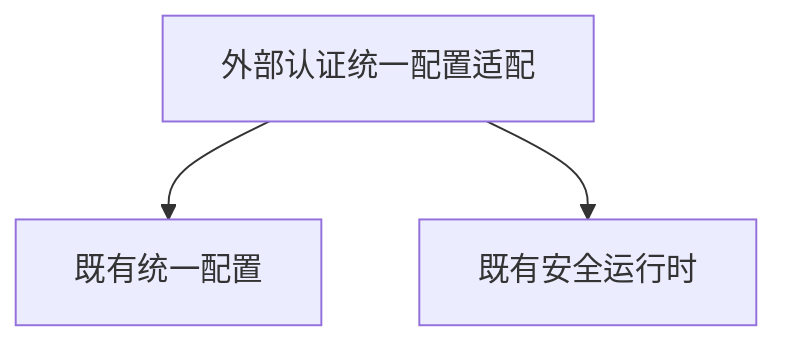
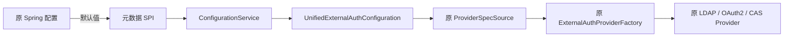

# 外部认证统一配置适配组件设计

## 1. 组件定位与依赖边界

`ouroboros-external-auth-configuration` 是平台能力层的配置适配组件，负责把统一配置中的外部认证设置接入既有安全运行时。本文面向平台组件维护者，记录装配机制、配置契约和变更生效语义。

本组件依赖 `ouroboros-configuration-core` 与 `ouroboros-web-security-runtime`。LDAP/OAuth2/CAS 的协议实现、渠道工厂、身份绑定、用户和会话继续由既有安全模块负责。OIDC IdP 是[独立组件](../ouroboros-oidc-server/DESIGN.md)，二者互不依赖；仅使用外部认证动态配置时，无须引入 OIDC 服务端及其协议依赖。标准能力聚合运行时包含两个组件。



图中箭头表示模块依赖。外部认证配置的直接读取由适配组件负责，安全运行时通过自己声明的配置读取契约消费有效配置。

统一配置位于 ability 层，因此通过上层适配既有安全配置契约，避免为本次能力增加 security 向 ability 的依赖。安全运行时历史上已有的配置依赖属于架构基线，不作为扩展跨层依赖的依据。适配组件只增加这一处配置桥接，认证 Provider、身份绑定与会话生命周期仍由原机制执行。

## 2. 核心实现与装配

| 类或契约 | 归属 | 职责 |
| --- | --- | --- |
| `ExternalAuthConfiguration` | 安全运行时 | 定义 `get()` 与 `getRevision()`，返回既有 `ExternalAuthProperties` 和变更标识 |
| `UnifiedExternalAuthConfiguration` | 本组件 | 通过 `ConfigurationService` 读取并解析有效配置，透传权威 revision |
| `ExternalAuthConfigurationMetadataProvider` | 本组件 | 通过元数据 SPI 注册配置项，并从原 Spring 配置生成默认值 |
| `ExternalAuthConfigurationValidator` | 本组件 | 通过配置保存校验扩展调用安全模块的 `ExternalAuthSpecValidator` |
| `ExternalAuthConfigurationAutoConfiguration` | 本组件 | 注册统一配置读取实现和保存校验器 |

自动配置注册在 `META-INF/spring.factories` 与 `META-INF/spring/org.springframework.boot.autoconfigure.AutoConfiguration.imports`；元数据提供器注册在 `META-INF/services/com.ouroboros.configuration.metadata.ConfigurationMetadataProvider`。

自动配置通过 `@AutoConfigureBefore` 排在安全自动配置之前，提供 `ExternalAuthConfiguration` Bean。安全运行时的 Spring 配置实现使用 `@ConditionalOnMissingBean`，因此两种读取实现在装配时互斥：引入本组件后使用统一配置，未引入时保留原 Spring 配置。统一配置读取失败时明确报错，不切回基础配置。

元数据提供器使用 Spring Binder 绑定 `ouroboros.security.external-auth`，将得到的 `ExternalAuthProperties` 序列化为统一配置默认值。配置项声明为 `BACKEND`、`OBJECT`、可修改且非空，继续使用既有配置管理入口。

## 3. 配置读取与更新流程



读取使用 `getSnapshot(key)`，从同一权威快照取得值与 revision；存储 JSON 严格解析，仅无存储行时取元数据默认值。这样可以区分“未配置”和“已保存但内容损坏”，避免通用类型转换把损坏内容静默降级为空集合。

保存通过既有 `ConfigurationValueValidator` 扩展点调用校验器，复用安全模块的协议必填项、渠道标识和限流规则校验。运行时构建也调用同一套 `ExternalAuthSpecValidator`，网络连通性仍由既有健康检查负责。

原 `ExternalAuthProviderFactory` 在渠道访问时比较配置服务的 revision。发生变化时，先构建完整替换目录，再次读取 revision；版本一致才在工厂锁内发布新目录，最多尝试三次。工厂首次使用时才读取配置，避免自动配置阶段早于平台元数据加载生命周期。该机制复用既有配置缓存与 revision，不增加后台轮询或第二套渠道注册表。

配置适配不仅服务渠道列表：回调公开地址、超时和绑定限流等公共设置也经同一契约读取。绑定限流规则变化时保留既有尝试计数。OAuth2/CAS 浏览器认证 state 关联发起时的配置 revision，回调遇到版本变化时拒绝继续旧流程。

## 4. 配置契约与示例

运行时配置键为 `security.auth.externalAuth`，配置管理入口沿用统一配置模块。该对象包含原 `ouroboros.security.external-auth` 下的 LDAP、OAuth2/OIDC、CAS 渠道、公开回调地址、HTTP 超时、JWKS 缓存时长和绑定限流规则。

配置未保存时，默认值由原 Spring 基础配置绑定生成。保存后，统一配置中的完整对象成为有效配置；基础配置继续作为恢复默认值的来源。空渠道数组表示关闭该类渠道，不会回退到基础配置中的渠道。

对象中的时长字段使用 ISO 8601 格式，例如 HTTP 超时 `PT5S`、JWKS 缓存时长 `PT5M`。原 Spring 配置仍支持 `5s`、`5m` 等 Spring 时长写法，生成默认对象时会转换为上述格式。

```json
{
  "publicBaseUrl": "https://platform.example.com",
  "ldap": [],
  "oauth2": [
    {
      "key": "corporate-idp",
      "displayName": "企业统一登录",
      "enabled": true,
      "authorizationUri": "https://idp.example.com/authorize",
      "tokenUri": "https://idp.example.com/token",
      "userInfoUri": "https://idp.example.com/userinfo",
      "clientId": "platform",
      "clientSecretRef": "env:EXTERNAL_IDP_SECRET",
      "externalIdField": "sub"
    }
  ],
  "cas": []
}
```

保存前会校验渠道标识、协议必填项和限流规则。配置 revision 变化后，工厂在下一次渠道访问时构建完整快照，再切换运行时目录；新增、删除、启停和参数修改均无需重启。配置不可解析时拒绝认证，不会恢复旧渠道。修改渠道配置也会使正在进行的旧 OAuth2/CAS 浏览器认证失效，用户需要重新发起登录。

企业协作连接仍通过 `EnterpriseAuthProfileResolver` 提供认证 profile，沿用已有连接发布和密钥机制。统一配置中的渠道不接受连接作用域标识；渠道 key 与连接 ID 冲突时继续拒绝认证。

## 5. 验证与回退边界

组件测试位于 [src/test/java/com/ouroboros/ability/auth](src/test/java/com/ouroboros/ability/auth)，覆盖独立装配、Spring 默认值、渠道增加/禁用/删除、损坏配置拒绝、保存前校验和限流规则热更新。Provider 与 OAuth2/CAS 回调回归测试仍归安全运行时。

恢复配置使用统一配置原有的恢复默认值或保存完整对象机制。代码回退无需新增数据库迁移；旧版本只读取原 Spring 渠道配置，回退前需保存当前统一配置，并核对基础配置中的渠道与预期一致。

相关边界见[安全模块设计](../../security/DESIGN.md)与[统一配置组件设计](../ouroboros-configuration/DESIGN.md)。
