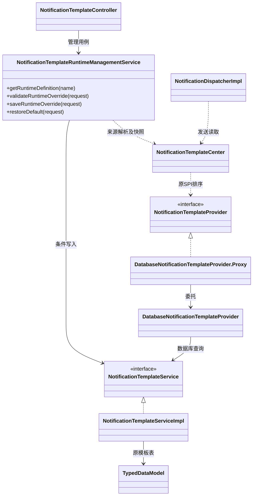
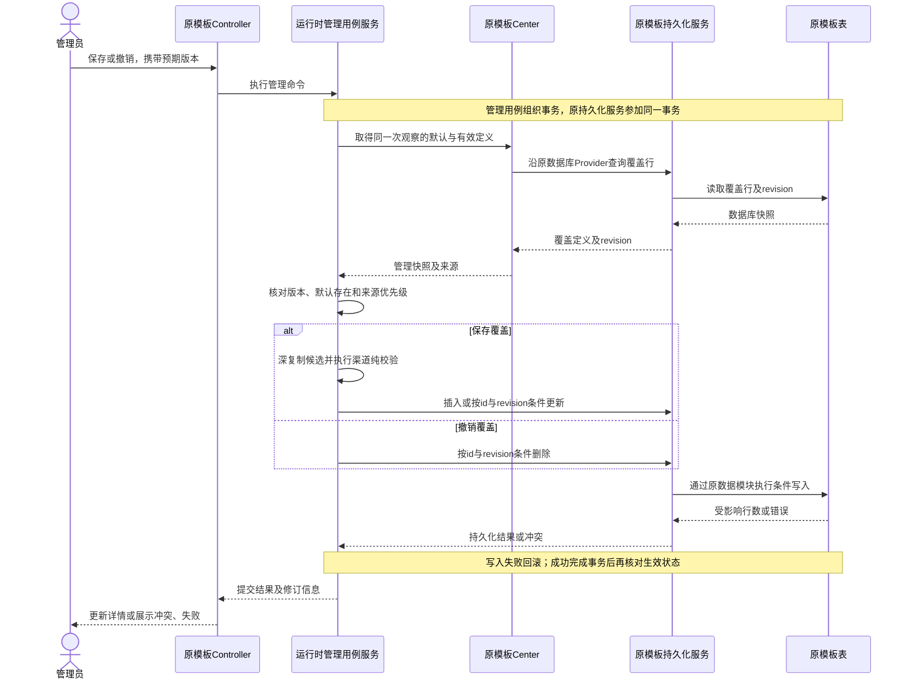
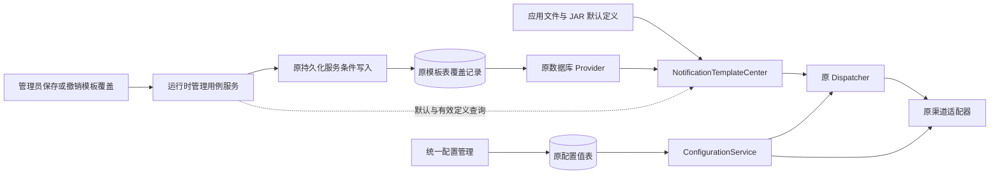

# 消息通知运行时配置设计

状态：**已实施，本地功能及完整应用集成验收完成；全仓验证存在基线限制**。分析基线为本地 `dev-next` 的 `7f9b5b381f9ba1632623299d5ce6172364c5578c`，设计日期为 2026-11-14。

2026-11-15 实施结果：模板覆盖、CAS 与迁移、纯校验、渠道管理描述、凭据策略、AMIS 列表/查看/编辑/渠道目录及正式元数据注册已落地。已验证正式 shell、真实密码登录、旧表样本升级、双 JVM 共享 Redis、撤销后跟随 V2/V3 默认。本地集成以 `dev-next` 为准，未向远端发布；原始验收与 rebase 后组合复验分别记录在[实施验收记录](runtime-management-validation.md)，其中说明各自基线、测试范围、覆盖率口径和全仓检查限制。

渠道参数的恢复语义已确认：在原统一配置 `RestoreDefaults` 命令中扩展元数据选项 `restoreDefaultRemovesOverride=true`，通知渠道的配置项声明该选项后，按预期版本条件删除原配置值表中的覆盖，随后跟随部署默认；默认值可以为空。未声明的组件继续使用原有恢复规则，受保护配置仍先通过所属组件的管理策略校验身份与权限。原配置值模型新增可空 `generation`，新插入记录分配 UUID，并与递增 revision 组成不透明版本 token，防止删除重建后的旧 token 误命中；历史记录保持原 token，条件删除/更新兼容空 generation。该扩展已通过真实 MySQL/Redis、原工作台与通知的组合验证。

部署边界已于 2026-11-15 确认：**同一应用可多实例，独立应用隔离存储**。模板写入用数据库条件操作保护并发，渠道参数沿统一配置原路径处理跨实例生效。通知模块不增加应用/租户隔离字段、请求参数或旁路缓存。

多租户能力尚未实现，当前边界见[多租户能力边界](../../../docs/design/cross-cutting/multi-tenancy.md)。通知配置通过原 TypedDataModel、配置服务和缓存入口访问；不推定这些通用扩展点已经提供租户隔离。

## 1. 目标和建议

应用部署后，管理员可以查看通知模板及渠道配置的默认值、运行时修改和当前生效值，修改后存入数据库，并能撤销模板或渠道参数的数据库覆盖，随后跟随部署默认。

建议扩展现有通知运行时模块，沿用两条正式路径：

- **模板定义**继续通过 `NotificationTemplateCenter → NotificationTemplateProvider` 读取，运行时覆盖存入已有 `t_notification_template`。
- **渠道连接参数**继续通过 `ConfigurationService` 消费，通过统一配置的管理服务修改，存入已有 `t_sys_configuration_value`。

通知管理页面把两类对象组织到同一入口；存储、权限和发送仍由各自已有机制负责。首期无需新增 Maven 子模块、通用覆盖框架或通知专用渠道配置表。

**本方案复用原有“高优先级同名定义覆盖低优先级定义”的机制，采用整份模板覆盖。** 保存修改只改变数据库这一层；撤销覆盖只移除数据库这一层。发送端仍通过原模板中心按 SPI 优先级取值，不增加字段补丁合并器、第二个模板中心或管理端专用发送路径。

方案由本文的后端机制与[通知运行时配置页面设计](runtime-management-ui.md)共同组成。页面设计纳入本提案，列表、查看、编辑和渠道目录的字段及交互以该专题为正文；本文第 7 节说明页面与后端的对应关系。正式页面由原 UI 模型和 AMIS 装配；早期交互原型仅作为评审附件。

### 首期范围

已确认：首期仅覆盖已部署模板，模板名称和载荷契约保持只读，并复用现有高优先级覆盖模式。以下操作边界作为实施合同：

| 对象 | 允许操作 | 边界 |
| --- | --- | --- |
| 随应用部署的模板 | 查看、修改展示标题、启停、调整渠道集合、编辑渠道 `schema/options`、比较差异、恢复默认 | 名称和 `payloadSchema` 在运行时编辑器中只读 |
| 已安装渠道 | 查看可用适配器、字段定义、引用该渠道的模板、连接参数配置入口 | 渠道实现仍通过原 SPI 和应用依赖交付 |
| 渠道连接参数 | 修改、按配置项或一组配置撤销覆盖并跟随部署默认 | 复用原配置 key，不创建第二份值 |
| 历史数据库独有模板 | 展示和识别没有默认定义的状态 | 本期不新增此类模板，不将删除误称为恢复默认 |

“调整渠道”指模板加入或移除已安装渠道。当前没有统一的渠道全局开关；本期不推定需要增加一个全局禁用机制。修改收件人绑定、业务事件订阅、审批通知规则、投递重试协议不在此次范围内。

作用域沿用当前运行时的数据源和应用上下文。同一应用允许多个实例，独立应用隔离存储；本方案不把开发平台的任意应用切换能力带入生产管理 API。透明租户能力由原数据与缓存扩展机制负责，通知模块不手写租户条件或命名空间。

## 2. 实施前机制与缺口

### 2.1 dev-next 分析基线的代码路径

| 机制 | 源码依据 | 实施前行为 |
| --- | --- | --- |
| 模板中心 | [NotificationTemplateCenter](../ouroboros-notification-runtime/src/main/java/com/ouroboros/notification/template/NotificationTemplateCenter.java) | 单个读取和列表都聚合原 SPI；按模板名称取优先定义 |
| 数据库模板 | [DatabaseNotificationTemplateProvider](../ouroboros-notification-runtime/src/main/java/com/ouroboros/notification/template/provider/DatabaseNotificationTemplateProvider.java) | 优先级 `-20`，每次调用服务读取；数据库异常被转换为空结果 |
| 应用文件模板 | [FileNotificationTemplateProvider](../ouroboros-notification-runtime/src/main/java/com/ouroboros/notification/template/provider/FileNotificationTemplateProvider.java) | 优先级 `-10`，读取应用 home 下 `notification-template/**/*.notification.json`，监听原元数据刷新事件 |
| 发布包模板 | [JarNotificationTemplateProvider](../ouroboros-notification-runtime/src/main/java/com/ouroboros/notification/template/provider/JarNotificationTemplateProvider.java) | 优先级 `0`，通过正式元数据目录加载 `.notification.json` |
| 模板持久化 | [NotificationTemplateModel](../ouroboros-notification-runtime/src/main/java/com/ouroboros/notification/service/model/NotificationTemplateModel.java)、[NotificationTemplateServiceImpl](../ouroboros-notification-runtime/src/main/java/com/ouroboros/notification/service/impl/NotificationTemplateServiceImpl.java) | 已有模板表，按名称查找，尚无名称唯一性声明及修订号 |
| 模板管理 API | [NotificationTemplateController](../ouroboros-notification-runtime/src/main/java/com/ouroboros/notification/controller/NotificationTemplateController.java) | 已有运行时 CRUD；读操作按名称，写操作主要按数据库 ID；用 `isControlled` 表示数据库对象 |
| 开发态管理 | [NotificationTemplateManagerServiceImpl](../ouroboros-notification-dev/src/main/java/com/ouroboros/notification/service/impl/NotificationTemplateManagerServiceImpl.java) | 通过 `BaseDevelopService` 修改开发文件，应继续属于开发态 |
| 渠道发现 | [NotificationAdapterCenter](../ouroboros-notification-core/src/main/java/com/ouroboros/notification/adapter/NotificationAdapterCenter.java)、[NotificationAdapterSupplier](../ouroboros-notification-core/src/main/java/com/ouroboros/notification/adapter/NotificationAdapterSupplier.java) | 从已注册 SPI 获得适配器及其 schema/options 类型 |
| 渠道字段接口 | [NotificationAdapterSchemaController](../ouroboros-notification-runtime/src/main/java/com/ouroboros/notification/controller/NotificationAdapterSchemaController.java)、[Classes](../ouroboros-notification-runtime/src/main/java/com/ouroboros/notification/util/Classes.java) | 返回 Java 字段的类型映射，**不是完整 JSON Schema**，没有必填、标签和语义校验能力 |
| 发送和可靠投递 | [NotificationDispatcherImpl](../ouroboros-notification-runtime/src/main/java/com/ouroboros/notification/NotificationDispatcherImpl.java) | 读取模板、校验载荷、合并调用方 options、解析配置引用，再调用原渠道适配器；可靠计划另有冻结快照 |
| 统一配置管理 | [配置模块设计](../../ouroboros-configuration/DESIGN.md)、[RuntimeConfigurationServiceImpl](../../ouroboros-configuration/ouroboros-configuration-runtime/src/main/java/com/ouroboros/configuration/service/impl/RuntimeConfigurationServiceImpl.java) | 已有管理投影、修订号、CAS、批量事务、恢复默认命令、提交后缓存驱逐与事件 |

内置模板的实际优先级是 **数据库 > 应用文件 > JAR**；自定义 Provider 仍按原 SPI 优先级参与。JAR Provider 的当前路径实现比架构总览中的旧目录示例更精确，本设计以源码为依据。

### 2.2 缺口与根因

当前系统已经可以让同名数据库模板覆盖部署模板，问题主要是管理语义和可靠性没有闭合：

1. 读取结果只保留获胜模板，管理端无法直接取得被覆盖的默认模板和完整差异。
2. CRUD 面向数据行，没有明确“为默认模板建立覆盖”和“撤销覆盖”的业务操作；`isControlled` 也无法说明默认值是否存在。
3. 名称没有唯一性声明，接口没有并发修订保护，两个管理员可能建立重复覆盖或相互覆盖修改。
4. 数据库读取故障会被当成“没有覆盖”，可能使已禁用模板恢复默认启用状态。这与恢复默认必须由管理员主动发起的语义冲突。
5. 开发态编辑器写死了渠道和部分字段；现有字段类型接口不足以独立承担可扩展表单与服务端校验。
6. 连接参数已经可配置，但不能仅凭数据库保存成功，推定所有通道客户端已经使用新参数。

因此，最小正确扩展是在原模板中心补默认层读取，在原持久化服务补条件写入能力，由运行时管理用例编排默认对比、校验和覆盖命令，并在渠道原扩展点补管理描述与校验。

## 3. 默认值、覆盖与恢复

### 3.1 默认模板的定义

默认模板是**排除运行时数据库覆盖后，按原 Provider 顺序解析的模板**。应用文件存在同名定义时，它优先于 JAR；恢复默认不能越过应用文件强行恢复 JAR。

| 层 | 原优先级 | 同名模板的处理 |
| --- | --- | --- |
| 数据库运行时覆盖 | `-20` | 存在即整份命中；`isEnabled=false` 和空渠道集合仍是有效覆盖 |
| 应用 home 文件 | `-10` | 没有数据库覆盖时命中；作为应用定制默认值 |
| JAR 元数据 | `0` | 前两层没有同名定义时命中；作为发布包默认值 |

`SPI.sortByPriority` 数值越小越先读取。原 `getTemplate(name)` 取第一个非空结果，原列表聚合保留排序后第一个同名模板；本次保持这一规则。**禁用、字段为空或渠道被移除不表示该层缺失**，不能因此继续读取低优先级定义，否则会重新启用通知或补回已移除渠道。

建议在原 `NotificationTemplateProvider` 增加默认方法 `isRuntimeOverride()`，默认返回 `false`，数据库 Proxy 返回 `true`。模板中心增加 `getDefaultTemplate(name)` 和默认列表查询，复用同一批已注册 Provider 和同一排序规则。

这个标记只区分默认定义与运行时覆盖，不再引入注册表。自定义 Provider 如提供运行时覆盖，需要显式声明；默认查询不能通过临时禁用数据库 Provider、删除数据再读取，或重新扫描文件实现。现有 `getTemplate/getAllTemplate` 继续是实际发送的唯一读取入口。

模板中心在原排序和同名选择逻辑内形成管理用解析结果：有效定义取所有 Provider 中的第一个结果，默认定义取 `isRuntimeOverride()==false` 的第一个结果，并记录获胜来源。单条管理读取对每个参与的 Provider 最多读取一次，复制成此次请求内的快照；列表则每个 Provider 读取一次列表，先聚合和筛选，再分页。数据库覆盖行及其 revision 来自同一次数据库观察，不在每行上重新查询。

这份解析结果仅服务于默认对比和写入校验，不成为另一套模板仓库。有效、默认两种查询共用原中心内部的 Provider 排序、同名选择及名称比较逻辑；默认查询只改变参与选择的来源范围，不复制一套解析算法。管理用例服务不自己拼装“数据库优先”或手工调用 File/JAR Provider，也不缓存第二份权威模板集合。请求内快照不承诺文件和数据库跨存储全局原子性，写入时仍需重新校验默认版本。

第三方默认 Provider 若声明了比数据库更高的现有优先级，数据库行就不能覆盖它。管理服务需识别这种情况并拒绝无效覆盖，提示核对该 Provider 的扩展合同；不能保存成功却显示为已生效。首期不擅自改写第三方 Provider 的排序。

同优先级的第三方同名定义也可能使胜出关系依赖加载顺序；管理端应诊断并拒绝建立无法保证生效的数据库覆盖。后端返回可用操作及原因，页面不只用“有默认值”推断可编辑性。

### 3.2 整份快照与字段补丁的取舍

| 方案 | 收益 | 代价 |
| --- | --- | --- |
| **整份模板快照，本方案采用** | 直接复用已有模板表和数据库 Provider；渠道删除、空值、布尔值语义清楚；保存后行为固定 | 应用升级时不会自动吸收默认模板的新字段或内容，需要显式比较和重新保存 |
| 按字段保存补丁 | 未修改字段可以随默认版本变化 | 需要定义缺省、删除、数组和嵌套渠道的合并协议，并改变原数据库 Provider 的整份替换语义 |

后端从当前有效模板深复制完整对象，仅修改允许的字段；新建覆盖时复制默认模板。复制过程不能修改 File/JAR Provider 持有的共享对象。`name` 和 `payloadSchema` 由服务端维护，客户端提交变更时拒绝这两类字段；更新已有覆盖时保留其中的契约快照。默认契约升级后如需采用新契约，先明确撤销旧覆盖，再基于当前默认重新建立覆盖，详见第 6.4 节。`channel` 是完整替换的 Map；移除其中一个 key 就表示该模板不再使用该渠道，不增加第二个渠道启用字段。

`title` 是模板管理标题；邮件等渠道实际消息标题由对应 `schema.titleTemplate` 决定，页面应分别标注。

运行时编辑器不提供单字段“恢复继承”。管理员可以把某字段改成当前默认值并保存，但它仍属于整份覆盖快照。只有撤销整份覆盖后，模板才继续随默认层变化。

### 3.3 状态和操作

| 默认定义 | 数据库定义 | 管理状态 | 操作结果 |
| --- | --- | --- | --- |
| 有 | 无 | 使用默认 | 保存建立覆盖；恢复默认为空操作 |
| 有 | 有 | 已覆盖 | 保存更新覆盖；恢复默认删除覆盖行 |
| 无 | 有 | 数据库独有 | 展示当前值；不提供“恢复默认”；既有内容继续按原路径读取 |
| 无 | 无 | 不存在 | 返回 404 |

默认定义删除后，原覆盖会呈现为“数据库独有”，不能声称能够恢复一个已不存在的默认模板。本期管理页面保持只读，并提示需先核对部署版本或由后续明确的删除操作处理；不自动删掉历史数据。

**恢复模板默认值是删除覆盖行，不是把默认 JSON 再写回数据库。** 删除成功后再次通过模板中心读取，验证生效源已回到默认层。恢复动作不修改开发文件、发布包和通知投递记录。

渠道连接参数沿用统一配置的 `RestoreDefaults`，在该命令内按配置元数据 `restoreDefaultRemovesOverride=true` 选择条件删除覆盖。通知渠道全部配置项声明该选项；未声明的其他组件继续原恢复规则。受保护参数仍先经过原管理策略的身份和权限校验，删除需提供 expectedRevision，支持默认值为 null。管理读取返回部署默认 token 和无覆盖状态，后续部署默认变化自然生效。通知模块不直接删除配置表。

统一配置值模型新增可空 generation；新插入分配 UUID，token 为 generation 与递增 revision 的组合，防止删除重建后的旧 token 误命中。历史 generation 为空的行保持已有 token，条件更新与删除同时核对 generation；更新历史行不重置其版本协议。

### 3.4 覆盖与撤销示例

假设 `order.approval.result` 在 JAR 中使用“邮件 + 站内信”，应用文件中改为“站内信”。没有数据库行时，原模板中心返回应用文件定义。

管理员保存“停用、仅保留邮件”后，数据库记录该模板的完整快照。原数据库 Provider 优先命中这行，分发器看到停用即停止，不能回落到已启用的应用文件。重启后仍命中同一数据库行。

管理员撤销覆盖后删除该行；下一次读取自然命中应用文件的“站内信”。以后应用文件改为“邮件 + 站内信”，没有数据库覆盖的模板随默认层变化。这一过程不复制默认值到数据库，也不改变原优先级。

## 4. 管理服务、数据与并发

### 4.1 服务职责

在 `ouroboros-notification-runtime` 中增加 `NotificationTemplateRuntimeManagementService`，承担读取管理投影、构造和校验候选、组织保存/撤销事务、检查预期版本及生成差异。原 `NotificationTemplateService/Impl` 保持数据库访问职责，仅补充覆盖行的条件插入、更新和删除；原模板中心继续负责来源解析。Controller 承接 HTTP 和权限，发送端不依赖管理用例服务或管理 DTO。

管理编排若直接加入持久化服务，会形成 `Service → Center → DatabaseProvider → Service` 的依赖回环。将管理用例与数据库访问分开，使依赖保持单向；新增服务承载完整的管理规则，不只是转发 CRUD，也不拥有另一套模板解析、Provider 注册、存储或发送机制。

| 位置 | 本次最小扩展 | 保留的边界 |
| --- | --- | --- |
| `NotificationTemplateRuntimeManagementService` | 管理查询、候选检查、默认对比、覆盖/撤销用例与事务编排 | 复用原中心和持久化服务，不自行解析来源或直接访问数据模型 |
| `NotificationTemplateProvider` | 增加默认的运行时覆盖标记 | 继续通过原 META-INF SPI 注册，无第二份来源清单 |
| `NotificationTemplateCenter` | 默认查询、带来源的管理快照，共享原排序规则 | `getTemplate/getAllTemplate` 仍是发送取值入口 |
| `DatabaseNotificationTemplateProvider` | 声明覆盖层，区分缺省与数据库故障 | 仅查询原模板表，不向低优先级合并字段 |
| `NotificationTemplateService/Impl` | 保留数据库查询，补充唯一性及 revision 约束下的条件持久化 | 只走原 TypedDataModel/QueryDSL；不依赖中心或管理用例服务 |
| `NotificationTemplateModel` | 唯一约束、修订号、基线和修改信息 | 原字段继续表示完整可发送模板 |
| `NotificationTemplateController` | 扩展管理合同；新旧管理写入口调用同一用例服务 | 复用原响应、异常及权限装配 |
| `NotificationAdapterSupplier` | 可选管理描述和纯校验扩展 | 补充原渠道类型的展示及约束，不维护独立渠道清单或重复字段定义 |
| `NotificationDispatcherImpl` | 一次发送复用同一模板快照 | 原内容解析、options 合并、投递协议继续成立 |

下图展示核心静态关系，省略 DTO、校验器、文件/JAR Provider 和原通用服务基类：



`getByName/searchAll` 始终只读数据库行，供数据库 Provider 使用。持久化服务不调用模板中心、管理用例服务或渠道适配器；条件写入只核对数据库行身份、revision、唯一约束及受影响行数。是否有默认定义、候选能否生效、渠道内容是否有效，由管理用例在调用中心和渠道原扩展点后判断。

管理用例组织的数据库事务使用项目原事务机制，持久化操作参加同一事务；事务提交后的生效核对在提交完成后执行。不能在持久化服务中回调管理用例，也不能通过覆写无条件 CRUD 再委托管理用例来重新引入依赖回环。

管理详情建议包含：`name`、`defaultTemplate`、`effectiveTemplate`、`hasOverride`、`defaultExists`、`effectiveSource`、`defaultSource`、`defaultRevision`、`overrideRevision`、`baseChanged`、`modifiedBy`、`modifiedAt`、`availableActions`、`diagnostics`。列表仅返回摘要和状态，完整内容放在详情；差异由两份确定快照计算。`hasOverride` 表示数据库行存在；是否实际命中该行以 `effectiveSource` 为准。更高优先级的自定义来源、缺失适配器等情况通过诊断与操作约束展示。

`defaultRevision` 对默认模板的规范化 JSON 计算稳定摘要：对象 key 排序，数组顺序保留。`baseChanged` 比较保存覆盖时记录的默认摘要和当前摘要；历史记录没有该信息时显示“基线未知”，不能按未变化处理。

### 4.2 复用模板表

保留原 `id/name/title/payloadSchema/channel/isEnabled`，建议增加：

| 字段或约束 | 目的 |
| --- | --- |
| `nameKey` 及数据库唯一约束 | 原名称保持不变，按 Java 忽略大小写规则折叠后计算 SHA-256；唯一性不依赖数据库 collation |
| `revision` | 更新及恢复时执行条件写入 |
| `baseDefaultRevision` | 识别默认版本变化，不参与发送时的优先级排序 |
| `updateBy/updateAt` | 展示最后修改人和时间 |

名称比较需要与现有中心列表的忽略大小写排序、Provider 单条读取和数据库 collation 对齐。新增覆盖不得产生仅大小写不同的名称；上线前检查这类历史冲突。最终以默认定义的原始名称作为写入名，不另行批量改写已有模板标识。

唯一约束必须验证已经形成真实数据库约束，不能用“先查询不存在再插入”代替。所有数据访问和条件更新使用 `ouroboros-data` 的现有 TypedDataModel/QueryDSL 路径。

迁移前报告重复名称、大小写冲突及数据库独有记录。冲突需要明确选择保留记录，迁移不自动按时间猜测并删除。启用新管理写入前，通过正式数据迁移为所有旧行回填初始 revision；未完成回填时拒绝写入，避免长期维护两套并发协议。迁移窗口暂停旧版本管理写入。原 Map 字段对应 TEXT，本次不扩展跨方言大字段类型；`payloadSchema/channel` 各按序列化后的 UTF-8 字节数限制为 65,535，容量包含 JSON 结构。管理端返回字段容量错误，不允许等数据库截断。原默认定义可能没有标题或载荷契约，原模型的 `title/payloadSchema` 改为可空以保留完整快照，不能凭空补造契约。

原 Map 存储及 Dispatcher 对 null/空 Map 的载荷契约均按无约束处理。管理快照统一将空契约投影为 `{}`，不增加任何载荷字段；这避免保存后的存储表示变化被误报为契约升级。其他可写字段的空值、停用及渠道移除仍按各自合同处理。

### 4.3 原子保存与撤销

管理写请求必须带打开详情时得到的 `expectedDefaultRevision` 和覆盖状态 token：无覆盖时为 `NONE`，有覆盖时包含 `id + revision`。重新创建的覆盖有新 ID，旧页面不能修改新的覆盖。

1. 管理用例在事务内通过原中心取得默认、有效定义及数据库覆盖快照，核对默认摘要与期望覆盖 token。
2. 管理用例核对默认存在、覆盖确实能按原排序胜出，再根据现有有效模板生成候选快照，通过渠道原扩展点校验可写字段和渠道定义。
3. 管理用例调用原持久化服务：首次保存插入完整覆盖，依靠唯一约束防止双插入；更新使用原行 ID 和 revision 条件更新，影响行数必须为 1。
4. 撤销时，管理用例核对默认存在后，调用持久化服务按相同条件删除覆盖。没有覆盖且期望也为 `NONE` 时保持幂等。
5. 事务提交后由管理用例返回本次持久化结果与修订号，并按需通过原中心核对当前来源。数据库失败回滚；并发冲突返回 409，提示刷新比较。

不能只在事务前比较版本再执行无条件 CRUD，也不能用进程内锁保证多实例写入。部署默认定义在一次管理操作中使用同一快照；滚动升级期间不同实例可能有不同默认版本，管理写操作应等待目标应用实例版本一致。默认摘要不是跨版本发布锁。



修订号由服务端生成。首次覆盖为 `revision=1`，每次有效更新递增；`updateBy/updateAt` 来自当前安全上下文和服务端时间。更新和删除的条件至少包含 `id/name/revision`，影响行数为 0 表示版本冲突。首次插入的唯一键冲突映射到 409，其他数据库故障保留失败原因，不能把所有插入异常都当成冲突。

撤销前读取当前默认快照，用于恢复确认和版本检查；条件删除成功即完成持久化。删除后再经原中心核对来源时，若另一位管理员已建立新覆盖，应展示最新状态并区分“本次撤销已提交”和“当前又有新覆盖”，不能误报数据库删除失败。提交后核对失败也不能回报未保存，详见第 6.3 节。

### 4.4 写入字段与候选检查

| 输入 | 服务端规则 |
| --- | --- |
| `changes.title` | 非空管理标题；不影响渠道消息标题 |
| `changes.isEnabled` | 必须区分未提交与显式 `false`，拒绝 `null` |
| `changes.channel` | 提交即完整替换渠道 Map；空 Map 不表示继承；启用状态至少保留一个有效渠道 |
| 未提交的可写字段 | 保留此次打开的有效快照；版本变化时先冲突，不用新值悄悄替代旧值 |
| `name/payloadSchema/id/revision` 等内部字段 | 不接受客户端改写；版本只从专用预期版本字段读取 |
| 不认识的字段 | 返回字段错误，不静默丢弃后报告保存成功 |

“检查配置”和保存使用同一个候选构造与纯校验过程。检查只返回候选摘要、相对生效值的本次差异、相对默认值的覆盖差异、字段错误和警告，不写数据、不增加 revision、不驱逐缓存、不调用渠道。检查通过后保存仍重新读取和校验，不能把先前检查当成占锁。

无实际修改时页面禁止保存；服务端也比较候选与当前有效模板。两者一致则返回 `changed=false`，不新增覆盖或递增修订。已有覆盖恰好等于默认值时仍保留覆盖记录，只有明确撤销才重新继承默认。

### 4.5 旧写接口的收敛

旧 Controller 当前直接暴露 `add/update/partialUpdate/delete`，继承的服务方法也可能被内部代码调用。实施前用调用方清单核对这些路径；不能只约束新页面而留下无版本的旧写入口。已部署模板的旧路由如保留，应将 ID 映射到模板名称后调用同一个运行时管理用例服务，并要求预期版本；无版本写入明确拒绝，不能先读最新版本再替客户端补齐。

内部管理写调用方也应迁移到管理用例服务，条件数据库写入统一落在原持久化服务。原无条件 CRUD 不再作为管理写入合同；需要保留的入口必须完成调用方迁移及合同收敛。持久化服务自身不能通过委托管理用例来兼容旧调用，否则会重建依赖回环。

旧 `DELETE /{id}` 若用于已部署模板，业务含义归为撤销覆盖，执行同样的默认存在和 CAS 检查。数据库独有模板的既有写入合同需单独核对消费者并评审，不能在本期页面开放，也不能默默删除既有合同；存在未收敛调用方时，写入上线前必须完成迁移或明确停止该入口。不得通过一个“兼容”开关保留绕过并发保护的路径。

## 5. 渠道配置与编辑能力

### 5.1 三类渠道信息

| 信息 | 权威来源 | 管理方式 |
| --- | --- | --- |
| 安装了什么渠道 | `NotificationAdapterSupplier` SPI | 页面只读展示，随应用依赖交付 |
| 模板使用渠道的内容和选项 | 模板 `channel[channel].schema/options` | 随模板整份覆盖保存 |
| SMTP、AppKey、授权码等连接参数 | 渠道模块的原配置元数据和值 | 复用统一配置的管理读写及恢复命令 |

渠道 ID 与配置分组并不总是同名。例如 `ding-talk` 对应 `notification.dingTalk`，`aliyun-sms` 对应 `notification.sms.aliyun`，`aliyun-call` 对应 `notification.call.aliyun`。不得根据字符串拼接推测关联。

建议在原 `NotificationAdapterSupplier` 增加一个可选管理描述方法，返回渠道标题、配置分组路径、schema/options 编辑器定义；默认无描述。描述由各渠道实现随原 SPI 提供，不建立中心化渠道映射表。无描述的自定义渠道仍可显示已发现的类型和 JSON 内容；编辑时必须提示无法完成语义校验，不默认放行新的生产覆盖。

渠道与字段的权威来源保持唯一：渠道目录继续由原 `NotificationAdapterCenter` 的 Supplier 发现及同名选择机制产生；字段名称、类型和嵌套结构来自该适配器原有的 `getChannelSchemaClass/getChannelOptionsClass`。管理描述只补充标签、帮助文本、必填、范围等原类型缺少的信息，以及纯语义校验；不得手写第二份渠道清单、重复声明字段类型，或让前端自行维护渠道字段映射。

前端需要 JSON Schema 时，由原类型及补充描述生成同一份管理投影，服务端结构检查使用同一投影；复用并按需扩展原字段提取逻辑，不新增独立字段类型系统。现有 `Classes.toMapDefine` 仅返回字段类型映射，不能直接当作完整 JSON Schema 使用，原字段类型接口继续保留原合同。

各渠道按原扩展点提供纯校验能力，管理用例保存时校验 `schema/options`，不发送消息、不连接供应商。邮件标题/正文、短信模板 ID、电话模板 ID 的语义规则由对应渠道补充，不能只用通用 POJO 转换猜测是否有效。展示与校验共用管理描述，避免表单要求与保存规则各自维护。

停用模板应可保留原有渠道内容，即使其中有适配器已卸载或缺少管理描述；这类情况作为诊断展示。重新启用或编辑该渠道时再要求完整校验，不能让一个故障渠道反过来阻止管理员停用整份模板。

### 5.2 渠道参数继续走统一配置

首期页面从渠道描述定位配置分组，进入已有 `/system-setting/configuration-management` 管理对应参数；查看和保存使用原工作台和 `PUT /api/sys/configuration`。渠道连接配置保留配置管理权限，通知模板编辑权限不自动授予凭据管理权。

如后续将参数表单直接集成进通知页面，仍调用 `ConfigurationManagementService`，并使用原配置 `managementEntry` 声明专用入口接管。首期不需要两处独立编辑同一组值，也不复制配置工作台。

连接参数一组修改应通过原批量事务提交，每个 key 带 expectedRevision。模板和连接参数是两个独立保存动作；不提供一个表面“全部保存”却可能只成功一半的按钮。

密钥字段应接入现有 `managementProtected` 和 `ConfigurationManagementAccessPolicy`：管理投影隐藏真实值、原始值及元数据默认值，展示是否已配置；未提交密钥表示保留，显式替换才写入新值，恢复默认使用原命令。通用配置列表、单项读取和工作台同样受此策略约束，不能只靠密码输入框遮挡。相关策略只覆盖本通知渠道的已声明配置 key。

对接本地 `dev-next` 已扩展的策略合同：通知凭据无跨键写入依赖，`writeDependencies` 返回空集合；`prepareWrite` 返回原 `ConfigurationPreparedWrite`，包含候选值和从真实平台身份取得的审计人。调用方传入的 actor 不作为凭据写入的身份凭证。身份、权限、原批量事务和 CAS 仍由原配置机制执行，通知不增加策略注册表或依赖锁定路径。

该改动不等于已有配置值表具备加密存储能力。是否需要库内加密是另外的存储要求，不能用 UI 脱敏替代。

### 5.3 配置检查的准确含义

管理页检查 JSON 结构、已安装适配器、渠道必填字段、范围和配置引用。先按原 Java 类型绑定，再检查本次提交的字段；计算 getter 不作为输入，可选对象、枚举和空选项保持其原类型语义。`#{...}` 引用检查保留原解析语义，不在管理页面执行任意表达式；禁止通过模板内容引用受保护配置来向接收人输出密钥。载荷契约只读，实际发送仍由原 `NotificationPayloadSchemaValidator` 校验；本期管理请求不包含载荷示例或试发操作。

“配置完整”不等于供应商凭据有效或消息可送达。首期不在保存时自动试发，也不声明所有渠道都支持本地预览。若需要试发，应作为另一个明确操作，通过原 Dispatcher 发送到指定收件人，并保留实际投递结果。

## 6. 生效、失败与升级

### 6.1 生效边界



模板数据库 Provider 当前未缓存模板结果；SPI 缓存的是 Provider 实例。首期不额外加模板本地缓存。事务提交后，后续新读取使用数据库覆盖；已经取得快照的在途发送可能继续使用旧值，停用不是撤回已发出的消息。

员工地址发送入口当前可能在确定渠道和实际分发时分别读取模板。实施时应让一次新发送复用同一份模板观察，避免管理变更落在两次读取之间造成地址与模板渠道不一致；保持 Dispatcher 为正式编排入口。

### 6.2 可靠投递与连接客户端

可靠投递计划已经冻结地址、schema 和 options。模板修改或撤销覆盖只影响新计划；已有计划继续使用冻结内容。原 `dispatchUnit` 会重新检查当前模板是否启用、该渠道是否仍存在，禁用或移除可阻断尚未执行的投递单元，不自动重建计划或重放已完成单元。

连接参数可能在配置引用解析时被冻结到计划，也可能在渠道调用时由 `ConfigurationService` 读取，取决于渠道实现。管理页应说明这一差别，不能承诺修改凭据会改写所有既有计划。

统一配置已有缓存，配置变更事件是进程内事件。多实例环境需核对实际 CacheManager：共享缓存驱逐与本地缓存失效的效果不同，不能仅凭本地事件宣称集群即时生效。同一应用的多实例部署使用原 Spring CacheManager 的共享 Redis 区域，所有实例必须指向相同应用隔离后的配置缓存。已用两个真实 Spring context、同一 Redis 与原 @Cacheable/@CacheEvict 验证预热后保存/撤销的跨实例可见性；默认本地缓存不具备该集群承诺。Redis 及事务提交后的驱逐失败按原提交待核对语义报告，不在通知管理端另做广播通道。滚动升级期间先保持实例部署默认一致，再允许管理写入。

[EmailServiceImpl](../ouroboros-notification-channel/ouroboros-notification-channel-email/src/main/java/com/ouroboros/notification/email/service/impl/EmailServiceImpl.java) 实施前使用 `Session.getDefaultInstance`，导致后续发送仍持有首次主机配置。已在原构建处改用 `Session.getInstance`，行为测试验证两次发送读取不同主机参数。其他渠道的 token/客户端缓存也按同样原则检查，不在管理页调用“清空全部缓存”代替正确失效。

### 6.3 故障处理

数据库 Provider 必须区分“没有同名行”和“读取失败”。只有前者允许继续读取默认层；连接失败、反序列化失败和重复名称等错误应通过原异常体系传播，管理 API 返回明确诊断，发送不调用渠道。原测试中“服务异常时返回空模板”的预期需要同步修改；启动前 Proxy 尚未绑定服务的阶段与运行中数据库故障分别处理，不能把二者混为正常缺省。

提交前失败表示没有保存；提交成功但后续可见性检查失败应明确报告“已保存，生效状态待核对”，保留已提交 revision，不诱导用户盲目重复提交。配置中心已有对应错误语义，通知页面应正确展示。

### 6.4 应用升级与默认漂移

整份覆盖在应用升级后继续生效，同时显示 `baseChanged` 和默认差异。首期不自动字段合并或丢弃覆盖。管理员可以撤销覆盖，或在当前默认模板基础上重新应用希望保留的修改并显式保存。

这也意味着覆盖中的 `payloadSchema` 会保持保存时的快照，即使运行时编辑器不允许修改它。若升级改变业务载荷契约，旧覆盖可能与新调用方不兼容，**仅显示差异不足以保证发送兼容**；升级验收必须比较载荷契约，并重新确认相关覆盖。首期采用已有动作：先保留希望继续使用的内容，核对撤销后的启停及渠道，再撤销覆盖，基于当前默认重新编辑并保存；新覆盖由后端复制当前默认契约。撤销至重新保存期间默认定义会生效，需安排在可接受的变更窗口，不能把两个独立操作描述为原子重建。

首期不增加一键合并或契约迁移命令，正常更新已有覆盖也不静默改换契约。这是选择整份快照的明确代价；如果要求部署后自动跟随新载荷契约，应改选字段覆盖方案并另行评审，不能在 Provider 中偷偷拼接两套语义。

## 7. 页面、权限与 API 草案

### 7.1 页面流程

列表、查看、编辑、确认与冲突状态采用[通知运行时配置页面设计](runtime-management-ui.md)（本方案组成部分，已实施并通过本地组合验收）。沿用主应用浅色主题、蓝色主操作和表格密度，启用状态与覆盖来源分别展示，不增加统计卡片或新增模板入口。

在“系统设置 → 基础配置”下注册“通知模板”和“通知渠道”入口，采用现有 AMIS UI 模型、菜单、权限和 app-modules 声明，不把开发态 `/dev/{appName}` 编辑器引入生产。保留原“通知”个人消息模块及其菜单、权限。

| 页面 | 主要内容与操作 | 后端提供的依据 |
| --- | --- | --- |
| 模板列表 | 标题/名称、启用状态、发送渠道、配置来源、默认变化、修改人/时间；搜索筛选、查看和编辑 | 按原 Provider 合并后的管理摘要；来源、基线和可用操作由后端判断 |
| 查看模板 | 独立页面；当前生效、与默认对比、只读载荷契约三个页签；编辑和撤销覆盖 | 同一次观察的默认/有效快照、差异、revision 及诊断 |
| 编辑模板 | 独立页面；基本信息、渠道选择、按渠道生成的内容表单，右侧本次变更摘要，底部检查/保存 | 允许字段、原 Supplier 管理描述、纯检查结果；名称与契约不在可写字段中 |
| 渠道列表 | 已安装渠道、引用模板数量、配置分组、配置管理入口 | 原 AdapterCenter/Supplier；分组由渠道声明，不由 ID 拼接 |

查看页比较“当前默认值与当前生效值”；编辑页比较“打开编辑时的生效值与本次输入”。两者分别表示覆盖差异和本次变更，不能用已存在的覆盖差异冒充本次修改。保存后回详情，撤销覆盖后重新读取详情，回列表保留搜索筛选状态。

保存和撤销均先确认结果及生效范围。撤销确认突出恢复后的启用状态、渠道，以及会丢弃的覆盖；恢复后重新启用或增加渠道时特别提示。编辑期间切换渠道保留输入，离开页面提示未保存变更。409 保留本次编辑并比较最新配置，不自动重试覆盖他人的变更。

缺失适配器或被其他高优先级 Provider 遮蔽的模板仍可查看诊断，不能被列表静默过滤掉。无默认定义的数据库独有模板只读。后端返回 `availableActions` 和不可操作原因，页面据此呈现编辑、停用、撤销等操作；服务端每次写入仍重新检查。

权限建议沿用现有 `systemSetting.notificationTemplate` 作为模板管理授权，新增通知配置菜单/页面归属。渠道字段管理只返回结构描述；连接参数值继续要求 `systemSetting.configurationManagement` 及相应受保护配置策略。若以后需要只读运维角色，再按真实角色拆分权限；首期不先造一套角色模型。

### 7.2 模板 API

以下为拟议合同，不是已发布接口。沿用 `/api/sys/notification-template` Controller 和原响应包装，避免建立第二套模板 CRUD。

管理列表、详情、检查、保存和撤销统一由 Controller 调用 `NotificationTemplateRuntimeManagementService`。该服务组织管理规则，再调用原模板中心及原持久化服务；Controller 不直接拼接来源，管理用例也不直接访问 `TypedDataModel`。保留的旧管理写路由按第 4.5 节进入同一用例。

| 方法与路径 | 语义 |
| --- | --- |
| `GET /api/sys/notification-template` | 扩展原列表，增加覆盖状态和默认漂移摘要 |
| `GET /api/sys/notification-template/{name}/runtime-definition` | 返回默认/有效配置、修订信息、差异及诊断 |
| `POST /api/sys/notification-template/{name}/runtime-override/validate` | 与保存使用同一候选构造和校验，只返回差异/错误，不持久化 |
| `PUT /api/sys/notification-template/{name}/runtime-override` | 按名称创建或更新覆盖，要求预期版本，仅接收可写字段 |
| `POST /api/sys/notification-template/{name}/restore-default` | 带预期版本撤销整份覆盖，返回恢复后的管理投影 |

列表保留原 `name/title/enable/controlled/page/perPage` 的含义，增加 `keyword`（名称或标题）、`source`（DEFAULT/OVERRIDE/DATABASE_ONLY）、`baseChanged` 筛选；新条件与已提供的旧条件按 AND 组合。`controlled` 兼容字段仅描述数据库对象，不替代新来源语义。先筛选再分页，`total` 为筛选后的总数。

详情中的 `overrideRevision` 是不透明 token：无覆盖为 `NONE`，有覆盖编码数据库行 `id + revision`；前端只原样传回。`baseChanged` 在没有覆盖或没有默认值时不适用，历史记录缺基线时为未知，并附原因，不返回一个会误导页面的 `false`。差异项使用稳定字段路径，标明新增、移除或修改，值中的密钥和受保护配置始终遵循原管理策略。

覆盖请求示意：

```json
{
  "expectedDefaultRevision": "sha256:default-revision",
  "expectedOverrideRevision": "NONE",
  "changes": {
    "title": "订单审核结果",
    "isEnabled": true,
    "channel": {
      "email": {
        "schema": {
          "titleTemplate": "订单 ${orderNo} 审核结果",
          "contentTemplate": "审核结果：${result}"
        },
        "options": {}
      }
    }
  }
}
```

缺少预期版本或字段校验失败返回 400；未授权 403；模板不存在 404；版本冲突或没有可恢复默认定义返回 409；依赖读取失败返回 503。名称作为路径参数由客户端正确编码，不能将数据库 ID 和模板名称混用。

管理响应设置 `Cache-Control: no-store`。合同通过现有 Controller/WebAPIModel 提取机制维护，不能手改生成文档。新路径和旧写路径均注册到原权限元数据中，权限检查必须在服务端成立。

校验请求与保存请求使用相同的预期版本及 `changes` 结构；返回字段错误、警告和候选差异。字段错误至少包含 `path/channel/message`，前端据此定位到具体渠道及输入。保存冲突返回稳定错误原因（默认变化、覆盖变化或覆盖无法胜出）和当前版本信息，前端再获取最新详情比较；后端不合并用户编辑，也不为重试自动替换预期版本。

保存和撤销的结果区分提交成功与后续读取确认：确认成功返回最新管理详情；提交已成功但确认失败时保留 `committed=true`、本次提交结果和可用 revision，以原异常/响应机制明确表达待核对状态。它不等同于事务回滚，也不是自动再次提交的依据。

### 7.3 渠道描述与配置 API

在原 `NotificationAdapterSchemaController` 下增加拟议的 `GET /api/notification/adapter-schema/management`，由运行时管理用例服务复用原 AdapterCenter/Supplier 机制取得渠道及管理描述，结合原模板中心的有效定义计算引用数量，要求通知管理权限。该接口是原类型及补充描述的管理投影，不是第二份渠道或字段定义。原 `GET /api/notification/adapter-schema` 继续返回其原字段类型映射，不能把同一路由悄悄改成另一种 Schema。

渠道描述只提供表单结构及配置分组，不返回连接密钥。点击配置管理后，由原工作台调用统一配置管理读写合同和 `RestoreDefaults` 命令。没有 URL 分组定位能力时显示分组路径供管理员定位；模板 API 不代理一套配置值 CRUD。

## 8. 实施顺序与验收

以下顺序已用于本地实施；实际执行结果和未覆盖边界见[实施验收记录](runtime-management-validation.md)。

| 步骤 | 最小变更 | 验证结果 |
| --- | --- | --- |
| 1. 模板读取与恢复语义 | 原中心共用解析逻辑、默认查询、Provider 标记、数据库错误传播 | 数据库 -20 / 文件 -10 / JAR 0 的优先级不变；禁用和空渠道不触发回退；默认查询不含数据库；停用覆盖在数据库故障时不会变回默认发送 |
| 2. 管理用例与条件持久化 | 新增完整管理用例服务；原持久化服务补唯一性和 revision 条件写入；旧写入口统一 | 用例编排与数据库访问无依赖回环；并发创建只有一行；更新/恢复冲突返回 409；撤销后读取当前默认；失败事务保留原值 |
| 3. 渠道描述与校验 | 原 SPI 补展示及校验信息，从原类型生成管理投影，逐渠道接入 | 渠道和字段类型只有一份权威定义；所有内置渠道字段和必填规则可描述；自定义已注册渠道无需修改管理端列表 |
| 4. 参数与客户端生效 | 复用原配置管理；接入凭据策略；修正实际客户端缓存问题 | SMTP 前后参数真实变化；密钥不出现在管理投影；原配置版本和批量事务生效 |
| 5. 页面及运行时注册 | AMIS、menu、authority、app-modules | 普通应用可加载授权入口；未授权页面和 API 均拒绝；开发态编辑不写生产覆盖 |
| 6. 组合回归 | 原 Dispatcher、逻辑流/脚本及可靠投递 | 新发送读取新定义；在途和既有计划遵守快照；禁用/移除渠道保留原阻断协议 |

行为测试按模板中心、管理服务、Controller、具体渠道组织，新增功能覆盖率达到仓库 70% 门槛。唯一约束和 CAS 需要数据库集成测试，不能仅用 Mock 测出“调用过某个方法”。页面需验证完整的查看 → 覆盖 → 重启 → 再查看 → 撤销流程，以及两位管理员冲突。

必须覆盖以下边界：`false` 能正确保存；删除渠道不会被默认值自动补回；默认模板已变更时拒绝旧页面写入；没有覆盖重复恢复保持幂等；没有默认不显示恢复按钮且 API 仍会拒绝；历史数据库独有模板继续可读；配置默认值为空时明确显示渠道可能不可用；既有投递记录和计划内容没有被配置修改重写。候选生成不得改动 Provider 共享对象；没有本次变更不创建或更新覆盖；纯检查不产生持久化副作用。

原中心的组合测试应使用正式 SPI 验证：三层同名时数据库整份胜出；删除数据库行后文件胜出；再移除文件后 JAR 胜出；自定义默认 Provider 仍按原排序参与；更高或相同优先级导致覆盖不能保证生效时明确拒绝写入。列表和单条查询对同一组定义给出一致来源与内容，不得出现列表显示已覆盖而发送读取默认的情况。

多实例验证分别观测实例 A 保存、实例 B 读取的模板和配置 revision；原发送链通过组件测试验证一次发送使用同一快照。重启确认数据库修改仍在；撤销后再部署新默认版本，确认模板与渠道参数跟随默认层变化。用户明确排除本次实际供应商外发送达，不调用外部发送接口。

## 9. 评审取舍和未决项

已确认的范围是仅覆盖已部署模板，名称及载荷契约只读，运行时新增模板不进入首期；机制复用原高优先级覆盖。列表、查看、编辑和渠道目录已纳入同一提案，详细页面交互以页面专题为正文。

本方案选择整份快照，以保持原 Provider 的整份覆盖语义。代价是升级后需要人工比较和确认覆盖，不能自动继承未修改字段。字段补丁方案仅作为取舍说明，不进入首期实现。

管理编排与持久化职责分开：运行时管理用例服务承载查询投影、校验、默认对比和事务编排；原持久化服务只访问原模板表，不依赖中心或管理用例。这一调整不增加新的解析、注册、存储或发送机制。有效/默认查询共享原中心内部选择逻辑，渠道管理投影从原适配器类型加补充描述生成；两处均不得发展成独立权威来源。

部署目标已确认包含同一应用的多实例，独立应用隔离存储；统一配置跨实例生效和通知覆盖并发均纳入验收。该边界不改变模板复用原 Provider 优先级的设计选择。

实施验证覆盖旧写入口收敛、历史冲突预检、JSON 容量、物理唯一约束、客户端参数更新和共享缓存。生产历史数据仍须在升级窗口执行预检；出现重复名称时报告并中止，不自动选择或删除。使用方式及部署前提见[运行时管理指南](runtime-management-guide.md)。

按 `software-design-philosophy` 的八项静态诊断，本功能现状约 **6.3/10（5/8）**：缺少描述默认/覆盖承诺的接口说明，新维护者必须读 Provider 实现才能理解边界，管理调用方需要了解存储来源。这三项分别通过原 SPI/中心的默认层合同、明确状态投影和统一管理命令改进。提案把这些责任收回原模块；是否真正改善需以实现评审和上述行为测试确认，不以文档存在推定完成。

## 10. 相关设计

- [通知运行时配置页面设计](runtime-management-ui.md)：本提案的页面组成部分，覆盖列表、查看、编辑、渠道目录及交互状态。
- [通知模块设计](../DESIGN.md)：统一模板、分发和渠道边界。
- [配置模块设计](../../ouroboros-configuration/DESIGN.md)：统一配置管理投影、CAS、恢复及专用入口机制。
- [资源运行时管理](../../../core/ouroboros-resource/DESIGN.md)：可参考默认/覆盖的管理语义；其文件存储不用于通知模板数据库覆盖。
- [扩展机制](../../../docs/design/cross-cutting/extension-mechanisms.md)：SPI 与自动配置注册约束。
- [设计评审](../../../docs/rules/design-review.md)：提案、采纳和实施状态的维护规则。
