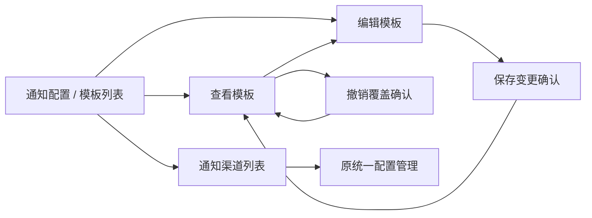

# 通知运行时配置页面设计

状态：**已实施，生产 AMIS schema 的组件组合与完整主应用验收通过**。本专题是[消息通知运行时配置设计](runtime-management-design.md)的页面组成部分，适用于已确认的首期范围：只覆盖已部署模板，模板名称和载荷契约只读；后端复用原 Provider 高优先级同名覆盖，保存整份模板，撤销时删除数据库覆盖。验证范围及全仓基线限制见[实施验收记录](runtime-management-validation.md)。

## 1. 页面结构与使用场景

应用管理员通常先查找一份通知模板，检查当前发送内容和渠道，再修改内容或撤销运行时覆盖。页面以这一操作顺序组织：

在“系统设置 → 基础配置”下注册“通知模板”和“通知渠道”两个相邻入口，列表中可以直接进入渠道目录；二者组成通知配置工作区。查看、编辑采用独立页面；内容模板、多个渠道和默认对比需要较大宽度，不放进多层弹窗。确认保存、撤销覆盖、离开未保存页面使用对话框。

正式 UI 模型路由如下，实际由现有 UI 模型注册，不另外建立 React 路由系统：

| 页面 | 路由 | 导航行为 |
| --- | --- | --- |
| 模板列表 | `/system-setting/notification-templates` | 默认显示模板；筛选和页码可回到原状态 |
| 渠道列表 | `/system-setting/notification-channels` | 与模板列表关联的渠道目录 |
| 查看模板 | `/system-setting/notification-templates/detail?name=...` | 标题可直接打开；回列表保留筛选 |
| 编辑模板 | `/system-setting/notification-templates/edit?name=...` | 保存成功回详情；取消回详情或原列表 |

原型位于本 worktree 的 `tmp/design/notification-runtime/index.html`，使用本地示例数据演示交互，不调用业务 API，也不改变正式页面或真实通知配置。截图与原型是此次评审附件，不作为已交付功能。

## 2. 视觉与信息层级

沿用主应用现有浅色主题和 AMIS 控件风格：品牌主色 `#2468f2`、白色内容面板、灰色工作区、绿色表示已启用、琥珀色提示默认变化或无默认定义。覆盖来源使用蓝色，与绿色启用状态区分。

使用现有 `--color-primary`、`--color-text-secondary`、`--color-bg-container`、`--color-border-secondary`、间距和控件尺寸契约，不将原型内的 fallback 色值复制为另一套产品主题。中文沿用系统字体，模板标识和变量使用等宽字体。主标题约 24px、分区标题 16px、正文和表格 14px、辅助信息 12px；以字重和文字颜色建立层级。

页面以表格与表单为主，不添加统计卡片。最有辨识度的组件是“默认值 → 当前值”的差异展示：列表提示覆盖来源，查看页并排比较，编辑页持续列出本次变更，确认操作展示恢复后或保存后的结果。

桌面沿用主应用约 200px 侧栏、60px 顶栏和 24px 内容间距。普通控件高度 40px、面板内间距 20–24px。主要动作使用实心主色按钮，其余动作降为次按钮或文本按钮。所有状态有文字说明，不仅依赖颜色。

## 3. 模板列表页

### 3.1 页面组成

顶部为面包屑“系统设置 / 通知配置”、标题、用途说明和刷新按钮。下方是筛选区、数据表格和分页，工具栏可进入渠道目录。首期不出现“新增模板”、批量删除或列表快捷启停。

| 区域 | 展示与行为 |
| --- | --- |
| 搜索 | 模板展示标题或模板标识，允许清空；查询后回第一页 |
| 筛选 | 启用状态、配置来源、仅看默认已变化；统一重置 |
| 刷新 | 重新获取当前列表，保留筛选；进行中禁用重复点击 |
| 分页 | 默认每页 20 条，沿用原列表响应及项目分页控件 |

启用状态不使用可直接操作的 Switch。管理员先进入编辑页确认内容及渠道后保存，避免误触立即改变投递。

### 3.2 表格列

| 列 | 展示规则 |
| --- | --- |
| 通知模板 | 第一行展示标题，第二行等宽显示模板标识；点击标题进入查看 |
| 启用状态 | “已启用 / 已停用”，使用图点与文字 |
| 发送渠道 | 渠道中文名称标签；过多时显示前两个和剩余数量，展开后可查全 |
| 配置来源 | “默认配置 / 运行时覆盖 / 数据库独有” |
| 默认配置 | 覆盖基线未变化显示“未变化”；变化显示“默认已变化”；历史基线缺失显示“基线未知”；数据库独有显示“无默认定义” |
| 最后修改 | 修改人与时间；无覆盖记录显示“—” |
| 操作 | 查看、编辑；根据后端可用操作显示。数据库独有或覆盖无法胜出的记录只读，适配器故障可限制为仅停用 |

“运行时覆盖”表示存在覆盖记录，不以当前内容是否恰好等于默认值推断。列表不把覆盖状态、启用状态和可投递性合成一个“正常/异常”标签。

存在比数据库更高或相同优先级的第三方定义、导致覆盖无法保证命中时，显示“覆盖未生效”诊断及实际生效来源，并关闭编辑入口。是否存在覆盖和实际由谁生效分别取后端状态，不能根据记录存在就提示修改已用于发送。

### 3.3 列表状态

加载时保留表头、显示行骨架；无已部署模板时说明模板随应用交付，不提供创建按钮；筛选无结果时提供“清除筛选”；请求失败显示“暂时无法加载通知模板”和重试按钮，不用空列表代替故障。

四个页面通过原 `hasAuth` 公式控制内容初始化；权限不足显示拒绝说明，不初始化受保护的数据请求或编辑控件，API 仍由原权限链校验。刷新失败时可保留上次成功列表，但必须标明“刷新失败，以下为上次结果”，不得继续显示为最新数据。

## 4. 查看页面

### 4.1 页面顶部

展示模板标题、只读标识、启用状态和配置来源。右侧主要操作为“编辑配置”，次操作为“撤销覆盖”；没有覆盖时不出现撤销按钮，没有默认定义时页面只读。

各动作以服务端 `availableActions` 及不可操作原因为准。覆盖被其他来源遮蔽时仍展示已保存的覆盖诊断，不能把数据库快照当成当前生效配置。

有默认漂移时，在内容区前显示提示：“应用默认模板已变化。当前仍使用运行时覆盖，请比较最新默认配置后确认。”提示可进入默认对比页签。基线未知使用独立提示，不冒充默认未变化。

摘要展示配置来源、最后修改和发送渠道，修订号等并发参数不作为管理员的必填输入，保留在页面状态中。

### 4.2 三个内容页签

| 页签 | 内容 |
| --- | --- |
| 当前生效配置 | 左侧选择渠道，右侧显示消息标题模板、正文模板、可用变量和渠道选项 |
| 与默认对比 | 按“字段 / 当前部署默认值 / 当前生效值”并排显示，仅看差异或查看全部字段 |
| 载荷契约 | 变量名称、类型和说明；需要时展开原 JSON，始终只读 |

模板管理标题与渠道消息标题分别标注。邮件等文本内容显示原始模板并强调变量占位符，不自动执行 HTML、表达式或任意模板内容。供应商模板渠道显示模板 ID 和选项，不能假造供应商最终渲染预览。

渠道选项默认折叠，空对象显示“使用默认选项”。查看页 JSON 有格式化和复制能力，敏感连接参数不会进入模板详情。渠道下方可说明连接参数在配置管理中维护。

默认对比按字段说明变化，包括启用状态、渠道新增/移除以及嵌套内容。长文本可换行；更改处使用背景与“已修改”文字标识，不能只用红绿区别。内容一致但仍有覆盖记录时显示“与当前默认配置一致；覆盖记录仍存在”。

底部说明生效边界：“修改影响后续新发送；已生成的投递计划保留原内容，已发出的通知不会被撤回。”

### 4.3 撤销覆盖

点击“撤销覆盖”打开确认框，展示模板、恢复后的启用状态、恢复后的渠道及会丢弃的覆盖差异。默认恢复后会重新启用模板或增加渠道时突出提示；确认按钮使用明确文案“确认撤销覆盖”。

请求带当前预期版本；成功后重新读取详情并显示默认来源。409 时保留旧视图并要求读取最新内容，不能继续使用旧 token 重试。无默认定义时前端不提供该操作，后端仍独立校验。

## 5. 编辑页面

### 5.1 布局

桌面为主编辑区加约 280px 的右侧变更摘要；右侧宽度服务于短摘要，长内容仍在主编辑区。底部固定在内容滚动区的操作条提供“取消 / 检查配置 / 保存并生效”。操作条占用真实布局空间，最后一个字段必须能完整滚出遮挡区域。

主编辑区依次是基本信息和渠道内容。左侧渠道导航只在“渠道内容”面板内出现，不再叠加第三层全局侧栏。摘要随主内容可见；不足 980px 时移到表单下方。

### 5.2 基本信息

| 字段 | 交互 |
| --- | --- |
| 模板标识 | 只读输入或静态值，可复制；不发到 changes 中 |
| 模板标题 | 可空，编辑的是管理展示名称；留空时以模板标识展示，不影响渠道消息标题 |
| 启用状态 | Switch，旁边始终显示文字；切换只修改表单，保存后生效 |
| 载荷契约 | 只读入口，允许编辑期间查看，不离开当前表单或丢失输入 |

初次从默认模板编辑与编辑已有覆盖使用同一个表单。初次保存提示“建立运行时覆盖”，已有覆盖提示“更新运行时覆盖”。不增加草稿、发布和审批流程。

### 5.3 渠道选择和内容

面板顶部显示当前选择的渠道与“添加渠道”。添加框只列出已安装且有可用管理描述的渠道，已选渠道标记“已添加”。添加后立即选择该渠道并聚焦第一个必填字段。

点击渠道切换右侧内容，表单状态按渠道保留；未保存文本、JSON 输入和错误提示不能因切换被清空。各渠道按照原扩展描述生成字段：

- 邮件：消息标题模板、正文模板、渠道选项。
- 站内信、钉钉、极光推送：按实际渠道描述生成内容字段及选项，不复用错误的固定字段清单。
- 微信、短信、语音：供应商模板 ID 和渠道选项；展示可用载荷变量，说明其映射由对应渠道约定。

正文编辑采用等宽文本输入，变量列表来自只读载荷契约。没有证据证明所有渠道遵循同一套 HTML 渲染规则，因此首期不统一增加富文本编辑器或“真实效果预览”。原始 JSON 只用于复杂选项或高级模式，常用配置由描述生成表单。

若应用升级后当前默认载荷契约与旧覆盖不同，展示两份只读契约并提示升级风险。普通保存保留旧覆盖契约，不把再次保存伪装成自动迁移。采用当前契约时，管理员先保留希望继续使用的内容，核对恢复后的启用状态与渠道，再撤销覆盖并基于当前默认重新编辑。两个操作之间默认定义会生效，页面必须说明这一边界；首期不提供一键契约合并。

“移除此渠道”位于渠道内容区，先确认该修改只影响模板选用关系，不删除适配器、连接凭据或历史计划。启用模板至少保留一个可用渠道。适配器缺失时保留内容和诊断；允许仅停用整份模板，不让故障渠道阻断止损操作。

### 5.4 变更摘要与保存

摘要比较**打开编辑时的有效配置与本次编辑值**，展示本次改了什么；另标明保存后相对于默认配置有多少差异。二者不可混为一谈。已有覆盖但本次未改动时，“本次变更”为 0，保存按钮禁用。

短字段显示旧值 → 新值，长文本显示字段名及“查看变更”，点击展开比较，不把整段正文挤进摘要栏。摘要下说明生效范围和可撤销性。

“检查配置”校验表单结构、渠道规则和引用，结果区分“检查通过 / 缺少配置 / 字段错误”。它不发送消息，也不证明供应商可达。“保存并生效”执行相同校验，然后确认变更项和生效范围，确认后提交。

一次保存处理完整模板覆盖；渠道连接参数在另一页面独立保存。无修改时禁用保存；提交时禁用重复操作，显示“正在保存”；成功后进入详情并刷新来源和默认差异。

## 6. 错误、冲突与离开保护

| 情形 | 页面行为 |
| --- | --- |
| 表单字段错误 | 字段旁说明错误，顶部汇总可定位到字段；折叠渠道上显示错误数量，切换到首个错误并聚焦 |
| 保存时默认配置变化 | 409，保留本次编辑，展示最新默认与本次编辑的比较，重新确认后用新 token 提交 |
| 保存时覆盖被他人修改 | 409，展示“打开时 / 最新生效 / 本次编辑”差异；不自动覆盖他人的改动 |
| 读取最新配置 | 在对话框中核对，保留本次编辑；另提供明确的“放弃本次编辑，加载最新”动作 |
| 保存前网络或服务失败 | 保留表单，允许重试，未确认提交前不显示保存成功 |
| 已提交但生效确认失败 | 显示“已保存，生效状态待核对”，展示返回的提交结果；先核对状态，不直接重复保存 |
| 取消、返回、切换页签或关闭页面 | 有未保存修改时使用原生确认；取消保持页面与输入，确认后才允许导航。页签仍被缓存时保守保留未提交输入，销毁后清除；浏览器离开使用 beforeunload 保护 |
| 查看期间模板消失 | 显示不存在并提供回列表；不沿用旧编辑页继续提交 |

切换渠道及查看只读契约属于当前编辑内的操作，不触发离开确认。进入渠道连接参数管理属于离开当前编辑，需要同样的保护。

## 7. 渠道列表与配置管理入口

渠道列表按正式适配器发现，展示渠道中文名称与 ID、引用模板数量、参数说明、配置分组和“配置管理”入口。配置分组来自渠道描述，不按 ID 拼接。

入口使用原 `/system-setting/configuration-management`；若原工作台尚不支持通过 URL 选中分组，首期显示目标分组路径供定位，不伪造一个无效深链。未来增强定位应在原工作台扩展。

参数保存、恢复默认、凭据脱敏和权限均由原统一配置管理负责。通知参数元数据声明撤销覆盖语义，恢复后删除该项数据库值并跟随部署默认；其他组件保持其原恢复规则。凭据真实值不回显，留空不提交表示保留，填写表示替换，显式勾选恢复后随同本组原子提交。通知模板管理权限不自动授予连接参数权限；无权限时入口说明所需权限。页面不把密钥原值放入列表，也不提供一个没有全局执行语义的“渠道启用开关”。

## 8. AMIS 落地与页面适配

沿用通知 runtime 下的 `src/main/metadata` 注册 UI 模型、schema、菜单、authority 和 app-modules。列表使用原 CRUD、operation、mapping、filter、分页；详情使用 service、tabs、静态字段和按渠道内容；编辑使用 form、switch、动态渠道表单、dialog 和提交事件。复用现有 UI schema 片段机制共享基础展示及渠道字段，不为本功能新增独立前端工程。

`expectedDefaultRevision/expectedOverrideRevision` 在表单状态中保存，服务端校验与前端展示使用同一管理投影。模板名称编码后作为 API 参数；写入只发送允许字段。管理描述的 JSON Schema 要转换到项目已支持的表单渲染方式，不能把旧字段类型接口当作完整 Schema。

模板管理 API 和渠道管理描述 API 由运行时管理用例服务组织，继续复用原模板中心、渠道发现与持久化服务。页面只消费其管理投影；渠道字段名称和类型来自原适配器类型，标签及校验信息由原 Supplier 补充，前端不另建渠道清单或字段定义。后端持久化服务不负责页面投影，也不反向调用管理用例或模板中心。

页面与后端的拟议合同如下，具体字段、并发和错误语义由主方案维护：

| 页面动作 | 后端合同 | 状态处理 |
| --- | --- | --- |
| 模板列表与筛选 | 原 `GET /api/sys/notification-template` 扩展管理摘要 | 筛选后分页；错误不伪装成空结果 |
| 查看、打开编辑、撤销前核对 | `GET /api/sys/notification-template/{name}/runtime-definition` | 取得默认/有效配置、来源、revision、差异及可用操作 |
| 渠道目录与动态表单 | 原渠道 Schema Controller 新增 `GET /api/notification/adapter-schema/management` | 复用原渠道发现，由原适配器类型加 Supplier 补充描述生成表单，旧字段类型接口保持原合同 |
| 检查配置 | `POST /api/sys/notification-template/{name}/runtime-override/validate` | 与保存同一请求结构；显示候选差异与字段错误，不产生覆盖 |
| 保存并生效 | `PUT /api/sys/notification-template/{name}/runtime-override` | 带两个预期版本；`changes.channel` 完整替换，不在前端合并默认渠道 |
| 撤销覆盖 | `POST /api/sys/notification-template/{name}/restore-default` | 带两个预期版本；后端条件删除覆盖，不提交一份默认 JSON |
| 修改渠道连接参数 | 原统一配置管理工作台与 API | 独立权限和保存动作，使用原 expectedRevision 与恢复命令 |

无本次改动不提交，服务端返回 `changed=false` 时不宣称新建了覆盖。冲突不修改页面保存的旧 token；先比较最新详情，再由管理员明确重新提交。提交结果已成功而确认失败时显示待核对状态，保留提交结果，不将按钮直接恢复成可盲目重试的“保存”。

页面内样式服从主应用主题和密度：优先使用原组件与语义变量。原型中的外层顶栏和系统侧栏仅说明页面归属，正式 UI schema 只渲染内容区，由主应用提供外壳。

小屏保留筛选、正文和操作按钮；编辑转为单列，渠道导航横向排列；长表格在面板内横向滚动，整页不产生横向溢出。默认对比在窄屏可转为每字段上下两组值，不能把两列文字压到无法阅读。

键盘操作沿用原控件：按钮和链接有可见焦点，弹窗捕获并恢复焦点，错误关联输入，保存结果通过 live region 宣告。只读字段不冒充禁用后不可复制的输入。敏感和有状态的操作使用文字标签，不只放图标。

## 9. 页面验收

列表筛选后打开详情和返回，筛选不丢失；从默认模板建立覆盖后出现“运行时覆盖”；修改 `false`、移除渠道、切换多个渠道后输入都保留；载荷契约和标识无法编辑；保存确认中的变化与实际提交一致。

查看默认对比能识别内容、启用状态和渠道变化；内容等于默认但仍有覆盖时不误报为无覆盖；数据库独有模板始终无恢复入口。撤销覆盖确认能看见恢复后的启用状态和渠道，成功后来源回到默认。

冲突保留表单，不自动覆盖；已提交可见性未确认不误报“未保存”；空、加载失败、无权限与不存在是不同页面状态。桌面与窄屏均能触达完整字段及底部动作。

交互原型演示列表、详情、默认对比、编辑、渠道目录、保存/撤销/离开确认，以及空列表、读取失败和版本冲突入口。它使用示例渠道字段和示例校验，不代替真实渠道 Schema、三方冲突处理、服务端并发与生产 AMIS 验收。第三方更高优先级来源、默认契约升级风险和提交后生效待核对等状态以本文规范为准，原型尚未完整演示。

正式实现使用 `notification-template-manager` AMIS renderer；路由、菜单、权限及模块均来自通知 runtime 的原 metadata 目录。浏览器测试使用同一套生产 schema，桥接真实 Controller、管理用例和 MySQL；认证装配由单独的正式过滤器集成测试验证，不能将测试 fixture 的管理员身份当作生产认证验收。
