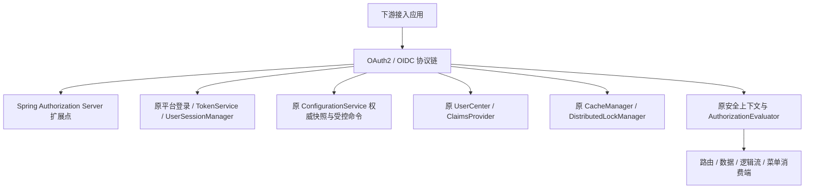
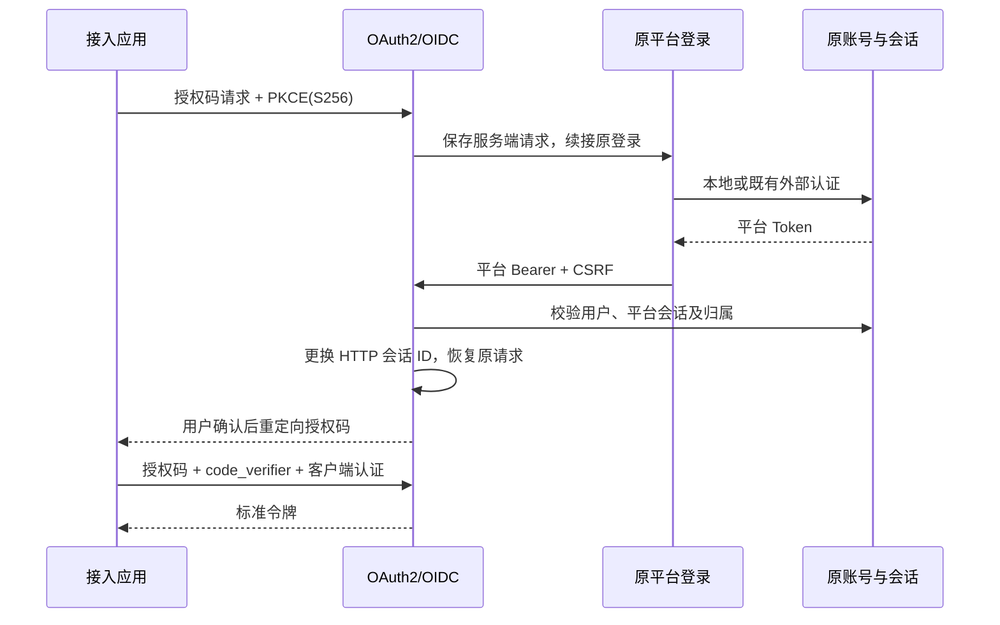

# OAuth2 授权服务器与 OIDC 身份提供方组件设计

## 设计范围与实现状态

本组件在能力层提供共用 OAuth2 授权协议与 OIDC 身份扩展，复用安全模块的账号、平台会话和统一权限。当前分支已有实现；稳定验收方法见[统一认证契约](../../testing/integration/feature/auth/sso-dynamic-config-oidc/contract.md)。历史实施记录中的本机 tmp 报告未作为共享产物保存，不能据此确认当前部署或发行状态。

| 主题 | 权威设计 |
| --- | --- |
| 上游 LDAP/OAuth2/CAS 动态配置 | [外部认证配置适配组件](../ouroboros-external-auth-configuration/DESIGN.md) |
| 独立包、协议装配、部署身份与动态暂停 | 本文 |
| 多客户端、管理员权限、密钥与授权边界 | [客户端职责与配置](authorization-design.md) |
| 配置安全投影、命令、CAS 与权威快照 | [统一配置安全读写契约](configuration-management-design.md) |
| 动态客户端注册、注册模式、凭证与并发 | [DCR 设计](dynamic-client-registration-design.md)及[受限配置写入契约 §11](configuration-management-design.md#11-组件命令的受限写入与依赖快照dcr-扩展) |
| 身份与业务两个确认组、请求绑定、CSRF 与异常恢复 | [确认流程](consent-flow-design.md) |
| 稳定公开 sub、按 scope 输出账号资料 | [身份资料映射](identity-profile-design.md) |
| 用户角色与凭据边界求交、统一消费端 | [安全模块委托授权](../../security/delegated-authorization-design.md) |
| 账号资料规则、自助和管理员维护、联系方式验证 | [安全模块用户资料](../../security/user-profile-design.md) |

## 1. 组件定位与依赖边界

`ouroboros-oidc-server` 是独立平台能力包，不把协议实现放进安全核心，也不另建账号、权限或配置库。上游身份认证仍归安全运行时和原认证工厂；下游 RP 接入归本组件。两个组件可独立装配，本地登录即可完成下游授权。

物理包共用一个授权服务器，逻辑上分为客户端注册、OAuth2 业务 API 委托和 OIDC 身份扩展。纯身份客户端只配置身份信息，无须业务权限；客户端凭据认证也不等于支持 Client Credentials 发证。



图中箭头表示调用或依赖。资料值在原 UserEntity，资料规则在统一配置；员工档案仍属于组织结构，不自动复制或作为兜底。OIDC 消费标准账号 claims。

## 2. 协议装配与平台集成

自动配置通过原 `META-INF` 注册；配置元数据和校验器分别通过原 SPI 加载。协议已就绪时装配 SAS 的 `SecurityFilterChain`，只匹配协议端点和 `/api/auth/oidc/**`；其他 API 继续原安全过滤链。部署身份缺失时保留拒绝协议入口的过滤链，不能回落为普通平台路由。

| 扩展点 | 实现职责 |
| --- | --- |
| RegisteredClientRepository | 从 `security.auth.oauth2.clients` 权威快照构造客户端 |
| OAuth2AuthorizationService | 原缓存保存授权记录，每次读取核验当前账号、公开 subject、客户端和平台会话 |
| 授权请求 converter/provider | 保存不可变请求，确认后在原 SAS 流程签发 |
| Token endpoint provider 与锁过滤器 | 重新验证当前策略，串行相同授权码/刷新令牌的兑换 |
| OAuth2TokenCustomizer / JWKSource | 原账号 claims、RS256、部署持久签名密钥 |
| TokenIdentityResolver | 有限委托身份进入原 API 认证与统一权限机制 |
| Logout handler | 原 UserSessionManager 销毁关联平台会话并清理协议浏览器会话 |

### 2.1 登录续接



返回目标仅取自服务端保存的授权请求，平台 Token 不进入 URL。前端把登录返回地址的路径与查询参数分开交给原 router；登录续接/确认页不参与普通工作台页面缓存，避免一次性流程再次进入时不执行校验。

HttpSession 保存 CSRF、协议 SecurityContext 及浏览器请求关联。集群需要会话亲和，或部署标准 Spring Session 共享会话；本组件不自建 HTTP 会话库。

### 2.2 授权状态与生命周期

授权记录绑定平台用户、公开 subject、平台 session、稳定 registrationId 和本次获准范围。读取时核验会话存在/归属/到期、用户启用和当前客户端配置；失效后移除授权及索引。缓存索引使用令牌摘要，不以明文令牌作为 key。

registrationId 是客户端实例的稳定身份，删除重建使用新值。全列表 revision 只用于配置一致性和 CAS，不使修改一个客户端波及其他客户端。当前客户端策略与原授权、本次 token 范围仍在使用和刷新时求交；配置扩大或角色增加不能扩大旧授权。

## 3. 部署配置与动态启停

### 3.1 部署身份

```yaml
ouroboros:
  security:
    oidc:
      enabled: false
      issuer: https://platform.example.com
      jwk-set-ref: file:/run/secrets/oidc-jwks.json
      access-token-time-to-live: 5m
      refresh-token-time-to-live: 8h
```

issuer 和签名私钥是部署身份，经 Spring 配置加载，修改需重启。issuer 必须为 HTTPS，本机回环允许 HTTP。JWK Set 使用唯一 kid、至少 2048 位 RSA 和 RS256，第一个 key 含当前私钥，其余可保留旧公钥。通过原 CompositeSecretResolver 的 file/env/config 引用加载；不在启动时随机生成签名身份。

issuer 使用平台公开地址；主应用开发代理与 Nginx 模板转发协议路径。多实例必须使用共享 CacheManager 和真正的分布式锁；原 RedissonDistributedLockManager 需要部署提供 RedissonClient，未提供时是单节点本地锁，不能据此宣称支持多节点并发兑换。

### 3.2 运行时策略与动态启停

BACKEND OBJECT 配置 `security.auth.oauth2.settings` 包含 `enabled`、`accessTokenTimeToLive` 和 `refreshTokenTimeToLive`。原 Spring 属性只作为未持久化配置的默认值来源。持久化后由同一配置项提供有效值；读取失败或损坏停止发证，不回退到基础配置。

```json
{"enabled": true, "accessTokenTimeToLive": "PT5M", "refreshTokenTimeToLive": "PT8H"}
```

暂停采用固定过滤链内的门禁，无需重启或拆装过滤链：

| 入口 | enabled=false |
| --- | --- |
| 新授权、登录续接、授权码兑换、refresh | 拒绝继续 |
| 部署已就绪的 discovery/JWKS | 保留 |
| UserInfo、内省、撤销、RP 退出 | 保留，继续原有效性/资源检查 |
| 已签发 JWT 的外部离线验证 | 受过期时间约束，不承诺立即撤销 |

保存 enabled=true 校验部署就绪。另有公开 subject 的物理非空/唯一约束门禁，未完成账号迁移时停止新签发；新安装可直接核验，存量维护流程见身份资料设计。

DCR 使用独立 `security.auth.oauth2.registration`，默认关闭，管理员动态选择凭证注册或开放注册，作用于新客户端注册，不是 OAuth2/OIDC 总开关。它使用原管理页面、配置策略、事务与客户端数组；配置字段和强制注册约束见[DCR 设计 §2–4](dynamic-client-registration-design.md#2-配置定义与管理员入口)。

## 4. 客户端注册模型

统一配置 `security.auth.oauth2.clients` 保存多客户端完整对象。专用入口为“接入应用（OAuth2 / OIDC）”，列表支持新增、编辑、禁用和删除。

```json
{
  "clientId": "example-rp",
  "clientName": "示例接入应用",
  "clientType": "CONFIDENTIAL",
  "enabled": true,
  "redirectUris": ["https://rp.example.com/callback"],
  "oidc": {"enabled": true, "scopes": ["openid", "profile", "email"], "postLogoutRedirectUris": []},
  "apiAuthorization": {"enabled": false, "allowedBoundary": {"permissions": []}},
  "consentPolicy": {"mode": "EXPLICIT"},
  "introspectionResources": []
}
```

registrationId 与 clientSecretHash 由服务端受控写入，不在普通管理响应回显。机密客户端现场生成高熵密钥，密码框提供“重新生成”，仅保存 bcrypt 散列；新值保存成功后生效。公共客户端不配置密钥。所有客户端要求 PKCE，回调与退出地址精确注册，禁止通配符、userinfo 和 fragment。

身份范围为 openid/profile/email/phone/offline_access；业务范围引用原可委托 Authority。管理界面不增加字段白名单或附加数据条件；用户角色中已有数据限制继续在统一安全机制执行。身份和业务分别在授权确认页展示两个组。

本组件首次引入发行基线；会话早期的 `security.auth.oidc.clients` 和 clientSecretRef 草稿不属于已有发布的数据库契约，不建立长期双读。原 Spring 客户端输入只在元数据默认值生成阶段归一化。

## 5. 协议端点与信任契约

| 用途 | 路径 |
| --- | --- |
| Discovery | `/.well-known/openid-configuration` |
| 授权 | `/oauth2/authorize` |
| 兑换与刷新 | `/oauth2/token` |
| 公钥 | `/oauth2/jwks` |
| 用户资料 | `/userinfo` |
| 撤销 / 内省 | `/oauth2/revoke` / `/oauth2/introspect` |
| 标准 RP 退出 | `/connect/logout` |

Discovery 只广告实际支持的流程、客户端认证和端点；不广告密码授权、设备授权或 Client Credentials。动态注册端点仅在启用且可用时广告。RP 发送 state/nonce/PKCE 并核验 ID Token 的签名、issuer、audience、到期和 nonce。

DCR 使用同一 SAS 协议链的 `POST /connect/register`，不另建 MVC 协议入口。启用以后，两份发现元数据才按动态可用性发布 `registration_endpoint`；注册管理仍在原平台页面，不开放 RFC 7592 端点。注册凭证只用于注册，不能代替客户端密钥、用户令牌或管理权限。

### 5.1 令牌用途与统一 API 权限

| 凭据 | 用途 |
| --- | --- |
| 平台内部 Access Token | 原 TokenService 的平台登录/API 凭据 |
| OIDC ID Token | RP 登录断言，不能调用业务 API |
| 纯身份 Access Token | UserInfo 等身份资源，不能调用平台管理 API |
| 业务委托 Access Token | RS256、access_token 用途、aud=platform-api，以有限边界进入原权限链 |
| Refresh Token | 延续原授权；旋转旧值，不扩大权限 |

OIDC 只在请求且明确同意 offline_access、客户端支持刷新时颁发 refresh token；纯 OAuth2 业务授权按业务确认和客户端刷新能力处理，不强制 openid。首版仅机密客户端使用刷新。

统一权限为当前用户角色 U、当前客户端 C、原获准范围 G 和本次 token 范围 T 的交集。身份保留 clientId/grantId/resource/boundary，不能仅重建 User 丢失凭据约束。错误用途、资源、签名或授权状态拒绝后不能降级为无限制平台身份。“只要登录”接口只默认接受平台凭据。

### 5.2 client secret、JWKS 与内省

client_id/client_secret（业务可称 appId/appSecret）用于 IdP 认证客户端。JWKS 用于 RP/资源服务器验证 IdP 签名；持有 client secret 不代替 ID Token 校验，PKCE 也不代替机密客户端认证。

内省调用先进行 client_secret_basic 认证，再检查目标 access token 的资源是否属于调用方 introspectionResources；默认空列表无查询权。ID Token 和其他资源 token 不因此暴露。内省继续检查当前用户、会话、客户端和授权状态，不创建另一套权限体系。

### 5.3 标准退出与撤销时效

[RP-Initiated Logout 1.0](https://openid.net/specs/openid-connect-rpinitiated-1_0.html) 请求使用 id_token_hint、精确注册的 post_logout_redirect_uri 和可选 state。SAS 校验后通过原会话服务销毁关联平台会话，撤销内部令牌；后续 OAuth2 refresh/UserInfo/在线校验拒绝。

退出不主动向其他 RP 推送通知。RP 自身本地会话由 RP 清理；外部仅离线验签的 JWT 在过期前仍可能被接受，需及时撤销的资源使用内省。

## 6. 验证、迁移与回退

正式场景为 `testing/integration/feature/auth/sso-dynamic-config-oidc/`；组件测试位于本模块 src/test。浏览器证据必须覆盖原登录、确认、RP 回调及资料管理，接口证据脱敏；失败记录与最后通过批次在报告区分。

原配置值列经显式 allowVarcharToText 模型属性由原迁移器扩为长文本，保留值、revision 和非空约束，回退不缩列。公开 subject 采用原模型迁移→系统身份分批回填（包括逻辑删除账号）→再次模型迁移收紧非空的维护流程；未就绪保持停止签发。旧版本回退前备份配置，暂停发证并保留原字段/标识，不能重新生成 subject。

## 7. 首版范围

包含管理员多客户端管理、授权码+PKCE、身份资料、OAuth2 有限业务委托、refresh 旋转、资源授权内省、标准 RP 退出及动态客户端注册。暂不包含 RFC 7592 注册管理、Client Credentials、front/back-channel logout、opaque 用户 Access Token、全局范围模板库和签名密钥自动轮换。

动态注册已按[DCR 设计](dynamic-client-registration-design.md)实现两种注册模式、一次性注册凭证和原配置安全写入扩展，默认关闭；验收入口包含真实协议、双节点并发和缓存故障恢复。注册凭证采用 opaque 随机值，这不表示已支持 opaque 用户 Access Token。
