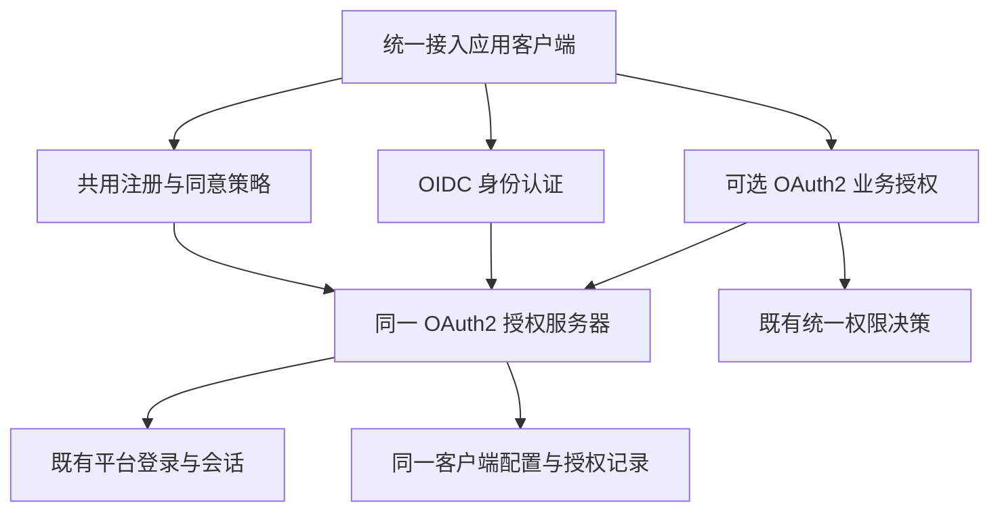
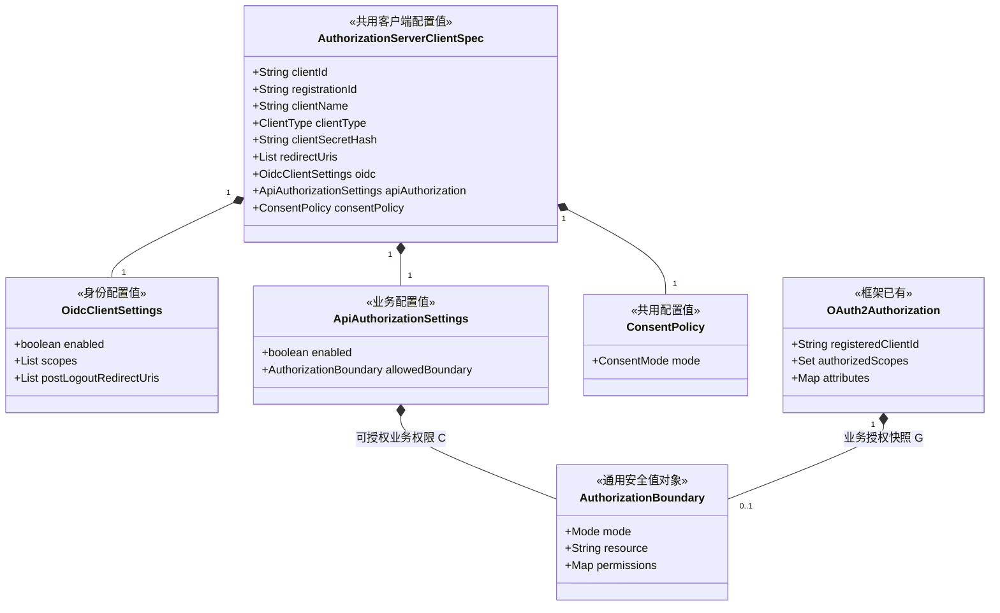

# OAuth2 客户端管理与 OIDC 身份配置设计

本文面向平台组件维护者，区分 OAuth2 授权服务器的客户端管理、可选业务 API 委托与 OIDC 身份认证。协议装配见 [DESIGN.md](DESIGN.md)，通用权限模型见[安全模块设计](../../security/DESIGN.md#46-委托授权边界)。

**实现状态：当前源码包含共用客户端、独立身份/业务设置、管理命令、确认页和统一 API 委托。** 本文维护组件契约，不能据此推定已发布；系统验收需按[正式 SSO 场景](../../testing/integration/feature/auth/sso-dynamic-config-oidc/contract.md)另取对应基线的运行证据。

## 1. 配置层次与职责

| 层次 | 配置内容 | 对纯 OIDC 单点登录的要求 |
| --- | --- | --- |
| 共用客户端注册 | 客户端标识、类型、生成的客户端密钥、启停、回调、授权类型、PKCE、令牌生命周期及同意策略 | 必需；OIDC 建立在 OAuth2 协议流程上 |
| OIDC 身份认证 | 启用身份登录、openid/profile/email/phone、ID Token、UserInfo、退出回调 | 仅处理身份认证和身份信息披露 |
| OAuth2 业务 API 授权 | 可选的目标资源、可授权业务权限 C 和本次批准快照 G | 默认关闭；身份登录无需配置任何业务权限 |

OIDC 也有身份信息披露的用户同意语义，`offline_access` 也涉及持续访问同意；“用户同意”不是业务授权独有的概念。配置页分别采用“身份信息确认”和“业务授权”，避免把两者混成必须配置的权限系统。

一个应用可以同时需要登录和业务 API 访问，因此两项能力独立组合，不把 OAuth2 与 OIDC 建成互斥客户端类型。请求包含 openid 时按 OIDC 处理；不含 openid 的请求只按已支持的 OAuth2 授权处理，不签发 ID Token。纯 OAuth2 请求复用同一授权码与刷新机制，响应不含 ID Token，UserInfo 不接受纯业务令牌。



OIDC 独立工作时仅通过原 User/Claims 获得身份资料，不依赖业务委托边界、权限树或业务 API 的令牌接入。通用 `AuthorizationBoundary` 是 OAuth2 访问业务资源时的安全能力，不作为完成 OIDC 登录的前提。

## 2. 管理员在哪里配置

新增菜单“系统设置 → 统一认证 → 接入应用（OAuth2 / OIDC）”，页面路径为 `/system-setting/auth-clients`。菜单和页面使用标准 `.menu.json`、`.ui-model.json`、`.ui-schema.json` 元数据，复用原页面及表单运行时。

入口展示多个客户端的列表，提供新增、编辑、启停及删除。列表和详情可同页展示；clientId 唯一且编辑时稳定。每个客户端单独配置，保存更新列表并保留其他客户端。

DCR 在该多客户端入口增加服务器级“动态注册”页签，编辑独立配置节 `security.auth.oauth2.registration`，不放在单个客户端的 OIDC 或平台 API 表单中。原列表增加注册来源与时间；完整配置、凭证操作及默认关闭规则见[动态客户端注册设计 §2](dynamic-client-registration-design.md#2-配置定义与管理员入口)。以下表格仍说明单个客户端的编辑区域。

| 页签或区域 | 配置内容 | 展示条件 |
| --- | --- | --- |
| 基本信息 | 共用注册、客户端能力开关、令牌与同意策略 | 始终展示 |
| OIDC 身份认证 | 标准身份 scope、持续访问申请和退出回调、身份信息确认内容 | 客户端启用 OIDC 时展示 |
| 平台 API 权限 | 可授权权限及“业务功能”整组确认 | 勾选“允许访问平台 API”后展示 |

接入能力的业务开关显示为“允许访问平台 API”，控制客户端能否申请平台业务权限，不是 OAuth2 协议启停。OIDC 身份认证仍使用同一 OAuth2 授权码和令牌流程。

新客户端默认启用 OIDC、关闭业务 API 授权。纯 SSO 应用不出现“可授权权限”及业务功能确认；开启业务授权后才展示原权限树和本次委托范围。首版不配置字段白名单、强制数据条件、选项级字段限制或附加数据条件；原用户角色的数据约束仍由既有权限链路执行。

### 客户端密钥的生成与展示

表单标签使用中文名称，不附加 `clientId`、`clientSecretRef` 等代码字段名。客户端标识仍是协议中的 client_id，身份选项显示“基本身份、个人资料、电子邮箱、手机号码”，各自对应原标准 scope，不改变协议值。

客户端类型区分“机密客户端”和“公共客户端”，与 OIDC、平台 API 两项能力独立。机密客户端默认生成密钥；公共客户端不生成、不展示密钥，继续使用授权码与 PKCE。浏览器或移动端不能因界面支持生成密钥而被当作能保密的机密客户端；现有公共客户端不发放刷新令牌的限制继续保留。

机密客户端使用“客户端密钥”密码框，紧接“重新生成”按钮，并提供“显示密钥”以便复制。新增时生成初始值；点击重新生成立即替换当前草稿的密钥，恢复隐藏显示。保存客户端后新密钥才生效，旧密钥同时失效；未保存或保存发生版本冲突时，原密钥继续有效。此处不支持旧、新密钥并行有效。

生成或重新生成的原文仅在当前编辑会话显示，离开当前客户端后清除；重新进入已保存客户端时，密码框为空并提示“已配置（不回显原密钥）”。空值表示保留现有密钥，不表示清空。显示开关不允许找回旧密钥，原文不得进入持久化表单状态、浏览器存储、日志或审计正文。

管理 API 在 `/api/sys/auth-clients` 下提供密钥生成操作，服务端以密码学安全随机数生成器生成至少 32 字节熵，采用 Base64URL 编码，通过受保护连接仅返回此次生成的原文，并设置 `Cache-Control: no-store`。生成操作不写配置、不撤销现有凭据，也不引入临时密钥仓库。产品界面调用管理服务生成，不在浏览器生成产品密钥。

保存接口接收一次性的 `newClientSecret`，在通过管理权限、输入与 `expectedRevision` 校验后，使用与现有客户端认证一致的 Spring Security PasswordEncoder 编码为 `{bcrypt}` 散列，再通过同一个 RuntimeConfigurationService 与客户端其他字段原子保存。持久配置只保存内部字段 `clientSecretHash`，原文不作为配置值；通用读取及管理响应不返回散列，只投影 `secretConfigured`。提交和响应的敏感字段必须在访问日志与审计中遮蔽，生成及更换密钥沿用注册安全字段的管理员权限。

敏感值投影是统一配置管理读写边界的能力，须覆盖当前值、默认值和历史值等管理读取。专用编辑器和通用编辑器均按 clientId 与 revision 更新；没有提交新密钥时从旧值保留散列，不能用脱敏后的数组覆盖并清空散列。通用 JSON 不接收密钥原文，也不将 `secretConfigured` 作为可写凭据；内部协议读取仍取得同一配置中的散列。

管理读写的实际入口、权限、敏感值投影及 CAS 契约以[统一配置管理详细设计](configuration-management-design.md)为准；当前不存在的历史值等入口不作为已实现能力。

RegisteredClientRepository 直接装配散列，仍由原 `client_secret_basic` 认证机制验证。更换密钥只更新目标客户端凭据；已签发令牌的撤销仍走原授权生命周期，不以更换密钥冒充令牌撤销。

### 配置归属与迁移

目标统一配置使用 `security.auth.oauth2.clients`，表示 OAuth2 授权服务器共用的客户端数组；客户端内的 `oidc` 保存身份配置，`apiAuthorization` 保存业务委托配置，`consentPolicy` 保存共用同意策略。其默认值继续由原 Spring 基础配置通过元数据 SPI 提供。

本组件首次发行，统一配置只读取新键与新模型；会话早期的 `security.auth.oidc.clients/clientSecretRef` 草稿不属于已发布的持久化基线。Spring 基础默认客户端在元数据装配阶段归一化，旧式输入默认开启身份、关闭业务授权，不因映射获得业务权限。协议层只消费同一权威配置，不长期双读或合并两份注册。

管理员通过专用命令生成或更换密钥；通用配置读写与恢复默认均使用同一管理策略、敏感投影和 CAS。原配置值列的扩容与回退条件见[配置管理设计 §8](configuration-management-design.md#8-发布迁移与回退)。

配置元数据以 `managementEntry = "/system-setting/auth-clients"` 声明由接入应用页面接管。原“配置管理”工作台 `/system-setting/configuration-management` 不再渲染该配置项，也不计入组保存及统计；统一配置仍维护同一份定义、默认值、权威值和管理策略。客户端 API 继续调用 `RuntimeConfigurationService`，按 clientId 修改数组目标元素并携带 `expectedRevision`；并发冲突刷新后重新提交。授权服务器 settings 继续在原配置工作台管理。

## 3. 对象模型与新增范围



上述嵌套类型仅组织同一客户端的配置值，不新增客户端实体仓库、范围实体或独立授权记录。原 `OidcClientSpec` 在实现时收敛为共用客户端配置；Spring Authorization Server 仍使用同一 RegisteredClientRepository、OAuth2AuthorizationService、令牌端点、授权码与刷新流程。

DCR 已在此配置值补充 `applicationType`、`grantTypes` 和服务端只读 `registration` 来源信息；旧客户端缺字段时保持既有手工注册与刷新行为，DCR 新客户端则按实际接受的 grant 登记。字段来源、只读投影与兼容规则以[DCR 设计 §3](dynamic-client-registration-design.md#3-注册请求与客户端模型)为准，不增加第二个注册对象仓库。

`oidc.scopes` 管理身份 scope；业务 scope 由 `authority:` 加已有 Authority 全名的 UTF-8 无填充 Base64URL 编码唯一派生，装配到同一个 RegisteredClient。映射函数归协议组件，不新增 scope 实体或别名配置；安全核心继续使用 Authority 全名。客户端只能选择原权限目录中 `isDelegable=true` 的权限，该声明默认 false，需完成消费端验收后开放。`apiAuthorization.enabled=false` 时不注册业务 scope，服务端拒绝业务 scope 请求；权限配置合法性检查也不能只依赖界面隐藏。

业务配置首版仅选择权限点。入选权限的客户端参数不额外收窄字段与数据，G 仍保存用户当时实际拥有的访问控制约束，避免后续扩大角色或客户端权限时扩大旧授权。安全核心保留参数完整交集及明确 Deny 的设计。

## 4. 身份信息与业务功能的展示

两个预置分组是按请求与客户端能力出现的用户确认内容，不强制所有客户端显示两个范围，也不新增两个替代标准语义的 scope。

| 请求内容 | 用户确认内容 | 令牌用途 |
| --- | --- | --- |
| 仅 OIDC 身份请求 | 身份信息，及实际请求的持续访问确认 | ID Token 用于登录；Access Token 用于获准 UserInfo，不获得平台业务 API 权限 |
| 仅 OAuth2 业务授权请求 | 业务功能 | Access Token 访问获准业务资源，不签发 ID Token |
| 同时请求身份与业务功能 | 身份信息与业务功能，分别明确展示 | 同一流程分别完成身份认证及业务委托 |

身份信息包含本次请求与客户端允许的 openid/profile/email/phone 的交集。身份标识、联系方式及个人资料的来源见[用户标识与个人资料设计](identity-profile-design.md)。`offline_access` 仍按协议要求确认，不能作为隐含业务授权。

业务功能覆盖该客户端所有可授权权限项，但实际批准始终与本次请求和用户权限求交，不补授未申请的 scope，不授予用户没有的权限。用户对本次实际可授予的业务功能整组同意或拒绝；不配置逐权限数据范围或自定义范围选项。

纯 OAuth2 请求没有身份登录结果，不得把未包含 openid 的响应或普通业务 Access Token 当作 OIDC 登录断言。OIDC UserInfo 本身受 Access Token 的身份 scope 保护，这属于 OIDC 所依赖的 OAuth2 机制，不表示平台业务 API 自动开放。

## 5. 同意策略

### 5.1 显式用户同意 EXPLICIT

新客户端默认使用 EXPLICIT，每次新授权根据本次请求显示实际存在的分组。OIDC 请求须满足身份信息披露与持续访问的同意条件，批准后才能完成登录；拒绝身份请求则拒绝授权。

业务功能默认不勾选，用户可整组同意或拒绝。混合请求拒绝业务功能时可仅返回身份结果；客户端必须检查实际获准 scope。纯业务请求拒绝业务功能时拒绝整次授权，不返回一个没有业务权限的伪登录结果。

首版不跨授权自动记住同意，`prompt=none` 遇到必须交互时返回相应协议错误。服务端区分身份 claims 与业务授权，不将已同意身份信息解释为同意全部权限。

### 5.2 管理员预批准 ADMIN_APPROVED

仅安全管理员可启用，表示在政策允许的条件下由管理员预先批准当前客户端允许的请求内容；不能绕过协议要求的显式同意，也不授予未请求或用户没有的业务权限。纯身份客户端也可使用该策略，无需因此设置业务委托权限。

## 6. 授权页面与服务端流程

完整页面、接口、框架适配及错误行为见[授权确认流程详细设计](consent-flow-design.md)。

仍通过原 OAuth2 授权流程和平台登录桥接，不为 OAuth2 业务授权新建平行协议链。用户确认页投影本次已验证请求，按请求是否包含 openid 和业务 scope 展示身份、业务或两个分组。

通过 Spring Authorization Server 的 consentPage、授权请求转换和 AuthenticationProvider 扩展点接入。框架继续签发授权码并校验 PKCE、回调及令牌兑换；OIDC 仅在合法身份请求时增加 ID Token、UserInfo 等身份能力。

待授权上下文绑定平台会话、用户、客户端、已验证请求与目标客户端策略摘要，具有有效期并防重复提交。服务端派生具体 scope；未知分组、越权 scope、关闭能力后的请求及过期/重复提交均拒绝。配置在展示后变化时重新展示。

仅在业务委托场景计算以下范围；纯 OIDC 登录不要求配置或构造业务 G：

```text
创建授权：G = U创建时 ∩ C创建时 ∩ 本次实际批准业务权限
当前凭据边界：B = C当前 ∩ G ∩ T
当前有效业务权限：E = U当前 ∩ B
```

T 为 Access Token 的业务 scope 子集。G 保存在原 OAuth2Authorization.attributes 中；OIDC 身份 claims 按身份 scope 和身份披露策略处理，不放进业务 Authority 清单。业务资源拒绝缺少有效业务 G 的令牌，即使该令牌可访问 UserInfo。

求交算法、身份传递和 API、脚本、逻辑流、数据插件的统一消费契约见[委托授权详细设计](../../security/delegated-authorization-design.md)。

## 7. 谁能管理及如何防止绕过

管理复用 RBAC：安全管理员注册客户端并分配管理范围，客户端管理员在被分配范围内维护资料和可授权业务权限。启用预批准、扩大管理范围、修改注册安全字段、设置资源内省权限及全局策略保留给安全管理员。

共用管理 API 为 `/api/sys/auth-clients` 及按 clientId 的子资源。接口复用统一配置服务、按管理范围投影读取；常规读取与保存响应不返回密钥原文或散列，只有密钥生成操作一次性返回本次新密钥。不能通过提交完整配置数组修改无权管理的客户端。

统一配置管理使用通用 `ConfigurationManagementAccessPolicy` 检查读写访问者、配置键、旧值及新值，原 ConfigurationValueValidator 继续校验值合法性。专用页面、通用 JSON、批量更新和恢复默认值均遵守同一检查；内部协议配置读取不要求管理员身份，不新增另一套存储。

## 8. 配置变化与授权生命周期

- OIDC 身份 scope 调整影响后续合法请求和身份信息披露，不借此授予业务权限。
- 关闭业务授权或缩小 C：后续业务请求、内省与刷新重新校验；扩大 C 不能突破旧 G。关闭业务能力不等于禁用整个客户端，其合法身份授权可继续使用。
- OIDC 能力关闭后拒绝新的 openid 请求；业务能力若仍开启，可继续其合法 OAuth2 请求。既有授权的清理、刷新和 UserInfo 按其用途、当前能力及撤销状态验证。
- 每个注册实例使用配置内服务端维护的 registrationId 作为稳定 RegisteredClient 身份；普通修改保留，删除后相同 clientId 新建使用新值。全数组 revision 只用于配置一致性和 CAS，修改一个客户端不应使所有客户端失效，删除重建也不能复活旧授权。
- 禁用/删除整个客户端时，经原授权服务清理该客户端记录；检索能力在原缓存增加索引，不创建第二套授权仓库。
- 刷新只延续仍获准的原授权，缩小 scope 后不能通过旧 G 恢复，扩大需要新授权。

纯离线验 JWT 的外部资源服务器不能自动获知配置收紧，其状态一致性仍依赖短有效期、内省或自身的撤销检查。

## 9. 实现与验收边界

1. 多客户端共用注册与授权存储；新增、编辑、删除、并发修改只影响目标客户端。
2. 仅启用 OIDC 的客户端无业务权限配置即可完成登录、UserInfo、刷新及退出；业务 API 拒绝其身份凭据。
3. 开启业务授权才装配业务 scope 和权限决策；关闭后界面隐藏且服务端拒绝业务授权，不仅靠前端控制。
4. 纯业务请求不强制 openid、不签发 ID Token；混合请求分别检查身份 scope 与业务 G，不混用 audience 或用途。
5. 身份披露仍遵守同意规则，业务功能仍按本次请求和用户权限求交；身份同意不会隐式批准业务权限。
6. 原 Authority、角色参数、统一配置、RegisteredClientRepository、OAuth2AuthorizationService、缓存及会话继续作为主路径；无业务授权也无需加载其通用委托契约。
7. 通用配置与专用管理均执行对象级校验；新旧配置迁移后只保留一个权威来源。
8. 密钥生成和重新生成更新当前草稿，保存成功才替换目标客户端凭据；保存冲突不使旧密钥失效。明文不落入配置、持久化页面状态或日志，常规读取不回显；公共客户端无密钥。生成、更换及通用配置修改执行相同管理权限，其他客户端凭据不受影响。

设计依据：[OpenID Connect Core 1.0](https://openid.net/specs/openid-connect-core-1_0.html)、[Spring Authorization Server 配置模型](https://docs.spring.io/spring-authorization-server/reference/configuration-model.html)。后者在 OAuth2 授权服务器基础配置上启用 OIDC 端点，共用同一套核心客户端和授权模型。
