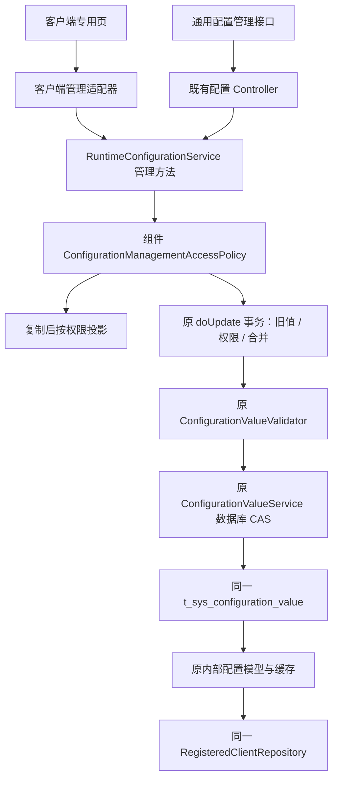
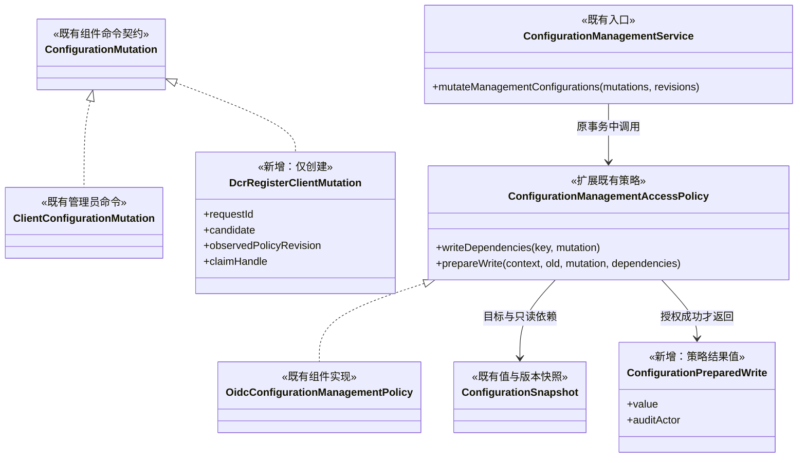
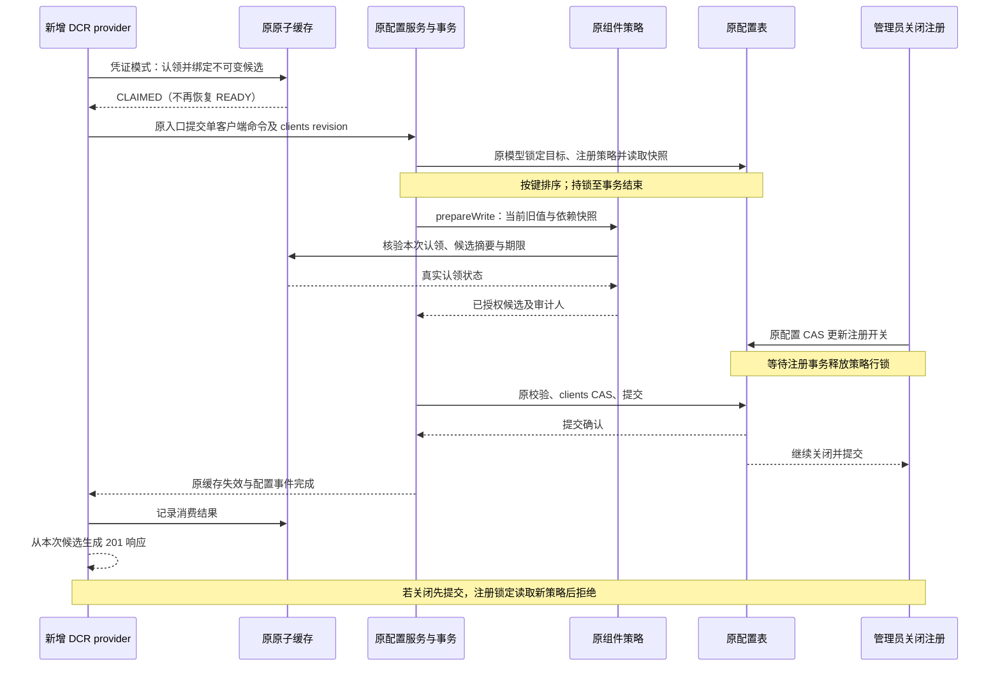

# OAuth2 客户端配置的安全读写契约

本文面向统一配置、安全与授权服务器组件的维护者，定义客户端和全局策略的管理权限、敏感值投影、并发写入与恢复默认行为。当前分支已在原配置服务补齐管理策略、权威快照与数据库 CAS；发布结论以系统验收报告为准。

§1–10 描述既有管理机制；[§11](#11-组件命令的受限写入与依赖快照dcr-扩展)说明 DCR 使用的受限组件命令与跨键事务契约。注册协议和凭证状态的唯一正文见[动态客户端注册设计](dynamic-client-registration-design.md)，默认关闭，启用条件见注册设计。

共用客户端模型见[客户端职责与配置](authorization-design.md)，协议装配和运行开关见[组件设计](DESIGN.md)，身份资料不属于本配置的存储范围，见[用户标识与个人资料](identity-profile-design.md)。

账号资料的字段规则使用独立配置 security.user.profile，资料值和验证状态仍保存于原账号模型。该键复用本文的通用 ConfigurationManagementAccessPolicy、管理投影和 CAS 机制，由安全运行时承接账号规则，不并入客户端数组或 IdP 开关。其权限、默认值和自助接口见[账号资料设计](../../security/user-profile-design.md#3-字段规则统一配置与管理入口)。

## 1. 主路径与扩展依据

### 1.1 变更前基线与扩展依据

| 机制 | 变更前基线 | 当前处理 |
| --- | --- | --- |
| `ConfigurationMetadataProvider → ConfigurationMetadataCenter` | SPI 汇总元数据及默认值，同键元数据允许合并 | 仍为唯一默认值来源；受保护键拒绝开发态同键覆盖 |
| `RuntimeConfigurationServiceImpl.getAllConfigurationModel()` | 缓存整份有效值、原始存储值、元数据与 revision | 保留内部模型；管理投影必须另建副本 |
| `ConfigurationController` | 列表返回 value/rawValue/metadata/configValue；按键 GET 使用 `@PermitAll`；PUT 要求 expectedRevision | 所有浏览器出口执行同一管理投影；按键 GET 限制敏感配置 |
| `ConfigurationWorkbenchServiceImpl` | 分组、条目和摘要直接携带有效值、默认值及原存储值 | 先投影、过滤，再计算树、分组及统计 |
| `RuntimeConfigurationServiceImpl.doUpdate()` | 事务内逐键校验并持久化；`ConfigurationValueValidator` 只收到新值 | 在原事务中补齐旧值、访问者和操作语义，保留合法性校验器 |
| `ConfigurationValueServiceImpl.update()` | 已有数据库 CAS：按 key/revision 条件更新；旧行还比较原 value；新行依赖主键唯一插入 | 继续复用；不能把内存中比较 revision 当作 CAS |
| 内部 `ConfigurationService` | 协议、脚本表达式和逻辑流节点都能读取配置；FRONTEND 配置经 WebAppInfo 下发 | 协议保留内部读；可编排或浏览器读取受保护值时拒绝或投影 |

变更前的根因是统一配置没有区分“内部配置消费”与“管理者可见、可改的投影”，也没有在原保存事务中表达客户端对象范围和字段权限。仅在新页面隐藏密钥、增加一个 Controller 权限注解，均不能解决通用列表、默认值、原始 JSON 和批量写的绕过。

### 1.2 扩展位置

在 `ouroboros-configuration-core` 新增一个 `ConfigurationManagementAccessPolicy` 契约，职责限于受保护键的读投影与写规范化。`ConfigurationService` 的内部读契约不变；不把管理员身份作为协议读取配置的前提。`RuntimeConfigurationService` 增加管理读和管理变更的显式方法，原 Controller、工作台和客户端管理适配器均调用它们；最终仍只有原 `doUpdate → ConfigurationValueService → TypedDataModel` 一条持久化路径。

策略的最小输入输出如下，名称对应当前实现的管理策略契约：

| 方法 | 输入 | 输出或失败 |
| --- | --- | --- |
| `supports(key)` | 配置键 | 是否承接该键；每个受保护键只能有一个管理策略 |
| `projectRead(context, snapshot)` | 服务端访问者、读取用途、完整快照；快照含有效值/默认值/存储值/revision | 独立管理副本或不可见；禁止返回内部对象引用 |
| `prepareWrite(context, oldSnapshot, mutation)` | 可信访问者、从存储读取的旧快照、管理变更 | 经授权且保留内部字段的完整候选值；或拒绝 |

管理上下文由服务端从 `CurrentSecurityContextHolder` 解析 `SecurityIdentity/OuroborosAuthentication`，不能从请求 body、updateBy、客户端配置中的 owner 或页面标识构造。`updateBy` 只记录操作人。原无 revision 的 `update(map, updateBy)` 对普通配置保持兼容，对受保护键必须拒绝；有 revision 的原 `update` 也必须进入相同策略，不能直接跳过管理变更处理。底层 value service 和 `doUpdate` 是模块内部持久化机制，不暴露为可调用的管理替代入口。

OAuth2 组件通过原自动配置导入一个策略 Bean，承接 `security.auth.oauth2.clients` 和 `security.auth.oauth2.settings`；配置模块只依赖 core 契约，不反向依赖 OAuth2 组件。沿用 `ConfigurationValueValidator` 的 Spring Bean 扩展方式，不增加第二个策略注册表；自动配置继续登记在既有 `META-INF` 自动配置文件中。受保护键通过代码提供的元数据 extraProps 声明 `managementAccessPolicyRequired=true`，缺少策略或策略重复时拒绝管理访问与修改，不降为普通 JSON 配置。



图中管理适配器只将按 clientId 的动作转换为原配置的变更；不保存客户端实体，不实现第二套注册或校验。

## 2. 配置值与 RBAC 权限

### 2.1 权威值与内部字段

目标键 `security.auth.oauth2.clients` 是 BACKEND ARRAY；`security.auth.oauth2.settings` 是 BACKEND OBJECT。Spring 基础配置仅由元数据 SPI 转为默认值，协议层不直接再读 Spring clients/settings 作为回退。issuer、JWK 引用仍为部署配置，不在此处动态修改。

客户端沿用 `clientId/clientName/enabled/redirectUris/oidc/apiAuthorization/consentPolicy`，退出回调放在 `oidc.postLogoutRedirectUris`，新增显式 `clientType=CONFIDENTIAL|PUBLIC`。内部唯一凭据字段为 `clientSecretHash`，机密客户端必须有合法 `{bcrypt}` 散列；公共客户端不得有散列，必须使用 PKCE，首版不注册 refresh_token grant。`secretConfigured` 仅属于响应投影，`newClientSecret` 仅属于受控保存命令，二者都不属于持久配置模型。

另在同一配置对象保存内部 `registrationId`，直接用作 SAS RegisteredClient.id。显式新建和旧持久配置迁移时由服务端生成 UUID，普通修改、密钥更换和策略恢复均保留；删除后用相同 clientId 新建必须获得新的 registrationId，旧授权不能因 clientId 复用重新有效。不新增客户端实体表或独立身份映射。该字段不作为管理表单输入，普通 JSON 禁止提交，由事务内旧值保留或创建服务生成。

未落库的 Spring 默认客户端，由元数据默认值适配使用固定命名空间、部署 issuer 和 clientId 确定派生默认 registrationId，避免重启临时变化；首次保存保留该值。显式删除通过持久化数组移除，后续新建使用新 UUID，不再回到默认身份。恢复默认不删除配置行、不替换 registrationId，因此不会重新激活已删除的注册实例。

### 2.2 谁获得权限

安全管理员和客户端管理员是权限能力的简称，不按角色显示名或自报角色判断。复用现有 Authority、Role、RoleAuthorityMap、`OuroborosGrantedAuthority` 与 `AccessControlParams`；变更前只有 `systemSetting.configurationManagement`；本次通过原元数据发现机制增加以下权限点与参数：

| 新增 Authority | 授权用途 | 参数 |
| --- | --- | --- |
| `systemSetting.authClients.security` | 注册/删除客户端、修改注册安全字段、生成和更换密钥、预批准、资源内省授权 | 无客户端范围限制；仅由现有 RBAC 管理员分配 |
| `systemSetting.authClients.manage` | 在分配范围内读客户端并维护获准字段 | 显式 clientIds、可维护字段、可授权业务权限上限 |
| `systemSetting.authServer.settings` | 读取和修改全局 enabled、令牌有效期 | 无客户端级作用域 |

普通“配置管理”权限只允许进入原工作台，不隐含上述权限。专用页面挂相应新 Authority；通用配置管理 API 同时要求原配置管理权限与相应组件权限。原 RBAC 管理入口负责给角色分配这些权限；客户端管理界面不提供修改角色、分配管理权限或扩大管理范围的功能。

管理入口先执行平台统一的有效权限决策，通过安全核心的 `AuthorizationEvaluator` 检查相应 Authority 的 Permit/Deny，不能只检查原角色中是否存在权限名。首版客户端与全局策略管理拒绝 DELEGATED 凭据，上述新增管理 Authority 默认不可委托；普通平台登录凭据仍须通过统一权限检查。凭据分类和统一决策复用[安全模块](../../security/DESIGN.md)的实现，配置组件不另实现其授权算法。

`manage` 的范围放在原角色授权参数中，不能放入客户端对象的 `managedBy/owner` 等可自行提交的字段。声明 `accessControlDefine.filterDefine` 中的 `clientIds` 与 `grantableAuthorityNames`，用现有默认 filter builder 读取显式列表；使用现有字段权限定义描述可写字段。缺少/空 clientIds 表示无客户端，缺少/空业务上限表示不能增加业务权限，均不表示全部。首版不接受通配符和任意表达式。

字段控制是不可突破的服务端上限：`manage` 只识别 `clientName`、`oidc.scopes`、`apiAuthorization.allowedBoundary.permissions` 三个可写字段，其他字段即使出现在 `$fieldControl`、`allowedFields=["*"]` 或旧角色参数中也不能开放。现有 `DefaultAccessControlParams` 在字段参数为空时可能开放全部受控字段，不能以其空列表默认行为推导本组件权限；新增权限的服务端校验要求显式字段选择，未选择即只读。

统一权限决策允许后，每个可信角色授权项构成一组“clientIds × 获准字段 × 业务权限上限”，作为组件领域约束继续收窄。对每个变更字段，要求有一项同时匹配目标客户端、字段及该字段请求内容的完整授权；不能先把不同角色的客户端列表、字段和业务上限分别取并集，再拼出原角色未授予的组合。不同字段可分别获得合法授权。此检查不产生 Permit、不覆盖任何核心 Deny；可从通过统一决策的 Authentication 中取得可信授权参数，无须改变安全核心的通用权限合并规则。

### 2.3 操作与字段矩阵

| 操作/字段 | 安全管理员 | 范围内客户端管理员 | 普通配置管理员 |
| --- | --- | --- | --- |
| 客户端列表/详情/默认值 | 全部，始终脱敏 | 仅分配 clientIds，始终脱敏 | 隐藏受保护键/客户端 |
| clientName | 可改 | 显式字段许可后可改 | 不可改 |
| oidc.scopes | 可改，限支持的身份 scope | 显式许可后可改，限支持的身份 scope | 不可改 |
| apiAuthorization.allowedBoundary.permissions | 可改，验证 Authority 有效性 | 显式许可，且新增项属于 grantableAuthorityNames | 不可改 |
| 新建/删除、clientId/clientType、enabled、回调/退出地址 | 可改；clientId 创建后不可更名 | 不可改 | 不可改 |
| apiAuthorization.enabled、consentPolicy、资源内省授权 | 可改；预批准仅安全管理员 | 不可改 | 不可改 |
| 生成/更换密钥、机密/公共类型转换 | 可操作 | 不可操作 | 不可操作 |
| 全局 settings | 另需 settings Authority | 不可操作 | 不可操作 |
| 恢复默认 | 按第 6 节，仅恢复获准对象和策略 | 只能恢复获准字段且不扩大业务上限 | 不可操作 |

客户端管理员可在安全管理员已开启的能力中维护配置，不能借允许列表修改开启业务能力、设置管理员预批准或修改自己的管理范围。已有 C 中超出新管理上限的旧权限可以保留或删除，不允许重新加入或扩大。OAuth2 最终仍与用户 U、批准快照 G 和 token scope 求交；配置权限上限不直接授予平台业务 API 的执行权限。

业务可授权项与管理 Authority 分开校验：安全核心新增 `Authority.isDelegable`，默认 false；权限树和保存校验只允许已验收且显式可委托的业务 Authority。上述三类管理权限保持不可委托，不能出现在客户端 C 或 grantableAuthorityNames 中，即使操作者本人持有这些角色权限也拒绝。业务 scope 按 `authority:` + Base64URL(UTF-8 Authority 全名，无填充) 派生，只是映射函数，不新增权限实体、scope 目录或另一份配置清单。

## 3. 管理读取与敏感值投影

### 3.1 实际入口覆盖

| 入口 | 当前数据来源 | 目标行为 |
| --- | --- | --- |
| GET `/api/sys/configuration` | 全部 ConfigurationModel | 按键/客户端过滤后返回独立投影；覆盖 value/rawValue/configValue/metadata |
| GET `/api/sys/configuration/{key}` | `ConfigurationService.get`，`@PermitAll` | 普通前端配置保留原可见性；受保护键必须认证并执行策略，不能匿名读取 |
| workbench `/tree`、`/group`、`/item/{key}` | 内部模型及元数据 | 在生成摘要、统计和子组前过滤；条目值与详情使用相同投影 |
| PUT `/api/sys/configuration` 的保存响应 | 再读全部内部模型后按 key 返回 | 直接使用成功写入结果的管理投影；禁止返回内部 ConfigurationModel |
| 新增客户端列表/详情/保存响应 | 同一配置快照 | 返回同一组件投影，不在 Controller 另写一版遮蔽 |
| WebAppInfo 的 `getValues(FRONTEND)` | FRONTEND 元数据范围 | 两个键始终 BACKEND；即使错误覆盖成 FRONTEND，通用外发仍排除受保护键 |
| `Config.get` 脚本/表达式、GetConfigNode | 内部 ConfigurationService | 通用执行上下文读取受保护键时拒绝，不能输出散列、默认值或原始存储值 |
| 协议 RegisteredClientRepository | 内部 ConfigurationService | 继续取得完整规范值及 clientSecretHash；不要求管理员认证 |
| 开发态 `/api/dev/{appName}/configuration` 的列表/详情/init-form/change-log/rollback | ConfigurationMetadataDevelopService 与原 VCS | 管理访问执行同一受保护键规则；见下文的元数据与历史边界 |

所有受保护管理响应设置 `Cache-Control: no-store`。`revision` 使用内部原始值的权威 token，不能因投影、clientId 过滤或密钥隐藏重新计算，也不是凭据。客户端管理员可能观察到整数组 revision 改变，但不能看到其他客户端的值或变化内容。

### 3.2 同一投影覆盖所有值形态

对当前值、元数据默认值、rawValue、configValue.value 应用相同 clientId 过滤与敏感字段规则。`clientSecretHash/clientSecretRef` 均不返回；用 `secretConfigured=true|false` 表达是否有凭据。管理投影同时移除内部 registrationId，避免高级编辑器将不可写内部字段回填；其保留与新建由服务端负责。`metadata.defaultValue` 仍按原字符串契约返回投影后的 JSON 文本，不把内部默认对象直接序列化；editorSchema 的默认数据、示例及 extraProps 也不得嵌入原散列或明文。

投影必须复制 ConfigurationModel、元数据及嵌套集合后再删除字段。不得修改 `getAllConfigurationModel()` 返回的共享缓存对象，也不得缓存“某管理员可见的列表”为全局模型。访问者权限每次请求重新解析，权限被收回后不能继续读旧投影。

运行时值表只有当前值、revision、更新时间和更新人，未找到独立的运行时历史查询、历史恢复或配置值导入导出 API；本次不为这些功能新建系统。开发态确有元数据的 VCS change-log 与 rollback，它们描述配置定义版本，不是运行时密钥历史。对受保护键的开发态读取，同样按组件策略投影；已有 change-log 若仅含版本说明，可返回说明，若含旧正文或 diff，必须先按历史值投影。不能因字段路径改名或旧版本使用 clientSecretRef 而漏过。

两个键的安全分类、BACKEND 范围、管理策略要求和内部默认值装配由组件元数据提供者负责；开发态同键 create/update/delete/rollback 不能替换这些约束或注入默认凭据，统一拒绝。`ConfigurationMetadataCenter` 在同键 merge 前检查受保护声明，防止绕过开发态服务直接放入同键文件后在刷新时生效。历史元数据中的原文或散列不能再次通过 change-log、调试响应暴露。后续若实现运行时历史或导入导出，应复用此次管理投影与变更内核；脱敏导出不是凭据备份，导入也不能接收散列覆盖。

### 3.3 防止配置引用转发敏感值

目前有效值装配会把 Spring 环境与已处理配置加入 EL context，并允许其他配置引用。仅保护 HTTP 的客户端配置键，仍可能被另一个可写 FRONTEND 配置转发。

最小修正在原 `RuntimeConfigurationServiceImpl` 的有效值装配处执行：受保护键作为严格 JSON 数据处理，不执行 EL；不把其原始值、默认值和散列加入可供其他配置使用的 EL context；其他键若引用受保护键则明确报 `CONFIGURATION_SENSITIVE_REFERENCE_FORBIDDEN`。该判断按键和值类别执行，不靠给散列加掩码后继续计算。

同一装配入口中的环境上下文应排除 OAuth2 密钥相关 Spring 默认字段、被默认值提供者解析的客户端密钥引用目标以及签名密钥配置。组件元数据装配时声明这些具体来源名称，由原配置装配器在构造环境上下文时排除；不追踪任意业务数据流。对其他配置中的同源 EL 引用拒绝求值，不能在失败时回落成部分求值后含敏感内容的文本。该限制覆盖读取、保存前验证及元数据刷新；不改变其他正常配置的引用语义，也不增加密钥仓库。任意可执行服务端脚本的既有权限不等于配置管理权限，但通用 Config 绑定必须显式拒绝受保护键，不能以脚本为管理侧读散列的通道。

## 4. 按 clientId 变更与原子并发

### 4.1 管理变更表示

`RuntimeConfigurationService` 的管理变更方法接受 key、expectedRevision 与 mutation，使用 core 的管理变更契约；组件策略识别自己的按客户端命令。通用 HTTP 的 `value` 是普通替换值，组件 Controller 构造的 `ClientCreate/ClientUpdate/ClientDelete/ClientRestoreDefaults` 是服务端类型，不能通过 JSON 中的 `source/internal/operationType` 自报。类型中可携带一次性 newClientSecret；该类型不能成为统一配置 JSON 的自动反序列化目标。

客户端配置元数据通过 `managementEntry = "/system-setting/auth-clients"` 声明由专用接入应用页面接管，配置 key、默认值、分组与原管理策略继续存在。原系统配置工作台在快照组装时排除该配置项，不渲染列表或详情，也不计入组保存和数量统计；接管不影响内部读取或专用页面取得完整的受控管理投影。专用页沿原 clientId 编辑器与管理适配器提交目标客户端命令，不再嵌入统一配置工作台。接管声明与服务端管理权限分别由元数据和原策略负责，契约见[统一配置设计 §4.1.2](../ouroboros-configuration/DESIGN.md#412-配置项的专用管理接管)。

安全管理员通过原通用管理 PUT 提交完整数组时，仍按 clientId 构建旧/新映射并比较增删改，不按数组下标合并。此 API 能力保留，但系统配置工作台不再为该键提供数组编辑器。全数组替换只对安全管理员开放；范围内客户端管理员使用上述逐客户端编辑器。完整替换中的缺失 clientId 明确表示删除，调用方须展示删除结果；客户端逐项修改中的缺失元素始终表示未修改。重新排序不改变客户端身份，重复或空 clientId 拒绝；单客户端更新不得更名。全数组中的旧 ID 消失、新 ID 出现按删除与新建处理，不迁移 registrationId、散列或旧授权，不把它推断为保留身份的更名。

### 4.2 密钥保留与字段拒绝

普通 JSON 输入使用严格字段模型，在反序列化前检查保留字段，出现 `registrationId`、`clientSecretHash`、旧 `clientSecretRef`、`newClientSecret`、`secretConfigured` 或任何未知字段一律 400，不静默忽略、不按“占位符”信任。编辑器提交普通 JSON 前移除响应中的只读 secretConfigured；服务端仍强制拒绝恶意回填。即使提交值等于当前散列也拒绝，避免形成散列确认接口。

旧客户端普通保存未携带受控新密钥时，策略从事务内旧值按 clientId 原样保留 clientSecretHash；禁止把 `""`、null、`******`、缺失字段或 secretConfigured=false 解释为清空。新建机密客户端必须通过受控保存命令带新密钥，不能靠普通 JSON 创建无凭据机密客户端。新建公共客户端不接受任何凭据。

公共/机密转换只允许安全管理员的显式类型变更：转公共明确显示将移除密钥并关闭刷新令牌能力；转机密必须同次生成并提交新密钥。普通保存、策略恢复及脱敏值回写均不能触发转换。

### 4.3 CAS 范围与提交顺序

所有客户端操作必须携带整个 `security.auth.oauth2.clients` 的 expectedRevision；settings 使用其独立 revision。没有另建 clientRevision 列或逐客户端数据库行。首次未落库的配置用原 `default-...` token，旧行用原 `stored-...` token，之后沿用原单调 revision。

1. 进入原管理写入内核，解析可信访问者，检查键、必填 revision、重复请求键和命令形态；不依赖缓存判断有权写入。
2. 在原 `doUpdate` 事务内通过 ConfigurationValueService 读取数据库旧行；无行才取同一元数据默认值。比较 expectedRevision 并规范解析旧值；损坏值明确拒绝，不能当空数组覆盖。
3. 组件策略检查目标 clientId 与字段差异；按旧数组构建候选值，保留其他客户端及未修改的散列；受控密钥在此编码，明文不进入候选 JSON。
4. 对最终完整候选值执行原值类型检查和 `ConfigurationValueValidator`；批量每个键都通过才可提交。
5. 仍由原 ConfigurationValueService 执行数据库条件更新。影响行数不是 1 或首次插入主键竞争时，抛 revision 冲突并回滚本批全部键。
6. 提交成功后清原配置缓存，按原机制发布更新通知并返回此次写入结果的脱敏投影。响应使用提交结果，不能再读一次已被另一请求修改的列表冒充本次结果。

不同管理员同时修改不同客户端也会发生整数组 CAS 冲突；冲突方刷新后手动重放目标修改，服务器不自动合并旧草稿、不自动重试密钥轮换。删除与更新、完整数组替换与逐客户端修改遵循同一规则；一方成功后另一方 409，不能把已删除客户端重新插回。

整数组 revision 只负责配置一致性与 CAS，不得进入 RegisteredClient 的稳定身份；RegisteredClient.id 使用第 2.1 节的 registrationId，并校验其仍属于当前注册实例。授权页与协议使用按客户端规范策略派生的 fingerprint 判断相关策略是否变化；只编辑客户端 A 不要求客户端 B 重新确认或撤销其授权。

## 5. 接口与密钥交互

### 5.1 管理 API

以下 `/api/sys/auth-clients` API，沿用平台 WebApiResult 与原认证/授权过滤链。路径只是同一配置的业务适配，不提供无策略读写接口。

| 请求 | 请求内容 | 成功结果 |
| --- | --- | --- |
| GET `/api/sys/auth-clients` | 无 | 当前访问者可见 clients 与整数组 revision |
| GET `/api/sys/auth-clients/{clientId}` | clientId | 单客户端投影、revision、可写字段与可执行动作 |
| POST `/api/sys/auth-clients` | expectedRevision、client、可选 newClientSecret | 创建后的投影与新 revision；新建机密类型必须有新密钥 |
| PATCH `/api/sys/auth-clients/{clientId}` | expectedRevision、changes、可选 newClientSecret | 目标客户端新投影与新 revision；path clientId 唯一定位 |
| DELETE `/api/sys/auth-clients/{clientId}` | body 中 expectedRevision | 被删除 clientId 与新 revision；不返原值 |
| POST `/api/sys/auth-clients/{clientId}/secret/generate` | 无；可用于安全管理员正在创建的新 clientId | 仅此次 clientSecret 原文；不保存、不递增 revision |
| POST `/api/sys/auth-clients/{clientId}/restore-defaults` | expectedRevision | 按第 6 节恢复后投影与新 revision |
| PUT `/api/sys/configuration` | 原批量 DTO，增加 operation=RESTORE_DEFAULT，缺省为 SET | 使用同一策略与事务的管理投影；禁止同条同时 value 与 RESTORE_DEFAULT |

GET 客户端详情示例，省略无关业务字段；外层包装沿用现有 WebApiResult：

```json
{
  "revision": "17",
  "client": {
    "clientId": "business-app",
    "clientName": "业务应用",
    "clientType": "CONFIDENTIAL",
    "enabled": true,
    "secretConfigured": true,
    "oidc": {"enabled": true, "scopes": ["openid", "profile"]},
    "apiAuthorization": {"enabled": false}
  },
  "writableFields": ["clientName", "oidc.scopes"],
  "allowedActions": ["update"]
}
```

轮换保存示例；newClientSecret 位于受控命令侧，不进入 `changes` 或配置数组：

```json
{
  "expectedRevision": "17",
  "changes": {"clientName": "业务应用"},
  "newClientSecret": "<本次生成的 Base64URL 原文>"
}
```

全局 settings 直接使用现有统一配置 GET/PUT 与工作台，值为 enabled、accessTokenTimeToLive、refreshTokenTimeToLive 完整对象，不另增一组 settings API。PUT 必须提供 expectedRevision，只有 settings Authority 可以操作；enabled=true 还需部署就绪校验。

### 5.2 生成、保存与内存边界

生成服务使用密码学安全随机数生成至少 32 字节随机数据并 Base64URL 编码。输入不接受自定明文、散列、算法或字符长度。响应只包含 `clientSecret`，设置 no-store；不写配置、不撤销旧密钥、不新增临时凭据表或缓存。生成端点与轮换均检查注册安全权限，不能靠已知 clientId 调用。

机密客户端编辑框旁显示“重新生成”。点击后立即替换当前草稿的原文，保存成功才将散列与其他字段原子写入；新旧散列不并存。后续重新进入已保存客户端时密码框为空，显示“已配置（不回显原密钥）”；空草稿表示保留旧凭据。公共客户端无密钥框且保持 PKCE。

受控保存校验 Base64URL 原文可解码、随机材料长度至少 32 字节，再用既有客户端认证兼容的 PasswordEncoder 产生 `{bcrypt}` 散列。生成器固定使用 32 字节，避免超出 BCrypt 输入限制；保存同时限制编码文本的字节长度不超过 BCrypt 有效输入上限，拒绝截断行为。首版无需证明原文一定来自某次生成请求：已授权保存者本就有替换凭据的权限，不引入生成凭证或临时密钥仓库。

原文仅保留在当前组件的易失内存状态，禁止进入全局表单持久状态、浏览器存储、URL、埋点、异常正文、审计快照或请求/响应日志。生成和保存路由须在已有日志/审计机制中屏蔽整个敏感字段；审计只记录操作者、clientId、动作、变更字段名和结果 revision。关闭页面、切换客户端、退出登录后清除草稿原文；保存失败可在当前会话继续显示草稿，但不得声明已生效或自动重新生成。

## 6. 恢复默认的明确语义

变更前运行时没有独立恢复默认接口；本次在原统一配置 PUT 增加 RESTORE_DEFAULT 操作，并由专用编辑器复用同一语义。恢复是一次正常 CAS 写入，写入计算后的完整值，不删除数据库行回落到随部署变化的默认值，也不引入审批或临时恢复流程。

| 恢复对象 | 明确行为 |
| --- | --- |
| 单客户端 | 从元数据默认数组找到同一 clientId，恢复当前访问者有权修改的非凭据字段；保留当前 clientType 与散列；默认中无此 clientId 返回 409，不删除客户端 |
| 客户端数组 | 仅安全管理员可做；对当前已存在 clientId 应用上述规则；不新增默认客户端、不删除当前客户端；当前客户端在默认中不存在则整次返回 409，避免部分恢复 |
| settings | 用元数据默认 settings 替换当前完整对象，执行原 settings 权限、类型/范围与启用就绪校验；不影响客户端凭据 |

恢复默认不会恢复默认密钥或改成公共客户端，默认散列只用于“尚无持久化值”的首次装配与发布迁移。历史凭据不通过恢复默认重新激活。恢复结果仍保持持久化覆盖；界面明确标为“恢复默认策略（保留现有密钥与客户端类型）”。需要删除客户端、切换类型或轮换密钥时执行对应显式操作。

恢复也不能放宽授权：默认候选若将 oidc/apiAuthorization 从 false 开为 true、扩大身份 scope、C 超出当前集合、EXPLICIT 改为 ADMIN_APPROVED、扩大资源内省许可或把 disabled 客户端重新启用，则返回 `CONFIGURATION_DEFAULT_WOULD_EXPAND_ACCESS`，不部分应用。安全管理员通过正常编辑显式设置这些值；客户端管理员恢复仅限其获准字段和业务上限。回调/退出地址的默认变化按注册安全字段校验。客户端类型与默认不一致时保留现类型，只恢复兼容字段，不自动转换。

默认值预览使用第 3 节投影，并可在客户端详情返回服务端计算的 `allowedActions`；是否实际可恢复仍在事务内判断。不能让页面从已脱敏默认值拼出数组再作为普通 SET 伪装恢复；RESTORE_DEFAULT 始终从服务器当前元数据取得默认策略。

## 7. 事务、缓存与失败行为

原 `doUpdate` 已有事务，底层已有真实 CAS，最小修改是把“事务内读旧值 → 访问策略 → 保留散列合并 → 值校验 → CAS”放入这段事务，而非新建锁内存储。受保护键全部要求 CAS；原批量更新任意一个键失败即回滚。内部旧值不能从 getAllConfigurationModel 的缓存获取，数据库候选与 CAS 必须使用同一旧 revision。

不为配置编辑新增分布式锁：数据库 CAS 已负责跨实例竞争。授权码/刷新令牌兑换继续复用原 DistributedLockManager；其锁不能代替配置提交原子性。策略/注册快照与缓存更新仍由原配置机制承接，不增加协议自己的配置缓存或定时轮询。

| 结果 | 存储与密钥 | HTTP/调用方行为 |
| --- | --- | --- |
| 未认证/无权、字段越权 | 完全不写 | 401/403；范围外 clientId 对详情/变更返回 404，避免枚举 |
| 缺 revision、非法 JSON、保留字段、重复 clientId | 完全不写 | 400，稳定错误码与字段路径；不回显提交值 |
| CAS 冲突或默认不兼容 | 整批回滚，旧密钥继续有效 | 409；可返回 currentRevision，要求刷新后重新提交 |
| 编码、校验或数据库提交失败 | 事务回滚，旧密钥继续有效 | 400 或 500；不得打印原文/散列 |
| 提交成功且缓存更新成功 | 新散列为唯一当前凭据，旧密钥不再通过客户端认证 | 200/201/204 与新 revision；保存响应始终脱敏 |
| 提交后缓存清除、事件或响应传输失败 | 已提交，不能宣称回滚，也不能恢复旧密钥 | 503 或连接中断，标为提交状态需核对；重新读取 revision/配置投影，不盲重放 |

错误码至少包括 `CONFIGURATION_ACCESS_DENIED`、`CONFIGURATION_FIELD_FORBIDDEN`、`CONFIGURATION_REVISION_REQUIRED`、`CONFIGURATION_REVISION_CONFLICT`、`CONFIGURATION_RESERVED_FIELD`、`CONFIGURATION_DEFAULT_NOT_AVAILABLE`、`CONFIGURATION_DEFAULT_WOULD_EXPAND_ACCESS`、`CONFIGURATION_SENSITIVE_REFERENCE_FORBIDDEN`、`CONFIGURATION_COMMITTED_VISIBILITY_UNCONFIRMED`。映射沿用平台异常和 HTTP 错误处理，不在 message 中拼接完整 JSON、密钥或散列。最后一种失败应附此次已提交 revision，方便当前会话判断草稿是否已保存。

成功保存后旧密钥失效要求读取边界与存储一致。现有 SpringBeanCacheManager 可使用共享缓存，也可回退进程内缓存；不能据此宣称所有实例立即看到新 revision。最小补齐是在 core 的 `ConfigurationService` 定义内部权威单键快照读，由原 RuntimeConfigurationService 实现：经原 ConfigurationValueService 在同一行读取值与 revision，无行时取同一元数据默认值，复用原规范解析。快照类型位于 core，OAuth2 组件继续只依赖 configuration-core，无须依赖 runtime。客户端认证与发证边界使用它确认配置版本，必要时失效原共享模型；该读取不产生新存储或第二套客户端缓存，也不能暴露为浏览器“原始值”端点。

权威读取失败时相关协议操作拒绝继续，不使用旧缓存验证 client secret。成功返回前清除原缓存并完成本实例可见性检查；其他实例的认证边界同样读取权威快照。这样提交后开始的新客户端认证不会接受旧密钥；在提交前已完成客户端认证的请求不追溯改写结果，发证前还应重新确认目标客户端仍有效。已经签发的 token 是否撤销遵守原授权生命周期，不能把密钥轮换等同于撤销所有 token。

## 8. 发布迁移与回退

本次组件首次进入发行基线，HEAD 中没有已发布的 OIDC 客户端库。早期会话草稿的 `security.auth.oidc.clients/clientSecretRef` 不属于生产迁移基线，因此不建立第二套持久化读取路径。Spring 默认输入通过元数据提供器归一化为唯一模型；协议只读取 `security.auth.oauth2.clients`。

发布前备份配置与 revision。原配置值列由显式 `allowVarcharToText` 模型属性经原迁移器扩为长文本，保留旧值和非空约束；旧二进制回退不缩列。账号公开标识的分阶段迁移见身份资料设计。回退前暂停签发和管理写入，保留已生成的 subject 与数据库字段；新增键可保留，禁止把密钥原文/散列输出到普通管理响应或开发态 VCS。

若某个环境试用了会话早期草稿，应先通过受控备份明确其唯一来源，离线归一化并验证，再启用当前组件；该环境不能一边混用草稿节点一边自动拼接新旧数组。此条件不为首次部署增加虚构的旧数据迁移。

## 9. 可执行验收场景

以下是实施验收要求；各项实际执行状态和证据见最终验证报告。测试应验证响应、存储、真实认证和事务结果，不做源码字符串匹配。

| 场景 | 操作 | 必须观察到的结果 |
| --- | --- | --- |
| 全出口遮蔽 | 以安全管理员请求列表、条目、分组、按键 GET、保存响应及客户端详情；同时配置带散列默认值 | 所有值形态只有 secretConfigured，无原文/散列/引用；缓存原对象未被修改，内部协议仍可认证 |
| 匿名与通用权限 | 匿名调用按键 GET；仅有 configurationManagement 的用户请求两键 | 受保护值不可见，不因 @PermitAll、分组统计或 FRONTEND 配置泄漏 |
| 凭据边界 | 用含同名管理 scope 的 DELEGATED token 调管理 API；再用被核心 Deny 的平台凭据请求 | 均拒绝；原角色中存在管理权限不能越过有效权限决策 |
| 对象和字段边界 | 给角色显式分配 A 的 clientName；修改 B、A 回调、C、ADMIN_APPROVED、角色范围 | 范围外 404，越权字段 403，无任何写入；另一角色权限不能拼成跨范围授权 |
| 业务权限上限 | 为 A 分配两个可委托业务 Authority，再请求加入第三个、未知/不可委托项或三类管理 Authority | 超上限/未知/不可委托/管理项拒绝；删除旧项成功；不能开启业务能力 |
| 脱敏回写 | 通过逐客户端编辑器改名称，再通过安全管理员普通数组编辑改另一个客户端 | 旧散列逐字保持；其他客户端不变；客户端管理员不能整数组替换 |
| 伪造凭据 | 普通 PUT 提交 hash/ref/newClientSecret/secretConfigured、null/掩码清空、未知凭据字段 | 全部拒绝且事务无写入；响应、日志和审计无提交凭据 |
| 草稿生成与失败 | 生成两次，保存前用旧密钥认证；制造 revision 冲突后保存草稿 | 仅第二次原文留在当前草稿；配置与旧认证未变，409 不切换凭据 |
| 轮换成功 | 正常保存草稿后用新/旧密钥认证；多实例部署另执行跨节点复测 | 新密钥通过，旧密钥失败；只存一个 bcrypt 散列，响应无原文和散列 |
| 公共客户端 | 创建 PUBLIC，提交密钥、无 PKCE 请求、申请 refresh token | 密钥输入被拒绝；必须 PKCE，首版不发 refresh token |
| 数组竞争 | 两连接从同 revision 分别改 A/B；另测删除 A 与更新 A | 仅一次 CAS 成功；失败方 409；无丢失更新、复活删除或跨客户端撤销 |
| 客户端标识复用 | 删除客户端，再以相同 clientId 新建；保留旧 token 与 pending 记录 | 新 registrationId 不同，旧 RegisteredClient.id 不再有效；旧授权、刷新与确认均不能复活 |
| 首次写与批量回滚 | 无持久化行时同时写默认数组；两键批量中令第二键冲突 | 首次仅一行成功；批量第一键与密钥也回滚，revision 不伪增 |
| 默认恢复 | 默认含旧密钥与较宽 C，恢复策略；默认缺目标 clientId | 密钥/类型保持；扩大权限和缺默认均 409，无删除/新增/部分恢复 |
| 引用与开发态绕过 | 将敏感键/默认密钥环境引用写入可外发配置；开发态覆盖受保护元数据并刷新 | 明确拒绝，无间接泄漏；旧元数据历史读取同样投影，刷新不削弱安全分类 |
| 提交后的失败 | 注入缓存清除/事件失败、断开保存响应；随后重新读取和认证 | 明确区分已提交与回滚；不自动恢复旧密钥；权威读取失败时拒绝认证 |
| 迁移与回退 | 检查原配置列扩容、账号回填及非空/唯一约束；回退保留当前配置与公开标识 | 原值和 revision 保留；未收口时停止签发；不为未发布的草稿旧键建立双读 |

## 10. 源码定位

- [配置服务与事务写入](../ouroboros-configuration/ouroboros-configuration-runtime/src/main/java/com/ouroboros/configuration/service/impl/RuntimeConfigurationServiceImpl.java)、[数据库 CAS](../ouroboros-configuration/ouroboros-configuration-runtime/src/main/java/com/ouroboros/configuration/service/impl/ConfigurationValueServiceImpl.java)、[revision 生成](../ouroboros-configuration/ouroboros-configuration-core/src/main/java/com/ouroboros/configuration/ConfigurationRevision.java)。
- [通用 Controller](../ouroboros-configuration/ouroboros-configuration-runtime/src/main/java/com/ouroboros/configuration/controller/ConfigurationController.java)、[工作台组装](../ouroboros-configuration/ouroboros-configuration-runtime/src/main/java/com/ouroboros/configuration/service/impl/ConfigurationWorkbenchServiceImpl.java)、[当前批量表单](../ouroboros-configuration/ouroboros-configuration-runtime/src/main/metadata/system-setting/configuration-management/group-panel.ui-schema.json)。
- [当前权限元数据](../ouroboros-configuration/ouroboros-configuration-runtime/src/main/metadata/configurationManagement.authority.json)、[RBAC 授权参数](../../security/ouroboros-web-security/ouroboros-web-security-core/src/main/java/com/ouroboros/security/authority/accesscontrol/DefaultAccessControlParams.java)、[当前 Authentication](../../security/ouroboros-web-security/ouroboros-web-security-core/src/main/java/com/ouroboros/security/authentication/OuroborosAuthentication.java)。
- [客户端元数据提供者](src/main/java/com/ouroboros/ability/auth/oidc/OidcClientConfigurationMetadataProvider.java)、[内部注册读取](src/main/java/com/ouroboros/ability/auth/oidc/repository/ConfigurationRegisteredClientRepository.java)、[元数据中心合并](../ouroboros-configuration/ouroboros-configuration-runtime/src/main/java/com/ouroboros/configuration/center/ConfigurationMetadataCenter.java)。
- [前端配置下发](../ouroboros-app-runtime/src/main/java/com/ouroboros/app/AppConfigWebAppInfoContributor.java)、[通用 Config 绑定](../ouroboros-configuration/ouroboros-configuration-runtime/src/main/java/com/ouroboros/configuration/contributor/ConfigurationContextContributor.java)、[逻辑流配置节点](../ouroboros-configuration/ouroboros-configuration-logicflow-node/src/main/java/com/ouroboros/configuration/logicflow/nodes/GetConfigNode.java)。
- [配置开发态服务](../ouroboros-configuration/ouroboros-configuration-dev/src/main/java/com/ouroboros/configuration/service/impl/ConfigurationMetadataDevelopServiceImpl.java)、[开发态版本接口](../../dev-module/ouroboros-dev-model-manage-webapi-scaffold/src/main/java/com/ouroboros/modelmanage/web/ModelDevelopController.java)、[原 Spring 缓存适配](../ouroboros-app-runtime/src/main/java/com/ouroboros/app/cache/SpringBeanCacheManager.java)。

## 11. 组件命令的受限写入与依赖快照（DCR 扩展）

### 11.1 现有约束与最小调整

原 `RuntimeConfigurationService.mutateManagementConfigurations` 在进入事务前要求平台用户，`doUpdate` 又以 `context.authenticated()` 为受保护键的统一门槛。该规则适合管理操作，但不能表达由注册策略允许的 OPEN 请求或只持有注册凭证的请求。不能伪造管理员、给外部应用分配管理 Authority，或增加 `saveInternal` 绕开策略。

演进后授权判断仍由拥有配置键的同一个 `ConfigurationManagementAccessPolicy` 完成。管理命令继续要求平台凭据及原 RBAC；受限组件命令由该策略核验本用途的真实授权依据。核心负责识别唯一策略、事务、依赖快照、完整值校验、CAS 和审计落库，不认识 DCR、IAT 或 OAuth2 scope。

不是简单删除平台身份检查：迁移时必须将原管理前提明确保留在每个现有策略中，包括账号资料规则策略，并验证匿名普通替换、恢复默认和脚本命令仍被拒绝。管理 HTTP 的原权限检查不放宽，内部普通配置的既有更新语义不借本次改动扩大或收紧。

### 11.2 策略接口与调用契约

以下是当前 Java SPI；在原接口上演进，不增加策略注册表或第二个配置保存服务：

```java
interface ConfigurationManagementAccessPolicy {
    boolean supports(String key);
    Optional<ConfigurationSnapshot> projectRead(
        ConfigurationManagementContext context, ConfigurationSnapshot snapshot);

    Set<String> writeDependencies(String key, ConfigurationMutation mutation);

    ConfigurationPreparedWrite prepareWrite(
        ConfigurationManagementContext context,
        ConfigurationSnapshot oldSnapshot,
        ConfigurationMutation mutation,
        Map<String, ConfigurationSnapshot> dependencySnapshots);
}

record ConfigurationPreparedWrite(Object value, String auditActor) {}
```

`writeDependencies` 由服务端组件声明只读依赖，不接受 HTTP 传入键列表；原有不需要跨键一致性的命令返回空集合。依赖是原配置的事务快照，不是新配置源，也不授予修改这些依赖键的资格。`prepareWrite` 必须先完成授权与规范化才能返回候选和非空审计人；异常、空结果或无效审计人均不得写库。审计字符串是结果属性，不是授权证明。

原 `ConfigurationManagementService.mutateManagementConfigurations(mutations, expectedRevisions)` 继续作为组件命令入口，返回现有管理投影，不新增协议专用保存 API。调整其默认适配和原 `updateManaged` 中提前要求平台更新人的位置：受保护键的审计人取成功策略结果，不再从调用参数推断身份。没有平台身份的此入口只接受一个受保护键的组件命令，拒绝 `Replace`、`RestoreDefaults`、非受保护键及混合批量请求；每个键仍必须恰有一个策略。

`ConfigurationManagementContext` 继续表达从原安全上下文得到的平台访问者；DCR 无平台身份时该值为空。不要为了注册写入生成一个平台用户，也不增加具有授权效力的 `Purpose.DCR`、`trusted=true` 或 `skipPolicy`。DCR 的真实资格在所属策略中核验，名称、枚举和命令构造入口都不能替代核验。



这些都是原机制中的命令、快照和结果值，不新增顶层客户端、权限或授权资格实体。新 SPI 需要同步修改已有实现并重新编译，不以默认“允许”方法兼容遗漏的策略。

### 11.3 DCR 的授权依据和操作范围

同一个 `OidcConfigurationManagementPolicy` 承接新增 `security.auth.oauth2.registration`。其管理读写要求原注册安全权限；普通用户不能借新键改变注册方式或启用开放注册。

| 命令 | 授权依据 | 允许操作 |
| --- | --- | --- |
| 原管理员客户端命令 | 原平台凭据及有效 RBAC 判断 | 原对象与字段范围内的管理动作 |
| 原普通替换/恢复默认 | 原平台凭据及对应配置管理权限 | 沿用既有规则，无 DCR 特权 |
| DCR：OPEN | 锁定的当前注册策略开启且模式为 OPEN，候选符合全部约束 | 仅向 clients 追加一个服务端生成的注册实例 |
| DCR：凭证注册 | 锁定策略允许凭证注册，原子缓存认领记录有效且匹配本请求 | 同上；不得读取管理原始值或修改旧客户端 |

原策略仅对确切的 `DcrRegisterClientMutation` 进入注册规则，其他命令走原管理规则或拒绝。DCR 命令只允许目标键为 clients；不能替换整个数组、删除、改密钥、修改 settings/registration、开启业务授权、内省或预批准。合并时保留旧数组所有元素与内部字段，仍用原客户端模型校验器和密码编码机制。

凭证模式下核验缓存中 `CLAIMED` 状态、issuer、绝对期限、requestId、候选摘要、clientId、registrationId、观察到的策略 revision；不能只检查“存在凭证标识”或句柄类型。OPEN 的依据是当前策略本身，不制造伪造的“已认证匿名人”。策略 revision 变化即拒绝原候选，不按新模式自动继续；CAS 重试不能放宽这一要求。详细认领状态见[注册设计 §4](dynamic-client-registration-design.md#4-注册资格与一次性凭证)。

### 11.4 事务依赖锁定与关闭注册的并发语义

DCR 对 clients 的写入声明只读依赖 `security.auth.oauth2.registration`。当事务包含此类依赖时，配置核心在原事务中对目标键和依赖键取并集、按键排序，通过原 `DataModel.queryForUpdate(QueryStatement)` 逐键锁定已有行并读取值与 revision，再调用策略、校验和原数据库 CAS。不在策略里临时追加锁，也不通过裸 JDBC 旁路读取。该数据接口会检查事务绑定，底层不支持时拒绝依赖此能力的操作，不能退化为普通缓存读。

没有跨键依赖的普通管理操作不增加锁定查询，继续原数据库 CAS；各写入路径统一按键排序处理。管理员修改 registration 时，原条件 UPDATE 本身会取得同一策略行的数据库写锁，因此会与 DCR 的锁定读取相互等待，不需要在管理 Controller 增加锁或特殊关闭接口。

锁定由原 `ConfigurationValueService` 承接，其实现通过 `TypedDataModel.getDataModel()` 进入原数据模型及插件链；OAuth2 组件只接收 core 的依赖快照，不依赖 configuration-runtime 的表或 SQL。依赖快照是不可变映射中的独立副本，不能返回给浏览器。锁持有至原事务提交或回滚；expectedRevision 仍只对本次实际修改的键提供，依赖不产生伪写入、revision 递增或配置事件。

锁内不生成密钥、不访问客户端提供的 URL，只做必要的快照、认领状态检查和持久化。数据库锁等待与缓存访问沿既有适配器的有限超时执行；超时按失败或提交不确定处理，不能无限持锁等待外部依赖。

缺行不等于锁住了一个不存在的行。registration 无持久行时只允许解析为默认关闭，DCR 必须拒绝；管理员第一次启用通过原 CAS 插入此行，成功以后才能注册。恢复默认写入关闭值且保留该行；不提供运行时删除该行来恢复默认的路径。clients 首次无行仍使用原默认 revision 和唯一键插入竞争，冲突必须结束当前事务后才能重试，不能在已失败的事务中继续。

| 竞争顺序 | 必须保证的结果 |
| --- | --- |
| 管理员关闭/收紧先提交，注册后取得策略锁 | 看到新策略，拒绝旧 revision 或不合规候选 |
| 注册先锁定策略，管理员随后关闭/收紧 | 管理员等待注册事务结束；该次注册可先提交，关闭成功响应后新注册均拒绝 |
| 注册与 OPEN/IAT 切换竞争 | 以锁定的策略及 revision 判断，不沿用旧资格，不自动降级 |
| DCR 与管理员编辑客户端竞争 | 仍检查 clients 数组 CAS；旧管理员草稿返回冲突，DCR 仅在明确回滚后同次调用有限重试 |
| 同时接近动态客户端数量上限 | 基于事务内旧数组计数，最终仍经 CAS；最多提交至上限 |

这一定义以数据库事务决定先后，不以用户点击时间或缓存读取时间判断。只在 CAS 前后再次读策略 revision 无法消除最后一次读取至提交的竞态，因此不能替代依赖锁。原授权服务器总暂停继续使用现有请求门禁，不承诺取消门禁前已获准的在途操作；上述严格顺序针对 DCR 注册策略。

未涉及依赖的普通配置操作不额外读取其他配置节。排序只协调已有目标与显式依赖；数据库 CAS 继续负责版本冲突，没有新增分布式配置锁、策略版本表或每次注册都修改策略 revision 的围栏写入。



### 11.5 提交结果、读取投影与审计

原管理投影仍依据平台访问者；持有 IAT 或 OPEN 资格不会获得配置管理读权限。DCR provider 不把服务返回的管理投影作为协议响应，响应只从本次固定、最终被策略完整接受的候选和内存密钥生成，不从仓库回读散列或其他客户端。任何策略拒绝或提交未确认都不能发送创建成功响应。

管理员写入继续记录原 userIdentity；DCR 审计人由成功策略生成 `dcr:iat:<非秘密凭证标识>` 或 `dcr:open:<服务端请求标识>`，该字符串不对应平台账号且不参与认证。原操作日志关联 requestId、clientId、注册来源、时间与事务结果；来源地址只取实际连接或已配置可信代理，不信任任意转发头。不得记录凭证原文、摘要、密钥或散列。

一次性凭证的认领和数据库事务不组成分布式事务。认领不可逆，只有同次调用的明确回滚允许有限重试；连接中断、提交确认丢失、提交后的缓存/事件错误均禁止盲目重放。原 `CONFIGURATION_COMMITTED_VISIBILITY_UNCONFIRMED` 语义保留，不能包装成“全部回滚”。该取舍与凭证状态的具体处理以[注册设计 §4.3](dynamic-client-registration-design.md#43-并发与失败)为准。

### 11.6 实施检查与验收边界

1. 更新原 core 策略契约、runtime 默认适配和唯一事务编排；既有客户端策略及资料规则策略显式保留管理授权，所有普通出口仍走同一策略。
2. 为原 value service 增加事务锁定快照读取，复用已有数据模型锁查询；不新增存储或底层 JDBC 例外。
3. 以真实数据库两连接控制锁的先后，覆盖 §11.4 的关闭、收紧、切换、首次插入、批量回滚和配额竞争；不能用单线程 mock 或源码断言代替。
4. 覆盖伪造命令/认领、匿名普通替换、混合批量、管理权限回归和 DCR 无管理投影；验证审计记录可关联且不泄密。
5. 在真实过滤链与原子缓存上覆盖同一凭证并发、已知回滚重试、提交不确定、响应丢失；多实例场景另验证共享缓存能力。

上述 SPI、锁定快照与 DCR 已接入原配置事务。数据操作继续使用[数据模型锁查询](../../core/ouroboros-data/ouroboros-data-core/src/main/java/com/ouroboros/data/model/DataModel.java)与[SQL 事务锁实现](../../core/ouroboros-data/ouroboros-data-sql/src/main/java/com/ouroboros/data/adapter/SqlDataAdapter.java)。
