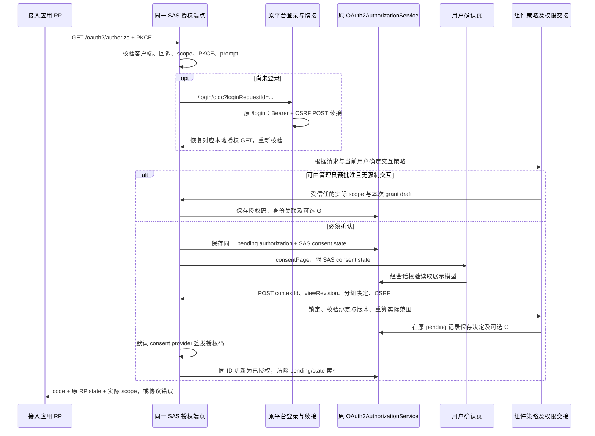

# OAuth2 / OIDC 用户确认流程设计

本文面向授权服务器组件维护者，定义用户确认页、协议接入和待授权状态。它扩展[共用客户端设计](authorization-design.md)，身份资料来源见[用户标识与个人资料](identity-profile-design.md)，业务权限求交见[安全模块委托授权边界](../../security/DESIGN.md#46-委托授权边界)。

**实现状态：当前分支已实现登录续接、独立确认页与绑定原请求的提交。** 页面使用原 AMIS 和 router 门面，协议仍通过 SAS converter/provider 继续；下文维护机制与验收约束，运行结果需另取对应基线证据；可复用验证入口见 [OidcServerFlowTest](src/test/java/com/ouroboros/ability/auth/oidc/OidcServerFlowTest.java)。

## 1. 确认内容与授权结果

确认页只提供两个预置展示分组：“身份信息”和“业务功能（所有获准权限项）”。它们是界面分组，不是新增协议 scope。分组按本次请求出现，OIDC 身份登录无需业务权限配置，也无需调用业务权限求交服务。

| 合法请求 | 展示内容 | 同意与拒绝的结果 |
| --- | --- | --- |
| 仅含 `openid` 及允许的身份 scope | 身份信息；申请 `offline_access` 时附持续访问选项 | 同意身份后完成 OIDC 登录；拒绝身份则整次 `access_denied` |
| 不含 `openid`，仅请求业务 scope | 业务功能 | 整组同意后取得业务 Access Token；拒绝或无可批准业务权限则整次 `access_denied`，不签发 ID Token |
| 同时请求身份与业务 scope | 身份信息、业务功能 | 身份必须明确同意；业务整组可拒绝，拒绝后仍可仅完成身份登录，响应反映实际获准 scope |

身份分组对应本次请求的 `openid/profile/email/phone`。首版对身份分组整组确认，不提供逐 claim 编辑器。没有 `openid` 的请求不能借 `profile/email/phone` 产生身份登录；这类组合在请求校验阶段拒绝。业务分组展示本次请求中实际可授予的全部业务权限，不补入未请求的权限，不提供逐权限勾选、字段白名单、附加数据条件或范围模板。

业务 scope 统一使用 `authority:` + `Base64URL(UTF-8(Authority 全名)，无填充)`，由共用映射函数可逆派生，避免与标准身份 scope 碰撞；不建立另一份 scope 配置或实体。客户端配置、确认展示及 scope 分类使用同一权限目录，只接受 `Authority.isDelegable=true` 的已登记权限；该标记默认 false。映射与可委托目录的权威设计见[业务委托授权详细设计](../../security/delegated-authorization-design.md)。

`EXPLICIT` 为默认值，每次新授权均确认实际出现的分组。首版不跨授权保存“以后不再询问”。`ADMIN_APPROVED` 仅由安全管理员启用，在策略允许时预批准当前请求；`prompt=consent`、OIDC 持续访问的显式同意要求仍然优先。预批准不增加用户或客户端拥有的权限。

## 2. 现有主路径与框架差异

实现继续使用同一 `RegisteredClientRepository`、`OAuth2AuthorizationService`、协议过滤链、授权码及刷新机制。待确认状态也是原 `OAuth2Authorization`，不另建授权表、临时授权仓库或手工发码接口。

| 已核实依据 | 对本设计的影响 |
| --- | --- |
| `ConfigurationRegisteredClientRepository` 按 EXPLICIT 设置 requireAuthorizationConsent，分别注册身份和业务 scope | 客户端策略由组件 predicate 继续约束，不把 requireAuthorizationConsent 当作唯一交互判断 |
| `CacheOAuth2AuthorizationService.save()` 无令牌时使用 Draft.expiresAt 保存 pending | 待确认状态仍属于原授权记录，不另建临时授权库 |
| `findByToken()` 已支持显式 `OAuth2TokenType("state")` 和 state 摘要索引 | 官方 consent provider 可沿原授权服务找到 pending；null tokenType 的 state 兼容差距见第 7 节 |
| SAS 1.5.6 默认 predicate 跳过仅 `openid` 的确认，也会复用历史同意 | 必须通过 `setAuthorizationConsentRequired()` 实现本组件策略，并显式禁用跨授权记忆 |
| SAS 默认 consent provider 会合并历史同意，且任意 scope 获准时自动加入原请求中的 `openid` | 拒绝身份必须在进入默认 provider 前转成整次拒绝；不能只从 scope 列表移除 `openid` |
| SAS 默认授权成功响应只输出 `code/state` | 部分批准时通过官方 response handler 增加实际 `scope`；RP 仍以 token response 的实际 scope 为准 |
| SAS 默认授权码兑换根据客户端的 refresh grant 尝试生成 Refresh Token，不检查 `offline_access` | 必须在原 token generator 扩展点检查此次授权的持续访问决定 |
| SAS configurer 将协议端点加入 CSRF 忽略列表 | 浏览器确认 POST 必须显式恢复 CSRF 保护，不能假设默认已开启 |

框架差异的原设计依据为 **1.5.6 sources.jar**，方法和来源见第 12 节；这段历史依据不代表本轮重新验证了全部框架默认行为。组件当前主路径以所链接仓库源码为准。官方默认组件承担协议校验与签发，组件增加其不能表达的分组策略、会话绑定和权限交接。

## 3. 页面信息架构与运行时接入

新增登录区独立路由 `/login/oidc/consent`，与 `/login/oidc` 一样由 `standaloneInternalRoutes` 注册，不进入主应用菜单或业务标签页缓存。路由壳负责读取上下文、加载页面 schema、提交和显示恢复状态，表单与列表使用原 `AmisComponent`。

组件通过原 UI 元数据发布固定的 `/auth/oidc-consent` schema，使用现有 `GET /api/ui-schema?path=/auth/oidc-consent` 加载及国际化处理。普通业务页的 `AmisPage` 依赖 `activeTabId`，不直接用于该独立页。schema 只描述显示和表单，不包含用户值、客户端策略或动态脚本授权规则；无需新增 `.menu.json` 或第二套页面引擎。

| 页面区域 | 内容与交互 |
| --- | --- |
| 请求概况 | “接入应用正在申请授权”、客户端名称、已验证回调地址的来源站点、当前平台账号显示名 |
| 身份信息 | 明确列出申请的身份类别及支持披露的资料预览；缺失资料显示“当前未填写”，不承诺存在或已验证；“同意向该应用提供上述身份信息”默认未选 |
| 业务功能 | 列出当前请求可批准的全部权限名称与说明，可按原权限目录折叠查看；仅一个“同意上述全部业务功能”选项，默认未选，条目不能单独选择 |
| 持续访问 | OIDC 请求 `offline_access` 时，在现有分组下附“允许在我离开当前页面后继续访问”，默认未选；说明仍受平台会话有效期与撤销规则限制 |
| 操作区 | “继续”和“取消授权”；身份未选时继续将拒绝整次授权，页面应明确提示。混合请求仅身份获准时显示“仅完成身份登录”结果提示 |

| 状态区 | 提交中禁用按钮；范围变化要求重新确认；已处理、超时或会话失效显示本地恢复说明 |

资料预览与签发使用[同一账号标准 claims 映射](identity-profile-design.md#41-账号拥有资料oidc-按-scope-投影)，不从任意员工联系方式兜底。联系方式要求验证时，pending 新地址不展示、不签发；只预览当前有效值及对应验证状态。资料和验证状态的变化纳入 viewRevision，提交时发生变化需重新确认；资料读取故障不能显示为“当前未填写”。

纯 OAuth2 业务请求不出现身份或 `offline_access` 选项。客户端允许刷新时，业务分组文案同时说明后台持续访问及有效期；整组业务同意包含这项 OAuth2 使用方式，不把 OIDC scope 强加给纯 OAuth2 客户端。

页面标题、列表、资料值均按纯文本转义。回调站点只从服务端返回的已验证 URI 投影，浏览器 query 中的 `client_id/scope` 不能填充页面。表单状态仅保留在当前页面内存，离开即清除，不写 localStorage、标签页持久状态或 URL。

确认提交使用同源原生表单导航，`application/x-www-form-urlencoded` POST 到固定 `/oauth2/authorize`，由框架最终重定向 RP。AMIS 只收集明确允许的字段；路由壳通过原生表单提交这些字段及 CSRF 参数。不能直接使用默认 JSON fetcher 提交协议表单，也不能用跨域 XHR 消费框架 302。浏览器向协议端点提交时不附加平台 Bearer Token。

## 4. 交互与状态



状态只描述原授权记录的生命周期：`PENDING → PROCESSING → AUTHORIZED`，拒绝、超时和失效通过原服务删除。状态不是独立的工作流实体。GET 页面或读取模型不批准授权；`PROCESSING` 是一次提交已被消费的标记，防止进程异常后重复决定。

## 5. 路由与 GET/POST 契约

以下接口都使用原协议 HttpSession，不凭浏览器传来的账号、客户端或 scope 建立身份。页面路由可以进入前端白名单，读取上下文和提交仍必须通过后端协议会话、平台会话与用户校验；不能因当前 `/api/auth/oidc/**` 被整体 permitAll 而省略这些检查。确认 API 由同一协议链显式要求已登录协议身份，机器 Bearer 不能替代浏览器绑定；原 login-context/session 仍负责登录桥接。前端 authApi 按既有登录上下文读取方式使用 `skipAuth: true, withCredentials: true`，不让默认平台 Token 注入代替上述校验。

| 请求 | 输入 | 服务端与返回 |
| --- | --- | --- |
| `GET /login/oidc/consent` | 首次由 SAS 附 `state/client_id/scope`；刷新时可用 `contextId` | 前端路由；query 仅用于定位，不作为展示与授权数据 |
| `GET /api/auth/oidc/consent-context` | `state` 或 `contextId` 二选一，禁止重复参数 | 首次通过 SAS consent state 查原 pending；后续按 authorization ID 查同一记录；验证绑定后返回 `WebApiResult<ConsentView>` |
| `POST /oauth2/authorize` | 下表定义的 form 字段 | 自定义 converter 转为组件决定 token，策略 provider 校验后委托 SAS；成功/用户拒绝使用协议导航响应 |

`ConsentView` 的最小字段：

```text
contextId                 = 原 OAuth2Authorization.id，不是 RP state
viewRevision              = 当前展示版本的不透明值
expiresAt                 = pending 的绝对过期时间
client                    = { name, verifiedRedirectOrigin }
account                   = { displayName, accountLabel }
identity                  = 可选 { scopes, supportedClaimPreviews }
business                  = 可选 { permissions: [{ scope, name, description }], refreshNotice }
offlineAccess             = 可选 { requested: true, explanation }
csrf                      = { parameterName, headerName, token }
```

account.displayName 使用原 User 的昵称 → 正式名称 → 登录名回退规则；身份资料预览中 name 和 nickname 分别按标准映射展示，不用账号显示名称替换正式名称。

身份字段仅按本次允许披露的范围投影；业务列表来源于第 8 节的权限交接接口。前端不接收 G、完整角色、访问控制条件、密钥或平台 Token。`viewRevision` 不等于可由客户端随意修改的配置 revision，它绑定当前已经展示的内容。

| POST 字段 | 约束 |
| --- | --- |
| `context_id` | 必填；定位原 pending authorization；不能证明提交者身份 |
| `view_revision` | 必填；必须等于服务端当前展示版本 |
| `decision` | 必填，只有 `continue` 或 `cancel` |
| `identity_approved` | 身份分组存在时必填，严格 `true/false`；其他请求不得传入 |
| `business_approved` | 业务分组存在时必填，严格 `true/false`；其他请求不得传入 |
| `offline_approved` | 只有本次存在 `offline_access` 时可传；缺省视为 false |
| 原 CSRF 参数 | 名称和值来自原 CSRF 机制；字段必填 |

拒绝重复键、未知决定值和未知分组。表单不接受 `redirect_uri`、RP `state`、`client_id`、`scope`、`response_type`、PKCE 参数、权限列表或 G。组件从原记录重新派生 SAS consent token 的 clientId、内部 state 与 scopes。原始默认 consent converter 必须从 converter 列表移除，使直接提交 `client_id/state/scope` 不能绕过分组确认。

SAS consentPage 中名为 `state` 的值是框架新生成的 **consent state**；RP 发来的原始 `state` 保存在 `OAuth2AuthorizationRequest` 中，只在最终协议响应原样恢复。`contextId` 是原授权 ID；三个值不可混用。首次模型加载成功后可用 `history.replaceState` 将 URL 改为仅带 contextId；页面设置 `Referrer-Policy: no-referrer`，上下文响应使用 `Cache-Control: no-store`。

GET context 的本地错误返回原 `WebApiResult` 及相应 4xx 状态。原生 POST 遇到展示变化时，error handler 用 303 导航到固定本地 `/login/oidc/consent?contextId=...`；只有已经重新验证属于当前会话的 contextId 才能带回，重新加载新模型并清空选项。其他无法恢复的浏览器错误导航到同一路由的固定 `result=expired/processed/invalid/unavailable` 状态，不带外部地址或原 RP 参数；这些状态只能改变提示，不能批准授权。CSRF filter 的失败保留本地 403 页面。第 9 节的 4xx 表示本地错误语义及 context API 状态，不要求原生导航把 JSON 错误直接展示给用户。

## 6. SAS 官方扩展点与职责分界

### 6.1 接入结构

在现有 `OidcServerAutoConfiguration` 的同一 authorizationEndpoint 中配置：

1. `consentPage("/login/oidc/consent")`，框架负责生成等待确认状态及首次页面跳转。
2. `authorizationRequestConverters(...)` 保留 GET 的默认授权请求 converter，替换默认 consent converter。组件 converter 置于默认 converter 前，独占本端点全部 POST；缺少 context_id 或携带其他协议请求字段即拒绝，不能回落到默认 converter。GET 在拒绝组件保留键后交默认 converter。组件 converter 只解析第 5 节表单并取得可信的当前 principal，不从请求构造回调或 scope。
3. `authenticationProviders(...)` 将该端点的两个默认 provider 收敛到一个组件策略 provider 的明确委托关系。组件持有原 `OAuth2AuthorizationCodeRequestAuthenticationProvider` 和 `OAuth2AuthorizationConsentAuthenticationProvider`，按 token 类型委托；列表中不再保留可直接处理同类请求的旁路 provider。两个 SAS provider 是 final 类，不使用继承或复制源码。
4. 在原请求 provider 的 `setAuthorizationConsentRequired(...)` 配置交互 predicate；在 `setAuthenticationValidator(...)` 组合标准 redirect/scope validator 和能力校验，保留默认 provider 的 grant type、PKCE、prompt 校验。
5. `authorizationResponseHandler(...)` 从已授权结果及原授权记录产生实际 scope 响应；`errorResponseHandler(...)` 区分可回 RP 的协议错误和无可信回调的本地恢复错误。

组件策略 provider 只处理分组、绑定、版本与权限决定，不生成 code/token、不计算签名，不另存授权。所有成功分支都调用上面其中一个 SAS provider，让框架创建 `OAuth2AuthorizationRequest`、`OAuth2Authorization`、授权码和协议结果 token；兑换与刷新继续走原 token endpoint。

### 6.2 初次授权与管理员预批准

这里的已登录专指原登录桥接建立的协议浏览器身份，必须同时具有有效 HttpSession binding、用户及其平台会话关联。即使协议链的 resource server 能验证某个机器 Bearer，也不能把它作为授权页的资源所有者身份。未登录时原请求按默认 provider 流转，仍由原认证入口触发平台登录。用户确认必须在平台身份建立、原授权请求再次校验后发生，不能在登录前记录某个账号的决定。

已登录后，策略 provider 按以下顺序处理：

1. 从同一客户端配置取得一致快照。先调用 SAS 公开的 `DEFAULT_REDIRECT_URI_VALIDATOR` 和 `DEFAULT_SCOPE_VALIDATOR` 校验**原请求**，再检查能力组合；不能先过滤 scope，再让未知或越权 scope 静默消失。此处复用同一标准校验函数，不复制其算法。
2. 计算本次请求是否必须交互。EXPLICIT、合法的 `prompt=consent` 和申请 OIDC `offline_access` 均要求交互。仅管理员预批准且无强制交互时才可直接决定。
3. 交互路径保留原 scope，附入服务端构造的 pending binding，让默认请求 provider 保存 pending 并返回 consent token。predicate 明确返回 true，因此 `openid` 单独请求也不会被默认豁免；`prompt=none` 在此返回 `consent_required`。
4. 无交互路径按当前用户、客户端与本次请求生成实际 scope、可选 G 及 refreshAllowed，再构造同一种官方请求 token，scope 使用实际批准子集，redirect/state/nonce/PKCE/prompt 等原协议参数保持不变。predicate 仅对这个已验证的预批准计划返回 false。默认请求 provider 再次完成全部协议校验并签发授权码。纯业务可批准集合为空时，计划标记为拒绝，由 predicate 在框架完成 grant/PKCE/prompt 校验后抛出带可信请求的标准 `access_denied`，不进入签码。

标准 prompt 校验仍在默认请求 provider 内；参数未被删除或改写，`none consent` 等无效组合不能由预批准绕过。纯 OAuth2 请求首版不解释 OIDC `prompt` 参数，不承诺其具有静默授权语义。

每请求的计划通过官方请求 token 构造器的 `additionalParameters` 携带一个组件保留键，`OidcAuthorizationPolicy.DRAFT`（`ouroboros_grant_draft`），值为服务端创建的不可变 `OidcAuthorizationPolicy.Draft` 对象。GET converter 对来自 HTTP 的该保留键一律拒绝；`prompt/PKCE` 等标准参数仍按原方式解析。这是组件已实现的内部对象交接，类型与保留键由 [OidcAuthorizationPolicy](src/main/java/com/ouroboros/ability/auth/oidc/OidcAuthorizationPolicy.java) 维护，不属于 SAS 自有 API。

SAS 请求 provider 会把 additionalParameters 复制到它创建的 `OAuth2AuthorizationRequest`，随后调用同一 `CacheOAuth2AuthorizationService.save()`。原服务在这次保存时消费该 typed draft：校验其用户、客户端、请求指纹、平台会话及策略版本与 authorization 一致，将其规范化到原记录顶层 attributes，并从保存的协议请求里删除临时保留键。无交互路径的 draft 同时保存原来已通过标准校验的 requestedScopes；存储服务用原框架 builder 恢复这份请求的原 scope，保持 `OAuth2AuthorizationRequest.scopes` 表示原申请、`authorization.authorizedScopes` 表示实际批准。除 scope 与内部保留键外，不改变协议参数；保存前必须断言实际批准是原申请的子集。此后 attributes 与框架请求各自承担明确职责，不保留第二份 draft。既不修改共享 RegisteredClient，也不使用 ThreadLocal、隐藏 registry 或额外临时 store。draft 在全部协议校验完成前不能成为有效授权；原服务校验失败时不得存入 code。

无交互路径因此也会在授权码第一次保存时同时保存 G 和公开身份关联，而不是先发码、再靠响应 handler 补权限。业务求交为空的纯业务请求按 `access_denied` 失败；身份请求仍可只批准身份。

### 6.3 确认提交

组件策略 provider 接到决定 token 后，以 authorization ID 的摘要为键取得原 `DistributedLockManager` 的锁，锁覆盖读取、校验、决定保存、默认 consent provider 调用和最终保存：

1. 从原服务重新读取 pending，校验 CSRF 已通过、绑定、TTL、stage、展示版本和当前配置。`PROCESSING/AUTHORIZED` 不得再次决定。
2. 若配置、角色或披露资料发生影响展示的变化，更新原记录的展示版本，停止该提交，返回本地“授权内容已变化，请重新确认”；不沿用旧勾选。
3. `cancel`、身份被拒绝、纯业务被拒绝或可批准业务为空时，构造 scopes 为空的官方 consent token，委托默认 consent provider 产生 `access_denied` 并移除原 pending。混合请求拒绝身份时即使同意了业务，也走整次拒绝，防止默认 provider 自动加回 openid。
4. 其他情况由服务端派生实际 scope，重算可选 G，保存 `PROCESSING`、决定和身份关联，然后构造官方 consent token。clientId 和 consent state 只取原记录，scope 只取本次实际决定。
5. 默认 consent provider 再次校验 principal/client/state/scope，签发授权码，在**同一个 authorization ID** 保存 authorizedScopes、code，并移除 SAS state。原存储服务完成 stage 归一化和旧 state 索引清理。响应 handler 只在保存成功后重定向 RP。

默认 provider 自动加入 openid 在此仅作用于已经批准身份的请求，历史 consent 不参与合并。`setAuthorizationConsentCustomizer(...)` 可做获准身份 scope 与策略一致性的断言，但不能承担 scope 缩减：1.5.6 在调用该 customizer 前已生成自己的 authorizedScopes，修改 builder 不会同步改变这个局部集合。

### 6.4 不跨授权记忆同意

为同一 SAS 装配提供一个明确的无记忆 `OAuth2AuthorizationConsentService`：`findById` 始终不返回历史记录，`save/remove` 接受框架调用但不持久化授权决定。它只表达首版“每次新授权重新决定”的产品策略，不承担 pending 存储，也不作为刷新依据。

本次实际同意、实际 scope、G 和 refreshAllowed 随原 `OAuth2Authorization.attributes` 保存，刷新延续同一 grant，不需要重新查找历史 consent。不能留下默认 InMemory consent service，防止实例内悄悄记住同意、集群间行为不一致或默认 provider 合并旧 scope。

### 6.5 浏览器 CSRF

保留原 CSRF token repository、请求 attribute handler 和 `/api/auth/oidc/session` 的保护。由于 SAS configurer 对其 endpointsMatcher 添加忽略项，需要对**当前协议链原有的 CsrfFilter** 使用受支持的 ObjectPostProcessor，调用 `setRequireCsrfProtectionMatcher(...)`，使 POST `/oauth2/authorize` 必须校验，其他非协议不安全方法保持保护。`/oauth2/token` 等标准机器端点继续沿用协议认证机制。

首版只支持 GET 发起授权，POST `/oauth2/authorize` 专用于本确认表单。必须在 filter chain 集成测试中验证 matcher 的最终效果，而不是仅检查配置调用顺序。缺少或伪造 CSRF 返回本地 403，任何 provider、code generator 或决定保存都不得执行。

## 7. 原授权存储与并发语义

### 7.1 绑定与展示版本

原授权 attributes 增加一份不可变交互上下文，包含：内部用户标识、公开 subject 关联、平台 sessionId、协议浏览器会话 binding、注册实例 registrationId/clientId、原请求指纹、客户端策略版本、viewRevision、createdAt/expiresAt、stage。registrationId 来自同一配置对象的服务端内部字段，直接作为 RegisteredClient.id；普通编辑和密钥轮换保持，删除后同 clientId 新建必须换 UUID。未落库默认值按固定命名空间、issuer、clientId 稳定派生，遵守配置管理设计第 2.1 节，不自行再生成。每次上下文读取、决定和保存都比较注册实例，不能仅比较 clientId，使旧 pending 或 grant 在同名重建后复活。请求指纹覆盖该注册实例、已验证的 redirect、RP state、scope、nonce、PKCE 与支持的其他协议参数。

浏览器 binding 使用原 HttpSession 中的随机 nonce，不以 cookie 原文作授权凭据。成功登录续接后生成；同一用户和同一平台会话的 session ID 轮换可保留，切换用户或平台会话时必须更换，并使旧上下文失效。原 `Principal` 中的内部 userIdentity 与平台 sessionId 仍保留，公开 sub 不取代内部定位。

客户端与全局启用状态读取使用[配置管理设计第 7 节](configuration-management-design.md#7-事务缓存与失败行为)的内部权威单键快照接口：通过原 `ConfigurationService` 从同一存储行取得值和 revision，无行时取同一元数据默认值。模型、提交及发证保存边界都使用该读取，不把当前本地缓存的双读 revision 当成跨实例一致保证；权威读取失败则停止授权。读取仍由 configuration-core 契约承接，不新增协议配置缓存。

配置数组 revision 用于一致读取及管理 CAS；页面指纹只包含目标客户端相关策略的规范化内容摘要，不把整个数组 revision 放入过期条件。其他客户端变化不应刷新当前确认页。viewRevision 同时绑定本次展示的身份资料、业务可批准集合和策略；角色或资料变化无法按版本检测时，在提交时重算并比较内容摘要。全局 settings 的启停单独校验，不因非相关设置变化刷新分组。

### 7.2 TTL 与索引

pending TTL 固定为 5 分钟，并截断到平台会话剩余有效期；GET、刷新和重复请求均不续期。expiresAt 作为原记录属性保存，读操作也检查绝对时间，不能只依赖缓存的延迟清理。首版无需新增可配置的多档 TTL。

`CacheOAuth2AuthorizationService` 按以下规则扩展：

- 无 token 且有合法 pending binding/SAS state 的记录按 pending TTL 保存；其他无 token 记录仍拒绝，不能任意制造长寿命空授权。
- 在原索引命名空间增加带类型前缀的 `state:SHA-256(consentState) → authorizationId`。state 索引 TTL 与 pending 记录一致；不索引 RP state，不在键或日志保存原文。
- `findByToken(value, new OAuth2TokenType("state"))` 比较记录中 SAS state，并检查绑定生命周期与绝对过期时间。它允许框架读取 PENDING 和本次锁内的 PROCESSING，以完成默认 provider 调用；能否开始一次新决定由组件 provider 的 PENDING 检查控制。兼容要求还包括 `tokenType=null` 时的 state 匹配语义；当前实现只对显式 state 类型选择 state 索引，null 走普通令牌索引，尚未满足这条要求，跟踪为 [SEC-003](../../docs/tech-debt-tracker.md#sec-003-oidc-state-的空类型查找兼容缺口)。该差距不等于已证明所有确认流程失败。state 不是 OAuth2Token，不能调用 `authorization.getToken(value)` 判断它是否存在。
- 保存同 ID 的最终授权时，先读取旧记录，计算应移除的 state/令牌索引；新记录去除 pending state、展示快照和暂存决定字段，保留获准 scope、最终 G、身份关联、策略信息及 refreshAllowed。记录与现有 token 索引改用原“最晚令牌到期时间”规则。
- state 索引最迟在最终 code 可被查到前失效；对该上下文的锁覆盖整个替换。若缓存不支持多键事务，所有索引查询仍以原记录中实际 token/state 的匹配为准，防止旧索引被误用。
- 拒绝、超时、客户端失效或删除时，经原 `remove()` 同时清除原记录及旧 state/token 索引。remove 不能只看调用参数中已被移除的 state，需同时处理存储中的旧记录。

任何 token 最大到期时间也不能延长 pending 阶段。框架签码后仍由原 code TTL 管理兑换；完成授权后的平台会话、用户和客户端检查继续沿用原生命周期，并消费目标稳定客户端身份。

### 7.3 重复提交、异常与并行页

同一上下文的两个提交串行执行。第一个提交在调用默认 provider 前保存 `PROCESSING`；第二个提交看到 PROCESSING 或已经移除 state 的最终记录后，返回本地 409“该授权请求已处理”，不再次签码，也不重新返回第一次的 code。双击按钮的前端禁用只改善交互，不承担幂等性。

如果进程在 PROCESSING 后中断，后续提交清除仍处于该状态的 pending，并要求从 RP 重新发起。默认 provider 抛出错误时，同样清理尚未转为最终授权的原 pending。若授权已保存而响应丢失，不重发 code；RP 重新发起。无需额外结果回执表或重放缓存。缓存、锁或配置服务失败时 fail closed，不能为了继续流程改走无锁或无绑定路径。

不同 contextId 互不覆盖；同一 HttpSession 可同时处理多个已登录授权页。相同或缺失的 RP state 也不能使上下文冲突。多个 tab 对同一 contextId 操作仍只能成功一次。

登录前也需要明确区分原请求：现有单槽 `HttpSessionRequestCache` 无法保证两个未登录标签页同时发起授权。实现时通过原 RequestCache 扩展点在**同一 HttpSession** 按 `loginRequestId` 保存最多 8 个、5 分钟有效的本地授权 GET，达到上限时拒绝新请求，不覆盖已有页。登录入口将该定位值带到 `/login/oidc`，并在原 `/login` 的本地 redirect 中保留。原 login-context/session 接口按该值取回并只消费对应请求。不能在浏览器存储完整请求或从 query 接受任意恢复 URL。

这个缓存只完成原登录请求恢复，不保存授权决定、G 或 code；恢复后仍回同一 SAS 端点校验。原请求已经耗尽或无法安全对应时返回本地恢复页，不回退到“最后一个请求”。现有无定位值请求只有在会话恰好存在一个未消费登录请求时才可定位，否则要求重新发起；发布时应让前后端同时使用新契约。

## 8. scope、C/G/T 与持续访问交接

### 8.1 交接接口

确认组件只消费业务权限服务，不在本模块复制角色合并、字段或数据条件算法。请求中的业务 scope 经共用映射函数解析为权限目录中的 Authority；用户看到目录名称而非编码字符串。未知映射、非规范编码、未登记或不可委托权限均在批准前拒绝。建议契约如下；实现名称可随原模块命名收敛，输入与结果语义必须保留。

```text
previewBusinessGrant(userIdentity, platformSessionId, clientPolicySnapshot C,
                     requestedBusinessScopes)
  -> { grantableScopes, displayPermissions, permissionRevisionOrDigest }

createBusinessGrantSnapshot(同上输入, approvedBusinessScopes)
  -> { grantedScopes, immutableBoundary G, permissionRevisionOrDigest }
```

preview 供展示；create 在提交锁内重新调用。两者使用安全模块同一有效权限语义。create 返回的 scopes 必须是已展示、已申请、客户端允许、用户仍拥有的子集；若与展示不一致，要求重新确认，不能自动扩大。混合请求拒绝业务、纯身份请求和无业务结果都不构造业务 G。

最终实际 scope 为：获准身份 scope + 整组业务批准后的 grantedScopes + 已获准的可选 `offline_access`。G 和具体业务 scope 保存到原授权，令牌生成读取同一 authorizedScopes。T 由 Access Token 的业务 scope 子集形成；资源消费端继续按安全设计得到 `B = C当前 ∩ G ∩ T`，再与用户当前权限求交。确认页不产生新的角色、临时 User 或可放宽原权限的边界。

纯身份 Access Token 可用于获准的 UserInfo，但没有业务 G，因此不能访问平台业务 API。混合拒绝业务后同样如此。用户拒绝的业务 scope 不得在 refresh、token customization 或资源认证时从原请求、当前 C 或历史角色重新补回。

### 8.2 OIDC 与纯 OAuth2 的刷新规则

| 场景 | 持续访问同意 | 本次 refreshAllowed |
| --- | --- | --- |
| OIDC 未请求 `offline_access` | 没有持续访问申请 | false；完成身份登录但不签发 Refresh Token |
| OIDC 请求 `offline_access`，用户拒绝或未选 | 身份及可选业务可继续；实际 scope 删除 offline_access | false |
| OIDC 请求且显式同意 `offline_access` | 同意与本次身份决定绑定；ADMIN_APPROVED 也需要展示此项 | 客户端支持 refresh grant、身份已批准且满足其余条件时为 true |
| 纯 OAuth2 业务授权 | EXPLICIT 的整组业务同意含已展示的持续访问说明；ADMIN_APPROVED 可按当前客户端策略预批准 | 客户端支持 refresh grant且获准业务非空时为 true；不要求 openid/offline_access |

纯 OAuth2 首版不支持单独使用 OIDC `offline_access`；此 scope 不会作为业务 scope 注册，相关请求报 `invalid_scope`。公共客户端继续遵守当前不签发 Refresh Token 的限制，即使请求或同意持续访问也不能突破；客户端注册和请求校验应拒绝其不可实现的 OIDC offline_access 申请，避免页面承诺不存在的能力。

通过同一 `OAuth2TokenGenerator` 组合中的 refresh generator 实现 gating：从原 authorization attributes 读取 refreshAllowed 和用途，条件不满足时不生成 Refresh Token；满足时委托原 `OAuth2RefreshTokenGenerator`，继续保留其公共客户端检查。不能在 response handler 删除响应中的 refresh_token 来假装没有签发，因为那样存储里仍有可用令牌。

刷新沿用原 grant 的同意、G、身份关联与当前生命周期，不产生新的用户同意，不重新接受曾拒绝的 scope。已拒绝整次授权的 pending 被删除，不存在可刷新的 grant；拒绝业务后的身份授权即使获准刷新，也只能延续身份及已批准的持续访问。缩小 scope 后的持久缩限由原授权生命周期实现，不能后续省略 scope 又恢复已缩掉的业务权限。

本组件继续要求关联平台会话有效；“离线”表示用户无需停留在当前浏览器页面，不表示平台退出、会话到期或管理员撤销后仍能刷新。这是当前产品会话策略，确认文案与客户端接入说明必须明确。

## 9. prompt、拒绝与错误出口

| 条件 | 结果与出口 |
| --- | --- |
| OIDC `prompt=none`，尚未登录 | SAS 返回 `login_required`，不进入原登录页 |
| OIDC `prompt=none`，已登录但必须确认 | `consent_required`，不创建可交互页面；EXPLICIT 因不跨授权记忆而满足此条件 |
| OIDC `prompt=none`，ADMIN_APPROVED 且无需强制同意 | 使用当前用户和客户端的实际范围完成；不显示页面 |
| OIDC `prompt=consent` | 每次显示本次请求的实际分组，ADMIN_APPROVED 也不能跳过 |
| `prompt=none consent` 等协议无效组合 | SAS `invalid_request`；不能把它解释成任选其一 |
| OIDC `prompt=login/select_account`、不支持的 prompt 值或包含 `max_age` | 在请求能力校验明确返回 `invalid_request`；首版不静默忽略，不让 RP 误以为已经重认证或选择账号 |
| 用户取消、拒绝身份、纯业务拒绝或无可批准业务范围 | 经同一 SAS provider 拒绝本次授权，向已验证且当前仍允许的回调返回 `access_denied` 和 RP 原 state；不退出平台、不撤销其他 grant |
| 混合请求拒绝业务 | 继续身份授权，实际 scope 不包含业务；无业务 G，不以部分拒绝作为协议失败 |
| 未知/不允许的 scope、能力关闭时的新请求 | 校验阶段按协议拒绝，不把未知 scope 静默变成身份请求 |
| 不存在、超时、重复、其他会话/账号的 contextId 或伪造 consent state | 本地 400/409/410/401 恢复页，不向浏览器所给地址跳转 |
| CSRF 无效 | 本地 403；不消费上下文，不生成协议成功或错误回调 |
| 缓存、锁、配置读取故障或签发失败 | 不能确认安全结果时本地失败并清理 pending；只有框架已携带可信且当前可用回调时才能输出 `server_error` |

协议错误与本地恢复是两种不同结果。只有已经验证、与当前上下文一致、且当前客户端仍允许的 redirect_uri 可以接收协议响应；state 只能从原 `OAuth2AuthorizationRequest` 取得。初始请求中的未知客户端或未验证回调、失效上下文以及页面 query 参数都不能成为重定向依据。没有可信回调时停在本平台，不按“注册列表第一个地址”自选目标。

本地恢复页只提供安全的本地操作，例如“返回平台”及说明“请回到接入应用重新发起授权”。页面关闭、浏览器后退或不再操作不等于协议拒绝，pending 按 TTL 清理，不在后台自行跳转 RP。重新登录为不同用户后，旧上下文作废，不能将旧决定套用到新账号。

成功授权响应采用框架结果中的 code 和原 state，由官方 response handler 扩展输出空格分隔、正确编码的实际 `scope`；不拼接用户提供的 URI。授权码响应附 scope 为本组件的兼容行为，RP 需要能够接受合法附加参数，并在 token response 检查最终 scope。ID Token 的存在和身份 claims 由合法 OIDC 请求及实际身份批准决定，业务客户端不能把一个普通 Access Token 当作登录断言。

## 10. 展示后配置变化与停用

模型读取、提交决定和原授权服务保存/读取都检查当前客户端与关联会话。平台会话到期、用户停用或浏览器 binding 不匹配时删除 pending，显示本地恢复，不自动重新登录并继续旧确认。

目标客户端名称、披露 scope、业务 C、同意策略、刷新能力或当前用户可授予范围变化，导致 viewRevision 改变。提交返回“授权内容已变化”，重新读取并清空选项；不在展示 EXPLICIT 后悄悄改为预批准。无关客户端变更不影响当前页。

原请求包含的能力被关闭或 scope 从注册中删除时，不再是合法的新授权请求，终止 pending；不能自动删掉业务请求后继续身份，或删掉身份后变成纯业务。用户主动拒绝业务才适用混合请求的部分批准规则。整个客户端禁用/删除、授权服务器停用或回调被移除时，停止签发并显示本地恢复，不使用停用前的旧地址重定向。

提交校验与原授权保存之间再次核对相关策略版本；在不同节点同时更新时，已保存 grant 的 G 不因后续扩大 C 而扩大，收紧与禁用由原服务端生命周期再次检查。不存在跨配置库与缓存的全局事务承诺。协议链停用时仍应对确认 API/页面返回稳定的本地“授权服务不可用”结果，不能落入普通业务登录或误用平台 Token 继续授权。

## 11. 验收场景

| 场景 | 必须验证的结果 |
| --- | --- |
| 仅 openid + EXPLICIT | 仍显示身份确认；拒绝不产生 code；无任何业务策略也可批准登录 |
| profile/email/phone 资料有缺失 | 展示和实际 claims 一致，不补造联系方式或 verified=true |
| 纯业务合法请求 | 只显示业务分组；无 openid、ID Token 或身份资料泄露 |
| 混合请求业务未勾选 | 可完成身份登录；code/token 的实际 scope 无业务，G 缺失，业务 API 拒绝访问 |
| 混合请求身份拒绝、业务勾选 | 整次 access_denied；默认 provider 自动补 openid 的行为不能绕过拒绝 |
| 整组业务批准 | 只授本次请求且用户和客户端都允许的权限；浏览器篡改 scope/G/权限字段被拒绝 |
| OIDC offline_access 同意/拒绝/未申请 | 分别验证 scope、refreshAllowed、实际 Refresh Token 及存储；拒绝不影响已同意身份 |
| 纯 OAuth2 刷新 | 无需 openid/offline_access；业务分组说明与策略一致；刷新不恢复拒绝或持久缩掉的范围 |
| EXPLICIT 第二次授权与多节点 | 每次重新确认，不能由默认内存 consent service 偷记住；同一 grant 的刷新无需新页面 |
| ADMIN_APPROVED 与 prompt | 身份/业务可按策略预批准；none 无强制交互时成功；consent 和 OIDC 持续访问仍显示确认 |
| prompt=none 未登录/已登录必须确认 | 分别 login_required/consent_required，没有 HTML 交互或登录跳转 |
| 不支持的重认证请求 | prompt=login/select_account、max_age=0 及其他 max_age 值均明确失败；不复用旧会话假装完成要求 |
| 无 token 的 pending 与 state 查找 | 原记录及摘要索引有相同 TTL，默认 provider 可找回；RP state 不能用于查 pending |
| 重复、并发、网络中断及进程退出 | 同 context 最多一次授权码；响应丢失不返回旧 code；PROCESSING 不可再次批准 |
| 两个未登录 tab、两个已登录 tab | loginRequestId/contextId 各自对应；同 RP state 也不串单；单槽旧缓存不能被误当作已满足 |
| CSRF、跨会话和换账号提交 | 本地拒绝，不能发码、消费他人决定或重定向攻击地址 |
| 展示后改配置、角色或资料 | 相关变化要求重新确认或终止；无关客户端变化不影响；扩大 C 不扩大旧 G |
| 客户端停用、回调移除、全局停用 | 停止签发；无旧回调跳转；原授权服务按统一生命周期处理 |
| pending 成功、拒绝与超时 | state 索引清除，只有同一授权记录继续存在或删除；没有孤立临时 store |
| 标准客户端集成 | 授权码、PKCE、原 state、scope、OIDC nonce、token 兑换和刷新仍通过同一 SAS；未知附加响应参数不破坏 RP |

验证应包含原组件的 MockMvc 协议流程测试、可控时钟的 pending/索引测试、共享缓存与锁的并发场景，以及主应用独立路由的浏览器旅程。不能仅用 schema 文字匹配、页面截图或单独调用业务求交函数证明确认流程成立。

## 12. 源码依据与兼容性限制

当前仓库主路径：

- [OidcServerAutoConfiguration](src/main/java/com/ouroboros/ability/auth/oidc/OidcServerAutoConfiguration.java)：同一协议链、原 RequestCache、登录入口和 token customization。
- [OidcLoginController](src/main/java/com/ouroboros/ability/auth/oidc/OidcLoginController.java)：原 Bearer + CSRF 续接、平台会话验证与本地已保存请求恢复。
- [CacheOAuth2AuthorizationService](src/main/java/com/ouroboros/ability/auth/oidc/service/CacheOAuth2AuthorizationService.java)：原授权记录、token 摘要索引和平台生命周期校验。
- [ConfigurationRegisteredClientRepository](src/main/java/com/ouroboros/ability/auth/oidc/repository/ConfigurationRegisteredClientRepository.java)：按当前客户端能力、同意策略和稳定 registrationId 构造 RegisteredClient；配置数组 revision 用于管理 CAS，不替代目标客户端策略摘要。
- [OidcTokenExchangeLockFilter](src/main/java/com/ouroboros/ability/auth/oidc/OidcTokenExchangeLockFilter.java)：既有分布式锁机制；本设计复用它所依赖的锁管理器，不另造并发设施。
- [独立页面路由](../../frontends/web/main-app/src/router/internalRoutes.ts)、[OidcLoginPage](../../frontends/web/main-app/src/features/auth/pages/OidcLoginPage.tsx)、[AmisComponent](../../frontends/web/main-app/src/components/amis/AmisComponent.tsx)、[AmisPage](../../frontends/web/main-app/src/components/amis/AmisPage.tsx)、[UISchemaController](../../core/ouroboros-ui-model/ouroboros-ui-model-schema-runtime/src/main/java/com/ouroboros/uischema/controller/UISchemaController.java)：登录区路由、页面运行时及元数据获取边界。

框架与协议依据：

- [SAS 1.5 协议端点扩展](https://docs.spring.io/spring-authorization-server/reference/1.5/protocol-endpoints.html#oauth2-authorization-endpoint)：converter/provider/consentPage/response handler。
- [1.5.6 请求 provider](https://github.com/spring-projects/spring-authorization-server/blob/1.5.6/oauth2-authorization-server/src/main/java/org/springframework/security/oauth2/server/authorization/authentication/OAuth2AuthorizationCodeRequestAuthenticationProvider.java)：标准验证、交互 predicate、pending state、additionalParameters 复制和默认签码。
- [1.5.6 consent provider](https://github.com/spring-projects/spring-authorization-server/blob/1.5.6/oauth2-authorization-server/src/main/java/org/springframework/security/oauth2/server/authorization/authentication/OAuth2AuthorizationConsentAuthenticationProvider.java)：state 查找、历史合并、自动 openid、customizer 时机、拒绝和同 ID 保存。
- [1.5.6 授权端点 filter](https://github.com/spring-projects/spring-authorization-server/blob/1.5.6/oauth2-authorization-server/src/main/java/org/springframework/security/oauth2/server/authorization/web/OAuth2AuthorizationEndpointFilter.java)：consentPage query 与默认 code/state 响应。
- [1.5.6 server configurer](https://github.com/spring-projects/spring-authorization-server/blob/1.5.6/oauth2-authorization-server/src/main/java/org/springframework/security/oauth2/server/authorization/config/annotation/web/configurers/OAuth2AuthorizationServerConfigurer.java)：协议端点 CSRF 忽略规则。
- [Spring Security 6.5.8 CsrfConfigurer](https://github.com/spring-projects/spring-security/blob/6.5.8/config/src/main/java/org/springframework/security/config/annotation/web/configurers/CsrfConfigurer.java)及[SecurityConfigurerAdapter](https://github.com/spring-projects/spring-security/blob/6.5.8/config/src/main/java/org/springframework/security/config/annotation/SecurityConfigurerAdapter.java)：最终 matcher 设置后才 postProcess 原 CsrfFilter，可用 addObjectPostProcessor 注册同一链的窄化调整。
- [1.5.6 授权码兑换 provider](https://github.com/spring-projects/spring-authorization-server/blob/1.5.6/oauth2-authorization-server/src/main/java/org/springframework/security/oauth2/server/authorization/authentication/OAuth2AuthorizationCodeAuthenticationProvider.java)及[刷新生成器](https://github.com/spring-projects/spring-authorization-server/blob/1.5.6/oauth2-authorization-server/src/main/java/org/springframework/security/oauth2/server/authorization/token/OAuth2RefreshTokenGenerator.java)：刷新 grant 与公共客户端的默认处理。
- [OIDC Core：prompt](https://openid.net/specs/openid-connect-core-1_0.html#AuthRequest)、[持续访问](https://openid.net/specs/openid-connect-core-1_0.html#OfflineAccess)及[OAuth2 scope 响应](https://www.rfc-editor.org/rfc/rfc6749#section-3.3)。

本设计不宣称覆盖所有 OIDC 交互参数。首版聚焦 code + PKCE、本文定义的 prompt=none/consent、标准身份 scope 和已有会话策略；PAR/JAR、逐 claim 请求、自定义 response mode、设备授权及多账号选择不由本页扩展。不支持的请求特性在能力校验中明确拒绝。`prompt=login/select_account/max_age` 首版按第 9 节失败，不静默忽略；完整重认证与账号选择属于后续原登录桥接的 OIDC 协议覆盖项，不为本页新建登录系统。

OIDC 未申请持续访问时不再签发 Refresh Token，是相对旧客户端级 refresh grant 行为的明确收紧；接入方必须按实际 scope/token response 处理。公共客户端离线刷新继续不支持。ADMIN_APPROVED 不代表已获得用户的 OIDC 持续访问显式同意。以上限制及部分批准响应应进入接入应用验收，而不是由页面隐藏掉。
