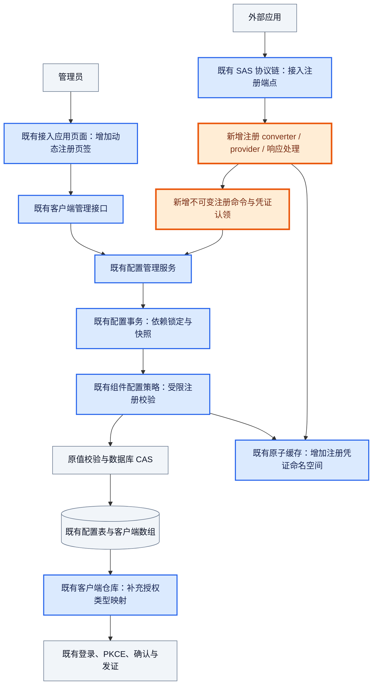
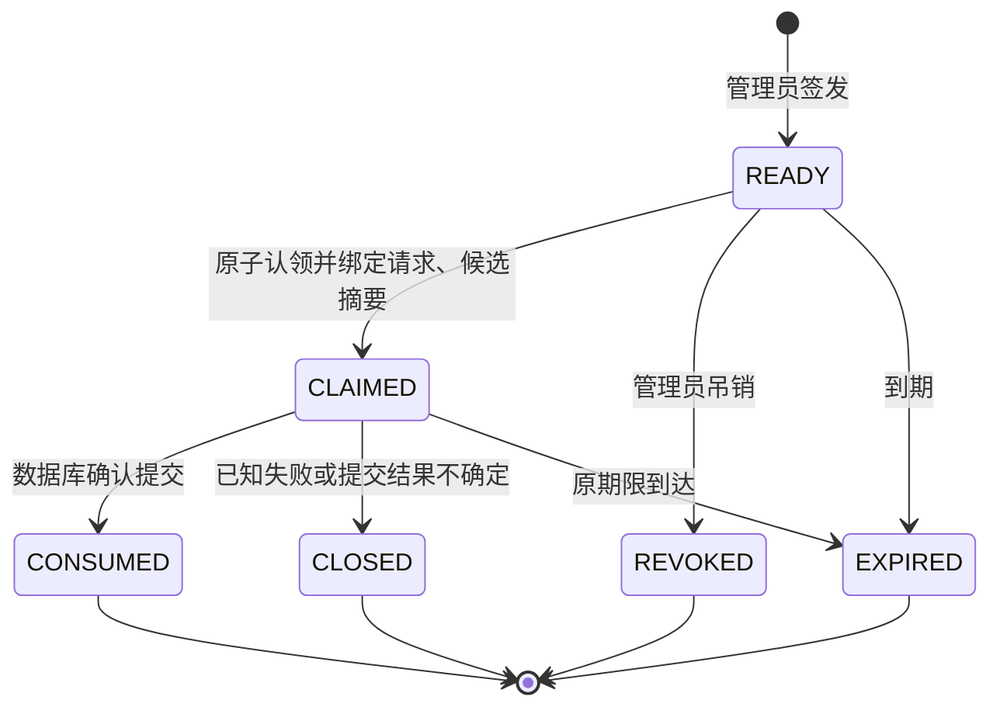

# OAuth2 / OIDC 动态客户端注册设计

状态：已实现，默认关闭。实现从 `23a6f8f80b4825d59e4b711d26282ce1c278b59e` 演进；行为验收由正式 testing 场景执行，具体运行结果以本轮验证报告为准。

本文定义 DCR 的协议范围、管理员配置、注册凭证和客户端生命周期。统一配置的受限命令、事务依赖和写入授权以[安全读写契约 §11](configuration-management-design.md#11-组件命令的受限写入与依赖快照dcr-扩展)为准。DCR 属于 OAuth2 共用客户端注册能力，OIDC 复用它，不归入某一个客户端的身份能力开关。

## 1. 范围与架构关系

提供 `POST /connect/register`，同时支持管理员选择的 `INITIAL_ACCESS_TOKEN`（凭证注册）与 `OPEN`（开放注册），默认关闭。首版只注册使用授权码的身份接入客户端，不自动开放平台业务 API。后续管理继续使用原多客户端页面和管理 API；不提供 RFC 7592 管理，不返回 `registration_access_token` 或 `registration_client_uri`，不开放协议侧 GET/PUT/DELETE。

橙色为新增，蓝色为扩展，灰色为复用。图表示逻辑调用关系，不改变物理模块归属。



`ConfigurationRegisteredClientRepository.save()` 继续拒绝写入。管理与注册都通过 `ConfigurationManagementService → doUpdate（原配置策略与校验）→ ConfigurationValueService → 原数据模型`。不新增客户端实体表、策略注册表、用户身份或用户授权服务。

## 2. 配置定义与管理员入口

新增 BACKEND OBJECT 配置节 `security.auth.oauth2.registration`，由原 `OidcClientConfigurationMetadataProvider` 定义，`groupPath=security.auth`，声明 `managementAccessPolicyRequired=true`、`managementEntry=/system-setting/auth-clients`。同一既有配置策略承接此键，使用原 `systemSetting.authClients.security` 管理权限；不把该权限授予注册调用方。授权服务器 `settings` 的原管理权限和入口保持不变。

原页面保留多客户端“应用列表”，增加服务器级“动态注册”页签；它不属于某个客户端的编辑表单。字段标签仅用中文。通用配置工作台按原接管机制排除此配置节，定义、默认值、内部读取和服务端授权仍然存在。

| 字段 | 中文标签 | 默认值与约束 |
| --- | --- | --- |
| `enabled` | 启用动态注册 | `false`；启用时检查部署就绪、授权服务器运行状态及原子缓存能力 |
| `mode` | 注册方式 | `INITIAL_ACCESS_TOKEN`；可切换 `OPEN` |
| `allowedClientTypes` | 允许的客户端类型 | `PUBLIC`、`CONFIDENTIAL`，分别对应 `none`、`client_secret_basic` |
| `allowedIdentityScopes` | 允许申请的身份信息 | `openid`、`profile`；可增加 `email`、`phone`、`offline_access`，不接受业务 scope |
| `allowedGrantTypes` | 允许的授权方式 | `authorization_code`；可增加 `refresh_token`，公共客户端仍不发刷新令牌 |
| `redirectPolicy.allowedHttpsOrigins` | 允许的 HTTPS 回调来源 | 空表示不额外限制 HTTPS origin；非空时精确匹配 origin，完整回调仍须登记并验证 |
| `redirectPolicy.allowLoopbackHttp` | 允许本机 HTTP 回调 | `true`；仅规范允许的回环地址，禁止通配符、userinfo、fragment |
| `maxDynamicClients` | 动态注册应用数量上限 | `100`，必须为正整数；禁用仍计数，管理员删除后才释放 |
| `rateLimit.window` | 注册频率统计时段 | `PT1M`，必须为正时长 |
| `rateLimit.global` | 每时段注册请求数 | `30`，必须为正整数 |
| `rateLimit.perSource` | 每来源每时段请求数 | `5`，必须为正整数 |
| `initialAccessTokenTimeToLive` | 注册凭证有效期 | `PT30M`；每份凭证最多认领一次注册尝试 |

以上与当前配置定义及校验一致。新配置节没有旧 Spring 注册配置需要兼容；无持久化行时始终关闭，不允许通过元数据默认值启用 DCR。恢复默认也是正常 CAS 写入，保留注册策略行并关闭注册，不删除客户端或重新启用已消费凭证。

配置校验要求至少允许一种客户端类型，保留 `openid` 和 `authorization_code`；`offline_access` 只有在允许机密客户端和 refresh grant 时才可开放。限流复用原原子缓存，以当前策略和固定时段执行全局及可信来源计数，不建立新的限流框架。来源来自实际连接或既有可信代理配置，禁止任意转发头绕过；统计先于凭证认领和昂贵的密钥编码，失败请求也计数且不回补，内部事务重试不重复计数，缓存故障拒绝注册。

```text
接入应用（OAuth2 / OIDC）
[应用列表] [动态注册]

  启用动态注册        [关闭]
  注册方式            (●) 凭证注册  ( ) 开放注册
  允许的客户端类型    [✓] 公共客户端  [✓] 机密客户端
  允许申请的身份信息  [✓] 基本身份 [✓] 个人资料 [ ] 电子邮箱 [ ] 手机号码
  允许的授权方式      [✓] 授权码 [ ] 刷新令牌
  回调来源、本机回调、注册数量、注册频率
  注册凭证            [签发凭证] [吊销未使用凭证]
  [保存]
```

凭证区仅在凭证注册模式展示；签发/吊销是原管理 Controller 的受保护操作，不是配置值。签发凭证时应用持久化策略，尚未保存的表单不生效。客户端列表增加来源、注册时间和来源筛选；自报应用名称不代表管理员验证过其身份。

修改策略仅约束新注册，不静默修改已有客户端；关闭 DCR 不使已有客户端失效。策略损坏、缺少策略 Bean、锁定查询或缓存能力不足均拒绝新注册，不能回退成开放模式。

## 3. 注册请求与客户端模型

继续保存于 `security.auth.oauth2.clients`，复用 `OidcClientSpec`。增加以下值字段，不增加顶层领域实体：

| 字段 | 来源与作用 |
| --- | --- |
| `applicationType` | 已接受的 `web` 或 `native`；缺省为 `web`，成功响应回显实际登记值 |
| `grantTypes` | 记录实际允许的授权类型；仓库不再无条件给所有机密客户端注册 refresh grant |
| `registration.source` | 服务端设置 `MANUAL`、`DCR_OPEN` 或 `DCR_INITIAL_ACCESS_TOKEN` |
| `registration.createdAt` | 服务端注册时间，创建后不由普通编辑改写 |
| `registration.initialAccessTokenId` | 凭证注册时的非秘密凭证标识，仅安全管理员可见，不是 token 摘要或原文 |

旧客户端没有新字段时，沿用当前授权类型行为和手工来源；普通保存保留来源及创建时间。原配置解析器、管理投影与仓库映射同步演进，不长期双读新旧配置键。原普通 JSON 的保留字段规则增加 `registration`，管理读取的只读来源字段不能作为可写输入回填。

`client_id`、`registrationId`、时间戳和机密客户端密钥由服务端生成。整个尝试固定同一组标识、已接受 metadata 和密钥，内部 CAS 重试不重新生成。最终策略校验必须接受这份完整候选；若当前策略已不允许，拒绝该请求，不在事务中静默缩小后返回旧响应。

生成阶段提取复用原管理功能的密钥生成与编码逻辑，一次生成原文和 `{bcrypt}` 散列；不可变持久候选只携带散列，原文仅保留在本次 provider 调用内存中供成功响应使用。认领摘要根据规范序列化的完整持久候选计算，避免每次重试产生新的 bcrypt 盐而改变候选。外部 metadata 不能影响这组服务端字段；其中不属于协议请求的未知字段仍按标准忽略，不映射成内部散列或标识。

首版注册的客户端固定 `apiAuthorization.enabled=false`、业务权限为空、`introspectionResources=[]`、`consentPolicy.mode=EXPLICIT`，不能由 metadata 自报放开。业务接入后续仍由原管理员明确配置，并走原用户同意和统一权限求交。

支持 `response_types=[code]`、`authorization_code` 和受策略允许的机密客户端 `refresh_token`；不接受隐式、密码、Client Credentials 或未知 grant。省略 scope 时取 `openid` 与当前允许的 `profile`；显式身份 scope 须属于当前允许集合并包含 `openid`。这是首版身份接入 profile 的限制，不代表 DCR 标准要求所有 OAuth2 客户端必须申请 openid。`offline_access` 仍须满足原刷新能力和用户显式同意规则，注册成功不代表已获用户授权。

未知 metadata 按标准忽略；已识别但不支持的认证方式、业务 scope、算法、远程密钥配置等明确拒绝，不抓取调用方提供的远程 URL。完整回调不得被服务端静默改写。native loopback IP 动态端口由共享 `OidcRedirectUris` 在原注册校验、授权校验和可信回调判断中统一匹配，除端口外仍须精确一致。`localhost` 不等同于 RFC 8252 的 IP-literal 动态端口规则。

## 4. 注册资格与一次性凭证

### 4.1 资格的实际依据

OPEN 的授权依据是事务内锁定的注册策略明确允许开放注册；凭证模式的依据是该策略允许凭证注册，并且原子缓存中存在绑定本次请求的有效认领记录。命令类型、`purpose`、`isAuthenticated`、请求体中的来源或更新人均不能单独证明资格。

provider 在完成请求格式、预检查及限流后生成不可变候选，计算候选摘要，并认领凭证。命令携带服务端生成的 `requestId`、候选、观察到的策略 revision 和认领句柄；句柄只包含凭证标识、请求关联信息，不携带管理员身份、角色或可复用的平台权限。策略在原配置事务内再次核对当前策略与认领记录。通用 JSON 接口没有构造该命令的反序列化入口；即使内部代码构造了同类型命令，没有匹配的权威策略与凭证记录仍不能通过。

OPEN 无需制造一个虚拟凭证或匿名管理员，其资格来自开放策略，不校验请求 Token，也不因附带 Authorization 增加任何权限。只有凭证模式才提取并验证 IAT，不把平台令牌或客户端密钥当作注册凭证。预检查后若模式发生变化，事务内 revision 检查拒绝该次尝试，不根据新模式自动重解释请求。

### 4.2 凭证存储与状态

管理员签发至少 32 字节密码学随机值；响应仅显示一次原文并设置 `no-store`。原 `CacheManager` 的专用命名空间保存 SHA-256 摘要关联的凭证标识、issuer、签发人、绝对到期时间与状态，读取校验当前 issuer，不保存原文，不放入客户端配置或用户 `OAuth2Authorization`。启用前要求 `atomicUpdates=true`；多节点还要求 `shared=true`，不能用非原子 `getAndEvict` 或本地锁冒充跨节点原子性。



`READY → CLAIMED` 使用原 `compareAndSet`，绑定 `requestId/clientId/registrationId/候选摘要/策略revision`，保持原绝对到期时间。认领后没有回到 READY 的迁移。这里选择“每份凭证一次尝试”，失败可能需要管理员重新签发，以避免数据库与缓存无法共同提交时重复创建。

只有同一次服务端调用、已明确回滚的事务可使用同一认领记录有限重试；HTTP 重发不能重用认领，即使提交相同 metadata 也不自动重建或返回原密钥。策略每次尝试都核对绑定、状态和期限。管理员吊销与认领竞争时，只有一个 READY 状态迁移成功；已认领的请求返回“已使用”，吊销不承诺追溯取消已进入事务的请求。

缓存丢失时未知凭证一律失效。恢复旧缓存快照前必须清空此命名空间，不能恢复已消费资格。`CONSUMED` 只是结果记录，阻止复用的关键是提交前已不可逆认领，不依赖提交后的缓存更新成功。

### 4.3 并发与失败

注册策略行在启用时由原管理写入持久化；该行是关闭、收紧策略与注册事务的共同数据库锁定对象。客户端 CAS、缺行语义及先后顺序见[配置契约 §11.4](configuration-management-design.md#114-事务依赖锁定与关闭注册的并发语义)。授权服务器总暂停沿用既有请求门禁语义，不承诺追溯撤销暂停前已经获准的在途操作；禁止新注册使用 DCR 注册开关。

| 结果 | 客户端 / 凭证处理 | 调用方行为 |
| --- | --- | --- |
| 认领前校验失败或限流 | 不写客户端，不消费凭证 | 返回协议或频率错误 |
| 认领后策略变化、校验失败 | 原事务回滚；凭证关闭，不退回 READY | 重新获取注册资格，不自动切换模式 |
| CAS 冲突且事务明确回滚 | 同次调用最多执行 3 次事务尝试；保持候选与认领；每次重验策略和配额 | 超限返回暂时失败；不重试管理员草稿 |
| 数据库连接中断、提交结果不确定 | 不重试，不释放资格；按 requestId/clientId 核对 | 返回 503 或连接失败，管理员核对后清理或轮换密钥 |
| 已提交但配置事件、凭证结果记录或响应失败 | 客户端已存在，资格不恢复，不创建第二个客户端 | 不宣称回滚；不重新返回原密钥 |
| 正常提交 | 沿用原缓存失效/事件；记录消费结果 | 201，返回实际接受的 metadata，机密客户端一次性返回新密钥 |

错误、访问日志和审计均不得包含 IAT、client secret 或其散列。已有提交状态不确定错误保留内部语义，协议层映射为无敏感内容的暂时失败和请求关联号。

## 5. SAS 集成与协议响应

在现有 SAS configurer 的 `clientRegistrationEndpoint` 注册 converter/provider/成功与失败处理，移除默认注册和配置读取 provider，避免回退到直接 `repository.save` 或默认注册管理令牌流程。GET/PUT/DELETE 明确不支持，不把它们落到默认 GET provider 或平台登录重定向。

现有协议过滤链只对精确注册 POST 允许进入 DCR provider，资格在 provider 与事务内策略校验。原 resource-server 的 Bearer 提取按此路径分派，将注册凭证交给 DCR 校验，避免提前作为 JWT 拒绝；UserInfo、内省、业务 API 和管理 API 的原认证不变。部署未就绪的拒绝链保留。

OIDC discovery 与 OAuth2 metadata 使用同一动态可用性判断：部署就绪、授权服务器运行、注册开关启用且依赖能力可用才发布 `registration_endpoint`。请求仍独立检查门禁，不能只隐藏发现字段。过滤链在启动时装配，运行时切换策略不重建链。

响应按 RFC 7591 / OIDC 注册规范返回实际登记的 `client_id`、回调、scope、认证方式、grant、response type 和签发时间。机密客户端附 `client_secret` 与 `client_secret_expires_at=0`，存储仍为原 `{bcrypt}` 散列；公共客户端不返回密钥。响应 `Cache-Control: no-store`，不调用可能把仓库存储散列当作明文返回的默认 metadata mapper。

非法回调使用 `invalid_redirect_uri`，其他不支持 metadata 使用 `invalid_client_metadata`；凭证模式缺失/无效注册凭证按 Bearer 规范返回 401，暂时不可用返回 503，限流返回 429 与 Retry-After。均不跳转登录页、不回显提交的秘密或完整配置。首版不提供协议层幂等重放或丢失响应后的密钥找回。

## 6. 实施验收

以下为行为验收标准；正式用例与自动入口见 [cases.md](../../testing/integration/feature/auth/sso-dynamic-config-oidc/cases.md) 和[执行手册](../../testing/integration/feature/auth/sso-dynamic-config-oidc/harness.playbook.md)。测试结果保存在每轮独立证据目录，不由本文替代：

| 场景 | 必须观察到的行为 |
| --- | --- |
| 两种模式与默认关闭 | 无持久行、关闭、启用、模式切换同时影响真实端点和两份发现文档；禁用不破坏手工客户端 |
| 真实过滤链 | opaque IAT 不被 JWT 过滤器抢先拒绝；OPEN 无凭证可到 provider；管理接口不因此开放 |
| 凭证竞争 | 同一 IAT 并发注册、认领与吊销竞争最多一个成功；失败、崩溃和过期均不重新释放资格 |
| 受限写入 | 普通 PUT、伪造 purpose/来源/认领句柄、平台 token 或委托 token 不能取得 DCR 写入资格 |
| 策略并发 | 两连接控制锁定时点，覆盖关闭先提交、注册先锁定、scope 收紧、模式切换、缺策略行与恢复默认 |
| 客户端与配额并发 | DCR 与管理员修改同一数组、两个首次插入、仅余一个配额；无覆盖或超额，重试不改变标识与密钥 |
| 失败边界 | 明确回滚才重试；提交断连、事件失败、响应丢失不重建客户端；审计可关联且无秘密 |
| 协议与元数据 | PUBLIC+PKCE、CONFIDENTIAL+basic、scope/grant 回显、未知字段忽略及不支持已知字段拒绝；无 RAT/管理 URI/散列回显 |
| 授权隔离 | 注册不能打开业务 API、预批准或内省权限；注册后完整登录、确认、兑换、UserInfo、允许的刷新和退出仍走原链 |
| 回归与部署 | 原管理员配置和旧客户端行为保持；loopback/localhost 区分；多节点验证真实共享原子缓存和数据库事务锁 |

## 7. 依据与上线边界

协议依据：[RFC 7591](https://www.rfc-editor.org/rfc/rfc7591)、[OIDC Dynamic Client Registration 1.0](https://openid.net/specs/openid-connect-registration-1_0.html)、[RFC 7592](https://www.rfc-editor.org/rfc/rfc7592)、[RFC 8252](https://www.rfc-editor.org/rfc/rfc8252)、[RFC 8414](https://www.rfc-editor.org/rfc/rfc8414)。框架采用项目 Boot 3.5.11 管理的 SAS 1.5.6，扩展行为以该版本源码为准。

已实现配置节和原页面扩展、SAS 注册 provider、一次性凭证与限流、原配置策略契约及事务依赖读取、客户端字段和统一回调匹配。没有新增数据库表或字段；新增值保存在既有配置表。旧手工客户端缺少 grantTypes 时保留原授权类型，缺少 applicationType 时按 web 解析。

上线先完整构建并升级全部节点，再启用新策略；配置策略 SPI 已演进，第三方实现需同步实现 writeDependencies 和返回 ConfigurationPreparedWrite，不支持仅替换单个 JAR 或带动态客户端的混版本运行。首次启用需要先完成既有 OIDC 部署身份（issuer/签名密钥）并启用授权服务器，再由安全管理员保存注册策略；默认升级不会开放注册。多节点必须配置原共享原子 CacheManager（本轮使用 Redis）及既有 OIDC 分布式锁要求，禁止把单节点内存缓存部署成集群。关闭注册只停止新注册，已创建应用由原客户端管理单独禁用或删除。

灰度/回退先关闭注册，保留策略行。回退程序前导出当前配置与审计并处理 DCR 客户端：旧程序不理解显式 grantTypes，可能给机密客户端恢复旧 refresh grant 语义，因此禁止对带动态客户端的配置直接运行旧版本。必要时先在原页面禁用/移除新增客户端；恢复旧缓存备份必须清空注册凭证命名空间。客户端密钥与注册凭证原文不能从数据库找回，响应丢失后按客户端标识核对并由管理员轮换密钥。
