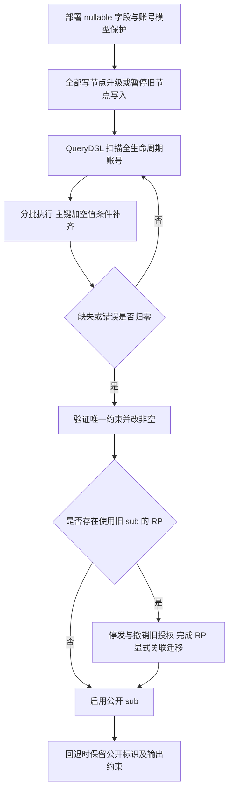

# OIDC 用户标识与个人资料设计

本文面向平台组件维护者，规定公开身份标识的迁移、标准 claims 的权威来源及其协议投影。账号字段、配置、自助维护、并发与联系方式验证的权威设计在[安全模块账号资料设计](../../security/user-profile-design.md)；协议装配见 [DESIGN.md](DESIGN.md)，共用客户端见[授权配置](authorization-design.md)，授权记录中的身份绑定见[确认流程](consent-flow-design.md)。

**实现状态：当前分支已实现公开标识、账号字段、原模型分批迁移与物理约束门禁，以及按 scope 投影资料。** 账号资料归安全模块，员工档案归组织模块；OIDC 不建立独立用户库。验证状态见验收报告。

## 1. 变更前基线与扩展位置

| 领域 | 当前事实 | 正确扩展位置 |
| --- | --- | --- |
| 账号 | UserEntity.userIdentity 是 t_sys_user 主键，有 password/avatar，无独立联系方式或公开标识 | 原 UserEntity、TypedDataModel、UserService 和账号模型插件 |
| 创建与通用写入 | 单建/批建、员工关联创建、自动管理员走 UserService；初始化 DataModelTargetDatasetGateway 可直接走模型 | 插件统一生成和保护公开标识；资料命令统一保存并保护版本/验证状态 |
| 更新 | UserService.update 移除 password；改密仍复制整实体写回 | 同步改为明确字段补丁，防止新资料被旧写法覆盖 |
| 标准 claims | UserEntityClaimsProvider 提供内部 sub/picture；EmployeeClaimsProvider 提供 employee 与组织、部门、岗位 | 账号 Provider 补齐账号资料，组织 Provider 保持业务身份职责，OIDC 按标准 scope 投影 |
| 员工档案 | EmployeeEntity 有 name/gender/mobile/email/birthday，扩展值以 employeeId 保存；已有人员模板和 FormScheme | 继续在组织组件管理，不作为所有账号联系方式或本人编辑的前提 |
| 本人和配置 | /api/sys/user/info 只读，没有本人资料页；安全运行时已有配置读取和元数据机制 | 原账号接口增加本人 profile，原配置工作台管理账号规则，原 UIModel/AMIS 展示 |

OIDC 的 openid 是请求身份认证的 scope；sub 才是 RP 识别用户的标识，RP 以 `(iss, sub)` 关联账号。账号联系方式可变，不能代替 sub；OIDC 身份不依赖可选 OAuth2 业务 API 委托。

## 2. 公开用户标识

### 2.1 字段与不变量

在原 `UserEntity` 增加 `publicSubjectId`：小写、带连字符的随机 UUID v4，字符串长度 36，一次生成、不可编辑、不可回收。复制构造和 TypedDataModel 映射必须包含它。它不替代 userIdentity 主键，也不改变密码、角色、UserSubject、内部 token 或会话中的用户定位。

字段使用 `@Unique(scope = ALL_RECORDS)`；不能沿用逻辑删除模型默认的 ACTIVE_RECORDS 唯一性。该字段级约束能经原模型迁移生成普通单列唯一约束，同时覆盖逻辑删除账号；上线校验必须确认实际数据库约束存在，不能只依赖运行时查重。迁移阶段 nullable，完成补齐后改为非空；不使用可能对整批记录产生同一值的数据库默认值。

- 登录、刷新、资料修改、账号显示变化、员工重绑和客户端变化均不更换标识。同一 issuer 的不同客户端看到同一 public subject，首版不增加 pairwise 表。
- 账号恢复须保留原记录的标识。当前没有专用恢复接口，未来恢复也不能实现为“删除后重新调用 add”。真正新建账号生成新值；当前 userIdentity 主键与逻辑删除不支持直接并存两个同名账号，本设计不改变该生命周期。
- 标识与逻辑删除记录一同保留，不由普通清理任务删除后重新生成。备份、恢复和数据搬迁须保留已签发标识；初始化资产、管理员表单、导入文件均无权指定它。

### 2.2 生成和不可改保护

在安全 RBAC 管理模块为原 UserEntity 声明一个账号专用 `DataModelPlugin`，通过现有 `@DataPlugin` 和 `DataModelPluginBuilder` SPI 注册。沿用原插件链，不新增拦截器注册表，不在 typed 模型编译器中硬编码账号逻辑。UserService 的原创建方法最终通过该插件完成赋值，不能在服务和插件中各生成一次。

| 写入入口 | 目标行为 |
| --- | --- |
| UserController → UserService.add | 拒绝请求自带 publicSubjectId；插件生成一次并随账号提交 |
| UserService.add(Collection) | 每行独立生成；批量失败遵循原事务，成功响应取已持久化值 |
| EmployeeController 关联时新建账号 | 继续调用 UserService.add，不在员工表复制标识 |
| SecurityRbacManageAutoConfiguration 自动管理员 | 继续调用 UserService.add；已存在账号不因重置密码重建标识 |
| DataModelTargetDatasetGateway 初始化 | 原模型插件生效；资产只给业务字段，不固化公开标识 |
| typed/untyped 模型、脚本、批量导入 | insert/batchInsert 均受同一插件保护；本次未发现独立账号导入 API，今后的导入也不得走裸 adapter 或关闭插件 |
| 用户更新、批量更新、禁用、改密 | 普通更新不能设置、清空或覆盖 publicSubjectId；服务写入只提交实际可改字段 |
| 存量补齐 | 仅受信系统迁移操作可做 null → UUID 的条件更新，不能改非空值 |

插件的 insert/batchInsert 在字段缺失或为 null 时生成 UUID；typed 实体转换可能带出 null，不能把它误当作调用方指定身份。任何非 null 的调用方值（包括空字符串）都拒绝，防止导入复制身份；外部创建 DTO 则直接拒绝传入该字段。生成插件须位于唯一性检查之前，保证检查和落库使用同一值。普通 update 若包含该字段一律拒绝；UserService 的管理 DTO 不接收它，整实体内部更新也须改成字段补丁，避免合法改密触发不可改检查。

迁移通过原系统 SecurityIdentity 执行。插件仅为系统操作放行合法 UUID 的一次补齐，并把条件强制收紧为“原条件 AND publicSubjectId IS NULL”；迁移服务每次还绑定一个确切 userIdentity。更新影响 0 行时重新读取，保留已写入值；不得先读空值后无条件写。普通用户即使有管理或通用数据权限也不能进入这条系统补齐分支。迁移不使用 `withoutPlugins()` 绕过账号保护。

UUID 冲突由数据库唯一约束裁决：尚未对外签发的新建/补齐操作可回滚后重试生成；已有非空值发生冲突属于数据完整性故障，停止启用并人工核对，不能自动重置已存在标识。受保护字段和迁移入口的审计不记录完整用户资料或令牌。

### 2.3 协议身份与内部身份

原 UserEntityClaimsProvider 保留 `StandardClaims.SUB = userIdentity`，新增只读扩展 claim `public_subject_id`，并同步声明 `getProvidedClaimTypes()`。该扩展仅供平台可信代码消费，不自动作为新的外部 claim 导出。

原 OIDC TokenCustomizer 对 ID Token 和本发行者签发的 Access Token 显式设置 `sub = public_subject_id`；不能保留当前“只处理 ID Token”的提前返回。UserInfo 使用同一个公开标识。缺少、格式错误或与授权记录绑定不符时拒绝签发、刷新和 UserInfo，不能退回 userIdentity、邮箱、手机号或临时 UUID。ClaimsAggregator 当前会记录并跳过 Provider 异常，因此签发边界仍必须明确检查必需的公开标识。

协议 `principalName`、平台会话与 `UserCenter.getUser()` 参数继续是内部 userIdentity。原最终 OAuth2Authorization 保存签发时 public subject 绑定；UserInfo、刷新和可选业务 API 校验使用原记录定位内部用户，再核对当前账号的公开标识。业务访问还须按确切 ACCESS_TOKEN 查原授权，具体见[委托授权设计](../../security/delegated-authorization-design.md)。账号被替换后不能因复用内部登录名继承旧授权。

外部 UserProvider 没有本地账号时，由原 Provider 提供同等稳定、不可回收、issuer 内唯一的公开标识；没有就拒绝发证，不自动建立影子账号。若外部值使用 UUID，仍须符合本节格式；不符合本发行者唯一性约束的 Provider 不能启用。不能仅因一个外部用户恰好与本地 userIdentity 同名就拿本地公开标识；接入前必须解决 Provider 身份命名冲突。

## 3. 迁移、启用与回退

### 3.1 可重复分批补齐

迁移由 RBAC 账号能力持有，OIDC 只消费结果。使用原模型迁移修改结构，使用原 QueryDSL（`TypedDataModel.query()` / `Query.field` / `QueryStatement`）读写数据，不写手工 SQL、不全量加载 UserService.searchAll，也不为迁移建立第二份账号表。

1. **扩展结构并先保护新写入。** 模型增加 nullable 字段、ALL_RECORDS 唯一约束和生成/保护插件；先部署到所有写账号节点，再开始补齐。混用不认识保护规则的旧节点时暂停账号写入，不能靠迁移锁阻止旧代码覆盖。
2. **扫描与预检。** 检查已有非空值的格式和重复值。扫描显式覆盖 `isDeleted=false/true/null`，避免 LogicalDelete 插件默认过滤已删除账号。原 QueryDSL 可明确写出该字段条件以覆盖默认过滤；其他审计和保护插件仍保留。
3. **按主键游标补齐。** 按 userIdentity 升序，每批读取有界数量，选择身份与迁移所需字段，并检查已有非空值，仅更新缺失公开标识的行；下一批用 `userIdentity > lastIdentity`。每行生成 UUID，以“userIdentity 精确匹配 AND publicSubjectId IS NULL”条件更新，独立记录成功、已被并发补齐和失败数。每批短事务提交后再推进游标；中断可从头重跑，已赋值行不改变。
4. **处理并发与重试。** 迁移互斥复用原 DistributedLockManager；数据库条件更新和唯一约束仍是正确性保障，本地锁回退不能当作跨节点互斥。并发新账号由插件赋值；与补齐竞争的普通账号更新不携带该字段。失败批次回滚重跑，0 行更新重新读取，不覆盖其他节点的成功结果。
5. **全量收口。** 游标结束后再次从头查缺失值，覆盖游标之前并发插入的账号及逻辑删除记录；检查全部本地账号无空值、无格式错误、无重复，并验证新建、批建、初始化、改密和批量更新路径。每批提交后失效账号缓存；不在发 token 时补值。
6. **收紧结构与启用。** 经原模型迁移改为非空，确认数据库实际非空/唯一约束、所有节点和 Provider 均满足契约；启用前通过原运维备份机制保存已补齐标识的受控备份，后续备份继续包含新建账号标识，再允许公开 subject 的签发与 UserInfo。未通过门槛的部署保持发行能力关闭，并给出明确运行检查结果；不把扫描全表放在每次请求中。

### 3.2 已有 RP 的切换

当前分支尚未发布，首发应直接使用新标识。若部署环境已用 userIdentity 作为 sub，发布前盘点 RP 和原授权记录，按维护窗口统一切换，不设置逐客户端的永久新旧 subject 模式。

- 停止新授权、兑换和刷新，导出受控的旧 `(iss, userIdentity)` → 新 `(iss, publicSubjectId)` 对照供 RP 完成显式关联；该数据是迁移资料，按原维护权限和审计处理，不开放匿名查询或以邮箱自动合并 RP 账号。
- 经原 OAuth2AuthorizationService 撤销旧 subject 的授权码、Access Token、Refresh Token 及待确认记录，清理其原缓存索引；无 subject 绑定的旧记录视为旧授权，不默认补绑定后继续使用。平台登录会话可保留，但后续授权必须重新走当前流程。
- RP 验证关联完成后再放开发行。已发 ID Token 是签名快照，无法撤回或修改；RP 必须结束旧身份会话。只离线验 JWT 的外部资源还须等旧 Access Token 到期或执行其自身的撤销处理，不能声称删除授权缓存已使其即时失效。
- 验收至少涵盖一名已有 RP 用户、一名新用户、一个被删除/恢复账号和旧刷新令牌；同一 RP 不应把老用户无声创建成第二个账号。

### 3.3 回退边界

对外尚未签发时可关闭新能力并修复实现，但保留已生成公开标识和模型保护。已签发后只允许回退到仍识别该字段、仍输出同一 sub 的兼容版本；若旧版本做不到，就关闭 OIDC 发行/兑换/刷新/UserInfo并撤销受影响授权，保留原平台登录，不能改回旧 sub 后继续发证。

数据库回滚、恢复备份和重新跑迁移均不得删除或重新生成已签发的标识。备份早于已签发标识时，必须从受控迁移记录/后续备份恢复原值后再启用；无法恢复则保持发行关闭。RP 身份迁移的回退也需显式协调，不用邮箱、手机号或登录名猜测关联。重启发行前再次执行本节门槛。

## 4. 资料存储与标准 claims

### 4.1 账号拥有资料，OIDC 按 scope 投影

账号资料存原 UserEntity：固定字段用原字段/新增列，普通扩展属性用同一行的 profileValues Map。字段与验证状态的完整契约见[账号存储设计](../../security/user-profile-design.md#2-存储与账号不变量)。配置中存字段规则，账号模型中存资料值，待验证地址只存在账号验证挑战中；三者不混用。

复用 `UserCenter → UserEntityClaimsProvider → ClaimsAggregator → User → OIDC TokenCustomizer/UserInfo`。员工、组织、部门、岗位继续经原 UserSubjectCenter/EmployeeClaimsProvider 聚合为业务身份 claims，不参与标准联系方式的兜底或覆盖。无组织组件、无员工关联、多员工关联及员工重绑不影响账号资料的维护或标准映射。

| 对外 claim | 权威来源 | 目标映射与披露条件 |
| --- | --- | --- |
| sub | UserEntity.publicSubjectId 或合规外部 UserProvider | 与授权记录绑定一致；不因资料变化更换 |
| preferred_username | userIdentity | profile 获准时输出，仅供展示，不作为 RP 账号关联键 |
| name | 原 SubjectClaimsProvider → Subject.getName()，即 User.getFormalName() 的正式名称来源 | profile 获准且非空时输出；员工账号对应 Employee.name，未绑定时省略；不拿昵称或登录名冒充正式名称，不猜 given_name/family_name |
| nickname | UserEntity.nickname → UserEntityClaimsProvider | profile 获准且非空时输出，允许与正式名称不同 |
| picture | UserEntity.avatar | profile 获准且非空时输出；本期无头像上传写入口 |
| email | UserEntity.email | email 获准且为合法单地址时输出 |
| email_verified | UserEntity.emailVerified | 与 email 一同按 email scope 输出；仅表示当前输出地址的验证事实，有值且未验证时为 false，无邮箱时一起省略 |
| phone_number | UserEntity.phoneNumber | phone 获准且符合 E.164 时输出 |
| phone_number_verified | UserEntity.phoneNumberVerified | 与 phone_number 一同按 phone scope 输出；有值且未验证时为 false，无电话时一起省略 |
| gender | 当前启用的账号扩展字段 profileValues.gender | profile 获准且为声明的合法值时输出；不从员工字段复制 |
| birthdate | 当前启用的账号扩展字段 profileValues.birthdate | profile 获准且为合法 YYYY-MM-DD 时输出 |
| 其他账号扩展/员工/权限 claims | 本次无外发映射 | 不因存在于 Map 或 User claims 就自动输出，不导出整份员工、部门、岗位或角色 |

账号昵称和主体正式名称分别使用 StandardClaims.NICKNAME/NAME，经原 ClaimsAggregator 聚合；UserEntityClaimsProvider 不再写 NAME，SubjectClaimsProvider 是原主体正式名称提供者，不靠优先级覆盖同一 name。菜单使用的 displayName 仍由原 User 接口计算，OIDC 不增加 displayName 自定义 claim。员工改名或解绑会改变/移除 name，但不覆盖 nickname，不改变 sub。

UserEntityClaimsProvider 同步声明所提供的标准类型；必要时补齐原 StandardClaims 常量。账号配置中的可见/可编辑规则管理资料维护场景，不自动建立协议 mapper；OIDC 继续使用明确支持的标准映射与实际获准 scope。profile 不隐含 email/phone，动态新增字段不自动增加 scope，也不增加客户端字段白名单或新的用户授权分组。

格式检查与账号保存共用同一规则：邮箱仅单地址、去首尾空白、域名规范化且保留本地部分；电话不猜国家码；gender/birthdate 按已声明类型输出。未填写或非法历史可选值省略，不能构造空字符串或伪造 verified=true。资料存储/策略不可用是故障，相关资料请求应明确失败，不能伪装为“用户未填写”；仅需稳定 sub 的身份认证保持独立。公开标识读取不能被可选资料规则解析失败连带跳过。

纯外部用户由原 UserProvider/ClaimsProvider 提供明确来源的标准资料；本期本人编辑只写内建账号，不建立本地影子资料，也不根据同名 userIdentity 合并本地和外部账号。外部 verified=true 必须有单独受信来源契约，首版不把任意上游 claim 当作已验证事实。

### 4.2 验证与授权展示一致性

联系方式采用 NONE/REQUIRED 策略，归账号能力而非 OIDC 设置。NONE 更新后对应状态为 false；REQUIRED 验证成功前保留旧有效值及旧状态，pending 新地址不进入 ID Token、Access Token、UserInfo 或确认页资料预览。验证成功时值、状态和 profileRevision 同事务更新。标准电话 claim 不代表已实现短信验证。

确认页从相同的标准映射取得已获准类别的资料预览，已有授权仍按原确认流程管理。资料改变影响展示时重新确认，具体见[确认流程的绑定与展示版本](consent-flow-design.md#71-绑定与展示版本)；验证状态与有效联系方式一起参与展示版本，不能预览新地址却签发旧地址。已签发 ID Token 是签发时快照，不随以后资料修改而原地更新。

原 `ouroboros:users` 缓存在资料事务提交后失效；组织缓存继续用于业务主体。RbacUserModel 单对象上的 claims 缓存不会自动刷新，因此新签发、刷新和 UserInfo 每次经原 UserCenter 重新解析当前用户，不能从旧 SecurityIdentity/User、旧令牌或授权资料快照拼装“当前资料”。仍须核对授权记录中的公开 subject、账号启用和平台会话；资料更新不重建内部 principal 或自动撤销所有正常授权。

## 5. 账号维护与协议消费的分工

账号字段规则、SELF/ADMIN 投影、表单、自助/管理员接口、联系方式挑战、CAS、缓存与错误行为，统一由[账号资料设计](../../security/user-profile-design.md)维护。OIDC 不复制这些机制，也不新增员工或账号写入口。

协议只消费第 4 节的明确标准映射及实际获准 scope；新签发、刷新和 UserInfo 重取当前用户与公开标识。pending 地址不外发；资料变更导致的确认展示版本检查由[确认流程](consent-flow-design.md#71-绑定与展示版本)承接。资料写入权限不由 profile/email/phone scope 授予。

## 9. 实施顺序与验收

公开标识先完成账号模型保护和第 3 节迁移门槛，再允许协议签发；账号资料、自助页和验证按[账号实施与验收](../../security/user-profile-design.md#8-实施顺序与验收)交付。两条实施顺序独立，OIDC 身份不以业务 API 委托或短信渠道为前提。

| 协议验收场景 | 必须观察到的行为 |
| --- | --- |
| 单建/批建/初始化、存量补齐中断与重跑 | 每账号一次稳定 UUID；逻辑删除也覆盖；唯一/非空约束真实生效，旧值不被重建 |
| 缺失/重复公开标识、旧节点、外部 Provider 无稳定值 | 发行门槛失败，无临时 UUID、邮箱或内部登录名兜底 |
| 多客户端、刷新、改资料、员工重绑/删除恢复 | ID Token/Access Token/UserInfo 的 sub 一致稳定，内部 userIdentity 与会话定位不变 |
| 旧 sub RP 切换与回退 | 显式关联、旧授权撤销、已发标识保留；不能回退后再次更换 sub |
| 无组织组件/无员工、多员工关系 | 可维护账号资料并输出当前合法账号联系方式，不读取任意员工兜底 |
| profile/email/phone 各种组合 | 仅输出对应 scope 映射；联系方式与 verified 配对，未知扩展/员工对象不泄露 |
| NONE 替换与 REQUIRED pending/成功 | 新值未验证时不产生 true；pending 不披露；成功后新值及状态同时生效，sub 不变 |
| 修改后同会话 UserInfo、新签发/刷新、跨节点 | 读取最新聚合资料；旧 ID Token 保持快照；资料变化影响确认展示时要求重确认 |
| 资料规则或存储故障 | 明确拒绝相关资料请求；仅 openid 的公开标识不依赖员工或可选资料配置 |
| 本人接口收到 DELEGATED token、他人 ID 或 verified | 按账号设计拒绝，scope 授权不赋予资料修改权 |

## 10. 现有实现与设计入口

- 账号主路径、配置、投递和页面入口见[安全模块资料设计](../../security/user-profile-design.md#9-现有实现入口)。
- 身份与 claims：[UserEntityClaimsProvider](../../security/ouroboros-web-security/ouroboros-web-security-rbac-manage/src/main/java/com/ouroboros/security/rbac/claims/provider/UserEntityClaimsProvider.java)、[UserSubjectCenterImpl](../../security/ouroboros-web-security/ouroboros-web-security-runtime/src/main/java/com/ouroboros/security/rbac/UserSubjectCenterImpl.java)、[RbacUserModel](../../security/ouroboros-web-security/ouroboros-web-security-rbac-manage/src/main/java/com/ouroboros/security/rbac/model/RbacUserModel.java)、[原 OIDC TokenCustomizer](src/main/java/com/ouroboros/ability/auth/oidc/OidcServerAutoConfiguration.java)。
- 员工业务资料：[组织组件设计](../ouroboros-organization-structure/DESIGN.md)、[EmployeeEntity](../ouroboros-organization-structure/ouroboros-organization-structure-runtime/src/main/java/com/ouroboros/organizationstructure/entity/EmployeeEntity.java)、[EmployeeClaimsProvider](../ouroboros-organization-structure/ouroboros-organization-structure-runtime/src/main/java/com/ouroboros/organizationstructure/claims/EmployeeClaimsProvider.java)。

### 维护阶段执行与门禁

部署属性 `ouroboros.security.rbac.public-subject.verify-on-startup=true` 在原 ContextRefreshed 生命周期下，用原分布式锁、系统身份和每批 500 条的 QueryDSL 执行补齐。原模型以 `requireAfterBackfill` 声明分阶段非空：旧表仍有空值时先保留 nullable，补齐后的下一次原模型迁移再收紧。首次补齐后若尚未非空，节点保持拒绝新签发并明确提示重启；第二次启动验证物理单列唯一与非空约束后就绪。新安装即有约束时无须打开回填开关即可就绪。其他 UserProvider 默认不声明就绪，须按其稳定标识契约显式接入。
