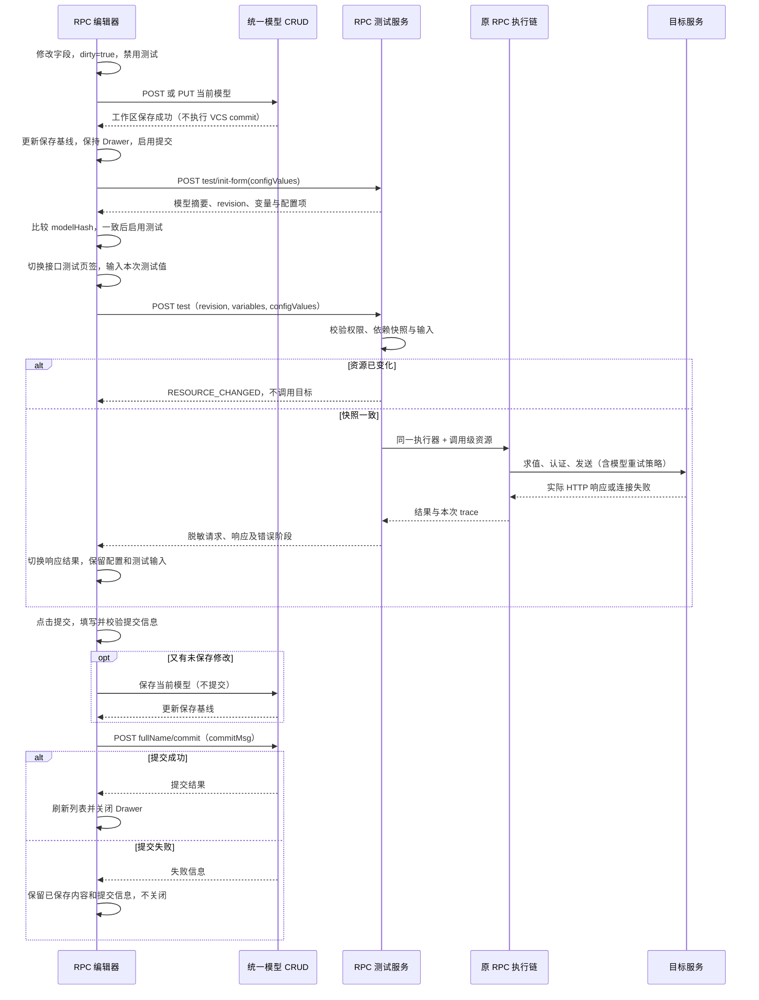

# RPC 模型测试设计

配置字段语义与初始化流程的修复方案见 [语义收敛修复](model-testing-semantics-repair.md)。该方案实施后同步本文对应合同。

状态：已在 `feat/rpc-testing-support` 工作区实现，基线为 `dev-next` 的 `8d2734e9b169aff9cc6ccebfa219f329b0006daf`。本文定义交互、后端机制、接口与验收条件；实现入口和实际验证见第 9 节。运行机制以 [模块设计](../DESIGN.md) 和正式代码为准。

## 1. 目标、依据和范围

开发人员在宽 Drawer 中编辑 RPC 模型，保存当前修改后留在原处，通过“接口测试”页签输入本次测试变量和配置值，向模型指定的服务发送实际请求，核对请求、响应和失败阶段。保存只修改工作区；提交时必须填写提交信息，完成保存和 VCS 提交后关闭 Drawer。测试必须使用刚保存的工作区模型及其认证引用，测试输入不得写回模型或统一配置。

需求依据是客户版《51.01.数字化建设项目定制软件建设项目-详细设计方案-技术支撑平台 · 技术开发平台分册 V0.9.9-修正版》的 **5.11 接口与服务模型管理**、图 **5.11-5 / 5.11-6**、**7.1** 中的 `lc-rpc-1 / lc-rpc-2` 和 **11.1** 的 RPC 调试用例。原件位于本仓库旁路工作区 `.worktrees/ciecc-dev-docs/`，文件 SHA-256 为 `a61a005a456da841511a7fe26f275bc8a75a01e796b90c5c228dcb8b07754483`。这里只记录必要出处，不复制客户文档；其他较早稿中的 WebAPI 调试不纳入本次范围。

沿用客户稿的核心约束：

- 两个内部接口分别初始化测试表单和执行测试；资源全名不带 `.rpc.json` 后缀。
- 调试展示模型基本信息、测试参数及请求响应；两个 `input-table` 分别填写表达式变量与配置项值。客户稿采用两个页签，本设计将其收进编辑 Drawer，并将请求与响应分开呈现。
- 配置查找顺序为本次显式覆盖 → `ConfigurationService` → Spring `Environment`。测试值只作用于本次调用。
- 沿用模型的超时、重试及认证语义；返回非成功 HTTP 状态时保留真实响应，没有响应时保留实际失败信息。
- 初始化与执行都要求应用编辑权限；初始化不申请资源锁；测试不改变模型、配置、资源锁或版本。

本次补齐保存与测试的状态衔接、并发快照、认证依赖、调用级配置隔离、报文采集、错误合同及实现拆分。首期支持现有 `OpenAPI` HTTP 模型及内置认证类型，不增加 WebAPI 入站测试、测试用例库、历史报文库、自动断言、批量测试或新的协议实现。

测试由**开发平台后端**发出，使用该后端的网络出口和默认配置，不依赖测试容器启动，不代表已部署应用容器中的连通性或配置验证。目标地址由已保存模型决定；界面以方法和地址作为测试上下文，不常驻显示内部环境、资源摘要和保存状态文案。

## 2. 当前实现与最小扩展

| 位置 | 基线事实 | 本次设计的扩展 |
| --- | --- | --- |
| [RPC 开发服务](../ouroboros-rpc-model-dev/src/main/java/com/ouroboros/rpc/dev/service/impl/RpcMetadataDevelopServiceImpl.java) | `@DevelopModule("rpc-model")`，继承统一开发服务；没有独立开发期测试接口 | 在 RPC `dev` 模块增加测试控制器与应用服务；模型读写继续经过原开发服务 |
| [统一模型控制器](../../../dev-module/ouroboros-dev-model-manage-webapi-scaffold/src/main/java/com/ouroboros/modelmanage/web/ModelDevelopController.java) / [基础服务](../../../dev-module/ouroboros-dev-model-manage-webapi-scaffold/src/main/java/com/ouroboros/modelmanage/base/BaseDevelopService.java) | POST 创建、PUT 更新；创建直接提交版本，更新默认自动提交。PUT 的 `commit=false` 不会覆盖服务内部的默认自动提交策略；另有显式 `/{fullName}/commit` 和 `/status` | RPC 更新通过既有 `isAutoCommitWhenUpdate()` 关闭自动提交；统一创建链增加默认开启的自动提交策略钩子，仅 RPC 关闭；保存沿原 CRUD，版本提交沿原 commit 接口 |
| [RPC 编辑表单](../ouroboros-rpc-model-dev/src/main/metadata/dev/{appName}/rpc-model/edit.ui-schema.json) / [列表](../ouroboros-rpc-model-dev/src/main/metadata/dev/{appName}/rpc-model/list.ui-schema.json) | Schema 配置持久化 API，没有测试入口和显式保存动作 | 为新增、编辑表单声明保存、测试、提交、关闭动作；列表增加“调试” |
| [模态动作归一化](../../../frontends/web/ouroboros-amis-runtime/src/renderers/modalFormActions.ts) / [Drawer 渲染器](../../../frontends/web/ouroboros-amis-runtime/src/renderers/OuroborosDrawer.tsx) | Drawer 与 Dialog 共享表单动作提升及异步 Schema 机制；页脚可以取得表单数据 | RPC 入口改用宽 Drawer，复用既有动作机制发布配置、测试和提交状态；其他模型入口不变 |
| [调用执行器](../ouroboros-rpc-model-runtime/src/main/java/com/ouroboros/rpc/execution/RpcInvocationExecutor.java) | 按名称查全局 `RPCModelDefinitionCenter`，执行协议选择与拦截器链 | 增加显式调用级资源上下文，复用同一执行器、SPI 构建器和协议执行器 |
| [HTTP 执行器](../ouroboros-rpc-model-runtime/src/main/java/com/ouroboros/rpc/execution/protocol/OpenApiRpcProtocolInvoker.java) | 认证查全局凭据中心；成功结果只有解码后的 payload，4xx/5xx 转异常；没有完整请求响应快照 | 在原发送链中增加调用级资源解析和可选报文观察，不另写 HTTP 测试客户端 |
| [请求构建](../ouroboros-rpc-model-runtime/src/main/java/com/ouroboros/rpc/util/HttpRpcRequestBuilder.java) / [模板求值](../ouroboros-rpc-model-core/src/main/java/com/ouroboros/rpc/util/ExpressionUtils.java) | 支持配置、EL、变量引用；配置 getter 未向调用方公开。URL 求值失败会回退模板，短变量匹配也需修正 | 公开显式配置 getter 的构建入口；统一模板分析与求值，失败在发送前终止 |
| [动态令牌](../ouroboros-rpc-model-runtime/src/main/java/com/ouroboros/rpc/security/DynamicAccessTokenRPCAuthCredential.java) | 令牌请求使用全局执行器；令牌缓存只按凭据名称区分 | 测试的令牌子调用继承同一资源上下文，缓存只存在于单次测试内 |

根因是表单没有区分工作区保存、VCS 提交和关闭，RPC 开发服务又沿用自动提交策略；调用链还把资源解析绑定在运行态全局中心。只加一个测试按钮、刷新全局中心，或者直接用前端草稿拼 HTTP 请求，都无法同时满足最新工作区、应用隔离和现有执行语义。

扩展限于 RPC 的开发入口、现有执行上下文和协议链。统一 CRUD、VCS、SPI、配置服务及弹窗动作机制继续作为正式路径。

## 3. 前端入口与保存规则

### 3.1 入口和布局

RPC 模型列表的“编辑”打开“模型配置”页签，“调试”打开同一 Drawer 的“接口测试”页签；详情也提供调试入口。入口携带 `appName` 和 `fullName`，调用初始化接口，不使用列表缓存的请求定义。桌面采用右侧约 80% 宽、占满应用内容高度的 Drawer，窄屏占满宽度；页头和页脚固定在 Drawer 中，正文可滚动。保留部分列表背景，点击遮罩不关闭。

两个主页签为“模型配置 / 接口测试”，测试区内再分“测试参数 / 请求详情 / 响应结果”，不叠加调试子弹窗。页脚按钮从左到右为：

```text
[关闭] [运行测试] [保存：绿色] [提交：primary 蓝色]
```

- **提交**：始终位于最右侧，使用 primary 色及版本提交图标。弹出提交信息输入框，去除首尾空白后必填；确认后先保存当前模型，再显式提交到 VCS，仅全部成功才关闭 Drawer。模型已保存但尚未提交时，直接提交已保存内容，不重复写入。
- **保存**：紧邻提交左侧，使用绿色。校验并持久化，成功后保持当前页签和 Drawer 打开；首次 POST 成功后原地转为编辑态，名称只读，后续保存改用 PUT。保存不调用 VCS commit；待提交状态通过提交按钮可用性和 VCS 状态接口维护，不在页头常驻重复文案。
- **运行测试**：仅在“接口测试”页签显示。只要求模型已保存、表单干净且测试初始化与快照一致，不要求提交到 VCS。测试不会保存或提交模型。
- **关闭**：干净表单直接关闭，已保存但未提交的工作区修改继续保留。脏表单提供“继续编辑 / 保存并关闭 / 放弃修改”；此处保存也不提交版本库，放弃只恢复未保存字段，不回滚此前保存的内容。右上角关闭和 Escape 共用规则。

工作区保存和 VCS 提交按第 5.0 节拆分，不能仅靠前端传入 `commit=false`。保存成功后提交失败时，保持 Drawer 和提交信息，明确显示“已保存，提交失败”，仅重试提交；不得把已保存内容显示为未保存，也不得自动重复提交。

### 3.2 表单状态和按钮矩阵

持久化模型与测试输入使用不同的数据域。`persistedModel` 保存最近一次服务端成功返回的模型；`currentModel` 只包含可持久化模型字段。`dirty` 由两者规范化后的深比较计算，不能用“曾触发 change”代替，也不能把测试值、页签、loading、状态标志算进去。`pendingCommit` 单独表示工作区与 VCS 版本的差异，初始化、保存和提交后通过既有 `/status` 的 `versionState` 刷新；不能仅凭当前会话记忆推断。它不参与测试禁用条件。

| 状态 | 保存 | 测试 | 提交 | 提示或转移 |
| --- | --- | --- | --- | --- |
| 新增且未持久化 | 可用，点击后校验 | 禁用 | 可用，点击后校验 | “请先保存模型后测试” |
| 编辑加载中或加载失败 | 禁用 | 禁用 | 禁用 | 重试加载，不使用列表数据作为基线 |
| 已保存、干净、测试初始化成功 | 无修改时禁用 | 可用 | 有待提交修改时可用 | 测试使用此快照，与 VCS 提交状态无关 |
| 脏表单 | 可用，点击后校验 | **禁用** | 可用，点击后校验 | “模型有未保存修改，请先保存后测试” |
| 保存中 / 提交中 | 禁用 | 禁用 | 禁用 | 编辑控件也禁用，防止响应覆盖后续输入 |
| 保存失败 | 可重试 | 禁用 | 可重试 | 保留所有输入，不更新基线 |
| 持久化成功，测试信息重载中或失败 | 无修改时禁用 | 禁用 | 可用 | “已保存，测试信息加载失败，请重试加载” |
| 无应用编辑权限 | 禁用 | 禁用 | 禁用 | 沿原权限规则拒绝访问 |
| 资源锁冲突，已保存快照有效 | 禁用 | 可用 | 禁用 | 展示锁冲突；测试不取得编辑锁、不修改资源 |
| 测试执行中 | 禁用，模型只读 | 显示执行中，禁止重复运行 | 禁用 | 可查看配置；关闭需确认目标请求可能继续 |
| 已保存但提交失败 | 无新修改时禁用 | 快照有效时可用 | 保留提交信息，可重试 | “已保存，提交失败”，保持 Drawer |

保存成功后按以下顺序恢复测试：更新 `persistedModel` 和资源身份 → 刷新列表和 VCS 状态但保持当前编辑器 → 使旧测试快照失效，将旧结果标记为“结果对应修改前的配置” → 重新 GET 测试初始化 → 核对 `modelHash` → 恢复测试。保留类型及名称仍匹配的测试输入；移除失效输入，对新增项提示填写。保存不自动运行测试。持久化成功而初始化失败时必须保留“已保存”的事实，不能让用户以为保存失败，也不能用旧快照启用测试。

已有模型首次加载成功后也执行同样的测试初始化。modelHash 不一致时提示“模型已被其他操作修改，请重新加载后测试”，保留当前编辑数据并禁用测试，由用户主动重新加载，不能用最新服务端模型静默覆盖草稿。服务端返回 RESOURCE_CHANGED 时使当前测试快照失效、标记旧结果；重新初始化按变量名称与类型核对输入，完成后仍需用户主动点击测试。

`canTest = hasPersistedIdentity && !dirty && !saving && !submitting && !initializing && !testing && testInitReady && initModelHash === persistedModelHash`。禁用按钮始终给出具体原因。模型 `isEnabled=false` 可以进入编辑，但初始化返回不可测试原因；先启用并保存后才能执行，与运行时启用语义一致。

表单初始化时默认值合并完成后才建立基线，避免初次渲染即变脏。规范化仅统一对象键顺序、约定的缺省值；请求参数数组顺序、空字符串、`false`、`0`、显式 `null` 均保留。表单把已编辑字段恢复为保存值后，`dirty` 恢复为 false。

### 3.3 Drawer 和 Schema 接入

`add.ui-schema.json` 与 `edit.ui-schema.json` 的入口由 Dialog 改为既有 `OuroborosDrawer`，显式配置动作，沿 `modalFormActions` 提升至 Drawer 页脚，使用稳定表单组件 ID 定向触发校验和持久化。保存不触发 Drawer confirm；提交信息确认后依次保存、提交，两步成功才定向关闭当前 Drawer。测试只切换页签，不冒泡为表单提交。

为管理快照、请求时序和 dirty，增加局部 `rpc-model-editor` 渲染器，按主应用既有 Renderer 注册方式接入。它复用现有 RPC `form-items` Schema 和 AMIS 表单，负责上述状态及动作编排，不复制请求字段 UI，也不引入全局表单保存框架。嵌套表单必须在下载的 Schema 中显式声明 `type=form`、稳定 id、`bubbleActionsToModal=true` 和 actions，使既有 `findBubblingModalFormSchema` 能发现并提升动作；不能把表单藏在运行时组件内部后另建页脚。状态由实例管理，经既有作用域和表单事件向页脚发布只读状态投影，持久化时只序列化模型对象；不得作为 `RPCModelMetadata.extraProps` 被写入文件。

序列化从原始模型数据保留已有扩展属性，再覆盖表单可编辑字段；排除 `appName`、`add`、`fullName`、调试数据及内部状态。当前标准字段为 `name/title/type/group/description/authCredential/isEnabled/request/retry/timeout`。类型与缺省值采用服务端模型序列化约定；保存响应是下一次比较和哈希的基线。

每次加载、保存和测试初始化递增 generation；晚到的旧响应不得更新新模型或重新启用测试。保存、提交期间禁止关闭；发生网络中断时保留草稿及提交信息，通过重新读取资源、状态和提交记录确认结果，不自动重发写操作。切换主次页签保留编辑值、测试输入及结果；Drawer 真正关闭后销毁测试输入与结果，移除监听和挂起的 UI 更新。

## 4. 接口测试页签

在同一 Drawer 中呈现配置与测试工作区。主页签使用蓝色下划线，测试子页签采用分段样式，测试区顶部集中显示方法和地址：

```text
RPC 模型 · 查询记录（queryRecord）                         [×]
[模型配置] [接口测试]
POST #{service.host}/records/query

[测试参数] [请求详情] [响应结果]

表达式变量（input-table）
变量名         输入类型       测试值
recordId       string         R001
pageNo         number         1

配置项值（input-table）
配置项名       使用方式       本次覆盖值
service.host   本次覆盖       https://test.example.org
rpc.token      使用现有配置   （不回显现有值）

[关闭] [运行测试] [保存：绿色] [提交：蓝色]
```

模型基本信息、认证及高级参数在“模型配置”查看；测试区只保留只读的方法和 URL 模板，敏感字面量脱敏。输入表默认由后端提取，不允许修改配置项名称或重复添加同名输入。表达式根变量可选择 `string/number/boolean/object/array/null`；对象、数组用 JSON 编辑并在提交前校验，`false`、`0` 和空字符串不能被当作未填写。无输入项时只显示“无需填写测试参数”，不展示空表格。

配置项表的“使用现有配置 / 本次覆盖”必须显式选择。使用现有配置时省略该 key；本次覆盖允许空字符串。配置覆盖值默认用密码输入，表达式变量中的认证输入按后端敏感标记使用密码控件。无可用默认值的项必须填写覆盖值；初始化只返回“是否存在”和来源，绝不回显现存口令或令牌。

点击运行测试后冻结模型编辑和输入表，显示执行进度并切换至“响应结果”。请求详情展示脱敏后的最终 URL、方法、请求头、Cookie、请求体、逐次重试和认证子请求；响应区将 HTTP 状态、耗时和请求次数集中一行，直接显示正文，响应头默认折叠，失败时显示阶段信息。内部测试编号和 revision 由 API 保留，不作为常驻界面信息。认证子请求的令牌内容遮蔽，所有可见内容均经过后端脱敏。

首次打开“请求详情”显示“尚未执行测试”；不存在请求或响应时展示“尚未生成请求”或“未收到目标响应”，不能用 `{}` 冒充响应。修改测试值后保留上一结果并标记“输入已修改，结果对应上次测试”；开始新测试时清除旧结果的有效状态。

测试中关闭 Drawer 先提示“关闭后目标请求可能继续执行”。关闭只停止等待和界面更新，不承诺远端撤销；无论关闭还是重开，前端不得自动重发 POST。执行中可切换主页签查看只读配置；从其他入口检测到模型变化时立即使测试快照失效。

## 5. 后端机制

### 5.0 工作区保存与 VCS 提交

RPC 的工作区保存复用统一模型 POST / PUT，显式版本提交复用 `POST /api/dev/{appName}/rpc-model/{fullName}/commit`，请求体携带 `commitMsg`；不增加另一套模型存储。先在 `RpcMetadataDevelopServiceImpl` 覆盖已有 `isAutoCommitWhenUpdate()` 返回 false，更新沿 `writeUpdate` 和 `BatchAction.write(false)` 执行。现有创建链强制 commit，在 `BaseDevelopService` 增加与更新策略对应的 `isAutoCommitWhenCreate()` 钩子，默认 true，仅 RPC 返回 false。创建仍经过统一校验、冲突检查、序列化、关联资源收集和事件发布，最终复用原 BatchAction 写入；禁止在 RPC 服务复制整段 create。

创建不提交时，按原资源锁管理器获取主文件及关联文件的锁，再执行 `write(false)`，不能以 `forceWrite=true` 绕过锁。当前 `autoLock()` 仅在 commit 路径取得锁，不能假定单独调用 `write(false)` 会自动加锁。保存失败时只释放本次新取得且没有待保留工作区修改的锁，不释放已有用户锁；保存成功保留编辑锁，显式提交沿原 `unlockWhenCommit` 及控制器解锁合同处理。

当前 RPC 编辑 Schema 没有显式锁的退出处理，不能假定 Drawer 关闭会自动解锁。局部编辑器通过既有 lock / release-lock 接口管理本实例实际取得的编辑锁：初始化需要写入的模型时确认取得锁，关闭时按当前用户权限释放本实例取得的锁，保留已保存工作区内容；已有同用户锁不能仅凭持有人相同就视为本实例独占。保存后再编辑期间必须重新确认锁状态，避免显式提交后的解锁使后续写入失去保护。正常关闭等待解锁结果，失败保持编辑器并提示重试；页面异常退出不承诺可靠执行网络解锁，恢复时沿既有锁管理处理。不得通过回滚内容掩盖锁释放失败，测试自身不变更锁。

提交信息在前端和 RPC 开发服务的 `commit(fullName, commitMsg)` 入口均校验：去除首尾空白后不能为空，最多 200 个字符；不允许由默认提交信息替代必填。UI 编排“若 dirty 则调用保存 → 调用既有 commit 接口 → 确认成功后关闭”。新增首次提交也先创建未提交文件，再调用同一 commit 接口。保存请求明确不提交；无修改而有待提交内容时跳过保存，直接提交该模型资源。提交范围沿该模型的正式资源集合，不提交应用中其他模型的修改。

保存和提交为两个有独立结果的步骤：保存失败不提交；保存成功、commit 失败则保留工作区、刷新 `/status`、保留提交信息并显示失败，重试仅 commit；提交成功但后续解锁失败时读取状态与提交记录确认，不自动重复 commit。测试读取工作区文件而非最后一次提交版本。`revision` 是测试用内容指纹，不是 VCS commit ID；保存和提交状态用于控制动作可用性，测试结果过期时单独提示。

接入前核对统一控制器的实际失败传播：当前 PUT 的可选提交分支使用 `Try.map` 包装服务返回的 `Try`，可能把内部提交失败当成外层成功；commit 与 release-lock 等入口还需核对解锁失败是否被忽略。RPC 提交使用独立 commit 接口，不依赖 PUT 的可选提交分支；本次触及的正式提交、解锁路径必须正确传播失败并通过行为测试证明，不能仅靠前端查询状态弥补接口假成功。修改共享机制时保留其他模型的成功合同，补充相应失败分支回归，不混入无关 CRUD 整理。

本节改变的是 RPC 的创建、更新策略及其显式提交校验。统一服务钩子的默认值、其他模型的持久化策略和 VCS 写入实现继续保持既有合同；必须以回归测试验证。

### 5.1 初始化、依赖快照和并发一致性

新增 `RpcModelTestController` 和 `RpcModelTestService`，放在 `ouroboros-rpc-model-dev`。正式路由为 `/api/dev/{appName}/rpc-model/{fullName}/test` 及其 `/init-form` 子路径。客户稿使用 `/api/v1/support/lowcode/dev`，本分支实际控制器使用 `/api/dev`，本设计沿用源码路径；客户交付时通过集成网关配置映射，不复制一套控制器。

通过 `DevAppHolder` 确定应用，使用 `RpcMetadataDevelopServiceImpl`、`RpcAuthCredentialMetadataDevelopServiceImpl` 的统一资源读取机制及 VCS 资源对象定位文件，不直接拼接任意磁盘路径，不查询同名全局运行模型。所有 fullName 都走原资源名称和路径约束，拒绝路径穿越。

初始化读取主模型、认证模型，以及动态 AccessToken 的令牌 RPC 及其递归认证依赖，构成**本次操作的不可变资源快照**。依赖只能属于当前应用；找不到、损坏、不支持的认证、认证或依赖模型禁用、依赖循环均明确失败，不回退到其他应用或平台同名模型。主模型禁用以 `testable=false` 返回，执行时拒绝发送。按原 SPI 顺序选择 definition/credential builder；无匹配构建器也必须返回错误。

复用 VCS 文件读取，先遍历依赖图并读取内容，再完整复读这组资源、依赖集合与分支标识；两轮内容指纹或依赖集合有变化就返回 `RESOURCE_CHANGED`，让前端重新初始化，不持资源写锁执行网络请求。现有 VCS 没有提供跨文件只读事务，不能宣称获得多文件写事务的原子快照；这里保证执行使用经过稳定性检查的同一组资源副本。后续构建和发送不再懒读可变工作区文件。

初始化返回两个摘要：

- `modelHash`：主模型规范化后的 SHA-256。规范化与编辑器的模型序列化规则一致，递归排序对象键、保留数组顺序，去除 UI 字段并处理相同的缺省值。前端据此确认快照仍对应最近一次保存成功的模型，而非保存后被他人覆盖的内容。
- `revision`：应用、当前 VCS 分支、主模型及全部依赖的资源路径与内容指纹，按路径排序后计算 SHA-256。不包含本次测试值或统一配置值，不充当持久化测试会话；服务端无需缓存初始化结果。

POST 必须携带 `revision`。服务端重新读取当前资源快照并比较，不一致时不执行目标请求，返回 `RESOURCE_CHANGED`。比较后只执行该副本，即使另一个用户随后保存，也不会混用新旧依赖。返回同一 revision，便于界面说明测试对象；本机制不承诺冻结其他用户的后续写操作，也不代替现有模型写并发控制。

### 5.2 沿原执行链注入调用级资源

当前执行器只有全局按名查找，凭据与配置也受全局依赖约束，无法直接满足工作区测试。最小设计调整是在现有执行上下文中显式传递 `RpcExecutionResources`，而不是临时替换静态 Center。

核心合同由 `RpcExecutionResources`、`RpcInvocationContext` 和 `RpcInvocationExecutor` 定义，以下是职责摘要：

```java
// core：只表达本次调用依赖，不依赖开发模块或 Spring。
interface RpcExecutionResources {
  Optional<RPCModelDefinition> findDefinition(String modelName);
  Optional<RPCAuthCredential<?>> findCredential(String credentialName);
  String getConfig(String name);
  RpcExecutionMode mode(); // RUNTIME 或 DEVELOPMENT_TEST，由服务端构造
}

// runtime：原入口保持可用，新入口使用同一协议选择和 buildChain。
RpcInvocationResult invoke(RpcInvocationRequest request);
RpcInvocationResult invoke(RpcInvocationRequest request, RpcExecutionResources resources);
```

普通入口委托到新入口，未指定调用级资源时继续使用现有两个 Center 和原配置读取；开发测试入口使用本次快照及本次配置 getter。`RpcInvocationContext` 持有这一资源对象，HTTP 执行器从 context 解析凭据、构建请求。两种入口共享同一 invoker 和异常转换，不新增开发专用协议执行器、HTTP 客户端或长期模型注册表。

把两个 Center 现有的 SPI 构建选择逻辑提取为可复用的无注册副作用方法，Center 的 refresh 与开发快照构建共同调用它们。dev 只提供 metadata，不能重复硬编码认证类型或自行维护 builder 列表。

为让 SPI 认证实现取得调用级配置及令牌子调用依赖，给 `RPCAuthCredentialBuilder` 增加显式资源参数的构建重载；内置实现将 getter、令牌执行回调和缓存依赖存入**本次构建的实例**。保留原签名及普通运行默认行为。新重载在未适配的外部 builder 上默认明确报“不支持调用级资源”，不能静默用全局配置完成开发测试。首期验收覆盖全部内置认证；第三方实现通过原 SPI 补齐该重载后接入。

`HttpRpcRequestBuilder` 公开带 `Function<String,String>` 的构建入口，调用原实现；HttpBasic、PlainCredentials、AccessToken、HMAC 都从同一 resources 取得配置。HttpBasic 还应使用本次变量，不再用空 Map 求值。新增调用级依赖不得通过修改静态 ConfigurationService、Environment、全局 Center 或临时 ThreadLocal 覆盖实现。

开发测试使用的 `purpose` 为 `developer-test`，由服务端写入。运行态治理拦截器在明确的 `DEVELOPMENT_TEST` 边界只执行请求必要校验，不读取或修改按模型名存储的运行态策略、可用性、指标和完整报文日志；运行态入口继续走原链。此模式只接受后端构造的资源对象，HTTP 测试请求不得传 `internalCall`、`bypassPolicyGuards` 或任意 options。

`dev` 模块增加对本模块 `runtime` 的直接依赖，以复用执行与认证；依赖方向为 dev → runtime → core，runtime 不引用 dev。沿现有 `RpcDevAutoConfiguration` / `RpcRuntimeAutoConfiguration` 装配，新增自动配置或 SPI 时更新原 `META-INF` 注册文件，不增加独立启动过程。

### 5.3 表达式输入发现和求值

初始化只分析模板，不求值、不请求令牌、不访问目标服务。分析范围包括主请求 URL、参数值、认证配置中的可求值字段、令牌模型的同类字段及令牌 placement。配置 key 去重；变量按外部根变量去重，记录出现位置和引用表达式。认证内部生成的 `accessToken`、时间戳、nonce 和已注册表达式上下文工具不是用户必填变量。

为避免提取和执行各用一套语法，在 `ExpressionUtils` 中建立同一个模板分段入口，由初始化分析和现有 eval 共同使用。具体规则：

| 模板 | 初始化输入 | 执行规则 |
| --- | --- | --- |
| `#{service.host}` | 配置项 `service.host` | 走本次配置 getter，缺少值时报配置缺失 |
| `$recordId`、`${recordId}` | 根变量 `recordId` | 完整占位符保留原值类型 |
| `$order.id`、`${order.id}` | 根变量 `order`，提示引用 `order.id` | 用户填写 object，按原 EL/路径访问规则取值 |
| `${pageNo + 1}` | 根变量 `pageNo` | 复用 EL 编译计划执行，不把 `pageNo + 1` 当变量名 |
| `${orders[index].id}` | 根变量 `orders`、`index` | 按 EL 执行动态索引，错误指出原字段 |
| URL 中的混合字面量和占位符 | 按模板分段分析各引用 | 只在全部求值成功后合成 URL |

对 `${…}` 使用 `EL.compile()` 的提供者分析语法树，在现有 `ExpressionPlan` 上增加只读输入引用描述能力，由 SpEL 实现报告外部根变量、静态路径和动态访问；不得用正则把完整 EL 拆成标识符，也不得靠执行表达式探测变量。未提供该分析能力的表达式引擎明确返回初始化不支持，不能返回空输入假装全部就绪。语法分析仍属于 common-expression，RPC 只处理自己的模板边界。

短变量扫描使用完整标识符和点路径规则，修复当前 `VARIABLE_PATTERN` 的最短匹配问题。URL 求值失败直接返回带字段位置的失败，不回退原模板；参数求值先检查 Either，再使用值。只修复这些阻止可靠测试的根因，保持已有合法模板、路径替换和求值类型语义，用运行调用回归约束兼容性。

客户端值转换后提交 JSON 根对象，不把 `order.id` 当成一个扁平 key。服务端区分 key 不存在与值为 null；静态必需引用缺失在发送前失败，条件表达式的分支访问由原 EL 决定。根对象及内部字段类型无法从模板完整推断时，界面提示相应引用，服务端以实际表达式求值和参数 required 规则校验，不能声称已完成静态类型证明。

### 5.4 配置覆盖、认证和隔离

本次显式配置用 `Map<String,String>` 表达。取值时用 `containsKey` 区分“未提供”和“提供空字符串”：覆盖 key 存在则使用该字符串；不存在才走统一配置及 Environment。未解析到的必需配置返回输入错误，不能替换为空字符串继续发送。

初始化只允许发现范围内的配置项进入测试请求，不提供任意读取平台配置的通道。GET 不返回默认配置值；POST 不返回覆盖原值。默认配置在本次实际执行首次读取时固定在请求级副本，同一 key 在请求、认证和重试中保持一致；下次点击重新读取。配置不参与 revision，也不据此承诺初始化时与执行时的全局配置完全相同。

HttpBasic、明文凭据、静态令牌、HMAC 继续使用原 builder 和 apply 逻辑，只改变依赖来源。HMAC 继续共享 `SerializedBody`，签名字节与发送字节必须一致。认证定义禁用、缺失或构建失败在认证阶段明确返回，不能像全局装载时那样过滤后只留下“找不到凭据”。

动态令牌测试使用同一资源快照、variables、configValues 和执行器递归调用令牌模型，purpose 为 `token-fetch`。单次测试内沿用原递归检测并按依赖图检查环；令牌请求单独记录为认证子调用。每个测试创建独立的凭据实例及调用内令牌缓存，复用现有缓存访问抽象注入存储；只在这一次测试的重试/子调用中共享，不读写 `ouroboros:rpc:access-token` 运行态共享缓存。普通运行仍用原缓存实现。不同应用、并发请求和下一次点击之间不得复用测试令牌。

### 5.5 发送、原始报文和重试

在现有 `OpenApiRpcProtocolInvoker` 内建立可选的调用级 trace 接收口，普通调用默认无报文采集。采集阶段如下：

1. 求值及参数装配后记录可取得的请求；认证失败时也保留这份未完成认证的请求并标记 `complete=false`。
2. 认证、URL 合并、Cookie、Content-Type 和 body 编码完成后，记录实际应用层请求，标记 `complete=true`。签名与发送使用同一序列化结果；GET/DELETE 无 body 时不强行发送 `null` body。
3. 在同一 WebClient exchange 中获取状态、完整多值响应头和响应体，再按原协议语义解码 payload；非 2xx 同样保留原响应并返回失败。正文只能从网络读取一次，不能为记录报文消费掉下游待解码的响应流。
4. 外层把执行结果与 trace 汇成 DTO，统一脱敏后返回。非结构化文本、二进制与认证正文按安全策略省略，保留类型、字节数和原因。不能用原输入模板重建“实际请求”，也不能用成功 payload 模拟原始响应。

“原始”指本次调用的应用层方法、最终 URI、可见请求头/Cookie及实际发送正文，响应为目标服务实际返回的状态、头和正文；不包含 TCP 抓包、TLS 或底层连接器自动生成的全部传输头。展示做脱敏和可能的截断，必须显示标记。

超时、重试来自本次保存的模型：有值时使用 `timeout` 与 `retry`，缺省沿用当前执行器 3000 ms、0 次重试；表单当前默认的 10000 ms、3 次重试不另行覆盖。测试输入无临时 timeout/retry 开关。每次 HTTP 尝试都记录，正式调用与测试共用同一安全重放约束：仅静态 `retrySafe=true` 的接口定义允许在次数上限内重试；默认只发送一次，不能通过测试输入、配置引用或 HTTP 方法放开。允许重放时最多发送 `1 + retry` 次主请求，动态令牌请求另计。界面不可宣称“一次点击只会发送一次目标请求”。

使用 Spring 系统配置设置执行边界，首期默认 `ouroboros.rpc.developer-test.max-duration-ms=120000`、`max-request-bytes=1048576`、`max-preview-bytes=262144`。这三项是新配置，实施时补入系统配置说明，不写成现存能力。总时限从 POST 进入测试服务开始计算，使用单调时钟截止时间传入同一执行上下文，覆盖令牌获取、重试和主请求；每次发送超时取模型超时与剩余预算的较小值，预算耗尽时停止下一次尝试。预览限制不改变实际请求 body；超过请求上限在发送前拒绝。响应超过既有传输解码上限时返回 `RESPONSE_LIMIT` 并保留已有元信息，不伪造完整成功响应。

文本预览保留原文本，不重新格式化成另一份 JSON；可额外提供格式化视图。二进制只返回类型、大小和省略说明，不提供默认下载。截断后给出 `truncated=true`，保留 UTF-8 字符边界；截断不能在脱敏前暴露半截密钥。

### 5.6 权限、锁和敏感信息

沿用 [DevAppEditAccessFilterSupplier](../../../dev-module/ouroboros-dev-app-management/src/main/java/com/ouroboros/dev/app/filter/DevAppEditAccessFilterSupplier.java) 的应用鉴权路径。初始化与执行统一使用 POST，直接走该过滤器现有 EDIT 分类，不另设 GET 特例。权限行为测试覆盖初始化与执行，不能只依赖前端隐藏按钮，也不能让 ability dev 反向依赖应用管理服务形成环。

保存继续遵守原资源锁与权限；测试初始化和执行不申请、释放或强抢资源锁，也不自动提交或回滚。别人持锁时，模型编辑、保存及提交禁用；具有应用编辑权限的用户仍可测试当前已保存快照，界面不宣称拥有编辑锁。有未保存草稿或失效快照时仍须先处理，不能用锁冲突绕过 dirty 和 revision 约束。

脱敏统一在后端 DTO 出口执行，覆盖基本信息、URL、header、Cookie、query、body、响应及错误消息。默认遮蔽 Authorization、Proxy-Authorization、Cookie、Set-Cookie、token/password/secret/accessKey/signature 类字段、认证 placement 指定字段，以及本次敏感测试值。认证配置中的密钥字段一律按敏感处理；不能只做名称匹配而漏掉自定义参数位置。

结构化正文按字段路径遮蔽；无法安全解析的认证正文或无法定位敏感值的内容整段省略，不靠前端 CSS 遮挡。异常 cause 只供服务端受控定位，响应中不输出完整堆栈、模板求值上下文或原始异常文本。开发测试不启用运行态完整报文日志，也不新增持久测试日志；普通日志不打印原始报文或配置值。实施时同步收敛请求构建器等内部错误日志中的完整定义与上下文输出，仅关闭 LoggingRpcInvocationInterceptor 不足以保证这一点。

## 6. HTTP 合同

本节描述已实现合同；以控制器 DTO、源注解和原 OpenAPI 导出为权威，不手工维护第二份 OpenAPI 文件。`appName` 与 `fullName` 作为单独路径段编码，fullName 不带模型后缀。

### 6.1 初始化

`POST /api/dev/{appName}/rpc-model/{fullName}/test/init-form`

请求体仅允许 `{ "configValues": { "配置名": "本次覆盖值" } }`，省略 configValues 等价于空映射；不允许 null 或非字符串值。初始化只读，不构建认证、不获取令牌、不请求目标服务。缺少依赖配置时返回已发现输入，供用户补全。

返回 `WebApiResult<RpcModelTestInit>`，`code=0` 时 data 包含：

| 字段 | 类型 | 含义 |
| --- | --- | --- |
| `model` | object | 脱敏后的名称、标题、类型、authCredential、isEnabled、request、timeout、retry |
| `modelHash` / `revision` | string | 主模型规范化摘要 / 主模型与依赖快照摘要 |
| `executionEnvironment` | string | 固定 `development-platform` |
| `maxDurationMs` | number | 本次测试的服务端总执行预算，客户端超时以此加 10000 ms |
| `variables` | array | `{name, references, required, suggestedType, sensitive}`；name 为外部根变量 |
| `configItems` | array | `{name, references, hasDefault, defaultSource, sensitive}`，无默认值本身 |
| `testable` / `disabledReason` | boolean / string | 模型是否允许测试；禁用或缺项时说明原因 |
| `ready` / `missingConfigKeys` | boolean / array | 依赖与配置是否准备完整 / 缺失的配置名称；ready=false 时保留配置填写能力 |

覆盖值或开关变更立即使旧初始化失效；输入停顿 350 ms 后自动重建依赖，期间禁测。沿用初始化代次丢弃晚到响应，保留仍有效的输入并移除旧依赖输入。变量变化只使结果过期，不重建依赖。测试配置不参与模型 dirty，模型修改仍须先保存。

字段分析统一调用 `RpcFieldSemantics`：完整模型和认证扩展属性用 JSON Pointer 分类；TEMPLATE 复用 ExpressionUtils/EL，CONFIGURATION 与 JSON_PATH 仅通过 `RpcConfigurationTemplates.keys` 发现配置引用，NONE 不解释。初始化只调用原 Center 的 SPI 支持检查；实例在执行阶段由原构建器创建。每次准备/执行共享一份记忆化配置视图，按覆盖值、ConfigurationService、Environment 顺序读取。认证名称、令牌模式和令牌模型先解析配置，再校验及读取当前应用资源；revision 包含实际依赖边、资源内容和分支，不含普通配置口令原值。

references 为资源名及字段路径，不包含敏感配置字面量。suggestedType 默认为 `string`，嵌套或动态访问建议 `object`；用户可改选数组、数字等实际输入类型。required 仅标记已能证明的必需根变量，计算或条件分支引用保留引用说明。

### 6.2 执行

`POST /api/dev/{appName}/rpc-model/{fullName}/test`

```json
{
  "revision": "a82...",
  "variables": {"recordId": "R001", "pageNo": 1},
  "configValues": {"service.host": "https://test.example.org"}
}
```

请求只接受上述三个字段。不得接受目标 URL、方法、模型正文、认证正文或调用 options。variables 的根 key 必须来自初始化发现的外部变量集合；configValues 的 key 必须属于发现的配置集合，拒绝重复表格 key、错误类型和未知字段。`configValues` 不接受 null；未传 key、空字符串各有明确语义。

完成调用后返回 `WebApiResult<RpcModelTestResult>`。目标 2xx 且协议解码成功时 `code=0`；本地失败、非成功目标状态和解码失败用平台现有异常映射得到非零 code，同时使用 `WebApiResult.build(code, msg, data)` 保留结果详情。目标 HTTP 状态只位于 `data.response.status`，不能直接当作平台接口的 HTTP 状态。

```json
{
  "code": 0,
  "msg": "测试完成",
  "data": {
    "testId": "服务器生成的调用标识",
    "revision": "a82...",
    "success": true,
    "durationMs": 82,
    "attemptCount": 1,
    "request": {
      "method": "POST",
      "url": "https://test.example.org/records/query",
      "headers": {"Content-Type": ["application/json"], "Authorization": ["***"]},
      "cookies": {},
      "body": {"text": "{\"recordId\":\"R001\",\"pageNo\":1}", "contentType": "application/json", "truncated": false},
      "complete": true
    },
    "response": {
      "status": 200,
      "headers": {"Content-Type": ["application/json"]},
      "body": {"text": "{\"items\":[]}", "contentType": "application/json", "truncated": false}
    },
    "error": null,
    "attempts": [{
      "index": 1,
      "durationMs": 82,
      "request": {
        "method": "POST",
        "url": "https://test.example.org/records/query",
        "headers": {"Content-Type": ["application/json"], "Authorization": ["***"]},
        "cookies": {},
        "body": {"text": "{\"recordId\":\"R001\",\"pageNo\":1}", "contentType": "application/json", "truncated": false},
        "complete": true
      },
      "response": {
        "status": 200,
        "headers": {"Content-Type": ["application/json"]},
        "body": {"text": "{\"items\":[]}", "contentType": "application/json", "truncated": false}
      },
      "error": null
    }],
    "authenticationCalls": []
  }
}
```

`request`、`response` 表示最后一次主调用尝试的可取得信息；没有时为 null。attempts 记录每次主请求的序号、耗时、请求、响应和错误；authenticationCalls 使用相同结构并带令牌模型名。attemptCount 只统计实际开始的主请求尝试，构建失败时为 0，认证子请求单独计数。body 的公共结构为 `{text, contentType, truncated, byteLength, omittedReason}`；未知字节数和不适用字段为 null，二进制或安全省略时 text 为 null，omittedReason 说明原因。示例只展开有值字段。success 与 code 一致；HTTP 2xx 中的业务码不自动判成业务成功，界面显示“HTTP 调用完成，请核对响应业务结果”。

错误对象固定为 `{stage, reason, message, resource, field, retryable}`；`stage` 为 `INPUT/RESOURCE/EXPRESSION/BUILD/AUTH/TRANSPORT/RESPONSE`，reason 使用下表中的稳定字符串。数值 code 沿用平台错误体系，不为每个测试阶段另建一套全局数值错误码。retryable 仅提示用户处理后是否可再点击，不触发前端自动重试。

| 条件 | 阶段 / reason | 目标请求与 UI 行为 |
| --- | --- | --- |
| 无认证或无编辑权限 | 现有 401/403 | 拦截器拒绝，不发送；前端按原认证流程处理 |
| 资源不存在、损坏或依赖无效 | RESOURCE / `RESOURCE_UNAVAILABLE` | 不发送，指出资源；刷新或修复后重试 |
| revision 变化 | RESOURCE / `RESOURCE_CHANGED` | 不发送；废弃初始化结果，提示重新加载，禁止自动测试 |
| 缺变量、缺配置、类型错误 | INPUT / `INPUT_INVALID` | 不发送；定位表格行/字段，保留输入 |
| 模板求值失败 | EXPRESSION / `EVALUATION_FAILED` | 不发送；指出模型字段，返回安全错误信息；运行期求值错误目前定位到请求构建阶段，初始化分析错误附资源和字段 |
| 参数或请求序列化失败 | BUILD / `REQUEST_INVALID` | 不发送主请求，保留已取得的部分请求 |
| 凭据构建、签名、令牌获取失败 | AUTH / `AUTHENTICATION_FAILED` | 不发送主请求；令牌子请求可能已经发送，返回其脱敏记录 |
| 连接、DNS、TLS、超时 | TRANSPORT / `CALL_FAILED` 或 `DEADLINE_EXCEEDED` | 已可能发出请求；response 为空，保留请求和尝试信息 |
| 目标非 2xx | RESPONSE / `REMOTE_HTTP_ERROR` | 保留实际状态、头、正文，不显示成功 |
| 目标 2xx 但解码失败 / 响应超限 | RESPONSE / `DECODE_FAILED` 或 `RESPONSE_LIMIT` | 保留已取得的状态与可安全展示内容，不把 payload 失败冒充成功 |

请求 JSON 无法绑定返回现有 HTTP 400；业务阶段失败以 HTTP 200 的非零 WebApiResult 携带详情。资源和 revision 校验失败同样保留结构化 error，request/response 为 null。HTTP 401/403、400 或网关级 5xx 未携带测试结果时，前端按平台请求失败显示，不保留旧结果为当前成功。

RPC 调试局部适配器从响应 envelope 读取 `data` 后再呈现非零 code 的失败状态；公共 fetcher 和全局错误语义不修改。使用现有 Client 的 `isSilent=true`、`throwOnError=false` 收取结构化结果，避免只收到 toast 而丢失详情。测试 POST 设置现有 `authRefreshRetry=true`，禁用 Client 遇 401 后的自动重发；认证恢复后由用户手动重试。局部请求超时设为服务端总预算加 10000 ms，网关超时至少覆盖该预算，避免默认客户端时限提前中断。不能依赖 AMIS 表单的“只有保存成功才 merge data”流程承载测试结果，也不能把非零 code 改成零来显示错误详情。

## 7. 完整交互时序



## 8. 实现拆分与验收

### 8.1 实施顺序

| 步骤 | 变更归属 | 可验证产物 |
| --- | --- | --- |
| 1. 补齐模板与资源上下文 | common-expression、RPC core/runtime | 模板引用分析与原求值共用语法；Executor 显式资源入口；内置 builder 取得实例级依赖；原运行调用回归通过 |
| 2. 补齐协议 trace | RPC runtime 原 HTTP invoker | 本地 HTTP stub 可核对实际 URL、头、body、非 2xx、无 body 请求、重试及截断；签名与发送字节一致 |
| 3. 初始化及执行接口 | RPC dev、原权限过滤器 | 同应用不可变快照、revision 校验、输入校验、调用内配置/令牌、脱敏；只读用户被两个接口拒绝 |
| 4. 保存提交分离及 Drawer 界面 | 统一开发服务策略钩子、RPC dev、主应用局部 renderer | RPC 新增/更新保存零次 VCS commit；提交信息必填、显式提交成功才关闭；从左到右为关闭、运行测试、绿色保存、蓝色提交；dirty 禁用运行测试 |
| 5. 联调与入口回归 | 各归属测试目录 | 真实主应用 + 开发后端 + 本地 stub 完成完整旅程；原 RPC 运行调用和其他模型弹窗无行为回归 |

步骤 1–3 完成前不开放测试入口。每步在原机制内推进，不能先以浏览器直连或运行态全局刷新作为临时可用方案。实施完成后同步本模块 DESIGN 中的事实和限制、[接口契约入口](../../../docs/api/README.md)及必要配置说明，不将本文的待实现合同直接标为现状。

### 8.2 行为验收矩阵

| 编号 | 场景 | 必须观察到的结果 |
| --- | --- | --- |
| RPC-T01 | 修改 URL、请求参数、认证引用及高级设置任一字段 | dirty=true，测试立即禁用；恢复原值后恢复对应状态 |
| RPC-T02 | 保存成功、保存失败和初始化失败分别执行 | 成功不关窗，测试快照重载；保存失败保留草稿；初始化失败显示“已保存”但测试仍禁用 |
| RPC-T03 | 新建保存后再次保存 | 首次仅一次 POST，原地转编辑；第二次 PUT，不重复创建；两次保存均零次 VCS commit，不关闭 Drawer，测试使用最新工作区 |
| RPC-T04 | 保存期间快速点击、旧初始化晚返回、切换模型 | 不重复写、不测试、不覆盖新实例；旧响应不能启用测试 |
| RPC-T05 | 列表编辑、列表/详情调试和 Drawer 页签切换 | 编辑默认配置页签，调试默认测试页签；使用同一初始化与执行合同，不叠调试子弹窗；切换保留两类输入 |
| RPC-T06 | `$recordId`、`${order.id}`、计算表达式、动态索引和混合 URL | 输入项完整且不执行表达式副作用；发送值与原求值语义一致，无单字符变量误提取 |
| RPC-T07 | 配置默认、覆盖空字符串、覆盖正常值、无默认缺失 | 优先级正确；缺失不发送；两次并发覆盖互不污染，统一配置原值不变 |
| RPC-T08 | HttpBasic / Plain / 静态令牌 / 动态令牌 / HMAC | 使用当前应用已保存认证；动态令牌子调用使用本次配置；运行态共享缓存不变；签名 body 与接收字节一致 |
| RPC-T09 | 两个应用存在同名模型和同名凭据 | 各自只执行本应用快照；平台同名运行模型完全不参与 |
| RPC-T10 | 初始化后修改主模型、认证、令牌模型或切换 VCS 分支 | 旧 revision 请求零次主请求/令牌调用，返回 RESOURCE_CHANGED；重载后手动再次测试 |
| RPC-T11 | 目标 200 JSON、204、纯文本、400、500、超时、TLS 失败 | 保留实际状态及可取得报文，未收到响应为 null；错误阶段准确，不把失败当成功 |
| RPC-T12 | 定义明确 retrySafe=true、retry=2，首两次失败第三次成功；无合同和总预算耗尽 | stub 计数与 attempts 一致；前端只发一次 POST；预算到期不再重试 |
| RPC-T13 | URL 求值失败、参数值错误、认证失败、依赖成环 | 不回退模板发送；主请求次数为零；错误定位资源及字段，不吞异常 |
| RPC-T14 | 普通查看者直调 GET 初始化和 POST 测试 | 两者均拒绝；初始化也不泄露模型、配置可用性或依赖信息 |
| RPC-T15 | 自定义认证字段、响应 Set-Cookie、body 内 token、错误 cause | DOM、接口结果、复制内容及普通日志均无敏感原值；无法安全处理时省略正文 |
| RPC-T16 | 保存、测试、提交三阶段比较模型、配置、锁、VCS 及运行状态/缓存 | 保存只修改工作区，VCS commit 数不变；测试无写入；填写信息后显式提交只提交该模型资源 |
| RPC-T17 | 大正文、二进制、超过响应解码上限 | 预览截断和省略标记准确；真实请求未被预览限制改写；资源限制失败不伪装完整结果 |
| RPC-T18 | 关闭测试中弹窗、再次打开、修改测试输入及收到 401 | 不自动重放请求，包括认证刷新后；旧结果标识准确；下一次点击才发起新调用 |
| RPC-T19 | 原 LogicFlow 调 RPC、运行治理测试调用及其他模型弹窗 | 默认资源解析、运行治理、缓存和提交关闭行为保持原合同 |
| RPC-T20 | 按钮顺序、提交信息为空/纯空白/超长、直调 commit 接口 | 从左到右为关闭、运行测试（仅测试页签）、绿色保存、蓝色提交；前后端拒绝无效信息，无 VCS commit、不关闭 Drawer |
| RPC-T21 | 先保存再提交、未保存直接提交、保存成功后提交失败 | 先保存后提交不重复写；直接提交先保存；commit 失败保留工作区和信息，重试只 commit，成功才关闭 |
| RPC-T22 | 已保存未提交时关闭再开，未保存关闭时放弃，其他模型创建和更新 | 重新读取 `/status` 仍为待提交；放弃只还原未保存字段；非 RPC 自动提交策略不变，保存失败及退出不泄露或越权释放资源锁 |

### 8.3 测试归属与验证命令

Java 行为测试放在相应 common-expression、RPC core/runtime/dev 的 `src/test/java`；创建策略钩子及其他模型的默认策略回归放在开发服务 scaffold 的既有测试目录。使用本地 HTTP stub 校验接收到的请求与调用次数，不访问客户外部服务；保存/提交行为以工作区内容、VCS commit 数和消息及资源锁核对。权限场景加入应用管理模块现有过滤器测试。适用模块采用 BUNDLE LINE 覆盖率门槛 70%；行为测试覆盖成功、失败、并发和资源隔离，禁止源码文本匹配代替行为证明。

前端状态单测放在 `frontends/web/main-app/tests/unit/src/components/amis/renderers/rpc-model-editor/`；保存—测试界面旅程放在 `tests/integration/rpc-model-testing/`。跨前后端场景在 `testing/integration/feature/lowcode/rpc-model-testing/` 维护 `scenario.yaml`、`contract.md`、`cases.md`，回指本文 RPC-T01～RPC-T22；前端测试实现与正式场景共用 case ID。复用现有主应用浏览器 harness、AMIS 真实表单和 Drawer，不为本功能创建另一套测试运行器。按 [前端测试规范](../../../frontends/web/TESTING.md)和[主应用测试规范](../../../frontends/web/main-app/tests/README.md)执行。当前 `playwright.config.js` 的 API 指向 mock server，只能证明界面交互；真实后端联调使用标准 `playwright.rpc-model-testing.config.js`，使用 `RPC_TESTING_BACKEND_URL` 指向已启动的开发后端，webpack 的 `--api` 同步指向该地址；`RPC_TESTING_TARGET_STUB_URL` 指向本地目标 stub。此配置不启动 API mock，缺少任一必需环境值就退出，不把默认配置的通过结果当成真实后端验收。

真实主应用旅程使用一个隔离测试应用和正式登录的编辑者，目标 stub 回显并记录请求次数；两应用同名资源、查看者拒绝访问、认证及故障注入分别由组件测试覆盖。账号沿原测试登录机制配置，不写死客户凭据。保存动作与测试动作分阶段核对工作区和 VCS；结束后只清理本任务创建的应用与进程。各层覆盖边界见正式场景的用例映射。

实施后的最低验证命令，在仓库根目录及对应前端目录执行：

```bash
mvn -pl libs/common/common-expression,ability/ouroboros-rpc-model/ouroboros-rpc-model-runtime,ability/ouroboros-rpc-model/ouroboros-rpc-model-dev,dev-module/ouroboros-dev-app-management -am test

cd frontends/web/main-app
npm run test:unit
npm run test:integration:modal-form-rendering
npx playwright test --config=playwright.rpc-model-testing.config.js

# 真实模式：先启动开发后端和主应用，目标 stub 由测试启动。
# 必须设置 BACKEND_URL、FRONTEND_URL、TARGET_STUB_URL、APP_NAME、
# APP_WORKSPACE、USERNAME、PASSWORD（均带 RPC_TESTING_ 前缀）。
npx playwright test --config=playwright.rpc-model-testing.config.js

cd ../../..
bash scripts/docs/check-links.sh
```

实际运行结果见第 9 节；这些命令用于复验。浏览器联调必须覆盖真实后端应用权限与资源读取，并以本地 stub 作为目标服务；纯前端 mock 只能证明界面分支，不能证明工作区一致性、脱敏或调用隔离。交付时分别记录实际执行结果与未执行范围。


## 9. 实现入口、边界与验证

前端使用 `main-app/src/components/amis/renderers/rpc-model-editor/` 的正式 AMIS Renderer 与局部状态对象。字段继续加载原 `form-items`；页脚动作通过 `bubbleActionsToModal` 提升。列表新增、编辑及调试采用原 Drawer，详情页提供同一测试入口。模型表单、两个测试参数表和提交说明表单在动作前调用 `flush()`，避免快速点击使用旧输入；敏感行在同一表格单元格中切换密码输入，普通值支持 JSON。

视觉层复用 AMIS `line` 主页签和 `radio` 分段子页签，主页签以蓝色下划线和字重区分选中态，子页签使用蓝色选中背景。编辑器不常驻显示保存状态、快照哈希及流程解释。测试顶部只显示已保存模型的方法与地址；初始化失败或快照过期时才提供重新加载。无输入项时不显示空表；响应区直接展示正文，状态、耗时和次数集中一行，响应头默认折叠。错误、dirty 导致的禁测原因及过期结果提示按实际状态出现。

后端入口是 `RpcModelTestController`；`dev/service/testing/` 负责快照、输入、调用级资源与统一脱敏。`dev` 直接依赖同模块 `runtime`，协议发送仍经过 `RpcInvocationExecutor → OpenApiRpcProtocolInvoker`。Center 新增纯构建方法，开发测试不刷新全局注册表。创建策略使用统一 `prepareCreate` 与批操作；原策略默认开启，RPC 单独关闭创建和更新自动提交。

提交结果不明确时，前端先核对 `/status` 和 `/change-log`：发现新的同信息版本后标记已提交，后续确认只完成锁释放和关闭，不再次提交。普通关闭等待解锁；意外卸载尽力释放本实例取得的锁，失败通过通知提示既有锁管理入口。浏览器被强行终止时仍无法保证网络清理。

实现边界：

- SpEL 输入分析支持普通根变量、属性链、计算和动态索引；投影、集合选择以及显式 `#root/#this` 作用域暂不支持初始化分析，明确报错，不改变这些表达式原有运行语义。第三方表达式引擎必须实现输入引用分析。
- 运行期模板错误目前提供安全的请求构建阶段信息；初始化分析错误附资源和字段。未额外建立通用表达式源映射框架。
- 请求报文是 WebClient 应用层提交的 URL、header、Cookie 与序列化正文；HTTP 传输层自动生成的 Host、Content-Length 等不保证全部出现在展示中。Cookie 脱敏后保留于 headers，独立 cookies 对象为空。
- 主模型缺省 timeout/retry 按现有元数据的 10000 ms / 3 规范化哈希；旧定义执行时没有相应字段，协议原缺省仍为 3000 ms / 0。页面保存会写入表单默认值。
- 纯文本和二进制正文省略；JSON 在脱敏后按 UTF-8 字节边界截断。空 2xx（包括 204）正常成功，正文可为空或省略。
- 平台测试成功表示 HTTP 状态与解码成功，业务成功仍由用户核对响应。关闭不撤销远端副作用；一次点击仅在模型明确安全重放合同且次数大于零时可能发送多次请求。

实际验证记录保存在工作区 `tmp/testing-evidence/rpc-model-testing/`。已完成真实开发后端（18180）、主应用（18181）和 HTTP stub（18182）的新增 → 保存两次 → 测试最新 URL → 显式提交旅程：两次保存及测试期间 HEAD 不变，目标只收到一次 `/echo?marker=latest`，最终 commit 仅包含本模型 `.rpc.json`，版本状态 `NOTCHANGED`、锁 `UNLOCKED`，Drawer 成功关闭。`live-journey.json` 与 `drawer-live-test.png` 分别保留实际状态和截图。

对应自动化与覆盖范围由 [正式场景](../../../testing/integration/feature/lowcode/rpc-model-testing/contract.md) 和 [用例映射](../../../testing/integration/feature/lowcode/rpc-model-testing/cases.md) 管理。模块组件测试、架构、覆盖率及前端检查的最终执行结果以同目录日志为准。完整前端单测中 UserMenu、modal-schema-filter 的 DOM 环境问题及 CSS 历史基线失败已用相同依赖在原始基线副本复现；不修改无关测试期望。
