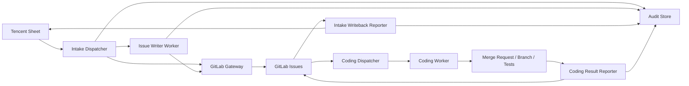

# GitLab Defect Automation Design

This directory contains design and prompt assets, not an implemented automation runtime. Deployment, scheduling, audit storage and external integrations must be supplied and verified by each instance.

## 1. Background

The target operating model is no longer "choose a bug tracker". It is:

- GitLab is the only source of truth for defects in the current monorepo.
- Tencent Docs online sheets are external intake and writeback surfaces.
- AI agents are responsible for two independent automation chains:
  - intake and triage
  - confirmed issue coding and regression work
- automation instances must be parameterized instead of hardcoded to a single sheet or a single GitLab project

The current working constraints are:

- the team uses self-managed GitLab Free
- external issue input is often noisy and inconsistent
- the same defect may appear in multiple Tencent sheets
- wrong merges are more expensive than duplicate issues
- coding automation must run through clean-context worker instances instead of one long-lived agent

Therefore the first-phase design must optimize for:

- shortest path to production
- GitLab-first operating model
- conservative deduplication
- reusable prompt templates for Codex automations
- strong human checkpoints on risky transitions

## 2. Scope

### 2.1 In scope

- parameterized automation framework for defect intake and coding
- Tencent Docs online sheet as the first external source type
- GitLab issue lifecycle and labels for self-managed GitLab Free
- prompt templates for Codex automation instances
- parameter schema for intake and coding instances
- writeback contract from GitLab to Tencent sheet
- audit, safety, and recovery rules

### 2.2 Out of scope

- a full custom defect management UI
- replacing GitLab with a second system of record
- hardcoded Tencent Docs or GitLab project bindings
- automatic merge or automatic issue closure without human review
- support for non-Tencent sources in phase 1

## 3. Goals

- Keep GitLab as the single source of truth for all defects in the current monorepo.
- Treat Tencent sheets as external input and visibility surfaces only.
- Parameterize automation instances so new sheets or new GitLab targets are configuration, not new code paths.
- Split intake and coding into independent automation chains.
- Split each chain into dispatcher, clean-context worker, and reporter responsibilities where needed.
- Prefer duplicate GitLab issues over incorrect auto-merge into an existing issue.
- Keep the system operable on self-managed GitLab Free.

## 4. Core Decisions

### 4.1 Source-of-truth decision

GitLab issues are the only defect truth for the current monorepo. Tencent sheets never become peer issue systems.

### 4.2 Automation-family decision

There are two independent automation families:

- `Intake`
  - reads external issue observations
  - clusters and routes them
  - creates or updates GitLab issues
  - writes results back to Tencent sheets
- `Coding`
  - scans GitLab for issues explicitly approved for agent execution
  - dispatches clean-context workers
  - writes execution results back to GitLab

These two families do not call each other directly. Their handshake is the GitLab issue state model.

### 4.3 Parameterization decision

Sheet locator, GitLab target, dedupe thresholds, labels, writeback columns, and schedules are automation parameters. They must not be hardcoded into prompt templates.

### 4.4 Dedupe decision

The dedupe strategy is conservative:

- high-confidence match: may attach to an existing issue
- medium-confidence match: create a new candidate issue and mention similar issues
- low-confidence match: create a new candidate issue

The system prefers duplicate issues over incorrect merges.

### 4.5 Coding execution decision

Coding automation is split into:

- `Coding Dispatcher`
- `Coding Worker`
- `Coding Result Reporter`

Each coding worker receives only one issue context package and runs in a clean context.

## 5. Selected Architecture

### 5.1 High-level view

### 5.2 Architectural components

- `Automation Definition`
  - Codex automation instance configuration
  - stores schedule, prompt template choice, and parameter values
- `Source Adapter`
  - reads the configured source type
  - phase 1 source type is `tencent_sheet`
- `Normalizer`
  - converts noisy rows into normalized observations
- `Correlation and Dedupe Engine`
  - clusters observations
  - searches existing GitLab candidates
  - applies conservative merge policy
- `GitLab Gateway`
  - searches issues
  - creates or updates issues
  - applies labels and comments
- `Writeback Adapter`
  - writes issue results back to Tencent sheet columns
- `Audit Store`
  - stores source-record mappings, run logs, confidence scores, and side effects
- `Coding Worker Runtime`
  - isolates single-issue coding execution

## 6. Intake Automation Design

### 6.1 Intake responsibilities

The intake chain must:

- read parameterized Tencent sheet input
- normalize and cluster noisy observations
- find candidate existing issues
- route each cluster to one of:
  - attach to an existing issue
  - create a new candidate issue
  - mark for explicit human review
- write back issue references and sync status to the source sheet

### 6.2 Intake split

#### Intake Dispatcher

Responsible for:

- loading automation parameters
- reading Tencent sheet content
- normalizing and clustering source records
- finding candidate matching GitLab issues
- deciding the route for each cluster
- dispatching a clean-context `Issue Writer Worker` for create/update work

Not responsible for:

- writing final human-facing issue narratives itself
- writing directly back to Tencent sheet
- changing global dedupe policy at runtime

#### Issue Writer Worker

Responsible for:

- handling a single structured observation cluster
- generating the GitLab issue title and body
- creating a new issue or adding structured updates to an existing issue
- preserving source references and candidate-match explanation

Not responsible for:

- re-clustering source records
- changing dedupe routing policy
- writing back to Tencent sheet

#### Intake Writeback Reporter

Responsible for:

- writing issue references and sync results back to the configured sheet columns
- persisting audit results for each source record and cluster

Not responsible for:

- changing GitLab issue semantics
- re-evaluating dedupe decisions

### 6.3 Intake data model

The phase-1 conceptual model is:

- `Source Record`
  - one raw Tencent sheet row or other externally stable input unit
- `Observation Cluster`
  - one inferred problem cluster derived from one or more source records
- `GitLab Issue`
  - the final defect record of truth

Mappings:

- many source records may map to one observation cluster
- many source records may map to one GitLab issue
- one source record may later be remapped to a different GitLab issue after human review

### 6.3.1 Minimum operational identity and audit fields

To make intake idempotent and replayable, each processed source record or cluster
must produce at least the following operational fields in the audit store:

- `source_uid`
  - stable external identity for the record
  - derived from document identity plus configured business key or explicit
    `source_record_id`
  - must never rely on sheet row number alone
- `source_snapshot_hash`
  - hash of the normalized input payload used to detect material change
- `cluster_fingerprint`
  - stable fingerprint of the inferred observation cluster for the current
    routing decision
- `routing_revision`
  - monotonic revision incremented when material source content changes or a
    human remaps the source to another issue
- `bound_issue_iid`
  - currently linked GitLab issue
- `bound_issue_state`
  - latest observed business state of that GitLab issue
- `last_writeback_status`
  - latest known sheet writeback outcome
- `last_run_id`
  - automation run identifier
- `side_effect_log`
  - append-only list of GitLab writes, writeback attempts, and recovery actions

The audit store is operational memory for idempotency and recovery. It is not a
second defect source of truth. GitLab remains the only defect truth.

### 6.4 Intake routing rules

The default routing policy is:

- if a cluster strongly matches an active existing issue, attach to that issue
- if a cluster is only partially similar, create a new candidate issue and mention similar issues
- if data is incomplete or ambiguous, create a candidate issue with `review::required`

### 6.4.1 Suppression and re-entry rules

- if the same `source_uid` and the same `source_snapshot_hash` were already
  routed to `state::needs-info`, `state::closed-invalid`, or
  `state::closed-duplicate`, intake must not create another candidate issue
- in that case, the system should write back the previous routing result or a
  status such as `suppressed_no_change`
- re-entry is allowed only when:
  - the source content changed materially and therefore produced a new
    `source_snapshot_hash`
  - or a human explicitly reset the prior binding
- if a human remaps one source record to a different GitLab issue, intake must
  create a new `routing_revision` while preserving the previous binding history

## 7. Coding Automation Design

### 7.1 Coding responsibilities

The coding chain must:

- scan GitLab for issues that humans explicitly marked ready
- claim one issue at a time
- dispatch a clean-context worker
- let the worker fix code, add tests, run regression checks, and open an MR
- report structured results back to GitLab

### 7.2 Coding split

#### Coding Dispatcher

Responsible for:

- scanning GitLab using a configured selector
- enforcing claim and concurrency rules
- assembling the minimal issue context package
- dispatching a clean-context `Coding Worker`

Not responsible for:

- changing code
- deciding whether an MR should be merged

#### Coding Worker

Responsible for:

- handling one GitLab issue only
- operating in an isolated worktree or clean execution workspace
- making code changes
- adding or updating tests
- running the required verification commands
- creating a branch and opening an MR when appropriate

Not responsible for:

- closing issues automatically
- changing Tencent sheet content
- dispatching other issues

#### Coding Result Reporter

Responsible for:

- writing execution summary back to GitLab
- adding MR links and test results
- applying `agent::*` labels
- reporting blocked states clearly

Not responsible for:

- further code changes
- human approval decisions

### 7.3 Claim lease protocol

The coding dispatcher must not rely on the `agent::claimed` label alone.
Claiming one issue requires both:

- the `agent::claimed` label
- one structured claim note or structured comment in GitLab containing:
  - `run_id`
  - `dispatcher_id`
  - `worker_id`
  - `claimed_at`
  - `lease_expires_at`
  - `branch_name` when known
  - `mr_url` when known
  - `supersedes_claim_id` when a stale lease is replaced

Claim rules:

- dispatcher may claim only when no unexpired lease exists
- lease expiry must be explicit and time-based
- expired leases must not disappear silently; reclaim must write a superseding
  note
- if `agent::mr-opened` exists with an active MR, dispatcher must not auto-
  reclaim the issue unless a human resets it
- result reporter is responsible for updating claim metadata on blocked, MR-
  opened, and completed outcomes

### 7.4 Minimum coding context package

To preserve clean-context execution while keeping workers effective, the coding
dispatcher should pass only a bounded context package containing:

- issue identity, title, description, and current labels
- latest human comments relevant to reproduction or scope, capped to a small
  configured number
- known related issues or duplicate references when relevant
- suggested code paths
- required verification commands
- allowed edit paths and disallowed paths
- branch and MR policy

The context package should be intentionally bounded. Dispatcher should prefer
structured summaries over dumping long issue history or broad repository context.

## 8. Parameter Model

### 8.1 Shared automation fields

All automation instances should expose:

- `instance_id`
- `instance_name`
- `schedule`
- `secret_ref`
- `audit_sink`
- `dry_run`
- `max_items_per_run`

### 8.2 Intake instance fields

- `source.kind`
- `source.locator`
- `source.identity`
- `source.parse_profile`
- `source.change_cursor`
- `gitlab.base_url`
- `gitlab.project`
- `gitlab.issue_template`
- `gitlab.default_labels`
- `dedupe.policy`
- `dedupe.thresholds`
- `writeback.columns`
- `writeback.enabled`
- `human_review.rule`

### 8.3 Coding dispatcher fields

- `gitlab.base_url`
- `gitlab.project`
- `issue_selector`
- `claim_label`
- `claim_timeout_minutes`
- `dispatch_limit`
- `worker_profile`
- `result_reporting_policy`
- `worktree_policy`

### 8.4 Coding worker fields

- `repo.path`
- `repo.default_branch`
- `worktree.root`
- `branch_prefix`
- `verification.commands`
- `mr.target_branch`
- `mr.template`
- `allowed_paths`

### 8.5 Recommended prompt release metadata

Each approved automation instance should also record a small release manifest
for reproducibility:

- `prompt_manifest.repo_commit`
- `prompt_manifest.template_files`
- `prompt_manifest.parameter_source`
- `prompt_manifest.generated_at`
- `prompt_manifest.generated_by`
- `prompt_manifest.reviewed_by`

## 9. GitLab Label State Model

The maintained label groups, transition matrix and claim rules are defined in
[GitLab Label State Machine](prompts/30-gitlab-label-state-machine.md).
Dispatchers and reporters must use that contract when generating or executing an instance.

## 10. Tencent Sheet Contract

The maintained columns, identity semantics and retry rules are defined in
[Tencent Sheet Column Contract](prompts/31-tencent-sheet-column-contract.md).
The audit fields in §6.3.1 support those operations; GitLab remains the defect source of truth.

## 11. Safety and Governance

### 11.1 Human control points

Humans must remain the decision makers for:

- confirming that a candidate issue is real
- granting `agent::ready`
- merging coding MRs
- closing defects as resolved

### 11.2 Permission boundaries

- Intake Dispatcher
  - may read Tencent sheets
  - may read and write GitLab issues
  - may not change code
- Issue Writer Worker
  - may create or update GitLab issues for one cluster
  - may not change global routing policy
- Intake Writeback Reporter
  - may write only configured Tencent sheet columns
  - may not change GitLab semantics
- Coding Dispatcher
  - may claim issues and dispatch workers
  - may not change code
- Coding Worker
  - may change code, run tests, and open MRs
  - may not close issues or modify source sheets
- Coding Result Reporter
  - may report results into GitLab
  - may not continue coding after report finalization

### 11.3 Concurrency rules

- one active coding worker per issue
- dispatcher must check and set claim metadata
- claim expiry must be explicit
- source records must be idempotently processed
- stale claims must be superseded explicitly, never silently overwritten

### 11.4 Recovery rules

- write side effects must be replayable without duplicate issue creation
- failed sheet writeback must not invalidate a successful GitLab write
- worker failures must end in explicit `agent::blocked` or equivalent report state
- unchanged rejected or duplicate source records must be suppressible without
  creating new candidate issues

## 12. Deliverables

This design delivers the following artifacts under the dedicated repository root `ai_automation/`:

- one design document
- one prompt-template bundle for Codex automations
- one shared parameter schema
- one GitLab label state reference
- one Tencent sheet column contract
- one automation instance example set

The primary output is the prompt-template bundle. The design document explains how and why to use it.

## 13. GitLab Prerequisites

Detailed operational setup is intentionally centralized in
`ai_automation/gitlab_defect_automation/gitlab_project_setup.md`.

That file is the executable GitLab project-configuration checklist for both
human operators and AI agents.

This section keeps only the design-level prerequisite categories:

### 13.1 Required GitLab configuration categories

- one explicit project selected as the defect source of truth
- one label system covering business lifecycle, review gates, and classification
- one automation identity and token strategy
- one protected default branch and human-controlled merge path
- repository-side issue and merge request templates when stable narrative is
  desired

### 13.2 Recommended GitLab configuration categories

- one project issue board aligned to the state labels
- one documented claim lease note format
- one documented coding result comment format
- one future label-promotion strategy if scope expands beyond one project

### 13.3 Optional GitLab configuration categories

- webhook-based event push for issue and merge request events
- token-expiry notifications routed to automation owners

## 15. Artifact Index

- `ai_automation/README.md`
- `ai_automation/gitlab_defect_automation/README.md`
- `ai_automation/gitlab_defect_automation/gitlab_project_setup.md`
- `ai_automation/gitlab_defect_automation/prompts/README.md`
- `ai_automation/gitlab_defect_automation/prompts/00-common-parameter-schema.md`
- `ai_automation/gitlab_defect_automation/prompts/10-intake-dispatcher-prompt.md`
- `ai_automation/gitlab_defect_automation/prompts/11-intake-writer-worker-prompt.md`
- `ai_automation/gitlab_defect_automation/prompts/12-intake-writeback-reporter-prompt.md`
- `ai_automation/gitlab_defect_automation/prompts/20-coding-dispatcher-prompt.md`
- `ai_automation/gitlab_defect_automation/prompts/21-coding-worker-prompt.md`
- `ai_automation/gitlab_defect_automation/prompts/22-coding-result-reporter-prompt.md`
- `ai_automation/gitlab_defect_automation/prompts/30-gitlab-label-state-machine.md`
- `ai_automation/gitlab_defect_automation/prompts/31-tencent-sheet-column-contract.md`
- `ai_automation/gitlab_defect_automation/prompts/40-automation-instance-examples.md`

## 16. Sources

The following external constraints were checked on 2026-03-18:

- GitLab pricing and tier boundary for Duo and planning features
- GitLab issue boards, issues API, webhooks, description templates, and service desk
- Tencent Docs Open API and MCP documentation

Official references:

- https://about.gitlab.com/pricing
- https://docs.gitlab.com/user/project/issue_board/
- https://docs.gitlab.com/api/issues/
- https://docs.gitlab.com/user/project/integrations/webhook_events/
- https://docs.gitlab.com/ee/user/project/description_templates.html
- https://docs.gitlab.com/user/project/service_desk/
- https://docs.qq.com/open/document/app/openapi/v2
- https://docs.qq.com/open/document/mcp/
