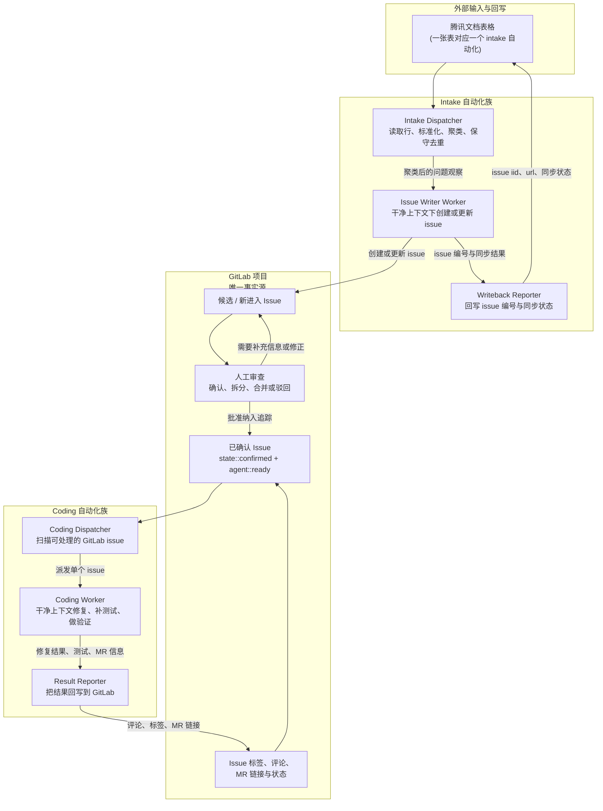

# GitLab 缺陷自动化

这个主题目录保存以 GitLab 为中心的缺陷自动化方案、prompt 模板和参数示例。仓库未提供执行器、调度服务或部署验收记录；下述流程是实例化目标，启用前需要接入可用的工具与运行环境。它遵循以下原则：

- GitLab 是唯一缺陷事实源
- 腾讯文档表格只承担输入与回写界面
- intake 与 coding 是两套彼此独立的自动化任务
- prompt 模版与参数配置保持参数化，不写死环境信息
- 由 AI agent 基于模版和参数文件直接生成最终 prompt

目录内容：

- `gitlab_project_setup.md`
  - GitLab 项目配置执行清单，可直接交给 AI agent 执行
- [DESIGN.md](DESIGN.md)
  - 当前方案设计
- `prompts/`
  - 可复用的 Codex prompt 模版、参数约定、标签状态模型、表格列契约
- `examples/`
  - 可直接交给 AI agent 使用的示例参数 JSON 文件

主要入口：

- `gitlab_project_setup.md`
- [DESIGN.md](DESIGN.md)
- `prompts/README.md`
- `examples/README.md`

推荐使用方式：

1. 将 `prompts/` 下的 markdown 模版作为唯一模版事实源。
2. 从 `examples/` 里复制一份最接近的 JSON 示例，并填入你的环境参数。
3. 把参数 JSON 和对应的 prompt markdown 文件一起交给 AI agent。
4. 让 AI agent 按 JSON 替换模版占位符，生成该自动化实例的最终 prompt bundle。
5. 将生成后的 prompt 放入你的自动化系统中使用，而不是反写回模版文件。

## 快速上手

如果你是第一次落这套方案，先做“准备工作”；系统跑起来以后，日常按“工作流”运转即可。

### 准备工作

1. 明确当前 monorepo 对应的唯一 GitLab 缺陷事实源项目，以及你要接入的腾讯文档表格范围。
2. 按 [`gitlab_project_setup.md`](./gitlab_project_setup.md) 完成 GitLab 项目侧基线配置。
3. 在 `examples/` 中分别挑一份最接近的参数 JSON：
   - intake / writeback 用一份
   - coding dispatcher 用一份
4. 按你的环境修改 JSON，只填环境值，不改 prompt 契约结构。
5. 从 `prompts/` 选择对应模版，把模版和参数 JSON 一起交给 AI agent 生成最终 prompt bundle。
6. 人工审阅生成结果后，再放进 Codex app 或其他自动化系统中配置 recurring automation。
7. Phase 1 建议先只上线一个 intake 实例和一个 coding dispatcher 实例，先把闭环跑通，再扩到更多表格和更多调度器。

### 日常工作流

1. 外部问题先进入腾讯文档表格，由 intake 自动化定时读取、标准化、聚类，并写入 GitLab issue。
2. 人工在 GitLab 中完成审查，决定确认、驳回、补充信息、拆分或合并。
3. 对确认且允许 agent 处理的问题，人工加上约定标签，例如 `state::confirmed` 与 `agent::ready`。
4. coding dispatcher 定时扫描可处理 issue，claim 单个 issue，并派发 clean-context worker 处理。
5. coding worker 负责修复、补测试、跑验证，并把结果交给 result reporter 回写到 GitLab。
6. GitLab 中形成 issue、评论、标签、分支、MR 的完整记录；腾讯文档只回写 issue 编号和同步状态。
7. 当你要新增一张表、调整标签策略或更换 prompt 时，重复“复制参数 JSON -> 生成新 prompt bundle -> 人工审阅 -> 发布 automation”这条流程，不要直接改运行中的模版事实源。

## 整体流程



关键点：

- 腾讯文档只是输入与回写界面，不是系统事实源。
- GitLab 才是缺陷状态、标签、审查决策、修复进展和 MR 结果的唯一权威记录。
- intake 自动化与 coding 自动化是两套独立的定时任务。
- coding worker 是“按单个 issue 干净上下文执行”的一次性工作单元，不是长期共享的常驻任务。

## Pilot 前建议补齐的运行约束

在小范围试运行前，建议先把下面这些规则明确下来：

- 每条外部记录都要有稳定的 `source_uid`，不能只依赖表格行号。
- 每条外部记录都要有 `sync_fingerprint` 或等价内容指纹，用于判断“内容是否实质变化”。
- 对已经被判定为 `needs-info`、`closed-invalid`、`closed-duplicate` 且内容未变化的记录，intake 不应重复创建新 issue。
- coding dispatcher 的 claim 不能只靠 `agent::claimed` 标签，还要有带过期时间的 claim lease 记录。
- GitLab 写成功但表格回写失败时，应进入可重试状态，而不是重新建 issue。
- coding worker 上下文包必须有边界，避免把过多 issue 历史直接塞给 worker。
- 每个正式启用的 automation 实例，都应记录所用模版、参数文件、仓库 commit 与审核人，方便回溯。

## 需要配置什么

每个自动化实例只需要在示例 JSON 中填写环境相关的值。通常需要替换的字段包括：

- `gitlab.base_url`
- `gitlab.project`
- `source.locator`
- `source.identity`
- `gitlab.default_labels`
- `writeback.columns`
- `issue_selector`
- `worktree_policy.root`
- `repo.path`
- `secret_ref`

不要直接修改源 markdown 模版去写入这些值。

## GitLab 侧需要做的配置

详细配置已经单独收敛到：

- [`gitlab_project_setup.md`](./gitlab_project_setup.md)

这个文件现在是唯一的 GitLab 项目配置清单事实源，适合直接和参数 JSON 一起交给 AI agent 执行。

这里只保留结论：

- Phase 1 走“自建 GitLab Free 的最短路径”，优先使用 project 级能力。
- 必需项是：唯一 defect project、标签体系、默认分支保护、issue/MR 模板、自动化身份与 token。
- 强烈推荐项是：project issue board、claim lease 评论模板、结果回写评论模板。
- webhook 和 group label 都可以后置。

## Codex App 使用示例

在 Codex app 里，建议分成两层来使用：

- 一次性生成最终 prompt bundle
- prompt 审阅通过后，再配置成 recurring automation 执行

推荐在 Codex app 中这样操作：

1. 以本仓库作为 workspace 打开 Codex app。
2. 选择你要实例化的自动化族。
3. 从 `examples/` 复制一份最接近的 JSON 文件，并替换成你的环境值。
4. 启动一个 Codex 线程或 automation，在提示词中明确引用：
   - 参数 JSON 文件路径
   - 对应的 markdown 模版文件路径
5. 让 Codex：
   - 读取这些文件
   - 按 JSON 替换占位符
   - 保留那些本来应由后续 agent 或任务提供的运行时段落
   - 以 markdown 形式返回最终 prompt bundle
   - 如果参数缺失，要明确指出，不能自行猜测
6. 人工审阅生成后的 prompt bundle，确认无误后再配置成 recurring automation。

建议在这一步同时记录：

- 当前仓库 commit SHA
- 使用的模版文件列表
- 参数 JSON 路径
- 生成时间
- 审核人

## Codex App 中推荐的实例拆分方式

- Intake dispatcher：
  每张腾讯文档表格对应一个 recurring automation 实例
- Coding dispatcher：
  每个 GitLab 项目和一套 issue selector 策略对应一个 recurring automation 实例
- Coding worker：
  通常不单独做 recurring automation；它更适合作为 coding dispatcher 派发出来的单 issue 干净上下文 prompt

## Codex App 操作员请求示例

当你希望 Codex 在 app 中帮你生成最终 prompt bundle 时，可以使用类似下面的请求：

```text
读取这些文件：
- ai_automation/gitlab_defect_automation/examples/intake-customer-cn.json
- ai_automation/gitlab_defect_automation/prompts/00-common-parameter-schema.md
- ai_automation/gitlab_defect_automation/prompts/30-gitlab-label-state-machine.md
- ai_automation/gitlab_defect_automation/prompts/31-tencent-sheet-column-contract.md
- ai_automation/gitlab_defect_automation/prompts/10-intake-dispatcher-prompt.md
- ai_automation/gitlab_defect_automation/prompts/11-intake-writer-worker-prompt.md
- ai_automation/gitlab_defect_automation/prompts/12-intake-writeback-reporter-prompt.md

任务：
1. 使用 JSON 中的值替换模版占位符。
2. 保留那些尚未在当前阶段展开的运行时 payload 段落。
3. 按目标文件分组，以 markdown 段落返回最终 prompt bundle。
4. 如果缺少任何参数，不要猜，直接列出缺失字段。
```
