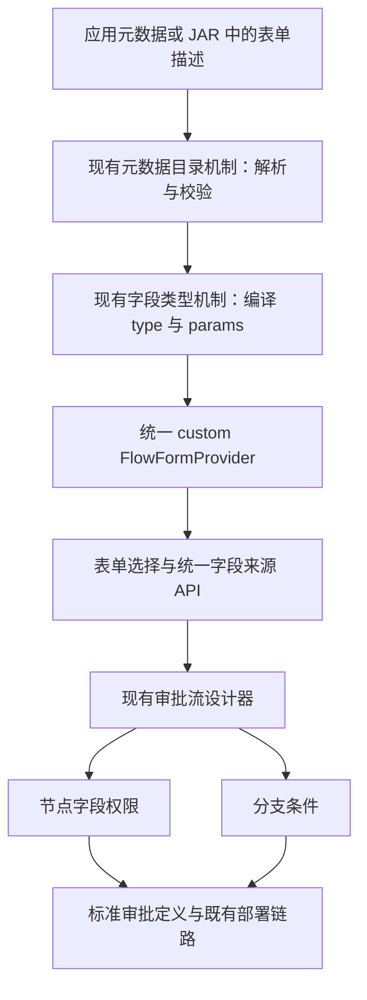

# 自定义表单接入审批流方案

状态：已实现并完成功能验收；扩大回归中的未通过项与验证边界见验收报告。本文记录本次实现的产品边界与资源契约。适用场景为应用自行实现业务页面和数据处理，同时使用平台配置、管理审批定义。

## 1. 目标与范围

应用提供独立的表单字段描述 JSON，平台将这些字段接入现有审批设计器。应用部署后，管理员可以查看、修改流程节点与审批人员，配置节点字段的可见、可写、必填，并在条件编辑器中引用同一份字段。

本次交付范围如下：

| 内容 | 本次负责的结果 |
| --- | --- |
| 表单描述 | 定义、校验和加载标准 JSON 资源，可随应用元数据或 JAR 交付 |
| 表单绑定 | 开发端与运行端审批管理入口可选择自定义表单，保存稳定引用 |
| 字段权限 | 能查看字段、配置权限、保存并正确回显 |
| 分支条件 | 能按字段类型配置条件、保存并正确回显，沿用现有条件结构与求值机制 |
| 部署后修改 | 复用现有流程定义管理、接管和重新部署机制 |
| JSON Schema | 新增自定义表单描述的结构合同，配套类型索引、示例、校验及分发 |
| 应用开发 Skill | 更新审批接入和元数据定义指引，同步生成项目中的配套 Skill 与 Schema |
| 高代码运行接入 | 本次不实现业务页面渲染、数据读写、字段取值与权限执行，由应用开发者负责 |

不提供注解入口。高代码业务不一定存在代表完整表单的 Java 类，字段也可能来自多个对象或计算结果。应用不需要为声明字段创建 Java 类，也不需要逐表单实现 `FlowFormProvider`。

字段描述按应用元数据生命周期维护；管理员部署后在线修改的是流程及其字段使用规则。本次不增加独立的表单搭建器，也不提供在线新增 Java 业务字段的能力。

## 2. 现状与缺口

现有主路径是：表单来源提供 `FlowForm` → 字段 API 返回统一字段来源 → 编辑器派生字段权限和条件选项 → 保存标准审批定义 → 显式部署。

| 机制 | 当前事实 | 本次安排 |
| --- | --- | --- |
| `FlowFormProvider` | 提供一种来源下的表单搜索、分页与按名称读取；一个 Provider 可以提供多张表单 | 平台新增一个 `custom` 来源实现，统一提供描述文件中的表单 |
| `FlowForm / FlowFormField / ExpressionVariable` | 已有表单、字段、条件变量的设计时模型 | 作为统一投影结果，不建立第二套编辑器模型 |
| `FlowFormService` | 负责运行时表单呈现和提交，与设计时 Provider 是不同接口 | 不因新增字段来源而自动生成运行时表单服务 |
| 字段来源 API | 运行端已有 `/api/approval-workflow/base-info/form/{type}/{name}/workflow-field` | 继续承载自定义表单字段，保留响应结构 |
| 条件字段编译 | 动态表单已有字段类型编译、条件控件与运算符转换，但实现依赖动态表单字段类 | 提取其中可复用的字段投影逻辑，不复制规则 |
| 编辑器 | 已支持 `formFieldSourceApi`，从同一份字段派生权限和条件来源 | 保持薄边界，来源解析交给外层页面和后端 |
| 配置入口 | 运行端新建页固定动态表单，开发端主要固定业务模型；运行端编辑页仍输入类型与标识 | 开放有实际字段来源的表单选择，保留原绑定与上下文约束 |
| 流程生命周期 | 已有 `WorkflowModel`、元数据层刷新、运行端接管、部署和重置 | 直接复用，不增加一套流程存储或状态机 |

`business-model` 已有运行时表单服务和开发端字段查询；当前运行端尚未找到同等的 `FlowFormProvider` 实现。因此来源选择器必须按当前环境实际可用的来源展示，不能把已有类型名称等同于每个入口都具备完整字段来源。本次保留其原有行为与已绑定值，不借新增 `custom` 改造业务模型接入。

## 3. 类型与术语

| `formType` | 界面名称 | 字段来源与职责 |
| --- | --- | --- |
| `default` | 动态表单 | 平台管理动态表单定义及相应页面、数据 |
| `business-model` | 业务模型 | 从业务模型获取字段，配合业务模型页面和数据能力 |
| `custom` | 自定义表单 | 应用提供字段描述，业务页面和数据处理由应用实现；本次新增 |

`default` 保留历史标识，不更名、不迁移已有定义。类型通过现有接口开放扩展，不改为封闭枚举。未绑定表单不增加独立类型，也不伪造 `default` 绑定。

界面只展示中文类型名称。JSON 是交付格式，不作为界面中的类型名称。

## 4. 表单描述资源

### 4.1 文件与位置

新增后缀为 `.approval-form.json`。一份文件描述一张表单，文件基名与 `name` 一致，例如 `purchase.approval-form.json`。一份描述可以被多条流程引用。

| 场景 | 正式位置 |
| --- | --- |
| 应用元数据仓库 | `approval-form/{name}.approval-form.json` |
| 应用运行目录 | `AppContext.homePath/approval-form/{name}.approval-form.json` |
| JAR 内资源 | `META-INF/ouroboros/metadata/approval-form/{name}.approval-form.json` |

JAR 资源可以由模块现有的 `src/main/metadata` 资源打包机制交付。开发端读取应用当前元数据版本和可见依赖资源；运行端读取当前应用上下文的资源。不在文件中增加 `applicationId`，不跨应用搜索同名表单。

本次允许开发者编辑文件并通过现有应用版本管理提交；审批设计器内的字段目录为只读展示。无需先开发一个新的元数据建模模块。

### 4.2 格式

```json
{
  "formatVersion": 1,
  "name": "purchase",
  "title": "采购申请",
  "description": "采购申请审批可使用的业务字段",
  "fields": [
    {
      "name": "amount",
      "label": "采购金额",
      "description": "本次申请的采购总金额，单位为元",
      "type": "定点数字",
      "params": {
        "size": 12,
        "precision": 2
      }
    },
    {
      "name": "department",
      "label": "申请部门",
      "type": "单行文本"
    },
    {
      "name": "purchaseType",
      "label": "采购类型",
      "type": "单选",
      "params": {
        "dataType": "String",
        "size": 100,
        "options": [
          { "value": "equipment", "label": "设备" },
          { "value": "consumable", "label": "耗材" }
        ]
      }
    }
  ]
}
```

这是独立资源合同，不是 `FlowForm` 的直接 JSON 序列化格式。资源先解析、校验、编译，再投影为现有设计时模型。

### 4.3 字段约束

| 位置 | 属性 | 约束与含义 |
| --- | --- | --- |
| 根 | `formatVersion` | 必填，当前为整数 `1`；未知版本明确拒绝，不按旧格式猜测 |
| 根 | `name` | 必填，应用范围内稳定标识；禁止路径分隔符、空白及上级目录片段，大小写冲突按现有目录规则诊断 |
| 根 | `title` | 必填，界面展示名称 |
| 根 | `description` | 可选，解释表单用途 |
| 根 | `fields` | 必填数组；允许空数组，此时只提供无字段空态 |
| 字段 | `name` | 必填，同一表单内唯一，是业务输入中稳定的顶层键，使用 `[A-Za-z_][A-Za-z0-9_]*`；本版不把它解释为路径或表达式，不允许平台保留的 `__` 前缀 |
| 字段 | `label` | 必填，设计器展示名称 |
| 字段 | `description` | 可选，解释业务含义；随字段来源保留，供后续说明或智能体使用 |
| 字段 | `type` | 必填，引用现有 `FieldTypeCatalog` 中的字段类型 |
| 字段 | `params` | 可选，缺失等同无显式参数；结构及默认值沿用该字段类型的合同 |

文件不声明节点的 `visible / writable / required`，也不重复声明条件对象、条件输入控件、数据值类型和运算符。它们分别由流程定义或已有字段类型编译机制承载。

本版描述平铺字段。嵌套对象、数组子表的权限与条件定位没有现成统一合同，不新增 JSONPath 或自行解释 `a.b`；业务可通过一个明确的顶层字段描述所需的计算结果。

## 5. 加载、覆盖与错误处理

加载复用 `TypedMetadataCatalog`、`TypedMetadataSpec`、`ClasspathMetadataSource`、`FileSystemMetadataSource` 和既有应用元数据生命周期，不另建扫描框架、全局注册表或刷新接口。

来源顺序与审批定义资源保持一致：先加载 JAR 层，再加载应用目录层。JAR 同名资源沿现有 classpath 覆盖顺序处理，来源与覆盖轨迹可通过加载器的 debug 日志诊断；应用目录中的同名资源整体覆盖 JAR 描述，不按字段合并。应用目录内出现重复标识必须报错。

不存在 `approval-form` 目录表示该应用没有这类资源。资源存在但 JSON、版本、名称、字段或类型参数错误时，明确返回文件与字段位置，不能静默跳过、回退其他表单或返回成功的空字段列表。启动、既有元数据刷新入口及每次读取均校验完整目录，单次读取须将全部描述编译成功后才返回结果。运行端不另设冻结快照或保留上一次成功结果的缓存；无效更新明确失败。

字段描述修改跟随应用元数据更新进入当前上下文；不隐式修改流程定义、不自动部署流程。`formatVersion` 表示格式版本，描述内容的修订由应用版本管理追踪；不增加另一套表单发布版本或持久化表。

## 6. 从描述到统一字段来源



平台提供一个 `custom` Provider，负责全部自定义表单的搜索、分页、按名称读取；Provider 是来源适配器，不是每张表单的业务实现。

字段编译遵守以下约束：

1. 使用对应环境的 `FieldTypeCatalogContext.devApp(appName)` 或 `runtime()`，不能拿开发平台自身的字段目录替代应用目录。
2. 复用字段类型编译结果，派生已有条件编辑器所需的输入类型、值类型和选项。例如资源中的“定点数字”与条件值类型 `Decimal`、输入控件类型不是同一概念，不能直接互换。
3. 复用已有审批条件运算符及其适用范围。先从 `BasicFieldExpressionVariableBuilder` 提取不依赖动态表单实体的编译与投影逻辑，再让原动态表单实现委托它；保留现有 `ExpressionVariableBuilder` SPI，不复制一份运算符资源或新增表达式语法。
4. 共享投影逻辑放在现有审批 core 中，按需增加其对字段类型 core 的单向依赖；不新建 Maven 模块，不让审批 core 反向依赖 dynamic-form 或 runtime。现有 dynamic-form builder 继续只负责其输入适配及已有扩展选择。
5. 所有有效字段可用于字段权限；只有已有机制能提供合法条件控件、值类型和运算符的字段进入条件候选。明确设置 `FlowForm.expressionVariables`，不能用其默认从所有字段派生的行为把不支持的字段也标成可用于条件。
6. 继续返回 `sourceKind / revisionToken / fields / boundForm / boundFormSummary`，通过现有 `usages` 表达用途。`revisionToken` 必须反映字段名称、标签、类型、参数与选项的有效变化，不能只统计字段个数。

资源中的 `params` 是字段类型参数，不能原封不动作为运行时表单数据或深层调用参数。描述不包含任何一条审批实例的实际业务值。

## 7. 绑定与配置入口

### 7.1 标准绑定

审批定义继续使用现有结构：

```json
{
  "form": {
    "formType": "custom",
    "formId": "purchase"
  }
}
```

`formId` 引用描述的 `name`，不保存 JSON 文件路径、Java 类名、页面 URL 或 Provider Bean 名称。不新增顶层 `formType / formKey`；历史兼容继续由现有定义 codec 处理。字段来源响应中的既有 `boundForm.formKey` 是展示摘要，不回写为资源绑定字段。

### 7.2 来源 API

运行端继续使用现有 API：

- `GET /api/approval-workflow/base-info/form/{type}`：表单搜索与按值回显。
- `GET /api/approval-workflow/base-info/form/{type}/{name}/workflow-field`：统一字段来源。

新增 `GET /api/approval-workflow/base-info/form-types` 返回当前上下文可用来源的中文选项。来源名称通过现有 Provider 的向后兼容默认方法提供，既有扩展无需立即实现新方法；内置类型提供中文标题，扩展缺少标题时保留类型标识作为回显。

开发端在现有审批 dev 模块提供对应的应用作用域入口，为 `/api/dev/{appName}/approval-workflow/base-info`，下挂相同的 `form-types`、`form/{type}` 和 `form/{type}/{name}/workflow-field` 路由。它读取正在编辑的应用元数据，不能转向某个已运行容器或调用开发平台自身的 runtime Provider 来凑字段。

开发端业务模型字段继续使用已有业务模型解析能力。若需要共用，提取已有 helper 中的字段装配方法为可复用服务，旧 helper API 保留委托，不让控制器互相调用，也不复制业务模型查询逻辑。

来源列表按各环境实际具备的读取能力返回，不要求两端来源完全相同。既有绑定的类型未出现在来源列表时仍保留、回显并诊断，不清空绑定，也不擅自转换成 `custom`。

新增 dev 路由复用应用元数据读取权限；运行端来源 API 复用审批定义管理权限。对应权限项进入现有权限元数据，不开放绕过应用作用域的公共目录。

### 7.3 界面

运行端新建、运行端编辑、开发端通用新建与编辑入口接入同一交互：

- “表单类型”使用现有 `button-group-select` 展示少量可用中文类型；扩展类型变多时沿用项目现有可搜索选择器。
- “关联表单”使用可搜索选择器，显示名称与标识，不要求用户输入技术类型或文件路径。
- 用户选中表单并确认改绑后，“流程信息”的“当前流程表单字段”显示字段目录；节点属性区展示字段权限，分支区展示可用于条件的字段。
- 从业务模型专属入口打开且绑定由模型确定时，保留原绑定约束，不因新增选择器允许静默改绑其他表单。
- 本版不展示 `formatVersion`、加载策略、Provider 等技术设置；帮助内容只保留完成配置所需的信息。
- 复用当前设计器、表单控件和样式，不新做一个审批编辑器，也不通过大量局部 CSS 修补布局。

修改当前草稿的表单绑定后，字段权限和条件来源必须同时重新解析。加载过程中不继续展示上一张表单的字段；异步旧请求不能覆盖新绑定的返回结果。已有权限或条件不静默删除，保留并显示待修复诊断。

空字段目录、字段来源加载失败、绑定资源缺失必须是可区分的状态，不能都显示为“没有字段”。字段目录仅提供业务字段的名称、类型和必要说明，不提供实际数据预览或完整页面预览。

## 8. 权限与条件的持久化

节点权限继续保存在 `StartNode / ApprovalNode / HandleNode` 的现有 `permission` 中，例如：

```json
{
  "name": "amount",
  "label": "采购金额",
  "visible": true,
  "writable": false,
  "required": false
}
```

默认权限及字段间约束沿用当前编辑器合同，不另设 `custom` 专属默认规则。字段描述改变不能覆盖管理员已经配置的权限。

分支条件继续保存现有结构，例如“采购金额大于 5 万元”：

```json
{
  "left": { "type": "field", "field": "amount" },
  "op": "greater",
  "right": 50000
}
```

选项条件保存实际 `value`，不保存中文标签作为业务值。条件与权限都引用同一份字段标识，不维护两份可编辑字段列表。条件求值继续走现有结构化条件与表达式引擎。

修改字段标签只改变展示；改字段标识属于合同变更。删除字段、改变类型或收窄选项后，编辑器保留旧引用并给出诊断。沿既有 draft-invalid 机制允许保存结构合法但待修复的草稿；新部署必须验证表单存在、字段引用有效、条件类型及运算符可用，失败时指出流程节点或连线与字段，不隐式修正条件。

部署校验针对新增 `custom` 绑定实施，不借此追溯收紧历史动态表单和业务模型流程的合同。部署时重新解析当前应用字段来源，不能只依赖浏览器先前加载的字段快照。

## 9. 部署后修改与运行边界

初始流程仍通过现有 `workflow/{name}.workflow.json` 或 JAR 标准审批定义交付，表单描述与流程定义是两类独立资源。运行时修改流程使用现有 `WorkflowModel`，不写回 JAR、Java 源码或应用仓库文件。

| 操作 | 行为 |
| --- | --- |
| 应用启动或元数据刷新 | 加载描述，沿现有机制刷新初始流程；不自动部署 |
| 运行端保存流程改动 | 标记既有接管状态；已部署定义改动后进入待重新部署状态 |
| 显式重新部署 | 使用现有部署路由生成后续实例使用的新定义版本 |
| 应用升级 | 已被运行端接管的流程按现有机制保护，不被初始流程覆盖 |
| 恢复初始配置 | 使用现有显式重置，再按需重新部署 |

在途实例继续使用启动时的部署定义，不自动迁移。字段目录没有独立历史快照，本次也不增加快照表；来源描述不再提供历史字段时，历史流程的权限和条件配置必须原样可读并显示失效引用。应用开发者仍需维护已有在途实例所依赖的业务字段和取值兼容性。

运行端接管只保护流程定义，不锁定字段描述的来源版本。描述更新可能使已接管草稿出现失效引用，必须按上一节诊断并在重新部署前修复；不能宣称“接管流程”同时冻结了高代码的数据合同。

`custom` 字段目录只解决设计时配置，不等于存在可调用的运行时 `FlowFormService`。本次不新增返回空容器或假成功的表单服务，也不自动生成高代码页面或把普通 REST 接口包进业务模型 Action。通用发起或办理页面发现没有对应运行时表单服务时，应明确提示通过业务页面操作，不展示可执行但必然失败的表单提交入口。

字段来源与引擎无关；流程执行仍经过正式统一路由。对于执行权威位于外部系统的流程，本地字段和规则配置不承诺修改外部系统的实际编排，部署继续遵守现有适配器能力和外部权威边界。

## 10. 兼容与架构约束

- 保留 `default / business-model`、历史定义 codec、现有表单 Provider 与表单 Service 的扩展接口，新增来源不要求存量应用迁移。
- 不修改 aggregate 或其他应用的低代码元数据；新能力通过新描述文件显式接入。旧流程不会因为存在同名描述就自动改绑。
- 不增加数据表、事件总线、流程引擎、表达式语法、应用身份字段、隐藏注册表或高代码执行桥接层。
- 复用现有字段类型及操作符目录、统一字段来源响应、权限结构和条件结构；通用编译逻辑只保留一份。
- 来源与流程按应用上下文隔离，开发平台查询不得读取其他应用或其他运行实例的字段描述。
- 表单选择与字段 API 的新接口属于设计时读取能力；旧 API 保留已有合同，不通过无提示的空结果掩盖新来源解析失败。

## 11. JSON Schema 与 Skill 配套交付

配套合同与实现一同交付。新资源已进入正式 Skill、Schema、模板分发及 IDE 类型目录。

### 11.1 JSON Schema 与类型索引

新增 `metadata-schema/approval-form.schema.json`，沿用仓库的 JSON Schema Draft 2020-12。它约束第 4 节定义的资源信封、必填属性、版本、字段结构及可选描述，配套完整正反示例。

| 文件或入口 | 实施要求 |
| --- | --- |
| `metadata-schema/approval-form.schema.json` | 作为新资源的维护源；校验 `formatVersion = 1`、名称与字段结构，允许空字段数组；`type` 保持非空字符串，`params` 保持字段类型参数对象 |
| `metadata-schema/index.json` | 注册 `approval-form`、中文名称“自定义表单描述”、后缀 `.approval-form.json` 与 Schema 路径 |
| `metadata-schema/README.md` 与 `README.en.md` | 补充新资源及验证方式；当前 31 类资源随本次新增为 32 类，数量与实际索引保持一致 |
| `metadata-schema/approval-workflow.schema.json` | 现有 `form.formType` 已是开放字符串，支持 `custom`，不收紧为三个内置类型的枚举；补充绑定回归示例，保留 `formId` 与历史 `formKey` 别名兼容 |
| 元数据 Skill 的 Schema 副本与来源清单 | 由现有分发工具生成新 Schema，记录维护源、内容摘要及分发摘要，不手工维护副本 |

Schema 负责静态结构，平台负责语义。不能在 Schema 中枚举当前 `FieldTypeCatalog` 的所有类型，或复制各类型的 `params` 校验和默认值规则。字段名称重复、类型是否存在、类型参数是否合法、文件名与资源名是否一致、绑定及字段引用是否有效，仍由正式解析、字段编译和部署路径诊断。`uniqueItems` 不能替代按字段 `name` 判重。

完整校验使用现有 `tidestack-metadata-definition/scripts/validate_resource_json.py`，保留 Draft 2020-12 与本地引用解析机制。缺少依赖或引用必须失败，不降级为子集校验；显式 `--subset` 仅用于有限检查。Schema 通过后，示例还必须经过平台正式加载、字段投影和部署验证。

### 11.2 更新现有 Skill

更新公共套件的维护源 `skills/`，不新增专门的“自定义审批表单 Skill”，也不把仓库运维用的 `.agents/skills/` 当作公共套件源。

| 维护位置 | 补充内容 |
| --- | --- |
| `skills/tidestack-approval-integration/SKILL.md` | 说明动态表单、业务模型、自定义表单的选型；高代码场景按需提供字段描述及标准流程绑定，不要求先创建 UI Schema、DTO 或逐表单 Provider |
| 同 Skill 的 `references/business-integration.md` 及配套示例 | 给出可校验的表单描述和完整审批定义；说明部署后配置权限与条件、接管及重新部署，以及业务代码提供实际值、落实权限的责任；统一发起入口说明与目标版本的正式实现、测试保持一致 |
| `skills/tidestack-metadata-definition/SKILL.md` | 新增后缀到 `approval-form` 的路由、资源路径、版本、字段类型及绑定规则，并更新资源清单数量 |
| 同 Skill 的 `references/contracts.md` | 说明新 Schema 的维护源、结构与语义校验边界及来源覆盖规则；`schema-sources.json` 由工具生成 |
| `skills/README.md` 与 `README.en.md` | 同步资源清单与维护说明；只有能力发现目录需要补充选型时，才按既有目录同步机制更新 `tidestack-howto`，不泛改其他 Skill |

Skill 必须区分字段类型的 `params` 与实例业务值。示例中的 `form.formId` 引用描述的 `name`，不引用文件路径或 Bean 名称；独立流程绑定不要求额外建立业务模型或 Action。不能因设计时已有字段目录，就声称高代码页面、数据读写或运行时权限执行已由平台自动完成。

### 11.3 分发与现有工具接入

复用 `scripts/skills/sync_distribution.py`，将发现集合由仅遍历手册 Schema 目录改为“既有手册文件与显式来源覆盖项的并集”，为 `approval-form.schema.json` 声明根目录维护源。保留其他类型的既有来源，不借本次迁移全部 Schema。

手册冻结期间，不构建手册或用旧手册快照覆盖新合同。新 Schema、Skill 引用及来源清单从上述维护源生成；既有审批流 Schema 的开放绑定结构可直接复用，通过新增用例验证兼容，不为新增类型收紧旧格式。

同步范围包括：

- 公共元数据 Skill 的 `references/approval-form.schema.json` 与 `schema-sources.json`。
- `project-templates/templates/backend.extension.spring-autoconfigure/1.0.0/tree/.agents/skills/`。
- `maven-archetypes/ouroboros-module-archetype/src/main/resources/archetype-resources/.agents/skills/`。
- 后端扩展模板 `template.json` 中的 Skill 文件复制清单，由工具生成。

若现有 IDE 入口按元数据类型目录匹配后缀，应同步 `ide-plugins/common/metadata-editor-schema/metadata-types/` 的类型注册与索引，关联本次正式 Schema，并复用既有生成机制。该配套仅保证描述文件可识别、校验，不新增专属可视化表单搭建器；未完成目录接入前不能宣称新后缀会被 IDE 自动识别。

### 11.4 配套验收

1. 同一份有效描述和完整流程示例同时通过正式 Schema 校验与平台语义检查；二者失败原因和职责可区分。
2. 覆盖缺少必填项、未知版本、错误属性类型等结构错误，以及重复字段、未知字段类型、无效类型参数、失效绑定等语义错误；空字段数组和省略 `params` 为有效用例。
3. 原有 `default / business-model`、历史表单标识别名与其他 SPI 类型绑定继续通过原有校验；合法扩展字段类型不被静态 Schema 误拒绝。
4. 用真实应用开发任务验证更新后的 Skill：能生成两张表单和复用同表单的流程，不生成专属 Provider、额外 Action 或无关 UI Schema；示例可由生成项目中的工具离线校验，不依赖 monorepo 路径或联网下载引用。
5. 在现有分发工具单测中增加“新 Schema 只存在于显式维护源”的用例；同步后来源摘要、两种模板副本及复制清单一致，再次同步无变化，`--check` 无漂移。不得用源码文字匹配替代这些行为验证。

## 12. 实施顺序与验证

本次按下列顺序实施。可重放的验收命令、结果及限制以 `tmp/testing-evidence/approval-custom-form/acceptance-report.md` 为准；本次未执行远程发布。

| 顺序 | 实施内容 | 完成证据 |
| --- | --- | --- |
| 1 | 资源模型、JSON Schema、类型索引、解析校验、正式资源位置与加载规则 | 同一批示例通过结构与语义校验；未知版本、重名、文件名不符、无效字段和类型参数能定位；JAR 与应用目录覆盖行为通过测试 |
| 2 | 提取既有字段编译逻辑，提供统一 `custom` Provider | 一个 Provider 搜索多表单；数字、文本、单选等正确投影；动态表单原测试通过；无条件能力的字段只进入权限来源 |
| 3 | 运行端与开发端来源 API 和选择入口 | 应用作用域正确；搜索、分页、按值回显、绑定切换正确；旧绑定保留；缺失、失败、空目录状态可区分 |
| 4 | 字段目录、节点权限、条件编辑与保存回显 | 真实设计器中可见中文字段；权限与数字、枚举条件保存后重开一致；快速切换表单不会被旧请求覆盖 |
| 5 | 部署校验、部署后修改、接管保护与回归 | 标准定义可以重新部署；新实例采用新定义；原实例仍按旧定义；刷新不覆盖已接管流程；失效字段拒绝新部署但可保存待修复草稿 |
| 6 | 审批及元数据 Skill 更新、Schema 与模板分发、使用说明 | 示例能按指引生成和校验；新 Schema 能被同步工具发现；来源摘要、模板副本和复制清单一致；同步幂等且 `--check` 无漂移 |
| 7 | 完整验收 | 文档、Schema、Skill、API、自动化测试和浏览器操作结果一致，当前功能与未对接运行能力的边界明确 |

验证必须覆盖以下交付条件：

1. 应用提供两份表单描述，不编写专属 Provider，即可被搜索和选择。
2. 一张表单可绑定两条流程，节点权限互不覆盖，字段目录共用。
3. 金额能配置数值比较，单选能选择中文标签并持久化真实值；保持现有表达式求值路径。
4. 可见、可写、必填保存后重开仍一致；修改流程无需修改 Java 或重新构建应用代码。
5. 描述同字段数量下修改标签、类型或选项能刷新编辑器，旧条件和权限不会静默丢失。
6. 元数据刷新、重新部署、接管保护、重置和旧实例版本均有可观察的验证结果。
7. 动态表单和业务模型原有相关回归通过；不为新来源伪造运行时表单服务，不产生死按钮。
8. 新增实现遵守仓库覆盖率和架构检查要求；测试验证行为，不使用源码文本匹配证明功能成立。
9. 第 11 节配套验收全部通过，Skill 与 Schema 同能力一起交付，不作为上线后补项。

配套自动化检查复用以下命令；Schema 正反例还需调用第 11.1 节的完整校验器，功能验收继续执行对应模块测试与浏览器旅程：

```bash
python3 scripts/skills/sync_distribution.py
python3 scripts/skills/sync_distribution.py --check
python3 -m unittest discover -s scripts/skills/tests -v
python3 -m unittest discover -s skills/tidestack-metadata-definition/scripts/tests -v
```

实施与验收的原始命令、测试报告、API 请求与响应、截图保存在 `tmp/testing-evidence/approval-custom-form/`。本轮方案的静态核查及文档校验记录在 `tmp/testing-evidence/approval-custom-form-plan-20261115/`，不以方案中的预期测试替代实际通过证据。

## 13. 代码与合同依据

以下是复用机制及实现的主要入口；具体验收结果见第 12 节的证据目录。

- 设计时来源：[FlowFormProvider](../ouroboros-approval-workflow-core/src/main/java/com/ouroboros/workflow/approval/FlowFormProvider.java)、[FlowForm](../ouroboros-approval-workflow-core/src/main/java/com/ouroboros/workflow/approval/model/FlowForm.java)、[FlowFormField](../ouroboros-approval-workflow-core/src/main/java/com/ouroboros/workflow/approval/model/FlowFormField.java)。
- 运行时表单边界：[FlowFormService](../ouroboros-approval-workflow-core/src/main/java/com/ouroboros/workflow/approval/FlowFormService.java)。
- 动态表单投影：[DynamicFormProvider](../ouroboros-approval-workflow-dynamic-form/src/main/java/com/ouroboros/workflow/approval/dynamicform/DynamicFormProvider.java)、[BasicFieldExpressionVariableBuilder](../ouroboros-approval-workflow-dynamic-form/src/main/java/com/ouroboros/workflow/approval/dynamicform/expressionvariables/BasicFieldExpressionVariableBuilder.java)。
- 字段 API：[ApprovalWorkflowBaseInfoController](../ouroboros-approval-workflow-web/src/main/java/com/ouroboros/workflow/approval/web/controller/ApprovalWorkflowBaseInfoController.java)。
- 元数据加载及流程生命周期：[ApprovalWorkflowMetadataDefinitionProvider](../ouroboros-approval-workflow-runtime/src/main/java/com/ouroboros/workflow/approval/runtime/lifecycle/ApprovalWorkflowMetadataDefinitionProvider.java)、[WorkflowModelServiceImpl](../ouroboros-approval-workflow-manage/src/main/java/com/ouroboros/workflow/approval/manage/service/impl/WorkflowModelServiceImpl.java)。
- 正式结构与表达式：[审批定义元数据与图契约](definition-metadata-and-graph-contracts/overview.md)。
- 编辑器统一字段投影：[workflowSourceContract](../../../frontends/web/ouroboros-approval-workflow-designer/src/editor-core/workflowSourceContract.js)、[集成适配器](../../../frontends/web/ouroboros-approval-workflow-designer/src/editor-integration/approvalWorkflowEditorIntegrationAdapter.js)。
- 配套合同与分发：[Schema 索引](../../../metadata-schema/index.json)、[审批流 Schema](../../../metadata-schema/approval-workflow.schema.json)、[公共 Skill 套件](../../../skills/README.md)、[分发工具](../../../scripts/skills/sync_distribution.py)。
- 应用开发指引：[审批接入 Skill](../../../skills/tidestack-approval-integration/SKILL.md)、[元数据定义 Skill](../../../skills/tidestack-metadata-definition/SKILL.md)、[Schema 来源边界](../../../skills/tidestack-metadata-definition/references/contracts.md)。
