# 工作流前端代码说明

> 本文保留早期 Vue3 + G6 实现的历史说明。当前审批流设计器位于 `frontends/web/ouroboros-approval-workflow-designer`，编辑器和只读流程图采用 React Flow。当前机制见[设计器设计](../../../frontends/web/ouroboros-approval-workflow-designer/DESIGN.md)和[审批模块设计](../../../docs/design/modules/core/ouroboros-approval-workflow.md)。

## 1. 基本信息

### 1.1 git 地址

项目 `gitlab`
地址：[Files · test · 下一代低代码平台 / app-module 应用模块 / workflow 工作流 / workflow-frontend · GitLab (whxinpai.com)](http://gitlab.whxinpai.com:51080/ouroboros-lowcode/app-module/workflow/workflow-frontend/-/tree/test)；

`dev` 分支的代码是最新的；

`amis` 页面代码目前在后端工程的根目录中的 `amis` 文件夹内

### 1.2 审批流编辑器技术栈

- 开发框架：Vue3
- 组件库：Element Plus
- 图可视化引擎：G6（v4.7.5）

### 1.3 前端开发环境说明

目前的开发环境是同时运行前端基座、后端基座以及审批流编辑器（微应用）；

审批流编辑器需要放置到前端基座中：

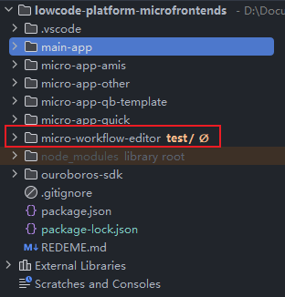

前端基座 `main-app`  `vue.config.js`开发配置：

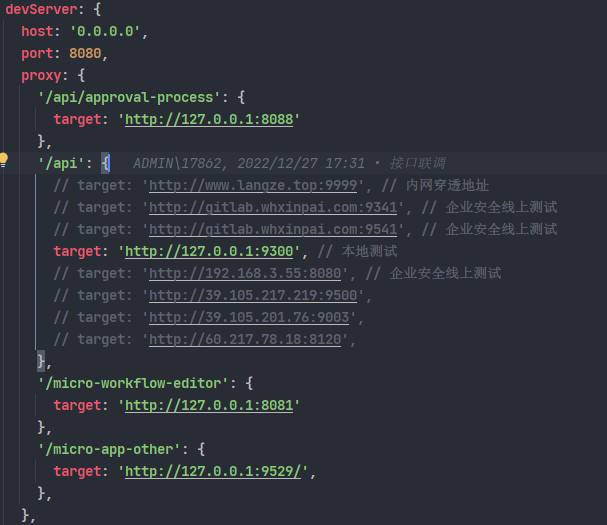

审批流集成相关页面开发时是放置到后端基座进行的，后端基座的端口在测试时被修改成了 9300，后端基座中 amis 页面结构配置：

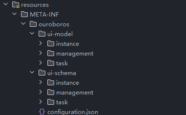

## 2. 代码结构说明

前端代码主要由**审批流集成**和**审批流编辑器**两部分组成；

**审批流集成**部分的页面主要利用 `amis` 绘制，**审批流编辑器**以 `Vue3` 框架为主体，以微应用的形式运行在前端基座中。

### 2.1 审批流编辑器

#### 2.1.1 页面

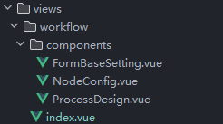

`views` 文件夹主要包含审批流编辑器的前端页面，其中 `index.vue` 是编辑器主体；

`FormBaseSetting.vue` 是编辑器的子组件，主要功能是审批流基本信息编辑；

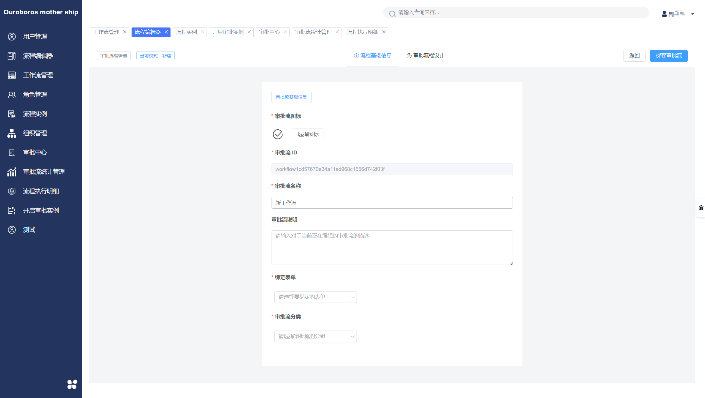

`ProcessDesign.vue` 是编辑器的子组件，主要功能是审批流程绘制；

具体的图定义、渲染函数在 `src/views/workflow/components/ProcessDesign.vue` 中，具体的配置项详见如下图所示的方法：

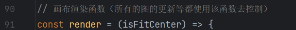

使用了层次布局（流程图），并针对节点点击、鼠标在节点上的移入移出等设置了相应的事件，每当点击到一个工作流节点，我们可以获得节点本身（
`id`、`type`
）以及点击到的具体的图形（`shape`），上述信息主要用于设置节点点击事件的逻辑：

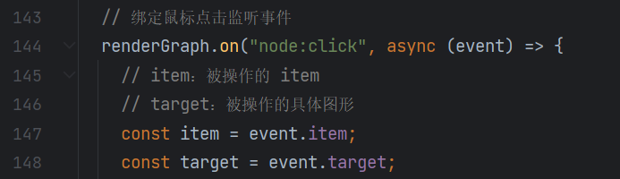

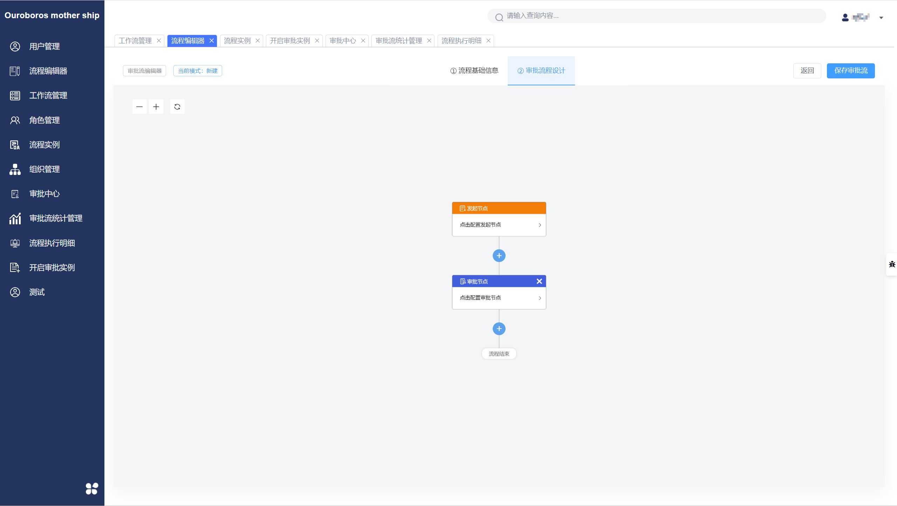

`NodeConfig.vue` 是 `ProcessDesign.vue`
的子组件，主要功能（以审批节点为例）是配置审批流中节点的信息，通过点击画布上的发起节点、审批节点等可配置节点，可以生成该子组件，子组件生成时，将接受
`ProcessDesign`
传递的节点基本信息（`id`、`type`）以及节点集合映射 `map`，从 `map` 获得节点配置后，深拷贝至临时对象，通过将表单与临时对象绑定，修改值，在
**修改配置**时将临时对象的值传递给 `map` 中的节点的配置信息中；

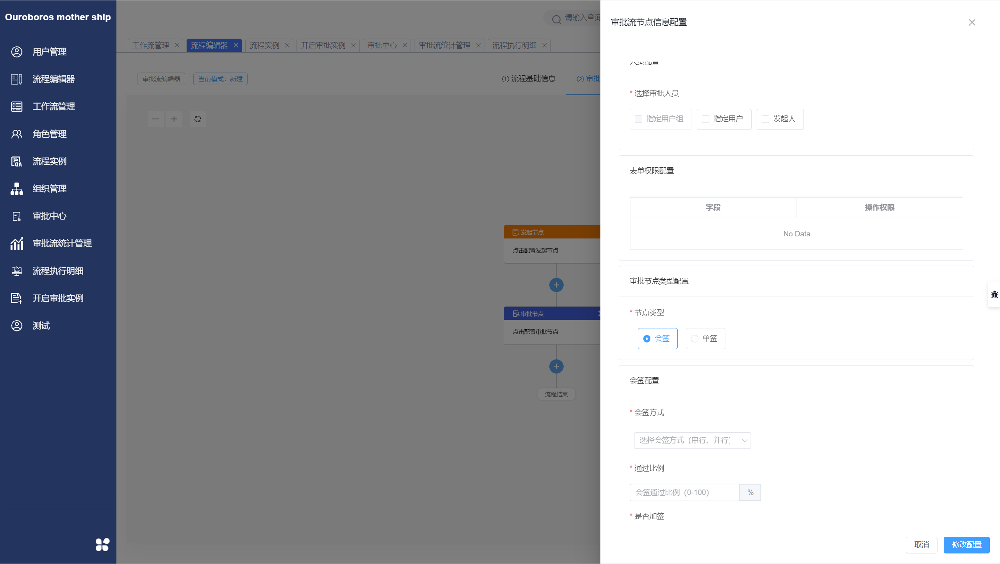

#### 2.1.2 转译器相关

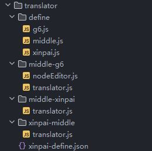!image-20230425172906259（本地截图，未入库）

`translator` 文件夹主要包括对工作流结构（`xinpai`，目标数据结构）、G6图渲染结构（`g6`
，用于渲染审批流至画布的数据结构）、中间结构（`middle`，用于前两种数据结构互转） 3 种数据结构的定义（`define`），以及 3
种数据结构的互相转换算法（例如 `A` 转换成 `B` 的转换器在文件夹 `A-B`
中），特别地，对于审批流节点的增、删、改操作引起的数据的变化全部是在 `middle`
结构上操作的，在需要使用其余两种结构的数据时，利用转译器进行转译，节点的增删改操作算法在文件 `nodeEditor.js`
中，每一次节点的增删改都会对工作流的中间结构进行修改，修改后调用 `translator/middle-g6/translator.js`
中的结构转换方法可以将中间结构转换成上述的 G6 的渲染数据，根据新的数据**重新渲染**画布。

G6 的渲染所需要的数据格式是：

```js
{
    nodes: [
        // 节点信息 item
        {
            id: "节点 id",
            type: "节点类型",
            name: "节点名称",
            ......
        },
        ......
    ],
    edges: [
        {
            source: "起始点的 id",
            target: "终点的 id"
        },
        ......
    ]
}
```

G6 的数据格式利用边连接两节点与目标结构（`xinpai`）具有较大差异，因此创建一种中间结构，在工作流的创建过程中，我们需要一直维护两处数据，即
**中间结构的工作流**以及**中间结构的工作流对应的** `map`（`key`——节点 id、`value`——节点配置），新增节点将被保存至 `map`
中，通过 `vuex` 维护相关数据。

中间结构（`middle`）类似于**双向链表**，每一个节点的 `next` 指向后序节点的地址，`pre` 代表前序节点的 `id`。

`nodes` 文件夹主要包括G6渲染用的工作流节点（发起节点、审批节点、子流程节点、定时器节点、通知节点、条件节点、“添加”结点、结束节点）以及边；

G6 的每一个自定义节点都是由 1 个 `keyshape` 和多个 `shape` 组成的，例如审批节点是由最外层框（`keyShape`
）、标题蓝色矩形框（`shape`）、标题文字（`shape`）、标题 logo（`shape`）、删除按钮“x”（`shape`）、白色的内容框（`shape`
）、内容框文字（`shape`）、查看更多“>” logo（`shape`）组成：


节点上展示的文字信息是根据参数 `cfg` 配置的（如果需要修改内容框内文字，如下图所示为自定义节点添加 `xxx`
属性，修改 `cfg.xxx` 即可）：

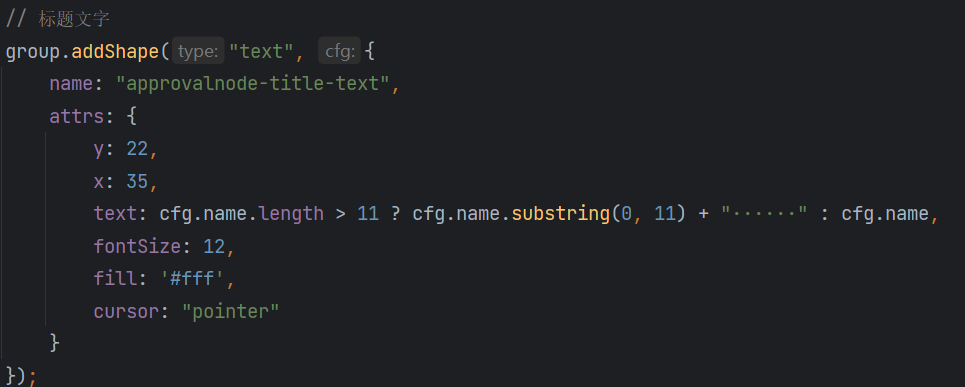

### 2.2 审批流集成

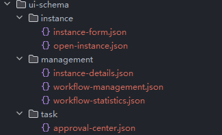

#### 2.2.1 审批流管理相关

`management/workflow-management.json` 审批流管理

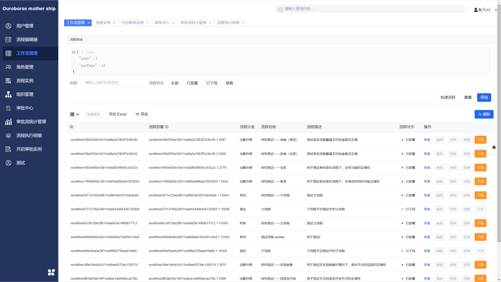

`management/workflow-statistics.json` 审批流统计管理

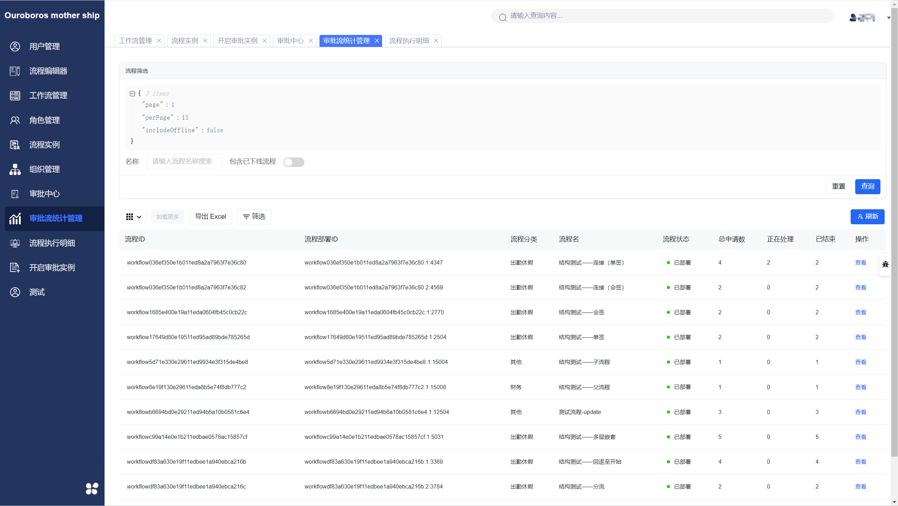

`management/instance-details.json` 流程执行明细，在审批流统计管理界面点击某一流程的“查看”按钮可以跳转至该界面；

目前该页面的发起人查询需要输入完整的发起人 `ID`

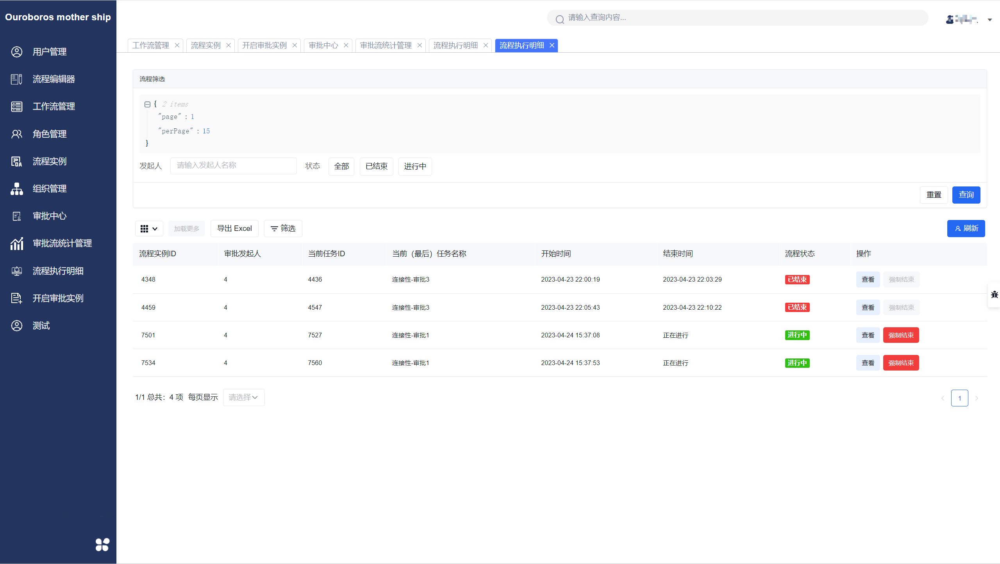

#### 2.2.2 流程实例相关

`instance/open-instance` 流程实例页面，点击某一卡片，开启审批实例（跳转至动态表单的数据填写界面）

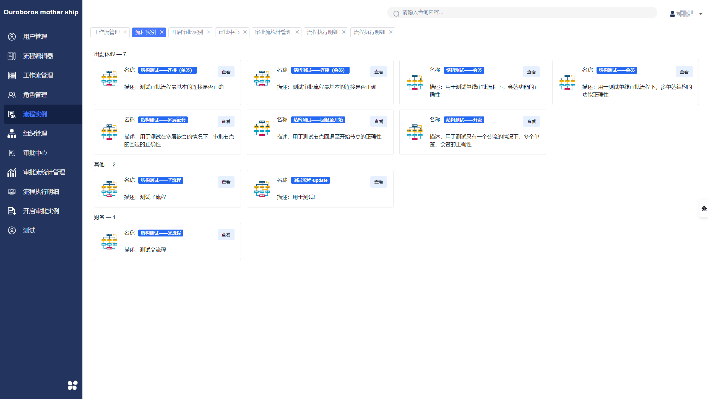

`instance/instance-form.json` 开启审批后，填写的动态表单；

目前动态表单的表单项的权限配置中，是否可见与是否可写都是用 `disabled` 去标识的；

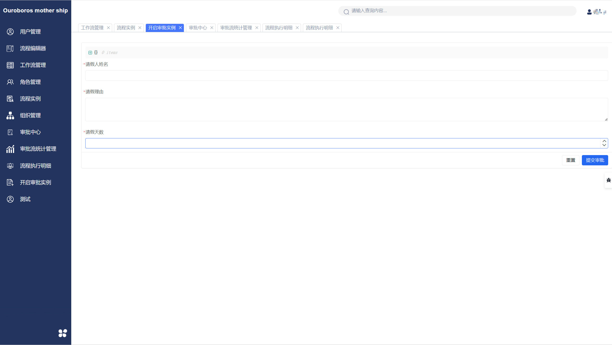

#### 2.2.3 审批中心

`task/approval-center.json` 审批中心，允许用户查看“已处理”和“未处理”的审批任务，并且可以查看当前审批实例的时间线。

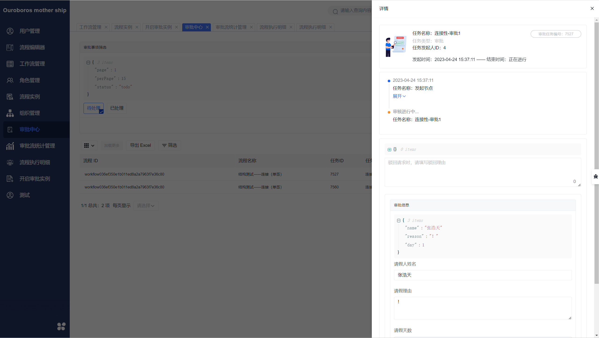
