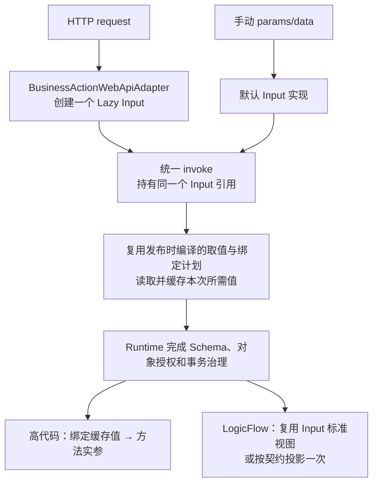

# Business Action 输入参数与调用上下文设计

> 状态：**已实施，验收记录见第 10 节**。更新日期：2026-10-22。本文定义当前 Input 接口、params/data 契约、Lazy 请求包裹、注解签名和 WebAPI 字段，与[业务模型 DESIGN](../DESIGN.md#8-动态业务行为与事实)及[开发指南](../../../docs/guides/business-model-behaviors.md)共同描述当前实现。
>
> 本轮确认：以 **BusinessActionInput 接口**统一手动输入与 HTTP 输入；BusinessActionWebApiAdapter 的调用级包裹类直接实现该接口，延迟取值并缓存结果，不再增加独立 InputSource 包裹层。WebAPI 使用显式 BusinessAction 处理器类型，引用字段简化为 businessModel / action。设计先提交为 `d8c8057ee`，随后作为独立修订执行；不改写此前已验收 Epic 的结论。

> **2026-11-11 请求形状兼容修订**：Action → LogicFlow 的正式输入视图直接兼容旧 `RequestInfoMap` 访问方式，见 §6、§7.2。高代码 Input 接口仍只提供 params/data。旧脚本不需要把 `$request.body/headers/uri` 改成 `$request.context.request...`；原请求惰性读取及缓存继续复用。

> 当前映射由 BusinessBehaviorMappingPlan 与 BehaviorMappingCompatibility 沿正式 EL 实现：新版使用 `${ ... }`，旧 `$.`在拥有定义的资源/贡献入口按自身格式解释并转换，普通编辑保留原文。精确兼容表与存在性计划统一见[业务行为契约 §12.1.4](business-model-behavior-contracts.md#1214-映射统一使用现有-el保留完整-request-与-lazy-读取)。


## 1. 为什么需要重切参数边界

当前主路径是 WebAPI → BusinessActionWebApiAdapter → BusinessActionRuntime → LogicFlow / BusinessActionHandler。平台已有动态 inputSchema、binding.inputMapping、脚本命名端口和 RequestInfoMap，应沿这些正式机制扩展。

修订前的不足有四个：

1. 独立的 `target` 只表达一个主要对象，无法自然表达无对象、对象集合和多个业务角色；它又和 input 中的对象标识重复。
2. Web 适配器目前选择非空 body，否则选择 query，无法准确表达路径、查询和请求体同时参与一次调用的情况。注解方法又固定接收 `(BusinessActionContext, Map)`，类型化体验和动态契约尚未分开。
3. 旧脚本的 `$request` 来自名为 request 的输入端口，旧 Web 入口通常向它传入 RequestInfoMap。变量名称本身不能证明依赖 HTTP；替换逻辑流入口对象却不检查其端口契约，会造成语义变化。
4. WebAPI 目前仍声明 handlerType=LogicFlow，再根据 businessActionName 扩展字段切换到 Action 适配器。元数据声明与实际执行目标不一致，也难以准确表达高代码 Action。

本次对 aggregate 工作副本的静态检查发现：196 个业务模型文件中，8 个模型的 35 段脚本引用 `$request`；其中 4 段是已启用且采用自动 CRUD 实现的 afterScript，分别读取检查单的 `data.id`、车辆的 `data.transportLicense/id`。其余 31 段 custom 脚本全部配置 `isGenerateImplementation=false`，不能据此认定它们正在执行。已检查的这些脚本没有使用 HTTP headers、host 或 remoteAddress。应用未启动，本结论不覆盖运行环境中另行保存的模型。

修订前的 CRUD binding 已构造 data / params，故上述 4 段并不因为包装成 Action 就失去 `$request.data`。但它们拿到的已经不是完整 RequestInfoMap。本次分别解决业务输入迁移和真实 HTTP 信息保留，不能靠一个 request 名称混淆两者。

## 2. 总体路径：一个 Input 接口，两种输入实现

原始来源仍有两种：HTTP request，以及手动 invoke 提供的 params/data。两种来源直接实现同一个 BusinessActionInput 接口；Runtime 接收这个 Input 实例，不根据 context.request 是否存在切换参数来源。

| 原始来源 | Input 如何提供业务值 | 高代码接收方式 | LogicFlow 接收方式 |
| --- | --- | --- | --- |
| HTTP request | WebAdapter 创建 HttpBusinessActionInput，按路由取值计划延迟读取 request，转换后的值缓存于本次调用 | 按参数表将已缓存的值绑定为 Java 实参 | 直接使用该 Input 暴露的标准流程视图；自定义入口只做一次必要投影 |
| 手动 invoke | DefaultBusinessActionInput 持有 params/data，按同一动态契约准备本次稳定值 | 绑定为相同位置、相同类型的实参 | 提供与 HTTP 相同业务形状的标准视图；自定义映射规则相同 |

高代码的最终产物是方法实参，Flow 的最终产物是流程入口。Input 接口表达逻辑业务参数，不要求高代码先生成 Flow 封套再拆回参数。内部代码、定时任务和订阅最终都是手动输入；订阅先将 payload 映射为 params/data，不构成第三种来源。



图中的计划、校验和执行是同一次调用的不同职责，不表示每经过一个框就创建一个包裹器。HTTP Input、业务读取缓存和授权后的 Context 按调用管理；绑定计划按发布快照共享，不保存请求或上一次调用的数据。可复用的手动输入值不保存执行 Context，beforeScript 的工作数据也按本次 Invocation 隔离。

## 3. BusinessActionInput 接口与动态契约

### 3.1 固定协议，允许动态内容及类型化内容

在 business-model core 定义中立接口，最小业务访问契约如下：

```java
// 不继承 Map，不依赖 Spring / Servlet。
public interface BusinessActionInput<P, D> {
    boolean hasParams();
    P params();
    boolean hasData();
    D data();
}
```

params 是具名操作参数，支持动态对象和 DTO；data 是业务载荷，可以是对象、数组或 Schema 允许的其他值。泛型改善 Java 调用体验，输入是否合法仍由当前发布的 inputSchema 决定。动态 Action 不要求增加 Java 类或重新编译。

| 分区 | 业务含义 | 例子 |
| --- | --- | --- |
| params | 操作范围、对象角色、条件、执行选项 | order 引用、预期版本、notify、查询条件 |
| data | 本次处理的业务载荷 | 创建数据、修改字段、审批意见、转账命令、文件引用 |

分区不等同于 HTTP query / body，不按字段类型猜测。例如转账的 fromAccount / toAccount 可以属于 data；其中的对象引用同样需要授权。params 不重新成为特殊 target。

接口提供 of(params, data)、paramsOnly(params)、dataOnly(data)、empty() 等工厂方法，返回默认实现。hasParams / hasData 区分分区缺失与显式 null；of 的两个分区均视为已提供，dataOnly(null) 表示显式 null。内部属性的缺失由动态对象的字段存在性表达；普通 nullable DTO 字段不能同时表达缺失与 null，确有此需要时使用动态对象或平台已有的字段存在性类型。

默认实现负责本次调用的稳定输入；HTTP 实现位于 Web 适配模块。两者都不能由调用者写入 actor、授权状态或伪造的真实 request。文件等特殊平台值保留其正式类型，不通过 JSON 往返强制复制。

### 3.2 调用 API 直接接收 Input，不增加 InputSource 层

简洁调用形态为：

```java
Object invoke(String modelFullName, String actionName,
              BusinessActionInput<?, ?> input);
```

继续复用现有 invoke(BusinessActionInvocation) 作为唯一执行入口。三参数方法仅创建 Invocation，并将传入的 Input 引用放入其中；WebAdapter 创建的 HttpBusinessActionInput 也直接传给这个入口。Invocation.input 由 Map 改为接口后，不再增加 BusinessActionInputSource、HTTP 来源封套或将已有 Input 再包装为另一个 Input。

Invocation 仍承载模型、Action、契约指纹等调用描述；Context 由平台建立。原始来源如何读取由 Input 实现封装，核心无需新增按 HTTP / invoke 分派的分支。

类型化手动调用示例：

```java
record ApproveParams(BusinessObjectReference order, boolean notify) {}
record ApproveData(String comment) {}

var input = BusinessActionInput.of(
    new ApproveParams(orderRef, false),
    new ApproveData("同意"));
actionRuntime.invoke("sales.Order", "approve", input);
```

动态调用使用同一工厂和接口，params / data 内容可以由模型或订阅生成的动态对象承载。Map 允许作为动态内容，但外层调用协议不再是任意 Map。SDK 类型从动态契约派生，不建立另一份 Java 专属契约。

### 3.3 一份 inputSchema 管理两个分区及所有对象角色

inputSchema 的根对象只声明 params / data。分区是否必需、允许的载荷类型、默认值及未知属性都由该 Schema 决定，不另外维护 paramsSchema / dataSchema 两份独立真相。Schema 校验只消费业务接口的两个分区；即使某个实现同时提供带 context 的 Flow Map 读取能力，也不能把可信上下文作为业务根的额外字段送入校验。

| 场景 | 逻辑业务输入示例 |
| --- | --- |
| 创建，无已有对象 | `{"data":{"customer":"C-1"}}` |
| 单对象审批 | `{"params":{"order":{"id":"O-1"},"notify":false},"data":{"comment":"同意"}}` |
| 一组对象与另一对象角色 | `{"params":{"orders":[{"id":"O-1"},{"id":"O-2"}],"warehouse":{"id":"W-1"}},"data":{"comment":"优先处理"}}` |
| 多角色业务命令 | `{"data":{"fromAccount":{"id":"A-1"},"toAccount":{"id":"A-2"},"amount":100}}` |
| 无业务输入 | `{}`，两个分区均缺失 |

取消独立 target / targetId 以及 model / instance 目标分支。对象引用继续用 x-business-object-ref 标记，数组项可以是引用，不新增 batch target 类型。模型归属表示 Action 所属业务模型，不要求每个 Action 都处理该模型的一条既有记录。

分配订单的动态契约可以声明为：

```json
{
  "type": "object",
  "required": ["params"],
  "additionalProperties": false,
  "properties": {
    "params": {
      "type": "object",
      "required": ["orders", "warehouse"],
      "additionalProperties": false,
      "properties": {
        "orders": {
          "type": "array",
          "minItems": 1,
          "items": {
            "type": "object",
            "x-business-object-ref": "sales.Order",
            "required": ["id"],
            "additionalProperties": false,
            "properties": {"id": {"type": "string"}}
          }
        },
        "warehouse": {
          "type": "object",
          "x-business-object-ref": "inventory.Warehouse",
          "required": ["id"],
          "additionalProperties": false,
          "properties": {"id": {"type": "string"}}
        }
      }
    },
    "data": {
      "type": "object",
      "additionalProperties": false,
      "properties": {"comment": {"type": "string", "default": ""}}
    }
  }
}
```

对象身份仍沿用当前单个 id 主键的边界，本次不扩展复合主键或 ObjectSet。Runtime 在事务内解析两个分区中的全部对象角色，检查对象及字段权限、前置条件和并发条件。引用不原地替换成 Record；客户端附带状态不能代替服务端授权。已授权状态按业务 JSON Pointer 放入 Context，例如 /params/orders/0、/params/warehouse 或 /data/fromAccount。

列表保持顺序；是否允许重复或多个角色引用同一对象由契约及业务条件声明。一次批量调用执行一次，不隐式拆成 N 次单对象调用。事务保证仍受现有资源参与边界约束。

旧 targetState、授权与前置条件表达式迁移到具名角色。事件 subject 由事实发生位置确定，不能取第一个对象或机械地把对象列表变成事件列表；审计关联实际写集。

## 4. WebAPI 显式接入与 Lazy 请求包裹

### 4.1 新增 BusinessAction 处理器类型，引用简化为 businessModel / action

WebAPI.handlerType 增加 BUSINESS_ACTION，对外值为 BusinessAction。路由构建按类型明确选择适配器：

| handlerType | 调用对象 |
| --- | --- |
| RequestMapping | Java Controller 方法 |
| RouterFunction | 代码注册的函数式路由 |
| LogicFlow | 直接执行逻辑流 |
| BusinessAction | BusinessActionRuntime 中的业务 Action |

新版来源映射示例：

```json
{
  "method": "POST",
  "path": "/orders/{orderId}/approve",
  "handlerType": "BusinessAction",
  "businessModel": "sales.Order",
  "action": "approve",
  "actionInputMapping": {
    "params.order.id": "${ request.pathVariables.orderId }",
    "params.notify": "${ query.notify }",
    "data.comment": "${ request.body.comment }"
  }
}
```

businessModel 仍保存业务模型全名；action 是该模型内的 Action 名，不是 handlerName 或 flowName。无论 Action 选择高代码还是 Flow，WebAPI 都只引用这两个业务身份字段。底层实现只配置在 Action binding 中，Action 类型的 WebAPI 不再重复配置 logicFlow。

路由构建必须同时覆盖 BusinessAction 类型，不能仍只筛选 LogicFlow。移除“存在 businessActionName 就切换适配器”的隐式分支；元数据校验按 handlerType 检查必需字段及互斥配置。CRUD / 自定义行为投影、编辑器、OpenAPI 类型筛选及序列化同步更新。

迁移在正式投影或元数据升级阶段将 businessActionModelFullName / businessActionName 改为 businessModel / action，并生成正确 handlerType；不在运行时长期保留两套字段名和按字段存在性猜测类型。普通 LogicFlow WebAPI 仍按其自身契约执行。

### 4.2 HttpBusinessActionInput 直接实现 Input

BusinessActionWebApiAdapter 在 Web 适配模块定义调用级包裹类 HttpBusinessActionInput，实现 BusinessActionInput。它持有已有请求信息视图和当前路由的取值计划，创建时不读取 body、不转换 DTO、不提前构造完整业务 Map。

WebAdapter 直接调用 invoke(businessModel, action, httpInput)，随后 Runtime 继续持有同一实例。该类不保存到模型快照、共享注册表或单例 Handler。Input 接口不继承 Map；HTTP 包裹类同时实现已有表达式机制使用的 Map 读取协议，而不再外套一个 Input。标准 Flow 入口使用关联本次 Context 的薄视图，视图本身不复制载荷；读取可变工作分区时只做本次流程需要的隔离拷贝，避免脚本污染稳定输入。它不是新的 InputSource 或 Input 包裹。

WebAPI 的 ParameterModel / requestBody 描述原始来源，Action Schema 描述业务值，方法签名 / binding.inputMapping 描述接收形式。发布时组合并编译为只读计划。计划与路由、Action 绑定使用同一发布快照，跨版本不兼容在执行前拒绝，不能混用旧路由计划与新绑定。

以上审批例子的参数表为：

| 逻辑业务路径 | HTTP 来源 | 手动 Input 来源 | Java 接收示例 |
| --- | --- | --- | --- |
| params.order.id | pathVariables.orderId | params.order.id | order 引用参数 |
| params.notify | query.notify | params.notify | boolean notify |
| data.comment | body.comment | data.comment | String comment |

这里 query 是取值计划的独立 HTTP 查询来源，不是 RequestInfoMap 的成员；request.pathVariables 对应路径变量，request.path 是字符串。读取明确的 query 来源应复用现有框架的查询解析能力，不能拿叠加 Header / path / form 的旧 request.params 代替。

### 4.3 Lazy 是按键读取的视图，校验按契约触发读取

- 对齐 LogicFlowWebAdapter 使用的 RequestInfoMap：创建时只保存请求引用与编译计划；get 按业务路径读取对应来源并缓存，不在首次读取任一字段时循环组装全部映射。params() 返回分区视图，不顺带读取 data；headers 按名称读取，不先遍历全部 Header。
- containsKey、keySet 和 Entry.getKey 只判断实际可见键，不为了枚举键先计算全部值。完整 body → data 的存在性按请求元信息判断，不解析载荷；若映射 `${ request.body.comment }`，判断该字段存在必须解析 body，结果仍复用同一解析缓存。枚举 values 或调用 Entry.getValue 则按正常读取规则求值。
- Runtime 在执行实现前读取契约校验需要的已映射业务值，一次遍历完成严格转换、默认值和可变容器隔离，形成稳定值；不先物化原始业务 Map、再深复制、再转换。缺失、显式 null、多值及读取失败保留各自语义。未映射的 transport 字段不因为业务校验被读取；完整 body 映射为 data 时，整个 data 都属于业务输入，必须校验。
- 准备后 params() / data() 返回同一份已校验业务值。具名 Java 参数通过已编译参数表读取这份值，不先构造 Flow 封套；文件等原生资源不做 JSON 序列化或读取内容。
- Runtime 在用户方法、节点、beforeScript 或任何业务写入执行前，完成所有已提供输入和必填字段的 Schema 校验，以及全部对象角色的必要授权。验证触发的读取同样进入缓存；执行复用已校验的值。
- 任意自定义 Input 实现也受这条规则约束：Runtime 和绑定计划按本次 Invocation 稳定业务值，执行不能重新调用未经约束的 getter 取得另一套值。HTTP 实现可直接复用自身调用级缓存，不为这项保证增加第二个 Input 包裹。
- 输入解析错误在准备阶段按字段及来源报告，不用空 Map 继续执行，也不在业务中途因为第一次读取才发现必需参数错误。Lazy 不承诺已提供载荷可以绕过校验或 body 永不解析。
- JSON / form / multipart 共用本次请求的解析缓存，body 只消费一次。接口 getter、可用性检查、参数绑定与 Flow 视图不能分别创建 RequestInfoMap 再解析一遍。

Input 可以管理读取与调用级缓存，不能自行执行业务、开启事务、决定访问权限或发布事件。共享编译计划不持有请求与缓存；每次 Action 各有自己的业务缓存，同一请求的原始解析结果则可以复用。

### 4.4 转换规则与性能边界

一个业务叶子只有一个显式来源，禁止映射父属性及其子属性后按遍历顺序解决冲突。自动 CRUD 生成固定计划，自定义 Action 的 WebAPI 显式声明；允许完整 body 映射到 data，不采用“body 非空就丢弃 query”的规则。

路径身份与 body 中重复的同一身份必须一致，否则写入前拒绝；不同角色的同名 id 不混为一个对象。标量多值拒绝，数组按 Schema 与正式 WebAPI 序列化声明解析，不自动取首项或统一按逗号切分。

同一身份通过 `x-business-object-identity: "/params/record/id"` 显式声明，发布校验指针必须指向 params/data 中直接声明的单个对象角色的 id；不支持数组通配指针。自动 update 使用这个约束，其他角色不会因为属性同名而被比较。HTTP query 数组目前支持 ParameterModel 声明的 form / explode 重复参数，单项仍为数组，其他 query 数组序列化在路由编译时拒绝。

两种 Input 使用同一严格类型规则，拒绝截断、隐式真假值及对象字符串猜测解析。默认值只补缺失，null 按 Schema 判断。DTO 投影不能悄悄丢弃未知业务属性；additionalProperties 作用于选取的业务对象，而不是把所有无关 Header 都当成业务输入。actor、租户和授权状态只能来自可信入口。

性能目标是“原始请求解析一次、每个业务值准备一次、Flow 必要投影一次”，不是零分配承诺。标准流程输入直接复用同一调用对象的视图；自定义 Flow 入口可以建立一次必要投影，引用已有缓存，不重复建立 Input、做整棵请求复制或 JSON 往返。

Runtime 现有 envelope / inputMapping 组装责任迁入正式绑定接缝，替换原内联逻辑，不能在其前面再叠加一套归一化。beforeScript 需要修改的 data 建立调用独享工作数据，不能为减少复制而回写原请求或调用者对象。对象身份和授权状态保持受控，实际字段写入继续接受数据层治理。

## 5. 高代码：从同一 Input 绑定最终方法参数

通用 BusinessActionHandler SPI 已使用 handle(BusinessActionContext, BusinessActionInput<?, ?>)，精确声明以正式类型为准；注解注册校验使用同一输入契约，不保留两套通用输入协议。

自由签名仍扩展现有 BusinessActionAnnotationCatalog 与候选绑定机制。以下为受原注解目录校验的参数接法：

| 方法参数 | 接收语义 |
| --- | --- |
| `@BusinessActionParam("order") BusinessObjectReference order` | params.order |
| `@BusinessActionParam("notify") boolean notify` | params.notify |
| `@BusinessActionParam ApproveParams params` | 整体 params 投影为 DTO / Map |
| `@BusinessActionData("comment") String comment` | data 对象的 comment 属性 |
| `@BusinessActionData ApproveData data` | 整体 data 投影为 DTO / Map / 数组等契约类型 |
| `BusinessActionInput<?, ?> input` | 注入同一个 Input 实例，显式整体接收协议 |
| `BusinessActionContext context` | 注入本次可信 Context，可省略 |

不再使用与接口同名的 @BusinessActionInput 注解。BusinessActionParam / BusinessActionData 无名称时分别接收整体分区，有名称时绑定对应顶层业务属性，首期不增加注解路径表达式。一个分区的整体接收与其字段拆分互斥；整个 Input 与其他业务参数互斥；Context 可与任一种接法组合，最多一个且位置不限。

```java
// 方法体无需判断 HTTP / invoke 来源。
@BusinessActionBinding(
    modelFullName = "sales.Order", actionName = "approve",
    handlerName = "approveOrderHandler")
public ApprovalResult approve(
    @BusinessActionParam("order") BusinessObjectReference order,
    @BusinessActionParam("notify") boolean notify,
    @BusinessActionData("comment") String comment,
    BusinessActionContext context);
```

Java 实参来自同一 Input 的已校验值，不重新读取原始 request。Map 到 DTO、对象引用类型或方法参数数组的构造属于最终接收形式适配，不再创建第二个 Input。

整个 Input 的注入使用通配符契约；不将 HTTP 的动态 Map 视图强转为 BusinessActionInput<ApproveParams, ApproveData>。需要类型化载荷或参数时，通过参数表按方法声明类型投影。手动调用的 Input 泛型并不构成运行时强转的依据。

发布 / 注册检查字段存在、无重复或未标注业务参数、契约输入有明确接收方式、泛型元素可解析、可空性与输出兼容。List<BusinessObjectReference> 可以表达对象组，禁止 raw List 和无法确定元素类型的泛型。无业务输入可对应零业务参数方法。

必填、默认值和身份规则只在动态 Schema 中维护。可选属性绑定 primitive 且没有默认补全时拒绝注册；不能暗填 0 / false。不能用方法参数顺序或重载作为公开 Action 身份。Spring 的 @RequestParam / @RequestBody / @PathVariable 不成为 Action 契约，HTTP 位置始终属于 WebAPI 的取值计划。

## 6. LogicFlow：直接复用标准视图，必要映射只执行一次

### 6.1 标准入口与自定义投影

标准 Flow 入口保留 params / data / context，并提供兼容 RequestInfoMap 的读取视图。已准备 / 映射的业务字段优先（包括显式 null），未显式单独映射 body 时，body 是 data 的同一对象别名；其他未映射字段惰性读取原请求。params 中已映射键优先，缺少的键回退到原 request.params，不物化其不可枚举 Header。没有真实请求时不补 HTTP 字段，缺失业务分区仍缺失。Context 由 Runtime 在授权后关联到调用级执行状态，不允许调用者提供或覆盖。可复用的手动 Input 不写入 Context 或流程工作数据。通过现有 execute(flowName, List.of(flowInputView)) 传入，不再先物化 {input: input} 再拆回 params/data。

两种来源的审批业务值均为：

```text
{
  params: {order: {id: "O-1"}, notify: false},
  data: {comment: "同意"},
  body: <与 data 相同的工作对象>,
  context: <可信上下文视图>
}
```

这表示同一 Input 的流程访问视图，不要求复制 params / data。核心 Input 接口仍只定义业务分区；context 的访问由受控实现承接，不把它变成公开 Input 工厂参数。同步执行结束后不再访问原始请求。

某些既有 Flow 需要 data.id / params.id 等入口时，继续使用正式 binding.inputMapping。下例从同一 Input 的业务访问路径生成该 Flow 的固定形状：

```json
{
  "kind": "logicflow",
  "flowName": "sales.Order.approveFlow",
  "inputMapping": {
    "params.id": "${ input.params.order.id }",
    "params.notify": "${ input.params.notify }",
    "data.id": "${ input.params.order.id }",
    "data.comment": "${ input.data.comment }",
    "context": "${ context }"
  }
}
```

input / context 是正式 EL 上下文的取值根，引用同一输入和可信上下文，不意味着先构造并复制一个中间 envelope。自定义形状只投影一次；不能为追求同一物理对象而混淆业务 Input 的 params 与该 Flow 自定义 params.id 的含义。

方法实参或 Flow 投影计划在发布时编译并复用；每次调用只保存必要值。Flow 节点无需按 HTTP / invoke 分支。多入口位置参数的既有 Flow 仍需核对正式端口描述，不能遍历 Map 值猜参数顺序。

### 6.2 request 端口与脚本变量

脚本变量由命名端口和连线形成，包裹器不新增全局脚本变量。生成模板将标准流程视图接到 request 端口，并按需将 params / data / context 接到相应命名端口。

| 读取方式 | 固定语义 | HTTP / invoke 的差异 |
| --- | --- | --- |
| `$request.data` / `$request.body` | 已投影 data 及其 body 别名；显式单独映射 body 时以映射为准 | 业务数据优先；未映射字段有真实请求时可回退 |
| `$request.params` | 已投影业务键优先，其余键按原 request.params 读取 | HTTP 时额外保留 query/form、路径变量、Header 回退 |
| `$request.headers/uri/path/...` | 显式映射优先，其余惰性读取原 RequestInfoMap | 无 HTTP 上下文时不存在 |
| `$params` / `$data`，存在相应连线时 | 对应业务分区；既有 data 端口以原模板责任为准 | 不因来源改变 |
| `$context` | 可信上下文 | 主体及链路按本次调用建立 |
| `$context.request` | 可选的完整真实请求信息视图 | 普通后台 invoke 不存在 |
| 存量 request 端口明确接真实请求 | HTTP 专用 Flow 的旧请求语义 | 缺少必需请求时在执行前拒绝 |

既有 $input 若保留，必须明确连接到业务 Input，而不是自定义 Flow 投影；不为同一份业务输入再默认增加一份 input Map。新 CRUD 推荐用 $params / $data / $context 的明确端口，原有 $0、data / statement 端口与返回值责任保持具体模板原义。

同一绑定始终使用上述 Flow 工作视图，不按 HTTP / invoke 切换执行路径。旧脚本可以继续读取 `$request.body/headers/uri/params`；不要求修改元数据来增加请求映射。强依赖真实 HTTP 属性的绑定声明 requiresHttpRequest，无请求时由 Runtime 在执行前拒绝。

### 6.3 CRUD 与 aggregate

生成器同步产出业务分区、HTTP 取值计划和 Flow 固定投影：

| Action | 手动 Input 逻辑形状 | Flow 业务投影 |
| --- | --- | --- |
| add | `{data}` | data = input.data |
| getOne / delete | `{params:{record,options?}}` | params.id = input.params.record.id；选项显式映射 |
| update | `{params:{record},data}` | params.id = input.params.record.id；data = input.data；重复 id 一致性检查 |
| search | `{params:{query}}` | params = input.params.query |
| batchDelete | `{params:{records}}` | 按现有批量节点契约生成，不把引用数组直接当 ID 数组 |

record / records 只是具名业务参数。主子表提交仍经过 ChildCollectionSyncPlan 和 DataModel 插件，不逐个调用子模型 Action。import 核对现有文件输入协议后定义，不能由普通 JSON CRUD 推断；持久化订阅及重试使用可重新访问的文件引用，不保存请求流或 MultipartFile。

aggregate 的 4 段启用 afterScript 按实际端口回归，不做全局字符串替换：

- data.transportLicense：固定 Flow data 由 HTTP body 或手动 Input.data 提供，业务值一致时保留脚本写法。
- data.id：若 data 显式携带且与 params.record.id 一致，可以保持；若身份只有 path / record，则须在该 Flow 投影中明确补齐或改读对象角色。使用 $params 时，读取路径取决于端口接的是业务 params.record 还是投影后的 params.id，不能机械替换。
- add 的生成 id 由实际持久化结果及原模板回填语义决定，不在 Input 中预造。

beforeScript 的工作数据与原始请求 / 调用者对象隔离；返回值和修改沿原模板继续传递。包裹器保证两种来源的一致性，不保证任意旧字段都自动具有正确业务来源。

## 7. 默认 Context 与完整旧 request

### 7.1 Context 按调用自动建立

公开 invoke 不要求调用者组装 Context。沿用当前 Runtime 创建 BusinessActionContext 的位置补齐上下文：模型、Action、只读属性来自发布契约；executionId 每次生成；parentExecutionId 来自现有 Action 执行范围；身份来自平台安全上下文或明确任务身份；对象状态由本次授权建立。

默认意味着逐次建立，不是共享一个可变 Context.DEFAULT，也不是缺少身份时自动取得系统权限。Context 不是 Input 的第三个业务分区。

真实 Web 入口优先复用 HttpBusinessActionInput 已持有的请求信息视图。Controller 内普通 invoke 可由 Web 集成边界通过 Spring RequestContextHolder 补充当前线程的真实请求；优先使用同一请求已缓存的解析结果，不重新消费 body。Spring / Servlet 访问保留在 Web 集成层，核心消费中立上下文信息，不新增隐藏 ThreadLocal 或另一套执行范围。

Spring MVC 的 DispatcherServlet 默认暴露当前请求；getRequestAttributes() 没有绑定请求时返回 null，适用于后台调用。该能力只补充 Context，不改变 Input 实现与取值规则。相关机制见 [Spring RequestContextHolder](https://docs.spring.io/spring-framework/docs/6.2.x/javadoc-api/org/springframework/web/context/request/RequestContextHolder.html)。

| 场景 | context.request | 参数来源 |
| --- | --- | --- |
| BusinessActionWebApiAdapter | 复用本次请求视图 | 当前 HttpBusinessActionInput 的路由计划 |
| Controller 内普通 invoke | 可补充当前真实请求 | 显式传入的 DefaultBusinessActionInput |
| Action 同步嵌套 invoke | 可保留同步真实来源，重新授权 | 子调用显式 Input，不绑定父请求 |
| 定时任务、普通线程池、独立事件消费、Outbox 恢复 | 不自动继承生产时的请求 | 本次 Input / 订阅映射 |

当前线程碰巧存在请求，不能成为独立事件消费或异步恢复继承 HTTP 的依据；由入口生命周期决定是否保留。Input 的参数取值不读取 Context 来猜来源。

### 7.2 旧 RequestInfoMap 的完整结构单独保留

| 字段 | 当前真实语义 |
| --- | --- |
| method | 请求方法 |
| uri | Java URI 对象 |
| path | 路径字符串，不是路径变量对象 |
| queryString | URI query 部分，不含问号 |
| protocol | URI scheme，如 http / https，不是 HTTP 协议版本 |
| host | URI 主机名 |
| port | URI 端口，未显式指定时可能为 -1 |
| remoteAddress | 远端地址字符串，缺失时为空字符串 |
| pathVariables | 路由路径变量 |
| headers | 支持多值的请求头 |
| params | 请求参数优先，其次路径变量，再次 Header 的叠加读取视图 |
| body | 按 Content-Type 解析后的载荷；JSON 支持对象、数组和标量，form / multipart 为动态对象 |
| data | body 的别名，返回同一份解析结果 |

旧 params 有嵌套字段展开能力、单值 / 多值处理和不可枚举 Header 的回退读取。普通复制、JSON 序列化或只复制枚举键不能保证这些语义。body 不是原始字节；multipart 文件在字段中，旧结构没有独立顶层 files、cookies 或 session。

这些信息既通过 context.request 保留原中立请求视图，也在 Flow 输入根提供兼容读取；始终复用同一个 RequestInfoMap，body 不重复解析。Flow 已投影字段优先；body 默认与 Flow data 指向同一工作对象，允许 beforeScript 修改且不改变已验证 Input，它可能与 context.request.body 的原始载荷不同。显式单独映射 body/data 时尊重各自映射。Flow params 的已映射键优先，其余键惰性回退到原 request.params，保持多值 Header 及其不可枚举语义；参数工作修改不写回 Input 或请求。高代码 input.params 仍只表达显式业务参数，不自动继承 HTTP 回退。普通后台 invoke 不生成虚假 Headers、URI 等信息。

request 只在同步请求生命周期有效，不进入共享模型、Handler 字段、Event payload、Outbox、审计全量快照或重试数据。必要持久化的请求值显式采集为业务字段。强依赖完整请求的绑定声明 requiresHttpRequest；缺失请求在业务执行前拒绝。自定义 Flow 映射 `${ context.request }` 时保留原 RequestInfoMap 引用及其不可枚举读取语义，只对业务来源制作可变工作数据。静态分析只是提示，不能自动证明任意 Java / 脚本无间接依赖。

Controller 的 @RequestBody 已消费输入流时，通过 MVC RequestBodyAdvice 缓存转换后的载荷，RequestInfoMap 按需投影为动态值并缓存；不重新读取流，也不为每次 invoke 再解析。它表达 MVC 已接收的逻辑载荷，不能用于恢复原始字节或被 MVC 反序列化规则忽略的属性。

## 8. 执行顺序与失败语义

1. WebAdapter 按显式 handlerType 创建一次 Lazy Input；手动调用直接提交默认 Input。入口只包装，不提前执行业务转换。
2. Runtime 固定本次发布快照、身份、契约和绑定，检查启用状态及调用权限；复用同步调用中的真实请求视图。
3. 使用共享绑定计划读取 Input，执行严格转换、默认补全和 Schema 校验。读取结果按调用缓存，分区缺失与 null 分开；不执行用户方法、流程节点或脚本。
4. 检查必需上下文；在既有事务边界内解析全部对象角色，完成对象 / 字段授权及既有治理检查，填充可信状态并建立本次 Context。当前任意 precondition 仍按已有契约拒绝，不因输入修订扩展执行能力。
5. 同一 Input 提供已校验值。高代码构造最终实参，标准 Flow 直接用输入视图，自定义 Flow 做一次入口投影；Context 视图关联授权后的本次状态。
6. 执行后沿既有输出校验、事件暂存、事务完成及审计路径收束；不再次从原始来源读另一套值，不隐式拆分批量调用。

输入、解析和上下文错误包含模型、Action、业务字段路径及必要来源，不回显完整 Header、body 或授权对象状态。对象不可读 / 不存在沿用现有防泄漏策略。可用性检查复用取值与验证规则，不执行实现；用于检查的请求不能被消费后又在执行时重新解析，跨调用的授权结果也不能因为缓存而复用。

## 9. 实施安排与验证

必须修改的正式位置是 Input / Invocation / Handler 协议、Runtime 的上下文与输入准备边界、WebAPI 类型与投影、注解参数计划、Flow / CRUD 模板。沿用现有注册、候选绑定和发布机制，不创建第二注册中心或备用调用通道。

建议先以一个审批 Action 穿刺 HTTP / invoke × Java / Flow 四种组合，再展开具名对象集合和 CRUD。随后迁移 target、旧字段名、SDK 契约指纹、订阅 targetIdMapping、可用性及编辑器。Action inputSchema 根结构改变后应重新发布并生成类型支持，不能假装旧 SDK 仍然兼容。

| 验证场景 | 可观察结果 |
| --- | --- |
| BusinessAction 类型及 businessModel / action | Java 与 Flow 绑定都经同一 Runtime；无隐式类型切换，冲突元数据发布失败 |
| HTTP / invoke × 两类实现 | 同契约的业务值、校验、授权及结果一致 |
| Lazy Input 身份与读取次数 | 同一 Input 到达执行边界；读取 params 或枚举分区键不解析完整 body；Entry.getValue 按键求值并缓存；未映射 body 不被校验读取，已映射非法值在执行前拒绝 |
| 未被实现读取的非法输入 / 缺少必填字段 | 用户方法、脚本、写入及事件产生前失败，不能靠 Lazy 绕过验证 |
| 缺失、null、默认值、多值及未知属性 | 两种 Input 按同一动态契约处理 |
| params / data 中的对象及列表角色 | 全部必要授权完成后执行，保持顺序，不隐式拆分 |
| 共享计划及并发请求 | 每次调用缓存、Context 和请求独立，无上次调用数据泄漏 |
| 参数变化及 beforeScript 修改 data | 不污染原始输入，不切换到未授权身份，原模板结果语义保持 |
| 标准 Flow / 自定义投影 | 前者复用标准视图，后者只投影一次，不重复构造 Input 或原 envelope |
| Controller / 嵌套 invoke 处于 HTTP 线程 | 可保留真实请求，但参数始终取自显式 Input |
| 独立事件消费、Outbox、线程池和重试 | 不自动保留请求、请求流或不适合持久化的文件对象 |
| aggregate 通知及车辆资质脚本 | 按真实端口和 id / 资质来源验证业务结果及返回值 |
| 性能与资源 | 验证 body 单次解析、Input 身份复用及工作数据隔离；分配量和延迟未做基准测量，不声称零开销 |

导入文件经无 JSON 约束的 data.file 保留原生 MultipartFile，已通过正式 XLS/XLSX 导入流程验证。自建 Flow 继续使用现有输入端口与 binding.inputMapping，不引入多入口解析框架。实现、回归及迁移记录见下一节。

## 10. 验证方法与来源

正式类型包括[BusinessActionInput](../ouroboros-business-model-core/src/main/java/com/ouroboros/businessmodel/action/BusinessActionInput.java)、[BusinessActionHandler](../ouroboros-business-model-security-core/src/main/java/com/ouroboros/businessmodel/action/BusinessActionHandler.java)、[BusinessBehaviorMappingPlan](../ouroboros-business-model-core/src/main/java/com/ouroboros/businessmodel/behavior/BusinessBehaviorMappingPlan.java)与[BehaviorMappingCompatibility](../ouroboros-business-model-core/src/main/java/com/ouroboros/businessmodel/behavior/BehaviorMappingCompatibility.java)。不从早期示例再实现一套路径求值器。

HTTP/invoke、Java/LogicFlow、单次 body 解析、原生文件、缺失/null、对象/关系授权与代码注解验证统一复用[业务行为场景](../../../testing/integration/feature/lowcode/business-model-actions-events/contract.md)。性能和部署回归按[运行手册](../../../docs/runbooks/business-model-behaviors.md)的显式环境执行。具体执行基线与验收结果归任务或 CI 附件，本文持续维护有效输入合同。
