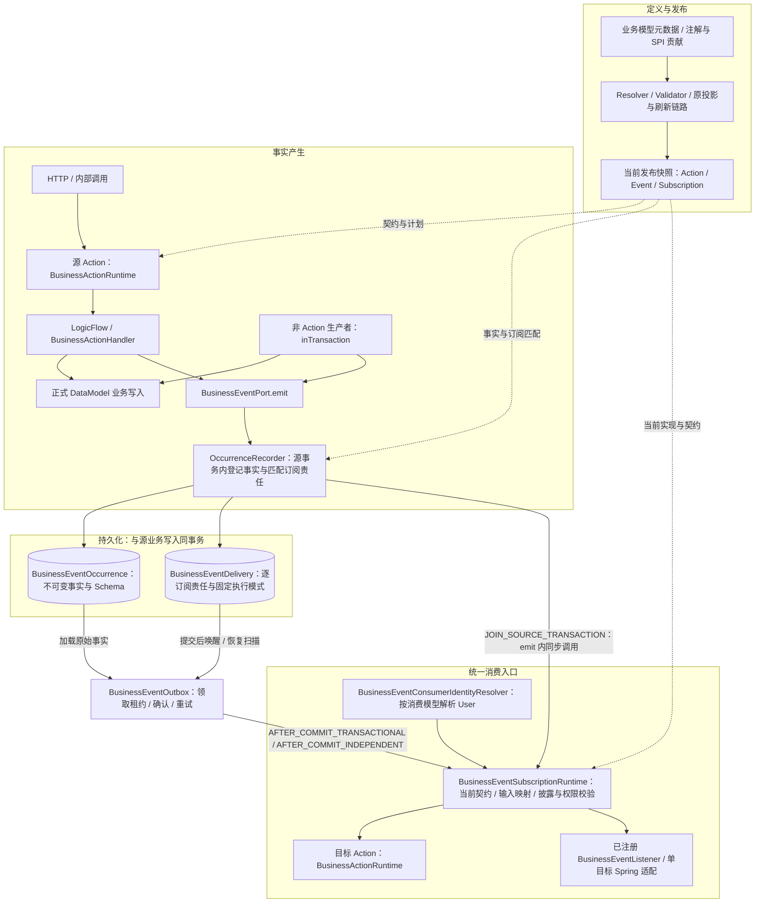
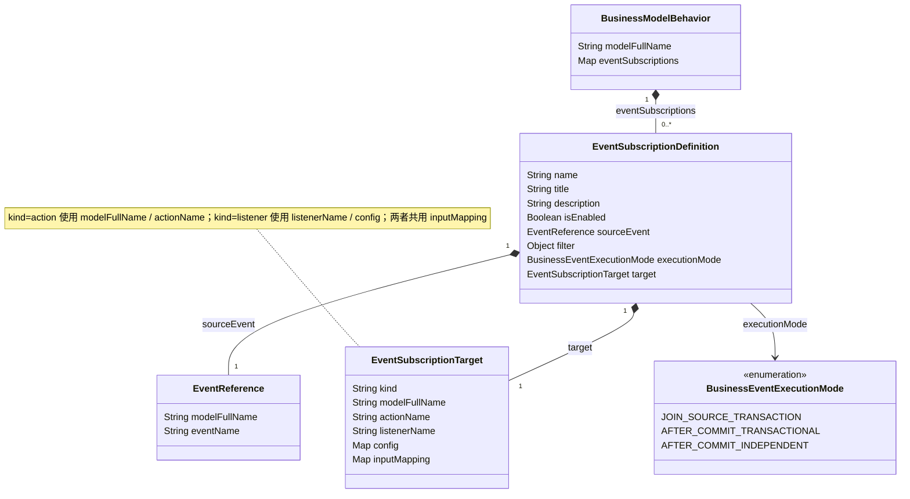
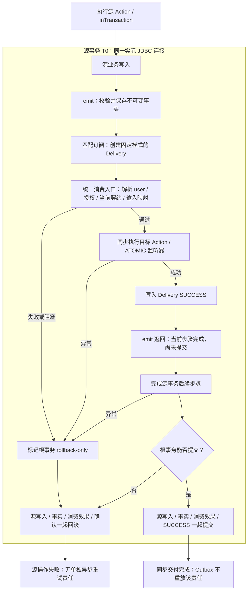
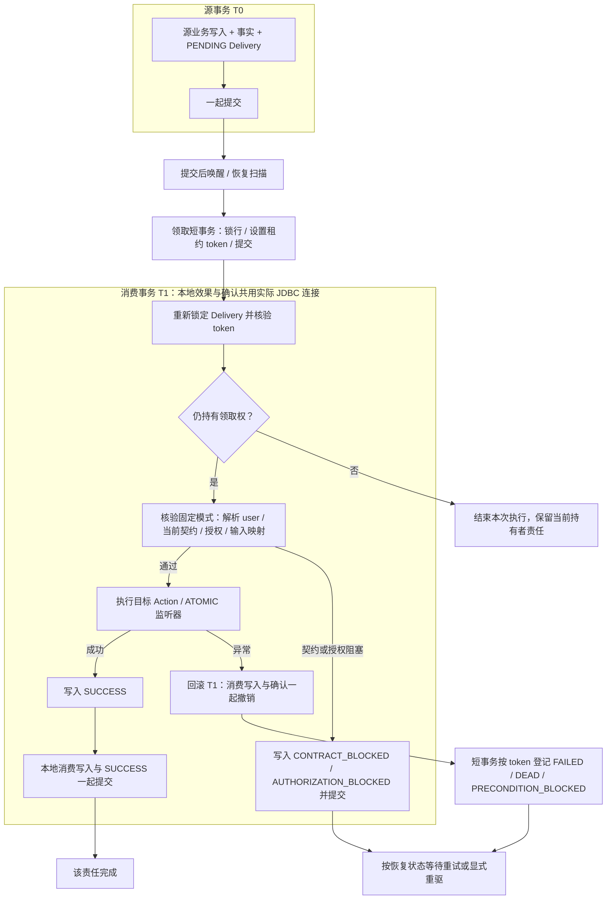
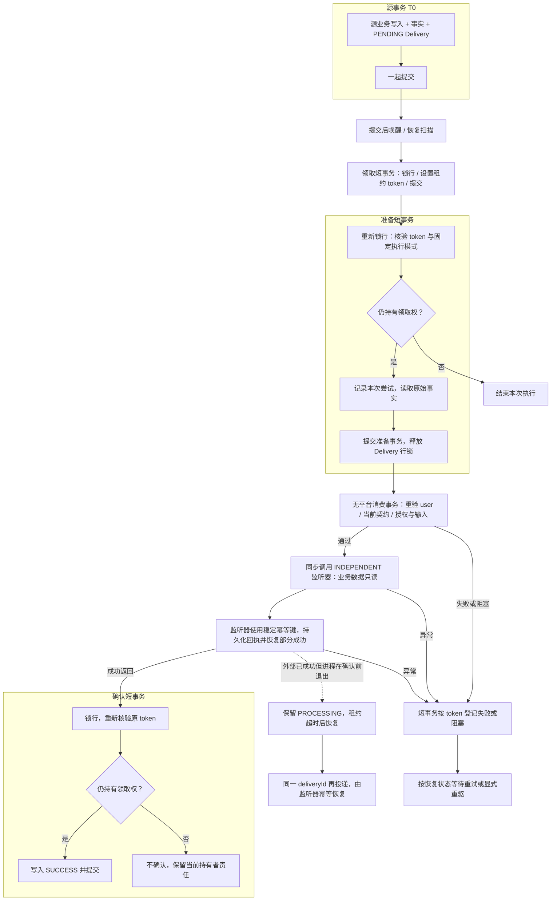
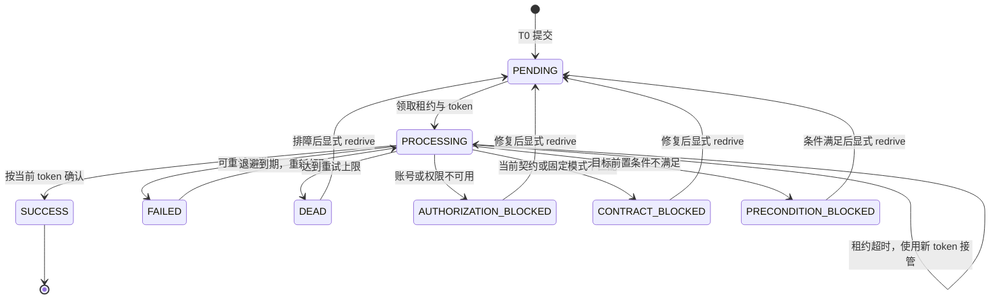

# 业务模型 Action / Event：动态行为建模

本文解释动态契约、发布与事件可靠性的机制和取舍。当前精确输入 API 统一由[输入设计](business-action-input-design.md)维护，格式兼容、默认事实、工作流和特性行为的约束见[业务行为契约](business-model-behavior-contracts.md)。运行时概览见[模块设计](../DESIGN.md#8-动态业务行为与事实)，重要决定与备选方案统一由[ADR-005](../../../docs/adr/ADR-005-business-model-behavior-ontology.md)维护。运行方法见[指南](../../../docs/guides/business-model-behaviors.md)与[运维手册](../../../docs/runbooks/business-model-behaviors.md)。单次实施/验收状态归关联任务。

## 1. 需求与设计结论

已确认的需求是：业务模型同时描述业务对象的结构、关系、可执行行为和可发生的业务事实；Action 与 Event 均为业务模型的一等公民。Action 能绑定投射生成的逻辑流；Event 表达业务语义，独立于 Spring Application Event，可以使用 Spring 作为投递渠道。

本体属性（attributes；Palantir 称 Property）直接由现有 `fields` 表达，本体关系（relations；Palantir 称 Link Type）直接由现有 `relations` 表达。模型统一使用 `fields`、`relations`、`actions`、`events` 描述属性、关系、行为和事实；关系对齐在既有关系机制上扩展，具体契约见 §3.1。

字段与关系的业务解释复用现有 `fields[].description` / `relations[].description`，用于说明业务含义、单位 / 口径、关系角色及用途，供开发者与未来 AI 智能体理解。两者已有元数据、运行时读取与编辑入口；填写提示与适用描述输出遵循贯通要求，不另加 AI 专用说明、不替代结构化约束，也不因此要求存量模型升级，见[统一方案 §15](business-model-behavior-contracts.md#15-字段与关系的业务语义描述)。

既有 CRUD 直接映射为 `actions`；自定义业务功能由 API 配置决定是否绑定同名 Action。绑定时沿用已有 `name`，执行绑定复用投射生成或显式提供的逻辑流；未绑定的高代码 Rest 接口继续属于普通 WebAPI。查询操作也可定义为只读 Action。业务行为由同一契约治理，API 与 UI 消费该契约；具体映射见 §5.3。

**先有动态定义与动态运行，再有类型化支持。** 创建一个“提交订单”动作或“订单已提交”事件，应通过模型元数据完成，不能以增加 Java 类、枚举、Spring Bean 或重新编译应用为前提。平台可以有通用的 `ActionDefinition`、`EventDefinition` 等 Java 结构，但不能要求每个业务动作、事件都有专属编译期类型。

当前沿现有业务模型投影机制组织：

1. 在业务模型上声明 `actions`、`events`，在消费方模型上声明 `eventSubscriptions`，经现有验证、投影、导出与刷新机制生效。
2. Action 的语义身份独立于实现名称；业务运行时统一处理调用上下文、授权、事务和事件暂存，再按绑定委托现有 LogicFlow 或已注册的高代码 BusinessActionHandler 执行。
3. Event 定义与不可变的事件事实分离；订阅是消费方对事实的反应，以调用另一个 Action 为首个执行方式。
4. 可靠事件沿用并演进审批模块已有的 Outbox 能力。Spring、未来的 MQ 都是适配渠道，不定义业务事件的身份、契约或可靠性。
5. 类型化 SDK、便捷对象方法和类型化监听器由同一份动态契约派生，使用同一执行与投递路径。
6. 高代码与低代码共享同一份业务契约：低代码负责可动态调整的定义和编排，高代码负责需要源码、外部 SDK 或特殊性能的实现；实现来源不能改变 Action / Event 的业务身份和运行时治理。

本文解释已采纳的设计及验收边界，不引入 RDF/OWL、知识图谱存储、事件溯源、自建分布式事务协调器或通用消息中间件重建。这些能力不是本次本体对齐的前置条件。事务一致性统一由已配置的事务管理器承接；部署使用 JTA/XA 等跨资源能力时，其保证及接入条件见 §7.1。

## 2. 当前主路径与实现边界

| 机制 | 当前归属与约束 |
| --- | --- |
| 动态行为定义与发布 | BusinessModel、ModelProcessStep、ModelBundle 与原 Provider/Validator 维护同一份 Action/Event/Subscription 契约 |
| Action 执行 | BusinessActionRuntime 负责授权、输入、事务与事件暂存，再进入 LogicFlow 或正式 Handler；不能裸调用 Flow 冒充等价执行 |
| 传输无关输入 | params/data 经 BusinessActionInput 进入；HTTP Lazy/原生资源/显式来源见输入专题，不再采用旧 target/Map 签名 |
| 事件与交付 | 已有动态事实与逐订阅 Outbox；当前身份、契约和幂等责任在原运行时落实，Spring 仅作渠道 |
| 可见行为与权限 | CRUD、业务功能、工作流与特性行为沿正式投影；格式和权限兼容细则见业务行为契约 |
| UI 与客户端 | 按钮/API/生成客户端消费发布契约，显示按钮不等于调用授权；动态发布不要求生成 Java 类型 |

当前同资源 JDBC 事务边界见模块设计。ObjectSet、完整跨模型本体及未证明的 JTA/XA 仍是后续方向，不能从现有类或已接受决定推断支持。

## 3. 语义模型与边界

| 概念 | 建议含义 | 示例 |
| --- | --- | --- |
| BusinessModel | 一类业务对象的定义，拥有字段、关系、Action 定义与 Event 定义 | 订单 |
| Field / 属性 | 模型的业务属性定义，由 `fields` 声明；对象持有对应属性值 | 订单金额、订单状态 |
| Relation / 关系 | 模型之间的业务关系定义，由 `relations` 声明；对象之间具有对应关系实例 | 订单所属客户、订单分配仓库 |
| BusinessObject / 对象引用 | 某个业务对象的身份；可按需加载状态并执行其模型允许的行为 | 订单 O-1001 |
| Action | 可请求执行的业务行为，有目标、输入、约束、结果与执行绑定 | 提交订单 |
| EventDefinition | 一种业务事实的语义和载荷契约，由所属业务模型定义；可由低代码元数据或高代码注解贡献 | 订单已提交 |
| EventOccurrence | 某次已经发生的事实，具有唯一身份、发生时间、对象引用和载荷 | O-1001 在某时被提交 |
| EventSubscription | 消费方对某种事实的响应规则 | 收到订单已提交后创建预留 |

“隶属于业务模型”指语义归属和建模入口，不要求所有对象共用一个存储表，也不等于所有对象都是 DDD 聚合根。跨对象行为应有明确的业务所有者、目标和一致性边界，不能用一次全局事件广播代替业务约束。

Action 表达意图，可能被拒绝；Event 表达事实，订阅者不能否决一个已经提交的事实。需要同步校验的规则应放在 Action 的授权、前置条件或业务逻辑中。跨模型必须原子完成的写入，应在明确的同一事务编排中完成；提交后事件用于允许异步反应的协作。

业务模型因此成为“具有行为契约的对象类型”。运行时对象引用把身份、状态访问与行为调用组织在一起，可提供类似充血模型的使用体验；它不要求把逻辑流嵌进实体类，也不引入隐式自动保存的 Active Record 语义。



该图描述调用与数据流，不表示 Maven 依赖方向。同步路径在源事务提交前进入统一消费入口；提交后两种模式由 Outbox 调用同一入口，具体事务边界见 [§7.1.2—§7.1.4](#712-加入源事务的执行流程)。

### 3.1 沿用 fields / relations 的本体映射

以下映射与本 Epic 范围内的 Action 对象参数约束已实现；完整双向关系遍历和 ObjectSet 仍属后续路线。

| 本体语义 | 业务模型中的表达 | 对象实例中的表达 |
| --- | --- | --- |
| Attribute / Property | `fields` 中的字段定义 | 对象的属性值 |
| Relation / Link Type | `relations` 中的具名关系定义 | 源对象与目标对象之间的关系实例 |
| Action | `actions` 中的行为定义，包含 CRUD 与自定义业务功能 | 针对对象或模型的一次行为执行 |
| Event | `events` 中的事实定义 | 一次不可变的 EventOccurrence |

`fields` 是业务属性的建模入口，继续投影为数据字段、Schema 和 UI；业务属性不要求与数据库列一一对应，后续来源映射、共享属性或计算属性也在这个入口演进。关系即使投影成 DataModel 的 Model / Collection 字段，业务定义仍由 `relations` 拥有，不能在 `fields` 中另存一份独立关系定义。

`relations` 中每个成员描述一个业务关系及当前模型侧的访问方式，沿用 `BusinessModelRelationMeta / BusinessModelRelation`。现有元数据承担以下责任：

| 现有成员 | 对齐后的业务语义与边界 |
| --- | --- |
| 所属模型、`name` | 当前关系成员的稳定身份，按 `(modelFullName, relationName)` 引用；名称表示业务角色，如 `customer`、`assignedWarehouse` |
| `title`、`description` | 关系的业务含义与展示说明 |
| `model` | 目标业务模型；目标须在当前运行上下文的模型目录内解析 |
| `type` | 保持现有 child/master/reference 关联模式及历史别名的解释；基数约束须单独明确并验证，不能仅凭 `reference` 推断双侧一对一 |
| `referenceKey`、关联投影 | 沿用现有的关联键解释和数据映射；在投影中落实对象之间的关系，不将关联键或物理外键当作业务关系名称 |
| `isRequired` | 当前侧关系的必需约束，结合基数及数据约束验证 |
| `submitTogether` | owned child 的既有聚合提交和生命周期约束；普通对象关联不因此获得级联删除或重挂子对象的能力 |

在该定义上补齐两端角色、反向访问名称、基数、业务约束、读取权限和允许的变更行为。这些信息进入现有关系描述与发布产物，按既有元数据扩展方式承载和验证；字段形式在实现设计中收敛。

例如 `Order.customer` 与 `Customer.orders` 可以是同一业务关系的两个访问侧。双方若都声明关系成员，发布时须明确配对并校验目标、关联键和基数一致，两侧查询和变更共享同一关系事实。不能仅因为两端模型相同就自动配对：`Order.billingCustomer` 与 `Order.deliveryCustomer` 表达不同业务角色。引用或配对有歧义时，应给出发布错误，而不是按扫描顺序选择。

运行时按对象身份和 `relationName` 遍历，按基数返回单对象或对象集合，通过正式 DataModel / QueryDSL 查询并校验关系及目标对象的读取权限。业务关联的建立、解除和调整由所属模型声明的 Action 执行；Action 的绑定委托既有 LogicFlow 或 BusinessActionHandler，关系解析、写入、授权、审计与事务仍沿正式数据路径。

解除普通关系只改变关联；owned child 的同步、级联和防重挂继续遵循 `submitTogether`。多对多可按实际需求通过关联 DataModel 投影扩展；关系自身有价格、有效期或审批状态等生命周期属性时，可建模为关联业务对象。

关系的动态定义、校验、投影与刷新沿现有 Validator / ModelProcessStep / ModelBundle / Export 链路完成。低代码关系与高代码生成的访问器使用同一已发布契约；属性和关系都无需以新增业务 Java 类型为前提。

## 4. 动态定义是唯一事实来源

### 4.1 元数据与业务身份

`actions`、`events`、`eventSubscriptions` 是业务模型的正式语义成员。它们需要出现在编辑器、模型描述与查询结果中，参与校验、依赖分析、导出和变更诊断，不能长期隐藏在无人校验的 `extraProps` 中。底层可复用现有元数据扩展机制承载，正式化不等于为每个业务成员生成一个类。

首期在一个运行上下文中处理一个应用，成员身份沿用现有业务模型身份和成员 key：Action 为 `(modelFullName, actionName)`，Event 为 `(modelFullName, eventName)`，Subscription 为 `(consumerModelFullName, subscriptionName)`。`modelFullName` 沿用现有 namespace + name 的解释，示例中的 `sales`、`payments`、`inventory` 是同一上下文内的业务命名空间。名称比较沿现有目录的忽略大小写规则，规范化后冲突须在发布时报告。持久化定义分别保存模型全名与成员名，不把业务身份压缩成字符串。日志、URL 或消息头可以派生出 `sales.Order#action:submit`、`sales.Order#event:submitted` 这样的显示标识，但它们不是模型中的第二套身份来源。显示名称不参与身份，修改显示名称不应破坏引用。

首期不引入独立的 `contractVersion`。当前运行上下文内的 `(modelFullName, actionName)` 或 `(modelFullName, eventName)` 只允许一个最终生效契约；兼容扩展可以直接发布，不兼容变化需要协调更新调用方和消费者，必要时使用新的 Action / Event 名称。事件事实保留产生时的 `modelRevision` 及不可变的契约 Schema 快照，供 Outbox、重试和历史重放解释事实。`formatVersion` 仍表示模型文件格式，`modelRevision` 表示一次完整发布快照。首期不保留旧可执行实现；历史事实 Schema 的保留不意味着可以执行历史流程或代码，投递使用当前已发布实现，具体规则见 §8.3。

### 4.2 动态不等于无约束

动态模型仍须在发布前验证：身份唯一、引用可解析、目标类型合法、Schema 合法、输入映射可检查、启用的执行绑定可用。禁用 Action 可以保留描述及实现引用；重新启用前必须完成绑定与能力验证，禁用状态不能执行。无法静态推导的表达式和输出在运行时验证。动态错误应指出模型、成员和字段路径，而非只返回 Java 类型转换错误。

复用现有 `BusinessModelSchemaSupport`、字段类型语义及 `JsonSchemas` 验证能力。当前 `SchemaModel` 位于 WebAPI 模块，不能为了复用它让独立事件内核依赖 Web 层；可在业务模型投影侧转成通用 JSON Schema 数据，在内核侧使用已有验证工具。不另造一套与字段类型并行的类型语言。

类型化支持是派生视图：生成 Java / TypeScript DTO、Action 方法、Event 载荷类型和身份常量；调用时仍解析动态身份并进入同一运行时。SDK 与模型定义不兼容时应明确报告，不能悄悄走另一套实现。业务 Action / Event 名称不可封闭为枚举；平台有限的执行模式等结构选项可以使用枚举。

### 4.3 高低开融合：契约与实现分离

高低开融合不是让高代码和低代码各自拥有一套 Action / Event，而是让同一个业务契约可以选择不同实现来源。业务模型元数据定义“是什么、谁可以调用、输入输出是什么、何时产生事实”；实现绑定定义“由哪条逻辑流或哪项已注册能力完成”。因此，模型编辑器、代码仓库、运行时和事件投递都围绕同一个稳定引用协作。

| 层次 | 低代码路径 | 高代码路径 | 共同约束 |
| --- | --- | --- | --- |
| Action 定义 | 模型元数据 + 投射 LogicFlow | 模型元数据 + 已注册的代码 BusinessActionHandler | 同一 `(modelFullName, actionName)`、Schema、授权、事务与审计 |
| Action 编排 | LogicFlow 节点和映射 | 代码调用统一 Action 端口，或由 BusinessActionHandler 实现一个步骤 | 不能直接绕过 Action 运行时调用数据库或另一个公开入口 |
| Event 产生 | LogicFlow 的显式发出节点 | 代码通过业务事件端口发出动态事件身份 | 同一 `(modelFullName, eventName)`；先验证定义和载荷，再纳入源事务；不能直接 `publishEvent(new XxxEvent())` 取代业务事件 |
| Event 消费 | `eventSubscriptions` 映射到目标 Action | 注册为平台管理的 BusinessEventListener，或实现目标 Action | 同一 deliveryId、幂等、重试、权限与执行身份 |
| 类型化体验 | 编辑器和 SDK 根据定义生成 | 高代码 DTO / wrapper 根据同一契约生成或校验 | 类型是便利层，不能成为第二个契约来源 |

#### 4.3.1 高代码 Action 的注册方式

高代码 Action 的实现注册为 **BusinessActionHandler（行为处理器）**，执行一次行为请求并返回业务结果。事件订阅的代码实现使用 **BusinessEventListener（事件监听器）**，响应已经发生的事实并参与逐订阅交付确认。两者具有独立的调用契约和引用类别；一个 Event 可以被多个订阅监听，同一 Action 在一次已发布快照中只选择一个执行绑定。既有 Provider 继续负责提供模型或描述。

注解方法通过统一贡献清单进入现有 SPI / 模型发布链路，无需为每个 Action 或 Event 定义专属 Java 类型。以下仍为提案示例：§4.3.5 中的注解方法声明 `handlerName = "captureOrderPaymentHandler"`，发布后的 Action 绑定引用该名称：

```json
{
  "modelFullName": "payments.Order",
  "actionName": "capturePayment",
  "binding": {
    "kind": "handler",
    "handlerName": "captureOrderPaymentHandler"
  }
}
```

注解、SPI 描述和绑定元数据统一使用 `handlerName` 表示处理器名称；发布时校验该名称已注册且契约兼容。此处引用由当前运行上下文中的贡献清单发布，按 `handlerName` 解析；不是任意能力字符串，也不隐式解析成 Spring Bean 名或 Java 方法路径。处理器名称显式声明，重构方法或升级代码不会自动改变它；代码构建版本由描述信息单独记录，不给引用自动拼接版本后缀。处理器名称在当前上下文内唯一，重复名称必须报告来源并拒绝发布。

BusinessActionHandler 实现可以使用支付 SDK 或外部服务，本地数据访问仍经过正式 DataModel / QueryDSL API。它接收平台提供的中立调用上下文，并返回符合 Action output Schema 的结果。实现描述应声明支持的输入 / 输出 Schema、事务能力、幂等能力、所需权限和外部副作用，以便发布校验和运行时诊断。

BusinessActionHandler 注册是实现扩展点，不是业务 Action 注册表：它不能凭自身类名创造一个绕过模型验证的业务 Action。模型必须声明 Action 的归属、身份、Schema 和授权，发布时确认 `handlerName` 存在且兼容；当前启用 Action 引用的 BusinessActionHandler 下线、能力不兼容或缺少必要适配器时，候选模型快照不得发布。高代码实现替换时保持 `(modelFullName, actionName)` 不变；不兼容变化需要协调调用方，必要时使用新的 Action 名称。

代码模块可以实现通用 BusinessActionHandler，并由多个动态 Action 复用，但 BusinessActionHandler 不应把任意字符串当作 SQL、Bean 或脚本入口。需要模型专属规则时，规则仍应进入 Action 的前置条件、输入映射或 LogicFlow 编排，避免把业务语义藏进无法发现的代码分支。反过来，性能敏感的共享算法可以作为 BusinessActionHandler 能力，不必为每个调用方生成一个类型化业务类。

#### 4.3.2 高代码 Event 的产生和消费

高代码生产方通过 `BusinessEventPort.emit(eventIdentity, subject, payload, emissionContext)` 这类中立端口发出事实，其中 `eventIdentity` 是 `(modelFullName, eventName)`，`emissionContext` 是显式的 `EventEmissionContext`。端口只接受已发布快照中的 Event 定义，并校验 payload Schema、生产者是否被该定义允许及当前事务；Action 生产者还必须满足当前 Action 的 `emits` 声明，非 Action 生产者必须提供已注册且获授权的 `producerRef`。代码可以拥有类型安全 wrapper，但 wrapper 内部仍调用拆分后的动态事件身份，不能直接把 Spring 事件对象当作业务事实。

高代码消费方有两种受治理的形态：

1. 优先实现一个目标 Action，由动态 `eventSubscriptions` 调用。这样高低开消费者自然共用授权、事务、幂等和重试。
2. 对需要直接使用代码消费事实的场景，注册一个 BusinessEventListener，注解、SPI 描述和订阅元数据统一使用 `listenerName` 指定该监听器。引用在当前运行上下文中按 `listenerName` 解析；监听器接收标准 EventOccurrence 和 delivery 上下文，成功 / 失败必须由平台记录，不能自行吞掉异常或另建重试线程。

第二种形态仍是订阅的实现细节，不能让 BusinessEventListener 反向拥有生产方的消费者清单。订阅定义保留来源 Event、过滤、执行身份和投递配置；BusinessEventListener 提供具体响应逻辑。Spring `@EventListener` 若要接入，必须经适配器注册为平台 BusinessEventListener，并接受逐订阅确认、租约和幂等要求；一个普通 Spring listener 不能自动获得平台业务事件语义。本文的 BusinessEventListener 是平台中立接口，不继承 Spring 的监听接口。

#### 4.3.3 代码优先场景的边界

高代码团队可能先写实现再补低代码模型，但运行时仍要求“契约先于调用”。建议开发期允许代码贡献清单携带一个待审核的 Action / Event 契约草案，平台把它导入模型编辑器进行校验和审批；部署后只有已发布业务模型中的正式定义可被调用。这样保留代码优先的开发流，又不创建代码私有的隐藏行为。

高代码可以在同一业务模型中提供复杂实现，低代码可以重新编排它；低代码可以发布新 Action，现有高代码 BusinessActionHandler 不需要为每个新 Action 编译。若高代码实现需要新增业务语义，则必须新增或修改模型成员并经过同样的身份、优先级、权限和引用检查。任何“代码启动时自动注册事件并立即广播”的机制都应视为技术扩展，不能当作业务 Event 的正式定义。

#### 4.3.4 契约候选、绑定候选与发布治理

必须把业务契约候选和实现绑定候选分成两个阶段解析：

1. **契约候选**是完整的 Action / Event / Subscription 定义，拥有业务身份、Schema、权限、目标、发生条件和订阅语义。低代码模型是默认来源；代码优先注解产生待审核候选，发布时必须物化为同一模型快照。替换已有契约还须有明确的模型级覆盖授权，不能在运行时凭类路径优先级替换低代码契约。
2. **绑定候选**只说明如何实现已经解析确定的契约，例如 LogicFlow 的 `flowName` 或高代码的 `handlerName`。它必须引用候选快照中的完整契约，单独校验兼容性，不能靠拼接其他候选的业务字段补齐契约。新定义与绑定可以在同一次发布中生效，无需先发布一个不可执行的 Action。

绑定候选可以来自低代码投影、高代码注解或其他 SPI。平台在当前运行上下文的同一业务身份内独立校验候选，再按 `jakarta.annotation.Priority` 选择实现；本仓库约定数字越大越优先，未声明时按 `0` 处理。最高优先级相同必须发布失败并报告来源模块、类和定义位置，不能按扫描顺序决定。优先级只解决兼容实现之间的选择，不改变业务身份，也不绕过权限、Schema、事务和发布校验。

代码要替换低代码绑定，必须在模型或发布策略中显式允许该替换；不能仅凭 `@Priority(100)` 让部署一个类就改变业务行为。被覆盖绑定保留在诊断信息中，便于解释最终实现来源。订阅候选同样按 `(consumerModelFullName, subscriptionName)` 选择绑定；不同订阅全部保留，优先级不表示监听器的全局执行顺序。

模型 `modelRevision` 和 BusinessActionHandler / BusinessEventListener 的代码构建版本参与一次可执行快照，但不替代契约身份或实现名称。已产生的 Event 不因代码回滚而被重写，补偿应发出新的、明确命名的业务 Event。低代码定义、高代码定义候选和绑定候选的错误都必须在同一候选快照阶段报告，不能用兼容 wrapper 掩盖根因。

#### 4.3.5 注解是高代码接入入口，不是第二套业务模型

Action、Event 和监听器都应提供注解接入方式，以便高代码团队能够在熟悉的代码边界声明能力。注解属于框架无关的轻量契约模块，不能依赖 Spring；如果需要运行时反射发现，使用 `RUNTIME` 保留策略，否则由编译期处理器消费同一份注解。不要复用 Spring 的 `@EventListener` 来承载业务 Event 身份，也不要把现有 `@LowCodeModel`、`@ProCodeModel`、`@LowCodeProvider` 的来源标记误作行为注册机制。

注解有两种合法用途：

1. **绑定已有动态定义。** 业务模型已经声明 Action、Event 或 Subscription，注解只提供高代码实现、载荷类型或监听器能力。模型定义继续拥有名称、归属、Schema、权限和订阅语义。
2. **提交代码优先的定义贡献。** `@BusinessAction` 或 `@BusinessEvent` 携带完整候选契约，由注解处理器 / 注册适配器转换成统一定义，进入模型编辑、校验、审批和发布流程。未物化到已发布模型快照的候选定义不能被运行时调用。

两种用途都必须经过同一个注册端口和候选快照。编译期处理器生成定义 / 绑定贡献清单，并登记 `META-INF/services/com.ouroboros.businessmodel.annotation.BusinessDefinitionContributor`；Spring 运行时适配器也只能把 Bean 转换成同一类贡献，不能直接向运行时 Map 注册方法。现有 `ModelProcessStep`、Provider 和刷新生命周期负责收集、校验和发布，Spring 不是业务注册表。代码候选随部署加载，模型元数据可按既有刷新机制热更新；代码模块变更需要重新加载应用或明确的模块生命周期，不能假定 SPI 缓存会自动失效。

**Action 定义与绑定注解。** `@BusinessAction` 只贡献完整的代码优先 ActionDefinition；`@BusinessActionBinding` 绑定候选快照中已确定的 Action。方法级注解用 `handlerName` 声明该方法的注册名称，贡献器生成 BusinessActionHandler 描述，绑定中沿用同一 `handlerName`；类型级逻辑流绑定使用 `flowName`，不能同时声明方法实现。绑定与契约均发布后才可调用。以下示例省略所属业务类及方法实现：

```java
@BusinessActionBinding(
    modelFullName = "payments.Order",
    actionName = "capturePayment",
    handlerName = "captureOrderPaymentHandler"
)
public CapturePaymentOutput capturePayment(ActionContext context,
                                           CapturePaymentInput input) {
  // 只能通过平台提供的端口访问业务能力和外部支付适配器
}
```

这个注解把 `capturePayment` 方法注册为当前运行上下文中的 `captureOrderPaymentHandler`，并贡献 `capturePayment` Action 的实现绑定。§4.3.1 的 JSON 展示该绑定的元数据形态，不要求再手工重复注册一次。适配器从描述定位已装配的方法；元数据只能选择已登记且兼容的 BusinessActionHandler，缺失或重复注册名称应在发布时报告。编译期贡献与 Spring 装配关联同一描述，不能重复产生两个注册项。

注解中的 `modelFullName` 与成员名必须稳定、明确归属；Action 业务身份与 BusinessActionHandler 实现名称分别管理。注解绑定只生成一个绑定候选，不能覆盖模型的权限、目标类型、Schema 或事件声明。方法参数和返回类型可以生成 Schema，但发布时仍以已发布模型快照的校验结果为准。

仅需要把 Action 绑定到 LogicFlow 时，不需要创建 Java 实现方法，可以使用绑定注解：

```java
@BusinessActionBinding(
    modelFullName = "sales.Order",
    actionName = "submit",
    flowName = "sales.Order.submit"
)
public final class OrderFlowBindings {
}
```

该注解只贡献 `kind=logicflow` 的 binding；`flowName` 是技术实现名，Action 的业务身份仍由 `(modelFullName, actionName)` 决定。LogicFlow 是投影产物还是既有流程由平台内部记录，不要求使用者选择来源模式。

`binding.kind=handler` 表示直接调用已注册的行为处理器，`handlerName` 标识具体实现。只保留 LogicFlow 绑定也能实现高代码接入，但每个直接方法绑定都需要投影一条包装流程，并承担该流程的引用与刷新生命周期；对于只执行一项代码能力的 Action，直接 BusinessActionHandler 绑定更简单。已有 LogicFlow 内的高代码节点继续复用现有节点 SPI；这里的 BusinessActionHandler 只实现 Action 调用契约，不再建一套编排引擎。

`kind` 是规范化 `ActionBinding` 的技术判别字段，供 Schema 校验和统一执行入口分派使用，不参与业务身份。`kind=logicflow` 必须且只能携带 `flowName`，`kind=handler` 必须且只能携带 `handlerName`；缺少引用、同时声明两种引用或标签不匹配均拒绝发布。注解适配器可根据互斥字段生成 `kind`，开发者无需重复填写。两种绑定都必须经过同一授权、事务和事件机制。

**Event 定义与载荷注解。** `@BusinessEvent` 只贡献完整的 EventDefinition，必须包含业务发生条件；仅需要为动态 Event 提供类型化载荷时使用独立的 `@BusinessEventPayload`，不能用一个载荷类隐式创建或覆盖事件身份。示意：

```java
@BusinessEvent(
    modelFullName = "payments.Order",
    eventName = "paymentCaptured",
    title = "订单支付已捕获",
    subject = SubjectKind.INSTANCE,
    description = "订单完成支付捕获",
    occurrenceCondition = "支付捕获成功并已写入订单状态",
    payloadSchema = "payments.PaymentCapturedPayload",
    allowedProducerKinds = {"action"}
)
public final class PaymentCapturedEventDefinition {}

@BusinessEventPayload(
    modelFullName = "payments.Order",
    eventName = "paymentCaptured"
)
public record PaymentCapturedPayload(String orderId, String paymentId) {}
```

示例中的 `payloadSchema` 是可解析的 Schema 引用；代码贡献器可从载荷类型生成对应 JSON Schema，并纳入候选快照，运行时不靠反射加载业务类解释动态事件。代码通过事件端口发出该事实，端口把载荷封装为通用 `EventOccurrence`，并执行 Schema、事务、模型引用和生产者授权校验。Action 上下文中的 `emits` 声明仍需满足；非 Action 生产者使用显式 `producerRef`，见 §6.1。载荷类是类型化便利层；序列化后仍以 `modelFullName` 和 `eventName` 识别事实。一个载荷类不能偷偷对应多个事件身份，也不能以构造 Java 对象代替事件发布。

**Event 监听器注解。** `@BusinessEventSubscription` 必须明确消费方模型与 Subscription 身份。方法级注解用 `listenerName` 注册 BusinessEventListener，订阅中沿用同一名称；如果仅声明目标 Action，可在类型级贡献订阅，无需额外提供监听方法。目标 Action 与 BusinessEventListener 互斥。以下示意代码优先的订阅贡献，省略所属业务类及方法实现：

```java
@BusinessEventSubscription(
    consumerModelFullName = "inventory.Reservation",
    subscriptionName = "reserveOnPayment",
    sourceEventModelFullName = "payments.Order",
    sourceEventName = "paymentCaptured",
    listenerName = "reserveStockOnPaymentCapturedListener",
    executionMode = BusinessEventExecutionMode.AFTER_COMMIT_TRANSACTIONAL
)
public void reserve(EventOccurrence<PaymentCapturedPayload> occurrence,
                    DeliveryContext delivery) {
  // 成功返回才确认；异常交给平台重试，不在方法内另建重试线程
}
```

该注解将 `reserve` 方法注册为当前运行上下文中的 `reserveStockOnPaymentCapturedListener`，并生成以下订阅描述片段；这同样是同一声明的投影，不需要另建配置：

```json
{
  "name": "reserveOnPayment",
  "sourceEvent": { "modelFullName": "payments.Order", "eventName": "paymentCaptured" },
  "executionMode": "AFTER_COMMIT_TRANSACTIONAL",
  "target": { "kind": "listener", "listenerName": "reserveStockOnPaymentCapturedListener" }
}
```

如果订阅已经由模型定义，注解只填写 `subscriptionRef=(consumerModelFullName, subscriptionName)` 和本方法的 `listenerName`，不重复声明来源事件。若注解贡献代码优先 Subscription，则必须补齐来源、目标 Action 或 BusinessEventListener、必要的输入映射和 executionMode，先进入模型发布；执行身份由平台按消费模型配置。过滤条件可选；示例 BusinessEventListener 接收完整事实，无需输入映射。平台仍负责匹配过滤、创建 `deliveryId`、租约、去重、执行身份、确认和重试；监听器不能返回“已处理”却在后台继续异步工作。普通 Spring listener 不能自动获得平台业务事件语义。

注解处理器和运行时适配器必须报告以下冲突，而不是按扫描顺序覆盖：同一身份的最高优先级绑定候选并列、完整定义缺少必需字段、Event Schema 与模型不一致、监听器订阅重复声明、监听器引用候选快照中不存在的 Event / Action、模型引用不一致或 BusinessActionHandler / BusinessEventListener 能力缺失。注册清单带来源模块、代码版本和实现能力，进入现有 `ModelProcessStep` / Provider 刷新生命周期；代码模块卸载或版本切换须等待正在执行的调用结束，并验证当前启用契约的能力仍可用。待投递任务按 §8.3 解析当前实现，不要求保留旧代码版本。

#### 4.3.6 通用接口与业务接入方式

平台提供框架无关的通用执行接口，业务代码默认使用注解方法接入，也可直接实现接口；两种方式均不要求继承平台基类。公开接口采用 `Business` 前缀，避免与 JDK、Spring 等框架的同名类型混淆。接口与注解也使用不同的简单名称，避免业务类同时引用二者时产生导入冲突。

| 场景 | 平台执行接口 | 默认接入注解 | 注册与绑定字段 |
| --- | --- | --- | --- |
| Action 实现 | `BusinessActionHandler` | `@BusinessActionBinding` | `handlerName` |
| Event 订阅监听 | `BusinessEventListener` | `@BusinessEventSubscription` | `listenerName` |

`BusinessActionHandler` 接收行为上下文和输入，返回业务结果；`BusinessEventListener` 接收事件事实和交付上下文，完成订阅响应。它们表达平台通用协议，不要求为每种 Action 或 Event 新增接口或业务类型。注解 `@BusinessEventSubscription` 负责声明或绑定消费方订阅，并把方法注册为 `BusinessEventListener` 实现；Event 定义仍由 `@BusinessEvent` 贡献。

默认链路为“统一运行时 → 接口适配器 → 已注册的普通业务方法”。适配器根据正式贡献描述完成方法签名校验、输入输出转换、调用和异常映射；业务方法不必实现接口。通用组件也可直接实现上述接口，经同一贡献端口注册、校验和发布。两种方式最终都进入统一的执行或投递运行时；授权、事务、事件确认与重试由运行时负责，不能因为直接实现接口而绕过这些边界。

## 5. Action 契约与执行

### 5.1 最小定义

| 内容 | 责任 |
| --- | --- |
| modelFullName、actionName、title、description | 稳定身份和业务含义；当前运行上下文内同一模型的 `actionName` 不重复 |
| isEnabled | 行为启用状态，未声明时按 `false` 归一化；CRUD / custom 从旧功能配置继承，关闭后 HTTP、内部调用和订阅触发均不得执行 |
| target | 首期区分 `model` 与 `instance`；模型级可用于创建，对象级要求合法对象标识 |
| inputSchema、outputSchema | 输入和结果契约；可引用既有模型字段 Schema。Action 输入 Schema 可通过 `x-business-object-ref` 声明对象参数引用的模型 |
| binding | 规范化为 `kind: logicflow` + `flowName` 或 `kind: handler` + `handlerName`，并携带输入 / 输出映射；`kind` 只供运行时分派，不是业务模型类型 |
| readOnly | 只读执行约束；CRUD 的 `getOne/search` 默认推导为 `true`，其他未声明行为按 `false` 归一化；查询脚本有写入或外部副作用时须显式声明 `false`。默认推导来自查询契约，不根据 HTTP 方法或任意动作名称猜测 |
| authorization、precondition | 引用现有权限机制与业务条件；UI 可用性提示不能替代服务端检查 |
| emits | 声明可能产生的本模型 Event（`modelFullName` + `eventName`），用于发现、校验及依赖分析 |

`x-business-object-ref` 的值是目标业务模型全名，可出现在嵌套对象或数组项 Schema 中。对应输入携带对象标识（例如 `{"modelFullName":"sales.Customer","id":"C-1001"}`）；运行时按目标模型唯一 `id` 主键解析对象，并重新检查该调用主体的 `search` 权限，再把已授权的对象状态交给 Action 实现。发布校验会检查目标模型是否存在且恰有一个名为 `id` 的主键；未知模型、非业务模型或主键契约不符合要求时拒绝发布。对象参数不接受调用方提交的对象字段作为已授权状态。

首期对象引用标记支持 Schema 根、经 `properties` 定位的属性和单个 `items` Schema 定位的数组项。包含此标记的契约须直接表达这些位置；Schema 引用（`$ref` 等）、组合分支、动态属性和数组元组中的引用标记在发布时报告具体路径，避免校验支持的形式超出授权解析能力。没有对象引用标记的 JSON Schema 仍使用平台已有验证能力。Event payload 中的引用采用相同的位置规则；每次投递同时检查原始事实 Schema 与当前发布 Schema 的引用授权，保留原始事实，并应用当前定义新增的约束。

事件列表不是成功回调配置。Action 可以成功但没有业务状态变化，也可以一次产生多个事实，不能依据 `emits` 自动“成功即发布”。只读 Action 不修改业务状态、不执行外部副作用，也不发出业务事件；运行时须约束该承诺，不能把 `readOnly` 只作为 UI 标签。只读上下文沿同步嵌套调用传播，拒绝调用写入 Action；正式数据写入、事件发出及受管理的外部副作用入口据此拒绝操作。脚本和 BusinessActionHandler 必须遵守声明；默认推导不是对任意源码无副作用的证明。写入行为在真正业务转移发生处显式发出事件，运行时验证其符合声明。

首期不新增通用批量目标、长任务调度、任意脚本执行器和复杂事务选项。已有批量、导入导出功能可按原业务输入与一致性边界映射为模型级 Action。`dashboard`、`composite-view` 等模型能否提供某类 Action，按模型能力验证；没有对象身份的模型不能被强行加上实例行为。

### 5.2 与 HTTP 无关的调用入口

正式 BusinessActionInput、调用上下文、Lazy RequestInfoMap、params/data 与映射边界统一见[输入设计](business-action-input-design.md)。HTTP、模型便捷调用和内部调用进入同一 Runtime/EventPort；本页不复制早期 Java 签名。对象与关系授权、锁内前置条件及字段/行约束沿[行为契约](business-model-behavior-contracts.md#5-前置条件与已有声明的语义收口)执行。

### 5.3 CRUD 与自定义功能直接映射为 actions

CRUD 映射为 Action；自定义功能是否进入 Action 由 API 配置显式决定。既有模型配置在加载 / 投影阶段形成规范化 Action 契约，建模者无需为 CRUD 和选择绑定的自定义功能重复手写同一份定义。沿用现有操作名，以下以 `sales.Order` 为例说明逻辑流绑定：

| 现有业务功能 | Action 名称 | target | 默认执行绑定与约束 |
| --- | --- | --- | --- |
| 新增：`apis.add` | `add` | `model` | `kind=logicflow`，`flowName=sales.Order.add`；创建对象并返回结果 |
| 单对象读取：`apis.getOne` | `getOne` | `instance` | `kind=logicflow`，`flowName=sales.Order.getOne`；默认流程只读 |
| 查询：`apis.search` | `search` | `model` | `kind=logicflow`，`flowName=sales.Order.search`；默认流程只读，保留筛选、排序、分页与数据权限 |
| 更新：`apis.update` | `update` | `instance` | `kind=logicflow`，`flowName=sales.Order.update`；校验对象权限、允许修改的字段和并发条件 |
| 删除：`apis.delete` | `delete` | `instance` | `kind=logicflow`，`flowName=sales.Order.delete`；沿用逻辑删除、归档及关联生命周期规则 |
| 自定义业务功能：`custom[].name=submit` 且 `api.isBindAction=true` | `submit` | 按业务目标声明 | 复用 `sales.Order.submit` 等已生成或显式提供的流程；也可绑定已注册的 BusinessActionHandler |

CRUD 与选择绑定的自定义功能都是普通动态 Action，来源不同不影响业务身份与治理，也不要求定义专属 Java 类或 CRUD 枚举。模型、字段和原操作配置可提供目标、输入 / 输出 Schema、权限及执行绑定；自定义脚本等无法推导的契约须显式补齐并经发布校验。`getOne/search` 默认归一化为只读 Action，包括带 before/after script 的自动模板和替换脚本；脚本若包含业务写入或外部副作用，建模者须显式声明 `readOnly=false`，随后按有副作用的行为治理。

自定义功能的后端 API 默认保留原有 WebAPI 语义。平台生成实现时默认绑定同名 Action；高代码直接使用 `@RequestMapping` / `@WebRequestMapping` 提供接口时，默认不创建 Action、不生成 BusinessAction WebAPI，也不把请求套入业务模型 Action Runtime。编辑器在自定义功能的 API 配置中提供 `api.isBindAction` 选项：开启后才创建同名 Action 并要求高代码通过 `@BusinessActionBinding` 或正式 Handler 提供实现；关闭后保留普通 WebAPI，接口由高代码 Controller 直接处理。`api.isGenerateImplementation` 只表示是否生成平台实现，不能单独表达高代码绑定意图；未显式配置 `isBindAction` 时，历史生成实现按 `isGenerateImplementation=true` 兼容推导为绑定，历史高代码接口按 `false` 推导为不绑定。

在现有加载与投影边界，将旧 CRUD 及显式绑定的 custom 功能定义单向归一化为 Action 契约，再关联必要的 FlowModel 与 BusinessAction WebAPI 投影。未绑定的高代码 custom API 保留普通 WebAPI 投影边界，不创建 Action。API 的路径和 HTTP 方法属于传输配置；旧功能的启用开关同时归一化为 Action 的启用状态，关闭即禁用业务行为。UI 的按钮、表单与布局属于展示配置。已绑定的业务调用统一经过 Action 运行时并委托原执行绑定，既有 FlowModel 继续由现有 LogicFlow 引擎执行。

Custom API 投影的目标类型取自归一化后的 Action，API 子配置不能覆盖业务目标。实例级 Action 通过 HTTP 暴露时，`targetPathVariable` 必须指向 URL 中的路径变量；未配置时仅当 URL 恰有一个路径变量才可推导，零个或多个都在发布校验中拒绝。

Action 是否可调用由模型启用状态、模型能力、Action 启用状态、授权和绑定可用性共同决定。旧配置的归一化规则如下；禁用 Action 的实现产物可以保留，但不能因此获得调用权限。启用 Action 的 Authority 沿现有权限投影生成并关联稳定业务身份，不能因调用来源不是 HTTP 而缺省放行；权限绑定无法解析时拒绝调用。

| 旧配置 | Action 启用状态 | 实现与 HTTP 行为 |
| --- | --- | --- |
| `apis.add/getOne/search/update/delete.isEnabled=true` | 对应 Action 启用 | 复用原自动 / 脚本流程；HTTP 路由沿原配置生成 |
| 上述 `isEnabled=false` 或未配置 | 对应 Action 禁用，沿用原开关默认值 `false` | 不开放 HTTP、内部或订阅调用；已有流程不作为授权依据 |
| `custom[].api.isEnabled=true` 且 `api.isBindAction=true` | 同名 Action 启用 | 生成实现绑定 LogicFlow；高代码实现须由 `@BusinessActionBinding` / 正式 Handler 提供，否则拒绝启用发布 |
| `custom[].api.isEnabled=true` 且 `api.isBindAction=false` | 不创建同名 Action | 保留普通 WebAPI；`@RequestMapping` / `@WebRequestMapping` 直接处理请求，不经过 BusinessActionRuntime |
| `custom[].api.isEnabled=true` 且未配置 `api.isBindAction` | 按兼容规则推导 | `isGenerateImplementation=true` 推导为绑定；`false` 推导为普通 WebAPI |
| `custom[].api.isEnabled=false` 或未配置 | 已绑定的同名 Action 禁用；未绑定时不创建 Action | 已绑定 Action 不开放 HTTP、内部或订阅调用；普通高代码 WebAPI 是否存在由 Controller 和其自身配置决定 |

新 `actions` 的 `isEnabled` 直接表示行为启用状态。旧配置仍在归一化阶段提供启用状态时，不能通过新增同名定义绕过其禁用规则；按 §4.3.4 处理完整契约冲突。绑定 Action 的 HTTP 暴露配置消费统一 Action 的状态，Action 禁用时所有入口都拒绝；普通 WebAPI 不受 Action Authority 影响，继续沿原 WebAPI 权限链路执行。当前 CustomAPIMPS 的实现投影和 WebAPI 投影须在原链路中拆清责任，避免实现生成条件成为高代码绑定依据。旧 HTTP 输入适配仍按 §5.2 规范化，不能靠伪造请求对象支持内部调用。

通用 CRUD 同样须遵守业务字段的写入限制：例如已有“提交订单”行为时，`update` 对订单状态字段的直接修改须受明确约束，不能绕过提交条件。已有批量功能按原输入与权限范围归一化，不因映射为模型级 Action 而获得无条件修改输入对象的能力。

同一模型内，旧功能与显式 `actions` 贡献同名成员时，按统一契约候选规则处理，重复或有歧义的定义须给出发布诊断。CRUD 成功不会自动产生领域事件；需要的业务事实仍由流程或 Handler 在实际业务转移处显式发出。

## 6. Event 定义、事实与订阅

### 6.1 定义归模型，事实有独立生命周期

Event 定义最少包含 `modelFullName`、`eventName`、业务名称、语义说明、发生条件、主体类型与 payload Schema，并声明允许的生产者类型。说明应写清发生条件，例如“订单从草稿转为已提交”，而不是“submit 方法正常返回”。同一个事实可以由多个合法 Action 产生，也可来自明确映射的审批业务转移。

EventOccurrence 使用通用不可变载体，至少承载：

- `eventId`：事实唯一标识；重试、换渠道投递不能重建。
- `modelFullName`、`eventName`：事件定义所属模型和事件名称；另记录产生事实的 `modelRevision` 与不可变 Schema 快照引用。
- `subject`：事实主体的模型及对象标识，按定义可为模型级主体；不默认命名为 aggregate。
- `payload`、`occurredAt`：事实发生时所需的数据快照和时间。
- `producerRef`、`actor`、可信租户上下文、`correlationId`、`causationId`：生产者能力、执行身份与因果来源；敏感数据只按事件契约最小化携带。

订阅者可以查询当前对象，但不能把查询到的新状态当成当时的事件事实。载荷应足以解释业务事实；也不应无条件复制整条数据库记录。事件定义发布后尽量只做兼容扩展；不兼容变化需要协调消费者，必要时使用新的事件名称。

流程发出事件时先记录到当前执行 / 事务上下文，提交前不是对外可见事实。回滚时丢弃；提交后才投递。纯内存通知、元数据刷新、流程节点日志、数据库行变化不会自动获得业务事件语义。

`BusinessEventPort.emit` 接受显式的 `EventEmissionContext`。Action 内生产时，运行时校验当前 Action 的 `emits` 声明；审批、定时任务、外部入站或其他受信代码生产时，必须使用已注册且有权限的 `producerRef`，并提供 actor、租户、关联链路和事务边界。不能通过伪造 Action 上下文让任意代码发出业务事件。

### 6.2 订阅由消费方定义

`eventSubscriptions` 放在消费方业务模型中，使用 `name/title/description/isEnabled/sourceEvent/filter/executionMode/target`。sourceEvent 明确来源模型和事件，target 判别 Action 或 listener 并统一 inputMapping；消费方由所在模型确定，执行账号由平台按消费模型配置。生产方只拥有事实契约，不知道有哪些消费方。

订阅执行目标为一个 Action 引用或一个 `listenerName`，两者互斥；`listenerName` 只能解析为已注册的 BusinessEventListener，不能解析成 BusinessActionHandler。订阅匹配、输入映射和目标解析都以通用事件载体为输入，使用既有表达式 / 映射设施；不能通过元数据随意指定 Java 类名、Bean 名称来运行代码。目标 Action 要求的输入以及目标模型身份须在发布时尽可能验证，运行时再次校验。

消费方以显式配置并授权的系统身份执行，保留原始 actor 作为审计来源；不能无条件继承一个可能已失效、跨租户的原始用户凭据。HTTP、内部调用和订阅触发最终经过同一 Action 授权入口。

首期每个订阅只响应一个来源事件、调用一个 Action 或一个 BusinessEventListener；多步处理放进该 Action 的 LogicFlow 或 BusinessActionHandler 内部。事件组合、窗口计算及流程编排不塞进订阅 DSL。类型化监听器和 `@BusinessEventSubscription` 在首期就必须注册为可识别的消费者，参与同一投递确认和重试体系。

### 6.3 订阅定义 UML

下图只列订阅相关字段。订阅的消费模型归属来自包含它的 `BusinessModelBehavior`，来源事件引用与执行目标分别表达“响应什么”和“执行什么”。完整 DSL 示例见[开发指南](../../../docs/guides/business-model-behaviors.md#定义与发布)。



`executionMode` 是必填的单一策略。监听器实现的 `ATOMIC / INDEPENDENT` 是能力声明，供平台校验策略是否可执行；不增加第二个订阅配置维度。`filter` 在创建逐订阅责任时求值，后续修改过滤条件不撤销已有责任。

执行账号不属于订阅定义。平台从 `ouroboros.business-event.consumer.principals` 按消费模型解析已有、启用且已授权的 User；运行时和交付诊断的 `user` 保存其 `User.userIdentity`。原事件的 `actorRef` 只记录事实来源，不自动授予消费权限，也不提供订阅级身份覆盖或默认管理员回退。

## 7. 事务、可靠性与 Spring 边界

### 7.1 推荐的可靠投递基线

业务状态和 Outbox 事实必须由同一个事务边界保证原子提交。统一行为运行时的事务拦截层负责开启、参与和结束事务；Spring 适配复用已配置的 `PlatformTransactionManager`，不在各 Handler 或流程节点中另建事务管理路径。`PlatformTransactionManager` 是统一接口，实际保证取决于具体实现及资源是否真正加入该事务。

| 事务管理器与资源条件 | 原子提交边界 |
| --- | --- |
| `DataSourceTransactionManager` / `JdbcTransactionManager` | 管理一个 DataSource 的本地事务；该资源内的业务写入、Outbox 及消费去重记录可共同提交 |
| 已配置的 `JtaTransactionManager` + XA 资源 | 多个已加入同一全局事务的资源由底层 JTA/XA 协调器管理；业务写入与 Outbox 可跨数据源共同提交 |
| 多个本地事务管理器顺序提交、普通路由数据源或仅存在事务同步上下文 | 不能据此承诺跨独立数据源原子提交；先提交资源无法因后续提交失败而自动撤销 |

首期通过这个统一事务边界承接一致性，不自行实现分布式协调器。部署选择事务管理器并配置实际资源参与方式；发布时校验可声明的数据资源和 Handler 事务能力，运行时在正式数据访问 / Outbox 入口校验所访问资源确实在管理范围内。同步嵌套 Action 延续同一事务边界，不能通过另选一个本地管理器把独立提交伪装成参与外层事务。管理器不能覆盖要求原子的资源时，拒绝该执行路径。

现有 `SqlDataAdapter` 通过 `DataSourceUtils.getConnection` 获取连接，可沿正式数据路径参与 Spring 管理的事务；多数据源仍需对应管理器和 DataSource 配置。现有跨数据源删除协调使用多个本地事务顺序提交，属于 best-effort，不是通用 Action / Outbox 的跨资源原子性保证。涉及这类局部协调的插件接入 Action 时，也须沿统一事务边界验证参与方式，不能额外独立提交。JTA/XA 部署须验证资源加入、整体提交与回滚、宕机后的事务恢复，再声明该路径事务可靠。

提交后回调仅用于尽快唤醒投递，持久化扫描 / 重试负责恢复“已提交但未送出”的事实。回调应绑定实际拥有提交责任的事务；仅检测事务同步存在不等于业务写入与 Outbox 已原子提交。无法满足这一原子条件时，应拒绝把该路径声明为事务可靠投递，不能静默降级为内存广播。

当前实现从 `DataAdapter.requireTransactionResource()` 取得实际资源身份，在正式 DataModel 写入前由 `DataModelWriteGuard` 核验拥有提交责任的连接与事务边界。已验证范围是 `DataSourceTransactionManager` / `JdbcTransactionManager` 的同一连接本地事务；未参与的另一数据源、独立 `REQUIRES_NEW` 内部业务写入及不能提供资源证明的适配器会拒绝并标记源事务回滚。上表的 JTA/XA 描述底层能力，当前业务运行时尚未提供对应参与证明，不能据此声明该部署已获得本平台的可靠跨资源写入支持。

Action 中可直接调用 `BusinessEventPort.emit`。非 Action 生产者通过同一个端口的 `inTransaction` 包住全部源写入与事件产生，以在第一笔业务写入前建立资源约束：

```java
eventPort.inTransaction(() -> {
    orderModel.update("O-1001", Map.of("status", "submitted")).get();
    return eventPort.emit(new BusinessEventIdentity("sales.Order", "submitted"),
        BusinessEventSubject.instance("sales.Order", "O-1001"),
        Map.of("orderId", "O-1001"), BusinessEventEmissionContext.fromProducer("orderScheduler"));
});
```

生产者仍须正式注册、符合 `allowedProducerKinds` 并获 emit Authority。单独加 `@Transactional` 不提供业务写入资源约束；在普通事务中直接 emit 会拒绝。`inTransaction` 可以加入调用方同一事务，最终提交仍归最外层事务所有者。事件验证、事实保存或逐订阅入队失败会标记源事务回滚；业务代码捕获异常也不能提交部分状态，Action 与 `inTransaction` 会拒绝返回成功结果。

| 阶段 | 失败语义 |
| --- | --- |
| 业务执行、输出验证、事件验证、Outbox 写入 | 回滚当前业务事务，不投递事实 |
| 提交后渠道不可用、进程退出 | 业务提交保留；从 Outbox 恢复投递，不将已成功提交的 Action 标成回滚 |
| JOIN_SOURCE_TRANSACTION 订阅失败 | 标记源事务不可提交；业务、事实及所有同步效果一起回滚，不单独异步重试 |
| 提交后订阅处理失败 | 只重试该订阅；其他已成功订阅不因此整体重跑 |
| 超出重试策略 | 进入明确失败状态，可诊断并人工重放；保留原 eventId |

提交后交付采用 **至少一次**。同步订阅在 emit 返回前通过同一正式 runtime 完成并保存 SUCCESS，与源事务一起提交；任一失败包括授权、契约、前置条件及级联限制均使根事务回滚，即使调用者捕获异常也不可提交。`eventId` 标识事实，`deliveryId` 标识某个订阅对事实的一次逻辑交付，attempt 标识重试次数。消费侧以事实与订阅身份去重；“已处理”记录应与本地业务变更在同一事务中落库。跨服务副作用需要下游幂等键或明确补偿策略，不能宣称 Outbox 提供端到端 exactly-once。

当前 `BusinessEventOccurrence` 模型保存原始事实和 Schema，`BusinessEventDelivery` 模型保存逐订阅责任。`deliveryId` 由 eventId 和规范化的消费模型 / 订阅名派生；重试与显式重驱均保持身份。worker 先在独立事务中锁行并取得租约 token，再在消费事务中重新锁行、验证 token、执行当前订阅及写入 SUCCESS；AFTER_COMMIT_TRANSACTIONAL 的本地效果与确认共同提交；AFTER_COMMIT_INDEPENDENT 则在锁内核验后提交并释放交付锁，无消费事务调用监听器，再按同一 token 确认，持久回执和外部幂等由监听器负责。旧 token 不执行，成功记录不重跑。授权或当前契约不满足时分别暂停为 `AUTHORIZATION_BLOCKED` / `CONTRACT_BLOCKED`，修复后通过 `BusinessEventOperations.redrive(deliveryId)` 显式重驱，要求独立的 `businessModel.events.redrive` 权限；失败按指数退避重试，超过上限转 DEAD，也可显式重驱。诊断保存稳定原因码或异常类名，不保存业务载荷。

系统配置前缀为 `ouroboros.business-event.delivery`：`batch-size=100`、`lease-seconds=60`、`max-retry-count=6`、`scan-delay-ms=30000`。提交后唤醒和周期恢复扫描使用 Spring 管理的 `businessEventTaskScheduler`；唤醒失败不改变已提交事实，重启后的扫描仍能处理。

Action 重复请求与事件重复投递是两个问题。前者按业务动作定义请求幂等策略；后者由投递运行时和消费者处理。不能依赖随机生成的新 eventId 解决重复提交。

不保证全局顺序。依赖对象顺序的场景需显式契约及对象版本检查，不能凭 `occurredAt` 推导处理顺序。因果链记录支持定位循环；同步传播最大深度固定为 32，超限报告传播路径并回滚，不给兄弟订阅承诺顺序。

#### 7.1.1 三种执行方式的事务边界

以下流程展示一个已匹配订阅的成功与执行异常主路径。T0 表示源事务，T1 表示提交后的消费事务；领取、准备、确认和失败登记使用各自的短事务。当前实现的原子性以同一实际 JDBC 连接为边界。

| executionMode | 执行时机 | 效果与确认的关系 | 允许的目标 |
| --- | --- | --- | --- |
| `JOIN_SOURCE_TRANSACTION` | emit 内同步完成 | 源写入、事实、消费效果与 SUCCESS 在 T0 一起提交或回滚 | Action / ATOMIC 监听器 |
| `AFTER_COMMIT_TRANSACTIONAL` | T0 提交后 | 本地消费效果与 SUCCESS 在 T1 一起提交或回滚 | Action / ATOMIC 监听器 |
| `AFTER_COMMIT_INDEPENDENT` | T0 提交后，交付锁释放后 | 监听器效果与平台确认分开持久化，由稳定幂等键及回执连接 | INDEPENDENT 监听器 |

授权、契约和前置条件阻塞的恢复见 [§7.1.5](#715-提交后交付的恢复状态)。同步模式遇到这些阻塞直接使 T0 不可提交。

#### 7.1.2 加入源事务的执行流程

适用于源操作和消费动作必须一起成功的场景，例如“订单提交成功时，库存预留也必须成功”。



同步消费异常即使被源代码捕获，T0 仍不可提交。后续源步骤失败也会撤销先前已完成的同步消费；因此监听器返回和 emit 返回均不能代替根事务提交。外部 HTTP、邮件或消息效果无法由此 JDBC 事务撤销。

#### 7.1.3 提交后事务消费的执行流程

适用于源单据先提交、消费方本地数据允许最终一致的场景，例如“订单已提交后生成本地待办”。



消费失败不会回滚已经提交的 T0。提交 T1 前进程退出时，本地效果与确认一起回滚；T1 已提交后，SUCCESS 阻止该责任再次执行。该保证覆盖参与同一事务的本地写入，跨服务副作用仍须另行保障幂等。

#### 7.1.4 提交后独立执行的流程

适用于外部渠道或监听器已经拥有持久回执、幂等与部分成功恢复机制的场景，例如工作流业务通知。



网络调用期间不持有平台消费事务或 Delivery 行锁；监听器应同步完成当前处理后再成功返回。外部效果和 SUCCESS 不构成同一事务：外部已成功但确认失败时仍可能再次投递，监听器须凭稳定处理单元及持久回执识别已完成部分。租约接管后旧执行方不能确认，也不能据此撤销已经发生的外部效果。

#### 7.1.5 提交后交付的恢复状态

下图只描述两种提交后模式。同步模式的 SUCCESS 随 T0 提交，失败时整条责任随 T0 回滚。



重试、接管和重驱保留同一 `eventId / deliveryId`；`deliveryId` 由事实身份、规范化消费模型和订阅名派生。每次尝试使用当前发布契约并重新授权，但已创建责任的执行模式保持固定。改变模式不能把已提交的事实补接回源事务；遇到模式不一致进入 CONTRACT_BLOCKED。SUCCESS 不接受重驱；显式重驱要求 `businessModel.events.redrive` 权限。

### 7.2 Spring 只是适配渠道

事件契约、发出、订阅与投递状态接口不依赖 `ApplicationEvent`、`ApplicationEventPublisher` 或 `@EventListener`。Spring 适配器可把通用业务事件载体封装成应用事件，桥接到平台注册的订阅执行器。

需要明确以下限制：

- 同步 `publishEvent()` 返回，只有在适配器契约确保实际处理完成时，才能用于确认该订阅交付。异步监听器完成前不能记成功；任意外部 `@EventListener` 不自动获得可靠消费保证。
- 订阅的持久化确认由业务事件运行时管理，不由 Spring 是否广播成功决定。多个监听器共享一次广播无法提供逐订阅确认。
- 提交后订阅按所选 executionMode 执行。此时再使用 `@TransactionalEventListener` 不能恢复源事务的 BEFORE_COMMIT 阶段，也不能回滚源 Action。
- 进出 Spring 的桥接须有明确方向，避免同一事件重复导入、重复发布形成回环。

首期可提供进程内投递实现，Spring 作为可选适配；未来 MQ 接入同一投递接口。一个订阅在一个已发布配置中只有一个权威投递路径，不同时走“直接调用 + Spring + MQ”多路重复处理。

当前可用 `BusinessEventSpringAdapter` 包装一个正式监听器绑定，包装后仍使用目标的 `listenerName`，只注册该包装绑定。内部 Spring 信号不广播业务载荷，仅调度已选定目标；必须在原交付线程及 publish 调用内同步完成。异步 multicaster、延迟回调或异步目标不能据广播返回提前确认，业务 Outbox 仍拥有逐订阅确认。

### 7.3 演进现有审批事件

审批 `InstanceEventDispatcher` / `TaskEventDispatcher` 继续沿原事实构造和表存储处理存量任务。当前实现保留审批表、`eventFactId`、claim 与 Spring 分发入口；租约领取判定和退避策略由既有 `common-service` 中的 `OutboxLease` / `OutboxBackoff` 复用。通用业务 Event 使用正式 DataModel 表和逐订阅确认，不迁移或复制审批待投递记录，因此不会因存储演进产生迁移双发。具体升级与运维边界见[运行手册](../../../docs/runbooks/business-model-behaviors.md)。

迁移时每个生产入口只有一个事实生成点与一个持久化责任方。现存待投递审批记录必须继续可恢复，并在迁移切换时保留稳定 eventId，验证不会双发。审批 `APPROVED` 是否映射为“报销已批准”，由所属业务模型明确声明，不能把流程状态普遍等同于业务状态。

若某个既有事实已在外部事务提交，接入层只能承诺“本平台接收后的可靠处理”，不能事后补出与原业务状态原子提交的保证。外部 HTTP 补偿 Outbox 等不同一致性边界的设施不应为统一命名而强行合并。

## 8. 投影、模块与刷新生命周期

### 8.1 沿用主路径

元数据 → 既有 ModelValidator → `ModelProcessStep` → `ModelBundle` → `BusinessModelExport` / Provider → 既有刷新生命周期，是新增 Action 描述、Event 描述、Subscription 描述的唯一发布路径。新增投影步骤、校验器、编辑器 Schema 贡献与运行时配置均按现有 `META-INF` 机制注册。

Action 描述引用 FlowModel 产物或已注册 BusinessActionHandler，不复制执行器；对使用者暴露统一的 `ActionBinding` 联合结构：`kind=logicflow` 搭配 `flowName`，或 `kind=handler` 搭配 `handlerName`，以及输入映射和输出映射。流程是投影生成还是既有流程由平台内部记录，不进入业务模型 DSL。描述查询是已发布投影的索引，不是第二个定义注册表。引用解析应复用现有目录机制的扩展点。`call-action` / `emit-business-event` 等桥接节点放在业务模型或事件集成层，通过现有节点 SPI 接入，不能让 LogicFlow core / builtin 反向依赖业务模型运行时。

### 8.2 建议的依赖责任

| 位置 | 责任与依赖方向 |
| --- | --- |
| business-model-core / default | Action 及模型成员定义、校验、投影；复用现有数据、字段类型和流程契约 |
| business-model-runtime 及必要的集成模块 | 对象引用、统一行为执行、权限 / 事务适配、LogicFlow / BusinessActionHandler 委托；保持核心定义不持有框架实例 |
| 候选 `core/ouroboros-business-event` 的 core | 最小通用事件载体、契约描述及投递端口；模型身份使用值引用，不反向依赖 BusinessModel 类 |
| 事件 runtime / 适配模块 | DataModel 支撑的 Outbox、订阅交付、重试与 Spring 适配；实现 core 端口 |
| 业务模型与事件集成层 | 消费订阅描述，通过 Action 入口执行；不让事件 core 为调用业务模型而产生环依赖 |
| `ability/ouroboros-message-queue` 所在能力层的桥接模块 | 未来 MQ 投递适配；核心模块不反向依赖 ability |

独立事件内核的理由是审批和其他核心模块也需要使用业务事实，且不应被迫依赖完整业务模型投影链。首期仅提取确有共享需要的契约和机制，不建立独立的事件建模中心；定义的业务归属仍在业务模型。最终 Maven 拆分以无循环依赖和最小可交付范围为准。

### 8.3 发布一致性与在途任务

现有业务模型导出和 LogicFlow 初始化存在生命周期顺序，不能假设刷新同名引用就能同时切换所有产物。候选快照必须完成契约解析与绑定选择、Action → Flow / BusinessActionHandler、Event → Schema、Subscription → Action / BusinessEventListener 的跨引用校验，并确认流程可执行、BusinessActionHandler / BusinessEventListener 能力可用后，才能对新业务调用发布；不得修改事件回调顺序后跳过既有 Provider 的失败状态规则。

每次调用固定同一 revision；发生候选构建失败时，沿用现有生命周期的失败处理，明确业务入口不可用或仍服务哪个完整 revision，不能混用新 Action 与旧流程。动态发布不要求无条件热切换：首期可以在既有刷新窗口暂停新调用并等待在途执行结束，以保证一致性，不先构建第二套多版本引擎。

当前实现使用 `OuroborosContextRefreshLifecycle.publish` 的完整刷新写锁，Action、可用性 / 描述查询、Event 生产事务和一次订阅 / Outbox 操作持读锁。刷新等待同步执行结束；刷新中拒绝同线程执行业务或再次刷新。刷新失败后，业务入口明确不可用，直到完整刷新成功；不承诺回滚已应用的数据结构变更。`BusinessModelExport` 先验证全部启用模型，再局部构建九类投影和应用模块，最后一次性发布。验证、投影或身份冲突失败保留上一份完整导出；停用模型不导出，启用但无效的模型使整个候选失败。完整上下文开放新调用前核验实际 Handler / Listener / LogicFlow，错误包含模型与成员路径。

master / reference 的 Action 参数保留标量或引用对象两种输入。生成的 Schema 用内部 `x-business-relation` 标记所属模型与关系名，运行时从正式 `relations` 读取目标和唯一关联键，重新查询并应用当前对象读取权限、行过滤与字段控制；客户端附带的对象状态不作为事实。child / `submitTogether` 由已有子集合计划和同步器管理新建、所有权与关联回填。关系名不能与字段或其他关系冲突；未知基数、缺失目标、非唯一引用键和无法唯一推导的反向关联在发布前报告。Event 载荷用 `x-business-object-ref` 表达稳定对象身份，不使用依赖当前关系声明的内部标记。

child 关系显式指定的 `referenceKey` 可以复用子模型已声明的标量字段，投影不重复生成该字段。正式投影管线记录的错误必须传播为候选失败，保留模型、成员及原始原因；含错误的 Bundle 不得发布，旧完整导出保持可诊断。

`BusinessActionRuntime.describe(modelFullName)` 和 `GET /api/business-model-behaviors/{modelFullName}/actions` 返回经 Action Authority 过滤的名称、标题、说明、目标、启用 / 只读状态和 revision，不返回实现绑定或对象字段。`POST /api/business-model-behaviors/{modelFullName}/actions/{actionName}/availability` 接受 `targetId` 与 `input`，路径确定业务身份，返回三态结果；`blockage` 区分权限与契约阻塞，便于订阅选择暂停原因。说明 / 可用性查询不调用处理器，不产生执行审计、事件或业务写入。订阅输入不符合当前 Action Schema 时暂停为契约阻塞。

`BusinessEventOperations.inspect(eventId)` 和 `GET /api/business-events/{eventId}/deliveries` 要求 `businessModel.events.inspect`，返回事实标识、模型 / Event / revision / 时间及最多 100 条交付状态、attempt、重试次数和诊断码；不含原始载荷、Schema 或租约 token。`POST /api/business-event-deliveries/{deliveryId}/redrive` 使用独立的 `businessModel.events.redrive` 权限。重驱保持原事实和身份，每次交付仍重新校验消费者权限。两个操作权限沿 `AuthorityProvider` SPI 注册，HTTP 与内部业务操作使用同一校验。

可靠事件入队时按当时已发布配置匹配订阅，持久化各订阅的稳定身份与投递责任，并记录匹配时的 revision 供诊断。过滤条件限于不可变事件和配置，不能隐含查询当下外部状态；是否匹配在入队时确定，重试不重新筛选订阅。新增订阅默认接收之后的事实，历史回放另行显式发起。

字符串过滤器由现有 EL SPI 的受限谓词入口执行，仅允许传入 `event` 的 Map / List 取值、字面量、比较、算术和布尔组合。发布时检查完整表达式树，包括未执行分支；类型访问、方法 / 构造器调用、赋值、函数和全局贡献变量均不允许。求值不使用通用 LogicFlow 表达式上下文，未支持受限谓词的表达式 provider 拒绝此能力。

首期待投递任务不恢复旧实现。每次交付或重试开始时，解析同一订阅身份的当前已发布配置，使用当前输入映射、执行身份、目标 Action / BusinessEventListener 及其绑定；一次 attempt 内固定当前快照，并记录实际执行的 revision 和代码版本。订阅或目标实现更新后，原任务可以由新实现处理；新实现仍使用原 eventId / deliveryId 和既定去重身份，不改写原始事实或重建投递责任。

当前交付表保存 `matchedRevision`，以及最后一次 attempt 的 `attemptRevision`、`targetRevision`、`implementationRef`、`implementationVersion`。失败事务回滚后仍保存本次诊断，重驱保留最初匹配 revision。LogicFlow 版本为实际流程 revision；高代码版本取 Handler / Listener 的构建版本，缺省为包 manifest 的 Implementation-Version，未提供时为 null，不伪造版本号。注解绑定记录原声明类和方法。诊断接口可返回这些元信息，载荷仍独立受控。

当前订阅必须仍接受该任务的来源 Event，映射结果须符合当前 Action / Listener 契约并通过当前授权；不兼容、引用缺失、订阅或目标 Action 停用时，保留任务并报告可诊断的暂停 / 失败原因，待恢复或人工处理，不静默跳过，也不回退执行旧代码。更改同名订阅的来源不把已入队旧事实重新解释为另一种 Event。长期历史查询所需的 Event Schema 独立保留，不依赖当前业务模型仍然存在；它只用于解释原始事实。

## 9. 动态建模示例

以下是用于说明语义的**简化 DSL 片段**，省略既有 `fields`、`relations` 及其他必填业务元数据；具体字段约束和可编辑 Schema 以编辑器及[开发指南](../../../docs/guides/business-model-behaviors.md)为准。`actions`、`events` 与 `eventSubscriptions` 均为数组，每个成员以 `name` 标识。示例假定已有 Order 与 Reservation 模型，以及完成相应业务规则的逻辑流。

生产方 `sales.Order` 的定义片段：

```json
{
  "modelFullName": "sales.Order",
  "actions": [
    {
      "name": "submit",
      "title": "提交订单",
      "isEnabled": true,
      "target": "instance",
      "inputSchema": {
        "type": "object",
        "properties": { "comment": { "type": "string" } },
        "additionalProperties": false
      },
      "outputSchema": {
        "type": "object",
        "properties": { "status": { "type": "string" } },
        "required": ["status"]
      },
      "binding": {
        "kind": "logicflow",
        "flowName": "sales.Order.submit",
        "inputMapping": {
          "target": "$.target",
          "input": "$.input",
          "context": "$.context"
        },
        "outputMapping": "$.result"
      },
      "emits": [
        {
          "modelFullName": "sales.Order",
          "eventName": "submitted"
        }
      ]
    }
  ],
  "events": [
    {
      "name": "submitted",
      "title": "订单已提交",
      "description": "订单由草稿转为已提交，已通过提交所需业务校验",
      "occurrenceCondition": "订单状态由草稿成功转为已提交",
      "subject": "instance",
      "allowedProducerKinds": ["action"],
      "payloadSchema": {
        "type": "object",
        "properties": {
          "orderId": { "type": "string" },
          "orderVersion": { "type": "integer", "minimum": 1 }
        },
        "required": ["orderId", "orderVersion"],
        "additionalProperties": false
      }
    }
  ]
}
```

示例根节点的 `modelFullName` 为该模型及其成员提供归属；`emits` 显式写出模型全名与事件名，便于跨模型引用校验。`sales.Order.submit` 流程在原子检查草稿状态并更新成功后，显式发出 `submitted`，载荷记录本次订单身份与新版本。权限与状态规则必须配置并验证；示例省略这些规则的具体配置格式，不代表省略即可获得开放调用权限。

消费方 `inventory.Reservation` 的定义片段：

```json
{
  "modelFullName": "inventory.Reservation",
  "actions": [
    {
      "name": "createForOrder",
      "title": "为订单创建预留",
      "isEnabled": true,
      "target": "model",
      "inputSchema": {
        "type": "object",
        "properties": {
          "orderId": { "type": "string" },
          "orderVersion": { "type": "integer", "minimum": 1 }
        },
        "required": ["orderId", "orderVersion"],
        "additionalProperties": false
      },
      "outputSchema": { "type": "object" },
      "binding": {
        "kind": "logicflow",
        "flowName": "inventory.Reservation.createForOrder"
      }
    }
  ],
  "eventSubscriptions": [
    {
      "name": "reserveSubmittedOrder",
      "sourceEvent": { "modelFullName": "sales.Order", "eventName": "submitted" },
      "executionMode": "JOIN_SOURCE_TRANSACTION",
      "target": {
        "kind": "action",
        "modelFullName": "inventory.Reservation",
        "actionName": "createForOrder",
        "inputMapping": {
          "data.orderId": "${ event.payload.orderId }",
          "data.orderVersion": "${ event.payload.orderVersion }"
        }
      }
    }
  ]
}
```

消费方所在模型确定订阅归属；来源事件与目标 Action 使用模型全名和成员名解析。此例选择 JOIN_SOURCE_TRANSACTION：提交订单 → emit 内同步调用预留 Action → 源状态、事实、库存效果和同步确认一起提交；库存失败则订单提交也回滚。需要源单据先提交、库存最终一致时选择 AFTER_COMMIT_TRANSACTIONAL，并通过原 Outbox 恢复消费失败。

示例载荷只足以通知消费者读取指定订单版本；若业务要求按提交时的明细预留，需在载荷中提供必要明细，或确保能读取对应历史版本。读取当前订单而忽略版本会改变事实含义。

## 10. 与既有能力的迁移关系

| 既有入口 / 能力 | 建议演进 |
| --- | --- |
| `fields` / `relations` | 分别承接本体属性与关系定义；在现有关系描述中补齐遍历、基数、约束与权限，数据关系继续通过既有投影和插件链落实 |
| CRUD：`apis.add/getOne/search/update/delete` | 直接归一化为同名 Action；复用现有逻辑流绑定，查询默认只读，写入遵守业务约束；旧启用开关同时控制 Action 启用，API 配置管理路由，映射规则见 §5.3 |
| 自定义业务功能 / custom API / 自定义 LogicFlow | `api.isBindAction=true` 时以既有功能 `name` 归一化为 Action，显式补齐目标与 Schema，复用对应流程或 Handler；未绑定的高代码接口保留普通 WebAPI |
| 高代码方法 / Spring Bean | 通过 `@BusinessActionBinding(handlerName=...)` 或 SPI 描述注册实现，Action 元数据以 `handlerName` 引用对应名称；规范化后的 `kind=handler` 只用于运行时分派，禁止以 Bean 名称成为公开业务身份，禁止 BusinessActionHandler 绕过统一授权、事务、幂等与审计 |
| 高代码事件发布 / `@BusinessEvent` | 注解贡献 EventDefinition，经模型发布后由业务事件端口发出；载荷类只是类型化投影，必须保留事件契约、Outbox 与源事务语义 |
| 高代码监听器 / `@BusinessEventSubscription` | 注册为订阅到目标 Action 或受平台管理的 BusinessEventListener；必须使用平台 delivery、确认、去重和重试，不能把普通 Spring listener 直接改名为业务订阅 |
| CRUD 自动模板和 before/after scripts | 将业务输入规范化；扫描直接依赖 `request` 的脚本，给出可定位诊断并迁移。不可伪造 HTTP 上下文掩盖非 HTTP 调用缺口 |
| WebAPI 的原始逻辑流调用 | 已迁移的业务操作通过同一 Action 执行入口；保留内部通用 Flow 调用能力，但不得留下能绕过 Action 权限与事务的旧公开入口 |
| `composite-view.actionButtons` | 作为 UI 暴露层逐步引用 Action；保留按钮本身的布局、展示与选择上下文，不把其 `scope` 自动视作行为目标语义 |
| `submitTogether` | 保持既有 `ChildCollectionSyncPlan` 和 DataModel 插件链；不改为逐个调用子模型公开 CRUD / Action，也不额外执行子模型脚本。外层 Action 事务承接主子对象一致性 |
| 审批 FlowInstanceEvent / FlowTaskEvent | 作为既有输入契约保留，通过明确映射接入业务事件；通用机制演进时迁移事实身份、待投递记录与确认责任 |
| 元数据生命周期事件 | 保持基础设施用途，继续服务模型刷新，不与业务 Event 定义混合 |

旧配置兼容应在既有模型加载 / 投影边界单向归一化。已有 action 与旧 API 配置都声明同一成员时须给出明确冲突诊断，不按读取顺序静默覆盖。迁移完成后的业务调用只有一份 Action 契约、一条执行路径；兼容解析必须有退出条件，不能成为两套并行模型。

## 13. 源码与现有设计索引

- 业务模型与投影：[BusinessModel](../ouroboros-business-model-core/src/main/java/com/ouroboros/businessmodel/BusinessModel.java)、[ModelProcessStep](../ouroboros-business-model-core/src/main/java/com/ouroboros/businessmodel/projection/ModelProcessStep.java)、[BusinessModelExport](../ouroboros-business-model-default/src/main/java/com/ouroboros/businessmodel/BusinessModelExport.java)。
- 属性与关系：[BusinessModelFieldMeta](../ouroboros-business-model-core/src/main/java/com/ouroboros/businessmodel/meta/BusinessModelFieldMeta.java)、[BusinessModelRelationMeta](../ouroboros-business-model-core/src/main/java/com/ouroboros/businessmodel/meta/BusinessModelRelationMeta.java)、[RelationMPS](../ouroboros-business-model-default/src/main/java/com/ouroboros/businessmodel/projection/data/basic/RelationMPS.java)、[ReferenceRelationMPS](../ouroboros-business-model-default/src/main/java/com/ouroboros/businessmodel/projection/data/basic/ReferenceRelationMPS.java)、[RelationValidator](../ouroboros-business-model-default/src/main/java/com/ouroboros/businessmodel/validation/RelationValidator.java)。
- CRUD 与自定义功能：[AddMPS](../ouroboros-business-model-default/src/main/java/com/ouroboros/businessmodel/projection/logicflow/AddMPS.java)、[GetOneMPS](../ouroboros-business-model-default/src/main/java/com/ouroboros/businessmodel/projection/logicflow/GetOneMPS.java)、[SearchMPS](../ouroboros-business-model-default/src/main/java/com/ouroboros/businessmodel/projection/logicflow/SearchMPS.java)、[UpdateMPS](../ouroboros-business-model-default/src/main/java/com/ouroboros/businessmodel/projection/logicflow/UpdateMPS.java)、[DeleteMPS](../ouroboros-business-model-default/src/main/java/com/ouroboros/businessmodel/projection/logicflow/DeleteMPS.java)、[CustomConfig](../ouroboros-business-model-default/src/main/java/com/ouroboros/businessmodel/projection/custom/CustomConfig.java)、[CustomAPIMPS](../ouroboros-business-model-default/src/main/java/com/ouroboros/businessmodel/projection/custom/CustomAPIMPS.java)。
- 输入和 HTTP 边界：[add 模板](../ouroboros-business-model-default/src/main/resources/META-INF/prototype-templates/logic-flow/add.json.ftl)、[update 模板](../ouroboros-business-model-default/src/main/resources/META-INF/prototype-templates/logic-flow/update.json.ftl)、[HandlerFunctionAdapter](../../ouroboros-logicflow/ouroboros-logicflow-web-adapter/src/main/java/com/ouroboros/logicflow/adapter/HandlerFunctionAdapter.java)。
- 事务资源参与：[SqlDataAdapter](../../ouroboros-data/ouroboros-data-sql/src/main/java/com/ouroboros/data/adapter/SqlDataAdapter.java)、[SpringSqlDeleteTransactionCoordinator](../../ouroboros-data/ouroboros-data-runtime/src/main/java/com/ouroboros/data/delete/SpringSqlDeleteTransactionCoordinator.java)。
- 流程执行与发布：[DefaultLogicFlowExecutionFacade](../../ouroboros-logicflow/ouroboros-logicflow-runtime/src/main/java/com/ouroboros/logicflow/DefaultLogicFlowExecutionFacade.java)、[DefaultLogicFlowProvider](../../ouroboros-logicflow/ouroboros-logicflow-runtime/src/main/java/com/ouroboros/logicflow/DefaultLogicFlowProvider.java)。
- 审批投递与可靠性：[InstanceEventDispatcher](../../ouroboros-approval-workflow/ouroboros-approval-workflow-core/src/main/java/com/ouroboros/workflow/approval/event/InstanceEventDispatcher.java)、[FlowEventOutboxService](../../ouroboros-approval-workflow/ouroboros-approval-workflow-core/src/main/java/com/ouroboros/workflow/approval/event/FlowEventOutboxService.java)。
- Schema 复用：[BusinessModelSchemaSupport](../ouroboros-business-model-default/src/main/java/com/ouroboros/businessmodel/projection/support/BusinessModelSchemaSupport.java)、[SchemaModel](../../ouroboros-webapi-model/ouroboros-webapi-model-core/src/main/java/com/ouroboros/webapi/openapi/SchemaModel.java)、[JsonSchemas](../../../libs/util/ouroboros-util/src/main/java/com/ouroboros/util/JsonSchemas.java)。
- 模型类型与 UI 动作：[CompositeViewBusinessModelMeta](../ouroboros-business-model-core/src/main/java/com/ouroboros/businessmodel/meta/CompositeViewBusinessModelMeta.java)、[模块当前设计](../DESIGN.md)。
