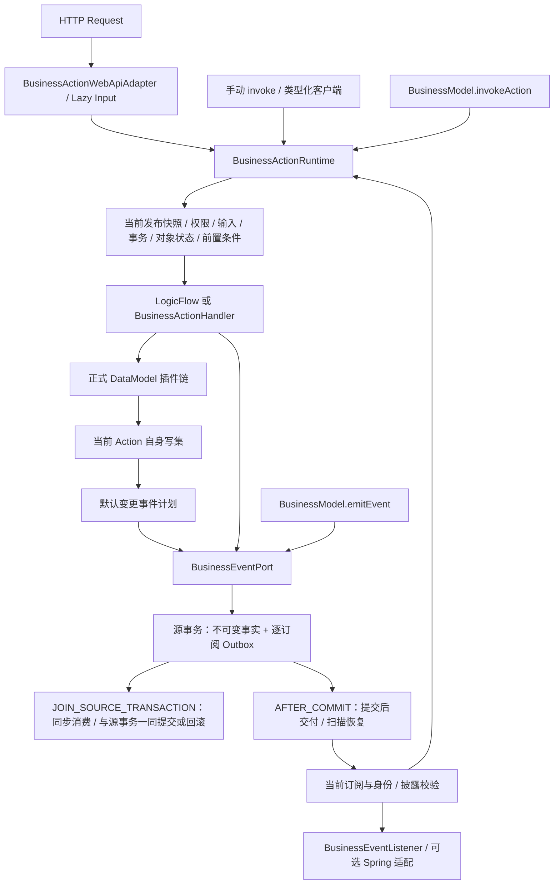
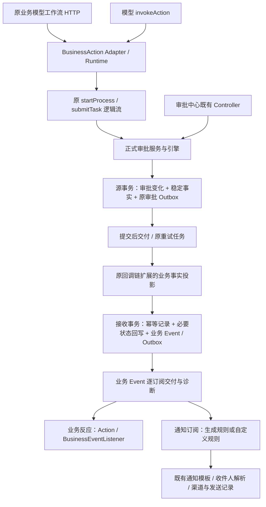

# 业务行为、格式兼容与消费契约

本文从原实施总计划提取长期契约：模型便捷入口、默认事实、前置条件、格式兼容、工作流投影、特性行为和语义描述。分阶段计划、阶段测试数字及实施收口在原 Git 提交与关联任务保留，不在本页维护执行账本。

当前运行时和 API 以[模块设计](../DESIGN.md#8-动态业务行为与事实)及[输入契约](business-action-input-design.md)为准；本文保留已确认的行为约束与验收标准。正文明确标为待新增/待实施的机制仍保留差距，不能由历史“已完成”标题推成全量已实现。后续本体方向保持提案/进入条件，不计入当前功能。

## 订阅执行与身份契约

订阅结构与示例以[开发指南](../../../docs/guides/business-model-behaviors.md#定义与发布)为唯一说明。`executionMode` 是必填的单一执行策略，取 JOIN_SOURCE_TRANSACTION、AFTER_COMMIT_TRANSACTIONAL 或 AFTER_COMMIT_INDEPENDENT；模式与投递责任一起固定。Action 支持前两种，监听器必须声明匹配的事务能力。同步失败（包括授权、契约、前置条件及级联深度失败）使源事务不可提交；不降级为异步，不单独重试。同步成功仍须等待根事务提交。兄弟订阅无顺序保证，级联同步传播上限为 32。

平台从 `ouroboros.business-event.consumer.principals` 按消费模型解析启用且已授权的 User；订阅不配置执行身份或 runAs。原 actor 不授予消费权限；delivery 上下文、交付记录和工作流通知持久归属统一使用 `user`，其值为消费方账号的 `User.userIdentity`；运行时通过 `resolveUser(consumerModelFullName)` 查询。事实来源继续由 `actorRef` 记录。工作流通知捕获与交接期间若账号配置改变，保留原恢复责任并拒绝静默换人。

至少一次 Outbox 只直接保证持久责任与恢复。事务模式将本地写入与确认绑定；独立模式的外部副作用必须使用监听器的稳定通知单元、持久回执与幂等恢复。数据库事务不承诺回滚外部渠道。

## 2. 保持的主路径与扩展位置



图中默认事件在绑定执行、输出校验成功之后，源事务提交之前产生。它不是 DataModel 的全局数据库变更通知。同步订阅在 emit 返回前执行并等待根事务提交；其余订阅在源事务提交后由 Outbox 交付。

| 责任 | 现有所有者 | 修改方式 |
|---|---|---|
| 模型实例与投影 | `BusinessModelCenter`、Builder、`AbstractBusinessModel` | 模型增加无调用状态的便捷方法，不改变模型构建协议 |
| 契约汇合与发布 | `BusinessModelBehaviorResolver`、Validator、`BusinessModelBehavior`、Export | 默认事件及执行计划与已有 InputPlan 一样进入同一发布快照；不另建注册表 |
| 默认动作归一化 | `LegacyBusinessActionNormalizer` | 扩展为同时归一化默认事件和自动产生计划，复用 CRUD 身份与开关 |
| 动作执行 | `DefaultBusinessActionRuntime` | 增加前置条件阶段与提交前默认事实阶段；WebAdapter、Flow、Handler 不重复实现 |
| 实际写入观测 | `DataModelExecutionContext`、`DataModelMutation`、`BusinessActionExecutionScope` | 区分自身写集与审计汇总写集；复用插件链与 mutation observer |
| 事实与交付 | `DefaultBusinessEventPort`、SubscriptionRuntime、Outbox | 保持事务、权限和至少一次交付；增加默认事实所需的附加披露限制与前置条件阻塞诊断 |

本次局部的归属问题是：共享模型定义尚无执行入口；默认 Action 定义尚未描述默认产生事实的能力；审计汇总写集不能直接充当自动事件的来源。分别在模型接口、已发布执行计划和执行作用域内补齐，不在 WebAdapter 或脚本模板中添加另一套事件机制。

## 3. 业务模型接口

### 3.1 对外方法

在 `BusinessModel` 增加以下动态方法；`invokeAction` 与 `emitEvent` 采用“动词 + 业务概念”的对应命名，分别表达调用动作与产生事件，避免与 Spring 的 `publishEvent` 等接口混淆：

```java
Object invokeAction(String actionName, BusinessActionInput<?, ?> input);

BusinessEventOccurrence<Map<String, Object>> emitEvent(
    String eventName, Object payload);

BusinessEventOccurrence<Map<String, Object>> emitEvent(
    String eventName, BusinessEventSubject subject, Object payload);

BusinessEventOccurrence<Map<String, Object>> emitEvent(
    String eventName, BusinessEventSubject subject, Object payload,
    BusinessEventEmissionContext context);
```

`invokeAction` 只将 `getFullName()`、actionName、原 Input 交给现有 `BusinessActionRuntime.invoke`。没有 input 时显式传 `BusinessActionInput.empty()`；不新增 target 或原始 Map 调用协议，不使用无校验的泛型结果转换。需要返回类型的应用继续使用生成客户端。

`emitEvent` 只补全 `BusinessEventIdentity(getFullName(), eventName)`。第一种重载使用模型级 subject；前两种使用 `BusinessEventEmissionContext.fromAction()`。实例级事件必须显式传 `BusinessEventSubject.instance(...)`；不从输入中猜测对象身份或选取数组第一个对象。subject 仍按当前 Event 定义校验。

| 调用场景 | 用法与结果 |
|---|---|
| Handler/Flow 内执行业务动作 | `model.invokeAction("submit", input)`；沿当前同步执行上下文进入 Runtime，保留嵌套审计、权限和 REQUIRED 事务 |
| Controller、定时任务或测试执行动作 | 同一方法；Input 来自调用方；真实 HTTP 请求只按已有规则补充 Context，不替代 Input |
| Action 内产生模型级事实 | `model.emitEvent("reconciliationCompleted", payload)`；当前 Action 必须声明 emits，且不可只读 |
| Action 内产生实例事实 | `model.emitEvent("submitted", BusinessEventSubject.instance(model.getFullName(), id), payload)`；实例身份显式传入 |
| 非 Action 生产者产生事实 | 在现有 `eventPort.inTransaction(...)` 中完成业务写入与 emit，使用最后一种重载及 `fromProducer("已注册的生产者名")`；照常验证 producer 和 emit Authority |
| 没有事务、未发布、禁用、无权限、契约不匹配 | 使用同一平台异常与诊断；模型方法不偷偷另起事务或绕开检查 |

“派发”在该接口上表示**在源事务中产生并登记事实**。返回 occurrence 只证明当前事务已登记；外层事务仍可能回滚。JOIN_SOURCE_TRANSACTION 订阅此时已完成但尚未提交；提交后订阅的可靠交付由 Outbox 负责。不要把模型方法实现成直接遍历 listener 或调用 Spring 广播。

### 3.2 core 与 Spring 的连接

模型由 SPI Builder 创建，并不是 Spring Bean。不能在每个模型对象中注入 Controller、Runtime Bean 或保存当前请求。

采用一个窄的 core SPI `BusinessModelRuntimeAccess`，只提供现有 `BusinessActionRuntime` 与 `BusinessEventPort` 的访问。`BusinessModel` 的默认方法在调用时通过既有 SPI 机制取得该访问器；runtime 模块注册一个无状态实现，经现有 `SpringContextUtil` 获取已配置 Bean。访问器不执行授权/事务、不复制 Handler/Listener 目录，也不缓存 Bean 或调用上下文。所有 SPI/自动配置按 `META-INF` 正式注册。

选择这个桥接是因为既有 Builder 与 Provider 负责模型构建/查找；不应仅为两个便捷方法把所有模型构造器改为依赖 Spring，或把 Provider 改成服务容器。脱离 runtime 仍能读取、校验和投影模型；只有执行方法要求运行环境就绪。

这里必须先验证生命周期：当前 `SpringContextUtil` 只保存首次 context，尚未清理关闭引用。本轮在这个现有桥接处补“所属 context 关闭时释放、顺序重建可重新绑定”的最小修正及回归；不再添加第二个静态 context holder。未启动、已关闭、Bean 缺失、SPI 实现不唯一都明确失败。多 Application 并存仍不在范围内。

即使调用方持有刷新前的模型对象，也只使用其稳定模型身份；实际契约重新经 Runtime/EventPort 的发布锁解析。模型对象不是旧实现的执行凭证。dashboard/composite-view 不会因此凭空拥有 CRUD，没有对应已发布成员就拒绝执行。

## 4. 默认写入动作产生事件

### 4.1 事实定义与覆盖范围

默认数据业务模型统一投影三个模型级 Event：`recordsCreated`、`recordsUpdated`、`recordsDeleted`。它们描述本次事务成功执行并最终提交的持久化操作，不推断“订单已批准”等业务状态。

| 当前执行 | 自动事实来源 | 不产生事件的情况 |
|---|---|---|
| add/update/delete | 本 Action 经正式 DataModel 对本模型产生的 INSERT/UPDATE/DELETE mutation | 无本模型成功写入，或源事务回滚 |
| batchDelete/import | 同样来自实际 mutation；逐条/批量实现都适用，按确定规则分块 | 空批次、未匹配对象、导入失败并回滚 |
| CRUD before/afterScript、替代自动实现的脚本 | 本模型实际写入仍由 observer 记录；不依赖脚本返回形状 | 只返回“成功”但没有写入，不制造事实 |
| 重新绑定到 Handler 的默认 CRUD Action | 自动产生计划属于 Action；兼容改绑不移除它 | 非正式 DataModel 写入仍按现有架构规则禁止 |
| 默认只读的 getOne/search、其他 readOnly Action | 无自动计划；显式改为可写的查询动作也不自动获得默认变更计划 | readOnly=true 时禁止写入，也禁止 emit |
| 自定义 Action | 业务事实继续显式 emit；若调用默认 CRUD Action，由被调 CRUD 自己产生默认事实 | 不因任意自定义 Action 写库就启用全局 CDC |
| submitTogether 的子集合同步 | 根默认 Action 只产生根模型自身变更事实；子写集仍进入审计 | 同步不调用子模型 CRUD，因此不自动制造子模型 Action/Event；需要时显式建模并 emit |
| 嵌套默认 Action | 每层仅由自身直接写集产生；被调 Action 负责自己的事件 | 父审计合并后的子写集不能再次用于自动产生 |

每个默认可写 Action 的生成 emits 覆盖这三个 Event：before/afterScript 可能执行不同写入操作，不能机械规定 add 只能发 created。关闭原 CRUD/feature 开关也关闭对应 Action；没有可执行 Action就没有该入口的新事实。Event 契约保留，以便既有 Outbox 责任按当前权限继续交付。模型整体停用仍按现有发布规则阻塞交付。

默认事件的 allowedProducerKinds 为 `["action"]`，occurrenceCondition 描述对应已提交写入操作。名称纳入与动态/注解定义相同的冲突诊断：有同名声明就拒绝发布并指出来源，不覆盖、不自动改名。生成定义不回写用户的原始 JSON；编辑器/事件描述显示生成来源及只读说明。无数据字段或不满足当前单一 id 主键条件的模型不自动获得这三个事件。

本轮默认启用，不增加第二套独立的生产开关。升级后的首次成功发布开始生效，不回放历史 CRUD，不把部署前数据扫描成事实。正常调用没有消费者时也保存事实；保存成本进入性能与容量验收。

### 4.2 从写集到 occurrence

1. 归一化时生成 EventDefinition、默认 emits 和自动产生计划；计划随模型行为快照发布，不按动作名称在运行时硬编码猜测。
2. `BusinessActionExecutionScope` 维护自身 mutation 与审计汇总两个用途。子调用只合并审计信息；自动产生读取自身 mutation。平台事实/Outbox/审计表写入不成为业务事实来源。
3. 绑定执行成功，完成 mutation 健康检查与输出 Schema 校验后，在同一事务和当前 Action scope 内调用计划。需要将现有 `withWriteGuard/withExecution` 的范围覆盖到自动事实阶段；不能退出 guard 后再调用 EventPort，也不能用 platform-write 绕过源资源证明。最终审计在自动事实登记成功之后记录 eventId。
4. 按 mutation 原顺序处理，仅选择本模型、已知操作且 affectedRows 为正的条目；根据主键声明将现有字符串 objectIds 还原为正确 JSON 标量类型。不能从输入 IDs、最终返回值或脚本改写结果猜测受影响对象。
5. 每个 mutation 按 ID 数量与序列化字节预算分块，每份生成独立 occurrence，经同一个 `BusinessEventPort.emit` 校验和落库。初始上限为每份 500 个 ID、64 KiB JSON payload，作为 Spring 系统配置并在性能验证后定版；单 ID 已超限或计数/身份无法证明时整笔回滚，不截断。
6. 任一事实、输出、afterScript、写入跟踪或审计失败，源业务写入、事实和 Outbox 一起回滚。提交后交付失败只影响消费事务及 delivery，不撤销已提交源事实。

示例载荷（同一动态 Schema 由主键类型派生）：

```json
{
  "operation": "UPDATE",
  "objectIds": [101, 102],
  "affectedCount": 2
}
```

按 Owner 确认的 A 方案，每份默认事件独立消费，不提供整批重组协议。载荷不包含 `chunkIndex`、`chunkCount` 或 mutation 分组标识；affectedCount 是本份事件包含的已证明操作对象数。每份 occurrence 有独立 eventId，各自持久化逐订阅交付责任，失败和重驱互不要求整批联动；消费方使用现有 eventId/deliveryId 实现幂等，不等待其他分块或依赖交付顺序。源事务内仍须全部事实与源写入共同提交或回滚。

executionId、模型身份和时间由 occurrence 已有字段承载，executionId 用于追踪调用，不作为整批完整性交付凭证。跨 mutation 不合并，不做事务净差分：同事务先插入后更新可有 created 和 updated 两份操作事实。`recordsUpdated` 不承诺字段值发生了语义变化；MySQL matched/changed rows 差异须遵守并验证现有 DataModel 写入计数契约。

MySQL 的“匹配但值未变”必须在 P0 验证；若现有锁定对象数与驱动行数约定不一致，在正式 DataModel/适配器的计数与观测边界修正，不能在事件生成中删掉一致性检查或将输入 ID 视为写入成功。分块只限制单份事实的大小；现有写集持有全部操作 ID，内存仍随总写入规模增长，不能宣称整个导入是常量内存。

不默认携带整行、前后镜像、原始请求、文件或敏感字段。业务状态事实使用单独命名的显式事件。不要在脚本里重复手动 emit 同名默认事实；平台不将手工 emit 与自动事实做猜测性去重，也不承诺整次客户端重试只产生一次业务操作。客户端幂等仍按业务规则处理。

### 4.3 删除后可交付，同时保持授权边界

当前实例 subject 与对象引用载荷的披露会查询对象当前状态；物理删除后无法通过这条路径。不能用“找不到就允许”修复，也不能为了交付把全部删除行复制进事件。

默认变更事实采用以下明确约束：

- subject 为 model；objectIds 是历史操作标量，Schema 不标记为需要加载当前对象的 `x-business-object-ref`。
- EventDefinition 增加动态布尔属性 `requireUnfilteredModelRead`，缺省 false；默认变更事件固定为 true。这是**附加限制**，不替代现有 Event read、全部载荷字段授权和 subject 检查。
- true 时，消费者还必须具有当前源模型的 search Authority、无行过滤且 id 字段可读。Event read 自身也不能带行过滤；因此仅具备局部行权限的订阅不能读取全模型 ID 列表。
- 该限制随 occurrence 保存不可变快照；每次交付同时满足原事实限制和当前 Event 限制，不能通过以后把配置改为 false 扩大历史事实的披露。旧事实迁移缺省 false，保持旧语义。
- 撤权进入可诊断的授权阻塞；恢复权限后显式 redrive。运维查询不暴露 payload，redrive 权限不等于消费权限。

这能覆盖受控系统消费者的创建、更新、删除/批量删除通知。按历史行权限交付删除前镜像属于另一个需求，需要历史授权依据，本轮不宣称支持。应用若只需要通知少量业务字段，应显式定义业务 Event，而非放宽默认事件。

## 5. 前置条件与已有声明的语义收口

### 5.1 动态定义

将现有 `precondition` 收口为一种结构，不支持任意脚本、Java 类名或多套规则语言：

```json
{
  "precondition": {
    "expression": "${objectStates['/params/order'].status == 'DRAFT'}",
    "message": "只有草稿订单可以提交"
  }
}
```

表达式复用现有 `EL.validatePredicateExpression/evaluatePredicate` 的受限谓词能力。发布时验证整个 AST，禁止类型/Bean/方法调用、赋值及全局变量；结果必须是 Boolean。规则只读取已经归一化的 input 和已授权 objectStates，不读取 request、Spring Bean 或外部系统。message 为静态、安全的业务说明。

无 target、单角色、多角色和数组角色仍由 Input Schema 表达；objectStates 继续以 JSON Pointer 定位各对象。数组可按受限表达式支持的索引读取，不在本轮引入循环/集合规则 DSL；复杂批量业务规则继续写在正式 Flow/Handler 中。

`BusinessModelBehavior` 编译并保存前置条件校验计划；若需要缓存表达式，扩展现有 EL API 的受限谓词计划，不能另建解释器。注解只贡献同一 precondition JSON，不直接注册一段绕开 Runtime 的校验回调。

### 5.2 availability 与执行

| 场景 | 时机 | 状态与效果 |
|---|---|---|
| 输入不完整 | availability | NEEDS_INPUT；不执行 Handler，不产生写入/事件/执行审计 |
| 无权限或对象不可读 | 两入口均先鉴权 | 保留现有权限阻塞；不泄露对象状态或规则业务信息 |
| 规则引用不可读字段 | 两入口均在求值前检查字段读取权限 | 授权阻塞；不得将受限字段裁剪为 null 后继续判断 |
| 规则不满足 | availability 在当前授权状态上求值 | BLOCKED，新增 `Blockage.PRECONDITION`；不把业务不满足标成权限/契约错误 |
| 执行可写 Action | REQUIRED 事务内，经权限过滤的对象锁定与重新读取后求值 | 不满足抛明确的前置条件业务异常，绑定不执行；满足后继续 |
| 只读 Action | 当前授权状态求值 | 不取得写锁；保持只读，无写入及 emit |
| 订阅调用目标 Action | availability 预检，实际 invoke 仍重新求值 | 不满足进入独立 `PRECONDITION_BLOCKED`，修复业务条件后显式重驱 |

配置了对象状态前置条件的写 Action 复用 `DataModel.queryForUpdate(QueryStatement)` 及正式插件链；对 Schema 引用的对象按“模型身份、主键类型、规范化主键值”稳定排序并去重，再锁定、重读、授权、求值。不能先无锁读取状态、判断成功之后才在最终 update 中锁行。无前置条件不为此新增锁；input-only 条件没有对象锁；readOnly 不使用写锁。数据库/适配器无法提供所需锁定能力时明确拒绝。

这条通路先补齐既有插件的授权前提：基线 `AccessControlDataModelPlugin` 仅在普通 `query` 中添加行过滤和字段裁剪，`queryForUpdate` 目前直接沿默认方法转发。P0 必须验证这项缺口，P3 在同一访问控制插件内复用查询授权处理，扩展锁查询的行过滤和字段限制；不在 Runtime 复制一套权限查询。锁查询继续使用目标模型的正式读取 Authority，不能仅证明调用者持有 search 名称就视为对象已授权。

availability 与执行使用相同的字段权限规则：前置条件引用不可读对象字段时返回授权阻塞，Handler/Flow 不执行；裁剪后的缺失值不能充当业务 null，使 `status != 'CLOSED'` 等条件误通过。仅真实可读字段的空值按原契约求值。

按 Owner 确认的 A 方案，继续支持通过非 id 的唯一关系键传入对象角色。沿现有 `BusinessRelationParameters` 和 relations 定义完成类型转换及授权定位，保留“输入角色路径、目标模型、原关系键及其规范值、实际主键”的本次调用解析结果；不改变公开 Input 形状。按上述稳定主键顺序锁定后，使用锁后当前授权状态重验原关系键仍匹配同一主键，再进行前置条件求值和绑定执行。关系键已改值、指向其他对象、无法唯一定位或对象不再可读时拒绝本次调用，不自动改绑到新对象或重放 Action。该要求覆盖多个角色/数组中的每个关系对象，不扩展为新的关系系统。

锁只覆盖已声明对象，不承诺约束未声明对象、范围查询或幻读。规则依赖集合总量、余额竞争或外部资源时，仍由业务在正式数据/事务机制中实现对应约束。前置条件只能访问允许读取的字段。

稳定锁序只约束本次已声明对象，不能消除嵌套调用与后续业务 DML 的全部死锁。死锁/锁超时沿正式事务失败回滚；框架不自动重放可能包含外部副作用的整次 Action。

`PRECONDITION_BLOCKED` 同步扩展 delivery 结果、状态展示和 redrive 白名单。若 availability 后发生竞争、invoke 重验失败，消费事务必须回滚；Outbox 在回滚后按原 claim/token 的所有权，在独立状态事务中登记业务阻塞。这条分支只识别明确的前置条件异常，不能把任意 BusinessException 当作可吞掉的阻塞；其他失败沿既有退避/DEAD 机制。

并发验收必须证明两个调用不能都依据旧 DRAFT 状态成功；使用同一事务管理器、相同正式锁机制的状态写入遵守此约束。availability 只是提示，不是执行授权票据。

### 5.3 authorization 字段

当前真实授权是 `模型全名.Action名` Authority、现有行/字段权限及对象访问检查。它继续是唯一权威。对未定义语义的非空 `authorization` 在候选发布阶段给出精确路径诊断；不能继续保存后静默忽略，也不在本轮发明与安全模块并行的权限 DSL。已有配置需盘点并迁移到正式 Authority；precondition 不得用来替代权限隔离。

## 6. 输入、注解、客户端和编辑器一起闭环

| 路径 | 保持的输入协议 | 本轮新增验证 |
|---|---|---|
| HTTP → 高代码 | WebAPI 的 businessModel/action；Lazy Input → 参数注解绑定 | 模型入口/新阶段不解析未访问的 body；任意参数表行为与已有 Runtime 一致 |
| invoke/模型 → 高代码 | 真实 Input.params/data → 同一参数表绑定 | 没有 HTTP 也能执行不依赖请求的动作；params/data 缺失与 null 保持区别 |
| HTTP → LogicFlow | 已编译投影映射；CRUD 保留正式端口，真实 request 可选 | 原 `$request.data` 与真实 `context.request` 不混用；before/afterScript 回归 |
| invoke/模型 → LogicFlow | 同样的业务输入形状；不伪造 HTTP | requiresHttpRequest 在绑定前检查；Flow 修改工作数据不污染调用方输入 |
| 订阅 → Action | 当前 inputMapping 产生 params/data，独立执行上下文 | 不继承源 HTTP 请求；缺输入、契约、授权、前置条件阻塞分别诊断 |

前置条件、默认事件计划和模型便捷方法均使用现有 Input，不再加一层运输格式或深拷贝。发布阶段编译计划；执行阶段只准备实际需要的数据。保留 RequestInfoMap 按需访问的行为，不能将“Lazy”简化为“先复制完整请求，再延迟取 getter”。

沿现有行为 JSON 编辑页面增加 schema、成员引用/生成来源说明和可定位发布错误。沿现有动作入口与运维页面/通用数据视图接通可用性、调用结果、delivery 查询、阻塞原因与有权重驱；不为本轮引入完整可视化规则编排器或新的事件管理中心。原页面若缺少上述操作入口，以最小表单/列表补上，布局与权限沿项目现有模式。

Java/TS 生成器与 SDK 同步 availability 的 PRECONDITION 枚举、新 Event 属性/载荷、默认 Event 类型及指纹处理。载荷 Schema 指纹继续表达载荷结构；执行/披露策略进入行为 revision 与独立保存的事实限制，不能仅靠 Schema 指纹证明授权兼容。动态调用无生成步骤仍须通过全部场景。

## 7. aggregate 应用迁移

静态盘点基线：196 个模型文件中，8 个模型的 35 段脚本使用 `$request`；4 个启用的自动 CRUD afterScript 读取 data.id/transportLicense，另 31 段 custom 脚本配置为不生成实现，不能据此断言它们当前正在运行。尚未启动该应用，扫描也不能代替已部署元数据盘点。

**2026-10-29 约束修订：后续工作以兼容存量定义为优先，原“应用迁移”不再要求重写 aggregate 的低代码元数据。** 在其已有独立工作区先检查状态；不修改该应用主 checkout。核验覆盖文件定义、实际加载的模型和已保存开发元数据，逐条记录来源与用途；默认由平台在既有解析、绑定和输入适配入口解决兼容问题。

| 发现的依赖 | 兼容方式 |
|---|---|
| 旧 CRUD `$request.data` 等正式端口 | 保留已实现的 CRUD 端口映射，按真实场景回归；不批量改名 |
| 业务参数、ID、分页与载荷 | 平台从既有端口和正式绑定契约完成映射；已有 actionInputMapping 原样使用，不要求为格式升级批量补映射；同一个 Action 用 HTTP 和 invoke 验证 |
| URL/header/remoteAddress 等真实 HTTP 信息 | 复用 context.request 与 requiresHttpRequest 的正式绑定能力，不为兼容而批量改脚本；依赖真实请求的动作仍不能由独立 Event 调用 |
| custom API 的旧开关、输入映射或绑定不完整 | 经 CustomConfig、Normalizer、Resolver 和正式注解 / SPI 契约处理可确定部分；不能虚构实现、从 REST 路由猜测业务 Action，或把未生成实现当作可执行 Flow |
| 新的默认事实与订阅 | 确认系统消费者完整模型读取权、事件量与幂等策略；业务事实使用独立命名 |
| Java/TS 客户端 | 重新生成并编译；旧契约客户端执行前拒绝行为仍需验证 |

兼容逻辑必须是平台的一般规则，不硬编码 aggregate 名称、107 / 35 项名单或模型 URL，不另建应用专用注册表。确实涉及业务语义选择或存量错误的少量定义修正，应单独列出必要性、修改内容和影响，不能混入批量格式升级；此前已确认的题目导入选择保持原决定。

本轮元数据基线为 aggregate 独立 worktree 的 metadata 提交 `d53076959178d443998abe031a6a9f3768cdbb39`，其中已有上一阶段写入的 107 项 `isBindAction=true` 和 35 项 `false`。本次要求不被解释为已恢复到更早版本；这些历史改动单独保留记录，不自动回退，也不要求进一步换成新枚举。需要评估更早版本时，以该版本副本单独验证，不能拿当前基线的通过结果声称更早版本也已兼容。

至少选择覆盖新增、修改、删除/批删、导入、主子表、启用的 afterScript、自定义高代码/Flow、非 HTTP Action、事件消费与恢复的真实应用用例。不虚构 aggregate 原本没有的业务功能；平台具备但应用未使用的分支由正式集成场景补齐。


## 9. 验证方法与验收标准

### 9.1 必测行为

| 验证组 | 关键断言 |
|---|---|
| 模型接口 | 与直接 Runtime/EventPort 的结果、权限、事务、错误等价；没有旧快照执行；无多余输入复制 |
| 默认事件 | 所有默认写动作；真实写集与 PK 类型；同模型钩子；子表边界；自身/子调用不重复；分块有界、无重组字段；各份独立失败/幂等/重驱且不依赖到达顺序；禁用/只读；无订阅仍存事实 |
| 原子性 | before/afterScript、输出、自动 emit、审计任一失败都回滚源写/事实/交付责任；消费效果与确认共同提交 |
| 披露 | 未授权和行过滤身份拿不到默认事实；id/载荷字段限制；删除后完整授权身份能消费；历史限制不能被配置放宽 |
| 前置条件 | 动态定义和注解等价；AST 完整校验；输入缺失/无权限/条件不满足有区别；锁查询行过滤与字段限制；不可读 status 不按 null 误通过；非 id 关系键锁后重验、并发改键/改绑拒绝；锁前竞争与事务后重验；不存在对象/无锁适配器拒绝 |
| 订阅恢复 | availability 后状态变化；rollback-only 不被吞掉；业务/权限/契约阻塞分开；重驱保持 eventId/deliveryId，幂等效果可验证 |
| 现有主链 | Lazy RequestInfoMap、body 一次解析、CRUD 正式端口、主子表插件、注解自由参数、生成客户端、审批旧 Outbox 回归 |

新增 Java 功能遵循仓库单元测试及至少 70% 覆盖要求，并按组件/场景组织；测试业务结果，不匹配源码文字。沿既有正式集成场景和公共 runner 扩展，不另造一次性验收脚本体系。运行受影响模块 Maven 测试/Checkstyle、SDK 测试与类型检查、架构检查；稳定通过后不无理由反复扩大测试范围。

### 9.2 性能验证

固定机器、Java 21、驱动、数据量和配置，至少记录 HTTP→Flow、HTTP→Handler、invoke→Flow、模型→Handler 四条路径。将“无新默认事件的入口开销”与“写入事实/Outbox 的新增业务成本”分开比较；后者不能被包装成零性能成本。

- 未映射且 Schema/绑定/规则都不需要 body 的动作，解析次数必须为 0；需要读取时最多一次。模型便捷方法向 Runtime 传递原 Input，不提前遍历 RequestInfoMap。
- 比较单次与批量输入的分配、吞吐、P50/P95，保留预热/样本/原始结果及提交。入口额外包装的基准以改造前后相同事务/审计配置比较；默认事件成本以相同写入、不同订阅数比较。
- 分块上限、峰值内存、事实/投递增长与大批量回滚必须有证据。暂不杜撰延迟 SLA；以可重复显著退化、实际容量需求和既有性能门槛决定是否整改并记录结论。

### 9.3 环境与发布边界

MySQL 验收使用隔离数据库，通过正式 DataModel 迁移流程生成和审核 SQL，不手工直连写业务表；覆盖本轮新增事实披露字段、delivery 状态和已有事实缺省值。保留审批原表及在途身份，验证升级不会重建或双发存量责任。

部署/重启演练需明确测试环境、版本和数据备份/恢复方式。没有环境访问时标记待验收，并继续本地可做任务。`remote_publish=manual` 不授权推送、合并或生产部署；准备交付包不等于已上线。

## 10. 后续本体路线与进入条件

这些方向仍有价值，但不是本轮 Action/Event 闭环的必要前置，不和本次待补功能混成无限期任务：

| 后续方向 | 进入条件及实施原则 |
|---|---|
| 跨数据源事务 / JTA/XA | 出现真实多资源原子提交需求；先证明每个 DataAdapter、事实、Outbox 的 XA 参与、恢复与故障处理，再宣称支持；配置事务管理器本身不是证明 |
| ObjectSet 与关系运行时 | 真实跨模型过滤/遍历需求；扩展既有 QueryDSL 和 relations，保持授权及 owned child 生命周期 |
| Interfaces / Shared Properties | 有跨模型业务复用案例；动态契约先行，Java 接口仅作适配，不机械复制 Palantir 类型体系 |
| Automate / 集合和时间触发 | 需要从观察条件产生新事实；单独定义状态、去重与调度，不把 occurrenceCondition 说明文字当作可执行触发器 |
| 历史行权限与删除镜像事件 | 确有局部行权限消费者读取历史载荷需求；设计可证明的历史授权与数据保留，再扩展本轮模型级变更事实 |


## 12. 统一实现方式与事件可见性

S6b 已在原 Resolver / 生成器保留完整定义与绑定来源，新增同一契约的只读目录及开发侧完整草稿预览，返回请求标识 / 指纹 / 正式诊断并明确开发环境代码覆盖范围。来源随 revision 与特性查询投影保留，派生视图不落盘。S6c 已接入只读目录 UI 与独立目标已发布视图，使用正式建模查看权限；S6d 已实现完整资源显式升级，S6e1 已接入版本化功能引用及结构化原定义编辑、原配置分区跳转；S6e2 已接入订阅启停及其原 Outbox 恢复边界，S6e3 已接入快捷创建脚本动作 / 正式 Flow；S6e4 已在共享特性计划和原贡献来源补入条件效果 / 工作流生产及通知规则配置定位，目录可打开原特性分区及绑定流程；新建 default 模板已切到 2.0。精确节点 / 模板定位与部署组合仍须 S7 实际验证。目录最终浏览器证据见唯一执行记录；本节 MODE 验收须按实际证据逐项收口，不以已实现后端推断整项通过。

### 12.1 版本决定格式，自定义功能引用 Action

**本节是本轮配置改造的执行契约，§12.5 的 MODE 验收项逐条验证它。** 旧格式专指当前已实现的布尔开关及其既有语义。讨论过的 `SCRIPT_FLOW / CUSTOM_FLOW / BUSINESS_ACTION / WEB_API` 四态尚未落地，属于本次新版方案的演化过程，不能作为已发布历史格式增加兼容分支。当前新版收敛为：Action 定义业务行为，自定义功能只引用 Action 或声明普通 REST 调用，纯界面功能保留原界面配置。

原设计、开发指南及执行记录中的旧开关说明用于解释现有实现，不能覆盖本节。实施时同步更新当前使用文档；不得只在代码中改变版本、解析或保存规则。aggregate 继续原样接入，不以批量迁移元数据为升级前提。

#### 12.1.1 复用模型文件的 formatVersion

`BusinessModelMeta` 已有字符串字段 `formatVersion`；默认模型新建模板当前写 `"1.0"`，基本信息表单也存在写死 `"1.0"` 的隐藏字段。复用此字段，不再新增 `metadataVersion/schemaVersion`，不把它与行为 `modelRevision`、Schema 指纹、Action / Event 契约版本或审批定义自身的版本混用。本节先限定 `modelType=default`；其他模型类型沿各自格式规则，不由本次调整统一升版。

| 原始版本字段 | 读取规则 | 保存规则 |
|---|---|---|
| 缺少 `formatVersion` 键 | 进入旧格式解析；只在内存记录有效格式，不回写缺省值 | 普通编辑保留缺失状态 |
| `"0.1"` / `"1.0"` | 进入已知旧格式解析 | 普通编辑保留原版本字符串 |
| `"2.0"` | 进入新版规范解析，按新版校验 Action 定义与功能引用 | 按新版规范保存 |
| 显式 null、空串、错误类型或未知版本 | 在原始 JSON 边界定位版本错误；未知版本不得回退成旧版或套用最新规则 | 保留可查看的原文和诊断，不以旧表单覆盖保存 |

先按 `modelType + formatVersion` 选择格式规则，再进入同一正式 Normalizer / Resolver / Validator 和发布链路；版本分支集中在元数据入口，不在 Runtime、UI、API 投影和订阅交付中分别猜格式。版本校验必须在 Bean 类型转换可能抹掉错误类型 / 缺失差别之前处理。归一化的运行时契约可以统一，但原始编辑文档与来源信息须单独保留，不能把归一化快照直接当成原文保存。

版本号属于整个模型文件。新旧模型可在同一应用中并存；同一个 `"2.0"` 文件不能混入旧内联定义再靠字段存在与否逐项猜版本，旧版本文件也不能偷偷写新版 Action 引用。这不禁止旧格式中已经支持的独立 `actions/events/eventSubscriptions`，只是不能在旧版本下引入本次新版功能引用语法。

**版本只解释拥有该定义的来源，不沿引用传播。** 业务模型的 formatVersion 只决定本文件中的定义，包括内嵌 HTTP / Flow 绑定 / 订阅映射；不能根据被调用模型的版本解释另一个文件或 Java 贡献，也不能让模型升版改变所引用 LogicFlow 内部的表达式语义。各入口须保留资源身份、字段路径、原始格式及定义来源，按下表转换一次后汇入正式发布链路：

| 定义来源 | 格式选择与转换责任 |
|---|---|
| `.business.json` 内拥有的定义 | 原始 JSON 入口按本节 modelType + formatVersion 解析；旧定义的表达式 / 字面量规则由该字段原有语义决定，2.0 使用本节新版规则 |
| 独立 `.webapi.json` 或代码直接提供的 BusinessAction WebAPI | 在既有 WebAPI Provider / 校验入口增加**本资源自己的** formatVersion 规则：缺少键沿已实现旧 HTTP 映射规则，字符串 `"2.0"` 使用 EL 映射；其余显式值诊断。本规则为待新增能力，不冒称 WebAPI 当前已有版本解析；不借用目标业务模型的版本或 OpenAPI info.version。此规则限定 BusinessAction 路由，普通 REST 不因本项新增版本限制或强制补版本 |
| 正式 SPI 行为 / 绑定 / 订阅绑定贡献 | 扩展现有贡献对象携带其自身 formatVersion；现有构造入口缺省保留原贡献语义，新入口可显式声明 `"2.0"`，其他显式值诊断。Normalizer / Resolver 在正式贡献汇合处转换，不根据目标模型版本或 source 描述字符串猜测；无映射的贡献不因此改变行为 |
| 平台内置投射产物、注解 Catalog 生成的贡献 | 更新生成器直接产生规范化计划 / 2.0 贡献，并继承真实来源定位；不能把投射后的 WebAPI 当作缺省旧文件再次转换。注解参数绑定仍走原机制，原无表达式的注解不增加用户必填版本参数 |
| 引用的正式 LogicFlow 资源 | 资源内部映射、脚本和版本继续归 LogicFlow 入口管理；本节只处理 Action 的 binding.inputMapping / outputMapping，不借模型升版改写流程内部表达式 |

来源版本与规范化状态属于正式解析结果，不增加隐藏注册表；Runtime 只接收已经统一的计划，不接收原始方言再分支。旧 Event 订阅原本已经支持的 EL 继续是表达式，旧 Flow 绑定中原本作为字面量的 `${ ... }` 则须按官方转义保留字面量；不能在所有旧字段上仅凭字符串前缀套同一转换。独立新 WebAPI 可以调用旧模型 Action，旧 WebAPI 也可以调用新版 Action，双方只需通过同一输入契约校验。来源缺失或无法确认时定位诊断，不能回退到目标模型版本；旧原文的普通保存规则不因内存转换改变。

#### 12.1.2 旧格式仅在入口兼容，原定义不被覆盖

旧自定义功能的定义位置仍为原 `custom` 成员。以下保留可确定的有效执行语义，并沿用先前确认的冲突收口要求；冲突诊断属于待实施规则，不能冒充当前代码已经拒绝了该组合。推导结果不写成任何四态枚举：

| 旧 API 配置 | 有效语义 |
|---|---|
| `isGenerateImplementation=true`，`isBindAction` 非 false，`isCustomLogicFlow` 非 true | 在原位置生成单脚本流程及同名 Action |
| `isGenerateImplementation=true`，`isBindAction` 非 false，`isCustomLogicFlow=true` | 复用原固定名称逻辑流及同名 Action |
| `isGenerateImplementation` 非 true，`isBindAction=true` | 在原位置定义同名 Action，由正式代码绑定提供实现 |
| `isGenerateImplementation` 非 true，`isBindAction` 非 true | 普通高代码 REST；不因存在同名 Controller / 注解而自动创建 Action |
| `isGenerateImplementation=true` 且 `isBindAction=false` | 按既定收口规则诊断旧组合冲突，不使原先未投影的实现变为新可执行入口 |

布尔缺省值沿用当前读取语义：不生成实现时，缺省绑定不等于开启绑定；缺省 `isCustomLogicFlow` 不等于自定义流程。API 未启用时，旧内联拥有的 Action 不可经 HTTP、invoke 或订阅执行；普通 Controller 的生命周期仍由框架和原配置负责。

保留功能名、标题、原权限名、URL、流程名、脚本、参数契约、输入映射及键的缺省状态。有效契约带原始来源；Actions 页编辑旧来源动作时回写该来源，不向 `actions` 再复制同名定义。重复完整定义和重复代码绑定仍按正式冲突机制拒绝，不能以元数据来源不同为由允许覆盖。

#### 12.1.3 新版定义与编辑入口

新版把实现、输入 / 输出、前置条件、权限和 `emits` 留在 Action 的唯一来源中，自定义功能保存引用、HTTP 和界面配置。下例是结构示意，省略完整参数 Schema 与流程输入映射；实际流程资源须存在并通过正式校验：

```json
{
  "formatVersion": "2.0",
  "modelType": "default",
  "namespace": "sales",
  "name": "Order",
  "actions": [
    {
      "name": "approve",
      "title": "审批订单",
      "isEnabled": true,
      "binding": {
        "kind": "logicflow",
        "flowName": "sales.Order.approve"
      }
    }
  ],
  "custom": [
    {
      "name": "approveFromList",
      "title": "列表审批",
      "ui": {
        "isEnabled": true,
        "entryPoint": "operation",
        "mode": "api"
      },
      "api": {
        "isEnabled": true,
        "implementationMode": "ACTION",
        "action": "approve",
        "httpMethod": "POST",
        "url": "approve",
        "actionInputMapping": {
          "params.record.id": "${ request.params.id }",
          "data": "${ request.body }"
        }
      }
    }
  ]
}
```

本例参数 id 来自完整请求参数视图，请求体本身作为载荷，不要求 HTTP 调用者把参数和载荷重新包装成 `{params, data}`。`${ ... }` 复用平台已有 EL 语法；Action HTTP 映射尚须接入同一引擎，详见下一节，不能把示例当成当前已可运行的新格式。

| 新版配置位置 | 职责 |
|---|---|
| `actions` 或正式代码 / 默认贡献来源 | 唯一定义 Action；实现仍复用 `handler / logicflow` 绑定，不为功能引用另造处理器 |
| `custom[].api.implementationMode=ACTION` | 只引用 `api.action` 指定的当前模型 Action，不生成以功能名命名的第二个 Action；缺失、空值和错误引用明确诊断 |
| `custom[].api.implementationMode=WEB_API` | 普通 REST 声明，实际接口由 Controller 提供；不生成 Action / BusinessAction 路由 |
| `api.isEnabled` | 对引用功能只控制本功能 HTTP 入口；关闭不影响 Action 的其他入口，目标 Action 禁用则所有引用均不可执行 |
| `api.httpMethod/url/actionInputMapping` | 声明本入口的 HTTP 形态及业务输入来源；走现有 BusinessAction WebAPI 投影与编译，不再各自组装另一份参数 |
| `ui` | 界面入口、输入收集、确认、反馈；纯界面功能不凭空新增 API |

新建功能的“调用业务动作”要求选择或快捷新建动作，不默认生成同名脚本动作；“调用普通接口”明确走原 REST。Action 编辑器提供脚本 / 逻辑流 / 高代码的实现体验；新脚本通过现有单脚本 LogicFlow 模型和正式开发模块能力承载，Action 引用该流程，脚本不再内联到新功能中。多个功能可以引用同一个 Action，也可引用可用的默认 / 特性 / 工作流 / 代码动作，不要求功能名等于 Action 名。

S6e3 的快捷创建沿原开发服务准备已保存 2.0 模型的完整草稿和正式单脚本 Flow，先展示两个资源的精确差异；确认后用原 VCS BatchAction 一起提交，在锁后写前重新核验草稿 / 原文件 / 依赖 / 全部资源指纹。取消零写入，任何校验或提交失败保留原资源集。仅新增唯一 Action 和正式 Flow，并修改当前功能引用，不删除先前目标动作，不把脚本内联到功能。旧模型须先显式升级，新建未保存模型须先保存。关联 Flow 沿正式开发服务校验，脚本由既有引擎执行，不建立另一套脚本执行器。

新脚本采用平台既有命名端口 `input`，脚本按正式端口语法访问 `$input.params`、`$input.data`、`$input.context`；同步 HTTP 的完整视图在 `$input.context.request`，非 HTTP invoke 不保证该属性存在。默认 Flow 输入计划直接复用统一 params / data / context 视图，无额外输入包裹；旧单脚本模板的 request 端口及旧脚本文字保持不变。新动作默认只读，可明确选择允许写入；初始 params 是通用对象、data 保留任意载荷，可在唯一动作契约中继续定义字段 Schema。当前功能没有 HTTP 映射时，快捷创建显式初始化 `${ request.params }` / `${ request.body }` 为 params / data；已有映射保留，精确类型和单多值仍由原 RequestInfoMap / 官方计划及 Schema 决定。临时脚本、语言、预览与请求状态不入模型元数据。


动作选择器读取同一正式行为预览 / 快照，保留来源和覆盖范围；代码贡献未加载不能被解释为不存在并清空既有引用。新引用功能不同时定义脚本、绑定、参数契约、前置条件或 `emits`，新版也不接受旧生成 / 绑定开关及未落地的三个内联模式，冲突定位到原字段。普通 REST 与独立同名 Action 不因名字一致自动关联。

新引用入口沿目标 Action 的执行权限授权，API 权限映射和按钮可用性在原 Authority 投影中对齐，不因功能别名引入另一套业务执行授权；Action Runtime 仍独立重验权限。执行权限须按 §12.1.6 在发布契约中解析并贯通 Runtime，不能仅关联 URL。现有独立界面权限和可见性表达不能代替执行授权。旧格式原权限名保持不变，显式迁移也不得要求角色批量重新授权。

#### 12.1.4 映射统一使用现有 EL，保留完整 request 与 Lazy 读取

**映射表达式必须使用平台已有 `${ ... }` 语法和求值机制。** 通用表达式入口为 `common-expression` 的 `EL.eval`，默认实现为已注册 `SpElImpl`；LogicFlow 通过现有 `LogicFlowExpression → CommonExpressionLogicFlowExpression → EL` 接入。不能在 Action / Event 模块自行剥掉 `${}` 再 split 点号、用正则限制成另一套语言，或直接另建 SpEL / JSONPath 解析器。目标字段如 `params.record.id` 是原有分层字段装配路径，并非右侧的表达式语言；继续复用 `Maps.Hierarchical` 等既有机制。

不同调用边界提供不同的明确上下文，语法和引擎相同：

| 映射位置 | 表达式上下文 / 示例 | 含义 |
|---|---|---|
| HTTP → Action 参数 | `${ request.params.id }` | 从同一 RequestInfoMap 的叠加 params 读取，再写入目标业务路径，例如 params.record.id |
| HTTP → Action 载荷 | `${ request.body }` 或 `${ request.data }` | 请求体本身，不是 body.params / body.data；两者复用同一载荷缓存 |
| HTTP 确定来源 | `${ query.notify }`、`${ request.pathVariables.orderId }`、`${ headers['X-Trace-Id'] }` | query / headers 复用现有 HTTP 计划按参数声明处理的精确来源；RequestInfoMap 本身没有 query 成员，不伪造 request.query |
| HTTP 原始 Header | `${ request.headers['X-Trace-Id'] }` | 保留原 HttpHeaders 多值视图，结果是 List；不将其冒充已按 ParameterModel 处理的标量 headers 来源 |
| Action → LogicFlow | `${ input.params.record.id }`、`${ input.data }`、`${ context }`、`${ context.request }` | 业务输入来自本次 Input；可信 Context / 完整同步请求来自原上下文，不先复制 envelope |
| LogicFlow 输出 → Action 输出 | `${ result }` 或 `${ result.id }` | result 是本次流程结果，保留其实际类型，不自行按 $. 路径解释 |
| Event 订阅 → Action | `${ event.payload.orderId }` | 沿既有 Event envelope / 订阅表达式上下文取值；不继承源 HTTP 请求 |

HTTP 请求视图、业务 Input、流程结果和事件 envelope 都只是表达式上下文的数据，不改变它们原有契约，也不建立另一套表达式上下文注册表。普通取值、默认值（如 `${ request.params.limit ?: 20 }`）、索引等均按现有引擎解释；模板字符串、转义和字面量也沿平台规则，不添加 Action 专用操作符。一次完整表达式返回 Map / List / 数字 / 文件时保留对象类型和必要引用，不用字符串替换或 JSON 序列化再恢复。前置条件和订阅 filter 仍使用已有受限谓词入口；其 Boolean 和根访问约束属于原业务规则，不把它当作通用映射返回值接口。

`RequestInfoMap` 是按键取值的 Lazy 请求视图。实际 `request.params` 由请求参数（query / Servlet form 参数等）、路径变量、Header 叠加，读取优先级依次为请求参数、路径变量、Header；Header 可回退读取但不可完整枚举。EL 的 Map 属性访问必须直接 get 到同一视图，不能为组装表达式上下文先枚举 / 深复制 request。`request.body` 与 `request.data` 复用同一按 Content-Type 解析的结果，均不是 `body.data`。

| 输入来源 / 访问方式 | 规则 |
|---|---|
| HTTP 业务分区 | 表达式将来源投影到 params/data 契约；request.params 的叠加来源和 input.params 的业务角色不是同一个结构，不把裸 id 直接当作 record 引用 |
| 完整同步请求 | context.request 保留 method、uri、path、queryString、protocol、host、port、remoteAddress、pathVariables、headers、params、body/data；不由业务映射条目决定是否可访问 |
| 手动 invoke | 显式 input.params/input.data 为业务值来源，环境 HTTP 不覆盖它；同步 HTTP 上下文可补 request，但不改变显式 Input |
| LogicFlow / beforeScript / afterScript | 保留原正式端口、别名与工作数据隔离；完整请求通过原绑定及 context.request 提供，不要求 aggregate 批量改脚本 |
| 定时 / 独立订阅无 HTTP | 不伪造 headers、uri 等事实；requiresHttpRequest 按原规则提前拒绝无请求调用 |

**Lazy 是取值策略，不是另一套语法。** 沿现有 Input / HTTP 计划缓存机制，在实际读取某个目标值时，才用该调用上下文求值对应表达式并缓存结果或失败；不在首次访问一个参数时求出全部映射。表达式真正访问 body 才触发解析，Context 和流程继续共用缓存；EL 已有解析缓存不可存放本次请求值。错误须定位模型 / 功能 / 映射目标并保留原因，不吞成 null。发布期只解析 / 校验表达式，不执行带实际业务副作用的表达式求值。

**实施结果（承接设计时缺口）**：HTTP 的 `BusinessActionWebApiContract / BusinessActionHttpInputPlan`、Action 的 `BusinessActionInputPlan / outputMapping` 和 Event 订阅已统一接入 common-expression 的官方 EL / provider 计划；旧 `$.` 仅在所属来源入口等价转换，Lazy 请求缓存、Map / 集合装配与存在性信息沿原机制保留。发布校验不执行实际业务求值，Runtime 只执行已发布计划；没有新增模块级解析器或 AST 分支。

**存在性、传输值形态与表达式求值分别有明确职责。** EL.eval 的 null 不能表示字段是否提供；原始 RequestInfoMap 也不负责把 Header 变为业务标量。统一计划须在同一正式编译边界保留以下信息，不能用 null、空字符串或空集合猜测缺失：

| 输入 / 映射情况 | 目标存在性与结果 |
|---|---|
| 没有配置目标映射 | 目标缺失；不生成占位 null |
| 2.0 的纯属性 / 固定索引选择，如 `${ request.body.comment }` | 任一所需成员不存在则目标缺失；最终成员存在且值为 null，则目标存在且为 null；中间值为 null 不能被当作存在的下级成员。HTTP 根 body 的存在性沿原请求元信息判断，不能因 RequestInfoMap 支持 body 键就判为已提供 |
| 2.0 的计算、默认值、投影或模板表达式 | 映射目标视为已声明提供，实际读取才求值；成功返回 null 是显式 null，其他结果保持类型，失败是错误。`${ request.params.limit ?: 20 }` 的默认规则归 EL，不将结果再次按真值或空值判缺失 |
| 旧 HTTP 映射 | 保留原 present 规则，包括无 body 与 JSON null、嵌套字段缺失、分区由子目标存在性派生等；转换所得存在性计划与值计划一起使用 |
| 旧 Flow / Event 映射、字面量及输出映射 | 保留各字段原来的目标物化规则；例如原来即使读到缺失值也写入目标 null 的条目，不能转换后擅自省略。独立输出值 null 仍为输出值，不解释成删除映射 |
| 手动 invoke | 沿原 hasParams / hasData 与 Map 字段存在性，不经过 HTTP 传输值处理，不从环境 request 补业务字段 |

新纯选择器的存在性由 common-expression 正式 provider 在编译时从**引擎自己的解析结果**识别并提供，不在 WebAPI / Action / Event 模块另写解析器；其他表达式统一采用上表“已声明提供”规则，不根据它偶然读过哪些字段反推存在性。旧入口可把原来明确的存在性要求编译进同一计划。计划将存在性与值缓存区分：containsKey / 键枚举不求值计算表达式，纯选择器只读取判断路径存在所必需的父级；嵌套 body 字段的存在性检查确需解析 body 时复用原缓存。get / Entry.getValue 才按目标缓存一次求值结果或失败；不同存在性策略不构成第二套表达式解释器。

Schema 默认值仅补缺失字段，显式 null 继续接受 nullable 校验或被拒绝，不被默认值覆盖；required、hasParams / hasData 和参数绑定均读取同一存在性结果。准备阶段仍按正式契约读取和验证已提供业务值，Lazy 不延后必填参数报错，也不承诺完整 data 已提供时跳过校验。

精确 headers 来源复用 BusinessActionHttpInputPlan 原有传输值规则：Header 名大小写不敏感，未提供为缺失；声明 array 的参数即使只有一个值也保留 List；未声明 array 时单值为标量、多值为有序 List，目标标量 Schema 继续拒绝多值，不静默取首项。query 同样保留既有重复参数、声明数组与解码规则。request.headers 和 request.params 的 Header 回退仍保持原来的 List，不替换为该精确来源视图。旧 `$.headers.x-token` 因此转换为 `${ headers['x-token'] }`，不能直接改成 `${ request.headers['x-token'] }`。

存量 $. 配置作为**已实现旧格式**兼容：仅在 §12.1.1 规定的所属来源入口转换成统一计划，普通编辑仍保存原文，2.0 使用官方 EL 与字面量规则；Runtime 不长期保留两套求值机制。转换须保留存在性策略、值类型、嵌套集合形状 / 顺序、引用及错误语义；例如旧 `$.pathVariables.orderId` 对应 `${ request.pathVariables.orderId }`。旧 Flow 的 `$.input.params.records.id` 在已知 records 为列表或 null 的契约下，对应 `${ input.params.records?.![id] }`；records 缺失 / null 时返回 null，空表返回空表，元素的缺失 id 保留原位置 null。不能使用不带空安全的 `records.![id]`，也不能假定旧路径穿越任意 Map / List 的行为都能按一个固定投影式替换。带连字符的键用引擎已有索引语法。

转换器须先依据原字段语义和正式 Schema / 输入形状证明等价，再编译为官方计划；保留原本应发生的数组类型错误，不把求值异常吞成 null。无法证明等价时按来源定位诊断，保留原文并阻止该发布 / 显式升级，不能发布改了业务结果的计划，也不能以自动修改 aggregate 为补救。原样加载回归必须覆盖实际存量映射，不能仅以“有诊断”代替兼容完成。相关通用编译 / 存在性能力只扩展 common-expression 的 provider，平台内置生成器和代码贡献使用同一汇合机制。

#### 12.1.5 编辑、保存与显式升级

| 操作 | 行为 |
|---|---|
| 打开 / 预览旧模型 | 根据原 formatVersion 展示兼容表单和统一行为目录，不写文件，不补版本或生成定义 |
| 普通编辑旧模型 | 修改实际编辑内容，保留原版本、原定义来源、未知扩展字段和缺省状态；Action 详情跳转到原定义位置 |
| 新建模型 | 默认创建 `formatVersion="2.0"`，按新版规范创建 Action 和功能引用，不产生旧开关 |
| 在旧模型里新增本次新版功能 | 提供“升级当前模型并新建”的明确流程，先在草稿中转换整个模型、预览差异并校验，再以 2.0 保存；取消则不改原模型，不把新引用偷偷写进旧版文件 |
| 用户显式升级既有模型 | 将本模型内旧内联 Action 提取为唯一新定义、原功能改为引用；普通 REST 和纯 UI 保持原语义，其他模型不随之迁移 |
| 普通编辑新版引用 | 只改引用、HTTP 或 UI 配置；编辑动作回到唯一来源；删除引用不删除目标 Action |
| 删除 / 改名被引用动作或旧定义来源 | 按正式引用关系诊断，不能静默删除其他入口、解绑代码或回退成 REST |

兼容编辑保留旧格式为默认方案；转成新版后保存必须是明确的模型升级，不是打开页面、初始化控件、修改标题或新版本平台读取时的副作用。统一显示不意味着把旧模型自动转换后当成原文保存。表单必须分开原始文档、可编辑字段与只读派生视图，复用已有开发读取 envelope 与保存入口，派生目录 / sourcePath / 有效模式不进持久化；前后端均排除这些只读字段。移除或调整当前隐藏 `formatVersion="1.0"` 的强制默认值，不能把新版覆盖回旧版，也不能给缺省旧文档自动补版本。

显式升级须保留模型 / Action 身份、原 URL 和输入映射、原流程名及端口、脚本、只读属性、前置条件、事件声明、启用状态、代码绑定和存量权限。旧 API 关闭时，迁移后的独立 Action 初始也保持不可执行；之后新版入口开关与动作开关按新版的独立职责工作，界面明确说明。旧内联脚本如需实体化为正式 LogicFlow 资源，应先通过原开发模块准备完整资源集并校验，不能仅删脚本字段或改变绑定造成实现丢失；代码绑定来自正式贡献，不把目标运行时合并结果复制为第二份定义。存在同名冲突、缺失依赖或无法证明等价的内容时保留原文并阻止升级，不把兼容迁移当作猜测业务意图的机会。

升级过程必须经正式开发 / VCS 暂存及校验 / 发布边界完成，失败不切换原模型版本、不丢脚本、不发布半套资源；先验证这个边界才能开放升级操作。新版本号只描述文件格式，不代表脚本或运行行为可以不兼容变化。aggregate 的 195 个业务模型在当前基线均未声明 formatVersion，解析时按缺省旧版接入，普通读取 / 编辑不批量补写；原题目导入选择和 107 / 35 绑定边界保持不变。

#### 12.1.6 执行权限是发布契约的一部分

现有 DefaultBusinessActionRuntime.authorityName 固定拼接 `${model}.${action}`，仅修改 Authority 的 URL 投影无法复用 `.workflow` 或 `.serverSideExport`。最小修正是在既有行为归一化 / 来源贡献中解析唯一的 **executionAuthorityName**，作为已发布 Action 计划的只读信息；这不是新增的用户必填字段，也不把当前无执行语义的 authorization 属性直接当作权限名。

| Action 来源 | executionAuthorityName |
|---|---|
| 默认 CRUD、普通动态 / 代码 Action、searchDeleted / searchArchive / searchHistory | `${modelFullName}.${actionName}` |
| 旧内联自定义功能及其显式升级所得 Action | `${modelFullName}.${原功能名}`；升级保留 Action 名与权限身份，不要求角色重新授权 |
| 工作流 startProcess / submitTask / initTaskForm | `${modelFullName}.workflow`；三项能力复用原权限，任务 / 对象细项校验仍执行 |
| 平台导出 export | `${modelFullName}.serverSideExport`；业务动作不改名，也不额外要求 `.export` 权限 |
| 新版自定义功能引用任一 Action | 采用目标 Action 已解析的执行权限；功能别名不产生新的业务执行 Authority |

权限身份由模型身份和正式来源 / 特性计划决定，不能从调用参数、HTTP Header、UI 功能名或订阅载荷指定。归一化阶段不为查找权限而递归 buildModelBundle；原 Authority MPS 按同一解析结果创建 / 复用权限并关联 API 与 UI，发布校验确认引用可解析、归属一致且无冲突，不能因目标权限不存在回退为放行。

HTTP 路由授权、通用 invoke、内部嵌套调用、订阅目标授权、availability、按调用权限过滤的动作描述，以及 Runtime requireAuthorized 都读取该发布结果。BusinessActionContext.authorityName、BusinessBehaviorSecurity.withAuthority / accessControlParams 和审计使用同一名称；不能入口检查旧名、Runtime 或数据行 / 字段权限又改用拼接新名。实现中应替换现有拼接落点，禁止在各入口散布 workflow / export 特判、临时附加权限或建立权限别名注册表。权限映射参与行为 revision / 契约指纹，刷新后旧计划不能与新路由混用。

界面自身独立的显示 / 访问权限可以作为附加限制，但不替代 Action 执行授权，也不凭功能别名新增必须分配的执行权限。模型管理视图、Event 披露与审批引擎的经办人 / 候选人校验继续沿各自原授权边界；执行权限复用不扩大其能力。存量角色不批量改写；新历史 / 已删除查询权限仍须显式授予，不能借旧 search / delete 权限获得。

### 12.2 事件总览与 Action 的发出事件

编辑器沿现有“行为契约”入口组织“动作 / 事件 / 事件订阅”，使用左侧成员列表、右侧单成员编辑的工作台。事件列表合并本模型原始动态定义与正式解析目录；生成与代码贡献成员只读，动态定义只写回原数组。运行诊断、已发布版本对照和格式兼容设置放在“更多”中，不与建模类型并列。

```text
业务模型：sales.Order → 行为契约
[动作]  [事件]  [事件订阅]             配置检查状态      更多
┌──────────────────┬──────────────────────────────────────────┐
│ 搜索名称或标识   │ 选中成员：业务定义 / 来源只读详情          │
│ 来源筛选         │ 显示名称、标识、业务说明                   │
│ 新增             │ 动作：输入结构、逻辑流、允许发出事件       │
│ 本模型定义       │ 事件：对象 / 模型主体、事件数据结构        │
│ 平台生成         │ 订阅：来源事件、响应动作、params/data 映射 │
│ 代码贡献         │ 高级定义、关联来源与订阅                   │
└──────────────────┴──────────────────────────────────────────┘
```

事件详情展示其定义、已知发出来源及关联订阅；Action 详情展示允许发出的事件。关联按正式引用读取，本轮以详情列表呈现，不承诺全部引用可双向跳转。外部引用保留完整模型名，可以手动填写；在未连接或不可见时标记待核验，不复制为本模型定义。动态 Action 的普通表单只选择逻辑流，代码动作继续归代码来源维护；旧 Handler / listener 配置保留高级编辑。

事件主体选项为“对象 / 模型”，与 payload 独立：对象主体显式提供 ID，模型主体不提供 ID，二者均显式提供 JSON 对象载荷。切换主体不自动查询快照、补字段或裁剪数据。订阅的 params/data 各自支持逐字段、整体传入、不传入；来源为事件字段、带类型的固定值或平台 EL。编辑器只构造已有 inputMapping，不求值表达式、不引入 JSONPath。嵌套表达式树保留高级映射，重复或父子覆盖拒写。操作步骤见[开发指南](../../../docs/guides/business-model-behaviors.md#将事件传入动作)。

“定义来源”和“发出方式”是两个维度，不用一个“默认 / 自定义”标记混在一起：

| 定义来源 | 可编辑性 | 发出方式如何判定 |
|---|---|---|
| 平台生成 | 只读；跳转到对应 CRUD / 功能 / 特性 / 工作流配置 | CRUD 来自实际 mutation event plan；工作流来自 §13 的审批事实投影计划；可见特性的附加效果按 §14 展示，不能仅按事件名或动作名猜测 |
| 模型动态定义 | 编辑该模型的 `events` 成员 | 结合 Action 的 `emits` 与允许的生产者声明展示；定义本身不自动触发 |
| 代码贡献，包括 `@BusinessEvent` / 正式 SPI | 只读；显示贡献来源并定位代码 | 与动态定义相同；注解注册事件不等于自动发出事件 |

同一个 Event 可由多个 Action 或已注册生产者发出，因此触发方式展示在每条“生产者 → Event”关系上。非 Action 生产者的允许 kind 与具体 producer 清单分别展示；仅知道 allowedProducerKinds 时不伪造具体生产者绑定。没有已知 Action 引用不意味着事件无效，可能由非 Action 生产者显式产生。

### 12.3 展示事件时保持真实的执行语义

| 场景 | 编辑器应显示的承诺 |
|---|---|
| 默认可写 `add/update/delete/batchDelete/import` | 本 Action 对本模型的真实 INSERT/UPDATE/DELETE 可分别产生三个默认事件；不是每次调用都发出三个事件，也不是 add 只能发 created |
| 默认只读 `getOne/search` | 不自动产生变更事件；改为可写仍不自动获得默认 mutation plan |
| 自定义 Action 的 `emits` 包含业务事件 | “声明可发出；由实现显式 emit”，不能显示为“执行成功自动产生” |
| 自定义 Action 调用默认 CRUD Action | 被调用的 CRUD 按其自身计划产生事件；不把所有潜在嵌套调用推断为外层 Action 的直接 emits |
| 无实际写入或源事务回滚 | 无新默认事实；事件总览展示的是事件类型，不是本次调用结果 |
| 原 CRUD / 功能关闭 | 保留生成的 Event 契约；关联动作显示禁用，不误报仍可由该入口产生新事实 |
| 无数据字段或不满足单一 id 主键条件 | 不展示三个默认事件为可用生成结果；同时保留正式模型校验诊断 |
| 普通 `WEB_API` 功能 | 不自动获得 Action / CRUD 发出计划；高代码若要发事件，须走已注册生产者与 EventPort 的正式路径 |
| 配置工作流生成的能力 | 按 §13 展示发起、任务提交与只读初始化 Action；事件由审批事实投影自动产生，区分任务操作成功与整个流程结果，不把只读调用显示为会发事件 |
| 可见高级特性 | 按 §14 区分新增 Action 与既有 Action 的附加效果；导出、已软删除 / 历史 / 归档查询不自动发业务变更事件，插件内部副本写入不冒充新的业务对象创建 |

发生条件 `occurrenceCondition` 是语义说明，不是可执行触发器。事件引用或订阅的存在都不会自动添加 emit 节点、修改业务脚本或订阅任意 Spring Application Event。

Action 详情读取规范化契约：默认 CRUD 的发出计划和生成 emits 只读；新版动态 Action 编辑 `actions[].emits`，引用它的自定义功能只展示并跳转到该唯一来源；旧内联来源动作仍按原来源编辑（如 `custom[].api.emits`），归一化时传入同一 ActionDefinition，不在 actions 再创建同名定义。格式升级按 §12.1.5 显式进行。选择事件只声明允许发出，帮助文本提醒显式 emit；普通 REST 不配置 Action emits，已有非空声明报告冲突，不静默丢弃。

新增动态 Event 时至少填写名称、语义 / 发生条件、subject 与 payload Schema；默认事件显示真实主键类型及 `{operation, objectIds, affectedCount}`，并说明完整模型读取权要求。代码 / 动态同名或覆盖生成事件时，显示双方来源和字段路径，沿既有发布校验拒绝冲突。

### 12.4 草稿预览、代码贡献与已发布契约

前端不重新实现默认事件规则，不从源码文本搜索 emit 调用，也不建立事件目录注册表。总览是既有归一化结果、`BusinessModelBehavior`、mutation plan、工作流事实投影计划与订阅引用的只读视图；来源信息在已有 Resolver 汇合贡献处保留并供查询使用，不增加第二份事件定义。无权限的来源或跨模型细节不能因总览而泄露。

开发侧在 `BusinessModelController` / `BusinessModelDevService` 的既有模型解析和验证入口扩展只读行为预览，接受当前完整草稿；复用 DefaultBusinessModel / Resolver / Validator，不执行 Handler、流程、数据结构变更或模型发布。关联定义取当前开发应用的模型 Provider。JSON 不完整时保留编辑内容并定位错误；有同名冲突时保留来源诊断，不把索引覆盖后的单个结果冒充有效契约。

草稿预览与已发布视图分别带数据来源和 revision / 草稿请求标识。切换模型或连续编辑后，过期响应不能覆盖新预览；草稿改变后显示待检查并去抖自动检查，旧结果标为过期；失败时提供重新检查。视图数据、查询状态、临时运行地址和令牌不写回模型元数据。

开发平台不能假定自己已加载目标应用的 Java 注解贡献。完整代码贡献与已发布视图需要通过现有目标应用会话，在目标运行时读取同一已发布行为快照；在现有行为描述入口旁补 Event 与订阅引用查询，沿模型管理权限保护建模视图，不能拿 Action invoke 或 Event payload read 权限代替模型管理授权。只读查询不提供新的公网 emit 端点，不读取事实载荷或交付业务数据。

| 视图 / 状态 | 界面行为 |
|---|---|
| 草稿预览 | 展示当前草稿可解析的动态定义、默认投影及当前开发环境实际加载的贡献，明确覆盖范围 |
| 已连接目标应用 | 单独展示目标应用已发布契约及其 revision；代码贡献来源以该应用正式快照为准 |
| 草稿与运行版本不同 | 并列标明版本差异，不把旧运行时注解结果合并成“草稿已验证” |
| 应用未连接 / 无管理权限 / 查询失败 | 展示对应状态；保留本地预览，提示代码贡献未核验，不显示为“没有代码事件” |
| 加载中或预览无效 | 显示加载 / 字段诊断；上一结果如保留必须标为过期 |
| 无自定义事件 | 仍显示实际存在的默认事件，并提供新增入口；确实无任何事件时再显示空状态 |

事件详情的“消费方”仅查询当前应用、当前视图可见的订阅，并区分启用 / 停用；覆盖不完整时标为未核验。订阅定义使用可选 `isEnabled`，缺省为启用且普通读取不补写。停用后仍记录源事件事实，但不为该订阅新增投递；已持久责任交付时进入 `CONTRACT_BLOCKED`，恢复启用后须由原显式 redrive 恢复，不自动补发停用期间事实。显式 true 与缺省的有效契约指纹等价，兼容已固定的历史通知责任；显式 false 不得取得新的工作流通知责任，已有责任无法交接时保留原审批 Outbox，不能回退旧通知造成双发。注解可停用自己定义的订阅，纯 Listener 绑定不能覆盖动态定义的启停状态。停用不免除结构与绑定校验。没有查到订阅不能推断其他应用或外部系统没有消费者。查看本模型订阅的其他模型事件仍放在“订阅”页，不混入本模型定义列表。

消费方还包括 §13 由工作流通知配置派生的订阅，标为“平台生成 / 工作流通知”，只读展示并跳转原流程 / 节点 / 模板配置；不要求用户再建立一份订阅。必要的流程状态同步属于 Event 产生前的内部投影，不列为该 Event 的普通消费者。草稿未加载实际审批定义时，将相应通知规则标为未核验，不凭模板名称猜测存在的订阅。

### 12.5 实施与验证边界

版本化解析、唯一 Action 引用归一化、统一 EL / 执行权限和完整资源集显式升级已分阶段实现；新版引用编辑器及结构化 Action / Event / 订阅原定义编辑已接入。订阅启停已接入正式事实 / 投递 / 通知责任边界；快捷创建正式脚本动作已实现，新建默认 2.0 模板和完整应用验收仍待完成，以唯一执行记录中的实际证据为准。不得把未落地四态候选当作已发布格式补兼容分支，也不得用旧 isBindAction 测试通过记录替代新版验收。实施顺序如下：

1. 在原元数据读取 / 校验入口按 formatVersion 选择规则，统一归一化及来源；先验证旧定义原样加载、未知版本拒绝和旧编辑往返不覆盖，不在 Runtime 引入第二套格式分支。
2. 更新 CustomConfig、Normalizer、Validator、CustomAPIMPS、CustomUIMPS 和既有 Authority 投影：新版只做引用，旧版保留原来源；将 executionAuthorityName 贯通发布、所有调用入口、Runtime 与数据权限上下文，验证存量角色和新旧启停边界，普通 REST 不进入 Runtime。
3. 映射统一接入 EL / 现有 LogicFlow 表达式端口：HTTP、Action Flow 输入 / 输出和 Event 订阅使用相同语法；按所属文件 / 贡献格式转换一次，内置产物直接给规范化结果。必要编译与存在性能力只扩展 common-expression，先证明缺失 / null / 默认值、精确 Header 单多值、可选列表 / 字面量和来源版本隔离，再贯通 Lazy 缓存；不保留自制求值器。
4. 编辑器统一动作 / 功能入口及事件总览，接入同一草稿预览与目标快照；新建默认 2.0，旧编辑保留，版本升级使用差异预览和正式资源集校验。升级跨资源失败边界先打通，再开放入口。
5. aggregate 以 §7 的原样基线运行：195 模型缺省旧版、107 旧绑定和 35 旧不绑定继续具有原义；不补 formatVersion、不写枚举、不批量迁移。保持旧 URL、脚本、题目导入及权限，重跑正式行为与绑定契约校验并记录前后差异。新版独立场景另行验证，不能把原样加载通过当作转换或完整应用运行已通过。

以下均为待执行标准：

| 编号 | 输入 / 场景 | 必须验证的结果 |
|---|---|---|
| MODE-01 | 缺省版本、0.1、1.0 与 2.0 模型 | 按显式版本规则进入同一归一化 / 校验链；旧原文与原版本保持，新格式严格校验引用，不由字段形状反向猜版本 |
| MODE-02 | 新版两个功能引用同一 Action，功能名不同 | 一个最终 Action、两个正式入口；无同名定义复制，引用以 action 字段为准，执行结果和业务事件不因入口复制而重复 |
| MODE-03 | 旧脚本 / 自定义流程；高代码绑定 true / false / 缺省 | 保持当前可确定语义、固定流程名及 Controller 边界；不写四态枚举，不从源码路由猜绑定 |
| MODE-04 | 新版引用混入旧开关 / 内联契约或未落地的内联模式；旧版本写新版引用 | 定位格式不一致，不兼容虚构历史版本，不以优先级静默覆盖定义；纯 UI 不新增 API |
| MODE-05 | 版本显式 null / 空串 / 非字符串 / 未知值 | 原始 JSON 边界报告版本错误，不被 Bean 强转为合法字符串或当缺省值，不回退旧版 / 最新版，不用旧表单覆盖原文 |
| MODE-06 | 新建模板、旧 / 新模型的隐藏字段、保存并重载 | 新建 default 模型为 2.0；旧版本及缺省状态不被覆盖；其他 modelType 不被本次全局升版；重复保存稳定 |
| MODE-07 | 同一 EL 语法用于 HTTP / Flow 输入输出 / Event；params 叠加与精确来源、默认值、集合及转义 | 经官方引擎得到一致值与类型，不能只把 $. 改写为 ${} 后继续手动解析；请求参数优先、路径其次、Header 回退；不可枚举 Header 可 get，精确来源 / 多值保持；旧 $. 等价转换仅在所属来源格式入口，普通保存不改原文；发布不执行业务求值 |
| MODE-08 | EL 取值与 body/data、完整 request、HTTP / invoke / Flow / 钩子 | 按目标字段 Lazy 求值并缓存结果 / 失败，不遍历请求组装上下文；同步 HTTP 复用同一完整视图，载荷按需至多解析一次，未读 body 为 0；Map / List / 文件类型和引用保留；旧端口 / 工作数据隔离、手动 Input 与无 HTTP 边界保持，错误不吞成 null |
| MODE-09 | 旧配置打开、预览、只改标题 / UI / 动作参数，保存再加载 | 只读阶段无写入；按原来源编辑，保留未修改定义、未知字段、版本缺省状态与旧开关；不向 actions 复制，派生视图不落盘 |
| MODE-10 | 在旧模型新建新版功能；取消、预览、确认并保存升级 | 明确升级当前模型才写 2.0 和新引用；取消零改动，不能旧版文件混入新版字段；不迁移其他模型 |
| MODE-11 | aggregate 原样接入 | §7 基线原样加载为旧格式；195 模型正式校验及绑定契约回归通过；元数据无格式迁移差异，107 / 35 边界、原 URL、脚本、题目导入及权限保持 |
| MODE-12 | 旧内联关闭、新引用入口关闭、目标动作关闭、普通 REST 仍启用 | 旧内联动作不能绕关闭执行；新入口关闭只影响该入口，动作关闭影响所有入口；Controller 生命周期不被 Action 开关接管 |
| MODE-13 | 高代码缺少 / 重复绑定、直接 REST、代码贡献未加载 | 正式绑定诊断保持；普通 REST 不包裹；来源未核验明确显示，不清空选择，不把独立同名动作关联到 REST |
| MODE-14 | 显式升级：脚本实体化、流程 / 注解 / 权限 / 禁用 / 事件引用；任一步失败 | 完整资源集验证等价；无实现或脚本丢失、重复绑定、重新授权、自动启用及半套发布；失败保留旧版本 / 原文 |
| MODE-15 | 动作引用缺失、删除 / 改名来源，草稿并发预览和目标版本不同 | 指向真实字段和来源；过期响应不覆盖，目标快照不冒充草稿已验证；无隐藏注册表或回退路径 |
| MODE-16 | 动作 / 事件总览与编辑跳转 | 默认 / 动态 / 代码 / 旧来源清楚；自定义功能不重复定义 emits；自动计划与显式 emit 区分；原事件编辑、无连接 / 无权限及运行诊断均按真实状态呈现 |
| MODE-17 | 无 body / JSON null、嵌套属性缺失 / null、Schema default / required、计算表达式返回 null | 按 §12.1.4 的存在性规则处理；默认值仅补缺失，hasParams / hasData 与字段绑定一致；containsKey 不提前求值计算表达式，嵌套 body 检查共用缓存；HTTP 与显式 invoke 不混来源 |
| MODE-18 | 精确 headers 与原始 request.headers、声明数组的单值 / 重复值、可选 / 空 / 嵌套列表及旧字面量 | Header 大小写、多值和类型原义保持，标量拒绝重复值；缺失 records 的旧映射返回 null、空表及元素位置保持，不因裸投影抛异常；旧 Flow 的字面量不误执行；转换覆盖实际存量配置，不以拒绝有效旧配置代替兼容 |
| MODE-19 | 旧模型 + 新独立 WebAPI / 2.0 SPI，及反向组合、内置投射、关联 Flow | 各来源按自己的格式处理并只转换一次，目标模型升版不改变外部表达式；未知来源格式定位拒绝，来源与原文保留；Runtime 只有统一计划，流程内部语法不被本次改写 |
| MODE-20 | 仅有旧 workflow / serverSideExport 权限、功能别名复用、无权限及新查询权限 | HTTP / invoke / availability / 订阅 / Context / 数据权限采用同一 executionAuthorityName；旧角色无需补动作名权限，未授权仍拒绝，新历史读取不被顺带授权；正式投影与 Runtime 无平行权限路径 |

完成标准是：建模者只定义一次动作，能选择复用，并明确当前模型的格式与保存策略；存量应用不因读取或普通编辑被迁移。事件总览展示实际已知契约、定义来源和自动 / 显式关系；来源不完整时明确标注，不承诺一次调用必定产生自定义事件。

## 13. 工作流新增能力的 Action / Event 对齐

### 13.1 代码检查结论与正确扩展位置

本节保留 2026-10-29 的静态检查作为设计依据；表中的“现状与缺口”描述的是实施前基线，右列的最小落点已沿同一行为归一化、Runtime、EventPort 和通知 Outbox 扩展。既有审批 Spring 事件只作为可选渠道，不替代业务 Event 契约。

| 当前正式路径 | 现状与缺口 | 最小对齐位置 |
|---|---|---|
| `StartProcessAPI` → `${model}.startProcess` | `HandlerType.LOGIC_FLOW`，没有同名 Action | 原工作流 MPS 生成 BusinessAction WebAPI；行为归一化补同名定义，继续使用原流程 |
| `SubmitTaskAPI` → `${model}.submitTask` → `SubmitTaskNode` → `FlowTaskService.doAction` | API 直接调用流程；引擎已有任务权限及动作校验 | 同上，保留唯一任务命令服务及别名转换，不另造审批执行器 |
| `InitTaskFormAPI` → `${model}.initTaskForm` | API 直接调用流程，是读取能力 | 投影只读 Action，不为初始化表单制造业务事实 |
| `ProcessCallbackLogic` 的绑定与 `ApprovalProcessCallbackListener` | 审批事实提交后，监听器通过事务管理器执行状态回写流程；当前使用 REQUIRED，尚不能据此证明内联 afterCommit 交付有独立提交；不经 Action / EventPort | 在原回调边界确保真实接收事务并接入业务事实投影；内部状态同步不另开放公共 Action |
| `InstanceEventDispatcher` / `TaskEventDispatcher` → 审批 Outbox → Spring 投递 | 已有稳定 `eventFactId` 和重试；没有业务模型 Event 契约及投影。任务状态事件不能覆盖所有成功命令，例如转交 / 加签 | 沿现有源事实与 Outbox 补充任务命令成功事实及业务投影，不新增第二套审批事实表或扫描器 |
| `ApprovalNotificationListener` → `EmployeeNotificationDispatcher` | 原监听器按审批状态选模板；源 Outbox 没有业务回调与通知的逐消费者确认。Dispatcher 可记录渠道 FAIL 后正常返回，原监听器无法据返回判断成功 | 业务绑定范围内改由生成订阅消费业务 Event；在既有通知入口补结构化结果与可恢复发送记录，按 §13.4.3 确认，不复制通知服务 |
| `LegacyBusinessActionNormalizer` | 当前只归一化 CRUD、批量删除、导入及绑定的自定义功能；默认事件仅三个 CRUD 事件 | 在同一行为解析 / 校验 / 发布链路中加入工作流派生定义和来源 |

代码依据：[工作流 API 投影](../ouroboros-business-model-default/src/main/java/com/ouroboros/businessmodel/projection/workflow/api/)、[行为归一化](../ouroboros-business-model-default/src/main/java/com/ouroboros/businessmodel/LegacyBusinessActionNormalizer.java)、[审批回调](../../ouroboros-approval-workflow/ouroboros-approval-workflow-runtime/src/main/java/com/ouroboros/workflow/approval/runtime/callback/ApprovalProcessCallbackListener.java)、[审批任务命令](../../ouroboros-approval-workflow/ouroboros-approval-workflow-flowable/src/main/java/com/ouroboros/workflow/approval/flowable/service/FlowableFlowTaskService.java)、[原审批通知](../../ouroboros-approval-workflow/ouroboros-approval-workflow-runtime/src/main/java/com/ouroboros/workflow/approval/runtime/notification/ApprovalNotificationListener.java)、[通知分发实现](../../../ability/ouroboros-notification/ouroboros-notification-runtime/src/main/java/com/ouroboros/notification/NotificationDispatcherImpl.java)。

### 13.2 工作流配置直接派生 Action

工作流能力继续由现有 `workflow` 配置、正式绑定和审批引擎提供，不要求在 `custom` 中再配置一遍，也不为工作流增加自定义功能的调用模式。Action / Event 先形成动态契约，再供注解绑定和生成客户端使用，无须逐项新增 Java 业务类型。

| 生成的 Action | 既有 HTTP 路径后缀 | 业务输入 | 执行与事件语义 |
|---|---|---|---|
| `startProcess` | `/{id}/start-process`，POST | `params.record={id}`；`data` 沿用现有发起表单载荷 | 可写；复用业务记录处理、发起人、流程绑定、回调与处理页地址装配。流程真正启动后才有 `workflowStarted` |
| `submitTask` | `/{id}/process/instance/{instanceId}/task/{taskId}/{ACTION}`，POST | `params.record={id}` 与 `params.instanceId/taskId/action`；`data` 沿用现有任务表单、意见与操作载荷，不改变旧请求体结构 | 可写；仍调用 `FlowTaskService.doAction`。命令成功可产生任务操作事实，整个流程结果由实例生命周期事实决定 |
| `initTaskForm` | `/{id}/process/instance/{instanceId}/task/{taskId}/init-form`，GET | `params.record={id}` 与 `params.instanceId/taskId`；其余查询参数保持原语义 | 只读；读取表单 / 任务信息，无自动变更事件 |

旧 HTTP 路由改为 `BusinessActionWebApiAdapter → BusinessActionRuntime → 原逻辑流`，非 HTTP 调用使用相同的 `invokeAction` 与 `BusinessActionInput`。沿用既定 Lazy RequestInfoMap 和流程输入视图，不预先复制 body，也不要求 aggregate 修改旧脚本。业务记录沿用既有 CRUD 的具名对象引用 `params.record` 及 `x-business-object-ref` 契约；入口将路径 id 映射为 `record.id`，流程绑定再提供旧的 `params.id`，不为工作流另造 target 或裸 id 引用规则。`ACTION` 是旧 URL 参数名，在入口映射为业务输入 `params.action`；流程兼容视图仍提供旧的 `request.params.ACTION`，两者不能由调用方分别给出矛盾值。任务操作别名与载荷转换复用 / 收敛到现有审批转换机制，不在编辑器、Normalizer、Adapter 中各写一张表。

`submitTask` 表达现有“办理任务”的能力；approve / transfer / addSign 等为它的操作参数，不自动给每个模型再生成同名 `approve/reject` Action，避免与已有业务自定义功能冲突。可用操作取已部署审批定义、正式引擎能力和当前任务状态；UI 上存在按钮或 Java 中存在方法，不代表该操作已受支持。不新增当前配置未提供的暂停、撤回等业务入口；其真实生命周期变化仍可产生事件。

以下约束必须同时成立：

- `workflow.isEnabled=false` 时，生成 Action 不可通过 HTTP、invoke 或订阅调用；启用时仍须通过工作流绑定和对象引用条件校验。同名显式 Action 不覆盖生成定义，冲突沿既有 Validator 定位拒绝。
- 保留原 `.workflow` 权限的能力边界，按 §12.1.6 将三项 Action 的 executionAuthorityName 解析为原权限并贯通 Authority 投影、Runtime 和数据权限上下文；不因包装要求存量角色补另一套权限，不开放匿名 invoke。引擎对经办人、候选人、节点允许操作和操作载荷的验证始终执行。
- 写业务表之前验证 `model + id ↔ instanceId ↔ taskId` 的真实绑定，不能只验证 taskId 权限后更新调用方随意指定的另一条业务记录。身份与流程绑定取服务端可信上下文，不能信任 `data` 中伪造的发起人 / 模型 / 回调地址。
- 业务模型包装入口仍是带业务记录的正式发起 / 办理链路。审批中心 Controller 保留原 `SubmitTaskVO → FlowTaskService.doAction` 契约；普通高代码 REST 不因本节自动改为 Action，也不能另写审批状态变更实现。

### 13.3 对应 Event 从真实审批事实产生

建议将以下契约作为模型的工作流派生事件，subject 为真实业务记录，定义来源为“平台生成 / 工作流配置”。它们描述工作流事实，不擅自把流程通过解释成具体领域的 `orderApproved`；后者仍可由业务实现显式产生。

| 业务 Event | 唯一事实依据 / 发生条件 | 不能混淆的情况 |
|---|---|---|
| `workflowStarted` | 实例 STARTED 事实 | 请求已接收、表单保存成功不等于已启动 |
| `workflowApproved` / `workflowRejected` | 实例 APPROVED / REJECTED 事实 | 单个节点或某位会签人同意 / 拒绝，不直接代表整个流程结果 |
| `workflowWithdrawn` / `workflowCancelled` | CANCELLED 事实结合可信 `outcome` 区分撤回与取消 | 不能只按 EventType 将两者合并或同时发出 |
| `workflowSuspended` / `workflowResumed` / `workflowFailed` | 对应实例生命周期事实 | FAILED 不能因状态映射落到 canceled 就改报为取消 |
| `workflowTaskActionCompleted` | 已支持的任务命令实际成功且源事务提交；载荷包含规范化 `action` | 转交、加签、会签操作成功不保证任务结束；不把只读查询、失败或权限拒绝算成功 |
| `workflowTaskCreated` | 正式任务 CREATED 源事实 | 表示任务已创建，不表示已通知、已领取或已完成 |
| `workflowTaskTimeoutReminded` | 正式 TIMEOUT_REMIND 源事实，一次真实的超时提醒触发 | 表示已触发提醒，不表示任何通知渠道已发送成功；重试不是新一次提醒 |

任务命令事实应在 `FlowTaskService.doAction` 的正式成功分支产生，复用 `TaskEventDispatcher` / 审批 Outbox 的源事实机制，并明确区分“命令成功”与现有“任务状态变化”事件；不能靠伪造 `TaskState.HANDLED` 表达仍在进行的任务。引擎监听器已有的任务完成事实继续保留其原职责，不能再映射出第二份同语义命令成功事实。业务模型入口和审批中心入口调用同一服务，均能覆盖；失败或后续源事务回滚不留下成功事实。

生命周期事实复用既有 `FlowInstanceEvent`。任务事实须在命令执行前捕获经验证的业务归属，命令成功后、源事务提交前与审批变化共同持久化：当前 `FlowTaskEvent` 尚无 `businessContext`，不能等 task / instance 被删除后才尝试反查，更不能直接采用客户端提交的模型 / id。无业务绑定的通用审批事实只保留审批语义，不猜测其业务模型。

任务创建与提醒同样在各自正式发生边界捕获可信归属并持久化源事实；多次合法提醒各有稳定且不同的 eventFactId，同一次提醒的重试复用原身份。任务创建、任务命令和提醒不推进实例生命周期的 stateSequence / 接收游标，也不要求任务尚存才能辨认历史事实。通知开关决定是否生成 / 执行通知订阅，不决定真实任务事实是否发生。

载荷保留源 `eventFactId`、实际发生时间、流程 / 实例 / 任务身份、规范化操作或 outcome、业务对象及可用的 `approvalCaseId/submissionRound`；新版生命周期事实另携带 §13.4.1 的可信 stateSequence，用于状态投影防倒退，不要求事件消费者排序。不默认复制整份表单、意见、候选人或 HTTP request。业务主键使用模型真实类型。Event 的 Schema、生产者约束、披露权限、订阅与客户端均使用既有业务行为契约，不增加一套工作流事件目录。

**不在 Action 返回成功、流程回调和引擎监听器三处分别 emit 同一事实。** 工作流事件由正式源事实投影自动产生，Action 的 `emits` 仍只代表声明与校验；原有三个 CRUD 事件按 §4 的实际写入计划产生，本节不扩大为“所有工作流内部 DataModel 写入自动广播 recordsUpdated”。

### 13.4 沿原 Outbox / 回调边界可靠投影

推荐沿当前“审批源事务提交 → 审批 Outbox 交付 → 业务回调”的责任边界扩展，确保接收事务真实独立提交。业务模型生命周期事件在**回调状态同步判定与事实投影都成功的接收事务**中落盘；对于已过期状态，按 §13.4.1 成功判定为不回写，不把历史事实改成不存在。任务命令事件使用同一投影机制处理；这是最终一致，不宣称引擎变化与业务状态回写跨事务原子完成。



审批模块当前没有业务模型 EventPort 依赖。正式接入应在审批 core 定义窄的事实投影扩展点，由业务模型 runtime 实现并按现有 SPI / 自动配置规范注册；审批 runtime 在原交付 / 回调边界调用它。实例投影复用同一次状态回调，不能新增一个 Spring Listener 再独立回写状态；任务事实复用同一接入与原重试责任。保持审批 core 不反向依赖 business-model，不使用 Dispatcher 中仅供隔离测试的 direct listeners 字段作生产扩展点。

接入还必须解决以下当前未有的能力，不能仅注册 `@EventListener` 就标为完成：

1. **持久化幂等**：源事实至少一次交付，使用稳定源事实身份、目标模型 / 对象和投影种类形成唯一接收标识；幂等记录、回调写入、业务事实与业务 Outbox 在同一接收事务提交。回滚不留成功标识；提交后审批 Outbox 确认失败而重试时，返回已完成结果，不再更新状态或创建新 Event。现有 EventPort 每次随机生成 eventId，单设 causationId 不能去重，须沿正式事实存储 / DataModel 增补接收幂等能力，不能使用内存 Set。
2. **可靠交接**：投影失败必须传播到原审批 Outbox 的失败 / 重试处理；成功意味着业务事实与逐订阅交付责任已持久化，不等待所有业务订阅完成。由此职责从审批 Outbox 交给业务 Outbox，不新增第三个扫描队列。
3. **事务资源实证**：源审批变化与源 Outbox、接收状态写入与幂等 / 事实 / 交付责任分别必须真实参与各自事务。内联 afterCommit 时原事务资源可能仍绑定，接收边界应显式使用 REQUIRES_NEW，不能照搬现有 REQUIRED 就认为已创建独立事务；调度重试与内联路径须得到相同提交结果。仅配置同名 `PlatformTransactionManager` 不证明不同数据源原子性；超出现有 JDBC 资源能力时明确拒绝或按后续 JTA/XA 路线处理。
4. **可信生产者与作用域**：走注册的 `BusinessEventProducer → EventPort`，保留生产者 kind、模型归属与披露校验。内联 afterCommit 仍可能位于源 Action 的线程作用域内，须经正式上下文机制隔离并恢复源 Action / 写入守卫 / 身份，不把投影误记为原 Action 的直接 emit。重试没有原 HTTP request，使用正式受限服务身份和现有授权机制，不伪造请求或信任载荷中的 actor，不借系统回调开放任意用户 emit 权限。原回调需要的写权限须在同一受控边界验证。
5. **在途与版本**：关闭工作流禁用新 Action，但现有绑定、在途实例回调和已产生事实的交付责任不能随之被丢弃；保留对应 Event 契约。删除绑定 / 定义遵循正式发布兼容校验。重复事实、跨轮次旧事实及同一实例内乱序事实分别按 §13.4.1 判定；eventFactId 幂等不能代替状态版本检查。事件消费者不获得全局或实例内交付顺序承诺。

升级后只处理正式投影生效边界内的新源事实；原审批 Outbox 的存量事实保留原身份、状态和回调责任，不因刷新模型自动批量补发业务事件。对生效前后边界须持久化或使用可信版本标识，不以重启时间 / 内存变量判断；需要历史回补时另做显式授权、范围明确且幂等的操作，不隐式重放。旧任务事实缺少可信业务归属时，不猜测补齐，并在诊断中显示未投影原因。

#### 13.4.1 事实去重与状态更新是两个判定

同一实例的 STARTED 首次投影失败、APPROVED 随后成功、STARTED 再次交付时，两个事实的 eventFactId 不同，均可通过去重；如果回调仍无条件更新，状态会从“通过”倒退为“审批中”。因此接收幂等只保证同一事实不重复处理，状态是否可更新须有独立的持久化判定，不能依赖 Outbox 投递顺序。

**源端顺序依据（已实现）**：在正式审批实例状态变更边界，为每个 instanceId 维护单调递增的 stateSequence；版本推进与状态变更位于同一实例互斥 / 事务边界，并与 FlowInstanceEvent 和原审批 Outbox 一起提交。重试复用原 eventFactId 与 stateSequence，不重新分配；同实例 / 序号不得对应两个不同状态事实。时间戳、随机 ID、Outbox 扫描顺序及 Flowable 表内部的 REV_ 不作为该契约。所有生命周期入口在原实例事实机制汇合，不仅覆盖业务模型 Action。

**接收端状态归属**：先沿正式绑定区分通用审批事实与需要业务投影的事实；明确无业务绑定的事实继续原审批交付，不创建业务状态游标或猜测模型归属。已声明业务投影却缺少可信归属则诊断拒绝。对需要投影的事实，沿正式流程绑定 / 运行关联确认业务对象当前有效的实例与审批轮次，不能仅凭事件载荷宣称自己是当前实例。状态游标按“目标模型 + 真实业务主键 + 正式工作流绑定”持久化，记录当前实例 / 案件 / 轮次以及已应用的 stateSequence。接收事务锁定同一归属及游标，再判定是否回写、执行原回调和更新游标；幂等记录、游标、业务状态、业务事实与业务 Outbox 一起提交。不能以 JVM 锁 / Set 代替跨进程并发控制；新实例的序号可重新开始，但实例身份不能因接收一条旧消息切回旧轮次。

新发起 / 新轮次对当前归属的变更也须遵循正式关联的同一锁定 / 条件更新机制，避免接收旧事实检查后又覆盖新归属；不同事务资源下不能只做锁外反查便宣称成立，需先证明原事务与关联边界可支持。接收事实存储还须对“目标投影 + instanceId + stateSequence”校验唯一源事实身份，与源端的实例 / 序号唯一约束配合；即使游标已推进，也不能把同序号的另一份冲突事实按过期消息接受。

| 接收情况 | 状态 / 回调处理 | 业务 Event 与交付责任 |
|---|---|---|
| 同一源事实已成功接收 | 返回已完成，不再执行回调或更新游标 | 不重复创建事实 / Outbox |
| 当前有效实例 / 轮次，stateSequence 大于已应用值 | 执行原正式状态回调并推进游标；尚未收到更早事实不阻止应用较新状态 | 生效边界内的事实按其原语义只投影一次，不等待缺少的序号 |
| 同一实例较小序号，或可信关联判定为旧实例 / 旧轮次 | 不回写状态、不重复执行旧状态分支及其副作用；记录过期判定 | 事实仍真实发生，生效边界内首次接收时仍投影对应历史事实；发生时间、原状态 / outcome 和源序号不改写为当前状态 |
| 同一实例同序号出现不同状态事实，或新的事实缺序号 / 可信归属 | 契约冲突或缺失，拒绝本次接收，不猜顺序、不推进游标 | 回滚接收事务，由原审批 Outbox 保留失败 / 重试责任并提供诊断 |
| 任务命令成功事实 | 沿相同事实幂等接收，但不推进实例状态游标，也不把任务操作解释成实例状态转换 | 按任务命令语义投影，不因较新的实例状态吞掉真实任务操作事实 |

不使用状态名称的固定高低顺序：暂停 / 恢复等合法往返依靠 stateSequence 判定。过期状态不回写属于成功接收，不能因不再执行旧状态分支就永远重试；事实投影或必要回调失败则整个接收事务回滚。业务 Event 可乱序抵达，消费者需要当前状态时沿正式读取能力查询，不能用“最后收到的事件”无条件覆盖业务对象。

生效前缺少序号的旧 Outbox 继续承担原回调责任且不补发业务 Event，但也不能绕过防倒退边界：由正式审批服务核对可信实例 / 轮次及当前权威状态，仅仍适用的状态进入原回调；已过期的状态分支成功跳过并记录原因。首次为在途实例建立版本基线须与源端实例状态互斥，从正式持久化状态建立，不能按消息时间、重启时间或临时计数补序号；无法核实时保留原 Outbox 待处理并报告诊断。生效后新事实缺失 stateSequence 是错误，不能降级为此旧事实兼容分支。

旧事实基线使用 `stateSequence=0`，不分配新的 eventFactId、不产生业务 Event；后续首个真实新事实从 1 开始。沿既有审批绑定校验扩展点读取引擎的运行 / 历史状态，先锁正式案件和源游标，再核对真实业务对象、当前实例和轮次。接收事务使用 READ_COMMITTED，避免源事实校验建立的旧快照遮蔽锁等待期间已经提交的引擎状态。基线、案件状态、适用的原回调及接收记录共同提交 / 回滚；新源事实更新案件时同样读取锁定后的当前案件记录。缺少案件变量的旧在途实例，只能沿正式案件中完全匹配的执行关联确认当前轮次，不能仅凭消息的业务键推导；后续源事实复用这一正式关联。

外部核验沿既有 `ApprovalBusinessBindingValidator` 的准备 / 锁内核验两个阶段完成：先验证正式 Outbox 源事实及模型绑定，挂起调用方事务，在案件加锁前沿固定映射调用已有详情读取端口；接收事务锁定案件和源游标后，再核对正式绑定、映射版本、业务归属、真实事务资源及远程快照。准备期间绑定已变更或无法核实时保留原 Outbox；已经接收、已被新版覆盖或旧轮次的事实不依赖远端可用性结束，且不补发业务 Event。结果解释复用源处理器的固定结果映射，恢复状态只用正式持久历史。此边界不宣称远端读取与本地提交具有跨系统线性一致性；后续权威更新仍由既有 Inbox / 对账链负责，不增加快照表、扫描器或旁路队列。

本地运行态区分当前暂停、已恢复与初始运行；历史终态须有持久业务结果，或正常结束节点和明确审批标记。旧删除实例若无法区分取消 / 拒绝，保留原 Outbox 并诊断，不能根据消息时间或删除原因猜测。外部引擎由同一个正式路由选取核验实现；缺少可信远程状态时明确保留原责任，不能回落到本地 Flowable 查询。旧事实的适用性核验不补造其历史顺序，也不把任意脚本中的外部副作用声明为恰好一次。

#### 13.4.2 流程回调分清必要同步与后续业务反应

对齐原则是：**审批引擎拥有源事实，业务模型投影业务 Event，回调和通知按各自责任消费。** “消费”不等于把所有原逻辑搬成同级监听器：业务 Event 表示业务侧已完成必要同步后的事实，不能再依赖它的普通订阅来完成这一步同步。

| 原有或新增行为 | 对齐位置 | 成功与失败边界 |
|---|---|---|
| 工作流状态到业务状态的必要回写、版本游标推进 | 原回调边界中的受控内部投影 | 按 §13.4.1 决定适用性，与接收幂等、业务 Event / Outbox 原子提交；失败交还审批 Outbox |
| 原 `processCallback` 中混合的状态处理与业务脚本 | 兼容期保留原正式回调整体及原执行条件，不自动拆脚本 | 保留原脚本参数与流程视图；同一事实成功接收后不因下游失败再次执行。接收事务自身重试仍要求原脚本遵守既有副作用约束 |
| 新建或显式迁移的后续业务处理，例如创建后续单据 | 正式 EventSubscription → Action 或 BusinessEventListener | 业务 Event 提交后独立确认与重试；一个订阅失败不回滚已提交的状态，也不重跑已成功订阅 |
| 待办、超时提醒、流程结果消息 | 正式通知订阅 → 原通知服务 | 不参与必要状态同步；发送结果及重试按 §13.4.3 管理 |

旧脚本不因元数据加载、格式升级或新增订阅而被自动复制到 Action / Listener。迁移一段旧业务反应时须明确移出原执行位置并审查事务 / 时序变化；不能同一段脚本在原回调和新订阅各执行一次。旧脚本直接调用外部服务的效果不具备数据库回滚保证，不能将接收幂等宣传为任意外部副作用恰好一次。

订阅没有原 HTTP request；Action 目标仍使用既定 Input / Context 与正式 EL 映射，不能靠重试时恢复请求来维持回调。原回调已有的流程参数 / request 兼容视图按现有输入规则保留其真实可用范围，不填造源请求、身份或 Header。

#### 13.4.3 通知是 Event 的消费方式，复用既有通知能力

EventDefinition 只定义事实语义、subject、载荷与生产者等契约，不放通知模板、接收人或渠道配置。工作流已有通知配置在正式归一化 / 贡献链中派生**生成订阅**，进入同一发布快照、权限检查、逐订阅 Outbox 与诊断；用户继续在原位置配置通知，不必额外配置一遍事件或订阅。

| 既有通知配置 | 消费的业务 Event | 继续复用的规则 |
|---|---|---|
| `taskCreatedTemplate` | `workflowTaskCreated` | 节点通知启用条件、候选人 / 实际收件人解析与原模板载荷 |
| `taskTimeoutRemindTemplate` | `workflowTaskTimeoutReminded` | 同上；每次真实提醒独立，重试保持事实身份 |
| `instanceCompletedTemplate` | `workflowApproved` | 原发起人收件规则；不把任意结束或取消解释为通过 |
| `instanceRejectedTemplate` | `workflowRejected` | 原发起人收件规则与拒绝模板 |

动态自定义 Event 也可通过同一通知监听器订阅，或调用已有发送通知能力的 Action；不要求为每个 Event 创建 Java 类型或独立 Bean。通知监听器由 ability 层的通知集成实现并正式注册，依赖业务模型 / 审批的下层契约；业务模型 core / runtime 不向上依赖通知实现，不沿现有审批通知依赖再扩散跨层引用。

Listener 订阅绑定已增加可选动态 `listenerConfig`，由监听器声明配置 Schema，沿原 Resolver / Validator 进入发布快照，交付时经原身份与披露鉴权边界传入。发布与运行时均检查 Schema / 配置相容性，非法配置定位到所属订阅。Action 目标仍用 inputMapping，两类目标严格互斥；不使用按订阅名读取配置的隐藏注册表、不为每条规则制造监听器 Bean。旧监听器不声明 / 不接收配置时保留原调用协议；新配置进入所属来源的版本与兼容校验，生成订阅是规范化产物，不写回旧工作流文件。基础配置、注解 / 方法监听器 Schema、不可变发布副本与授权交付已实现（S4a）；配置字符串保持字面量。通知专用配置与显式 EL 发布计划、生成订阅和可靠发送结果仍**待实施**，不能将基础配置交付视为通知闭环。

字面配置与动态输入分别定义：`target.config` 始终为字面 JSON（例如模板引用与渠道选项）；`target.inputMapping` 为 Action 和 Listener 的统一动态输入映射。Listener 可声明 `getListenerInputSchema()`，方法注解使用 `listenerInputSchema` 与 `inputMapping`；未声明输入 Schema 的 Listener 只接受空映射。订阅映射一律使用官方 `${ ... }` / `$${ ... }`，不随消费模型版本切换为旧 `$.` 方言。Resolver 的不可变行为快照编译映射，原文进入所属订阅与 revision；发布阶段检查目标和对象 Schema，授权与披露检查后才求值，结果深度冻结并按 Schema 校验。缺失与显式 null 保持 EL 语义；语法错误定位到订阅，求值失败或类型不符明确阻塞且不暴露原内容。消费输入只来自授权 Event，不隐式继承源 HTTP 请求。

模板引用、接收人规则、渠道及显式表达式位置在上述配置 / 输入映射中区分；映射只用 §12.1.4 的官方 EL 端口，不另造路径语法，也不擅自改变通知模板原有表达式协议。工作流内部路由信息经审批窄接口 / 受控接收记录提供，至少保留原模板载荷的字段含义与值形态；不为通知将整份表单、候选人及敏感信息加入公共 Event payload。源端保留事实发生时的可信归属，发送时再核对当前候选人 / 经办资格；规则和载荷的读取同样受授权限制。

**通知交付成功必须有结构化依据。** 当前 Dispatcher 可记录渠道失败后正常返回，不能直接以 void send 返回确认 Event 订阅成功。沿原 EmployeeNotificationDispatcher / NotificationService 增加带结果的发送入口，保留旧 void API 的兼容行为；正式通知订阅若以 Action 为目标，该 Action 也须处理结构化结果及未完成责任，不能仅调用旧 void API 就报告可靠通知成功。复用原模板、渠道适配器和发送记录，结果至少能区分：

| 结果 | 业务 Event 交付处理 |
|---|---|
| 所有适用发送单元成功 | 确认该订阅成功；成功的含义遵循渠道回执能力，不能等同于员工已读 |
| 部分成功或可重试失败 | 持久化每个单元结果，保留失败责任；只重试未成功且仍适用的单元 |
| 模板缺失、配置错误、执行身份或接收人披露授权不足 | 记录明确阻塞原因，经原运维恢复 / 重驱；不因无异常或空收件结果冒充发送成功 |
| 规则本来不适用，或待办 / 提醒已过期 | 持久化明确跳过原因，按无须发送结束；与应发送却无法解析地址 / 权限不足区分 |
| 渠道可能已接收、但响应或本地结果丢失 | 记录结果未知，使用渠道幂等能力或明确的恢复处置；不虚构确定成功 / 失败 |

发送单元以“稳定源事实 + 正式订阅 / 规则身份 + 收件人 + 渠道”持久标识，记录已解析目的地及发送尝试，重试不重新生成发送身份。规则版本可追溯；规则改名 / 修改和重驱不能隐式为同一事实制造另一批消息，确需重发须显式操作并留审计。支持幂等键的渠道使用同一键；当前渠道批量 API 若只能返回整批结果，须如实记录其确认粒度，不能编造逐人成功。

通知意图和每次已获得的渠道结果通过**原通知服务的独立持久化事务边界**保存，不能随外层订阅失败事务回滚，否则部分成功后仍会全量重发。发送前先持久化意图并协调同一单元的并发尝试，重启后沿原记录恢复；不能长时间持有业务事务锁等待渠道网络调用。Event 订阅仅在所有适用单元已成功或明确跳过后确认，持久化一条待发送记录不等于发送完成。崩溃发生在外部发送与本地回执之间时仍可能结果未知，过期租约本身不能证明未发送；没有渠道幂等保证时不承诺全局恰好一次。

S4b1 已沿原 NotificationService 实现发送计划 / 单元 / 每次尝试的独立持久化：沿原 t_notification / t_notification_state 加可空字段，发送尝试进入原模型扫描下的 t_notification_attempt；不新增扫描队列。源事实与稳定规则身份固定一个完整计划，规则版本、载荷、目的地变化不能隐式替换或扩大发送批次；请求与读取快照深度冻结。单元以收件人 / 渠道固定身份，成功 / 跳过不再领取，发送前提交唯一尝试 token，过期只转 UNKNOWN，迟到可信结果或带操作者 / 证据的显式恢复才可收敛；人工恢复保留原未知结果及处置记录。旧通知记录及 void API 保持原义。该基础已用真实 MySQL 增量升级、独立提交 / 回滚、并发及恢复验证。S4b1 时尚未接入 Dispatcher；后续带结果入口见 S4b3，正式通知订阅仍待实施，不能据此声明 WF-16…WF-22 完成。

S4b2 已沿原业务 Event Outbox / Listener 扩展正式执行边界：默认数据库监听器和 Action 保留效果与确认同事务；独立持久外部效果的监听器在锁内核验领取身份后，提交并释放交付锁，沿正式运行时重验授权、同步完成渠道调用，再凭原 token 回到锁内确认。网络阶段不持有接收业务事务或交付行锁，不用挂起但仍持锁的事务冒充锁已释放；租约更换后旧执行方不可确认。部分成功和并发发送由上述稳定通知单元负责，业务 Outbox 继续唯一恢复入口。实现自身声明 ATOMIC / INDEPENDENT，动态订阅通过单一 executionMode 选择执行边界，但不能改写实现能力；接口、方法注解和单目标 Spring 适配沿原注册路径。运行前 / 实际目标暴露前都核对所选实现与模式，独立效果入口要求当前无事务，沿原消费身份 / 披露鉴权并强制业务数据只读；Outbox 在责任创建时固定 executionMode，并另存每次尝试信息，诊断仍不披露载荷或 token。该边界已通过真实 MySQL 锁释放 / 接管 / 旧 token / 撤权 / 确认失败及原原子效果回滚回归。与真实通知服务的组合见 S4b3；实际渠道与正式通知订阅仍待接通，不把模拟渠道测试视为可靠通知整体已完成。

S4b3 已沿原 EmployeeNotificationDispatcher 增加 `sendWithResult(request, policy)`，显式源事实 / 稳定规则 / 规则版本与当前收件资格、内容披露及冻结地址归属检查不可缺省。调用入口拒绝外层事务；初次发送先经原模板 / payload Schema / 渠道选项合并 / `#{configurationKey}` 配置替换和员工地址解析，完整持久化后才发送。原 void 入口复用相同准备逻辑，继续保持原行为。重试恢复原载荷、渠道 schema / options、员工及整组地址；规则版本、模板或员工集合变化不隐式重建，已完成单元不再发送。一个员工 / 渠道允许多个地址，回执粒度为这组真实地址，不伪造逐地址成功。结构化渠道入口接受稳定单元 key；旧适配器默认只声明未实现该入口，由 Dispatcher 调用原代理 send 以保留事务 / 拦截器，正常返回按原渠道契约确认整组接受，抛错或回执丢失保留 UNKNOWN，不能盲目重发。正常返回的确认强度必须以具体渠道契约为依据，不能扩大为员工已读或第三方幂等承诺。发送前重新核对当前模板 / 渠道可用性及 policy；阻塞与明确跳过分别保存。原 NotificationService 的同一独立持久记录保存结果，实际存储失败继续向原 Outbox 传播。正式 EventPort / 授权 Runtime / 双订阅 Outbox 与真实通知持久服务的 MySQL 组合已验证部分恢复、确认回滚、权限与锁释放；渠道仍为测试实现。实际渠道回执、站内消息在独立业务只读上下文中的正式持久边界、通知专用 EL / 生成订阅及新旧责任切换仍待实施，不据此声明 WF-16…WF-22 完成。

S4b4 已沿原站内消息 Adapter / Service 接通稳定发送 key 和结构化持久回执，仅正式消息记账段在独立同资源事务中写入，业务数据只读守卫保持。整组真实收件消息与原表可空幂等字段同事务提交，重试只确认、不重置已读或扩大收件人；提交后 websocket 失败不撤销回执。实际 MySQL 渠道 / Dispatcher / 持久服务组合已验证父结果保存失败后的 UNKNOWN 显式恢复、并发去重、回滚、资源边界、旧表升级和旧 void 接口。外部渠道未实发，正式生成订阅及新旧通知责任仍待 S4c 完成，不能据此标记 WF-16…WF-22 整体通过。

S4c1 / S4c2 已实现上述显式 Listener 输入计划及 ability 层单一 `businessNotificationListener`。自定义 Event 的通知配置使用 `target.config: {template, options?}` 与 `target.inputMapping: {employeeIds, payload}`，输入声明和结果校验沿正式发布 / 交付路径；完整规则指纹固定可靠发送身份。消费身份与每位员工关联的当前真实用户分别经过同一 BusinessEventDisclosure 端口；发送前原地址 parser 重验冻结地址归属，未完成结果不确认 Outbox。自动配置沿双登记及正式应用顺序接入，core / runtime 不反向依赖通知。工作流受控通知源事实及当前任务资格接入见下述 S4c3a；生成订阅与源端自动固定责任仍待后继切片，不能把通用通知 Listener 视为工作流通知已闭环。

S4c3a 在同一 Listener 内增加受控工作流模式，沿 `BusinessWorkflowNotificationSource` 读取原审批通知上下文，不接受调用方以输入映射替换候选人、模板载荷或源事实。读取前重验真实消费身份与当前 Event 披露；再核对已提交业务 Event 的完整 JSON / Schema、业务接收凭据、对应审批 Outbox 的 canonical 源事实及当前模型绑定。原通知模板字段集中在审批 core 的共享载荷构造入口，保留显式 null 与 `LocalDateTime`，不把这些内部字段加入公共 Event。发送每个单元前，经原 `FlowTaskService` 重验活动任务、流程 / 实例 / 节点及当前经办 / 候选资格；节点开关使用正式结构化流程定义读取，不把 V2 图降为 V1 再辨认。任务失效、节点关闭或旧收件人失去资格返回明确 SKIP；未知状态、不可核验归属、源规则变化及服务错误仍阻塞。Listener 可按字面配置选择输入 Schema，旧无参 Schema 协议保持默认，普通自定义 Event 通知仍要求原 employeeIds / payload 输入。

独立 `businessNotificationOwner` 责任记录进入审批源事实 JSON，固定版本、模型、订阅、执行身份引用与完整规则指纹；缺省不序列化，旧事实格式不补写。原通知只在该持久责任存在时退出；工作流 Listener 对缺少责任标识的事实不发送。**S4c3a 仅接通责任校验及发送边界，尚无源端自动捕获 / 生成规则，因此没有自动切换既有通知。** 下一切片须沿正式贡献链生成订阅，并在源事实写入前确认已发布规则与真实配置的执行身份，才能写入该责任；不能因为该 Java 类型存在就认定 WF-21 完成。

S4c3b 已沿原 `BusinessModelBehaviorContributor → Resolver` 增加模型上下文贡献，通知 ability 在具备正式源端口时，为有正式流程绑定的模型派生四条 AFTER_COMMIT_INDEPENDENT 条件订阅。执行账号由 `ouroboros.business-event.consumer.principals` 按消费模型配置，仅引用已有真实 User，不创建账号或授予权限；发布和交付时重验账号与权限。未配置或账号不可用时发布失败，不静默回退到管理员或原 actor。工作流关闭但绑定保留时仍保留在途订阅；生成定义只存在于正式行为快照，不写回 aggregate 元数据，同名定义冲突沿原校验诊断。

四条规则使用固定 `target.config: {workflow: true, templateProperty: 原通知属性名}`，引用 `taskCreatedTemplate/taskTimeoutRemindTemplate/instanceCompletedTemplate/instanceRejectedTemplate`；不是另造表达式语言，也不在发布时读取已部署旧流程并复制模板。实际模板、原载荷和收件人取持久 canonical 源事实，经受控源端口读取。缺少模板、源节点禁用、无有效收件人或新路径尚不可交付时不取得新通知责任。原审批 Outbox 在源 JSON 序列化前固定责任与完整订阅指纹，原监听器仅因该持久责任退出。投影在必要同步和业务 Event 提交前重验同一已发布责任；规则移除 / 身份引用或规则变化时保留源 Outbox，不能 Event 已产生却漏掉通知订阅。恢复规则后可继续原交接；已有接收凭据则不因规则后续移除重复同步或阻塞源确认。

通知执行身份通过 Event 消费鉴权，不等于所有收件人都获准查看内容；发送前按当前业务 / 任务规则重验收件资格和模板披露。已完成 / 取消任务的旧待办或超时提醒，以及已失去资格的旧经办人，应记录不适用并跳过，而非在延迟重试时继续发送。读取原事实不能越过当前披露限制。

业务 Event Outbox 继续拥有该订阅的重试 / 重驱责任，通知服务提供可恢复结果，不再增加独立扫描队列。通知失败不重跑必要状态同步、不重跑其他已成功订阅；可选 Spring 适配仍只调度已授权的单一目标，不用全载荷广播替代订阅确认。

#### 13.4.4 兼容接入与唯一执行责任

aggregate 的 workflow、processCallback、节点通知开关及模板配置继续原样解析，编辑保持原格式；生成的 Event / 通知订阅只读展示并导航到源配置，不要求增加 actions/events/eventSubscriptions 数组。新建的自定义事件和显式订阅遵循 §12 的版本化规则。无业务模型绑定的通用审批继续使用原审批事件 / 通知路径，不创造虚假业务模型或丢弃通知。

业务绑定范围切换到新路径时，以持久化的投影生效版本 / 责任标识划定源事实归属。现有 `projectionVersion=1` 仅表示 S3 业务事实投影契约；此版本的通知仍由旧路径负责，不得直接用它启用或跳过新通知。通知切换须有独立且持久的责任标识或后继契约版本，在源事实写入时固定；缺少该标识的在途事实继续由旧通知承担。生效后的事实由原审批 Outbox 负责交接到业务模型；业务 Outbox 接管后续业务处理和通知。对同一事实、同一通知规则，原 ApprovalNotificationListener 与生成订阅必须只有一个执行所有者，不能同时监听发送；不能用 Spring Listener 顺序、启动时间或发现某字段存在来猜测由谁处理。

切换前已在途的事实保留原身份及原回调 / 通知责任，按 §13.4.1 校验状态适用性，不自动补发业务 Event，也不把旧通知复制成新发送责任。旧路径内尚未形成逐消费者 / 发送单元确认的重试风险须如实保留诊断，不将新路径保证追溯声明为历史数据已具备；不能简单清空源 Outbox。责任版本、已完成交接和通知结果经重启 / 重驱仍可追溯，失败时留在明确的现有责任方，不回退双发。

### 13.5 编辑器、兼容性与验收

§12 的动作 / 事件总览增加工作流派生来源与配置跳转。展示实际支持的能力及生命周期 / 任务创建 / 提醒事件、只读状态、禁用状态、生产者与可能关联的 Action；注明“源事实提交后，经可靠投影产生”，不显示为“每次调用必发”。事件详情与订阅页显示生成通知规则、模板来源及启用条件；运行诊断分别展示源投影、业务订阅和通知单元的结果 / 失败 / 跳过 / 未知，不用单一“已发布”代表全部成功。由审批中心或系统流程产生的事实也可关联到此模型，因此没有本模型 Action 调用记录不代表事件非法。前端不自行维护审批操作 / 事件列表。

aggregate 仍按 §7 的元数据基线原样读取 `workflow`、绑定、状态映射和脚本；不要求增加 `actions/events` 数组、不把工作流复制到自定义功能，也不批量改流程文件。参数视图、权限映射与旧 URL 的兼容由平台正式投影链实现。配置错误由统一校验定位，不增加按 aggregate 名称或模型清单硬编码的分支。

原方案要求的依赖顺序：工作流行为归一化 / API / 输入和权限 → 审批实例 / 任务源事实及可靠投影穿刺（含实例状态版本 / 接收游标与旧混合回调）→ 正式监听器配置与生成通知订阅、结构化结果 / 持久发送单元及责任切换 → 事件总览与真实应用回归。先证明事务、事实幂等、状态防倒退、原模板 / 收件规则和重试仍有效，再扩展展示；以下均为持续维护的验收标准，执行状态归关联任务。

| 编号 | 场景 | 必须验证的结果 |
|---|---|---|
| WF-01 | 配置 / 启停工作流、重复定义 | 三项 Action 和正确只读属性进入统一契约；禁用不可绕过；同名冲突定位；不新增 custom 配置 |
| WF-02 | 原 HTTP、模型 invoke、表单脚本 | 同一输入与结果；`ACTION` / action 别名兼容；旧 request 视图可用；body 按需解析至多一次，无重复组装 |
| WF-03 | 存量角色与任务绑定 | 原 workflow 权限的合法用户仍可执行；无权限 / 非经办人 / 不支持操作拒绝；错配 model/id/instance/task 在任何业务写入前拒绝且无成功事实 |
| WF-04 | 发起、最终通过 / 拒绝、撤回 / 取消、暂停 / 恢复 / 失败 | 按真实实例事实产生对应 Event；CANCELLED 根据 outcome 只选一种；不把 FAILED 映射成取消 |
| WF-05 | 转交 / 加签 / 会签、审批中心入口 | 成功命令一份任务操作事实；任务未结束仍可有操作成功事实；单人通过不误报整个流程通过；源事务回滚无事实 |
| WF-06 | 初始化表单、权限拒绝与业务失败 | 只读调用无变更事件；失败不发成功事件；工作流直接写入不凭空获得默认 CRUD mutation plan |
| WF-07 | 回调 / emit / 幂等存储 / 源提交分别故障，内联 afterCommit 与调度重试 | 接收事务真实独立提交；任一接收失败均回滚状态、幂等、业务事实和交付责任；审批源回滚无源事实；恢复后重试成功，生产者 / Action / 身份作用域隔离且不泄漏 |
| WF-08 | 投影提交后源 Outbox 确认失败、并发重试、进程重启 | 稳定源身份最多一份对应业务事实；不重复回写；业务订阅继续沿原 Outbox 恢复，不创建第三套责任 |
| WF-09 | 禁用工作流、旧在途 Outbox、缺业务上下文、跨轮次过期回调 | 新 Action 拒绝，既有责任可恢复；升级不隐式补发历史事件；缺绑定不猜测；旧轮次不能覆盖新状态 |
| WF-10 | 编辑器草稿 / 目标运行快照 | 动作与事件可发现、来源准确、可跳转配置；无目标连接时不伪造引擎能力；自动投影与显式 emits 区分 |
| WF-11 | aggregate 原样元数据、旧审批旅程、实际 MySQL | 元数据内容无本次格式迁移差异；旧表单和状态回调、角色权限回归；独立验证事务资源、重复交付与恢复，不以静态检查替代 |
| WF-12 | 同实例 STARTED 失败后晚到、APPROVED 先到；暂停 / 恢复乱序 | 当前状态保持最新序号，不重跑过期状态分支；各真实源事实最多一份业务 Event，保留原事实语义；不依赖状态名称排序或交付顺序 |
| WF-13 | 源版本推进回滚、同对象并发接收、跨轮次与同序号冲突、任务事实插入 | 源序号和事实同事务；锁定归属 / 游标后更新，旧实例不能夺回当前绑定，同序号冲突拒绝；幂等 / 游标 / 状态 / 事实 / Outbox 共同回滚，任务事实不推进实例游标；重启后判定不变 |
| WF-14 | 生效前无序号旧 Outbox、生效后错误缺序号、在途实例初始化 | 旧事实按可信源状态核对并保留回调责任，不补发 Event、不回退状态；基线持久化且与源状态互斥，无法核验保留待处理诊断；新事实缺序号明确失败，不能走旧兼容分支 |
| WF-15 | 必要状态同步、旧混合 processCallback、新业务订阅 | Event 可见前必要回写已完成或可信判定过期；旧脚本不自动拆分 / 双跑；下游失败不再执行已成功接收的旧回调；显式迁移能定位原执行位置 |
| WF-16 | 四类原通知配置与自定义 Event 通知、监听器配置 | 对应正确 Event 和生成订阅；模板字段 / 节点开关 / 收件规则兼容；listenerConfig 经正式校验 / 发布 / 授权交付，旧 Listener 兼容，无逐规则 Bean 或隐藏配置表 |
| WF-17 | 业务订阅成功而通知失败、反向故障、进程重启与重驱 | 两者逐订阅独立确认；失败只恢复自己的责任，状态同步和已成功业务订阅不重跑；原两级 Outbox 交接清楚，无第三个扫描队列 |
| WF-18 | 多人多渠道部分成功、订阅事务回滚、并发与发送后崩溃 | 稳定发送身份、意图及已得结果独立持久化，重试不全量重发；发送网络调用不长期持有业务锁；批量回执粒度真实；未知结果不被租约到期伪装成未发送，渠道幂等边界与人工恢复可验证 |
| WF-19 | 同任务重复合法提醒与重复交付、办理 / 转交后延迟通知 | 每次提醒独立事实，同次重试身份不变；不推进实例游标；已过期待办 / 提醒及旧收件人明确跳过，无新事实或虚报渠道成功 |
| WF-20 | 身份失效、接收人权限撤销、模板缺失 / 地址无法解析与无 request | 区分消费身份与收件人披露授权，不能泄露内容；应发送的配置 / 地址错误不吞成成功；EL 沿官方端口，异步不依赖原请求，不将内部通知上下文放入公共 payload |
| WF-21 | 新旧切换、旧待处理事实、重启、无业务绑定的通用审批 | 持久版本确定唯一执行方，无双发 / 清空 / 隐式历史回补；旧责任如实诊断，通用审批仍可回调 / 通知，aggregate 工作流元数据无格式改写 |
| WF-22 | 编辑器草稿 / 目标快照、默认 / 动态 Event 与生成通知订阅 | 可见事实、生产者和消费方准确，能跳转流程 / 节点 / 模板；来源未核验明确显示；内部状态同步不伪装成普通订阅，投影与各通知结果可分别诊断 |

## 14. 当前可见特性的行为覆盖

### 14.1 范围与逐项结论

本节依据当前高级特性模板、已注册特性插件及其运行代码实现。高级特性中可见七项，`workflow.isEnabled` 另按 §13 处理。数据变更日志、独占编辑、草稿开关明确 `visible=false`；状态流编辑器不可见，单据流配置未接入当前可见模板，这些继续不纳入。编辑器和真实应用证据见执行记录。

同时交叉核对其他可见入口：接口配置的五项 CRUD 已对应 add/getOne/search/update/delete，自定义功能按 §12，工作流按 §13；访问控制开关改变既有 Action 的权限策略。视图的显示 / 隐藏、创建 / 编辑页启用等只控制 UI，不等于禁用后端业务能力；与特性开关关闭后应拒绝执行的规则分开呈现。

| 可见配置 | 当前实际作用与 Action 覆盖 | 后续对齐 | 自动 Event 的承诺 |
|---|---|---|---|
| `features.isEnabledBatchDelete` 批量删除 | 已归一化 `batchDelete`，原 URL 已用 BUSINESS_ACTION | 保留集合对象输入 `params.records`，展示启用状态、删除策略及关联事件 | 沿实际写集产生 `recordsDeleted`；实际钩子另有本模型写入时按既有计划处理，零命中 / 回滚无事实 |
| `features.isEnabledImport` 数据导入 | 已归一化 `import`，原 URL 已用 BUSINESS_ACTION，原生文件输入已有支持 | 保留 `data.file`、映射与调用契约，不再重复造 importFile Action | 按真实本模型写集产生默认 CRUD 事件，不把“接收文件”视为导入完成，也不新增每行一份 importSucceeded |
| `features.isEnabledServerSideExport` 服务端导出 | 通用 Controller 查询 DataModel 并直接输出 Excel；有 `.serverSideExport` 权限，无 Action | 补 `export` 只读 Action、非 HTTP 调用与文件结果契约；原下载 URL 委托同一 Action | 不默认产生变更事件；服务端生成文件成功与客户端收到文件是两个结果，不虚构 exportCompleted |
| `features.isEnabledSoftDelete` 数据软删除 | 改变 DataModel 删除实现；既有 `delete/batchDelete` Action 已经承接，写集保留 DELETE 语义；无已删除查询 Action | 在原删除 Action 的效果中展示软删除，并补 `searchDeleted` 只读 Action；不额外生成与 delete 重复的 softDelete | 保留 `recordsDeleted`，不因物理执行 UPDATE 再误发 `recordsUpdated`；已删除查询不发变更事件，不默认增加技术性的 recordSoftDeleted |
| `enableArchiveDelete` 归档删除 | 插件生成并列归档 DataModel，将记录转存后物理删除；公开 delete 动作已有，归档读取 Action 缺失 | 原删除 Action 继续使用插件；拟补源业务模型所属的 `searchArchive` 只读 Action | 业务删除仍为 `recordsDeleted`；内部归档副本不自动发本模型 recordsCreated，不单凭开关宣称产生 recordsArchived |
| `enableScd2History` SCD2 历史追踪 | 插件生成并列历史 DataModel，实际字段变化时记录版本；无历史读取 Action | 既有写 Action 展示“自动记录历史”效果；拟补源模型所属的 `searchHistory` 只读 Action | 业务变更沿既有 CRUD 事实，历史副本不另冒充业务创建；忽略字段 / 无变化不假定必有新版本，查询不发变更事件 |
| `features.isEnabledAuditFields` 基本审计字段 | 给数据模型增加审计字段及自动维护插件，无独立业务命令 | 在既有写 Action 上展示自动维护创建人 / 更新人及时间；不生成 audit/updateAuditFields Action | 审计字段维护本身不另发独立事件；默认 CRUD 事实仍取实际写集，不能把每次更新时间当成新的业务事件类型 |

依据：[可见开关模板](../ouroboros-business-model-default/src/main/resources/META-INF/editor-schema-templates/default/features/index.json.ftl)、[归一化器](../ouroboros-business-model-default/src/main/java/com/ouroboros/businessmodel/LegacyBusinessActionNormalizer.java)、[服务端导出 Controller](../ouroboros-business-model-default/src/main/java/com/ouroboros/businessmodel/controller/DefaultBusinessModelServerSideExportController.java)、[归档插件](../ouroboros-business-model-default/src/main/java/com/ouroboros/businessmodel/plugins/ArchiveDeleteFeaturePlugin.java)、[历史插件](../ouroboros-business-model-default/src/main/java/com/ouroboros/businessmodel/plugins/Scd2HistoryFeaturePlugin.java)。当前源码及编辑器说明均为自动生成并列模型，旧删除策略设计中“归档模型必须手建”的表述不能覆盖此现状；本轮不借机改写整个归档实现。

**映射单位是业务能力，不能把开关名机械翻译为 Action / Event。** 开关新增可调用能力时派生 Action；改变既有能力的执行策略时，为同一 Action 附加真实效果说明；纯 UI / 字段维护行为不新造命令。Action 与 Event 的“平台生成”来源还需定位到具体特性，而不只笼统标为默认。

列表视图另有可见的 `views.index.isExportCurrentPageEnabled/isExportAllEnabled`。它们走前端导出，导出全部时继续复用既有查询入口；不调用服务端 Excel Controller，不能误标为调用 `export` Action，也不能据此产生服务端下载成功事件。刷新、列设置、显示 / 隐藏按钮等 UI 开关同样不自动增加业务 Action；它们所调用的后端业务能力仍须使用正式契约。

### 14.2 四项缺失能力与输入 / 输出

导出 Action 的业务名称统一为 `export`，不注册 `serverSideExport` 别名或第二份 Action。现有 `features.isEnabledServerSideExport`、`features.serverSideExport.fields`、`.serverSideExport` 权限标识和下载 URL 保留兼容，按 §12.1.6 在发布计划中解析执行权限并贯通 Runtime，而非仅关联 URL；配置 / 技术实现名称不要求成为业务能力名称。

| 待补 Action | 输入与结果 | 实现边界 |
|---|---|---|
| `export` | `params.query` 表达原导出筛选条件；返回正式文件结果，包含名称、媒体类型、可选长度和可关闭的内容资源 | 复用原字段配置、DataModel 查询、显示值转换及 Excel 生成逻辑；不要求传入 HttpServletResponse，不新建后台导出任务系统 |
| `searchDeleted` | `params.query` 提供分页、筛选与排序；返回源模型中已软删除的记录，以及实际存在且有权读取的删除时间 / 删除人字段 | 从实际 LogicalDelete 特性计划读取标记字段，固定查询根模型的删除标记为 true；复用源模型正式查询、行 / 字段权限，不读取归档表，也不要求记录通过正常存活对象引用校验 |
| `searchArchive` | `params.query` 提供分页、筛选与排序；返回本源模型的归档记录及可读业务快照 | 使用正式投影中的 archiveModel / sourceFieldMappings 与归档元字段，强制限定源模型；不让调用方任意指定归档模型、字段映射或数据源 |
| `searchHistory` | 必填 `params.recordId` 与可选 `params.query`；recordId 按源模型主键 Schema 校验，返回该业务键的分页版本、操作与有效期、可读快照 | 这是历史业务键查询，允许当前源记录已删除，因此不用要求存活对象的 `x-business-object-ref`；使用真实 historyModelFullName / businessKeyField 等映射，不能把历史行 id 当业务 id，也不全局放宽正常对象引用的存在性校验 |

已软删除 / 归档 / 历史查询是本次补齐的读取能力，现已接入正式只读 Action，不能用原插件内部查询替代其授权契约。先提供上述最小查询契约，不连带增加恢复记录、按历史版本回滚、永久删除、清空归档、任意时点快照等能力。自动生成的并列 DataModel 也不因此成为完整 BusinessModel，更不批量开放其 add/update/delete 接口。

`searchDeleted` 复用 LogicalDelete 已支持显式删除标记条件的正式查询能力，由平台将“根模型删除标记=true”与用户过滤作不可覆盖的 AND 合并，分页总数使用相同条件；不使用 withoutPlugins()，不增加任意插件关闭参数，也不以关联表同名标记代替根模型标记。用户传入 false / OR / 嵌套条件均不能扩为未删除记录。标记及删除审计字段取实际配置，不硬编码物理列名。

四项能力均属只读 Action，不能 emit 业务变更事件；可保留平台原有调用审计。文件结果仍为同步生成，不能将查询延后到 Action 事务退出后的任意异步线程。批量删除 / 导入保留现有集合与文件输入，不退化成 Map 拼装的新入口。

**导出输出须先打通。** 基线 `BusinessActionWebApiAdapter` 无条件使用 `WebApiResult.ok(result)` 返回 JSON，直接把原下载 Controller 包成 Handler 会丢失文件响应语义。S5a 已沿正式输出契约实现根 `type:string, format:binary` / 可选 `contentMediaType` 与 FileResult：输出 Schema 继续参与行为指纹及模型契约，Java 生成客户端返回同一可关闭资源，TypeScript 生成客户端经 SDK `invokeFile` 使用既有 Blob 请求通道；两个通用 HTTP 入口共用 FileResponses，按结果契约处理文件。原导出能力与旧下载 URL 的接入见下述 S5b；文件处理按结果契约分派，未按动作名添加特殊执行分支。

S5b 已接入只读 export 与原下载 URL：同一 Handler 复用旧字段 / 关联 / 显示值 / 筛选 / Excel 逻辑，经正式 Runtime 执行。发布权限为原 .serverSideExport，无对象目标时继续读取源模型原行 / 字段权限，不以执行权限覆盖源读取范围。真实 MySQL / 进程内两条 HTTP 与 Java 文件调用、每次单查询及关闭后三入口拒绝已有回归；真实浏览器下载仍待 S7。

HTTP 按文件结果输出正确媒体类型与 Content-Disposition，避免把二进制包进 JSON；Java 调用方获得可关闭资源，SDK / 生成客户端按文件返回类型读取。原下载 URL 与筛选语义保持兼容，普通用户自写的 REST 仍按 §12 的 WEB_API 规则独立执行；这是平台内置导出能力的职责收敛，不是拦截所有 Controller。

文件生成应在 Action 完成前得到可消费的资源；复用现有文件工具与资源管理，按既有配置限制内存 / 临时文件成本，不强制 Base64 或全文件 byte[]。生成失败按 Action 失败处理；响应传输失败不能回滚已完成的只读调用，也不能报告“用户下载成功”。成功、生成异常、断连和调用方关闭均须释放资源；不得把请求流、临时路径、内容句柄写入 Event / Outbox。没有消费 / 关闭语义的持久化订阅不能绑定仅供交互下载的 Action，应在发布期明确拒绝；自动生成并持久化文件属于另行显式建模的业务动作。

### 14.3 投影、权限与开关联动

当前缺口的共同原因是：特性插件主要投影 DataModel，行为归一化另外只列举 batchDelete / import；两者尚未共同描述特性新增的可调用能力、效果与关联产物。不能通过在每个 Controller 外再套一层代理、前端硬编码补 Action，或运行时扫描派生表猜测能力来解决。

实施应沿 `BusinessModelFeaturePlugin / PluginProjector → 正式归一化 Resolver → Behavior / Validator / 发布` 扩展特性行为贡献，并由原 MPS 输出 API / Authority。已注册插件可贡献动态 Action / 效果，缺省无贡献，不为每个模型注册专用 Java Bean。内置开关继续使用现有元数据键；新版功能引用与 formatVersion 规则不接管特性开关，默认动作仍由正式特性来源贡献。

特性数据产物与行为契约共享同一归一化特性计划，包含源模型、实际并列模型身份及字段映射。当前 Behavior 在模型构造时解析、并列 DataModel 在后续投影中生成，需要先收敛这两阶段的计划来源，再让两者共同消费；不能在构造 Behavior 时反调 buildModelBundle，也不能复制一份后缀 / 重名避让算法。发布时核验能力绑定与实际投影一致，插件投影失败不能变成“界面显示可用但没有对应模型”的成功发布。

| 边界 | 固定规则 |
|---|---|
| 独立启用 | batchDelete、import、export 由各自特性开关决定；searchDeleted / searchArchive / searchHistory 分别由实际生效的软删除 / 归档 / 历史特性派生，不能因 `apis.delete/add/search` 关闭就自行改写独立特性的启用语义。仍须有可用 DataModel 和必要字段 / 主键条件 |
| 关闭特性 | 对应新 Action 的 HTTP / invoke / 订阅均不可绕过关闭；UI 隐藏按钮不是执行守卫。关闭软删除同时禁用 searchDeleted，关闭归档 / 历史分别禁用对应读取 Action；这些开关同时改变相关写 Action 的效果，但不关闭所有 CRUD，已有数据不因关闭而自动清空 |
| 删除策略 | 沿当前 SoftDeleteMPS 与 ArchiveDelete 插件的规则归一化实际策略；同时存在旧开关时不由编辑器或 Action 层再发明另一套优先级。物理删除、软删除、归档删除仍为同一 delete 能力的不同实现 |
| 原有导出权限 | 原 `.serverSideExport` 能力权限在正式 Authority 投影中关联 `export` Action，不要求存量导出角色重写授权；模型关闭导出时，旧通用 Controller 也不能绕过禁用。查询仍执行正式字段 / 行读取权限 |
| 新增已软删除读取 | searchDeleted 经正式 Authority 投影独立授权，并继续对源模型中已软删除的真实行执行当前行 / 字段读取限制；不因持有删除权限或普通 search 权限就自动获得此能力。普通 search/getOne 若接受显式删除标记条件，读取已删除数据也须满足相同权限，不能成为绕过入口；不全局移除 DataModel 显式状态谓词能力 |
| 新增归档 / 历史读取 | 经正式 Authority 投影独立授权，不因有更新 / 删除权限就自动获得历史快照。现存对象须满足当前源模型行 / 字段读取限制；无法从现存对象证明历史范围、尤其已删除对象时，首期仅允许具备源模型完整读取能力且有对应 Action 权限的身份，否则拒绝；历史快照继续按当前字段权限裁剪 / 拒绝 |
| 不使用原始旁路 | 查询通过正式 DataModel / QueryDSL 与访问控制扩展点；不能照搬插件内部写历史使用的 withoutPlugins() 视图作为用户读入口；归档 / 历史模型自身没有配置权限也不代表可公开读取 |
| 主体与业务键 | 服务端固定当前源模型身份；searchDeleted 使用源记录自身主键，searchArchive / searchHistory 按规范化映射处理 sourceId / businessKey、真实主键类型及重名字段。源记录删除不等于历史不存在，也不能因拿到某个历史行 id 就绕过源模型授权 |
| 事实边界 | 副本 / 审计等内部技术写入不自动注册新业务模型事实；真实默认 CRUD 写集仍按源模型过滤。归档、历史与源写入分别验证事务参与，任一失败不得留下成功事实；不凭配置事务管理器宣称跨数据源原子性 |
| 存量格式 | 不向 aggregate 批量写 actions/events 或新开关，不迁移隐藏特性；保留当前键、脚本、URL 和普通保存格式。已软删除 / 归档 / 历史查询所需定义由平台动态派生 |

S5c 对仍存在的历史对象使用最小、可证明的范围：有源行限制时，历史语句须包含每条命中行都必须满足的业务键等值条件（searchHistory 自动提供）；同一 AccessControl 插件经官方 QueryDSL 归一化源读取范围，再通过正式源 DataModel.count 核验该当前对象。不能从 OR 内某个分支、历史快照中的旧归属值、分页结果或任意历史行 id 推导当前权限。证明失败则拒绝；无源行限制且具有两项独立权限时允许历史查询，并按真实 sourceFieldMappings 裁剪字段。源模型未启用可选权限字段插件时，也不能漏掉已授予的源行范围。

四项能力的查询权限与源模型限制必须在正式行为授权及数据访问扩展点表达，不能另造特性专用的安全执行路径。searchDeleted 的源记录仍在原表，可按实际行执行原读取过滤；归档 / 历史在无法证明范围时的首期完整读取限制是另一种能力上限，不机械套到所有软删除查询。需要对已物理删除记录提供更细的历史行级授权时，另行定义可信披露快照，不能临时按现有状态猜测。

searchDeleted 只在实际生效策略为 LogicalDelete 时开放；旧配置同时启用软删除与归档删除时，沿既有投影选出的实际策略决定能力，不能对物理删除的记录承诺软删除查询。切换策略后历史数据的迁移 / 查询另沿正式生命周期处理，本次不自动搬迁或恢复数据。

### 14.4 编辑器呈现与验收

在 §12 的 Action 详情中补“来源配置”和“启用特性的效果”，展示软删除 / 归档策略、自动审计、自动记录历史、输入 / 输出形态、关联默认事件；已软删除 / 归档 / 历史查询及导出可从对应开关跳转到生成 Action，软删除开关同时展示原删除动作效果和新增 searchDeleted。效果不是一条新 Event，也不是另一份可编辑 Action 定义。事件页只列真正定义的事件，不因打开技术特性就自动增加名称；工作流仍显示 §13 的真实源事实投影。

| 编号 | 场景 | 必须验证的结果 |
|---|---|---|
| FEAT-01 | 当前可见七开关、插件贡献与隐藏配置 | 表中各项均有能力 / 效果归属；隐藏日志、独占、草稿、状态 / 单据流不因本次升级新增 Action、路由或事件 |
| FEAT-02 | 批量删除 / 导入与单条 delete/add 的开关组合 | 保持特性独立启用语义；HTTP / invoke 输入一致；各自关闭不可绕过；默认事实按真实写集而非开关次数产生 |
| FEAT-03 | 软删除、归档删除、审计与 SCD2 组合 | 原插件链保持顺序；删除仍只产生源模型 DELETE 语义；技术副本不产生本模型 created；忽略字段不强造历史版本；查询与写入结果不被副本主键污染 |
| FEAT-04 | 原下载 URL、通用 HTTP invoke、Java invoke 与 SDK | 统一名为 export，仅此一份 Action；原配置键、下载 URL 及 .serverSideExport 权限兼容；筛选 / 字段结果一致，HTTP 为有效 Excel 与正确文件头，Java 为正式文件结果；JSON Action 不变，不重复执行查询 |
| FEAT-05 | 导出关闭、查询失败、生成失败、传输断连 | 关闭时旧 Controller 同样拒绝；查询错误不能降级为成功空文件；Action / 审计状态准确；临时资源与句柄释放；不虚构客户端收到文件的事件 |
| FEAT-06 | 大文件 / 原生导入文件、订阅绑定 | 按现有配置控制资源，body 按需解析且不 JSON 往返；下载资源不进入 Outbox；无文件消费语义的订阅绑定在发布时拒绝 |
| FEAT-07 | 归档 / 历史实际模型与字段重名避让、主键类型 | 查询使用同一正式特性计划；history.id 与业务键分开；外部不能选另一模型 / 数据源；源模型限定不可被查询条件覆盖 |
| FEAT-08 | 已删除对象、部分读取权限、仅持有增删改权限的用户 | 允许完整读取且有对应 Action 权限的身份查询；不能证明历史行范围的身份拒绝；敏感字段不从旧快照泄露，无权用户不能借派生模型原始查询绕过 |
| FEAT-09 | 归档 / 历史写入、事实写入或源提交故障 | 按支持的事务资源整体回滚；不遗留成功默认事实；已软删除 / 归档 / 历史查询及导出均无默认业务变更事件 |
| FEAT-10 | 插件投影失败、同名自定义 Action / 并列模型冲突 | 统一校验定位；不覆盖定义、不显示假可用；Behavior 构造与 ModelBundle 投影无递归；原字段避让与插件注册路径保持一致 |
| FEAT-11 | 当前页 / 全部前端导出、普通 REST、真实浏览器 | 前端导出沿原查询能力，不误路由到 export；普通 REST 不被自动包装；开关到 Action / 效果 / Event 的跳转和禁用说明与运行契约一致 |
| FEAT-12 | aggregate 原样定义与存量角色 | 元数据无本次格式迁移差异；原批量删除、导入、导出及 CRUD 行为 / 权限回归；新历史读取权不自动授予所有角色，实际 MySQL 事务证据单独记录 |
| FEAT-13 | searchDeleted 的过滤、分页、排序、定制删除字段与越权查询 | HTTP / invoke 仅返回已软删除且符合行 / 字段权限的源记录，total 使用同一条件；false / OR / 关联表同名字段不能覆盖根删除条件；仅持有普通查询或删除权限的用户拒绝，普通 search/getOne 不能绕过对应已删除读取授权 |
| FEAT-14 | 软删除开关启停、与归档互斥、普通 search 关闭 | 仅实际 LogicalDelete 策略派生 searchDeleted；关闭后所有入口拒绝，不清空数据；与普通 search 独立启用；无恢复 / 永久删除副作用及业务变更事件，编辑器显示对应来源和只读能力 |

## 15. 字段与关系的业务语义描述

Owner 要求字段和关系提供描述，以便未来 AI 智能体理解系统。**复用既有 `fields[].description` 与 `relations[].description`，不再增加另一套 AI 专用描述属性。** name 表达稳定技术身份，title 表达简短显示名，description 解释业务含义与使用口径；同一描述同时服务开发者、文档和未来智能体。

### 15.1 当前能力与本次落点

代码核对已确认：

- `BusinessModelFieldMeta`、`BusinessModelRelationMeta` 均已声明 description，运行时 `BusinessModelField` / `BusinessModelRelation` 已有 getDescription。
- 字段的“字段属性”和关系的“关联属性”抽屉均已有“描述”多行输入框，新建 scaffold 也包含该键；不重复新增表单或让用户在另一处维护说明。
- 正式 `BusinessModelSchemaSupport` 已把字段、主表 / 引用及随同提交的子表关系说明投影到其适用 Schema 的 description，缺省时可回退 title；这不意味着所有关系都出现在每一个 CRUD 输入 Schema 中。

因此本项不是新增元数据结构，而是明确既有属性的语义、完善编辑提示并验证其传递。沿原字段 / 关系模型和 Schema / 元数据输出扩展，不新建语义注册表、独立描述文件或 AI 专用副本。未来智能体需要完整关系目录时读取正式 relations 定义及其结构，不能只从某个 CRUD Schema 反推全部关系。

| 对象 | description 建议说明 | 示例 |
|---|---|---|
| 字段 | 业务含义、计量单位 / 统计口径、关键取值含义及必要的使用限制 | paidAmount：已实际到账的金额，单位为人民币元；不含未到账付款申请及已退款金额 |
| 关系 | 当前模型指向目标模型的业务角色、关联用途，以及与其他同目标关系的区别 | Order.buyer：订单的购买方客户，用于合同归属；与收货方、开票方可能不同 |

示例是自然语言填写指南，不让平台推导示例中未配置的业务规则。编辑器在既有描述框增加对应帮助文本，建议填写而非强制；类型、必填、枚举、关联目标 / 引用键和基数等仍以结构化元数据为准，描述不替代它们，也不作为 EL / 脚本执行。

### 15.2 新旧格式与后续描述输出

1. description 已是旧格式能力，缺失 / 空值保持允许，不为本项单独升级 formatVersion，不批量给 aggregate 补说明；按 §12 的版本和保存规则保留原文，仅更新用户实际编辑的内容。
2. 保留既有模型级 description，并与字段、关系、Action、Event 的说明共同构成可理解的业务契约；字段和关系说明归属原定义，标题回退只是展示行为，不能回写为用户描述。
3. 后续正式模型描述 / Schema 输出应传递原说明，并同时保留字段类型 / 约束、关系所属模型 / 目标 / 类型 / 引用键等可用结构信息。关系说明属于这条关系本身，不能用目标模型说明替换，也不能在自动外键字段上复制成另一份可独立维护的业务定义。
4. 本项不新增智能体接入协议、提示词模板、自动补写业务解释或推理系统。未来读取沿正式元数据 / 模型描述能力及其现有授权边界提供，不能因为是 AI 使用就绕过原读取权限；本轮不宣称完整智能体接口已经实现。

### 15.3 验收边界

以下为已执行的回归标准与范围边界：

| 编号 | 场景 | 必须验证的结果 |
|---|---|---|
| SEM-01 | 既有字段 / 关系描述的加载、编辑、保存与重载 | 复用原属性和输入框，中文 / 多行内容原义保留，不覆盖相邻定义；无关编辑不补写缺省描述或升级版本 |
| SEM-02 | 新建字段 / 关系，描述为空或缺失 | 可正常建模，帮助文本解释业务语义；不强制填充、不自动编造或把 title 持久化为 description |
| SEM-03 | 元数据到运行时对象、适用的请求 / 响应 Schema 与 OpenAPI | 已填写描述完整传递，原类型 / 对象或数组结构 / 关系身份不被改变；不把未出现在该 Schema 的关系解释为没有定义 |
| SEM-04 | 多条关系指向同一模型，目标模型及关系各有说明 | 每条关系保留自己的角色说明和结构化目标信息，字段 / 关系 / 模型说明不互相覆盖；未来描述消费无第二份事实来源 |
| SEM-05 | aggregate 原样定义、新旧格式与后续智能体使用边界 | 不批量改应用、不要求升版；自然语言描述不执行、不重定义业务规则，正式元数据读取授权保持 |
