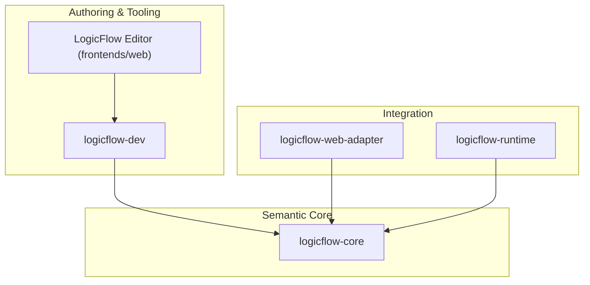
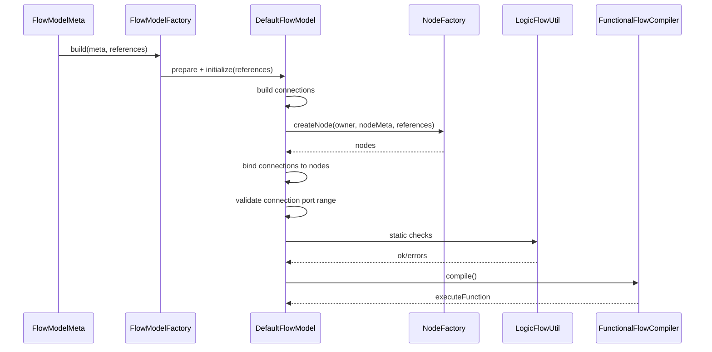

# Ouroboros LogicFlow 设计文档

更新日期：`2026-03-18`

> 这份文档的目标不是“一次性写完所有细节”，而是用分层的方式像素描一样逐步勾勒 LogicFlow 的全貌：先给出范式与原则，再解释架构与核心机制，最后才落到具体类与扩展点。后续每一轮演进，都应优先补齐某一层，而不是在多个层级同时改写导致认知漂移。

## 0. 阅读地图（从上到下分层）

如果你第一次接触 LogicFlow，建议按以下顺序阅读：

1. **设计理念与原则（本节 1）**
2. **架构概览（本节 2）**
3. **核心抽象（本节 3）**
4. **基本机制（本节 4）**
5. **具体拆解与扩展点（本节 5）**
6. **非目标与路线图（本节 6）**

如果你希望按“角色/模块边界”而不是按“抽象层级”来进入，请先看：

- [`DESIGN-READING-PATHS-AND-MODULE-BOUNDARIES.md`](./design/reading-paths-and-module-boundaries/overview.md)

如果你已经知道抽象分层，但想快速把“设计原则”对上“真实代码路径”，请继续看：

- [`DESIGN-CANONICAL-SCENARIOS-AND-END-TO-END-WALKTHROUGHS.md`](./design/canonical-scenarios-and-end-to-end-walkthroughs/overview.md)

如果你最关心的是“一张图究竟如何合法结束、`ReturnNode` 与 `exitNode` 的边界是什么、以及为什么当前还不能把它称为真正提前退出”，请继续看：

- [`DESIGN-SUCCESSFUL-TERMINALS-AND-EARLY-EXIT-BOUNDARIES.md`](./design/successful-terminals-and-early-exit-boundaries/overview.md)

如果你最关心的是“runtime failure 何时切入 `errorEntryNode`、错误流如何恢复成成功、以及为什么当前坚持 fail-closed”，请继续看：

- [`DESIGN-ERROR-FLOW-RECOVERY-AND-FAIL-CLOSED-BOUNDARIES.md`](./design/error-flow-recovery-and-fail-closed-boundaries/overview.md)

如果你最关心的是“外部输入如何进入图、同一个输入口多来源当前到底是什么语义、以及为什么 `MergeNode` 不能被当作 Join”，请继续看：

- [`DESIGN-INPUT-SEMANTICS-AND-JOIN-BOUNDARIES.md`](./design/input-semantics-and-join-boundaries/overview.md)

如果你最关心的是“`Decision` 为什么不是端口数据类型、路径为什么靠 `satisfied/unsatisfied` 激活、以及 skip 为什么不等于 OR-Join 或提前退出”，请继续看：

- [`DESIGN-DECISION-SIGNALS-AND-PATH-ACTIVATION-BOUNDARIES.md`](./design/decision-signals-and-path-activation-boundaries/overview.md)

如果你最关心的是“为什么 `exclusiveGroupId + defaultBranch` 只是最小互斥输出合同、哪些节点真的能消费它、以及 editor 为什么只能消费不能创造这层语义”，请继续看：

- [`DESIGN-SELECTIVE-OUTPUT-AND-EXCLUSIVE-PORT-BOUNDARIES.md`](./design/selective-output-and-exclusive-port-boundaries/overview.md)

如果你最关心的是“为什么 `FlowNodeMeta`、`NodeDefine.scaffold/portRules` 与 runtime 真实端口不是一回事、连线怎样逼出端口补齐、以及为什么 editor 不能把 authoring 端口直接当执行真相”，请继续看：

- [`DESIGN-AUTHORING-PORTS-AND-RUNTIME-PORT-MATERIALIZATION-BOUNDARIES.md`](./design/authoring-ports-and-runtime-port-materialization-boundaries/overview.md)

如果你最关心的是“`DataTypeEnum` 当前到底多强、`ANY` 为什么既有用又危险、流程输入输出合同怎样落到 `entry/errorEntry/ReturnNode/exitNode` 与图内连线上”，请继续看：

- [`DESIGN-TYPE-SYSTEM-AND-COMPATIBILITY-BOUNDARIES.md`](./design/type-system-and-compatibility-boundaries/overview.md)

如果你已经知道自己关心哪个概念，但想直接落到源码、测试和 fixture，请继续看：

- [`DESIGN-CONCEPT-TO-SOURCE-CROSSWALK.md`](./design/concept-to-source-crosswalk/overview.md)

如果你发现不同文档里同一个词看起来像在指不同东西，请先看：

- [`DESIGN-GLOSSARY-AND-DECISION-LEXICON.md`](./design/glossary-and-decision-lexicon/overview.md)

如果你想先把“顶层抽象类、接口、装配器、工厂/SPI、模板骨架”这层设计骨架读透，再进入装配或执行细节，请看：

- [`DESIGN-CORE-ABSTRACTIONS-AND-PATTERNS.md`](./design/core-abstractions-and-patterns/overview.md)

如果你是来改代码的：

- 构造/校验入口：[`DefaultFlowModel`](./ouroboros-logicflow-core/src/main/java/com/ouroboros/logicflow/model/DefaultFlowModel.java)
- 静态分析工具箱：[`LogicFlowUtil`](./ouroboros-logicflow-core/src/main/java/com/ouroboros/logicflow/util/LogicFlowUtil.java)
- 执行编译器：[`FunctionalFlowCompiler`](./ouroboros-logicflow-core/src/main/java/com/ouroboros/logicflow/compiler/FunctionalFlowCompiler.java)
- 节点创建与注册：[`NodeFactory`](./ouroboros-logicflow-core/src/main/java/com/ouroboros/logicflow/nodes/NodeFactory.java)、[`NodeBuilder`](./ouroboros-logicflow-core/src/main/java/com/ouroboros/logicflow/nodes/NodeBuilder.java)

当前代码基线与已知残余问题（更贴近“现状事实”）请看：

- [`reviews/2026-03-18-report-current-baseline.md`](https://gitlab.whxinpai.com/ouroboros-lowcode/ouroboros/-/blob/d2ebfd746acbaab0d3fc461ba4850e68c0d14cff/core/ouroboros-logicflow/reviews/2026-03-18-report-current-baseline.md)

如果你想先快速确认“哪个模块说了算、改一个点需要联动看哪些层”，请看：

- [`DESIGN-READING-PATHS-AND-MODULE-BOUNDARIES.md`](./design/reading-paths-and-module-boundaries/overview.md)

如果你想先看“一个真实场景从 meta 到 execute 再到外层消费面会怎样走完”，请看：

- [`DESIGN-CANONICAL-SCENARIOS-AND-END-TO-END-WALKTHROUGHS.md`](./design/canonical-scenarios-and-end-to-end-walkthroughs/overview.md)

如果你想直接按“概念 -> 代码 -> 测试 -> fixture”查入口，请看：

- [`DESIGN-CONCEPT-TO-SOURCE-CROSSWALK.md`](./design/concept-to-source-crosswalk/overview.md)

如果你想先把高频术语口径对齐，再继续读其他章节，请看：

- [`DESIGN-GLOSSARY-AND-DECISION-LEXICON.md`](./design/glossary-and-decision-lexicon/overview.md)

## 1. 设计理念与原则（范式、思想、底线）

### 1.1 定位：它是什么，它不是什么

LogicFlow 的定位是“**功能点级的执行逻辑编排内核**”：

- 输入一组数据（通常是 request/context），在图上做加工与分支选择，产出一个结果。
- 关注“**计算与编排**”，不直接绑定某个业务流程范式。

它不是：

- 审批流（人参与的状态机、长事务、任务待办）。
- BPMN 的完整替代品（广义流程编排规范实现）。
- 纯声明式规则引擎（当前仍以节点执行代码为主要承载）。

### 1.2 核心范式：DAG + 端口式数据流

当前核心范式可概括为：

- 图结构以 **DAG** 为主（依赖拓扑排序进行编译与执行）。
- 节点通过 **输入端口** 接收数据，通过 **输出端口** 产生数据。
- 多输入默认是 **AND-Join（汇聚）**，但对“同一输入端口多上游”的情况有受控规则（见 4.2）。
- 分支节点的输出可表达互斥（见 4.6），但互斥不是“任何节点随便配”，而是有门控与契约。

### 1.3 设计原则（长期要守住）

以下原则在实现中有明确的落点，并且是后续演进的“底线”：

1. **显式契约优先于隐式约定**
   - 例如：成功终点、错误流入口、端口互斥等都应当有可读的契约与校验，而不是靠约定或隐含实现细节。
2. **尽可能静态分析（Design-time）拒绝坏图**
   - 能在保存/加载/构造阶段发现的问题，不要推到运行时。
3. **Fail-Closed（失败即拒绝/失败即显性）**
   - 不允许“悄悄返回 null success”掩盖问题；执行失败必须能定位。
4. **低学习成本优先，复杂表达力按需渐进**
   - 例如：端口关系目前只落地 `exclusiveGroupId + defaultBranch` 的最小语义集，而不是一上来引入大而全的约束系统。
5. **兼容性优先，不轻易破坏公共签名**
   - 对外仍保持 `FlowModel.execute(): Try<Object>`，内部可以演进结果信封（见 4.4）。
6. **节点元数据与运行时端口并非 1:1**
   - 运行时端口可能基于连线、最小端口数、节点类型规则进行补齐或生成（见 4.5）。
7. **跨层一致性：core 是语义权威，editor/dev 是契约消费者**
   - editor 的行为/校验/提示不应“创造”core 不支持的语义；dev 的保存/诊断快照需要与 core 的校验口径一致。

## 2. 架构概览（模块、边界、职责）

### 2.1 模块分层（从内核到集成）

LogicFlow 在仓库中的主要模块（按“语义权威程度”从高到低）：

- `ouroboros-logicflow-core`
  - 语义权威：流程模型、节点抽象、静态分析、编译执行、错误流、结果契约。
- `ouroboros-logicflow-runtime`
  - Spring Boot 集成与装配（把 core 能力接入平台运行时）。
- `ouroboros-logicflow-dev`
  - 开发态与建模态：模型管理、校验诊断快照、节点定义（NodeDefine）对外 API。
- `ouroboros-logicflow-web-adapter`
  - Web 层适配（把 Web 请求转成流程输入、事务兜底、异常映射等）。
- `ouroboros-logicflow-data-model` / `ouroboros-logicflow-extra-nodes`
  - 节点扩展（将节点实现与 core 抽象解耦）。
- `frontends/web/ouroboros-logicflow-editor`
  - 编辑器：消费 dev 输出的节点定义与校验信息，提供建模、校验提示与保存体验。

深化说明（当你要理解模型来源、覆盖策略、刷新与缓存时阅读）：

- [`DESIGN-READING-PATHS-AND-MODULE-BOUNDARIES.md`](./design/reading-paths-and-module-boundaries/overview.md)
- [`DESIGN-MODEL-LIFECYCLE.md`](./design/model-lifecycle/overview.md)
- [`DESIGN-MODEL-STATE-AND-RUNTIME-GATING.md`](./design/model-state-and-runtime-gating/overview.md)
- [`DESIGN-ADAPTER-AND-TRANSACTION-BOUNDARIES.md`](./design/adapter-and-transaction-boundaries/overview.md)

为了避免职责漂移，我们默认：

- **core 说了算**：什么是合法图、什么是合法端口语义、什么是终点、错误如何收口。
- **dev/adapter 做集成**：把 core 的错误与诊断映射到平台侧模型管理与 API 语义。
- **editor 做体验**：大多数校验是 warning（不阻塞保存），但不得生成 core 不可执行的模型。

### 2.2 高层架构图（Sketch）

## 3. 核心抽象（顶层接口、抽象类、设计模式）

如果你希望把这一章继续展开成“抽象骨架与设计模式”的独立阅读面，请继续看：

- [`DESIGN-CORE-ABSTRACTIONS-AND-PATTERNS.md`](./design/core-abstractions-and-patterns/overview.md)

### 3.1 流程模型：FlowModel / FlowModelMeta / DefaultFlowModel

- `FlowModel`：运行时接口，提供 `execute(...)`、入口/出口节点访问、错误列表等。
  - 代码：[`FlowModel`](./ouroboros-logicflow-core/src/main/java/com/ouroboros/logicflow/model/FlowModel.java)
- `FlowModelMeta`：正式流程模型事实字段的元数据容器；validation 状态相关字段的分层与格式规范单独收口在 `DESIGN-PORTS-AND-DATA-CONTRACTS`。
  - 代码：[`FlowModelMeta`](./ouroboros-logicflow-core/src/main/java/com/ouroboros/logicflow/model/FlowModelMeta.java)
- `DefaultFlowModel`：把 `FlowModelMeta` 变成可执行模型的“构造与验证管线”，也是静态分析编排者。
  - 代码：[`DefaultFlowModel`](./ouroboros-logicflow-core/src/main/java/com/ouroboros/logicflow/model/DefaultFlowModel.java)

设计模式上：

- `DefaultFlowModel` 更像 **Assembler + Validator Pipeline**。
- `FlowModelMeta` 是纯数据结构（POJO + builder），不承载语义逻辑。

如果你需要系统理解“`FlowModelMeta` 如何一步步变成运行时模型、错误如何在装配阶段累积、以及 `executeFunction` 何时会被真正编译”，请继续阅读：

- [`DESIGN-MODEL-ASSEMBLY-PIPELINE.md`](./design/model-assembly-pipeline/overview.md)
- [`DESIGN-PORTS-AND-DATA-CONTRACTS.md`](./design/ports-and-data-contracts/overview.md)
  - `FlowModelMeta / FlowNodeMeta / FlowConnectionMeta` 的 canonical 元数据格式规范，以及 validation 状态相关字段的归类口径。

### 3.2 节点抽象：FlowNode / FlowNodeMeta / 基类体系

- `FlowNode`：节点运行时接口（端口、执行、连接、错误列表等）。
  - 代码：[`FlowNode`](./ouroboros-logicflow-core/src/main/java/com/ouroboros/logicflow/model/FlowNode.java)
- `FlowNodeMeta`：节点元数据（type、端口元数据、extra props、启用/异步等）。
  - 代码：[`FlowNodeMeta`](./ouroboros-logicflow-core/src/main/java/com/ouroboros/logicflow/model/FlowNodeMeta.java)

核心基类（从通用到特化）：

- `AbstractNode`
  - 把 meta + flowModel 的连接映射成运行时能力；实现端口补齐规则；提供端口元数据的合法性校验。
  - 代码：[`AbstractNode`](./ouroboros-logicflow-core/src/main/java/com/ouroboros/logicflow/nodes/AbstractNode.java)
- `AbstractSimpleNode`
  - 单输入、单输出节点模板。
  - 代码：[`AbstractSimpleNode`](./ouroboros-logicflow-core/src/main/java/com/ouroboros/logicflow/nodes/AbstractSimpleNode.java)
- `AbstractDecisionNode`
  - 决策/分支节点模板：输出用 `Decision` 表达“命中/未命中”。
  - 它也是 selective-output 语义的重要门控点（`supportsSelectiveOutputMetadata()` 返回 true）。
  - 代码：[`AbstractDecisionNode`](./ouroboros-logicflow-core/src/main/java/com/ouroboros/logicflow/nodes/AbstractDecisionNode.java)
- `AbstractTerminalNode`
  - 终点节点 marker（例如 `ReturnNode`）。
  - 代码：[`AbstractTerminalNode`](./ouroboros-logicflow-core/src/main/java/com/ouroboros/logicflow/nodes/AbstractTerminalNode.java)

### 3.3 端口抽象：FlowNodePort / FlowNodePortMeta

- `FlowNodePort`：运行时端口对象（带 index/name/type + 端口关系字段默认方法）。
  - 代码：[`FlowNodePort`](./ouroboros-logicflow-core/src/main/java/com/ouroboros/logicflow/model/FlowNodePort.java)
- `FlowNodePortMeta`：持久化端口元数据（包括 `exclusiveGroupId` 与 `defaultBranch`）。
  - 代码：[`FlowNodePortMeta`](./ouroboros-logicflow-core/src/main/java/com/ouroboros/logicflow/model/FlowNodePortMeta.java)

兼容性策略：

- `FlowNodePort` 通过 default methods 暴露关系字段，尽量避免对外签名破坏（兼容期常见策略）。

如果你需要系统理解“端口名字 vs 端口索引、端口补齐、连接模型、流程输入输出类型如何收口成一套数据契约”，请继续阅读：

- [`DESIGN-PORTS-AND-DATA-CONTRACTS.md`](./design/ports-and-data-contracts/overview.md)
- [`DESIGN-AUTHORING-PORTS-AND-RUNTIME-PORT-MATERIALIZATION-BOUNDARIES.md`](./design/authoring-ports-and-runtime-port-materialization-boundaries/overview.md)

### 3.4 节点创建：NodeFactory / NodeBuilder / SPI

LogicFlow 支持通过 Java SPI 扩展节点：

- `NodeBuilder<T extends FlowNode>`：判定是否支持某 meta，并构建节点实例。
  - 代码：[`NodeBuilder`](./ouroboros-logicflow-core/src/main/java/com/ouroboros/logicflow/nodes/NodeBuilder.java)
- `NodeFactory`：通过 SPI 发现全部 builders（含 builtin-nodes），要求唯一匹配后 build；build 后执行端口元数据校验。重复匹配会拒绝创建，详见[节点扩展合同](design/node-extensions/overview.md#22-nodefactory-的查找与后置校验)。
  - 代码：[`NodeFactory`](./ouroboros-logicflow-core/src/main/java/com/ouroboros/logicflow/nodes/NodeFactory.java)

这套机制要求设计上保持：

- core 抽象稳定
- 具体节点能力尽量下沉到扩展模块
- 新语义优先通过“元数据 + 门控 + 校验”演进，而不是不停新增硬编码分支

### 3.5 执行信号与结果信封：Decision / FlowOutcome

运行时有两类关键“信号对象”：

- `Decision`：分支节点输出的“满足/不满足”信号，支持携带值。
  - 代码：[`Decision`](./ouroboros-logicflow-core/src/main/java/com/ouroboros/logicflow/results/Decision.java)
- `FlowOutcome`：编译器内部的结果信封（区分 `EXIT/RETURN`），对外仍保持 `Try<Object>`。
  - 代码：[`FlowOutcome`](./ouroboros-logicflow-core/src/main/java/com/ouroboros/logicflow/results/FlowOutcome.java)

这反映了一个稳定策略：

- 公共签名不变（降低学习/迁移成本）
- 内部语义逐步增强（提高可维护性与可观测性）

如果你需要系统理解“`Decision` 为什么只是 runtime 路径激活信号、它怎样驱动 skip、以及为什么它既不是数据类型也不是提前退出机制”，请继续阅读：

- [`DESIGN-DECISION-SIGNALS-AND-PATH-ACTIVATION-BOUNDARIES.md`](./design/decision-signals-and-path-activation-boundaries/overview.md)

如果你需要系统理解“哪些结果合同是公开的、哪些内部信号故意不外泄、设计期诊断与运行期诊断分别如何被不同消费面看见”，请继续阅读：

- [`DESIGN-RESULT-CONTRACTS-AND-DIAGNOSTIC-SURFACES.md`](./design/result-contracts-and-diagnostic-surfaces/overview.md)

### 3.6 图连接：FlowConnection / FlowConnectionMeta / DefaultFlowConnection

LogicFlow 使用“带端口索引的有向边”表达数据流连接关系：

- `FlowConnection`：运行时接口，表达 `sourceNode:sourceOutputPort -> targetNode:targetInputPort`。
  - 代码：[`FlowConnection`](./ouroboros-logicflow-core/src/main/java/com/ouroboros/logicflow/model/FlowConnection.java)
- `FlowConnectionMeta`：持久化元数据（source/target + port index）。
  - 代码：[`FlowConnectionMeta`](./ouroboros-logicflow-core/src/main/java/com/ouroboros/logicflow/model/FlowConnectionMeta.java)
- `DefaultFlowConnection`：运行时实现，持有 meta 并缓存 sourceNode/targetNode 引用。
  - 代码：[`DefaultFlowConnection`](./ouroboros-logicflow-core/src/main/java/com/ouroboros/logicflow/model/DefaultFlowConnection.java)

设计要点：

- 连接本身只负责“引用关系”，不会在 getter 里每次都通过 name 去遍历节点列表做查找。
- 节点与连接的绑定发生在 `DefaultFlowModel.init()`，这也是很多静态校验的前置条件。

深化说明：

- [`DESIGN-PORTS-AND-DATA-CONTRACTS.md`](./design/ports-and-data-contracts/overview.md)

### 3.7 类型系统：DataTypeEnum（最小但可用）

LogicFlow 当前使用 `DataTypeEnum` 作为最小类型系统：

- `ANY` 作为顶层类型（宽松兼容）
- 数值类型之间相互兼容（integer/long/float/double）
- 其他类型要求一致

核心代码：

- [`DataTypeEnum`](./ouroboros-logicflow-core/src/main/java/com/ouroboros/logicflow/model/DataTypeEnum.java)

它的角色更接近“运行时契约检查”的基础设施，而不是完整类型推断系统。

深化说明：

- [`DESIGN-TYPE-SYSTEM-AND-COMPATIBILITY-BOUNDARIES.md`](./design/type-system-and-compatibility-boundaries/overview.md)

### 3.8 异常模型：DesignException vs FlowRuntimeException

LogicFlow 有意区分“设计期错误”与“运行期错误”：

- `DesignException`：
  - 发生在模型构造与静态校验阶段。
  - 会被收敛到 `FlowModel.getErrors()`；当模型不合法时，`execute()` 会 fail-closed（返回 `FlowDesignException`）。
  - 代码：[`DesignException`](./ouroboros-logicflow-core/src/main/java/com/ouroboros/logicflow/exception/DesignException.java)、[`FlowDesignException`](./ouroboros-logicflow-core/src/main/java/com/ouroboros/logicflow/exception/FlowDesignException.java)
- `FlowRuntimeException`：
  - 发生在节点执行期或编译器运行期（例如端口互斥 runtime 违约）。
  - 持有 `node + inputs` 以便诊断定位；在存在 error scope 时，编译器会将其信息标准化到 errorContext。
  - 代码：[`FlowRuntimeException`](./ouroboros-logicflow-core/src/main/java/com/ouroboros/logicflow/exception/FlowRuntimeException.java)

深化说明：

- [`DESIGN-RESULT-CONTRACTS-AND-DIAGNOSTIC-SURFACES.md`](./design/result-contracts-and-diagnostic-surfaces/overview.md)

## 4. 基本机制设计（构造流、静态分析、执行管线）

### 4.1 构造与校验管线（Implemented）

`DefaultFlowModel.init()` 是核心的“构造流 + 校验编排”：

1. 构造连接（`FlowConnection`）
2. 构造节点（`NodeFactory.createNode(...)`）
3. 绑定连接的 source/target 节点引用（避免在 getter 里反复遍历）
4. 校验连线端口是否越界
5. 汇总节点自身 errors（`ProblematicNodesDetectedException`）
6. 解析入口/出口/错误入口节点（`entryNode/exitNode/errorEntryNode`）
7. 调用 `LogicFlowUtil` 做静态分析（环、scope、可达性、终点互斥、输入冲突、类型兼容等）
8. 未启用或不合法：`execute()` fail-closed
9. 合法：编译执行函数（`FunctionalFlowCompiler.compile(...)`）

构造流示意：

核心代码入口：

- [`DefaultFlowModel`](./ouroboros-logicflow-core/src/main/java/com/ouroboros/logicflow/model/DefaultFlowModel.java)

深化说明：

- [`DESIGN-MODEL-ASSEMBLY-PIPELINE.md`](./design/model-assembly-pipeline/overview.md)

### 4.2 静态分析：坏图拒绝（Implemented）

静态分析由 `LogicFlowUtil` 提供方法集合并由 `DefaultFlowModel` 串联调用。典型类别包括：

- 拓扑排序与环检测（DAG 约束）
- scope 划分与冲突检查（main scope / error scope）
- 叶子节点与终点规则（拒绝“看起来会结束但其实没有合法终点收口”的结构）
- 可达性（没有 error scope 的普通流程，启用节点必须从 entry 可达）
- 输入端口连接完整性（无有效输入连线的根节点按位置接收 scope 外部输入；部分连线的节点须接全）
- 输入端口冲突与竞态条件推断（尽量静态发现运行时不确定性）
- 输入输出数据类型契约检查（flow input/output 类型与根节点/terminal 的一致性，error scope 根节点接收 MAP 异常上下文）

注意：

- 这里的“静态分析”并不包含条件层的穷尽覆盖证明（例如 switch 条件是否互斥/穷尽），那属于后续增强项（见 6）。
- 节点可能合法地拥有 0 个输出端口（例如成功终点节点、纯消费节点）。因此“叶子节点”并不等价于“无输出端口”，而是需要结合可达性、下游连线、以及是否属于合法终点共同判定。

入口：

- [`LogicFlowUtil`](./ouroboros-logicflow-core/src/main/java/com/ouroboros/logicflow/util/LogicFlowUtil.java)

深化说明（当你要改校验规则、写回归用例、或对齐 editor/dev 诊断口径时阅读）：

- [`DESIGN-STATIC-ANALYSIS.md`](./design/static-analysis/overview.md)

### 4.3 执行管线：编译为 CompletableFuture 链（Implemented）

`FunctionalFlowCompiler` 把 DAG 编译成一条“Future 列表的累积函数”：

- 按拓扑序遍历 scope 内节点
- 每个节点编译为 `CompiledFlowNode`：从上游结果 future 列表映射出本节点参数 future，执行节点得到本节点结果 future，然后 append 到列表
- 运行时 `execute(...)`：
  - 构造 analyzer context（如果注册了 `FlowRuntimeAnalyzer` SPI）
  - 执行 main scope
  - 若 main scope 失败且存在 error scope：构造 errorContext 输入，执行 error scope
  - 统一通知 analyzer completion/failure
  - 对外返回 `Try<Object>`，内部用 `FlowOutcome` 信封并最终解包

#### 4.3.1 Entry 输入映射（Flow inputs -> entry ports）

`execute(Object... inputs)` 的参数与 entry 节点输入端口之间存在明确映射：

- entry 节点没有上游连线时，编译器会把 `inputs` 作为一个“虚拟上游结果”放入 `nodeResultFutureList[0]`。
- entry 的第 `i` 个输入端口取 `inputs[i]`。
- entry 的输入端口数量决定 `execute(...)` 的**最小入参数量**；不足会直接失败，避免隐式 null/越界。

#### 4.3.2 输入 Join 语义（同一输入端口多上游）

当同一输入端口存在多条入边时（多 source -> same targetPort）：

- 编译器会等待这些上游 future 都完成。
- 然后按顺序选择第一个“有效值”：
  - 若上游输出是 `Decision.unsatisfied()`，会被过滤掉；
  - 若是 `Decision.satisfied(v)`，会解包为 `v`；
  - 找不到有效值时，该输入端口会收到 `Decision.unsatisfied()`。

这相当于一个“受控的 OR-Join”：它依赖静态分析确保这些来源在语义上互斥，否则会引入不可预期的“先后顺序依赖”。

#### 4.3.3 Decision 传播与节点跳过（Skip Semantics）

在执行阶段，`Decision` 同时也是“路径是否激活”的信号：

- 若某节点任一输入参数包含 `Decision.unsatisfied()`，该节点会被视为“跳过执行”，不会进入真实 `node.execute(...)`。
- 跳过时，编译器会返回与该节点输出端口数量一致的 `Decision.unsatisfied()` 列表，使“未激活路径”继续向下游传播。
- 若注册了 analyzer，会触发 `onNodeSkipped(...)` 而不是 `onNodeStart(...)`。

入口：

- [`FunctionalFlowCompiler`](./ouroboros-logicflow-core/src/main/java/com/ouroboros/logicflow/compiler/FunctionalFlowCompiler.java)

深化说明（当你要理解运行时并发、Decision 跳过、错误流切入时阅读）：

- [`DESIGN-DECISION-SIGNALS-AND-PATH-ACTIVATION-BOUNDARIES.md`](./design/decision-signals-and-path-activation-boundaries/overview.md)
- [`DESIGN-RUNTIME-EXECUTION.md`](./design/runtime-execution/overview.md)

#### 重要边界：当前不是“真正提前终止”

当前编译器会等待 scope 内所有节点 future 完成，再从候选终点里选择最终 outcome（`getResult(...)` 内使用 `CompletableFuture.allOf(...)`）。

因此：

- 已实现的是“**多成功终点结果语义**”（并要求静态互斥）
- 未实现的是“**命中终点后取消其余分支的 terminate/cancel 语义**”（Deferred，见 6）

### 4.4 成功终点与结果契约（Implemented，且强调互斥）

当前成功终点有两类来源：

1. 显式 `exitNode`（在 `FlowModelMeta` 里仍保留该字段，且保持可选）
2. `ReturnNode`（一种成功终点节点，属于 `AbstractTerminalNode`）

编译器会把这两类终点统一收敛为 `FlowOutcome`（内部信封）：

- `EXIT`：来自显式 `exitNode`
- `RETURN`：来自 `ReturnNode`

对外仍返回 `Try<Object>`，并将 `FlowOutcome` 解包为旧的 `Object` 值，保持公共签名兼容。

互斥原则：

- 一个 scope 在一次执行中必须只命中一个成功终点。
- 静态分析应当证明互斥；运行时若出现多个 outcome，会抛出 “静态分析漏检” 的错误（fail-closed）。

相关代码：

- [`FunctionalFlowCompiler`](./ouroboros-logicflow-core/src/main/java/com/ouroboros/logicflow/compiler/FunctionalFlowCompiler.java)
- [`ReturnNode`](ouroboros-logicflow-builtin-nodes/src/main/java/com/ouroboros/logicflow/nodes/ReturnNode.java)
- [`FlowOutcome`](./ouroboros-logicflow-core/src/main/java/com/ouroboros/logicflow/results/FlowOutcome.java)

### 4.5 端口数量补齐：为什么 meta 与运行时端口不 1:1（Implemented）

这是一个很容易被忽略但会影响设计与工具链的事实：

- `FlowNodeMeta` 里有 `inputPorts/outputPorts` 列表，但它只是“持久化端口元数据”。
- 运行时 `FlowNode.getInputPorts()/getOutputPorts()` 可能基于连线的最大端口 index 做补齐，并且还会考虑节点的 `minInputPortCount/minOutputPortCount`。

补齐逻辑在 `AbstractNode`：

- 输入端口：取 `max(meta.size, maxIncomingPortIndex+1, minInputPortCount)`，再受 `maxInputPortCount` 限制。
- 输出端口：取 `max(meta.size, maxOutgoingPortIndex+1, minOutputPortCount)`，再受 `maxOutputPortCount` 限制。

这解释了两个设计结论：

1. “节点元数据端口”是 authoring 层的持久化结构，但运行时端口数量需要与图结构一致。
2. 静态分析中对端口越界的检查必须考虑补齐与 maxPortCount 的双重约束（`DefaultFlowModel` 已做端口越界校验）。

相关代码：

- [`AbstractNode`](./ouroboros-logicflow-core/src/main/java/com/ouroboros/logicflow/nodes/AbstractNode.java)
- [`DefaultFlowModel`](./ouroboros-logicflow-core/src/main/java/com/ouroboros/logicflow/model/DefaultFlowModel.java)

深化说明：

- [`DESIGN-AUTHORING-PORTS-AND-RUNTIME-PORT-MATERIALIZATION-BOUNDARIES.md`](./design/authoring-ports-and-runtime-port-materialization-boundaries/overview.md)

### 4.6 输出端口互斥语义：exclusiveGroupId + defaultBranch（Implemented，最小语义集）

当前落地的最小语义集是：

- `exclusiveGroupId`：同一组内输出端口互斥
- `defaultBranch`：同一组内可声明一个默认分支

但它不是“端口字段一写就生效”的纯数据驱动，而是有两层门控：

1. **端口元数据合法性校验**
   - defaultBranch 必须带 exclusiveGroupId
   - 同组最多一个 defaultBranch
   - 校验在 `NodeFactory` build 后通过 `AbstractNode.validateOutputPortMetadata()` 执行
2. **节点能力门控**
   - selective-output 语义（互斥 runtime 校验与静态推断入口）只有当节点声明 `supportsSelectiveOutputMetadata()` 时才启用。
   - 目前 `AbstractDecisionNode` 默认启用（返回 true），普通节点默认不启用（`FlowNode` 默认 false）。

运行时互斥校验：

- 编译器会在节点执行后对 outputs 做检查，同组不允许命中多个输出，否则抛出 `FlowRuntimeException`。

相关代码：

- [`FlowNode`](./ouroboros-logicflow-core/src/main/java/com/ouroboros/logicflow/model/FlowNode.java)
- [`AbstractNode.validateOutputPortMetadata`](./ouroboros-logicflow-core/src/main/java/com/ouroboros/logicflow/nodes/AbstractNode.java)
- [`FunctionalFlowCompiler.validateSelectiveOutputContract`](./ouroboros-logicflow-core/src/main/java/com/ouroboros/logicflow/compiler/FunctionalFlowCompiler.java)

### 4.7 错误流（Same-Graph Error Flow）（Implemented，第一阶段）

当前引擎支持“同一张图里的错误流”第一阶段能力：

- `FlowModelMeta.errorEntryNode` 可选
- main scope 失败时会切入 error scope 执行（输入是标准化 `errorContext` Map）
- error scope 的成功必须依靠显式成功终点（例如 `ReturnNode`）才能把失败恢复成成功
- error scope 不递归重入（避免无限 error-handling）

`errorContext` 的字段目前由编译器构造（这是一份“运行时诊断快照”，并不是完整异常对象）：

- `exceptionType` / `exceptionMessage` / `exceptionCode`
- `flowName` / `flowInputs`
- `nodeName` / `nodeInputs`

核心实现：

- main + error 两个 scope 分别编译并执行
- main 失败时构造 errorContext 并执行 error scope

相关代码：

- [`FlowModelMeta`](./ouroboros-logicflow-core/src/main/java/com/ouroboros/logicflow/model/FlowModelMeta.java)
- [`DefaultFlowModel`](./ouroboros-logicflow-core/src/main/java/com/ouroboros/logicflow/model/DefaultFlowModel.java)
- [`FunctionalFlowCompiler`](./ouroboros-logicflow-core/src/main/java/com/ouroboros/logicflow/compiler/FunctionalFlowCompiler.java)

深化说明（当你要理解 runtime failure、异常终点、error flow 恢复边界时阅读）：

- [`DESIGN-ERROR-HANDLING.md`](./design/error-handling/overview.md)

### 4.8 工具链契约（dev / editor）（Implemented，但 core 是权威）

这部分不展开 editor 的 UI 细节，但需要把跨层契约写清楚：

- dev 提供 NodeDefine 列表（节点类型、终点标记、editorCapabilities 等），editor 消费并渲染
  - 入口：[`NodeDefine`](ouroboros-logicflow-authoring/src/main/java/com/ouroboros/logicflow/authoring/model/NodeDefine.java)
- dev 保存模型时会进行后端权威校验，并持久化“校验诊断快照”（validation state / errors / diagnostics）
- editor 的校验策略：除非缺少流程名，否则前端校验多为 warning，不阻塞保存；真正阻断由后端校验决定

更详细的“现状事实”请参考：

- [`reviews/2026-03-18-report-current-baseline.md`](https://gitlab.whxinpai.com/ouroboros-lowcode/ouroboros/-/blob/d2ebfd746acbaab0d3fc461ba4850e68c0d14cff/core/ouroboros-logicflow/reviews/2026-03-18-report-current-baseline.md)

深化说明（建议在需要做 editor/dev 契约对齐或集成测试治理时阅读）：

- [`DESIGN-AUTHORING-CONTRACTS.md`](./design/authoring-contracts/overview.md)
- [`DESIGN-RESULT-CONTRACTS-AND-DIAGNOSTIC-SURFACES.md`](./design/result-contracts-and-diagnostic-surfaces/overview.md)
- [`DESIGN-NODE-DEFINES-AND-EDITOR-CAPABILITIES.md`](./design/node-defines-and-editor-capabilities/overview.md)
- [`DESIGN-MODEL-STATE-AND-RUNTIME-GATING.md`](./design/model-state-and-runtime-gating/overview.md)
- [`DESIGN-TESTING-AND-VERIFICATION.md`](./design/testing-and-verification/overview.md)

### 4.9 事务（Deferred：从 adapter 的“整请求事务”到流程级边界）

当前 web-adapter 里存在整请求事务兜底（为了快速可用），但它不是长期理想状态：

- 入口：[`HandlerFunctionAdapter`](./ouroboros-logicflow-web-adapter/src/main/java/com/ouroboros/logicflow/adapter/HandlerFunctionAdapter.java)

未来方向（Deferred）：

- 事务边界应下放到流程层（节点级或 scope 级可控）
- 需要明确事务语义与异常语义、error flow 的组合规则

如果你需要理解“runtime 现在如何解析模型、web-adapter 当前如何做请求适配/事务/结果映射、为什么这仍是外层兜底而不是最终事务设计”，请继续阅读：

- [`DESIGN-ADAPTER-AND-TRANSACTION-BOUNDARIES.md`](./design/adapter-and-transaction-boundaries/overview.md)

## 5. 具体拆解（从机制到文件与扩展点）

### 5.1 core：必读类与职责分工

建议把 core 主要类按“生命周期阶段”理解：

- **模型构造/校验阶段**
  - `DefaultFlowModel`：装配管线与校验编排
  - `LogicFlowUtil`：静态分析工具箱
- **节点与扩展阶段**
  - `NodeFactory`：SPI builder 唯一匹配与节点实例创建
  - `NodeBuilder`：SPI 扩展点
  - `AbstractNode`：端口补齐规则、连接映射、元数据校验
  - `AbstractSimpleNode`：一进一出的节点模板
  - `AbstractDecisionNode`：分支节点模板（Decision 输出）
  - `AbstractTerminalNode`：终点节点 marker
- **编译与执行阶段**
  - `FunctionalFlowCompiler`：把 DAG 编译成执行函数，处理 analyzer、终点选择、error scope
  - `Decision`：分支命中信号
  - `FlowOutcome`：内部结果信封

### 5.2 内置节点：示例（不穷举）

内置节点的价值在于它们“体现”了核心抽象如何被正确使用：

- `SwitchNode`：典型分支节点，输出端口由条件动态生成，并声明 `exclusiveGroupId + defaultBranch`
  - 代码：[`SwitchNode`](ouroboros-logicflow-builtin-nodes/src/main/java/com/ouroboros/logicflow/nodes/SwitchNode.java)
- `ReturnNode`：成功终点节点（多终点结果语义的一部分）
  - 代码：[`ReturnNode`](ouroboros-logicflow-builtin-nodes/src/main/java/com/ouroboros/logicflow/nodes/ReturnNode.java)
- `ValidateNode`：典型单输入节点，做 schema 校验并通过异常表达失败（注意与 error flow 的组合语义）
  - 代码：[`ValidateNode`](ouroboros-logicflow-builtin-nodes/src/main/java/com/ouroboros/logicflow/nodes/ValidateNode.java)

如果你要从“节点家族”角度理解当前目录，而不是只看几个示例，请继续阅读：

- [`DESIGN-CONTROL-FLOW-NODE-CATALOG.md`](./design/control-flow-node-catalog/overview.md)
- [`DESIGN-NODE-CAPABILITY-MATRIX.md`](./design/node-capability-matrix/overview.md)

### 5.3 扩展点清单（SPI 与稳定边界）

已存在的主要扩展点：

- 节点扩展：`NodeBuilder`（Java SPI）
  - 新节点接入无需修改 core，只要提供 builder 并注册到 `META-INF/services/...`
- 模型提供：`FlowModelProvider`（Java SPI）
  - `FlowModelCenter` 会按 provider 优先级返回启用模型
  - 代码：[`FlowModelCenter`](./ouroboros-logicflow-core/src/main/java/com/ouroboros/logicflow/model/FlowModelCenter.java)
- 运行时分析器：`FlowRuntimeAnalyzer`（Java SPI）
  - 编译器会自动加载并回调（如果存在）

深化说明（当你要新增节点类型、或排查 SPI/端口语义问题时阅读）：

- [`DESIGN-NODE-EXTENSIONS.md`](./design/node-extensions/overview.md)
- [`DESIGN-MODEL-ASSEMBLY-PIPELINE.md`](./design/model-assembly-pipeline/overview.md)
- [`DESIGN-CONTROL-FLOW-NODE-CATALOG.md`](./design/control-flow-node-catalog/overview.md)
- [`DESIGN-NODE-CAPABILITY-MATRIX.md`](./design/node-capability-matrix/overview.md)
- [`DESIGN-NODE-DEFINES-AND-EDITOR-CAPABILITIES.md`](./design/node-defines-and-editor-capabilities/overview.md)

## 6. 非目标与路线图（明确标注 Deferred，避免“文档说有但代码没有”）

如果你想把“当前明确不做什么”和“未来可能做、但必须单独立项的能力”分开读清楚，请继续看：

- [`DESIGN-DEFERRED-CAPABILITIES-AND-NON-GOALS.md`](./design/deferred-capabilities-and-non-goals/overview.md)

以下能力在当前 baseline 下应视为 **Deferred**（尚未实现）：

1. **真正意义上的提前退出/取消其余分支（Terminate/Cancel Semantics）**
   - 当前仅支持多成功终点的结果语义，并要求静态互斥；编译器仍会等待 all futures 完成。
2. **节点级异常端口（Local Exception Ports）**
   - 当前异常以 runtime exception + error scope 方式处理，尚未统一“异常输出端口”与“普通输出端口”语义。
3. **条件层静态分析（互斥证明、穷尽证明、覆盖率）**
   - 当前主要做结构静态分析，不对表达式语义做证明。
4. **通用输入 Join 模式（OR-Join / XOR-Join）**
   - 当前输入冲突处理是受控的，避免引入通用复杂度。
5. **流程级事务边界下放**
   - 当前 web-adapter 仍是整请求事务兜底。

如果你要推进这些方向，请先补齐：

- 语义模型（契约）
- 静态校验规则
- editor/dev 的契约与展示
- 回归测试与夹具

## 7. 开发验证（稳定入口）

建议固定验证入口为：

- `core`
  - `mvn test --file core/ouroboros-logicflow/ouroboros-logicflow-core/pom.xml`
- `dev`
  - `mvn test -pl :ouroboros-logicflow-dev -am`

不建议直接运行：

- `mvn test --file core/ouroboros-logicflow/ouroboros-logicflow-dev/pom.xml`

原因是该命令可能命中本地仓库中的旧 sibling artifact，出现与当前工作树不一致的误报编译失败。开发、merge-pre review 与后续回归验证都应优先使用 reactor 方式。

如果你需要理解“为什么 LogicFlow 测试必须分层、前端 harness 为什么留在包内、跨栈场景与 fixture 资产如何组织”，请继续阅读：

- [`DESIGN-TESTING-AND-VERIFICATION.md`](./design/testing-and-verification/overview.md)

## 8. 术语表（Glossary）

- **Main Scope**：从 `entryNode` 出发的主流程节点集合（排除 error scope 的节点）。
- **Error Scope**：从 `errorEntryNode` 出发的错误处理节点集合。
- **Successful Terminal**：能作为流程成功结束点的节点（显式 `exitNode` 或 `ReturnNode` 等）。
- **Decision**：分支输出的满足/不满足信号。
- **Selective Output Metadata**：输出端口可被声明为互斥组（`exclusiveGroupId`）与默认分支（`defaultBranch`）的能力。
- **Fail-Closed**：遇到不确定或错误时，宁可失败也不悄悄返回“看起来成功”的结果。

## 9. 专题索引

> 维护约定：模块当前设计主链路始终以 `DESIGN.md` + `design/<topic>/overview.md` 组织；`reviews/` 只保存时间点快照。

### 9.1 基础总览与导航

| 专题 | 位置 | 维护者 | 状态 |
|------|------|--------|------|
| Reading Paths And Module Boundaries | `design/reading-paths-and-module-boundaries/overview.md` | logicflow maintainers | active |
| Core Abstractions And Patterns | `design/core-abstractions-and-patterns/overview.md` | logicflow maintainers | active |
| Canonical Scenarios And End-To-End Walkthroughs | `design/canonical-scenarios-and-end-to-end-walkthroughs/overview.md` | logicflow maintainers | active |
| Concept To Source Crosswalk | `design/concept-to-source-crosswalk/overview.md` | logicflow maintainers | active |
| Glossary And Decision Lexicon | `design/glossary-and-decision-lexicon/overview.md` | logicflow maintainers | active |
| Deferred Capabilities And Non-Goals | `design/deferred-capabilities-and-non-goals/overview.md` | logicflow maintainers | active |
| Testing And Verification | `design/testing-and-verification/overview.md` | logicflow maintainers | active |

### 9.2 核心语义与执行机制

| 专题 | 位置 | 维护者 | 状态 |
|------|------|--------|------|
| Model Lifecycle | `design/model-lifecycle/overview.md` | logicflow maintainers | active |
| Model Assembly Pipeline | `design/model-assembly-pipeline/overview.md` | logicflow maintainers | active |
| Model State And Runtime Gating | `design/model-state-and-runtime-gating/overview.md` | logicflow maintainers | active |
| Runtime Execution | `design/runtime-execution/overview.md` | logicflow maintainers | active |
| Static Analysis | `design/static-analysis/overview.md` | logicflow maintainers | active |
| Result Contracts And Diagnostic Surfaces | `design/result-contracts-and-diagnostic-surfaces/overview.md` | logicflow maintainers | active |
| Error Handling | `design/error-handling/overview.md` | logicflow maintainers | active |
| Error Flow Recovery And Fail-Closed Boundaries | `design/error-flow-recovery-and-fail-closed-boundaries/overview.md` | logicflow maintainers | active |
| Successful Terminals And Early-Exit Boundaries | `design/successful-terminals-and-early-exit-boundaries/overview.md` | logicflow maintainers | active |

### 9.3 端口、类型与控制流语义

| 专题 | 位置 | 维护者 | 状态 |
|------|------|--------|------|
| Ports And Data Contracts | `design/ports-and-data-contracts/overview.md` | logicflow maintainers | active |
| Authoring Ports And Runtime Port Materialization Boundaries | `design/authoring-ports-and-runtime-port-materialization-boundaries/overview.md` | logicflow maintainers | active |
| Type System And Compatibility Boundaries | `design/type-system-and-compatibility-boundaries/overview.md` | logicflow maintainers | active |
| Input Semantics And Join Boundaries | `design/input-semantics-and-join-boundaries/overview.md` | logicflow maintainers | active |
| Decision Signals And Path Activation Boundaries | `design/decision-signals-and-path-activation-boundaries/overview.md` | logicflow maintainers | active |
| Selective Output And Exclusive Port Boundaries | `design/selective-output-and-exclusive-port-boundaries/overview.md` | logicflow maintainers | active |
| Control Flow Node Catalog | `design/control-flow-node-catalog/overview.md` | logicflow maintainers | active |
| Node Capability Matrix | `design/node-capability-matrix/overview.md` | logicflow maintainers | active |
| Node Extensions | `design/node-extensions/overview.md` | logicflow maintainers | active |

### 9.4 Authoring、Editor 与集成边界

| 专题 | 位置 | 维护者 | 状态 |
|------|------|--------|------|
| Authoring Contracts | `design/authoring-contracts/overview.md` | logicflow maintainers | active |
| Node Defines And Editor Capabilities | `design/node-defines-and-editor-capabilities/overview.md` | logicflow maintainers | active |
| Editor Embedding And Lifecycle Boundaries | `design/editor-embedding-and-lifecycle-boundaries/overview.md` | logicflow maintainers | active |
| Adapter And Transaction Boundaries | `design/adapter-and-transaction-boundaries/overview.md` | logicflow maintainers | active |
