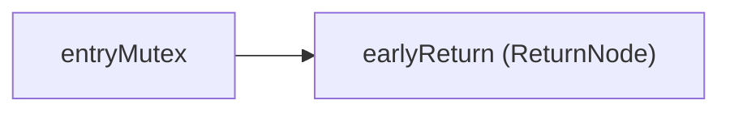
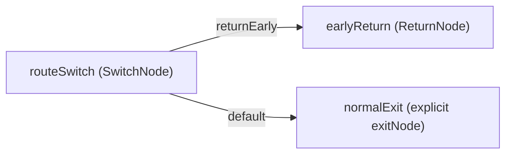
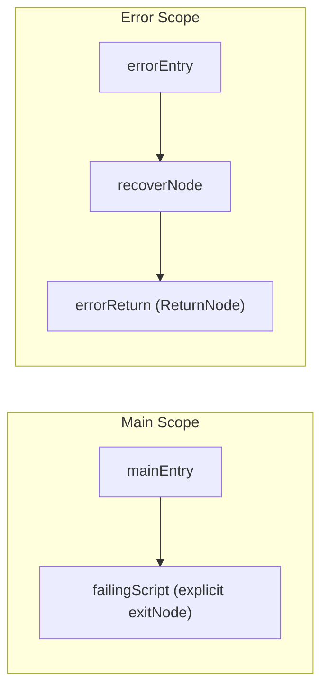

# LogicFlow 典型场景与端到端走查（Canonical Scenarios / End-to-End Walkthroughs）深化说明

更新日期：`2026-03-18`

> 回到总览：[`DESIGN.md`](../../DESIGN.md)
>
> 阅读导航：[`DESIGN-READING-PATHS-AND-MODULE-BOUNDARIES.md`](../reading-paths-and-module-boundaries/overview.md)
>
> 模块入口：[`README.md`](../../README.md)

这份文档补的是“**从抽象设计到真实代码路径**”之间的那一层。

前面的章节已经分别解释了：

- LogicFlow 的范式与底线
- 模块边界与职责
- 静态分析、运行时、结果合同、错误流、测试体系

但真正开始读代码时，很多人还是会卡在同一个问题上：

- 我知道这些原则了，但它们在一条实际流程上到底是怎么串起来的？

所以这章不再按“机制分类”展开，而是挑三条最有代表性的 canonical scenario，把它们从同一个视角走到底：

1. **线性成功路径**
2. **互斥双成功终点路径**
3. **主流程失败切入错误流路径**

每条场景都坚持同一套模板：

- 最小 fixture 长什么样
- `FlowModelMeta` 声明了什么
- `DefaultFlowModel` 在 design-time 做了什么
- `FunctionalFlowCompiler` 在 runtime 做了什么
- dev / editor / analyzer / adapter 这几个消费面分别会看到什么
- 这一条链路最容易被误解的点是什么

## 1. 先说结论：为什么这三条场景最关键

这三条场景几乎覆盖了当前 LogicFlow 的主干语义：

| 场景 | 它证明的核心事实 |
| --- | --- |
| 线性成功路径 | `exitNode` 与 `ReturnNode` 都可以作为成功终点收口，且对外仍保持 `Try<Object>` |
| 互斥双成功终点路径 | 可以有多个成功终点，但必须能在静态分析上证明互斥，运行时也保留防御性兜底 |
| 错误流路径 | `errorEntryNode` 是同图另一条 scope；它不是“补救 invalid model”，而是接住 main scope 的 runtime failure |

如果以后你要审查一项改动是否破坏了 LogicFlow 的设计底线，通常先问自己：

- 它会改变这三条 canonical path 里的哪一条？
- 它是否让其中一条路径在 design-time、runtime、authoring、adapter 的口径不再一致？

## 2. 怎么读这类走查：先看“场景骨架”，再看“代码落点”

这一章不试图替代原始实现文档，而是把它们串成一条读代码的路径。

建议每次都按下面这个顺序读：

1. **看 fixture**
   - 先看图的形状，而不是先读 Java。
2. **看 `DefaultFlowModel.initialize(...)`**
   - 确认这个 fixture 在构造期会被怎样装配、怎样校验。
3. **看 `FunctionalFlowCompiler`**
   - 确认这张图最终如何被编译成可执行管线。
4. **看消费面**
   - 确认 dev / editor / analyzer / adapter 分别看到的是哪一层事实。

如果你只记一个方法级落点，可以记这两个：

- `DefaultFlowModel.initialize(...)`
- `FunctionalFlowCompiler.executeCompiledFlow(...)`

前者决定“**这张图能不能进入运行时**”，后者决定“**它最终如何结束并把结果对外暴露**”。

## 3. 场景 A：线性成功路径

### 3.1 最小 fixture 家族

这一组最小样本建议一起看：

- runtime / `ReturnNode` 路径：
  - [`result/return-terminal-result.json`](../../ouroboros-logicflow-core/src/test/resources/fixtures/execution/result/return-terminal-result.json)
- runtime / 显式 `exitNode` 路径：
  - [`result/linear-exit-result.json`](../../ouroboros-logicflow-core/src/test/resources/fixtures/execution/result/linear-exit-result.json)
- validation / 仅 `ReturnNode` 合法性：
  - [`validation/valid/return-only-linear.json`](../../ouroboros-logicflow-core/src/test/resources/fixtures/validation/valid/return-only-linear.json)

如果只画 `return-terminal-result.json`，它的骨架就是：

这条路径之所以重要，是因为它把一个关键设计事实钉死了：

- **`exitNode` 已经不是唯一成功终点；`ReturnNode` 单独存在也可以构成合法流程。**

### 3.2 模型层到底声明了什么

这组 fixture 的共同点很简单：

- 有 `entryNode`
- 可以有也可以没有 `exitNode`
- `outputDataType` 已经在流程级声明
- 成功终点节点要么是显式 `exitNode`，要么是 `ReturnNode`

这里最容易误判的点是：

- `ReturnNode` 不是“只是 UI 里另一个结束符号”
- 它已经是 core 语义里的一等成功终点

也就是说，在 `FlowModelMeta` 仍然只保留一个 `exitNode` 字段的前提下，runtime 语义已经升级成：

- **该成功场景的出口 = 显式 `exitNode` 或可达 `ReturnNode`**；底层候选按 `AbstractTerminalNode` 家族收集，详见[成功终点边界](../successful-terminals-and-early-exit-boundaries/overview.md)。

### 3.3 design-time：`DefaultFlowModel` 如何把这张图装配成合法模型

`DefaultFlowModel.initialize(...)` 在这条场景上会依次做几件事：

1. 构造 `FlowConnection`
2. 通过 `NodeFactory.createNode(...)` 构造所有节点
3. 把连接和节点实例绑定起来
4. 检查连接端口是否越界
5. 收集节点自身设计错误
6. 解析 `entryNode` / `exitNode` / `errorEntryNode`
7. 做图级静态分析
8. 如果模型合法，再交给编译器生成 `executeFunction`

这条线性路径里，最关键的 design-time 判断有三个：

1. **成功终点存在性**
   - `DefaultFlowModel` 会先取主 scope，再调用 `LogicFlowUtil.hasSuccessfulTerminal(...)`。
   - 如果没有显式 `exitNode`，但存在可达 `ReturnNode`，这一步依然成立。
2. **可达性**
   - 在没有 `errorEntryNode` 的情况下，main scope 之外的启用节点会被当成 unreachable node 拒绝。
   - 所以 `ReturnNode` 不只是“存在”就行，还必须从 `entryNode` 可达。
3. **输出类型合同**
   - `LogicFlowUtil.validateInputTypeCompatibility(...)` 会统一检查流程输入输出合同。
   - 对显式 `exitNode`，检查它的第一个输出端口类型是否兼容 `FlowModelMeta.outputDataType`。
   - 对 `ReturnNode`，检查的是它的第一个输入端口类型是否兼容 `FlowModelMeta.outputDataType`。

最后这一点非常关键，因为它说明：

- **`ReturnNode` 的结果合同不是看“输出端口”，而是看它接收什么输入。**

这也是为什么“return-only 流程改错输出类型仍通过校验”会被视为真实设计 bug，而不是实现细枝末节。

### 3.4 runtime：结果是怎么真正跑出来的

一旦模型有效，`DefaultFlowModel` 会把 `executeFunction` 指向 `FunctionalFlowCompiler.INSTANCE.compile(this)`。

到 runtime，线性路径会经历这条链：

1. `compileScope(...)`
   - 对 main scope 做拓扑排序。
   - 把成功终点索引收集到 `terminalNodeIndexSet`。
   - 如果终点是 `ReturnNode`，还会在 `successfulOutcomeKindMap` 里标成 `FlowOutcome.Kind.RETURN`。
2. `CompiledScope.execute(...)`
   - 把外部输入先塞进一个 synthetic result slot，作为 entry 层的上游输入来源。
3. 节点执行
   - 普通节点返回 `List<Object>`。
   - `ReturnNode.doExecute(...)` 会把第一个输入值原样作为结果值返回。
4. `getResult(...)`
   - 成功路径等待 scope 全部节点 future 完成，再收集成功终点。
   - 取到唯一成功终点后构造 `FlowOutcome.exit(...)` 或 `FlowOutcome.returned(...)`。
5. `executeCompiledFlow(...)`
   - 把内部 `FlowOutcome` 通过 `unwrapOutcomeValue(...)` 解包回公开结果值。

所以对外部调用者来说，这两条线性 fixture 虽然内部一种是 `EXIT`，一种是 `RETURN`，但外部看到的仍然都是：

- `FlowModel.execute(): Try<Object>`

这也是 `FlowModelReturnExecutionTest` 和 `FlowModelExecutionResultSelectionTest` 在守的事实。

### 3.5 外层消费面会看到什么

这条路径在几个外层消费面上的表现是：

- **dev**
  - 如果模型合法，`LogicFlowValidationSnapshotSupport.normalize(...)` 会把 `validationState` 收敛成 `VALID`，并清空旧错误快照。
- **NodeDefine / editor**
  - `ReturnNode` 的 authoring contract 会通过 `logicflow-dev` 暴露 `isTerminal = true`、`terminalKind = successful` 以及 `editorCapabilities.isSuccessfulTerminal = true`。
  - editor 再基于这组 contract 决定终点视觉和拖拽限制，而不是自己发明“什么叫成功终点”。
- **runtime analyzer**
  - `FlowModelRuntimeAnalyzerCompatibilityTest` 已经锁住：分析器收到的是解包后的公开结果值，而不是内部 `FlowOutcome`。
- **adapter**
  - 外层适配边界仍建立在公开的 `FlowModel.execute(): Try<Object>` 合同之上，不直接暴露内部 `RETURN/EXIT` 区分。

### 3.6 这条路径最容易被误解的点

1. **没有显式 `exitNode` 也是合法流程**
   - 前提是存在可达 `ReturnNode`。
2. **`ReturnNode` 不是“提前退出”**
   - 它先是成功终点，再谈以后是否要支持真正取消其他并发支路。
3. **内部已经有 `FlowOutcome`，但公开合同没有变**
   - 不要把内部信封误写成平台对外 API。

## 4. 场景 B：互斥双成功终点路径

### 4.1 最小 fixture 家族

这一组建议配套看：

- validation / 双成功终点但可证明互斥：
  - [`validation/valid/exclusive-return-vs-exit.json`](../../ouroboros-logicflow-core/src/test/resources/fixtures/validation/valid/exclusive-return-vs-exit.json)
- runtime / `SwitchNode` 默认分支会跳过未命中路径：
  - [`branch/switch-default-skips-unselected-branch.json`](../../ouroboros-logicflow-core/src/test/resources/fixtures/execution/branch/switch-default-skips-unselected-branch.json)

把 `exclusive-return-vs-exit.json` 抽成图，大致是：

这条路径要回答的问题不是“能不能分支”，而是：

- **当一个图里同时存在 `ReturnNode` 和显式 `exitNode` 时，什么情况下它仍然是合法的？**

答案是：

- **只有当这些成功终点之间能够被静态证明互斥时，才合法。**

### 4.2 design-time：互斥证明不是“多出口随便放”

这条路径里，关键角色是 `SwitchNode`。

`SwitchNode` 在构造输出端口时，并不是只生成一组普通输出口，而是会额外带上：

- 统一的 `exclusiveGroupId = "switch-branches"`
- 默认分支端口的 `defaultBranch = true`

这组 metadata 的意义不是给 editor 上色，而是让 core 具备可验证的互斥语义基础。

随后，`LogicFlowUtil.checkSuccessfulTerminalExclusivity(...)` 会对主 scope 的所有成功终点做两层检查：

1. **不可串行共达**
   - 不能出现一个成功终点在另一个成功终点的下游。
2. **路径互斥可证明**
   - 如果两个成功终点来自同一个 opt-in selective 节点，而且它们的上游路径命中的是同一 `exclusiveGroupId` 的不同输出端口，则可认为互斥。

这一步真正说明的是：

- **多成功终点能力并不是“把 `exitNode` 放宽成 list”那么简单**
- **它依赖的是一整套“端口关系字段 + 节点 opt-in + 路径分析”的组合语义**

### 4.3 runtime：为什么未命中的分支不会把图跑炸

这一层的核心在 `AbstractDecisionNode` 和 `FunctionalFlowCompiler.compileNode(...)`。

运行时流程是：

1. `SwitchNode.makeDecision(...)`
   - 对每个输出口先填充 `Decision.unsatisfied()`。
   - 命中条件后只把一个端口置为 `Decision.satisfied(value)`。
2. 下游参数装配
   - 编译器在 `buildArgumentsMapper(...)` 里会把命中的 `Decision` 解包成真实值。
   - 如果某个输入口收集到的全是不满足的 `Decision`，则这个输入会变成一个 `Decision.unsatisfied()` 占位信号。
3. 节点执行前短路
   - `compileNode(...)` 里如果发现参数里带有“不满足”的 `Decision`，就不会调用该节点的 `node.execute(...)`，而是直接返回一组“不满足”的输出占位。

这就是为什么 `switch-default-skips-unselected-branch.json` 可以把一个“如果真的执行就会抛错”的节点挂在未命中分支上，但整条流程仍然成功：

- **未命中路径会继续生成 future，但不会真正执行该节点的业务逻辑。**

### 4.4 runtime guard：静态分析之外还有防御性兜底

即便静态分析已经尽量证明互斥，运行时仍然保留了一层兜底：

- `FunctionalFlowCompiler.validateSelectiveOutputContract(...)`

这一步会对支持 selective-output metadata 的节点按 `exclusiveGroupId` 分组，检查同组是否同时命中了多个输出。

如果发生这种情况，runtime 会直接抛 `FlowRuntimeException`。

这条保护很重要，因为它表明 LogicFlow 的策略是：

- **能静态拒绝就静态拒绝**
- **静态证明仍可能漏掉的极端情况，运行时继续 fail-closed**

### 4.5 这条路径对消费面的真实含义

这条路径最容易在跨层协同时被误读。

当前真正成立的边界是：

- **互斥语义首先是节点能力**
  - 不是任意普通节点只要手写几个 `exclusiveGroupId` 字段就自动获得 XOR 语义。
- **端口 metadata 是契约载体，不是唯一语义来源**
  - 只有 opt-in 的节点能力配合端口关系字段，这套语义才真正成立。
- **editor 可以消费和展示这套 contract，但不应自行创造新的 selective-output 语义**

换句话说，这条场景守住的是“**互斥是 core 语义，不是 editor 幻觉**”。

### 4.6 这条路径最容易被误解的点

1. **多成功终点已支持，但真正的提前取消还没支持**
   - 当前仍然会等待当前 scope 内已编译出的节点 future 收口，然后再选择唯一成功结果，不存在命中一个成功终点后就立刻终止全图的 cancel 语义。
2. **`exclusiveGroupId` 不是普通节点的万能开关**
   - 没有节点 opt-in，就没有那层语义权威。
3. **`SwitchNode` 的 default 分支是同组互斥的一部分**
   - 不是一个“额外普通输出口”。

## 5. 场景 C：主流程失败切入错误流

### 5.1 最小 fixture 家族

这一组建议一起看：

- recovery 路径：
  - [`error-flow/main-failure-recovers.json`](../../ouroboros-logicflow-core/src/test/resources/fixtures/execution/error-flow/main-failure-recovers.json)
- fail-closed 路径：
  - [`error-flow/main-failure-no-recovery-terminal.json`](../../ouroboros-logicflow-core/src/test/resources/fixtures/execution/error-flow/main-failure-no-recovery-terminal.json)
- main success 不触发错误流：
  - [`error-flow/main-success-ignores-error-flow.json`](../../ouroboros-logicflow-core/src/test/resources/fixtures/execution/error-flow/main-success-ignores-error-flow.json)

把 recovery 版本画出来，大致是两条 scope：

这条路径要回答的问题是：

- **错误流到底是在“修复无效模型”，还是在“接住主流程的运行时失败”？**

答案很明确：

- **它只处理已通过 design-time 校验的模型在 runtime 中发生的失败。**

### 5.2 design-time：错误流先要被当成另一条合法 scope

`errorEntryNode` 并不是一个松散附属字段，它会在 `DefaultFlowModel.initialize(...)` 里和 `entryNode` / `exitNode` 一起解析。

随后，`LogicFlowUtil.validateFlowScopeIssue(...)` 会首先检查几个硬边界：

1. `errorEntryNode` 不能等于 `entryNode`
2. `errorEntryNode` 不能等于显式 `exitNode`
3. main scope 与 error scope 不能重叠

然后，校验还会继续做两件很容易被忽视的事情：

1. **main scope 必须自己有成功终点**
   - 不能指望“只有错误流里有 `ReturnNode`”来满足主流程的合法性。
2. **errorEntry 的输入合同要合法**
   - `validateErrorEntryInputCompatibility(...)` 会要求错误流入口的实际输入端口形状最多一个，而且必须与标准错误上下文 `Map<String, Object>` 兼容。

这说明错误流的本质不是“挂一个异常回调”，而是：

- **同图内另一条有独立结构约束、独立成功终点约束、独立输入合同约束的执行 scope**

### 5.3 runtime：真正的 handoff 发生在哪里

错误流 handoff 的关键代码在 `FunctionalFlowCompiler.executeCompiledFlow(...)`：

1. 先执行 main scope
2. 收到 main scope 的 `Try<FlowOutcome>`
3. 只有在下面三个条件同时成立时才切入 error scope：
   - main scope 已经真正开始执行
   - main scope 的最终 outcome 是 failure
   - 模型里确实存在 error scope
4. 编译器调用 `buildErrorContext(...)`
   - 把异常、流程名、输入、失败节点、节点输入等信息标准化成一个 `Map<String, Object>`
5. 再以 `new Object[]{errorContext}` 的形式启动 error scope

这一步决定了错误流的正式 contract：

- **错误流收到的不是原始 Java 异常对象**
- **而是一份标准化错误上下文 map**

`FlowModelErrorFlowExecutionTest` 里已经验证了这份上下文至少包含：

- `exceptionType`
- `exceptionMessage`
- `exceptionCode`
- `flowName`
- `flowInputs`
- `nodeName`
- `nodeInputs`

### 5.4 recovery 与 fail-closed 的分水岭

错误流不是只要启动就算“恢复成功”。

当前 recovery 条件非常明确：

- **error scope 自己也必须命中成功终点**

也就是说：

- `main-failure-recovers.json`
  - error scope 走到 `errorReturn`
  - 最终对外结果从失败恢复成成功
- `main-failure-no-recovery-terminal.json`
  - error scope 虽然启动了，但没有命中成功终点
  - 最终仍然 fail-closed

这个设计非常重要，因为它坚持了同一条底线：

- **没有成功终点，就不应对外伪装成成功**

### 5.5 错误流不会递归重入

另一个容易误判的问题是：

- 如果 error scope 自己也失败了，会不会再次进入 error scope？

当前答案是不会。

原因不是“靠约定别这么画图”，而是 handoff 逻辑本身就是一次性的：

- main scope 失败时，最多触发一次 error scope 执行
- 后续如果 error scope 再失败，最终结果直接作为失败收口

这也是 `FlowModelErrorFlowExecutionTest.errorFlowFailureShouldNotReenterErrorEntryNode()` 在守的事实。

### 5.6 这条路径在外层消费面上的含义

这条路径对跨层协同的价值很大，因为它明确区分了两个“状态面”：

- **dev / editor 看到的是 design-time 诊断态**
  - 例如 invalid flow scope、缺少成功终点、错误入口不合法，这些都会被 `LogicFlowValidationSnapshotSupport` 归一成可导航的 validation diagnostics。
- **runtime / analyzer / adapter 看到的是 execution-time 最终态**
  - analyzer 收到的是恢复后的最终成功值或最终失败，而外层适配边界继续建立在公开执行合同之上，而不是内部中间态。

这又一次说明：

- `validationState` 是诊断快照，不是 runtime 的替身

### 5.7 这条路径最容易被误解的点

1. **error flow 不能拯救 invalid model**
   - 如果模型构造期就不合法，`executeFunction` 根本不会被编译成可执行流。
2. **error flow 不是“异常版本的 finally”**
   - 主流程成功时，错误流完全不会启动。
3. **恢复成功必须显式命中成功终点**
   - 不是“错误流跑了一下”就算恢复。

## 6. 这三条场景如何反过来指导后续设计和实现

如果后续继续推进 LogicFlow，我建议把所有核心改动都先映射到这三条路径之一：

### 6.1 改成功终点语义

先问：

- 它会改变场景 A 的线性结果合同吗？
- 它会改变场景 B 的双成功终点互斥证明吗？

### 6.2 改 selective-output 或控制流节点

先问：

- 它会不会让场景 B 的互斥证明从“节点能力 + 端口关系字段”退化成“普通 metadata 幻觉”？

### 6.3 改错误流

先问：

- 它是否仍然保持“design-time 先合法，runtime 才谈恢复”的顺序？
- 它是否仍然保持“没有成功终点就 fail-closed”的底线？

## 7. 这三条场景仍然没有覆盖什么

它们能勾勒主干，但还没有覆盖几个 deferred 方向：

1. **真正的提前退出 / cancel / terminate**
   - 当前仍没有“命中成功终点后取消其他并发分支”的能力。
2. **条件层静态分析**
   - 当前互斥证明仍然主要依赖结构与 selective-output metadata，不做表达式层面的完备推理。
3. **更丰富的公开结果信封**
   - 当前对外仍坚持 `Try<Object>`，不会把内部 `FlowOutcome` 直接外泄。

所以这章的定位不是说“LogicFlow 已经把所有场景做完了”，而是：

- **先把当前真正已成型的三条主干路径讲透**
- **让后续新增能力时，始终能回到这三条路径做一致性检查**
