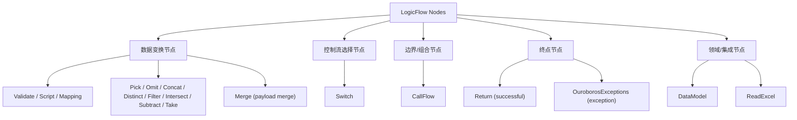

# LogicFlow 节点家族与控制流节点目录（Catalog）深化说明

更新日期：`2026-03-18`

> 回到总览：[`DESIGN.md`](../../DESIGN.md)

这份文档是对 [`DESIGN.md`](../../DESIGN.md) 中“内置节点”“控制流语义”“扩展点边界”的一次专题深化。它要解决的不是“把所有节点文件名列一遍”，而是回答三个更关键的问题：

- LogicFlow 现在到底有哪些**节点家族**，它们分别承担什么语义职责。
- 当前实现里，哪些节点是真正的**控制流节点**，哪些只是数据节点、边界节点或集成节点。
- 目前目录中哪些名字看起来像控制流，但运行时其实并没有对应语义，后续该如何避免继续漂移。

## 1. 为什么节点目录必须按“语义家族”理解，而不是按文件夹理解

如果只按 `nodes/` 目录浏览，很容易产生两个误解：

1. 文件名像控制流，节点就真的拥有控制流语义。
2. 只要 editor 里能拖出来，core 就已经实现了对应语义。

这两点在 LogicFlow 都不成立。

LogicFlow 的节点目录更适合按下面这组“语义角色”理解：

- **数据变换节点**
  - 对输入值做计算、筛选、重组、映射。
- **控制流选择节点**
  - 决定哪条路径被激活，输出的是路径命中信号，而不是普通 payload。
- **边界/组合节点**
  - 把当前流程与另一个流程、另一个运行上下文连接起来。
- **终点节点**
  - 把流程收敛成成功结果或异常结果。
- **领域/集成节点**
  - 调用平台能力、外部资源或业务模型，本质上是执行能力扩展，而不是调度原语。

这种划分方式直接对应了设计上的几个底线：

- 控制流语义必须由 `core` 运行时真实实现，而不是只停留在 metadata 或视觉层。
- 节点名字、NodeDefine 描述、静态分析规则、运行时行为必须尽量对齐。
- 一个节点是否属于“控制流节点”，取决于它是否改变了路径激活规则，而不是取决于它在画布上长得像不像“汇合”或“分支”。

## 2. 当前节点家族总览

下面这张图给的是“当前 baseline 的语义分组”，不是未来愿景：

### 2.1 数据变换节点：大多数“普通节点”都属于这一类

这类节点的共同点是：

- 关注输入值怎么变成输出值。
- 不负责调度路径激活，也不定义新的流程边界。
- 即使有多个输入，也通常仍服从编译器提供的既有 join 语义。

典型代表：

- `ValidateNode`
- `ScriptNode`
- `MappingNode`
- `PickNode`
- `OmitNode`
- `ConcatNode`
- `DistinctNode`
- `FilterNode`
- `IntersectNode`
- `SubtractNode`
- `TakeNode`
- `ConstNode`

它们大多继承自：

- [`AbstractSimpleNode`](../../ouroboros-logicflow-core/src/main/java/com/ouroboros/logicflow/nodes/AbstractSimpleNode.java)
- 或 [`AbstractNode`](../../ouroboros-logicflow-core/src/main/java/com/ouroboros/logicflow/nodes/AbstractNode.java)

这类节点是 LogicFlow 的“主力节点库”，也是最适合继续扩展的节点家族，因为它们学习成本低，行为直观。

### 2.2 控制流选择节点：当前真正成型的只有 `SwitchNode`

当前内置节点里，真正具备“控制哪条路径继续执行”语义的核心节点，是：

- [`SwitchNode`](../../ouroboros-logicflow-builtin-nodes/src/main/java/com/ouroboros/logicflow/nodes/SwitchNode.java)

它的控制流地位不是靠名字，而是靠这几个实现事实确立的：

- 继承 [`AbstractDecisionNode`](../../ouroboros-logicflow-core/src/main/java/com/ouroboros/logicflow/nodes/AbstractDecisionNode.java)
- 输出的不是普通对象列表，而是 `Decision` 列表
- 每个条件分支和默认分支都会生成一组互斥输出端口
- 节点声明 `supportsSelectiveOutputMetadata() == true`
- 编译器会在运行时校验同组输出不能同时命中

这意味着：

- `SwitchNode` 是当前 baseline 下**唯一稳定成型的 built-in XOR 分支节点**。
- 端口互斥能力目前不是“任意节点的通用属性”，而是主要服务于这类 decision 节点。

### 2.3 边界/组合节点：`CallFlowNode` 是流程组合，不是分支/汇合

[`CallFlowNode`](../../ouroboros-logicflow-builtin-nodes/src/main/java/com/ouroboros/logicflow/nodes/CallFlowNode.java) 的语义应理解为：

- 调用另一个 `FlowModel`
- 把子流程结果重新包装回当前流程
- 可选对集合逐项执行

它改变的是**流程边界**，不是**路径选择规则**。

因此它更适合被归类为：

- **组合节点**
- 或 **执行边界节点**

而不是控制流分支节点。

这一区分很重要，因为：

- 分支节点关心“哪条路被激活”
- 组合节点关心“另一个流程如何作为一个子能力被调用”

两者虽然都影响执行结构，但设计关注点完全不同。

### 2.4 终点节点：成功与异常终点必须分开理解

当前终点节点至少有两种稳定角色：

1. **成功终点**
   - [`ReturnNode`](../../ouroboros-logicflow-builtin-nodes/src/main/java/com/ouroboros/logicflow/nodes/ReturnNode.java)
2. **异常终点**
   - [`OuroborosExceptionsNode`](../../ouroboros-logicflow-extra-nodes/src/main/java/com/ouroboros/logicflow/nodes/OuroborosExceptionsNode.java)

它们都继承自：

- [`AbstractTerminalNode`](../../ouroboros-logicflow-core/src/main/java/com/ouroboros/logicflow/nodes/AbstractTerminalNode.java)

但语义完全不同：

- `ReturnNode` 会把首个输入值作为成功结果收口。
- `OuroborosExceptionsNode` 会直接抛出平台异常类型，属于异常终止，而不是成功返回。

因此“terminal node”在 LogicFlow 里不是一个单一语义，而至少要区分：

- `successful terminal`
- `exception terminal`

这也正是 `NodeDefine.terminalKind` 已经开始表达的 contract。

### 2.5 领域/集成节点：能力扩展，不是调度原语

像下面这些节点，更适合理解为平台能力或资源接入：

- `DataModelNode` 对应的数据模型能力
- `ReadExcelNode` 对应的 Excel 读取能力

它们的共同点是：

- 价值来自“能接什么资源/能力”
- 而不是“发明了什么新的流程调度语义”

所以它们应该作为：

- **领域节点家族**
- 或 **集成节点家族**

被组织和扩展，而不应与控制流节点混成一类。

## 3. 当前真正已经实现的控制流语义

如果按“引擎今天真实支持什么”来收口，当前已经稳定落地的控制流语义主要有四类。

### 3.1 选择分支：`SwitchNode`

`SwitchNode` 负责：

- 基于表达式计算条件
- 为每个命中的条件输出 `Decision.satisfied(value)`
- 为未命中的分支输出 `Decision.unsatisfied()`
- 为默认路径提供兜底分支

它的内建排他组常量是：

- `switch-branches`

对应实现位于：

- [`SwitchNode`](../../ouroboros-logicflow-builtin-nodes/src/main/java/com/ouroboros/logicflow/nodes/SwitchNode.java)

这使得 `switch` 成为当前控制流目录中的基准节点：

- 如果一个新节点也想表达“多出口但互斥”，它应该先证明自己在语义上属于 decision family。
- 不能只在 editor metadata 上做出“看起来像有多个互斥出口”的样子。

### 3.2 成功收口：`ReturnNode` 与显式 `exitNode`

当前成功终点结果契约已经统一为：

- `ReturnNode`
- 显式 `exitNode`

都会进入内部 `FlowOutcome` 收口，再对外解包为 `Try<Object>`。

这意味着成功终点语义已经不再只依赖老的 `exitNode` 字段，而是允许：

- 图内显式成功终点节点
- 兼容存量模型的显式 `exitNode`

共同作为“流程成功结束”的来源。

### 3.3 错误转移：main scope -> error scope

错误流本身也是一种控制流，只不过它不是节点局部的异常端口，而是：

- main scope 失败
- 切换到 error scope
- error scope 再决定是否恢复为成功结果

因此当前异常控制流是**scope 级**的，而不是**节点输出端口级**的。

这也是为什么 `OuroborosExceptionsNode` 虽然是 terminal，但它并不等价于“异常分支节点”。

### 3.4 输入等待与受控 OR：这是编译器语义，不是节点目录语义

当前输入侧的 join 行为主要来自编译器，而不是来自某个专门 join 节点：

- 多输入端口默认要等齐
- 同一输入端口有多个来源时，编译器会等待所有来源完成，再选择第一个有效值
- 这套行为依赖静态分析证明“这些来源在语义上互斥”

因此当前系统里已经有一部分“受控 OR / 互斥汇入”语义，但它的宿主是：

- `FunctionalFlowCompiler`
- `LogicFlowUtil`

而不是一个清晰成型的 join node 家族。

## 4. 哪些节点名字像控制流，但当前并不是

这是当前目录最容易造成理解偏差的地方。

### 4.1 `MergeNode` 不是 control-flow join

[`MergeNode`](../../ouroboros-logicflow-builtin-nodes/src/main/java/com/ouroboros/logicflow/nodes/MergeNode.java) 当前的真实语义非常明确：

- 输入必须都是 `Map`
- 多个输入值会被 merge / deepMerge
- 它等待的是所有输入齐备
- 它合并的是 payload，不是 trigger policy

所以它解决的是：

- “把几份对象数据拼成一份”

而不是：

- “任一路径先到就继续”
- “多个分支在这里完成控制流汇合”

因此文档、建模和后续节点扩展都不应把 `MergeNode` 当作 join primitive。

### 4.2 `MutexNode` 目前更像 legacy placeholder，而不是成熟控制流节点

[`MutexNode`](../../ouroboros-logicflow-builtin-nodes/src/main/java/com/ouroboros/logicflow/nodes/MutexNode.java) 当前实现只是：

- 继承 `AbstractSimpleNode<Object>`
- 接收一个输入
- 原样返回该输入

但它的 NodeDefine 描述却写着：

- “多个分支的数据汇集到一起，取最先到达的数据继续执行”

同时它的 `portRules` 仍然是：

- 1 个输入
- 1 个输出

这说明它目前存在明显的目录一致性缺口：

- 名字像互斥汇合
- 描述像 race/any-join
- 运行时却没有任何 race/join 调度能力
- authoring contract 也没有把多输入结构表达出来

在现阶段，更合理的理解方式是：

- 把 `MutexNode` 视为**未完成语义的 legacy 占位节点**
- 不把它当作当前控制流目录的稳定组成部分

在它没有补齐 runtime/compiler/static-analysis/NodeDefine 四件套之前，不应围绕它建立新的设计前提。

### 4.3 `CallFlowNode` 也不应被误读为“流程跳转节点”

`CallFlowNode` 虽然会把执行移交给另一个流程，但它并没有改变当前图的路径选择规则，也没有提供：

- goto/跳转
- early terminate
- any-join
- recover-join

因此把它归类为：

- **流程组合**

比归类为：

- **控制流跳转**

更准确，也更有助于后续设计收敛。

## 5. 目录一致性原则：以后新增节点时要先回答什么

为了避免节点目录继续出现“名字很大、语义很空”的漂移，后续新增节点时至少应先回答下面几个问题。

### 5.1 它到底属于哪个家族

先判断它是：

- 数据变换
- 控制流选择
- 边界/组合
- 终点
- 领域/集成

而不是先起一个“听起来很流程化”的名字。

### 5.2 它的语义到底落在哪一层

如果节点声称自己是控制流节点，就必须同时说明：

- 运行时如何表达“命中/未命中”
- 编译器如何调度它
- 静态分析如何限制坏图
- NodeDefine 如何把这些语义暴露给 editor/dev

否则就会再次出现：

- metadata 里看起来支持
- runtime 里实际上没有

的断裂。

### 5.3 它是否在偷渡“通用调度能力”

像下面这些能力，都不适合作为普通节点的随意开关：

- 任意一个输入先到即触发
- 命中成功终点后取消其余分支
- 节点级异常输出端口
- 通用 OR-Join / XOR-Join / Recover-Join

这些都更适合先落成**专用节点家族**，再配套编译器与静态分析，而不是作为普通节点的“高级属性”塞进系统里。

## 6. 当前控制流节点目录的缺口与后续方向

如果按“最值得补齐的目录空洞”来看，当前高价值缺口主要有三类。

### 6.1 真正的 join node family 仍未成型

当前还没有稳定的：

- `XorJoinNode`
- `AnyJoinNode`
- `ErrorJoinNode`
- `RecoverNode`

这也是为什么很多“控制流汇合”需求今天只能借助：

- 编译器的受控输入语义
- 或者被误认为是 `MergeNode` / `MutexNode`

来表达。

### 6.2 提前终止/取消其余分支还不是现有节点语义

当前成功终点只是结果收口，不是“命中即取消其余 future”。

因此如果未来要引入：

- terminate
- short-circuit completion
- branch cancellation

它应当被建模成一组新的控制流能力，而不是偷偷改某个现有节点的行为。

### 6.3 异常控制流还停留在 scope 级，而不是节点级异常端口

当前异常恢复的主干语义是：

- main scope 失败后切入 error scope

如果未来要增加：

- 节点级 catch/recover
- 局部异常分支

那也应视为新的控制流节点家族扩展，而不是把现有 terminal 节点误读成已经支持这些语义。

## 7. 实际改代码时怎么用这份目录

当你要新增或评估一个节点类型时，推荐按这个顺序思考：

1. 它属于哪个节点家族。
2. 它改变的是 payload，还是改变了 path activation。
3. 如果它是控制流节点，是否已经有对应的 compiler/static-analysis/runtime contract。
4. 它的 NodeDefine 是否只是展示，还是已经把 authoring contract 补全。
5. 是否需要补充回归测试来锁定这份语义。

配套阅读建议：

- 节点扩展与基类选择：[`DESIGN-NODE-EXTENSIONS.md`](../node-extensions/overview.md)
- NodeDefine / editor contract：[`DESIGN-NODE-DEFINES-AND-EDITOR-CAPABILITIES.md`](../node-defines-and-editor-capabilities/overview.md)
- 静态分析边界：[`DESIGN-STATIC-ANALYSIS.md`](../static-analysis/overview.md)
- 运行时执行与输入 join 语义：[`DESIGN-RUNTIME-EXECUTION.md`](../runtime-execution/overview.md)
- 历史基线事实与残余问题（不代表当前实现）：[`../../reviews/2026-03-18-report-current-baseline.md`](https://gitlab.whxinpai.com/ouroboros-lowcode/ouroboros/-/blob/d2ebfd746acbaab0d3fc461ba4850e68c0d14cff/core/ouroboros-logicflow/reviews/2026-03-18-report-current-baseline.md)
