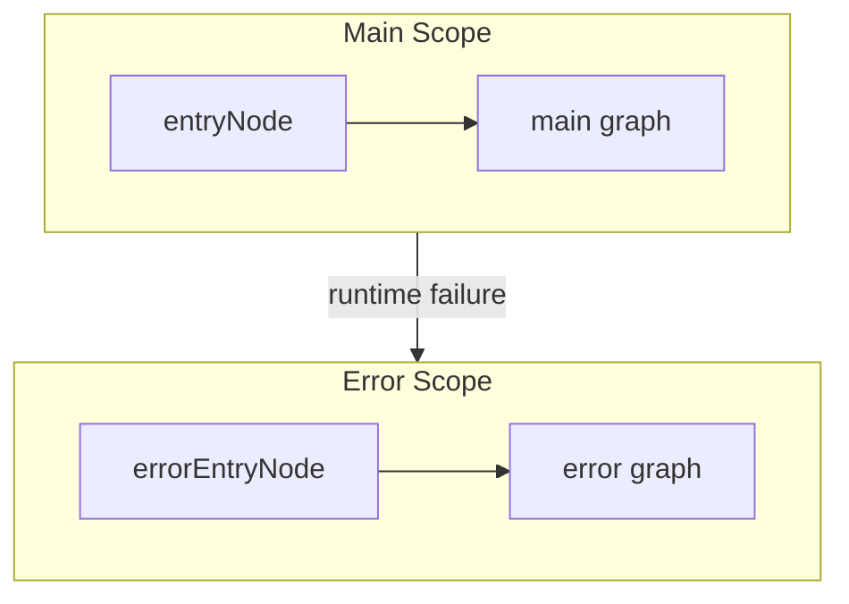

# LogicFlow 错误流、恢复成功与 Fail-Closed 边界（Error Flow / Recovery / Fail-Closed Boundaries）深化说明

更新日期：`2026-03-18`

> 回到总览：[`DESIGN.md`](../../DESIGN.md)
>
> 阅读导航：[`DESIGN-READING-PATHS-AND-MODULE-BOUNDARIES.md`](../reading-paths-and-module-boundaries/overview.md)
>
> 错误处理总论：[`DESIGN-ERROR-HANDLING.md`](../error-handling/overview.md)
>
> 运行时执行：[`DESIGN-RUNTIME-EXECUTION.md`](../runtime-execution/overview.md)
>
> 静态分析：[`DESIGN-STATIC-ANALYSIS.md`](../static-analysis/overview.md)
>
> 成功终点边界：[`DESIGN-SUCCESSFUL-TERMINALS-AND-EARLY-EXIT-BOUNDARIES.md`](../successful-terminals-and-early-exit-boundaries/overview.md)

这份文档把“错误流 / 成功恢复 / fail-closed”抽成一条单独的主线，重点不是重复解释“异常是什么”，而是把下面几层经常被混在一起的边界拆开：

- invalid model 为什么不会进入错误流
- runtime failure 在什么条件下会切入 `errorEntryNode`
- error scope 为什么是独立 scope，而不是主流程的一段分支
- error flow 如何显式恢复成成功
- 为什么当前实现坚持 fail-closed，而不是 silent `null` success

如果说 [`DESIGN-ERROR-HANDLING.md`](../error-handling/overview.md) 更像“错误处理总论”，这份文档更像：

- **same-graph error flow 的专题边界文档**

## 1. 先给结论：当前支持的是“同图错误恢复 scope”，不是“任何失败都能被兜住”

当前已落地的最小事实可以压缩成六句话：

1. `errorEntryNode` 是可选的，但一旦声明，就代表图里存在一条独立的 error scope。
2. 只有 main scope 已开始执行且以 runtime failure 结束时，error scope 才会被触发。
3. invalid model、未开始执行的输入错误、未启用模型都不会进入 error flow。
4. error scope 接收的是标准化 `Map<String, Object>` 错误上下文，不是原始异常对象。
5. error flow 想把失败恢复成成功，必须显式命中自己的成功终点，当前通常是 `ReturnNode`。
6. 任一已执行 scope 如果结束时没有命中成功终点，都会 fail-closed，而不是对外伪装成成功。

如果只记一句口径，应该记这个版本：

- **当前已经支持同图错误流恢复，但它只处理 runtime failure，并且恢复成功必须显式收口。**

## 2. 必须先分开的三层失败

### 2.1 设计期失败（invalid model）

设计期失败回答的是：

- “这张图在执行前就已经不合法了吗”

典型来源包括：

- `entryNode` / `exitNode` / `errorEntryNode` 解析失败
- scope 重叠或 scope 外启用节点
- 成功终点缺失或借错 scope
- 端口/类型/可达性/叶子节点规则不成立

这类错误的关键边界是：

- 它们在 `DefaultFlowModel` 构造阶段就被固化为 `DesignException`
- `execute()` 会 fail-closed 为 `FlowDesignException`
- **不会进入 error flow**

### 2.2 运行期失败（runtime failure）

运行期失败回答的是：

- “模型本身合法，但执行过程中是否出现了失败”

典型来源包括：

- 节点执行异常
- `ValidateNode` 校验失败
- `OuroborosExceptionsNode` 主动抛异常
- selective-output 运行时契约违约

这类失败才是 error flow 的潜在输入。

### 2.3 业务显式异常终点

业务显式异常终点回答的是：

- “建模者是否主动用一个节点表达‘此处应当失败’”

当前最典型的是：

- `OuroborosExceptionsNode`

它虽然属于 terminal family，但不是 successful terminal，因此：

- 它会制造 runtime failure
- 它进入静态终点家族候选，但执行抛错，不能生成成功 outcome；候选规则统一见成功终点专题
- 是否能被恢复，取决于 error scope 是否存在且是否成功收口

## 3. `errorEntryNode` 的真实语义：它不是一条普通分支，而是一条独立 scope

### 3.1 为什么 error flow 必须按独立 scope 理解

当前 same-graph error flow 的设计，不是“每个节点都多一条异常边”，而是：

- 主流程保持原有 DAG 执行语义
- 当 main scope 失败时，一次性切入另一条同图 scope

可以把当前模型理解成：

这条设计有三个直接后果：

1. main scope 和 error scope 都有自己的结构约束。
2. main scope 自己必须有成功终点，不能指望 error scope 的 `ReturnNode` 来充数。
3. error scope 自己如果执行了，也必须按自己的成功终点合同收口。

### 3.2 `errorEntryNode` 不是“异常入口视觉符号”，而是运行时 contract

`errorEntryNode` 当前不是仅供 authoring 展示的 metadata，它直接参与：

- scope 划分
- 静态分析
- 编译器双 scope 编译
- 错误上下文输入合同检查

所以这条边界必须继续坚持：

- **core 才是 `errorEntryNode` 语义权威**
- dev / editor 只能消费它，不能重新定义它

## 4. Error flow 到底什么时候触发

### 4.1 触发条件

当前 error flow 只有在以下条件同时满足时才会触发：

1. main scope 已经开始执行
2. main scope 的最终 outcome 是 failure
3. 模型声明了 `errorEntryNode`

这里“已经开始执行”很关键，因为它排除了两类常见误解：

- 输入参数数量不对导致的“未开始执行”失败，不会进入 error flow
- invalid model 也不会进入 error flow

### 4.2 触发时机与并发边界

当前编译器可提前形成 main scope failure 信号，但会先通过 `getNodeResults()` 等待主 scope 节点 future 完成，再启动 error scope。它不取消已调度分支，也不提供 terminate 语义。完整执行顺序统一见[运行时执行 §10.3](../runtime-execution/overview.md#103-失败信号与错误流切入不是同一时刻)。

## 5. 错误流收到的不是异常对象，而是标准化错误上下文

### 5.1 当前输入合同

error scope 的输入是一个标准化 `Map<String, Object>`，而不是原始 Java 异常对象。

典型字段包括：

- `exceptionType`
- `exceptionMessage`
- `exceptionCode`
- `flowName`
- `flowInputs`
- `nodeName`
- `nodeInputs`

### 5.2 为什么必须是标准化上下文

这条设计不是“为了方便”，而是为了守住两条边界：

1. 图上的数据契约不直接依赖 Java 异常类型体系。
2. error scope 的节点可以用统一结构消费失败信息，而不是各自猜测异常对象形状。

因此静态分析也必须同步守住：

- `errorEntryNode` 的实际输入端口合同必须兼容 `Map<String, Object>`

## 6. 恢复成功不是自动的，必须显式命中成功终点

### 6.1 “有 errorEntryNode” 不等于 “失败会自动变成功”

当前 error flow 的定位是：

- 给 runtime failure 一次在同图内重新收口的机会

它不是：

- “声明了错误流就自动吞掉异常”

### 6.2 当前恢复成功的最低条件

error flow 想把失败恢复成成功，必须同时满足：

1. error scope 自己存在成功终点
2. 本次 error scope 执行命中了那个成功终点

当前最典型的恢复方式是：

- error scope 通过 `ReturnNode` 显式返回一个恢复结果

这意味着恢复成功的语义仍然服从成功终点合同，而不是错误处理章节里额外发明的一套规则。

### 6.3 main scope 不能借 error scope 的成功终点

这条规则必须单独强调，因为它直接决定模型是否合法：

- main scope 必须自己有成功终点
- error scope 的 `ReturnNode` 只能为 error scope 自己的恢复收口服务

否则会出现一种危险漂移：

- 主流程其实没有合法成功结束路径
- 但模型却试图靠“出错以后还能恢复”来掩盖主流程本身不完整

当前 `core` 已明确拒绝这种模型。

## 7. Fail-Closed 在这条线上具体是什么意思

### 7.1 已执行的 scope 没有命中成功终点，就必须失败

当前 fail-closed 在 error flow 这条线上的最重要含义是：

- 任一已执行 scope 如果结束时没有命中成功终点，就不能对外伪装成成功

因此下面这些场景都必须失败：

- main scope 执行完了但没有合法成功终点
- error scope 启动了但没有命中 `ReturnNode`
- 静态分析漏检导致实际出现多个成功 outcome

### 7.2 为什么必须拒绝 silent `null` success

如果不坚持 fail-closed，最容易出现的就是：

- 错误流跑过了，但没有真正恢复结果
- 外层却收到一个看似成功的 `null`

这会同时破坏三条原则：

1. 失败不再显性
2. 结果合同不再可信
3. analyzer / adapter / 调用方 很难判断流程究竟是成功结束还是异常被吞掉了

所以当前坚持的口径应该是：

- **没有成功终点命中，就没有成功结果。**

### 7.3 error flow 自己失败时，不会递归重入

当前还明确守住了另一条 fail-closed 边界：

- error scope 自己再失败时，整个流程以最终 failure 结束
- 不会重新回到 `errorEntryNode` 形成递归错误处理

这保证了错误恢复机制本身不会演变成无限递归的异常放大器。

## 8. 两类典型节点在这条边界里的位置

### 8.1 `ValidateNode`

`ValidateNode` 当前不是“失败走另一条边”的分支节点，而是：

- 校验通过则透传
- 校验失败则抛 `ValidationFailedException`

因此它在当前设计里属于：

- main scope runtime failure 的常见来源

而不是：

- 局部异常端口原语

### 8.2 `OuroborosExceptionsNode`

`OuroborosExceptionsNode` 当前表达的是：

- 主动制造一个明确失败

因此它属于：

- exception terminal

而不是：

- successful terminal
- 多终点结果语义的一部分

这也是 editor 必须把它渲染成 exception terminal，而不是 return terminal 的原因。

## 9. 外层消费面最终看到什么

### 9.1 analyzer 看到的是最终态，而不是中间错误片段

当前 analyzer 的关键边界是：

- 如果 error flow 恢复成功，`onFlowCompleted` 看到的是恢复后的公开结果
- 如果 error flow 最终失败，`onFlowFailed` 看到的是最终失败

这意味着 analyzer 面向的是：

- **最终收口后的流程态**

而不是：

- 一个把 main failure、error scope 中间态、内部 envelope 全都直接暴露出来的调试对象

### 9.2 adapter 继续消费公开执行合同

当前 adapter 层并没有因为 same-graph error flow 的引入而切换到新的公开结果合同。

外层依旧消费：

- `FlowModel.execute(): Try<Object>`

这说明错误流恢复虽然增强了内部语义，但没有直接改变公共执行边界。

## 10. 未来如果继续推进这一条线，最可能的 deferred 能力是什么

当前最自然但仍未落地的后续能力主要有两类：

1. **局部异常端口**
   - 允许少数高价值节点在图上表达更细粒度的异常分流
2. **更细的事务与取消语义**
   - error scope 与异步节点、事务边界、cancel/terminate 如何组合

但这两类能力都不应该“顺手塞进”当前 error flow 语义里。

它们若要成立，至少要先补齐：

- 语义命名
- 静态分析边界
- authoring / editor contract
- runtime / adapter 合同
- 测试与 fixture

## 11. 改动这条语义时，至少要联动回查哪些地方

如果后续要继续改 error flow、恢复成功或 fail-closed 这条线，建议固定回查下面几层：

1. 总口径
   - [`DESIGN.md`](../../DESIGN.md)
   - 本文档
2. 错误处理总论
   - [`DESIGN-ERROR-HANDLING.md`](../error-handling/overview.md)
3. 运行时
   - [`DESIGN-RUNTIME-EXECUTION.md`](../runtime-execution/overview.md)
   - [`FunctionalFlowCompiler`](../../ouroboros-logicflow-core/src/main/java/com/ouroboros/logicflow/compiler/FunctionalFlowCompiler.java)
4. 静态分析
   - [`DESIGN-STATIC-ANALYSIS.md`](../static-analysis/overview.md)
   - [`LogicFlowUtil`](../../ouroboros-logicflow-core/src/main/java/com/ouroboros/logicflow/util/LogicFlowUtil.java)
5. 场景与测试
   - [`DESIGN-CANONICAL-SCENARIOS-AND-END-TO-END-WALKTHROUGHS.md`](../canonical-scenarios-and-end-to-end-walkthroughs/overview.md)
   - [`DESIGN-CONCEPT-TO-SOURCE-CROSSWALK.md`](../concept-to-source-crosswalk/overview.md)

只要这几层里有一层没跟上，这条语义就很容易再次被写散。
