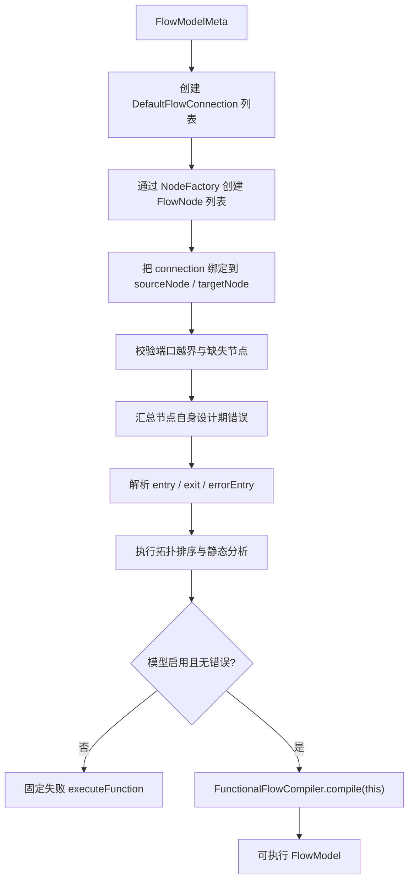

# LogicFlow 模型装配管线（Model Assembly Pipeline）深化说明

更新日期：`2026-03-18`

> 回到总览：[`DESIGN.md`](../../DESIGN.md)

这份文档是对 [`DESIGN.md`](../../DESIGN.md) 中“`DefaultFlowModel` 构造与校验管线”“`NodeFactory` 节点创建”“执行前 fail-closed gate”几部分的深化说明。它关注的不是运行时 Future 调度，而是更前面的那条链：

- 一份 `FlowModelMeta`
- 如何被装配成一份 `FlowModel`
- 又在什么条件下，最终变成可执行的 `executeFunction`

如果说 [`DESIGN-MODEL-LIFECYCLE.md`](../model-lifecycle/overview.md) 讲的是“模型从哪里来”，那这份文档讲的就是：

- **模型进到 core 之后，如何在本地完成装配、校验、编译和 gating**

## 1. 一句话定位：`DefaultFlowModel` 不是数据包装器，而是装配网关

当前 LogicFlow 里：

- [`FlowModelMeta`](../../ouroboros-logicflow-core/src/main/java/com/ouroboros/logicflow/model/FlowModelMeta.java)
  - 只是持久化/交互用的声明式图结构
- [`DefaultFlowModel`](../../ouroboros-logicflow-core/src/main/java/com/ouroboros/logicflow/model/DefaultFlowModel.java)
  - 才是真正把声明式图变成运行时模型的装配网关

它承担的职责至少包括：

- 创建运行时连接对象
- 创建运行时节点对象
- 绑定连接与节点引用
- 汇总节点/图级设计期错误
- 解析 entry / exit / errorEntry 锚点
- 编排静态分析
- 在通过校验后编译 `executeFunction`
- 在未启用或不合法时，改写为固定失败的执行函数

因此更准确地说，`DefaultFlowModel` 是：

- **Assembler + Validation Orchestrator + Compile Gate**

而不是一个“拿着 meta 提供 getter”的轻量包装类。

## 2. 输入和输出：装配管线前后到底是什么

### 2.1 输入：`FlowModelMeta`

装配管线的输入是：

- 一份 `FlowModelMeta`

它包含：

- 节点声明
- 连线声明
- 流程级输入输出类型
- 入口/出口/错误入口锚点
- 启用态与诊断快照字段

但它还没有：

- `FlowNode` 实例
- `FlowConnection` 实例
- 已编译的执行函数
- 已解析的 scope / terminal / runtime contracts

### 2.2 输出：`FlowModel`

装配完成后的运行时对象实现是：

- [`DefaultFlowModel`](../../ouroboros-logicflow-core/src/main/java/com/ouroboros/logicflow/model/DefaultFlowModel.java)

它对外暴露的是：

- `getNodes()`
- `getConnections()`
- `getEntryNode()`
- `getExitNode()`
- `getErrorEntryNode()`
- `getErrors()`
- `isValid()`
- `execute(Object... inputs)`

也就是说，装配完成之后，模型的“核心产物”不是某个中间图，而是：

- 一份带运行时节点/连线引用的模型对象
- 再加上一条已经准备好的 `executeFunction`

## 3. 总体流程：从 metadata 到 executeFunction 的十步装配链

`DefaultFlowModel.init()` 可以概括成下面这条链：

这条链有一个很重要的特征：

- **它不是 fail-fast 的一次性抛错流程**
- 而是“尽量累积设计期错误，再统一决定是否可执行”的流程

这正是 LogicFlow 当前设计期诊断能力能成立的基础。

## 4. 阶段一：先构造连接，再构造节点

### 4.1 为什么先建 `FlowConnection`

`init()` 的第一步是先把 metadata 中的每条连接变成：

- [`DefaultFlowConnection`](../../ouroboros-logicflow-core/src/main/java/com/ouroboros/logicflow/model/DefaultFlowConnection.java)

此时连接对象已经有：

- source/target 名称
- source/target 端口索引

但还没有：

- `sourceNode`
- `targetNode`

### 4.2 为什么节点构造时就需要看到连接集合

节点随后通过 `NodeFactory` 创建，而：

- [`AbstractNode`](../../ouroboros-logicflow-core/src/main/java/com/ouroboros/logicflow/nodes/AbstractNode.java)

在构造函数里就会扫描 `flowModel.getConnections()`，把：

- 自己的入边
- 自己的出边

筛出来缓存下来。

这意味着一个关键设计事实：

- **节点运行时端口数量与连线是联动的**

所以必须先让 `flowModel` 持有连接列表，节点才能在构造时正确 materialize 自己的端口与连接关系。

## 5. 阶段二：节点创建由 `NodeFactory` 统一收口

### 5.1 `NodeFactory` 的角色

节点创建入口是：

- [`NodeFactory`](../../ouroboros-logicflow-core/src/main/java/com/ouroboros/logicflow/nodes/NodeFactory.java)

全部 `NodeBuilder` 通过 SPI 发现，内置节点由 builtin-nodes 模块注册。创建节点时显式传入 `owner`、`nodeMeta` 和 `NodeReferenceCatalog`。

### 5.2 唯一匹配是当前 contract

匹配为零时报告未知节点类型，多于一个时报告构造器冲突，唯一匹配才构建节点。排序不能覆盖已有类型。完整发现、失败类型与注册约定统一见[节点扩展合同](../node-extensions/overview.md#22-nodefactory-的查找与后置校验)。

### 5.3 为什么 `NodeFactory` 还要做一次后置端口元数据校验

节点 build 完成后，`NodeFactory` 还会调用：

- `AbstractNode.validateOutputPortMetadata()`

用于兜底校验：

- `defaultBranch` 必须带 `exclusiveGroupId`
- 同组最多一个 `defaultBranch`

因此它不只是“把对象 new 出来”，还承担了：

- **节点级 authoring contract 的最后一道 core 兜底**

## 6. 阶段三：错误累积，而不是在第一处失败就放弃

### 6.1 节点构造异常如何被处理

在 `DefaultFlowModel.init()` 中，每个节点构造都被包在：

- `catch (DesignException e)`
- `catch (Throwable e)`

里。

对应策略是：

- 如果 builder 或节点构造阶段显式抛出 `DesignException`
  - 直接收集到模型 errors
- 如果抛出其他未预期异常
  - 收敛为一条新的 `NodeDesignException("节点构造错误", nodeMeta)`

这说明当前设计非常明确：

- **节点构造期的异常默认都应被吸收到设计期诊断里**
- 而不是让整个模型初始化直接崩掉

### 6.2 为什么这很重要

这样做的直接收益是：

- editor/dev 保存时能一次拿到更多权威错误
- 不会因为第一个坏节点爆掉，就完全看不到后续的结构性问题
- 平台能把“可诊断性”放在“尽快抛异常”之前

这也符合 LogicFlow 当前的建模态目标：

- 尽量在 design-time 暴露坏图
- 让错误能被快照、列表页和编辑页消费

## 7. 阶段四：连接绑定与图级结构错误收口

### 7.1 连接绑定不是运行时临时查找

节点创建完之后，`DefaultFlowModel` 会遍历每条 `DefaultFlowConnection`，为它绑定：

- `sourceNode`
- `targetNode`

如果绑定失败，会新增：

- `NodeNotFoundException`

这一步很关键，因为后续所有静态分析和运行时编译，都假设：

- 连接对象已经能直接拿到节点实例

### 7.2 为什么端口越界校验放在绑定之后

端口越界校验依赖的是：

- `conn.getSourceNode().getOutputPorts().size()`
- `conn.getTargetNode().getInputPorts().size()`

而这两个值本身又依赖：

- 节点类型的 min/max 端口规则
- metadata 声明
- 连线触发的运行时端口补齐

因此端口越界不可能只靠 metadata 预判，它必须在：

- 节点已经实例化
- 连接已经绑定到节点

之后再判断。

### 7.3 这一步收口的典型错误

这里会收敛出一类典型图级错误：

- [`InvalidConnectionDetectedException`](../../ouroboros-logicflow-core/src/main/java/com/ouroboros/logicflow/exception/InvalidConnectionDetectedException.java)

它表达的不是“节点业务有问题”，而是：

- 图的连线本身已经越过运行时允许的端口边界

## 8. 阶段五：节点级错误提升为模型级错误

### 8.1 节点可以自己携带 `NodeDesignException`

很多节点并不会在构造时直接抛异常，而是把错误挂到自己身上：

- `addError(new NodeDesignException(...))`

之后通过：

- `node.isValid()`
- `node.getErrors()`

暴露出来。

### 8.2 `DefaultFlowModel` 会把这些错误集中提升

在节点全部创建完成、连接绑定之后，模型会扫描：

- 所有启用且 `!isValid()` 的节点

并把这些节点错误统一打包成：

- [`ProblematicNodesDetectedException`](../../ouroboros-logicflow-core/src/main/java/com/ouroboros/logicflow/exception/ProblematicNodesDetectedException.java)

这条异常的意义是：

- **坏节点错误已经不再只是节点私有信息，而是模型整体不合法的组成部分**

## 9. 阶段六：锚点解析是执行语义建立的前提

### 9.1 entry / exit / errorEntry 在这里才真正解析成节点实例

在 runtime 里，入口和终点不是字符串，而是：

- `entryNode`
- `exitNode`
- `errorEntryNode`

它们都在 `init()` 中通过：

- `getNode(meta.getEntryNode())`
- `getNode(meta.getExitNode())`
- `getNode(meta.getErrorEntryNode())`

解析出来。

### 9.2 锚点缺失会转成专门的设计期错误

对应的错误类型包括：

- [`EntryNotFoundException`](../../ouroboros-logicflow-core/src/main/java/com/ouroboros/logicflow/exception/EntryNotFoundException.java)
- [`ExitNotFoundException`](../../ouroboros-logicflow-core/src/main/java/com/ouroboros/logicflow/exception/ExitNotFoundException.java)
- [`ErrorEntryNotFoundException`](../../ouroboros-logicflow-core/src/main/java/com/ouroboros/logicflow/exception/ErrorEntryNotFoundException.java)

此外，在静态分析之前还会做一个早期判断：

- 主流程是否至少存在一个成功终点

若不存在，则新增：

- [`MissingSuccessfulTerminalException`](../../ouroboros-logicflow-core/src/main/java/com/ouroboros/logicflow/exception/MissingSuccessfulTerminalException.java)

这一步让“流程有没有合法收口”在编译前就先被挡住。

## 10. 阶段七：拓扑排序成功后，静态分析才会整体展开

### 10.1 为什么拓扑排序是静态分析的门槛

`DefaultFlowModel` 会先尝试：

- `LogicFlowUtil.topologicalSort(this)`

如果失败：

- 收敛为 `CyclicDetectedException`

只有在拓扑排序成功后，才会继续执行一整串静态分析：

- scope 合法性
- 非法叶子节点
- 不可达节点
- 成功终点互斥
- 输入端口连接完整性
- 竞态条件
- 输入端口冲突
- 输入输出类型兼容

### 10.2 为什么这一步仍属于“装配管线”

虽然这些规则本身在静态分析章节里会详细展开，但从模型装配角度看，它们有一个共同作用：

- **决定这份 `DefaultFlowModel` 是否具备进入编译阶段的资格**

因此这里的重点不是规则细节，而是：

- 静态分析是装配管线中的一个 gate，而不是后置可选检查

## 11. 阶段八：`isEnabled` 与 `isValid` 共同决定是否编译

### 11.1 未启用模型：直接固定失败

如果 `meta.isEnabled() == false`，`DefaultFlowModel` 不会编译执行函数，而是把：

- `executeFunction`

改成一个固定失败函数，返回：

- `FlowDesignException("流程未启用", meta)`

### 11.2 非法模型：同样固定失败

如果模型启用但 `!isValid()`，同样不会进入 `FunctionalFlowCompiler.compile(this)`，而是把 `executeFunction` 改成固定失败函数，返回：

- `FlowDesignException("流程存在错误: ...", meta)`

### 11.3 只有“启用且合法”才真正编译

只有在这两个条件同时满足时：

- `isEnabled() == true`
- `isValid() == true`

模型才会执行：

- `FunctionalFlowCompiler.INSTANCE.compile(this)`

并把返回值缓存到：

- `executeFunction`

这就是当前 LogicFlow 最核心的 fail-closed gate。

## 12. 装配层的一个重要分层：selected model 不等于 executable model

这层很容易和模型生命周期混淆。

从装配层看，`DefaultFlowModel` 的结论只有三种：

1. 可执行
2. 未启用，因此固定失败
3. 有设计期错误，因此固定失败

但从更高一层的 runtime/model-center 看：

- 高优先级启用模型仍然可能被选中
- 即使它校验失败，也不自动回退到低优先级模型

这两层并不矛盾，而是不同边界的职责分工：

- **选择谁**：上层 provider / center
- **选中后能否执行**：`DefaultFlowModel` 装配与 gate

更完整的状态语义请看：

- [`DESIGN-MODEL-LIFECYCLE.md`](../model-lifecycle/overview.md)
- [`DESIGN-MODEL-STATE-AND-RUNTIME-GATING.md`](../model-state-and-runtime-gating/overview.md)

## 13. 为什么这条装配管线值得单独建模

把这条链单独讲清楚，有三个直接收益。

### 13.1 方便判断问题到底属于哪一层

比如一个问题可能分别属于：

- metadata 本身缺失
- builder 识别不到节点类型
- 节点构造时的局部设计错误
- 连接绑定失败
- 静态分析拒绝坏图
- compile gate 拒绝非法模型

如果没有装配管线视角，这些问题很容易被笼统地叫做“逻辑流执行失败”，从而失去诊断精度。

### 13.2 避免错误地把 editor 或 adapter 当作语义权威

只要理解了 `DefaultFlowModel.init()` 才是：

- 节点实例化
- 图级错误收口
- compile gate

的真正落点，就会更容易守住一个设计原则：

- **editor 与 adapter 可以改善体验，但不能替代 core 的装配权威**

### 13.3 为未来演进留出清晰扩展点

将来如果要做：

- 更细粒度的增量校验
- 懒编译 / 缓存策略
- 可观测的装配阶段诊断
- 更丰富的 builder 覆盖与注册策略

都需要先认清楚当前这条装配链的边界。

## 14. 实际读代码时，推荐的阅读顺序

建议按下面顺序阅读这一层：

1. [`FlowModel`](../../ouroboros-logicflow-core/src/main/java/com/ouroboros/logicflow/model/FlowModel.java)
2. [`FlowModelMeta`](../../ouroboros-logicflow-core/src/main/java/com/ouroboros/logicflow/model/FlowModelMeta.java)
3. [`DefaultFlowModel`](../../ouroboros-logicflow-core/src/main/java/com/ouroboros/logicflow/model/DefaultFlowModel.java)
4. [`NodeFactory`](../../ouroboros-logicflow-core/src/main/java/com/ouroboros/logicflow/nodes/NodeFactory.java)
5. [`AbstractNode`](../../ouroboros-logicflow-core/src/main/java/com/ouroboros/logicflow/nodes/AbstractNode.java)
6. [`LogicFlowUtil`](../../ouroboros-logicflow-core/src/main/java/com/ouroboros/logicflow/util/LogicFlowUtil.java)
7. [`FunctionalFlowCompiler`](../../ouroboros-logicflow-core/src/main/java/com/ouroboros/logicflow/compiler/FunctionalFlowCompiler.java)

配套阅读建议：

- 生命周期与 provider 选择：[`DESIGN-MODEL-LIFECYCLE.md`](../model-lifecycle/overview.md)
- 运行时执行语义：[`DESIGN-RUNTIME-EXECUTION.md`](../runtime-execution/overview.md)
- 端口与数据契约：[`DESIGN-PORTS-AND-DATA-CONTRACTS.md`](../ports-and-data-contracts/overview.md)
- 静态分析规则：[`DESIGN-STATIC-ANALYSIS.md`](../static-analysis/overview.md)
