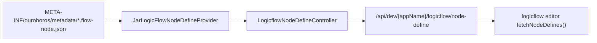

# LogicFlow NodeDefine 与 Editor Capabilities（Dev/Editor Authoring Contract）深化说明

更新日期：`2026-06-21`

> 回到总览：[`DESIGN.md`](../../DESIGN.md)

这份文档是对 [`DESIGN.md`](../../DESIGN.md) 中“dev/editor 工具链契约”“NodeDefine 供给”“终点视觉与行为能力”几部分的深化说明。它回答的是同一条 authoring contract 链路上的问题：

- 节点定义资源是如何从后端资源目录变成 editor 可消费的数据合同的。
- `NodeDefine` 里的各字段分别在 authoring 体验中承担什么职责。
- `editorCapabilities`、`terminalKind`、`scaffold`、`portRules`、`properties` 各自解决什么问题。
- editor 哪些 legacy fallback 已经裁剪，保留的 unknown render fallback 边界在哪里。

这份文档只描述当前已实现的 contract，不把未来想做的元数据体系写成“已经有了”。

## 1. 为什么 `NodeDefine` 必须被当成 authoring contract，而不是展示数据

如果只把 `NodeDefine` 理解成“左侧节点面板展示用元数据”，很容易低估它的重要性。

在当前 LogicFlow 里，它实际上横跨了三层：

- `core` / `extra-nodes`
  - 通过资源文件声明节点的 authoring-facing 元数据
- `logicflow-dev`
  - 把这些资源聚合成稳定的对外 API
- `editor`
  - 用它决定左侧节点目录、节点角色能力、终点视觉、拖拽 scaffold、属性面板 schema、端口编辑规则

因此 `NodeDefine` 的真实定位更接近：

- **“建模层节点合同”**

而不是：

- “可有可无的 UI 标签包”

如果这层合同不清晰，常见后果会是：

- editor 靠前端默认值偷偷补语义
- dev 返回的节点定义和 core 真实节点语义分离
- 终点/入口/错误入口这些关键角色在视觉和行为上各说各话

## 2. 供给链：从资源目录到 editor API

当前 `NodeDefine` 的供给链非常直接：

这条链的几个关键点是：

### 2.1 资源来源是节点定义目录，而不是 NodeBuilder SPI

当前 authoring-facing 元数据主要来自：

- `META-INF/ouroboros/metadata/*.flow-node.json`

典型示例：

- [`ReturnNode.flow-node.json`](../../ouroboros-logicflow-authoring/src/main/metadata/ReturnNode.flow-node.json)
- [`OuroborosExceptionNode.flow-node.json`](../../ouroboros-logicflow-extra-nodes/src/main/metadata/OuroborosExceptionNode.flow-node.json)

这和运行时节点构建用的 `NodeBuilder` SPI 是两条不同的链：

- `NodeBuilder` 解决“能不能运行”
- `NodeDefine` 解决“怎么被建模、怎么被编辑、怎么被看懂”

二者应该一致，但并不是同一个扩展点。

### 2.2 `logicflow-dev` 只做聚合与发布，不重写语义

发布端目前非常克制：

- 资源读取：[`JarLogicFlowNodeDefineProvider`](../../ouroboros-logicflow-authoring/src/main/java/com/ouroboros/logicflow/authoring/provider/JarLogicFlowNodeDefineProvider.java)
- API 聚合：[`LogicflowNodeDefineController`](../../ouroboros-logicflow-dev/src/main/java/com/ouroboros/logicflow/dev/controller/LogicflowNodeDefineController.java)

当前行为是：

- 扫描资源目录
- JSON 解析成 [`NodeDefine`](../../ouroboros-logicflow-authoring/src/main/java/com/ouroboros/logicflow/authoring/model/NodeDefine.java)
- 通过 SPI 聚合 provider 结果
- 按 `order` 排序后对外返回

这里没有做复杂的二次推理，这一点很重要：

- dev 的职责是把 contract 发出来
- 不是把 contract 在服务端再解释成另一套规则

## 3. `NodeDefine` 字段分工：它到底承载了哪些层面的合同

`NodeDefine` 当前字段虽然看起来扁平，但其实承载了几类不同语义：

### 3.1 目录与视觉字段

这些字段主要解决“怎么在节点目录里出现”：

- `type`
- `label`
- `icon`
- `iconBg`
- `iconColor`
- `group`
- `shape`
- `description`
- `svgs`
- `order`

这部分影响：

- 左侧面板分组与排序
- 图元外观
- SVG 图标注册

节点图标由引用方决定颜色：节点面板的 SVG 使用所在图标容器的 `color`（默认白色），画布将 `iconColor` 同时传给 `fill` 和 `color`。单色 SVG 使用继承的填充色或 `stroke="currentColor"`，不在路径中固定白色、黑色等色值；`fill="none"` 等空心几何定义保留。此约定同时适用于 Web 和 IDE 共享的编辑器。

### 3.2 角色与终点语义字段

这部分解决“这个节点在 authoring 里能扮演什么角色”：

- `isTerminal`
- `terminalKind`
- `editorCapabilities`

这已经不是纯视觉元数据，而是会影响：

- 左侧节点视觉状态
- 画布节点终点标识
- 可否被选为 `entryNode` / `exitNode` / `errorEntryNode`

### 3.3 初始结构字段

这部分解决“从节点目录拖进画布时，初始数据长什么样”：

- `scaffold`

它直接决定：

- 初始 `type`
- 默认 `name`
- 初始 `inputPorts` / `outputPorts`
- 节点特有默认属性

### 3.4 编辑约束字段

这部分解决“属性面板和端口编辑器如何工作”：

- `portRules`
- `properties`

它们共同决定：

- 输入/输出端口是 `limit`、`fixed` 还是 `auto`
- 节点属性面板里渲染哪些 amis 表单项

这也是为什么说 `NodeDefine` 不是“展示模型”而是“authoring contract”。

## 4. `editorCapabilities`：角色能力合同，而不是随便补的 flags

### 4.1 当前能力字段

editor 侧当前标准化后的能力字段包括：

- `canBeEntry`
- `canBeExit`
- `canBeErrorEntry`
- `isSuccessfulTerminal`
- `hasExclusiveOutputs`

默认值与标准化入口位于：

- [`editorCapabilityDefaults.mjs`](../../../../frontends/web/ouroboros-logicflow-editor/src/node-define/editorCapabilityDefaults.mjs)
- [`editorCapabilities.js`](../../../../frontends/web/ouroboros-logicflow-editor/src/node-define/editorCapabilities.js)

### 4.2 能力标准化规则：默认值 + server metadata

当前 editor 的标准化顺序是：

1. `defaultEditorCapabilities`
2. `nodeDefine.editorCapabilities`

也就是说：

- 默认值提供最小安全基线
- 服务器返回的 `editorCapabilities` 具有最高优先级

这正是当前 contract 的方向：

- **优先相信 server-provided metadata**
- **前端不再按 node type 推导正式 role / terminal 语义**

### 4.3 `null` 不是 false，而是“未声明”

一个很容易忽略的细节是：

- `resolveRoleCapability()` 只有在值是 boolean 时才采用该值
- 否则默认返回 `true`

这意味着：

- `canBeEntry: null` 不是“不允许作为入口”
- 而是“前端没有收到明确禁用信号”

因此当前 role capability 的策略是：

- **显式 false 才是硬禁用**
- **缺省值保持宽松**

这能降低存量节点定义因缺字段而被前端误伤的风险，但也意味着：

- 真正需要禁止的能力，最好由后端明确发布 false

## 5. `terminalKind` 与终点视觉：现在不再只靠 `isTerminal`

### 5.1 终点识别优先级

当前终点识别的优先级是：

1. 显式 `terminalKind`
2. `editorCapabilities.isSuccessfulTerminal`
3. `isTerminal`

入口：

- [`displayState.mjs`](../../../../frontends/web/ouroboros-logicflow-editor/src/node-define/displayState.mjs)

这条优先级很关键，因为它避免了两类误判：

- 成功终点被画成普通 terminal
- 异常终点被误画成成功返回

### 5.2 当前已落地的三种终点视觉

当前 editor 支持三类终点显示：

- `successful` -> `RETURN`
- `exception` -> `ERROR`
- `generic` -> `TERMINAL`

这套视觉语义已经与当前运行时含义对齐：

- `ReturnNode` 是 successful terminal
- `OuroborosExceptionNode` 是 exception terminal
- 纯 `isTerminal` 但未给出更细语义的节点只能退回 generic

### 5.3 这套 contract 的核心价值

它把一个过去容易散落在“节点类型特判 + 画布样式”的问题，拉回成了显式 contract：

- 后端发布终点语义
- 前端消费终点语义
- 测试锁定终点语义

而不是：

- 前端自己猜这个节点看起来像什么终点

## 6. `scaffold`：拖入画布时的最小可编辑实例

### 6.1 `scaffold` 的职责

`scaffold` 是拖拽/创建节点时的初始数据模板。

例如在当前 editor 里：

- 左侧面板拖入节点时会把 `nodeDefine.scaffold` 作为初始数据
- integration harness 新增节点时也会优先复用 `scaffold`

相关入口：

- [`logicFlowCanvasController.mjs`](../../../../frontends/web/ouroboros-logicflow-editor/src/logicFlowEditor/canvas/logicFlowCanvasController.mjs)
- [`createLogicflowEditorHarness.mjs`](../../../../frontends/web/ouroboros-logicflow-editor/tests/integration/logicflow/harness/createLogicflowEditorHarness.mjs)

所以 `scaffold` 不只是“示例值”，而是：

- **新建节点的默认实例合同**

### 6.2 为什么它不能等同于运行时端口事实

`scaffold.inputPorts/outputPorts` 是建模时的初始结构，不是 runtime 端口真相。

这是因为：

- 运行时端口数量可能会基于连线补齐
- `portRules.output.ruleType = auto` 时，端口本身还会被节点定义或前端规则生成

因此更准确的理解是：

- `scaffold` 负责“起步”
- runtime node 负责“最终执行面”

## 7. `portRules`：authoring 约束，不是 core 端口语义本身

### 7.1 当前三类规则

在 editor 里，`portRules` 当前主要支持：

- `limit`
- `fixed`
- `auto`

入口：

- [`transpile.js`](../../../../frontends/web/ouroboros-logicflow-editor/src/node/transpile.js)

它们主要用于：

- 生成/补齐 editor 里的输入输出端口
- 控制端口编辑器的增删范围

### 7.2 `portRules` 与 core selective-output 的边界

这部分最容易写混。当前必须分开：

- `portRules`
  - 解决前端 authoring 端口如何展示/补齐
- `exclusiveGroupId + defaultBranch`
  - 解决输出互斥的语义 contract

二者有关联，但不是同一层。

例如：

- `switch` 的输出互斥语义虽然最终要落到端口 metadata
- 但 editor 仍可能先基于节点类型兼容层补齐这部分 metadata

也正因为如此，`portRules` 不能被写成“已经完整表达 runtime 端口语义”的字段。

## 8. `properties`：属性面板 schema 的直接输入

### 8.1 节点属性表单如何生成

当前节点属性面板会：

1. 取 `node.attr('meta/nodeDefine')`
2. 读取其中的 `properties`
3. 通过 property transpiler 转成 amis schema
4. 叠加端口编辑器和默认字段

入口：

- [`logicFlowPropertyPanelController.mjs`](../../../../frontends/web/ouroboros-logicflow-editor/src/logicFlowEditor/propertyPanel/logicFlowPropertyPanelController.mjs)
- [`components/propertiesPanel/index.vue`](../../../../frontends/web/ouroboros-logicflow-editor/src/logicFlowEditor/components/propertiesPanel/index.jsx)

这意味着：

- `properties` 是真正驱动节点属性编辑体验的第一输入
- 不是只给前端“参考一下”的扩展字段

### 8.2 `wrapData` 把 authoring 侧辅助上下文注入进属性表单

属性面板不会只拿节点 data 原样渲染。editor 会在 `wrapData()` 时注入一组 authoring helper，例如：

- `__ENTRY_NODES`
- `__EXIT_NODES`
- `__ERROR_ENTRY_NODES`
- `__NODE_TYPES`
- `__validate_unique_name`

因此 `properties` 的真实运行环境是：

- “节点数据 + editor authoring 上下文”

这也是为什么 `NodeDefine` 这一层必须与 editor state contract 保持一致。

## 9. 当前 editor 数据面：API authoritativeness 与 render fallback 边界

### 9.1 当前主路径：API 返回的 NodeDefine 是权威来源

今天 editor 取节点定义的主路径是：

- [`fetchNodeDefines()`](../../../../frontends/web/ouroboros-logicflow-editor/src/node-define/index.js)
- [`useLogicFlowEditorState.js`](../../../../frontends/web/ouroboros-logicflow-editor/src/logicFlowEditor/state/useLogicFlowEditorState.js)

`fetchNodeDefines()` 只消费后端 API 返回的 `NodeDefine`，`useLogicFlowEditorState` 初始化节点定义时也只使用这份 API 结果。

这说明当前真实策略已经是：

- **以后端返回的 `NodeDefine` 为唯一正式 authoring source**

前端 built-in 节点目录、`disableBuiltIn` / `overwriteBuiltIn` 和 built-in/API merge helper 已经退出正式合同，不再作为可用扩展入口。

### 9.2 不再保留 built-in/API merge 结构

当前 editor 不再保留“前端 built-in + 后端 API”的合并面。这样做的直接收益是：

- 新节点能力必须先进入正式 `logic-flow-node-define/*.json`
- 节点面板和 scaffold 不会从前端私有目录长出第二主源
- 宿主继续传旧 props 时也不会改变 API-only 行为

如果未来确实需要更复杂的 authoring metadata，也应优先扩展后端 `NodeDefine` 合同，而不是恢复 editor 本地注册表。

### 9.3 unknown render fallback 的定位

如果 editor 遇到未知类型节点，会退回：

- [`unknow.js`](../../../../frontends/web/ouroboros-logicflow-editor/src/node-define/unknow.js)

这层 fallback 的意义是：

- 让存量模型或不完整目录至少还能被渲染和编辑基础字段

它不进入节点面板、scaffold 或新建入口，也不补 role capability。换句话说，unknown 是 render-only safety net，不是用来鼓励“后端节点定义缺了也没关系”。越依赖 unknown fallback，越说明 authoring contract 没有真正闭环。

## 10. 已裁剪的 legacy semantic fallback

### 10.1 `return` successful terminal 来自正式 metadata

`return` 的 successful terminal 能力现在由后端资源声明：

- [`ReturnNode.flow-node.json`](../../ouroboros-logicflow-authoring/src/main/metadata/ReturnNode.flow-node.json)

其中 `editorCapabilities.isSuccessfulTerminal = true` 是正式合同来源。editor 不再按 `return` type 自动补 successful terminal；如果服务端漏掉这个 metadata，前端会只套默认值，让合同缺失暴露出来。

### 10.2 `switch` 输出互斥 metadata 来自正式 NodeDefine

`switch` 的互斥输出和默认分支现在由后端资源声明：

- [`SwitchNode.flow-node.json`](../../ouroboros-logicflow-authoring/src/main/metadata/SwitchNode.flow-node.json)

`scaffold.outputPorts` 和 output `autoFunction` 都会显式产出：

- `exclusiveGroupId`
- `defaultBranch`

editor 端 `normalizeNodeOutputPorts()` 只复制输出口显式 metadata，不再按 `switch` 类型写死 `switch-branches` 兼容补齐。

这让 selective output 的 authoring 语义重新回到 `NodeDefine` 合同，而不是由前端按节点类型猜出来。

### 10.3 防回流守护

这轮裁剪后，旧入口由两层测试守住：

- editor 侧 [`legacyPathContract.test.mjs`](../../../../frontends/web/ouroboros-logicflow-editor/tests/legacyPathContract.test.mjs)
- repo-level [`LogicFlowExtensionContractTest`](../../../../testing/architecture-tests/src/test/java/com/ouroboros/architecture/LogicFlowExtensionContractTest.java)

它们分别守住：前端 built-in source 不回流、legacy capability / switch fallback 不回流、unknown 只被 `transpile.js` 消费用于渲染，以及外部 `NodeBuilder` 不能绕过 bundle 合同直接写进 `NodeFactory`。

## 11. 当前测试保护：哪些合同已经被锁住

目前这条 contract 链已经有几类测试在守：

- dev API / 资源发布
  - [`LogicflowNodeDefineControllerReturnNodeTest`](../../ouroboros-logicflow-dev/src/test/java/com/ouroboros/logicflow/dev/controller/LogicflowNodeDefineControllerReturnNodeTest.java)
- editor fetch 与 capability 标准化
  - [`nodeDefineFetch.test.mjs`](../../../../frontends/web/ouroboros-logicflow-editor/tests/nodeDefineFetch.test.mjs)
  - [`editorCapabilityDefaults.test.mjs`](../../../../frontends/web/ouroboros-logicflow-editor/tests/editorCapabilityDefaults.test.mjs)
- terminal display 语义
  - [`nodeDefineDisplayState.test.mjs`](../../../../frontends/web/ouroboros-logicflow-editor/tests/nodeDefineDisplayState.test.mjs)
- editor state helper 与 SVG 聚合
  - [`editorStateHelpers.test.mjs`](../../../../frontends/web/ouroboros-logicflow-editor/tests/editorStateHelpers.test.mjs)
- 属性面板消费 `properties/portRules`
  - [`propertyPanelController.test.mjs`](../../../../frontends/web/ouroboros-logicflow-editor/tests/propertyPanelController.test.mjs)
- 输出口显式 metadata 复制与 selective output 语义
  - [`outputPortNormalization.test.mjs`](../../../../frontends/web/ouroboros-logicflow-editor/tests/outputPortNormalization.test.mjs)
  - [`outputPortSemantics.test.mjs`](../../../../frontends/web/ouroboros-logicflow-editor/tests/outputPortSemantics.test.mjs)
- legacy path 防回流
  - [`legacyPathContract.test.mjs`](../../../../frontends/web/ouroboros-logicflow-editor/tests/legacyPathContract.test.mjs)

它们一起锁住的不是某一个函数，而是：

- dev 发布什么 contract
- editor 怎样把 contract 变成可见、可编辑、可保存的 authoring 体验

## 12. 当前剩余问题：这条 contract 还没有完全成熟的地方

虽然主链已经比之前清楚很多，但还有几个事实应明确写出来：

1. **不少节点定义资源仍偏轻**
   - 许多节点目前仍只有 `scaffold + portRules + properties`，缺少更完整的 authoring-facing 语义声明。
2. **role capability 的默认宽松策略是兼容友好，但也会延迟暴露缺失 metadata**
   - 缺字段不会立刻炸，但也可能让 contract 不完整的问题被延后发现。
3. **legacy semantic fallback 已裁剪，但必须防回流**
   - built-in source、`return` type override 和 `switch` type fallback 都不应重新变成 editor 侧语义来源。
4. **`NodeDefine` 仍没有变成“节点语义全集”**
   - runtime selective-output、执行期 fail-closed、真实端口补齐规则等，仍以 core 为权威。

## 13. 演进建议：如何继续补强而不让 contract 再次散掉

如果未来继续推进这条链，建议顺序是：

1. 先补齐高价值节点的 `NodeDefine` 资源质量。
2. 新增 authoring-facing 语义时，优先通过 server metadata 发布，而不是先在 editor 里补默认值。
3. 不要新增按 node type 推导正式语义的 legacy fallback；存量安全网只能像 unknown 一样保持 render-only 边界。
4. 当某个字段开始影响运行时语义认知时，必须同步检查：
   - core 是否已有对应权威语义
   - dev 是否能稳定发布
   - editor 是否已有测试保护

这条链最重要的设计底线仍然是：

- `NodeDefine` 负责把“怎么建模、怎么编辑、怎么理解”显式化
- 但它不能越权去替代 `core` 的运行时语义权威

只有守住这条底线，LogicFlow 才能同时保持：

- 较低学习成本
- 较低使用成本
- 不靠前端猜语义的建模一致性
