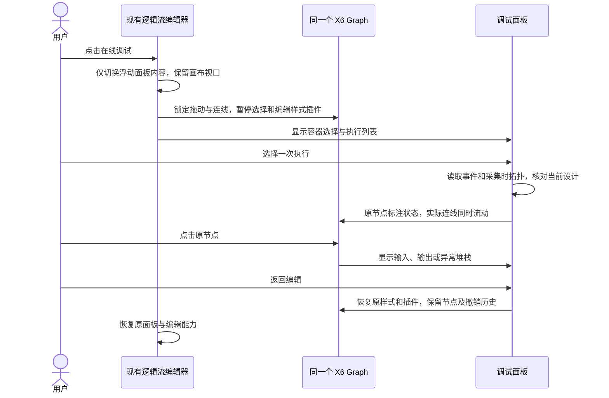
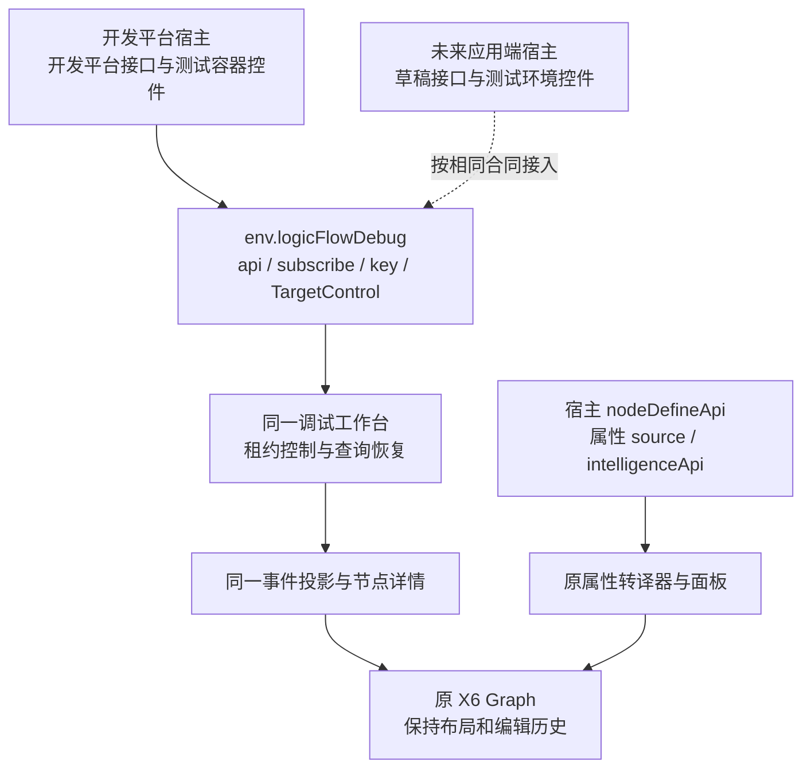
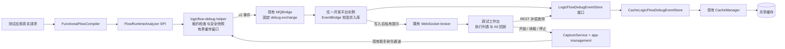
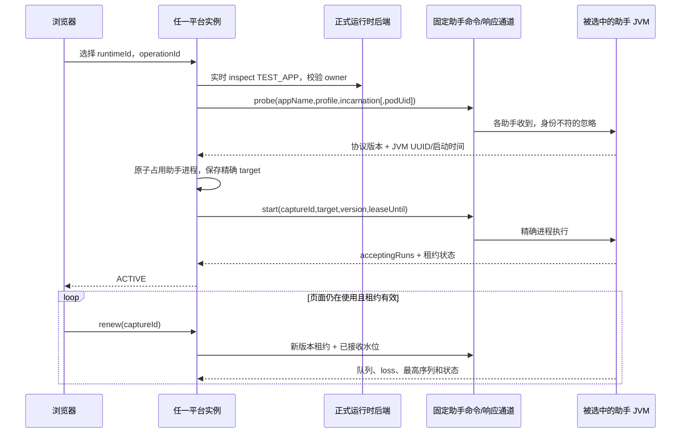
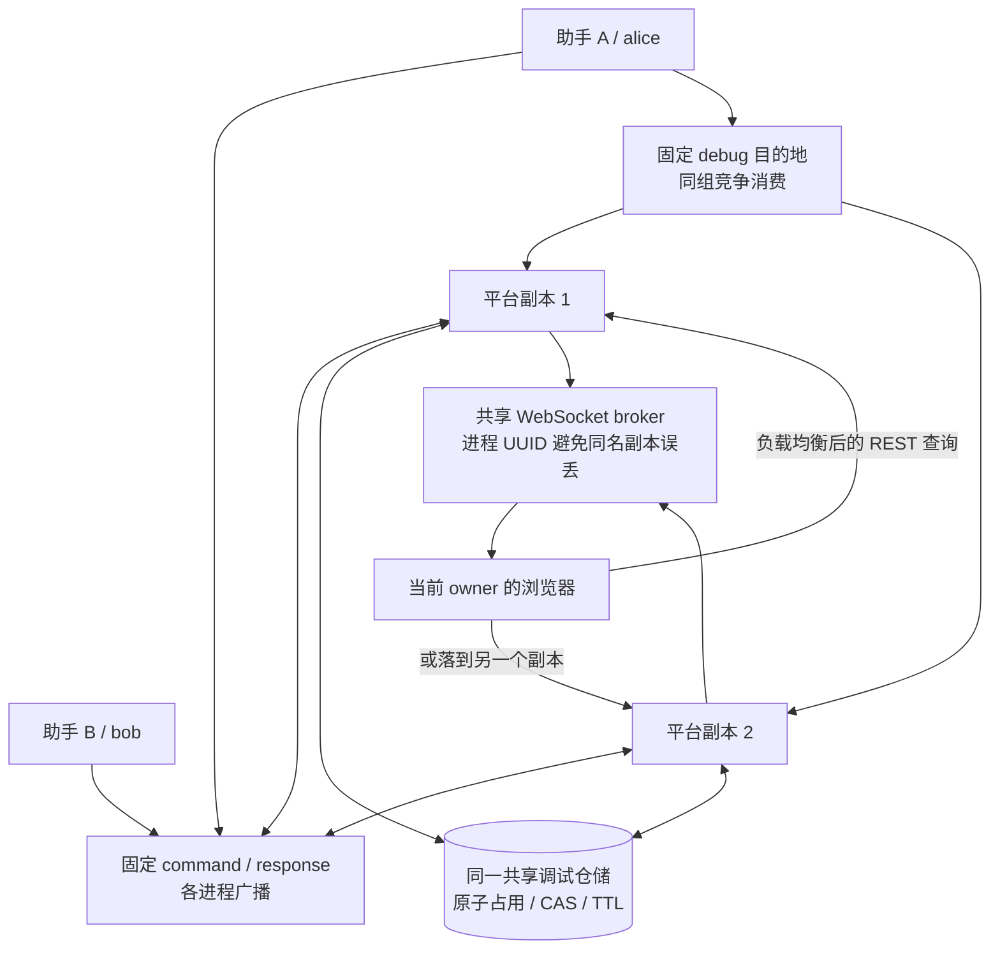
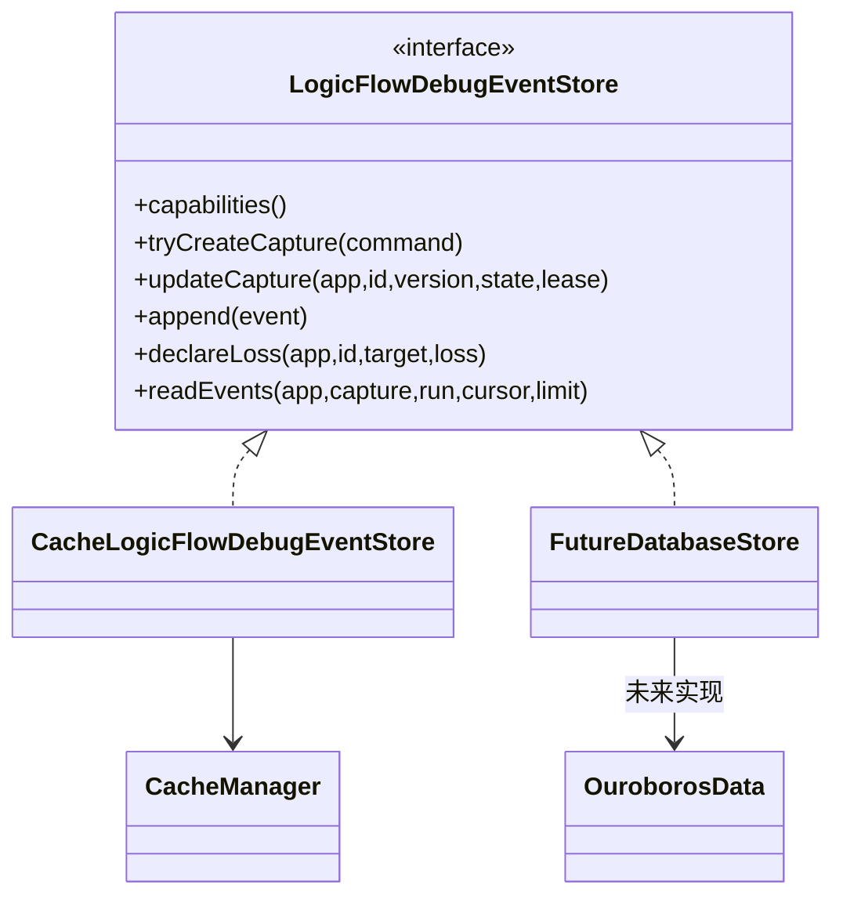
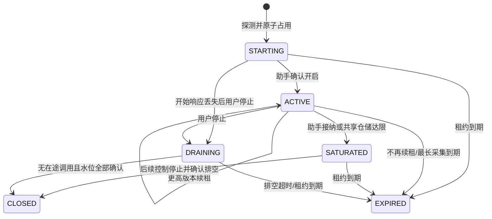

# 逻辑流在线调试

状态：已实现，本地正式平台验收通过，尚未生产发布。分支 `feat/logicflow-online-debug`，设计基线 `dev-next@f6144fdd037055f219e940c14df98095a6da7757`。本文描述当前分支的实现；分段验证与正式平台验收分别记录，不能据此推定已在目标环境启用。

## 使用行为

在逻辑流编辑器中进入“在线调试”，选择本人运行中的 TEST_APP 测试容器并点击“开始记录”。按钮使用“开始记录 / 停止记录”，状态为“待记录 / 记录中 / 已停止记录”；停止后已有执行仍可查看。随后通过测试应用的页面、接口、任务或消息触发逻辑流，执行列表显示本轮采集接纳的每一次根调用。选择一次执行后，立即显示该次执行的节点最终状态，实际流经的连线同时流动；点击节点查看输入、输出、跳过、上游阻断和异常堆栈。嵌套调用和异常处理作用域分别选择。

默认使用“完整路径”，支持暂停和恢复连线流动；逐事件检查折叠为辅助工具，包含播放、单步、倍速和进度拖动。业务线程按原有流程执行；画布不提供断点挂起、变量改写或重新执行业务。调试复用当前编辑器的同一个 X6 Graph、节点与连线，进入时将节点库与编辑属性内容切换为调试面板，保留原小地图和画布导航，锁定节点移动、端口连线及选择编辑；退出恢复原面板可见性、交互权限和样式。调试标注不修改模型数据、不进入撤销栈。

界面保持现有编辑器的浮动面板布局。左侧在节点库的原位置、原宽度展示容器选择、开始/停止采集、执行记录和历史；顶部在原工具栏位置展示调试模式、路径动画控制和返回编辑；右侧在属性面板位置展示节点详情。编辑与调试共用 `EditorPanel` 外壳和 `Toolbar`，沿用现有边距、圆角、阴影、标题和按钮样式。

画布始终占据同一个完整区域；面板叠加在画布上，显示、隐藏、展开详情均不挤压画布。进入、退出、切换执行和选择节点时不调用布局、居中、缩放、平移或滚动恢复；节点屏幕位置、SVG 变换和滚动位置保持原样。用户仍可通过原小地图显式缩放、居中或适配画布。节点详情在右侧纵向显示输入和输出，异常视图显示根因和可横向滚动的原始堆栈；可关闭或加宽详情面板，不改变画布尺寸。“事件时间线”提供定位，逐事件检查收在原位置的浮动工具栏中。

完整记录可确定性回放；事件、图或终态缺失时显示“不完整”。业务成功与记录完整是两个维度。缓存历史是临时数据，收到 ACK 不代表持久化保存。

## 原画布的调试模式

画布组件和其定位持续不变，调试面板通过现有浮动面板外壳叠加在左右两侧，工具栏保持原停靠位置。调试模式不建立 Grid 工作区、不修改画布尺寸与边距、不重建 Graph，也不修改视口。调试层只控制状态标注、连线流动与节点点击。Canvas 的动态只读机制处理进入/退出及数据延迟初始化，既有控制器的只读引用同时阻止自动布局、删除、端口编辑和撤销等编辑操作。

运行标注暂时暂停正式 LogicFlowPlugin 的编辑样式监听，并保存原属性；每次标注与恢复临时关闭 History 记录，再恢复其原启用状态。退出按原启用状态恢复插件，已有业务编辑的撤销记录保留。进入时不重置用户面板偏好，调试中的节点/空白点击也不改这些偏好。

采集拓扑与当前设计按流程名、业务节点名/类型、端口数量和连接端点核对，忽略编辑器的虚拟入口/出口节点与连线。匹配才允许标注；不匹配时保留原画布样式并明确提示，事件详情仍可查看。子流程属于其他流程时提示在对应逻辑流查看，不另绘第二张图。该核对证明拓扑兼容，不能证明未保存脚本或节点配置与测试容器版本完全相同；精确运行修订信息取自采集快照。

## 多宿主接入与应用端演进

编辑器通过 `env.logicFlowDebug` 接收调试宿主，由宿主提供接口操作、通知订阅、上下文标识和目标控件。开发平台默认适配器负责 `/api/dev/...`、私有 STOMP 地址及测试容器选择；通用工作台负责记录状态、查询补偿和原画布回放。应用端可以替换接口及目标控件，保持画布、面板外壳、事件投影和异常详情一致。完整方法、配置和生命周期见[编辑器宿主合同](../../../../frontends/web/ouroboros-logicflow-editor/docs/runtime-debug-host.md)。

流程克隆、保存和发布仍由宿主承担，沿用编辑器 `value/onChange`。属性转译器尊重节点定义显式提供的元数据和脚本智能接口，缺省才使用开发平台地址。调试宿主的 `key` 必须区分应用、草稿和测试修订；变更时只卸载工作台并释放旧订阅和定时器，迟到响应不能进入新上下文，画布实例保持不变。

后端继续使用现有访问、运行时、通知和仓储端口。未来应用端需装配自己的路由、管理员授权、草稿归属和隔离测试身份；不能将前端切换模式当成授权，也不能通过放宽当前 TEST_APP 约束复用生产业务执行。当前只实现接入合同及两种宿主的组件验证，尚未实现应用端克隆、草稿服务、发布或真实应用端运行环境。

## 正式路径与模块责任

| 归属 | 正式入口与责任 |
| --- | --- |
| logicflow-core | `FunctionalFlowCompiler`、`FlowRuntimeAnalyzer`；根/子调用身份、输入来源、节点状态、根终态。观察器故障隔离，不改业务结果 |
| logicflow-debug-helper | 仅在有效租约内复制数据、生成运行图、记录有界事件；后台线程经 MQ 发送，业务线程不执行网络请求 |
| dev-helper | 现有 `List<Command>` 扩展点；探测、开始、续租、停止、状态五种命令，通用 dispatcher 校验 profile 和助手进程身份 |
| logicflow-dev | 仓储接口/默认缓存实现、采集编排、事件接收、HTTP 控制与恢复；通过访问、运行时、通知端口衔接上层 |
| dev-app-management | 正式运行时服务实时 inspect、用户编辑权限、容器归属、助手 JAR 准备与注入、私有提示 |
| websocket | 使用每进程唯一实例标识进行跨平台私有投递；simple broker 仅用于单实例 |
| logicflow-editor | REST 事实恢复、私有提示订阅、纯事件投影；在原画布上叠加可恢复样式。退出释放订阅和定时器、恢复插件与样式，保留原 X6 实例 |

不另建助手注册中心、每容器 topic 或调试专用传输栈。动态 MQ 输入沿 `MQBridge` 创建，在其所属 Spring 上下文关闭时解除；子上下文关闭不影响父桥，连接工厂销毁前完成解绑。

`FlowRuntimeAnalyzer.isEnabled()` 在每次调用前检查观察器是否启用，默认返回 true 保持原有观察器行为。未开启采集的助手返回 false，编译器不为其创建执行上下文；检查和回调异常均隔离于业务执行。停止接纳后，仍有在途调用时继续观察以完成嵌套执行的排空。

## appName + profile 与精确目标

`appName + profile` 保留为逻辑位置，便于发现、人工管理和容器反复重建。它不足以证明“这条消息来自用户刚刚选中的进程”：滚动更新、旧进程迟到响应、profile 规范化碰撞都可能在短时间内产生同名对象。

本实现把逻辑位置与当次身份分开：

| 身份 | 生命周期与来源 |
| --- | --- |
| appName、profile | 人可理解的逻辑位置；profile 从当前登录身份按既有规则解析 |
| runtimeId、runtimeGeneration | 正式 DevRuntimeService 实时 inspect 的选中 TEST_APP |
| appIncarnationId | 每次测试容器创建注入 UUID，禁止复用旧实例的值 |
| helperInstanceId、helperStartedAtEpochMillis | 助手 JVM 自行生成，重启即变；探测响应和命令响应均带回 |
| Kubernetes Pod UID | Deployment 下恰好一个可用目标 Pod 时允许探测；通过 Downward API 注入，与实时 inspect 比较 |

Docker 元数据需同时保留原始创建者 `OUROBOROS_DEBUG_OWNER`，不能把规范化后相同的 profile 当作同一用户。旧容器缺少新身份或助手时，界面显示需要重建。

探测后再重建的容器不会接管旧采集；控制命令和响应按已绑定身份围栏。迟到的 START/RENEW 不能越过更高版本 STOP。控制记录丢失后不根据迟到事件重建旧 capture。

占位按 appName/profile、incarnation、助手 UUID/启动时间绑定进程。同一进程的重复采集竞争同一占位；重建后的新进程可以立即开始，旧会话迟到关闭只能释放自己的占位。历史保留和应用/平台容量约束仍共同生效。

## 多活 MQ 与恢复

只使用三个既有/固定目的地：`ouroboros.dev-helper.command`、`ouroboros.dev-helper.response`、`ouroboros.logicflow.debug`。

- 命令和响应为每进程广播订阅。助手按目标身份过滤；发起请求的平台只领取 sequenceId 和预期身份均匹配的响应。
- 调试事件用固定组 `logicflow-debug-ingest-v2` 竞争消费，任一平台写相同仓储。不依赖会话粘滞、某一平台内存或每次重建重订阅新 topic。
- 浏览器订阅 `/user/queue/dev/logicflow/debug/{captureId}`。通知只含更新提示，明细经已鉴权的 REST 查询；旧公共调试 topic 停发敏感数据。

事件同时有 captureSeq（采集全局序列）和 seq（某次根执行序列）。保存不可变事件和执行索引后才推进最高连续接收水位；乱序等待、重复幂等、同序号不同内容拒绝。payload map 键顺序变化不会形成伪冲突。字节预算先 CAS 预留，部分写入失败重试不重复收费，也不提前确认。

助手每 100 ms 通过发送线程尝试最多 50 个到期包。MQ 不可用时保留有界窗口并重试；续租/状态返回 highest、ACK、队列字节和明确 loss，平台写入 loss 后才能跨过永久缺口。网络异常不在业务线程传播。

浏览器每 2 秒补偿读取采集摘要，所选执行分页读取并按 seq 合并；完整记录读齐后停止重复轮询事件。提示丢失、平台切换和浏览器重连均从同一仓储恢复。没有可恢复数据时明确返回不存在、过期或不完整，不自动重执行业务。

## 共享仓储接口与装配

[LogicFlowDebugEventStore](../../ouroboros-logicflow-dev/src/main/java/com/ouroboros/logicflow/dev/service/LogicFlowDebugEventStore.java) 是控制、接收和查询的共同合同。默认 [CacheLogicFlowDebugEventStore](../../ouroboros-logicflow-dev/src/main/java/com/ouroboros/logicflow/dev/service/CacheLogicFlowDebugEventStore.java) 仅通过 CacheManager 官方能力读写；Redis Lua/MGET 由 app-runtime 的正式缓存适配器封装。

接口包括 capabilities、tryCreateCapture、get/update/listCapture、put/getGraph、append、declareLoss 和 readEvents。所有实现都要满足原子竞争、版本冲突、重复/乱序、部分失败、逻辑过期与分页的行为合同。

默认 Bean 在现有 logicflow-dev 扫描范围内以 `@ConditionalOnMissingBean(LogicFlowDebugEventStore.class)` 装配。提供一个自定义接口 Bean 即可完整替换，不能双写或请求期间自动切换。未来数据库适配器通过 ouroboros-data / QueryDSL 实现事务与条件更新，届时再建表、索引和迁移。

单机允许内存缓存。多活必须设置 `ouroboros.logicflow.debug.require-shared-cache=true`，所有副本使用同一共享缓存、序列化和 `ouroboros.logicflow.debug.cache-region`（默认 `logicflow-debug`）。不具备原子控制/共享能力时明确拒绝采集，不能静默降级。提供自定义仓储后该缓存开关不控制自定义实现。

app-runtime 通过正式 `META-INF/services/com.ouroboros.cache.CacheManager` 注册已有 Spring 适配器的 SingletonHolder，使 CacheManager 默认入口选中平台实际装配的 Spring 缓存。Redis 行为测试同时覆盖默认 SPI 入口与两个独立客户端，不能只用注入适配器的夹具代替默认装配验收。

控制记录、不可变事件及图协调绝对过期时间。丢失控制记录则不能续租或继续入库；丢失单个事件/图则查询判定不完整。缓存后端驱逐、重启和无持久化丢失均属于临时数据合同；ACK 不是灾难恢复保证。

## 租约、容量与数据边界

EXPIRED 为读模型根据期限计算的状态；过期不需要 reaper 才生效。助手也在记录/发送/状态操作时按单调时钟检查租约，最长再保留有界排空窗口。页面离开后不再续租，业务照常执行。

| 边界 | 当前默认值 | 达限行为 |
| --- | --- | --- |
| 租约与采集时长 | 平台每次 20 秒，浏览器约 5 秒续租；单轮最长 10 分钟 | 到期不复活；未完成执行标记不完整 |
| 助手执行与事件 | 32 个并发根调用、每轮 100 次、256 个调用上下文、每次 2,000 事件/8 MiB | 第 100 次接纳即关闭后续接纳；并发满则拒绝并关闭接纳，在途执行继续排空；事件截断另报 loss，业务继续 |
| 助手重传 | 4,096 个事件、16 MiB、单事件 64 KiB | 有界保留与缺失报告，禁止无界堆积 |
| 快照 | 深度 6、每容器 50 项、总 500 项、字符串 8,192 字符、总 32,768 字符 | 标注截断、循环和不支持类型 |
| 异常 | 128 帧、8 层 cause、每层 4 个 suppressed | 堆栈有界，限制应用自定义访问器执行 |
| 运行图 | 最多 2,000 节点/10,000 边，源快照另限 24 KiB | 大图不能完整调试时明确 loss |
| 仓储单轮 | 100 次执行、64 MiB payload 预算、256 个图 | SATURATED，声明缺失，下一次控制停止助手 |
| 应用/平台 | 预留应用 256 MiB、平台 1 GiB | 创建时按完整单轮预算原子预留，因此默认应用最多保留 4 轮、平台 16 轮 |
| 保留期 | 创建时起最长 10 分钟 + 30 分钟历史，即 40 分钟绝对上限 | 自动 TTL；不是每次访问或停止后重置 30 分钟 |
| 查询 | 每页最多 200 事件、单次执行最多 2,000 事件 | Redis 每 200 项批读，浏览器每次最多 10 页 |

存储预算计入图和两份事件 payload，不包含 Redis/JVM 的键、索引及对象开销，部署需要额外内存。失败的创建/部分写入可能保守保留预留额直到绝对期限；避免容量超卖。本期不主动淘汰已关闭记录让位，容量不足时返回明确错误。

以上为当前固定默认策略；未提供动态配置 UI 或项目级脱敏规则。缓存区域和共享要求是 Spring 启动配置。后续动态策略必须沿 ouroboros-configuration 接入，不能增加另一套配置服务。

快照只复制已知安全的标量和 JDK 容器，不调用任意业务 getter/toString；password/token/secret/authorization/cookie 等键在助手内屏蔽后才入队。任意字符串或异常消息中的秘密无法靠键规则识别，用户应在测试数据层处理。值截断与事件缺失分别显示。

## HTTP 与权限

所有入口前缀 `/api/dev/{appName}/logicflow/debug`，使用现有平台认证。原始 HTTP 返回 WebApiResult（`code/msg/data`），编辑器使用平台 AMIS fetcher 的规范化 `status/data`；数组经 AMIS 转成 `data.items` 后在 API 适配器还原。私有订阅使用正式 SDK 的 `Stomp` 能力。

| 方法与相对路径 | 行为 |
| --- | --- |
| GET `/targets` | 实时列出本人 TEST_APP，标注助手是否就绪 |
| GET `/captures?flowName=...` | 仅返回本人、仍有应用编辑权限的短期采集 |
| POST `/captures` | runtimeId、flowName、UUID operationId；开始响应丢失后以同一 UUID 重试 |
| GET `/captures/{captureId}` | 有界摘要、状态、执行列表、已接收水位 |
| POST `/captures/{captureId}/renew` | 续租或排空核对，同时传递 ACK |
| POST `/captures/{captureId}/stop` | 停止接纳新执行，排空，保留历史 |
| GET `/captures/{captureId}/runs/{runId}/events?afterSeq=0&limit=200` | 返回完整 v2 事件、afterSeq/highestSeq/hasMore/complete/availability |
| GET `/captures/{captureId}/graphs/{graphId}` | 读取采集时的只读图 |

原 sessions 只读入口保留为同一仓储的兼容视图，不维护第二份本机 session buffer。新增入口在源控制器中维护 OpenAPI operation/schema 描述，沿统一 RequestMapping → WebAPIModel → OpenAPI 导出，不手写第二份机器合同。

统一 Swagger 提取器合并控制器级 Tag/Security/ApiResponses 和方法级覆盖项；控制器级错误响应不会替换由返回类型推导的 200 schema。HTTP 合同测试从实际 MVC 映射经过正式模型和文档构建器输出 OpenAPI，校验认证、请求约束和错误状态。

访问边界：登录身份 → 应用编辑权限 → 原始容器 owner/profile → 采集 owner。每次读、续租、停止和通知均核验当前授权。其他 owner 看到相同“记录不存在或已过期”，避免暴露会话存在性；应用编辑权限撤销返回 403。

## 验收与发布状态

正式场景为 [logicflow-online-debugging](../../../../testing/integration/feature/lowcode/logicflow-online-debugging/scenario.yaml)。模块内测试归各模块，真实 Redis/MQ/HTTP 跨层测试归 platform/ouroboros-develop；私有通知多实例测试归 websocket 集成模块。

2026-11-13 本地发布候选验证已通过：主模块回归 860 条、外围模块回归 218 条；真实 Docker/MQ/Redis/HTTP 批次 30 条，覆盖同版本助手注入、容器重建、双平台/双助手独立 JVM、MQ 重启、重传去重及缓存丢失后的租约退出。另行通过助手命令合同 12 条、默认进程 UUID 下 Redis 私有消息/公共广播与共享路由 2 条、真实浏览器端到端 1 条。各批次包含重复场景，不合计为去重总数。

前一阶段前端回归通过 176 条 Node 测试、25 条 Vitest 单元测试、48 条集成测试、lint 和生产构建；构建仍有两处既有 Sass legacy API 警告。此前完整 Maven reactor test-compile、62 项架构检查与包边界检查通过。17 个包含生产源码变更的 bundle 均通过仓库原始 `jacoco:check@check` 的 LINE ≥70% 门槛。未宣称全仓 `verify` 通过：扩大到未修改依赖的验证曾被 common-app 存量覆盖率阻断。

性能按每模式 3 个独立 JVM、每次预热与测量各 10,000 次执行：基线/未采集/采集 p95 中位数分别为 64,792 / 64,667 / 160,708 ns；未采集增幅 −0.19%，采集增加约 0.096 ms，满足 ≤2% 和开启增幅 ≤10% 或增加 5 ms（取更宽者）的目标。重传队列排空后为零，发送线程释放。此测量使用替身传输，真实网络恢复由独立 MQ 集成测试覆盖，不能外推到任意业务流程或生产负载。

此前的浏览器验证直接挂载 RuntimeDebugWorkbench，使用真实 HTTP/MQ/Redis/Docker 链路，但属于隔离组件联调；认证身份固定，业务刺激和节点模型由夹具提供，不证明正式主应用和编辑器接入。

本轮补齐正式平台验收：`runtime-debug-platform.browser.spec.cjs` 从正式主应用导航进入现有编辑器，使用真实登录会话、AMIS fetcher、SDK STOMP 和本人 TEST_APP。通过普通业务 HTTP 请求触发两次正常和一次异常，验证完整路径同时流动、暂停后保留高亮、节点输入输出、异常标记及 Java 格式堆栈、下游阻断、停止后重新进入恢复历史；断言私有订阅与实际通知均存在，浏览器无 pageerror。最终一轮 1 条通过，耗时 53.7 秒，原始录像 54.16 秒，证据位于 `tmp/testing-evidence/logicflow-online-debugging/real-platform-recording/`。

此前界面重设计的 77.16 秒录屏位于 `tmp/testing-evidence/logicflow-online-debugging/redesign/`，其独立运行图方案已由本节“原画布的调试模式”替代；该历史视频不证明当前画布复用。原同 Graph 的 Grid 布局录屏保存在 `tmp/testing-evidence/logicflow-online-debugging/shared-canvas/`，不证明画布屏幕位置稳定。浮动面板方案的验证及录屏保存在 `tmp/testing-evidence/logicflow-online-debugging/stable-panels/`，需以该目录报告的最终结果判断；本轮只调整前端，不重跑完整后端批次。

2026-11-14 浮动面板最终验收为 `stable-panels/run-10`：正式平台浏览器 1 条通过，0 pageerror，收到 47 条私有通知。8 个固定视口检查点核对画布矩形、SVG 变换、滚动及节点屏幕坐标一致；另 1 个检查点证明手动滚动到新位置后退出仍保留当前视口。1600/1280 宽度均检查，窄窗口工具栏在剩余宽度内换行，不遮挡右侧标题。前端 Node 176 条、Vitest 单元 35 条、集成 51 条、lint、生产构建及 diff 检查通过；构建保留两处既有 Sass 弃用警告。原始 WebM、直接转码的 MP4、截图和坐标 JSON 均在该轮目录，具体范围与中间失败见 `stable-panels/report.md`。

2026-11-14 多宿主接入补充验证：Node 176 条、Vitest 单元 49 条、集成 53 条通过，lint 和生产构建通过。开发平台默认适配器和应用路径的测试适配器均使用同一工作台；后者覆盖固定草稿目标控件、原画布路径和堆栈、无 appName 的正式 Renderer 接入、草稿切换时的迟到响应隔离，以及禁用后释放订阅、取消续租并恢复编辑。属性数据源的默认值和显式覆盖均有行为验证。该轮是前端包回归，未重跑真实平台录屏或后端批次，不代表应用端草稿服务已经存在。

容器通过正式平台重启 API 后，`/app/deploy/extend` 仍在 loader.path，助手重新初始化并成功完成上述采集。修复基座 init.sh 把部署元数据软链接误判为内建目录的根因；`MothershipInitializationTest` 三项行为测试覆盖首次启动、重启及显式扩展开关。

正式录屏复用已登录会话，不包含输入密码；业务刺激通过 `docker exec curl` 访问真实容器内部普通 HTTP 路由。现有 Nginx 未转发 `/public-api`，后端 API 隧道未纳入此次验收。单平台录屏使用默认本地缓存；多活能力由独立 Redis/MQ/私有消息验证证明，不能由单平台视频推定。

Kubernetes 已验证单元行为及模拟 API，未验证真实集群。MQ 替换实现、目标部署配置及真实集群启用仍应按正式场景验收。原始日志、截图、覆盖率和本轮报告保存在任务工作区忽略目录 `tmp/testing-evidence/logicflow-online-debugging/`，尚未上传 CI 或外部存储。

部署操作与恢复见 [在线调试运行手册](../../../../docs/runbooks/logicflow-online-debugging.md)。平台、四个支持 JAR 和编辑器须同版本部署，多活须启用共享缓存要求与跨实例私有消息路由，旧测试容器需重建。本分支没有执行生产部署。
