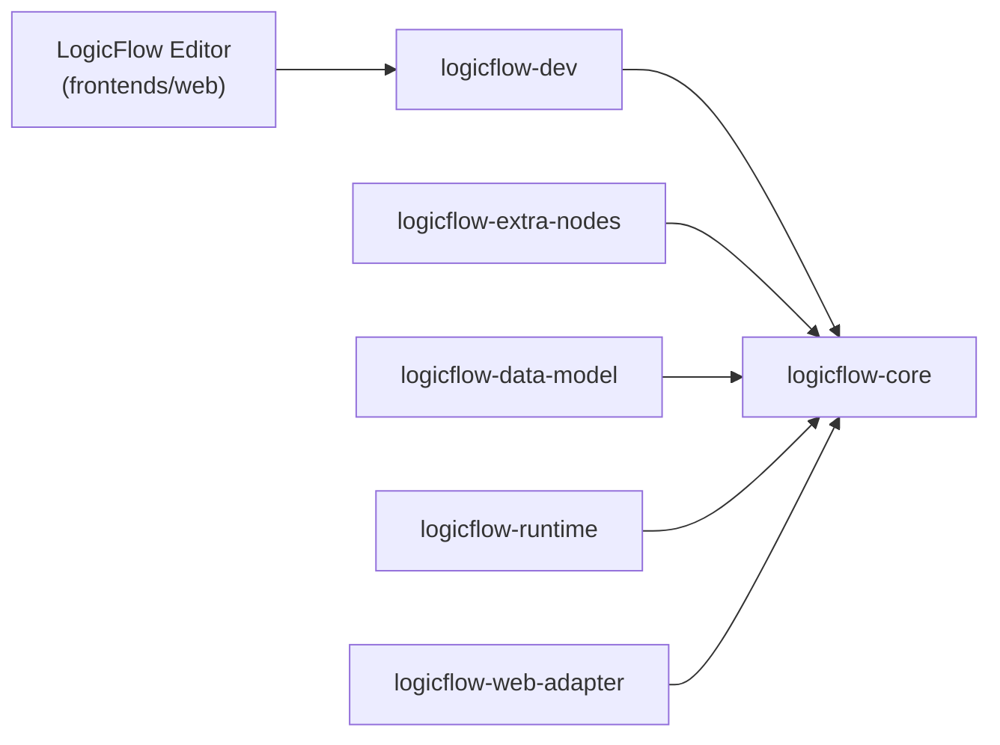

# LogicFlow 阅读路径与模块边界（Reading Paths / Module Boundaries）深化说明

更新日期：`2026-03-18`

> 回到总览：[`DESIGN.md`](../../DESIGN.md)
>
> 模块入口：[`README.md`](../../README.md)

这份文档补的是“导航层”，不是新的底层机制。

前面的章节已经把 LogicFlow 拆成了原则、装配、执行、端口、错误、测试等多条切片；但如果缺少一份稳定的阅读地图，后来者仍然很容易在三个地方迷路：

- 不知道应该先看哪几章，结果一上来就扎进局部实现。
- 不知道某个问题到底属于 `core`、`dev`、`adapter` 还是 `editor`。
- 不知道改动一个点之后，哪些章节和哪些模块必须一起检查，最终造成设计一致性漂移。

所以这章只做三件事：

- 给不同角色一条尽量低学习成本的阅读路径。
- 给每个模块一个“它负责什么、不负责什么”的边界描述。
- 给常见改动一张回查地图，帮助后续工作保持自顶向下的收敛。

## 1. 先看全貌：LogicFlow 不是一个单模块能力

如果只看 `logicflow-core`，很容易以为 LogicFlow 只是“节点执行引擎”。

但真正的模块全貌其实是五层协作：

1. **语义内核**
   - `ouroboros-logicflow-core`
   - 标准节点实现位于 `ouroboros-logicflow-builtin-nodes`，共享内核抽象
   - 定义什么是合法图、合法端口、合法成功终点、合法错误流，以及这些语义如何被编译执行。
2. **能力扩展层**
   - `ouroboros-logicflow-extra-nodes`
   - `ouroboros-logicflow-data-model`
   - 在不改写核心调度语义的前提下，提供异常终点、文件读取、数据模型等节点能力。
3. **运行时与适配层**
   - `ouroboros-logicflow-runtime`
   - `ouroboros-logicflow-web-adapter`
   - 把核心模型接入平台运行时、请求语义和事务边界。
4. **开发态与作者态层**
   - `ouroboros-logicflow-authoring`、`ouroboros-logicflow-dev`
   - authoring 提供无 Web 依赖的节点定义合同；dev 把 core 的语义和诊断快照转成可保存、可查看、可被编辑器消费的作品化合同。
5. **前端编辑器层**
   - `frontends/web/ouroboros-logicflow-editor`
   - 消费 NodeDefine、校验结果和模型元数据，提供建模体验，但不创造新的底层语义。

可以把它先理解成这样一张图：

这张图有两个阅读上的关键提醒：

- **箭头不是 Maven 依赖图的精确表达，而是语义消费方向。**
- **只有 `core` 是语义权威；其他层都是消费、装配、映射或体验层。**

## 2. 按角色阅读：别让每个人都从同一个入口硬读

### 2.1 如果你是第一次接触 LogicFlow

推荐顺序：

1. [`DESIGN.md`](../../DESIGN.md)
2. [`reviews/2026-03-18-report-current-baseline.md`](https://gitlab.whxinpai.com/ouroboros-lowcode/ouroboros/-/blob/d2ebfd746acbaab0d3fc461ba4850e68c0d14cff/core/ouroboros-logicflow/reviews/2026-03-18-report-current-baseline.md)
3. [`DESIGN-READING-PATHS-AND-MODULE-BOUNDARIES.md`](../reading-paths-and-module-boundaries/overview.md)
4. [`DESIGN-GLOSSARY-AND-DECISION-LEXICON.md`](../glossary-and-decision-lexicon/overview.md)
5. [`DESIGN-CORE-ABSTRACTIONS-AND-PATTERNS.md`](../core-abstractions-and-patterns/overview.md)
6. [`DESIGN-AUTHORING-PORTS-AND-RUNTIME-PORT-MATERIALIZATION-BOUNDARIES.md`](../authoring-ports-and-runtime-port-materialization-boundaries/overview.md)
7. [`DESIGN-TYPE-SYSTEM-AND-COMPATIBILITY-BOUNDARIES.md`](../type-system-and-compatibility-boundaries/overview.md)
8. [`DESIGN-SUCCESSFUL-TERMINALS-AND-EARLY-EXIT-BOUNDARIES.md`](../successful-terminals-and-early-exit-boundaries/overview.md)
9. [`DESIGN-ERROR-FLOW-RECOVERY-AND-FAIL-CLOSED-BOUNDARIES.md`](../error-flow-recovery-and-fail-closed-boundaries/overview.md)
10. [`DESIGN-INPUT-SEMANTICS-AND-JOIN-BOUNDARIES.md`](../input-semantics-and-join-boundaries/overview.md)
11. [`DESIGN-DECISION-SIGNALS-AND-PATH-ACTIVATION-BOUNDARIES.md`](../decision-signals-and-path-activation-boundaries/overview.md)
12. [`DESIGN-SELECTIVE-OUTPUT-AND-EXCLUSIVE-PORT-BOUNDARIES.md`](../selective-output-and-exclusive-port-boundaries/overview.md)
13. [`DESIGN-CANONICAL-SCENARIOS-AND-END-TO-END-WALKTHROUGHS.md`](../canonical-scenarios-and-end-to-end-walkthroughs/overview.md)
14. [`DESIGN-CONCEPT-TO-SOURCE-CROSSWALK.md`](../concept-to-source-crosswalk/overview.md)
15. [`DESIGN-NODE-CAPABILITY-MATRIX.md`](../node-capability-matrix/overview.md)
16. [`DESIGN-RUNTIME-EXECUTION.md`](../runtime-execution/overview.md)

这一条路径的目标不是立刻能改代码，而是先建立三个基础心智模型：

- 它是 DAG 编排内核，不是审批流引擎。
- 真正的控制流能力当前仍然是“薄层”。
- 编辑器、dev、adapter 都是在消费 core，而不是与 core 并列定义语义。

### 2.2 如果你要改 `core` 的图语义、终点语义或执行机制

推荐顺序：

1. [`DESIGN.md`](../../DESIGN.md)
2. [`DESIGN-CORE-ABSTRACTIONS-AND-PATTERNS.md`](../core-abstractions-and-patterns/overview.md)
3. [`DESIGN-AUTHORING-PORTS-AND-RUNTIME-PORT-MATERIALIZATION-BOUNDARIES.md`](../authoring-ports-and-runtime-port-materialization-boundaries/overview.md)
4. [`DESIGN-TYPE-SYSTEM-AND-COMPATIBILITY-BOUNDARIES.md`](../type-system-and-compatibility-boundaries/overview.md)
5. [`DESIGN-SUCCESSFUL-TERMINALS-AND-EARLY-EXIT-BOUNDARIES.md`](../successful-terminals-and-early-exit-boundaries/overview.md)
6. [`DESIGN-ERROR-FLOW-RECOVERY-AND-FAIL-CLOSED-BOUNDARIES.md`](../error-flow-recovery-and-fail-closed-boundaries/overview.md)
7. [`DESIGN-INPUT-SEMANTICS-AND-JOIN-BOUNDARIES.md`](../input-semantics-and-join-boundaries/overview.md)
8. [`DESIGN-DECISION-SIGNALS-AND-PATH-ACTIVATION-BOUNDARIES.md`](../decision-signals-and-path-activation-boundaries/overview.md)
9. [`DESIGN-SELECTIVE-OUTPUT-AND-EXCLUSIVE-PORT-BOUNDARIES.md`](../selective-output-and-exclusive-port-boundaries/overview.md)
10. [`DESIGN-MODEL-ASSEMBLY-PIPELINE.md`](../model-assembly-pipeline/overview.md)
11. [`DESIGN-STATIC-ANALYSIS.md`](../static-analysis/overview.md)
12. [`DESIGN-CANONICAL-SCENARIOS-AND-END-TO-END-WALKTHROUGHS.md`](../canonical-scenarios-and-end-to-end-walkthroughs/overview.md)
13. [`DESIGN-GLOSSARY-AND-DECISION-LEXICON.md`](../glossary-and-decision-lexicon/overview.md)
14. [`DESIGN-CONCEPT-TO-SOURCE-CROSSWALK.md`](../concept-to-source-crosswalk/overview.md)
15. [`DESIGN-RUNTIME-EXECUTION.md`](../runtime-execution/overview.md)
16. [`DESIGN-PORTS-AND-DATA-CONTRACTS.md`](../ports-and-data-contracts/overview.md)
17. [`DESIGN-RESULT-CONTRACTS-AND-DIAGNOSTIC-SURFACES.md`](../result-contracts-and-diagnostic-surfaces/overview.md)

这条路径适合处理：

- 成功终点 / 错误流 / selective-output 这类语义问题
- 静态分析规则的新增或收紧
- 结果合同、执行收口、fail-closed 行为

### 2.3 如果你要新增或重构节点

推荐顺序：

1. [`DESIGN-NODE-CAPABILITY-MATRIX.md`](../node-capability-matrix/overview.md)
2. [`DESIGN-CONTROL-FLOW-NODE-CATALOG.md`](../control-flow-node-catalog/overview.md)
3. [`DESIGN-NODE-EXTENSIONS.md`](../node-extensions/overview.md)
4. [`DESIGN-GLOSSARY-AND-DECISION-LEXICON.md`](../glossary-and-decision-lexicon/overview.md)
5. [`DESIGN-CONCEPT-TO-SOURCE-CROSSWALK.md`](../concept-to-source-crosswalk/overview.md)
6. [`DESIGN-PORTS-AND-DATA-CONTRACTS.md`](../ports-and-data-contracts/overview.md)
7. [`DESIGN-AUTHORING-PORTS-AND-RUNTIME-PORT-MATERIALIZATION-BOUNDARIES.md`](../authoring-ports-and-runtime-port-materialization-boundaries/overview.md)
8. [`DESIGN-TYPE-SYSTEM-AND-COMPATIBILITY-BOUNDARIES.md`](../type-system-and-compatibility-boundaries/overview.md)
9. [`DESIGN-DECISION-SIGNALS-AND-PATH-ACTIVATION-BOUNDARIES.md`](../decision-signals-and-path-activation-boundaries/overview.md)
10. [`DESIGN-NODE-DEFINES-AND-EDITOR-CAPABILITIES.md`](../node-defines-and-editor-capabilities/overview.md)
11. [`DESIGN-TESTING-AND-VERIFICATION.md`](../testing-and-verification/overview.md)

这条路径的重点是先回答“它到底是哪一类节点”，再去写代码：

- 是 payload transform？
- 是真正的 control-flow primitive？
- 是 external capability adapter？
- 还是某个领域家族里的操作节点？

### 2.4 如果你要改 dev / editor 的建模合同

推荐顺序：

1. [`DESIGN-AUTHORING-CONTRACTS.md`](../authoring-contracts/overview.md)
2. [`DESIGN-NODE-DEFINES-AND-EDITOR-CAPABILITIES.md`](../node-defines-and-editor-capabilities/overview.md)
3. [`DESIGN-EDITOR-EMBEDDING-AND-LIFECYCLE-BOUNDARIES.md`](../editor-embedding-and-lifecycle-boundaries/overview.md)
4. [`DESIGN-MODEL-STATE-AND-RUNTIME-GATING.md`](../model-state-and-runtime-gating/overview.md)
5. [`DESIGN-PORTS-AND-DATA-CONTRACTS.md`](../ports-and-data-contracts/overview.md)
6. [`DESIGN-AUTHORING-PORTS-AND-RUNTIME-PORT-MATERIALIZATION-BOUNDARIES.md`](../authoring-ports-and-runtime-port-materialization-boundaries/overview.md)
7. [`DESIGN-SELECTIVE-OUTPUT-AND-EXCLUSIVE-PORT-BOUNDARIES.md`](../selective-output-and-exclusive-port-boundaries/overview.md)
8. [`DESIGN-TESTING-AND-VERIFICATION.md`](../testing-and-verification/overview.md)

这里最容易犯的错是：

- 把 NodeDefine 当成 runtime 真相。
- 把 editor fallback 当成正式语义来源。
- 把前端 warning/展示状态误当成后端 gating 规则。

### 2.5 如果你要改 runtime / web adapter 的执行接缝

推荐顺序：

1. [`DESIGN-MODEL-LIFECYCLE.md`](../model-lifecycle/overview.md)
2. [`DESIGN-MODEL-STATE-AND-RUNTIME-GATING.md`](../model-state-and-runtime-gating/overview.md)
3. [`DESIGN-ADAPTER-AND-TRANSACTION-BOUNDARIES.md`](../adapter-and-transaction-boundaries/overview.md)
4. [`DESIGN-RESULT-CONTRACTS-AND-DIAGNOSTIC-SURFACES.md`](../result-contracts-and-diagnostic-surfaces/overview.md)
5. [`DESIGN-ERROR-HANDLING.md`](../error-handling/overview.md)

这一层的核心问题通常不是“节点怎么执行”，而是：

- 模型如何被选中、刷新和提供。
- invalid 但 enabled 的模型如何对外呈现。
- 请求适配、异常映射和事务边界应该停在哪一层。

### 2.6 如果你要维护测试、夹具和跨栈回归

推荐顺序：

1. [`DESIGN-TESTING-AND-VERIFICATION.md`](../testing-and-verification/overview.md)
2. [`reviews/2026-03-18-report-current-baseline.md`](https://gitlab.whxinpai.com/ouroboros-lowcode/ouroboros/-/blob/d2ebfd746acbaab0d3fc461ba4850e68c0d14cff/core/ouroboros-logicflow/reviews/2026-03-18-report-current-baseline.md)
3. [`docs/logicflow/references.md`](../../../../docs/logicflow/references.md)
4. [`README.md`](../../README.md)

这条路径的目标是先分清“哪一层在守什么”，避免：

- 用 editor 测试替代 core 语义测试
- 用跨栈 smoke 替代模块级回归
- 为了测通链路临时特调实现，反过来破坏设计原则

## 3. 模块边界：每个模块该承载什么，不该承载什么

| 模块 | 主要职责 | 语义权威 | 不应承载的职责 | 推荐回查文档 |
| --- | --- | --- | --- | --- |
| `ouroboros-logicflow-core` | 流程模型、节点抽象、装配校验、执行编译、结果收口、错误流 | 最高；合法图与运行时语义都以它为准 | 不应把 editor 体验逻辑、HTTP 适配或平台展示策略写进 core | [`DESIGN.md`](../../DESIGN.md)、[`DESIGN-MODEL-ASSEMBLY-PIPELINE.md`](../model-assembly-pipeline/overview.md)、[`DESIGN-RUNTIME-EXECUTION.md`](../runtime-execution/overview.md) |
| `ouroboros-logicflow-runtime` | 把 core 接入平台运行时，提供模型供应与生命周期装配 | 运行时集成边界 | 不应自行发明新的流程语义或覆盖 core 校验口径 | [`DESIGN-MODEL-LIFECYCLE.md`](../model-lifecycle/overview.md)、[`DESIGN-ADAPTER-AND-TRANSACTION-BOUNDARIES.md`](../adapter-and-transaction-boundaries/overview.md) |
| `ouroboros-logicflow-web-adapter` | Web 请求到流程输入的适配、外层事务兜底、响应/异常映射 | Web 调用边界 | 不应把业务可见错误语义写成另一套私有契约 | [`DESIGN-ADAPTER-AND-TRANSACTION-BOUNDARIES.md`](../adapter-and-transaction-boundaries/overview.md)、[`DESIGN-ERROR-HANDLING.md`](../error-handling/overview.md) |
| `ouroboros-logicflow-dev` | 建模态 API、NodeDefine 供给、保存时诊断快照、作品化合同输出 | authoring/dev contract 权威 | 不应让 validation snapshot 反向决定 runtime gate | [`DESIGN-AUTHORING-CONTRACTS.md`](../authoring-contracts/overview.md)、[`DESIGN-MODEL-STATE-AND-RUNTIME-GATING.md`](../model-state-and-runtime-gating/overview.md) |
| `ouroboros-logicflow-extra-nodes` | 平台或资源能力型节点扩展 | 节点实现级权威 | 不应在这里偷塞新的调度原语并绕过 core 协同演进 | [`DESIGN-NODE-EXTENSIONS.md`](../node-extensions/overview.md)、[`DESIGN-NODE-CAPABILITY-MATRIX.md`](../node-capability-matrix/overview.md) |
| `ouroboros-logicflow-data-model` | 数据模型领域节点家族 | 领域节点家族权威 | 不应被误读为控制流原语库 | [`DESIGN-NODE-CAPABILITY-MATRIX.md`](../node-capability-matrix/overview.md)、[`DESIGN-NODE-EXTENSIONS.md`](../node-extensions/overview.md) |
| `frontends/web/ouroboros-logicflow-editor` | 建模体验、可视化呈现、warning 提示、保存交互 | 体验层权威 | 不应生成 core 无法执行的模型；不应以 UI 兜底替代后端语义 | [`DESIGN-NODE-DEFINES-AND-EDITOR-CAPABILITIES.md`](../node-defines-and-editor-capabilities/overview.md)、[`DESIGN-AUTHORING-CONTRACTS.md`](../authoring-contracts/overview.md) |

如果只记一条边界规则，可以记这个版本：

- **core 决定“是什么”**
- **dev 决定“怎么被作者看见和保存”**
- **editor 决定“怎么被画出来和提示出来”**
- **runtime/adapter 决定“怎么接进平台调用链”**

## 4. 常见改动，到底要联动检查哪些层

### 4.1 改成功终点、结果语义或提前退出相关规则

至少要联动检查：

- `core` 的成功终点识别与静态分析
- `core` 的执行收口与 `FlowOutcome`
- `dev` 的诊断呈现和模型状态描述
- `editor` 的终点视觉与保存提示
- 模块级与跨栈测试

推荐回查：

- [`DESIGN-ERROR-FLOW-RECOVERY-AND-FAIL-CLOSED-BOUNDARIES.md`](../error-flow-recovery-and-fail-closed-boundaries/overview.md)
- [`DESIGN-SUCCESSFUL-TERMINALS-AND-EARLY-EXIT-BOUNDARIES.md`](../successful-terminals-and-early-exit-boundaries/overview.md)
- [`DESIGN-STATIC-ANALYSIS.md`](../static-analysis/overview.md)
- [`DESIGN-RUNTIME-EXECUTION.md`](../runtime-execution/overview.md)
- [`DESIGN-RESULT-CONTRACTS-AND-DIAGNOSTIC-SURFACES.md`](../result-contracts-and-diagnostic-surfaces/overview.md)
- [`DESIGN-MODEL-STATE-AND-RUNTIME-GATING.md`](../model-state-and-runtime-gating/overview.md)

### 4.2 改 selective-output、端口互斥或连接规则

至少要联动检查：

- `FlowNodePortMeta` / runtime 端口补齐
- 静态分析里的互斥证明、输入冲突、竞态条件
- NodeDefine / editor 的端口展示与连线约束
- 对应夹具与语义测试

推荐回查：

- [`DESIGN-AUTHORING-PORTS-AND-RUNTIME-PORT-MATERIALIZATION-BOUNDARIES.md`](../authoring-ports-and-runtime-port-materialization-boundaries/overview.md)
- [`DESIGN-SELECTIVE-OUTPUT-AND-EXCLUSIVE-PORT-BOUNDARIES.md`](../selective-output-and-exclusive-port-boundaries/overview.md)
- [`DESIGN-INPUT-SEMANTICS-AND-JOIN-BOUNDARIES.md`](../input-semantics-and-join-boundaries/overview.md)
- [`DESIGN-PORTS-AND-DATA-CONTRACTS.md`](../ports-and-data-contracts/overview.md)
- [`DESIGN-STATIC-ANALYSIS.md`](../static-analysis/overview.md)
- [`DESIGN-NODE-DEFINES-AND-EDITOR-CAPABILITIES.md`](../node-defines-and-editor-capabilities/overview.md)

### 4.3 新增一个节点

至少要联动检查：

- 节点应该落在哪个模块
- 该节点属于哪一类语义家族
- runtime 基类与端口轮廓是否正确
- NodeDefine 是否完整
- core/dev/editor/跨栈测试是否补齐

推荐回查：

- [`DESIGN-NODE-CAPABILITY-MATRIX.md`](../node-capability-matrix/overview.md)
- [`DESIGN-NODE-EXTENSIONS.md`](../node-extensions/overview.md)
- [`DESIGN-TESTING-AND-VERIFICATION.md`](../testing-and-verification/overview.md)

### 4.4 改模型覆盖策略、enable 语义或校验状态可见面

至少要联动检查：

- model lifecycle
- validation snapshot 的生成与消费面
- runtime/adapter 的 invalid 行为
- editor 列表页与编辑页呈现

推荐回查：

- [`DESIGN-MODEL-LIFECYCLE.md`](../model-lifecycle/overview.md)
- [`DESIGN-MODEL-STATE-AND-RUNTIME-GATING.md`](../model-state-and-runtime-gating/overview.md)
- [`DESIGN-ADAPTER-AND-TRANSACTION-BOUNDARIES.md`](../adapter-and-transaction-boundaries/overview.md)

## 5. 这套文档体系要守住的五个“别跑偏”

1. **不要把 editor 当语义源头**
   - editor 只消费和呈现；它可以做体验性 warning，但不能单方面创造 core 不支持的语义。
2. **不要把 NodeDefine 当 runtime 真相**
   - NodeDefine 是 authoring contract；实际端口仍可能被 runtime 规则补齐。
3. **不要把 validation snapshot 当执行开关**
   - `validationState` 解决的是诊断可见性，不是选模和执行语义本身。
4. **不要把内部结果信封当公共 API**
   - `FlowOutcome` 是内部实现收口；公开合同仍是 `FlowModel.execute(): Try<Object>`。
5. **不要把名字像控制流的节点自动当成控制流原语**
   - `MergeNode` 不是 join，`MutexNode` 当前也还不是可依赖的成熟控制流能力。

## 6. 后续继续深化时，文档应该怎么长

LogicFlow 的文档已经不适合继续堆成一篇巨型总述了。

更稳妥的演进规则是：

1. 模块入口保持 [`README.md`](../../README.md)，设计快照保持 [`DESIGN.md`](../../DESIGN.md)。
2. 一旦某个话题已经足够复杂，就单独抽成新的深化章节。
3. 新章节优先回答“它在全貌里属于哪一层”，再展开局部细节。
4. `docs/logicflow/README.md` 只保留 repo 级轻量索引，不再承担模块内 canonical 设计入口。

换句话说，这份导航文档本身也不是替代总览，而是帮总览把阅读和维护路径稳定下来。
