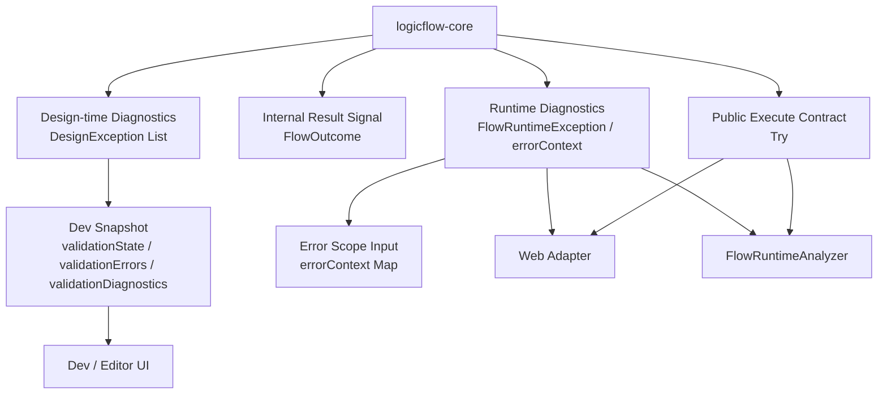

# LogicFlow 结果契约与诊断呈现层（Result Contracts / Diagnostic Surfaces）深化说明

更新日期：`2026-06-29`

> 回到总览：[`DESIGN.md`](../../DESIGN.md)

这份文档是对 [`DESIGN.md`](../../DESIGN.md) 中“`Try<Object>` 公共合同”“`FlowOutcome` 内部信封”“`DesignException` / validation snapshot”“`FlowRuntimeException` / `errorContext`”几部分的深化说明。

它要回答的不是“异常怎么处理”这种单一问题，而是更高一层的边界问题：

- LogicFlow 到底把什么当作**公开结果合同**暴露给调用方。
- 哪些 richer internal signals 只在 `core` 内部流转，不直接外泄。
- 设计期诊断、运行期失败、错误流上下文、adapter 响应、analyzer 回调，这几类“可观测信息”分别长什么样。

如果说 [`DESIGN-ERROR-HANDLING.md`](../error-handling/overview.md) 关注“失败怎么发生与恢复”，这份文档关注的是：

- **失败与成功最终以什么形式被不同消费者看见**

## 1. 先给结论：LogicFlow 不是只有一个“结果面”，而是四个并列可见面

当前 LogicFlow 的结果与诊断不是一个统一大对象，而是四个并列的可见面：

1. **公开执行结果面**
   - `FlowModel.execute(Object...): Try<Object>`
2. **设计期诊断面**
   - `FlowModel.getErrors(): List<DesignException>`
   - 以及 dev 返回的 validation snapshot
3. **运行期失败诊断面**
   - `FlowRuntimeException`
   - 标准化 `errorContext`
4. **消费侧呈现面**
   - adapter 的 `WebApiResult`
   - analyzer 回调
   - dev/editor 的错误列表与结构化诊断

它们彼此有关联，但故意没有被折叠成一个统一的“超级结果对象”。

这正是当前设计里“低学习成本 + 内部语义增强 + 兼容公共签名”的平衡方式。

## 2. 为什么这一层需要单独讲，而不是散在错误处理或 adapter 章节里

如果只看错误处理章节，很容易把所有事情都理解成：

- 成功就返回值
- 失败就抛异常

但 LogicFlow 实际上更克制：

- 内部已经有 `FlowOutcome`
- 设计期已有结构化 `DesignException`
- dev 已通过响应信封返回 `validationDiagnostics`
- runtime 已能构造标准化 `errorContext`
- analyzer 已有单独的 completed/failed node & flow callbacks

可它仍然坚持：

- 公共执行入口只返回 `Try<Object>`
- 不把内部 `FlowOutcome` 直接暴露出去
- 不把 Java 异常对象本体直接暴露为错误流 contract
- 不让 validation snapshot 反过来驱动运行时 gate

所以这章的核心不是“新增机制”，而是把这组有意保留的边界讲清楚。

## 3. 总体地图：谁能看到什么

这张图里最关键的一点是：

- **`FlowOutcome` 只留在 internal lane**

外部消费者最终看到的，要么是：

- 解包后的 `Object`
- 要么是 failure throwable
- 要么是设计期诊断快照

## 4. 公开执行结果合同：`Try<Object>` 仍然是第一公民

### 4.1 当前对外合同没有改变

公开执行合同定义在：

- [`FlowModel`](../../ouroboros-logicflow-core/src/main/java/com/ouroboros/logicflow/model/FlowModel.java)

关键方法仍然是：

- `Try<Object> execute(Object... inputs)`

这意味着对调用者来说，最稳定的心智模型依旧是：

- 成功：`Try` 里拿到一个普通 `Object`
- 失败：`Try` 里拿到一个 `Throwable`

### 4.2 为什么不直接暴露 richer envelope

当前设计没有把结果升级成例如：

- `Try<FlowOutcome>`
- `Try<ExecutionResult>`
- `Either<SuccessEnvelope, FailureEnvelope>`

主要原因是：

- 要保持低学习成本
- 要保住已有 adapter/runtime/analyzer 的兼容性
- 要让大多数调用方仍然以“拿一个业务结果对象”的方式消费逻辑流

这是一种很明确的设计选择：

- **内部可以增强语义，外部先不升级合同**

### 4.3 analyzer 也看到的是公开结果，而不是内部信封

这一点不是猜测，而是当前测试明确锁住的：

- [`FlowModelRuntimeAnalyzerCompatibilityTest`](../../ouroboros-logicflow-builtin-nodes/src/test/java/com/ouroboros/logicflow/model/FlowModelRuntimeAnalyzerCompatibilityTest.java)

也就是说：

- `FlowRuntimeAnalyzer.onFlowCompleted(...)`
  - 收到的是最终公开结果值
  - 不是 `FlowOutcome`

这再次说明：

- `FlowOutcome` 当前是内部语义对象，不是公共可见合同

## 5. 内部成功结果合同：`FlowOutcome` 只为编译器收口服务

### 5.1 `FlowOutcome` 解决的是真正的内部问题

内部结果信封定义在：

- [`FlowOutcome`](../../ouroboros-logicflow-core/src/main/java/com/ouroboros/logicflow/results/FlowOutcome.java)

它当前只区分两种成功来源：

- `EXIT`
- `RETURN`

并携带：

- `kind`
- `nodeName`
- `value`

### 5.2 为什么内部要有这个对象

它解决的是一个内部编译问题：

- 流程的成功结束点现在不只一个来源
- 显式 `exitNode` 和 `ReturnNode` 都可能成为成功终点
- 编译器需要在 scope 内统一挑出最终 outcome

因此 `FlowOutcome` 的角色是：

- **成功终点统一收口的内部信封**

而不是给外部调用方看的业务结果模型。

### 5.3 为什么它被故意挡在边界内

一旦 `FlowOutcome` 外泄，外层所有消费方都会立刻被迫理解：

- 成功终点类型
- nodeName
- EXIT/RETURN 区别

而当前产品线并不需要所有人都背这套语义。

所以现在的边界是：

- 编译器内部依赖 `FlowOutcome`
- 对外统一 `unwrapOutcomeValue(...)`

这就是“内部 richer，外部更稳”的直接体现。

## 6. 设计期诊断面：`DesignException` 是权威错误源，snapshot 是派生诊断读面

### 6.1 `FlowModel.getErrors()` 是 design-time 权威来源

设计期诊断的原始来源是：

- [`DesignException`](../../ouroboros-logicflow-core/src/main/java/com/ouroboros/logicflow/exception/DesignException.java)

以及：

- `DefaultFlowModel.getErrors()`

这里收敛的是：

- 节点构造期错误
- 连接/锚点/图结构错误
- 静态分析错误
- compile gate 之前的各种模型不合法状态

### 6.2 设计期错误不是执行异常

这一层最重要的边界是：

- `DesignException` 不属于“执行到一半失败”
- 它表达的是“这份模型在执行前就已经不合法”

因此对于无效模型，`execute()` 返回的失败本质上是：

- `FlowDesignException`

它不是业务流程运行中途爆出来的 runtime failure，而是：

- **设计期问题在执行入口上的 fail-closed 映射**

### 6.3 dev 返回的不是 `DesignException` 本体，而是 snapshot

dev 侧会把 `DefaultFlowModel.getErrors()` 映射为派生诊断快照：

- `validationState`
- `validationSummary`
- `validationErrors`
- `validationDiagnostics`
- `lastValidatedTime`

请求 `includeValidationSnapshot=true` 时以 `{model, validationSnapshot}` 返回；正式模型 JSON 会剔除这些字段。`validationState` 是推导读面值。字段分层共同正文见[端口与数据契约](../ports-and-data-contracts/overview.md)。

关键支撑在：

- [`LogicFlowValidationSnapshotSupport`](../../ouroboros-logicflow-dev/src/main/java/com/ouroboros/logicflow/dev/service/support/LogicFlowValidationSnapshotSupport.java)

也就是说，设计期错误对 dev/editor 的公开面不是 Java exception object，而是：

- **稳定、可序列化、不写入正式模型的 validation snapshot**

## 7. validation snapshot 的两种视图：`validationErrors` 给人看，`validationDiagnostics` 给机器定位

### 7.1 `validationErrors`

`validationErrors` 的定位很简单：

- 全量 message 列表
- 更适合人直接阅读
- 保序，首条 message 同时成为 `validationSummary`

### 7.2 `validationDiagnostics`

`validationDiagnostics` 的结构由：

- [`FlowModelValidationDiagnostic`](../../ouroboros-logicflow-core/src/main/java/com/ouroboros/logicflow/model/FlowModelValidationDiagnostic.java)

定义，当前正式消费字段包括：

- `diagnosticKind`
- `message`
- `nodeNames`
- `scope`
- `fieldPath`
- `portKind`
- `portIndex`
- `sourceNode`
- `sourceOutputPort`
- `targetNode`
- `targetInputPort`

它的定位是：

- 更适合前端导航、定位、分类展示
- 让 editor/dev UI 不必反向解析 message 文本

当前这组字段已经形成了明确分层：

- `validationErrors`
  - 给人直接阅读
  - 保序
  - 第一条同时作为 `validationSummary`
- `validationDiagnostics`
  - 给机器定位与消费面分流
  - 让 editor/dev UI 知道“这条错误属于 flow / node / edge 哪一层，以及是否能稳定落到具体字段”

### 7.2.1 当前字段级定位合同

`validationDiagnostics` 现在不是只有“节点名 + 文案”的粗粒度提示，而是带有正式字段级定位语义：

- `scope=flow`
  - 表示这条 diagnostics 属于流程属性面板
  - 例如 `fieldPath=entryNode`
- `scope=node`
  - 表示这条 diagnostics 属于节点属性面板
  - 当前仍复用 `nodeNames`
  - 要落字段时，要求 `nodeNames` 恰好只命中当前节点
- `scope=edge`
  - 表示这条 diagnostics 属于连线属性面板
  - 当前正式身份只认端点四元组：
    - `sourceNode`
    - `sourceOutputPort`
    - `targetNode`
    - `targetInputPort`
  - 不假设存在 `edgeId`
- `fieldPath`
  - 是字段级定位唯一正式概念
  - 表示属性面板里 AMIS 表单项的 `name`
  - 例如：
    - `entryNode`
    - `flowName`
    - `targetInputPort`
    - `inputPorts[0].name`
- `portKind / portIndex`
  - 只是辅助定位端口错误的结构化信息
  - 不与 `fieldPath` 形成第二套并行字段概念

这层合同的关键边界是：

- 不新增 `propertyName`
- 不新增 `edgeId` / `connectionId`
- 不允许前端从错误文案反向猜字段归属

### 7.2.2 editor 当前消费方式

前端 editor 当前把 `validationDiagnostics` 消费成两条稳定显示路径：

1. 命中 `fieldPath` 且当前属性面板 schema 中存在该字段
   - 直接注入 AMIS 原生字段错误
   - 优先走组件/表单 store 的 `setExternalErrors(..., "logicflow-validation")`，再回退 `setErrors` / `setFormItemErrors`；不覆写其他来源的校验状态
2. 没有 `fieldPath`、字段不存在、或错误本质上属于聚合/结构问题
   - 继续显示在属性面板告警区
   - 不被静默丢弃

因此 current editor surface 的 contract 已经明确是：

- `validationErrors`
  - 适合列表、摘要、人读提示
- `validationDiagnostics`
  - 适合导航、字段命中和 panel-level fallback

这也解释了为什么 `validationDiagnostics` 不是“异常对象 dump”，而是：

- **面向消费层重新组织后的结构化诊断合同**

### 7.3 mapping 不是逐条 1:1 复制，而是带 flatten 与归一化

比如：

- `ProblematicNodesDetectedException`
  - 会被 flatten 成多条节点级 diagnostic
- `NodeDesignException`
  - 会映射成 `node_design_error`
- 某些全局异常
  - 会归一成稳定的 snake_case `diagnosticKind`

因此 `validationDiagnostics` 不是“异常对象 dump”，而是：

- **面向消费层重新组织后的诊断合同**

## 8. 运行期失败诊断面：`FlowRuntimeException` 是统一的 runtime failure carrier

### 8.1 运行期错误会被标准化到 `FlowRuntimeException`

运行期失败的关键 carrier 是：

- [`FlowRuntimeException`](../../ouroboros-logicflow-core/src/main/java/com/ouroboros/logicflow/exception/FlowRuntimeException.java)

它会保留：

- `node`
- `inputs`
- `message`
- `cause`

### 8.2 为什么 runtime 要多带 `node + inputs`

因为 runtime failure 的重点不只是“失败了”，还包括：

- 是哪个节点失败
- 它当时收到了什么输入

这对下面几类消费面都很关键：

- analyzer 的 node/flow failed 回调
- error scope 构造 `errorContext`
- 测试断言失败来自哪个节点

### 8.3 runtime failure 的 contract 也经过了标准化，而不是原样外泄

在编译器里：

- 非 `FlowRuntimeException` 会被包装成新的 `FlowRuntimeException`
- 对已有 `FlowRuntimeException` 则直接沿用

这说明当前运行期失败也有明确的“归一层”，并不是完全放任底层异常自然冒泡。

## 9. `errorContext`：错误流看到的是标准化诊断上下文，不是 Java 异常对象

### 9.1 `errorContext` 的来源

当 main scope 失败且存在 error scope 时，编译器会构造：

- `errorContext`

对应逻辑位于：

- [`FunctionalFlowCompiler`](../../ouroboros-logicflow-core/src/main/java/com/ouroboros/logicflow/compiler/FunctionalFlowCompiler.java)

### 9.2 它当前暴露的字段

当前标准字段包括：

- `exceptionType`
- `exceptionMessage`
- `exceptionCode`
- `flowName`
- `flowInputs`
- `nodeName`
- `nodeInputs`

### 9.3 为什么这里不直接传原始异常对象

原因很明确：

- 错误流 contract 需要稳定、可序列化、跨边界
- Java 异常对象不是一个好 contract
- 直接暴露异常对象会把实现语言和内部类层级泄漏到流程 contract 中

所以当前错误流输入是：

- **标准化运行期诊断快照**

而不是：

- Java throwable object graph

## 10. 消费侧视角：不同层看到的东西刻意不同

### 10.1 普通 core 调用方

普通调用方只看到：

- `Try<Object>`

它通常不关心：

- `FlowOutcome.Kind`
- 成功来自 exit 还是 return

### 10.2 dev/editor

dev/editor 主要看到的是：

- `validationState`
- `validationSummary`
- `validationErrors`
- `validationDiagnostics`

它们主要消费的是：

- design-time 诊断快照

而不是 runtime throwable。

### 10.3 error scope authoring / runtime

error scope 节点看到的是：

- `errorContext`

也就是标准化后的运行期失败上下文，而不是 `DesignException` 或原始 Java 异常对象。

### 10.4 runtime analyzer

analyzer 同时能看到两类信号：

- `onFlowCompleted(...)` 的公开成功结果值
- `onFlowFailed(...)` 的最终 failure throwable
- `onNodeFailed(...)` 的节点级 runtime failure

因此 analyzer 是离内部最近的公共消费面之一，但它依旧不会直接拿到：

- `FlowOutcome`

### 10.5 web adapter

adapter 当前消费的是：

- `Try<Object>` 成功/失败
- 以及失败链中的 `FlowRuntimeException` / `cause`

在：

- [`HandlerFunctionAdapter`](../../ouroboros-logicflow-web-adapter/src/main/java/com/ouroboros/logicflow/adapter/HandlerFunctionAdapter.java)

里，当前会优先把：

- `FlowRuntimeException` 的 `cause`

作为更接近业务/平台语义的错误往外映射。

这说明 adapter 消费的重点是：

- “怎么变成 Web 响应”

而不是直接暴露 logicflow 内部诊断对象。

## 11. 这套边界体现的设计原则

当前结果契约与诊断呈现层，本质上体现了四条设计原则。

### 11.1 公共合同稳定优先

即使内部已经有 `FlowOutcome`，对外仍保持：

- `Try<Object>`

### 11.2 richer internal signals 可以存在，但不必全部外泄

这就是：

- `FlowOutcome` 留在编译器内部
- `errorContext` 只暴露标准字段
- validation snapshot 重组后通过响应信封返回

的共同逻辑。

### 11.3 设计期诊断与运行期失败严格区分

当前系统没有把这两者混成一个错误池：

- design-time -> `DesignException` / validation snapshot
- runtime -> `FlowRuntimeException` / `errorContext`

这种分层能极大降低认知混乱。

### 11.4 面向不同消费者，给不同粒度的可见面

不同消费者拿到的信息粒度故意不同：

- 调用方：最简 public result
- dev/editor：结构化设计期诊断
- error scope：标准化运行期上下文
- analyzer：最接近执行细节的回调面
- adapter：适合映射成 Web 错误响应的 failure chain

## 12. 最容易破坏这一层的几种做法

后续如果继续演进，最容易破坏这层设计一致性的做法主要有四类。

### 12.1 直接把 `FlowOutcome` 升级为公共合同而不做全栈同步

这样会立即影响：

- adapter
- analyzer
- 测试夹具
- 上层调用代码

因此如果真要升级，必须把它当成一次明确的公共合同变更，而不是内部实现细节调整。

### 12.2 让 validation snapshot 反向驱动 runtime gate

snapshot 的角色是派生诊断呈现，而不是运行时决策权威。若让 runtime 直接依赖 snapshot，而不是依赖 `DefaultFlowModel` 的当前装配结果，就会引入跨时刻漂移。

### 12.3 把原始 Java 异常对象作为 error flow contract

这会把内部实现、语言对象和序列化边界都混到流程 contract 里，长期一定失控。

### 12.4 让不同消费面看到不一致的“成功结果”

比如：

- `execute()` 返回解包值
- analyzer 返回 `FlowOutcome`
- adapter 又再包一层别的 envelope

这种分裂会快速制造认知成本。当前“统一看到 public result value”的策略反而更稳。

## 13. 实际读代码时，推荐顺序

建议按这条顺序读这一层：

1. [`FlowModel`](../../ouroboros-logicflow-core/src/main/java/com/ouroboros/logicflow/model/FlowModel.java)
2. [`FlowOutcome`](../../ouroboros-logicflow-core/src/main/java/com/ouroboros/logicflow/results/FlowOutcome.java)
3. [`FlowRuntimeException`](../../ouroboros-logicflow-core/src/main/java/com/ouroboros/logicflow/exception/FlowRuntimeException.java)
4. [`FunctionalFlowCompiler`](../../ouroboros-logicflow-core/src/main/java/com/ouroboros/logicflow/compiler/FunctionalFlowCompiler.java)
5. [`LogicFlowValidationSnapshotSupport`](../../ouroboros-logicflow-dev/src/main/java/com/ouroboros/logicflow/dev/service/support/LogicFlowValidationSnapshotSupport.java)
6. [`HandlerFunctionAdapter`](../../ouroboros-logicflow-web-adapter/src/main/java/com/ouroboros/logicflow/adapter/HandlerFunctionAdapter.java)
7. [`FlowRuntimeAnalyzer`](../../ouroboros-logicflow-core/src/main/java/com/ouroboros/logicflow/diagnostic/FlowRuntimeAnalyzer.java)

配套阅读建议：

- 运行时执行机制：[`DESIGN-RUNTIME-EXECUTION.md`](../runtime-execution/overview.md)
- 错误处理与错误流：[`DESIGN-ERROR-HANDLING.md`](../error-handling/overview.md)
- 模型状态与 gating：[`DESIGN-MODEL-STATE-AND-RUNTIME-GATING.md`](../model-state-and-runtime-gating/overview.md)
- authoring contract 与 validation snapshot：[`DESIGN-AUTHORING-CONTRACTS.md`](../authoring-contracts/overview.md)
