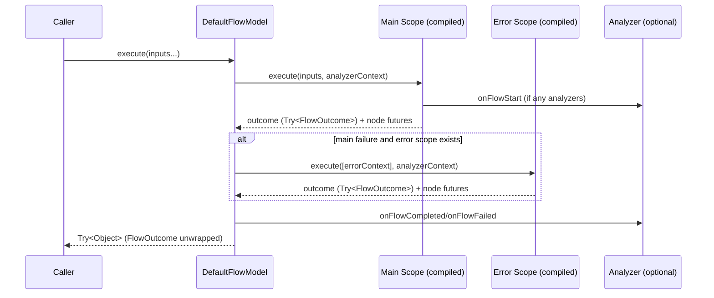

# LogicFlow 运行时执行语义（FunctionalFlowCompiler/Decision/并发边界）深化说明

更新日期：`2026-03-18`

> 回到总览：[`DESIGN.md`](../../DESIGN.md)

这份文档是对 [`DESIGN.md`](../../DESIGN.md) 中“执行管线”章节的深化说明，重点把“运行时究竟如何执行”讲清楚，并明确当前实现的并发边界与 deferred 的能力。

核心入口：

- 编译与执行：[`FunctionalFlowCompiler`](../../ouroboros-logicflow-core/src/main/java/com/ouroboros/logicflow/compiler/FunctionalFlowCompiler.java)
- 运行时信号：[`Decision`](../../ouroboros-logicflow-core/src/main/java/com/ouroboros/logicflow/results/Decision.java)
- 结果信封：[`FlowOutcome`](../../ouroboros-logicflow-core/src/main/java/com/ouroboros/logicflow/results/FlowOutcome.java)
- 模型构造/缓存编译结果：[`DefaultFlowModel`](../../ouroboros-logicflow-core/src/main/java/com/ouroboros/logicflow/model/DefaultFlowModel.java)

## 1. 一句话总结：它是“编译过的 DAG 计算”，不是解释器

当前实现属于“编译型执行”：

- 每个 `FlowModel` 在构造完成且静态校验通过后，会把整张图编译为一个 `executeFunction`（`Function<Object[], Try<Object>>`）。
- 每次执行时只做“参数绑定 + Future 链调度 + 结果收口”，而不是逐节点解释执行。

这也是为什么我们强调：

- Design-time 静态分析要足够强（否则 runtime 会出现顺序依赖与不确定性）。
- runtime 要 fail-closed（否则坏图会在生产中以“偶现”方式损害可信度）。

## 2. 从调用到结果：端到端执行生命周期

入口：`FlowModel.execute(Object... inputs)`

高层流程（含错误流切换）：

关键边界：

- 错误流（error scope）只在“主流程已开始执行且失败”的情况下触发。
- 输入参数数量不正确属于“未开始执行”（started=false），不会触发错误流。

## 3. Scope：main scope 与 error scope 是两条“独立编译、独立执行”的管线

`FunctionalFlowCompiler` 会分别编译两个 scope：

- main scope：`compileScope(model, LogicFlowUtil.getMainFlowNodes(model), model.getExitNode())`
- error scope：`compileScope(model, errorScopeNodes, null)`（没有显式 exitNode）

`scopeNodes` 确定编译范围；所有在该范围内没有有效输入连线的根节点都接收流程输入，不由 entry 参数指定唯一输入节点。

每个 scope 编译产物大致包含：

- `sortedNodeList`：该 scope 内参与编译的节点列表（来自 `LogicFlowUtil.topologicalSort`，再按 scopeNodes 过滤）
- `allNodesInPortsMapping`：每个节点的“输入端口 <- 上游节点输出端口”的映射表
- `compiledFlow`：一条把 `nodeResultFutureList` 从头连接到尾的函数链
- `terminalNodeIndexSet + successfulOutcomeKindMap`：成功终点候选的位置与结果类别

这解释了两点：

1. **scope 的存在不是“运行时 if/else”**，而是两套编译产物。
2. **scopeNodes 决定哪些节点会被纳入执行管线**，因此 scope 的静态划分是语义的一部分。

## 4. 输入绑定：Flow inputs 如何进入根节点

### 4.1 最小输入数量检查（fail-closed）

每个 scope 在执行前会做一次参数数量检查：

- `firstLayerMaxInputPortCount = max(该 scope 内所有无有效输入连线根节点的实际输入端口数)`，没有根节点时为 0。
- 若 `input.length < firstLayerMaxInputPortCount`，立即失败（`FlowRuntimeException("输入参数数量不正确")`），并标记 started=false。

这条规则的意义是：

- 防止“隐式缺参”在后续节点中以 null/越界/异常的形式扩散，导致定位成本高。

### 4.2 根节点的输入映射（inputs[i] -> root port i）

执行时会把 `inputs` 放到 `nodeResultFutureList[0]` 作为“虚拟上游结果”，然后：

- scope 内每个没有有效上游连线的根节点，都会构造 `InputPortMapping(-1, i, i)`，表示从虚拟上游取第 i 个参数。
- 每个根节点的第 i 个输入端口都是同一份 `inputs[i]`，不限于显式 entry。
- 零输入根节点无需参数；部分输入已连接的节点仍须接全，不会逐端口回退到流程输入。

这也是 `error scope` 能稳定接收 `errorContext` 的原因：

- error scope 的 inputs 是 `new Object[]{errorContext}`
- error scope 中每个根节点的输入端口（最多 1 个，且类型应兼容 MAP）会直接拿到这个 `errorContext`。

## 5. 参数装配：一个输入端口可能来自 1 条或多条连线

### 5.1 单一来源：直接取上游端口值

如果某个输入端口只有一条入边：

- 参数 future = 上游节点 future `.thenApply(r -> r.get(sourcePortIndex))`

### 5.2 多来源（同一输入端口多上游）：等待全部完成后“择一”

如果同一输入端口被多条入边连接：

- 会先对所有来源做 `CompletableFuture.allOf(...)`（注意：这里是等待全部完成，不是“先到先得”）
- 然后按连线的固定顺序选择第一个“有效值”：
  - `Decision.unsatisfied()` 会被过滤
  - `Decision.satisfied(v)` 会被解包为 `v`
  - 普通值会被视为有效值
  - 找不到有效值则返回 `Decision.unsatisfied()`

这是一种静态互斥保护下的同口多来源择值（受控 reconvergence）：

- runtime 有明确的择一行为
- 但静态分析必须证明这些来源互斥，否则结果将依赖连线顺序而不可接受

因此，**不要**把它理解成“随便多接几条边就行”，它必须受到静态分析保护（详见 [`DESIGN-STATIC-ANALYSIS.md`](../static-analysis/overview.md)）。

## 6. Decision 语义：分支命中、节点跳过、与结果传播

### 6.1 Decision 是“路径激活”的一等信号

在运行时：

- `Decision.unsatisfied()` 表示该路径未命中（或该输入缺失）
- 只要某节点的任一输入参数包含 `Decision.unsatisfied()`，该节点会被“跳过真实执行”

跳过逻辑发生在编译器的通用 nodeExecutor 中：

- 如果 params 里出现 `Decision unsatisfied`：不调用 `node.execute(...)`，直接返回与输出端口数量一致的 `Decision.unsatisfied()` 列表
- 否则：把 params 中的 `Decision.satisfied(v)` 解包为 `v`，再调用 `node.execute(...)`

这意味着：

- “分支选择”不是靠运行时删边，而是靠 `Decision` 信号沿图传播。
- downstream 节点是否执行，取决于它的输入是否“都被满足”。

### 6.2 为什么决策节点要输出 Decision 列表

决策节点（典型是继承 `AbstractDecisionNode` 的节点）输出的是每个输出端口的 `Decision`：

- 命中端口：`Decision.satisfied(value)`
- 未命中端口：`Decision.unsatisfied()`

这样 downstream 才能靠 `Decision` 来判断是否执行，从而实现“按路径激活”的语义。

### 6.3 Skip 不是“没执行就没成本”

当前 skip 语义仍然有两个成本特征：

- 仍然会等待上游参数 Future 全部完成（因为参数装配是 allOf 的）
- 仍然会执行一次轻量的 nodeExecutor（只是不会调用真实 node.execute）

这是一种偏“确定性与可解释性”的实现取舍；未来若要做更激进的性能优化，需要引入更复杂的 cancel/short-circuit 语义（见 12）。

## 7. 并发与异步：Node.isAsync 的真实含义

### 7.1 thenApply vs thenApplyAsync

对每个节点：

- 若 `node.isAsync() == true`：使用 `thenApplyAsync(nodeExecutor)`
- 否则：使用 `thenApply(nodeExecutor)`

因此：

- 异步节点会在默认异步执行器（通常是 `ForkJoinPool.commonPool()`）上调度。
- 同一层的多个异步节点在参数满足时可以并发执行。

### 7.2 并发边界与确定性

运行时的“结构确定性”来自于：

- 拓扑依赖决定了节点何时可以开始
- `Decision` 传播决定了路径是否激活
- 静态分析禁止“会引入顺序依赖”的结构（例如输入端口冲突）

但在以下场景，执行表现仍可能不同（尽管语义不应不同）：

- 异步节点调度顺序与完成顺序不可预测
- 节点内部如果有副作用或依赖外部时间，执行结果天然不再是纯函数

因此建议把逻辑流理解为：

- **拓扑依赖约束下的并发执行模型**
- 而不是“按节点顺序逐个执行”的解释器

## 8. 运行时契约校验：selective-output 互斥（同组不能同时命中）

当节点显式 opt-in selective-output（`supportsSelectiveOutputMetadata() == true`）时，编译器会在节点执行后校验：

- 对每个 `exclusiveGroupId`：
  - 统计该组内“命中”的输出数量
  - 若 > 1，抛出 `FlowRuntimeException("同一 exclusiveGroupId 不能同时命中多个输出")`

命中判定规则：

- `Decision.satisfied(...)` 视为命中
- `Decision.unsatisfied()` 视为未命中
- 非 `Decision` 的普通值默认视为命中

因此：

- 决策节点天然适配该契约
- 普通节点不应随意 opt-in，否则可能出现“所有端口都默认命中”的冲突

## 9. 成功终点与结果收口：exitNode 与 ReturnNode 的统一语义

### 9.1 成功终点候选来源

每个 scope 的成功终点候选来自：

- 显式 `exitNode`（main scope only，且可选）
- `ReturnNode`（main scope 与 error scope 都可作为成功终点）

实现会把 `AbstractTerminalNode` 家族作为候选，并读取其 `getSuccessfulOutcomeKind()`；内置异常终点虽然进入候选索引，但执行抛错，不会形成成功 outcome。候选机制与业务终点角色的区别见[成功终点边界](../successful-terminals-and-early-exit-boundaries/overview.md)。

### 9.2 结果值的定义（这是契约，不是实现细节）

为了保持公共签名 `Try<Object>`，当前结果值的定义是：

- `exitNode`：取该节点执行结果的第 0 个输出值作为流程结果
- `ReturnNode`：取该节点执行结果的第 0 个值作为流程结果（其语义是“返回首个输入值”）

对应静态类型契约校验也以“第 0 个槽位”为准：

- exitNode 用 output port 0 的 dataType
- ReturnNode 用 input port 0 的 dataType

这意味着：

- 如果你希望“返回某个中间值”，推荐用 `ReturnNode` 显式收口。显式 exitNode 的原始输出槽位不会递归解包 `Decision`，不应把决策节点直接当业务结果出口。

### 9.3 多成功终点：必须互斥（静态证明 + 运行时兜底）

运行时仍保留一个强兜底：

- 若实际收集到多个成功 outcome，会抛出 “静态分析漏检” 的异常（fail-closed）。

但请注意：当前实现不会“抢先返回第一个成功终点”，它会等待所有节点 Future 完成后再收集成功终点（见 10）。

## 10. 失败、异常与错误流：什么时候切入 error scope

### 10.1 异常归一化：FlowRuntimeException 的作用

编译器在执行节点时会把异常归一化：

- 节点执行抛出的非 `FlowRuntimeException` 会被包装成 `FlowRuntimeException("执行节点失败", cause, node, inputs)`
- 对于 `FlowRuntimeException`，会保留 node + inputs 以便诊断

这保证了：

- 错误流构造 `errorContext` 时能拿到 nodeName/nodeInputs
- analyzer 能在 `onNodeFailed` 里拿到定位信息

### 10.2 error scope 的触发条件

error scope 只有在以下条件同时满足时触发：

- main scope 执行已开始（started=true）
- main scope outcome 是 failure
- 模型声明了 `errorEntryNode`（error scope 存在）

错误上下文 `errorContext` 由编译器构造，字段包括：

- `exceptionType` / `exceptionMessage` / `exceptionCode`
- `flowName` / `flowInputs`
- `nodeName` / `nodeInputs`

### 10.3 失败信号与错误流切入不是同一时刻

`getResult(...)` 可以在任一节点 future 失败后先形成 failure；但 `executeCompiledFlow(...)` 随后先调用 `mainExecution.getNodeResults()`，该方法会 join 等待主 scope 全部节点 future 完成，再判断是否进入 error scope。

因此当前错误流在主 scope 节点结果收集后启动；已调度分支不会被取消。不能根据 failure 信号较早形成就推导“错误流与剩余主分支并行执行”。

## 11. 运行时分析器（FlowRuntimeAnalyzer）：旁路可观测性，不应影响主语义

编译器会从 SPI 加载 `FlowRuntimeAnalyzer` 并回调：

- onFlowStart/onFlowCompleted/onFlowFailed
- onNodeStart/onNodeSkipped/onNodeCompleted/onNodeFailed

设计原则是：

- analyzer 是旁路能力，任何 analyzer 抛异常都不应破坏主执行语义
- 因此编译器对 analyzer 调用做了 Try 包裹与隔离（best-effort）

## 12. Deferred：真正的提前退出/取消（terminate/cancel）目前未实现

当前实现不支持真正意义上的“提前退出流程并取消其余分支”：

- 成功终点收口发生在等待 all futures 之后
- failure 信号可以提前形成，但错误流仍等待主 scope 节点结果收集；已调度 future 不会被取消

要实现 terminate/cancel 语义，至少需要解决：

- Future 取消与资源清理（尤其是异步节点与外部 I/O）
- analyzer 的事件一致性（取消是否算 failed/skipped）
- error scope 与 cancel 的交互（谁先谁后，是否允许并行）
- 与静态互斥证明的关系（是否仍要求互斥，还是引入“胜者为王”）

因此它必须作为独立能力推进，而不应偷塞进 `ReturnNode` 或 exitNode 的现有语义里。
