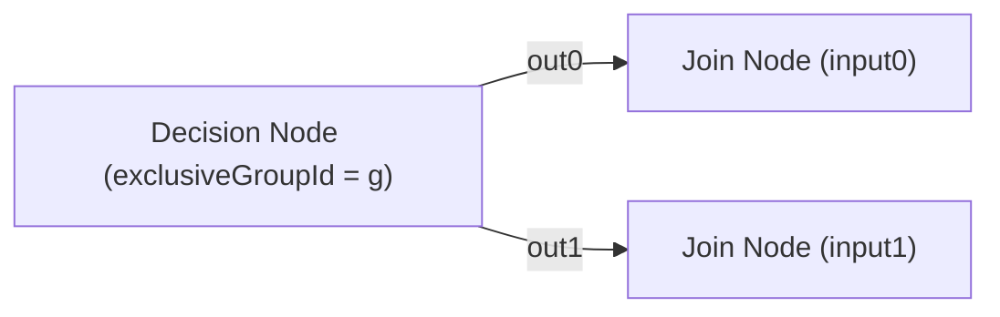
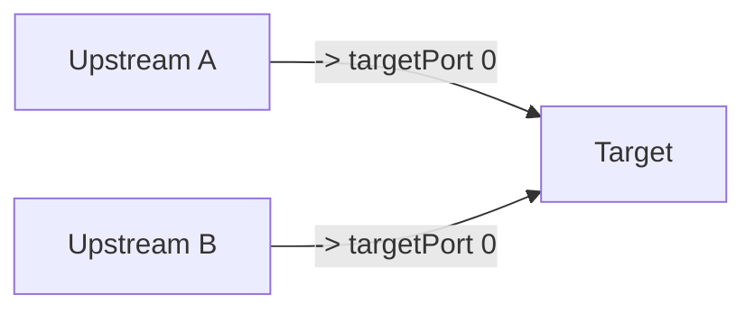

# LogicFlow 静态分析与校验体系（LogicFlowUtil/DefaultFlowModel）深化说明

更新日期：`2026-03-18`

> 回到总览：[`DESIGN.md`](../../DESIGN.md)

这份文档是对 [`DESIGN.md`](../../DESIGN.md) 中“静态分析/坏图拒绝”章节的深化说明，目标是把当前已经落地的校验规则讲清楚，方便未来：

- 继续增强静态分析能力时不破坏既有设计原则
- editor/dev 对齐提示与诊断时能知道后端的真实口径
- 写回归用例时能把“失败原因”和“应该失败的原因”对齐

核心入口：

- 构造与编排：[`DefaultFlowModel`](../../ouroboros-logicflow-core/src/main/java/com/ouroboros/logicflow/model/DefaultFlowModel.java)
- 静态分析工具箱：[`LogicFlowUtil`](../../ouroboros-logicflow-core/src/main/java/com/ouroboros/logicflow/util/LogicFlowUtil.java)

## 1. 静态分析的边界（当前做什么，不做什么）

当前静态分析偏向“图结构与端口契约”，不做条件表达式语义证明：

- 已做：DAG、scope、可达性、叶子节点、端口连接、竞态条件、输入端口冲突、类型兼容、成功终点互斥
- 未做：条件表达式的互斥/穷尽证明、条件覆盖率、基于表达式的路径可达性证明

这不是能力不足，而是刻意的设计选择：先保证低学习成本和可解释性，再按需增强表达力。

## 2. 校验管线：DefaultFlowModel 如何串联检查

`DefaultFlowModel.initialize(...)` 里大致按以下顺序执行（省略细节）：

1. 构造连接与节点
2. 绑定 source/target 节点引用
3. 校验连线端口越界（以运行时端口补齐后的端口数量为准，但仍受 maxPortCount 约束）
4. 汇总节点构造期 errors（`ProblematicNodesDetectedException`）
5. 解析 entry/exit/errorEntry 节点并做存在性校验
6. 主流程必须存在成功终点（main scope 本地规则）
7. 拓扑排序（环检测）与后续静态分析检查：
   - scope 合法性
   - 叶子节点
   - 可达性（普通流程）
   - 成功终点互斥
   - 输入端口连接完整性
   - 竞态条件
   - 输入端口冲突
   - 输入输出类型兼容

这意味着：

- 只要你构造 `DefaultFlowModel`，就能得到与运行时一致的权威校验结果。
- dev 保存时的 validation snapshot 也是复用这条管线（见 [`DESIGN-AUTHORING-CONTRACTS.md`](../authoring-contracts/overview.md)）。

## 3. Scope：main flow 与 error flow 的分离

### 3.1 为什么要分 scope

同图错误流的设计目标是：

- 主流程失败时只切一次错误流（而不是每个节点都挂异常端口）
- 错误流有自己的“成功终点”语义，用于把失败恢复成成功

因此需要把“主流程的合法性”和“错误流的合法性”分开校验，避免互相借用终点来“充数”。

### 3.2 校验底线（示意）

- main scope 的成功终点不能借用 error scope 的 `ReturnNode`
- error scope 的合法性也不能依赖 main scope 的出口
- entry/exit/errorEntry 不能互相重合（以 core 实现为准）

## 4. Reachability：不可达启用节点（普通流程）

当前 reachability 规则有一个重要边界：

- 当 **不存在** `errorEntryNode` 时，把流程视为“普通流程”，启用节点必须从 `entryNode` 可达。
- 当 **存在** `errorEntryNode` 时，启用节点可以属于 main scope 或 error scope，此时不混用普通流程的 reachability 口径。

原因：

- error flow 引入后，“从 entry 不可达”不一定是坏图，有可能它属于 error scope 的可达节点。
- 先把规则拆开，避免静态分析误伤并引入新的歧义。

## 5. Leaf：什么是非法叶子节点（不是“没输出端口”）

“叶子节点”是一个很容易被误解的概念。当前实现里：

- 节点没有输出端口是合法的（终点、纯消费节点都可能如此）。
- 非法叶子节点指的是：在某个 scope 中，存在“可达、启用、有输出能力、零下游连线、且不是合法成功终点”的节点。

它要解决的问题是：

- 防止出现“图上看起来能跑通，但某条路径无声结束”导致结果不确定或被掩盖。

## 6. 成功终点：必须存在，且必须互斥

### 6.1 必须存在成功终点

main scope 必须至少有一个成功终点候选：

- 显式 `exitNode`（可选字段，但如果配置了必须存在）
- 或 `ReturnNode`（`AbstractTerminalNode` 的成功终点候选）

否则模型在静态分析阶段直接 invalid。

### 6.2 成功终点必须互斥（静态证明 + 运行时兜底）

当存在多个成功终点候选时：

- 静态分析必须能证明它们在一次执行中不会同时命中。
- 运行时仍会做 fail-closed 的兜底：如果真出现多个 outcome，会抛出 “静态分析漏检”。

这里的互斥证明依赖两类信息：

- 决策节点的 `Decision.unsatisfied()` 跳过语义
- selective-output 的 `exclusiveGroupId + defaultBranch` 最小语义（仅对显式 opt-in 的节点生效）

## 7. 输入端口连接完整性：根节点接收外部输入，其余节点须接全

静态分析会检查：

- 没有有效输入连线的根节点按端口序号接收所在 scope 的外部输入，允许声明输入端口但不连线。
- 已有任意有效输入连线的节点，每个输入端口都必须连接；部分悬空仍是设计错误。

这条规则能避免一类常见建模错误：

- 节点期望从上游获得输入，但实际某个输入端口悬空，运行时只能拿到隐式 null 或触发异常，定位成本高。

注意：一些节点允许 0 输入（例如 Const 节点），这种节点通常会把 `minInputPortCount()` 设为 0，从而不会被这条规则误伤。

## 8. 竞态条件（Racing Condition）：同组互斥输出不能在下游制造“多输入同时等待”

竞态条件检查解决的是一个非常具体的问题：

- 同一个互斥输出组的多个端口，不能分别连接到同一个下游节点的不同输入端口。
- 否则下游节点会等待多个输入端口同时满足，但互斥组语义又保证这些输入不可能同时满足，最终会导致路径“永远不激活”。

这条检查只对显式 opt-in selective-output 的节点生效（减少误伤）。

## 9. 输入端口冲突（Input Port Conflicts）：同一输入端口多上游必须可证明互斥

当同一输入端口被多个上游连接时，编译器会做“选择第一个有效值”的 join 行为。

为了避免引入“先后顺序依赖”的隐式语义，静态分析要求：

- 这些来源在语义上必须能被证明互斥（否则就是冲突）

这条规则的核心设计理念是：

- 与其让运行时靠“谁先完成”或“谁排在前面”决定结果，不如在设计期直接拒绝，让建模者显式表达意图。

## 10. 类型兼容（Input/Output + Connection）

类型兼容校验分三层：

1. **Flow 输入类型 vs main scope 所有根节点输入端口类型**；error scope 的根节点最多一个输入端口且须兼容标准 `MAP` 异常上下文。
2. **Flow 输出类型 vs 成功终点输出契约**
   - `ReturnNode` 的输出来自其输入端口类型
   - 显式 `exitNode` 的输出来自其输出端口类型（通常取第 0 个输出）
3. **连线两端端口类型兼容**

最小类型系统由 `DataTypeEnum` 提供（`ANY` 宽松兼容，数值类型互兼容）。

## 11. 错误表达：DesignException 如何映射到 validation diagnostics

静态分析产生的错误会以 `DesignException` 的形式聚合到 `FlowModel.getErrors()`。

dev 保存时会把这些错误映射为结构化诊断快照（validation snapshot）：

- 全局错误：映射为 diagnosticKind + message
- 节点错误：尽可能绑定 nodeNames 便于 editor 定位与跳转

相关实现：

- [`LogicFlowValidationSnapshotSupport`](../../ouroboros-logicflow-dev/src/main/java/com/ouroboros/logicflow/dev/service/support/LogicFlowValidationSnapshotSupport.java)

## 12. 例子：两类典型失败（示意图）

### 12.1 竞态条件（同组互斥输出连到同节点不同输入）

如果 `J` 和 `J2` 实际是同一个节点的不同输入端口，这会被静态分析拒绝。

### 12.2 同一输入端口多上游但无法证明互斥

若 A、B 的输出路径无法通过互斥语义证明不会同时命中，则判定为输入端口冲突。

