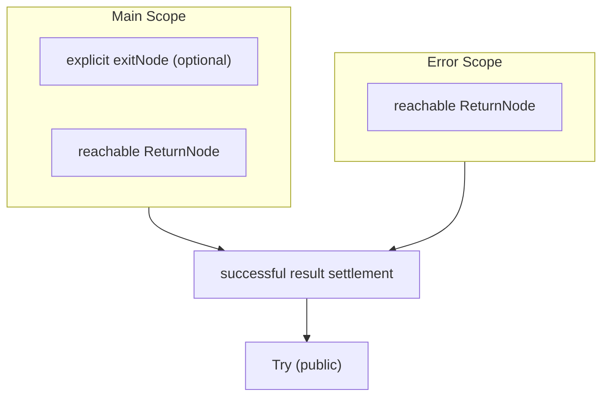

# LogicFlow 成功终点与提前退出边界（Successful Terminals / Early-Exit Boundaries）深化说明

更新日期：`2026-03-18`

> 回到总览：[`DESIGN.md`](../../DESIGN.md)
>
> 阅读导航：[`DESIGN-READING-PATHS-AND-MODULE-BOUNDARIES.md`](../reading-paths-and-module-boundaries/overview.md)
>
> 运行时执行：[`DESIGN-RUNTIME-EXECUTION.md`](../runtime-execution/overview.md)
>
> 静态分析：[`DESIGN-STATIC-ANALYSIS.md`](../static-analysis/overview.md)
>
> 结果契约：[`DESIGN-RESULT-CONTRACTS-AND-DIAGNOSTIC-SURFACES.md`](../result-contracts-and-diagnostic-surfaces/overview.md)
>
> 延后能力：[`DESIGN-DEFERRED-CAPABILITIES-AND-NON-GOALS.md`](../deferred-capabilities-and-non-goals/overview.md)

这份文档单独抽出“成功终点 / 多出口 / 提前退出边界”这条主线，原因不是它特别复杂，而是它最容易被不同层级的描述混淆成三件看起来相似、实际上完全不同的事：

- 允许流程存在多个**成功结果候选位置**
- 在这些候选位置之间做**结果收口**
- 命中其中一个后立即**终止其他已调度分支**

当前 LogicFlow 只把前两层作为已落地能力，第三层仍明确是 deferred 能力。

如果不把这三层拆开，后续最容易发生的漂移是：

- 把 `ReturnNode` 误写成“提前退出节点”
- 把 `FlowOutcome` 误写成公开 API
- 把 editor/dev 的终点展示或 metadata fallback 误当成 runtime 语义来源

## 1. 先给结论：当前支持的是“成功终点集合”，不是“真正的提前退出”

当前已落地的最小事实可以压缩成四句话：

1. `exitNode` 不再是唯一成功终点，`ReturnNode` 已是一等成功终点。
2. 流程必须至少有一个成功终点，且多个成功终点必须能在静态分析上证明互斥。
3. 编译器内部用 `FlowOutcome` 统一收口成功结果，但对外仍保持 `FlowModel.execute(): Try<Object>`。
4. 当前没有 terminate/cancel 语义，命中成功终点并不会自动取消其他已调度分支。

如果只记一句口径，应该记这个版本：

- **当前已经支持多成功终点结果语义，但尚未支持真正意义上的提前退出。**

## 2. 必须区分的四层概念

### 2.1 成功终点（successful terminal）

成功终点回答的是：

- “流程在哪些位置可以被判定为成功结束”

常规业务建模使用两类成功出口：

- main scope 中的显式 `exitNode`
- main scope 或 error scope 中的 `ReturnNode`

注意：

- `AbstractTerminalNode` 不等于“天然成功终点”
- 异常终点节点属于 terminal family，但不属于 successful terminal family

### 2.2 成功终点集合（successful terminal set）

成功终点集合回答的是：

- “对一张图来说，哪些节点一起构成合法的成功结束候选”

在当前实现里，这不是一个持久化字段，而是构造期和编译期共同推导出来的语义集合：

- main scope：显式 `exitNode` + scope 内 `AbstractTerminalNode` 家族候选
- error scope：scope 内 `AbstractTerminalNode` 家族候选

这也是为什么 `FlowModelMeta` 虽然仍然只保留单个 `exitNode` 字段，但 runtime 语义已经不是“单出口模型”。

当前候选实现与业务角色需要区分：`LogicFlowUtil.getSuccessfulTerminalNodes()` 收集显式出口和 `AbstractTerminalNode` 家族，不按具体 `ReturnNode` 类型过滤；编译器再读取终点的 `getSuccessfulOutcomeKind()`。内置异常终点同样继承该基类，但执行必然抛错，不能产生成功结果。本文后面的 ReturnNode 场景描述常规成功路径，不能据此认定静态候选列表会排除异常终点，或将其他合法终点扩展拒之门外。

### 2.3 结果收口（result settlement）

结果收口回答的是：

- “如果成功终点不止一个，最终如何统一成外部可消费的执行结果”

当前实现的边界是：

- 编译器内部统一成 `FlowOutcome`
- 外部调用方与运行时分析器仍只看到解包后的公开结果值

因此：

- `FlowOutcome` 是内部收口机制
- `Try<Object>` 才是公开执行合同

### 2.4 提前退出 / terminate / cancel

真正的提前退出回答的是：

- “一旦某个成功终点命中，是否立即停止其余并发支路、并终止后续调度”

当前答案仍然是：

- **不支持**

这不是文档措辞保守，而是 runtime 行为边界本身就还没有做到这一层。

## 3. 当前已落地的成功终点合同

### 3.1 元数据层仍保留单个 `exitNode`，但运行时语义已经升级

`FlowModelMeta` 仍然声明：

- `entryNode`
- `exitNode`
- `errorEntryNode`

其中：

- `exitNode` 现在是可选字段
- “流程必须有成功终点”这件事，不再等于“必须有显式 `exitNode`”

也就是说，当前的兼容策略是：

- **保留旧元数据骨架**
- **在 core 内部把成功收口升级为成功终点集合**

这样既保住公共模型形状，又没有把 runtime 继续锁死在“单出口才能合法”的旧语义里。

### 3.2 当前成功终点集合的真实定义

当前应当以 `core` 的真实语义为准，而不是以编辑器视觉或 NodeDefine 说明为准。

可以把当前规则概括成下面这张图：

更精确地说：

- main scope 的成功终点候选是：
  - 显式 `exitNode`（如果配置了）
  - main scope 内终点家族候选；常规成功节点为 `ReturnNode`
- error scope 的成功终点候选是：
  - error scope 内终点家族候选；常规恢复节点为 `ReturnNode`

其中有两个重要边界：

1. error scope 的 `ReturnNode` 只对 error scope 自己的恢复成功负责，不能借给 main scope 充当合法成功终点。
2. 不可达的 `exitNode` / `ReturnNode` 都不能被拿来“凑一个成功终点”。

### 3.3 `ReturnNode` 与显式 `exitNode` 的结果合同已经统一收口

当前成功结果合同的统一点不在于“节点长得一样”，而在于：

- 它们都会进入同一套成功收口逻辑

但二者的值来源仍有明确区别：

- 显式 `exitNode`
  - 结果值取该节点第 0 个输出槽位
  - 类型合同检查对齐其 output port 0
- `ReturnNode`
  - 结果值取其第 0 个输入槽位
  - 类型合同检查对齐其 input port 0

这条区分很重要，因为它决定了两个设计结论：

1. `ReturnNode` 的成功语义是“把一个中间值显式收口为流程结果”。
2. 如果想表达“返回某个中间值”，优先用 `ReturnNode`，而不是把 `exitNode` 挂到一个不适合做公开结果出口的节点上。

## 4. 静态分析如何守住这条边界

### 4.1 必须至少有一个成功终点

main scope 当前必须满足：

- 至少存在一个可达成功终点

因此下列情况会被判 invalid：

- 没有显式 `exitNode`，也没有可达 `ReturnNode`
- 只有 error scope 里有 `ReturnNode`
- 配了 `exitNode`，但该节点实际上不可达

### 4.2 多个成功终点必须可证明互斥

当前不是“有多个终点就天然合法”，而是：

- **多个成功终点只有在静态分析能证明互斥时才合法**

证明路径主要依赖两层事实：

1. 图结构上不存在串行共达
   - 不能出现一个成功终点落在另一个成功终点下游
2. 如果是分支型互斥，则必须建立在被 `core` 信任的 selective-output 契约之上
   - 当前最小契约是 `exclusiveGroupId + defaultBranch`
   - 且只有显式 opt-in selective-output 的节点才有资格让这套 metadata 参与互斥推理

这也是为什么：

- 普通节点即使带了同名 metadata，也不会自动获得 XOR 语义
- editor fallback 只能做兼容和展示，不能反向创造 runtime 语义

### 4.3 成功终点合同还包含输出类型规则

成功终点不仅要“存在”，还要满足流程级输出合同：

- `FlowModelMeta.outputDataType` 必须与成功终点的结果类型兼容

这里必须明确统一口径：

- 显式 `exitNode` 按 output port 0 校验
- `ReturnNode` 按 input port 0 校验

因此“return-only 流程也必须经过输出类型校验”不是额外优化，而是这条成功终点合同的组成部分。

### 4.4 叶子节点规则是在为成功终点边界兜底

当前 reachable leaf 校验的真实目标之一，就是防止出现：

- 图上某条可达路径走到了一个“有输出能力但零下游、又不是成功终点”的节点

否则执行会出现：

- 某条路径无声结束
- 调用方却拿不到明确的成功或失败语义

所以“非法叶子节点”本质上是在守住：

- **没有成功终点就不能伪装成成功结束**

## 5. 运行时到底做了什么，以及它没有做什么

### 5.1 当前运行时已经会统一收集成功终点

`FunctionalFlowCompiler` 对每个 scope 的做法，可以概括成：

1. 编译整条 scope 的 DAG 执行链
2. 收集成功终点候选索引与结果类别
3. 执行期间等待候选结果 future 收口
4. 将唯一成功结果封装成 `FlowOutcome`
5. 在 `execute()` 边界解包回公开结果值

这说明当前 runtime 已经具备：

- 多成功终点候选识别
- 成功结果统一收口
- 多 outcome 冲突时的 fail-closed 兜底

### 5.2 当前运行时没有真正的提前退出

但当前 runtime 仍然没有做到：

- 命中某个成功终点后立即取消其余已调度 future
- 对全图或对整个 scope 做 terminate/cancel
- 向调用方公开“是哪个成功终点赢了”这类 richer public envelope

换句话说，当前更接近：

- “编译好的 DAG 最终会从多个合法候选里选出唯一成功结果”

而不是：

- “某个节点一命中就立刻终止剩余计算”

### 5.3 为什么 `ReturnNode` 不能被解释成隐式 cancel

如果把 `ReturnNode` 解释成“自动停止流程”的节点，会立刻破坏三条现有边界：

1. 它会让成功终点语义和调度终止语义混成一件事。
2. 它会让现有 `Try<Object>` 公共合同开始隐含更多状态，却没有公开表达这些状态。
3. 它会让异步分支、错误流和 analyzer 回调的行为都变得不再自洽。

因此当前正确的表述必须是：

- `ReturnNode` 是成功终点
- terminate/cancel 是未来可能独立演进的能力

## 6. 结果合同与消费面的边界

### 6.1 `FlowOutcome` 是内部对象，不是公共 API

当前 `FlowOutcome` 的职责非常清楚：

- 区分成功终点来源
- 帮助编译器内部完成结果收口

它当前仍然是：

- internal settlement envelope

而不是：

- 外部调用方、analyzer、adapter、editor 共同依赖的公共结果模型

### 6.2 公开执行合同保持不变

当前外部稳定合同仍然是：

- `FlowModel.execute(): Try<Object>`

因此：

- analyzer 收到的是解包后的公开结果值
- adapter 对外消费的仍是公开成功/失败结果
- 后续若要公开 richer result envelope，必须作为单独公共合同升级，而不是顺手把内部对象透出去

### 6.3 authoring / editor 只能表达这条合同，不能重写它

当前 dev/editor 可以表达与展示：

- `ReturnNode` 是 successful terminal
- `terminalKind`
- 终点视觉差异
- validation diagnostics 与 warning

但它们不应被写成：

- “前端支持了某种终点语义，所以 core 就算支持了”

这条边界依旧要坚持：

- **NodeDefine 是 authoring contract，不是 runtime truth。**

## 7. 与错误流的关系

成功终点与提前退出边界，不能只看 main scope，还必须把 error scope 一起讲清楚。

当前 error flow 的正确理解是：

- main scope 运行失败后，切入同图另一条独立 scope
- error scope 可以通过显式 `ReturnNode` 把整体执行恢复成成功

但这里有三条刚性边界：

1. main scope 必须自己有成功终点，不能借 error scope 的 `ReturnNode` 通过设计期校验。
2. error scope 自己如果启动了但最终没有命中成功终点，也必须 fail-closed。
3. error scope 的成功恢复，不等于引入了“提前退出”语义；它只是另一条 scope 的成功收口。

因此 error flow 强化的是：

- 多 scope 成功终点合同

而不是：

- terminate/cancel 合同

## 8. 未来如果要推进真正的提前退出，最低要求是什么

这条线未来不是不能做，但只能作为独立能力推进。

最低要求至少包括：

1. **独立语义命名**
   - 明确是 terminate、cancel、short-circuit，还是别的名字
2. **静态分析补强**
   - 哪些图结构允许使用这类能力
   - 它与 selective-output、错误流、异步节点如何交互
3. **公共合同决策**
   - 是否仍保持 `Try<Object>`
   - 若保持，出口身份如何对外表达
4. **authoring / editor 对齐**
   - 前端如何表达这是一种真正的调度语义，而不是成功终点视觉变体
5. **测试与夹具**
   - core runtime、静态分析、dev contract、跨栈场景至少一层要能稳定守住它

只要这些层还没有一起补齐，就不应把当前能力包装成“已经支持提前退出”。

## 9. 改动这条语义时，至少要联动回查哪些地方

如果后续要继续改成功终点、多终点或提前退出这条线，建议固定回查下面几层：

1. 总口径
   - [`DESIGN.md`](../../DESIGN.md)
   - 本文档
2. 静态分析
   - [`DESIGN-STATIC-ANALYSIS.md`](../static-analysis/overview.md)
   - [`LogicFlowUtil`](../../ouroboros-logicflow-core/src/main/java/com/ouroboros/logicflow/util/LogicFlowUtil.java)
3. 运行时
   - [`DESIGN-RUNTIME-EXECUTION.md`](../runtime-execution/overview.md)
   - [`FunctionalFlowCompiler`](../../ouroboros-logicflow-core/src/main/java/com/ouroboros/logicflow/compiler/FunctionalFlowCompiler.java)
4. 结果合同
   - [`DESIGN-RESULT-CONTRACTS-AND-DIAGNOSTIC-SURFACES.md`](../result-contracts-and-diagnostic-surfaces/overview.md)
   - [`FlowOutcome`](../../ouroboros-logicflow-core/src/main/java/com/ouroboros/logicflow/results/FlowOutcome.java)
5. 场景与测试
   - [`DESIGN-CANONICAL-SCENARIOS-AND-END-TO-END-WALKTHROUGHS.md`](../canonical-scenarios-and-end-to-end-walkthroughs/overview.md)
   - [`DESIGN-CONCEPT-TO-SOURCE-CROSSWALK.md`](../concept-to-source-crosswalk/overview.md)

如果某次改动只改了其中一层，却没有检查其他几层，那它大概率会重新把这条语义写散。
