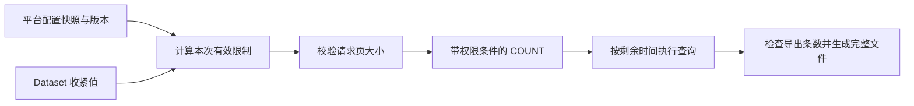

# Statistics reporting design

The module owns SQL Datasets and Charts. Dashboard and composite-view definitions belong to business models. Core owns source contracts, validators and execution ports. Runtime owns definition loading, execution, chart projection and authority projection. Dev owns source CRUD, schema inference and preview configuration.

## Definition loading

Application defaults use provider order 100 and runtime overrides use 200. Higher orders replace lower orders. A disabled override masks a lower enabled definition. Names, references and duplicate detection ignore case. Duplicate names in one tier fail loading. A failed individual center refresh retains its previous snapshot and raises the original failure through platform exceptions.

Dataset and Chart identifiers use ASCII letters, digits, underscores and hyphens in dot-separated segments. This identity works in source filenames, fixed runtime routes and projected permissions. Development CRUD resolves existing source filenames without case sensitivity and rejects ambiguous files.

## Execution and permissions

Dataset requests enter `DatasetExecutionController`, obtain the trusted server context and run the shared Dataset pipeline. Chart and composite-view reads use that pipeline. The path definition name overrides any body name. Runtime API routes remain fixed controllers. Effective Dataset and Chart definitions each project separate execute and export permissions through `AuthorityProvider`.

- Dataset uses `POST /api/statistics-reporting/datasets/{datasetName}/execute` and `/export`.
- Chart uses `POST /api/runtime/statistics-reporting/charts/{chartName}/execute` and `/export`.
- Permission names use `statisticsReporting.runtime.dataset.<lowercase-name>.execute|export` and `statisticsReporting.runtime.chart.<lowercase-name>.execute|export`.

API permission patterns quote the concrete name inside a case-insensitive path segment. Permission injection and parameter normalization run before SQL execution. Data engine failures are mapped to the platform exception family at the API boundary and handled by application advice.

## Development connections

Application source contains `datasource`, common `sql`, `dialects[{dialectName,sql}]`, `${parameter}` placeholders, parameters and schema. `isEnabled` controls runtime availability.

`DatasetDevConfigModel` stores the application/dataset identity, preview parameters and `testConnection` in `t_statistics_dataset_dev_config`. Identity keys are saved in lowercase with a unique app/dataset constraint. Connections are references with kind `application`, `platform` or `runtime`. Manual JDBC configuration is registered with platform datasource management. Dataset metadata carries portable definitions and uses the source declared in the SQL definition.

The default logical datasource can select a platform connection/environment or an application runtime. Nondefault datasources use their application binding. An explicit `kind=application` selection resets a saved connection choice. Saved preview parameters are combined with request overrides. Schema inference uses the selected actual connection or current application data-model metadata with an isolated temporary H2 schema. Metadata inference does not return business rows. Its warning distinguishes model-derived fields from database verification.

The shared Amis runtime provides the Dataset SQL editor, Dataset preview and Chart runtime to Web and IDE hosts. Host HTTP, event and navigation services use declared ports.

## Composite views and dashboards

Composite-view business models project the read UI and execute authority. The fixed execute controller applies configured pagination/default sorting, restricts user filters and sorts, and projects configured result columns. Buttons resolve existing WebAPI operations and use their normal HTTP behavior. Source fields map into row or selected-item context.

Dashboards return structure. Each chart widget issues its own request, displays its own error or unauthorized state and supports retry. Responses may represent different query times. Stale chart requests cannot overwrite newer responses.

## Existing definitions

Run the one-time converter against an exported statistics-reporting directory. Output goes into a new directory for review. Original files remain available through the export and Git history.

```bash
python3 scripts/migrations/migrate-statistics-definitions.py \
  --source /path/to/export/statistics-reporting \
  --output /path/to/converted-statistics
```

Add `--apply` after reviewing the preview. The converter maps lifecycle state to `isEnabled`, `datasourceName` to `datasource`, common SQL and one SQL candidate per dialect, and named SQL parameters to `${parameter}`. Draft, validated and deprecated definitions become disabled. Tags/version constraints and multiple candidates for one dialect require explicit resolution. Legacy QueryView, ReportView and Dashboard files produce actionable conversion errors. QueryViews move to composite-view business models, ReportViews to Charts and Dashboards to dashboard business models. Conversion stops before producing output when a file needs a decision.

For old `t_statistics_dataset_test_fixture` or development configuration rows, export a JSON array using platform data tools and pass `--config-input /path/to/configs.json`. The converter maps preview parameters, logical source and connection references into `dev-configs.json`, normalizes identity and rejects conflicting rows. Old raw JDBC configuration requires registering the connection in platform datasource management and providing `--connection-map /path/to/references.json`. The map keys are `appName/datasetName` and values are `testConnection` references. Credentials are excluded from converted configuration.

Import each reviewed configuration through `PUT /api/dev/{appName}/dataset/{datasetName}/dev-config`. Keep the original export until application definitions and preview configuration are verified. Historical duplicate configuration rows must be resolved before enabling the unique constraint. Migration tooling does not connect to or alter an external database.


## 复合业务视图关联校验

复合视图通过现有 `getRelationValidationResult()` 检查引用对象。开发态诊断与投射共用该入口。业务模型定义可以保存为带诊断的草稿，保存响应通过原 `validationSnapshot` 返回错误。投射、导出运行模型和候选发布遇到无效关联时失败，原有有效导出快照按平台生命周期保留。

`CompositeViewSourceSchemaProvider` 位于业务模型 core，只传递字段合同。统计 runtime 将有效 Dataset 定义转换为该合同，统计 dev 从当前应用的 `DatasetDevService` 读取工作区定义。两个提供者沿现有 SPI 注册，开发请求优先读取工作区，缺失引用直接产生诊断。业务模型 default 依赖该核心合同，不依赖统计 runtime 或 dev 实现。

校验覆盖 Dataset 存在及启用、输出 Schema、列字段存在、筛选字段的 filterable、默认排序字段的 sortable。动作 API 从当前候选业务模型与外部 WebAPI 提供者解析，允许 operationId 或 METHOD /path。业务模型生成的 API 使用当前候选定义，避免禁用或删除后继续命中上一份投射快照。相同 HTTP 操作以当前候选版本为准，不同操作共用一个 operationId 时报告歧义。

筛选操作符与当前 Dataset 执行合同保持一致，支持 eq、neq、gt、gte、lt、lte、in、notIn、like、isNull、isNotNull。历史定义中的 ne、contains、startsWith、endsWith、between 会保留为带诊断的草稿，投射时阻断，需明确改成执行层支持的条件。

参数映射检查目标参数存在、必填绑定完整、来源字段存在以及类型兼容。integer 可以赋给 number。批量字段映射产生数组，selectedItems 产生对象数组，类型按数组元素递归检查。路径和查询参数与 JSON 请求体字段使用同一合同，嵌套 JSON 对象以点路径表达。包含无法解析的 Schema 引用时返回可定位诊断，等待提供者给出可解析合同。

字段引用不区分大小写，运行 UI 的映射表达式统一使用投射列的字段名。动作来源必须包含在投射列中。可接受的来源表达式为字段名、历史 `${field}` 形式和批量 selectedItems。编辑器显示结构化映射，运行 UI 仍由既有 WebAPI 执行授权和业务行为。路径变量从同一映射取值，嵌套目标生成嵌套请求体。可空字段不能绑定到禁止空值的参数，已映射的可选对象仍须满足其内部必填字段。

私有内嵌查询由 `EmbeddedQueryDefinition` 承载 `queryDefinition`、`parameters`、`schema`、`requiredContext`、`permissionDefinition`、`executionConstraints`。通过现有数据集校验器检查 SQL 参数声明和输出字段。运行时实例仅属于当前视图，进入同一执行服务，无独立定义注册。服务端账户上下文必须满足 requiredContext，请求参数不得超出声明白名单，systemContext 参数值始终从可信上下文读取。

综合查询正式编辑器在共享 Amis runtime 中注册，Web 与 IDE 沿原宿主端口加载。数据集和 API 选择器读取当前工作区候选合同，列、筛选、排序和参数映射使用结构化控件。开发预览与运行共用 `CompositeViewQueryService`，响应保留 `DatasetResult`，分页总数位于 `pageInfo.total`。无效草稿可保存，投射按同一关联诊断阻断。

## Dataset 访问与数据范围

Dataset 编辑器在参数和输出字段旁增加“访问与数据范围”页签。查询和导出沿既有逐定义权限投射，页面展示权限标识与当前登录环境的授权状态，分配操作仍由平台权限管理完成。读取授权失败显示未读取，不推断目标运行环境的授权结果。

数据范围以“查询参数 → 账户上下文”映射保存到 permissionDefinition.scopeBindings。编辑器提供当前用户、员工、部门、组织四个内置来源，目标来自当前 Dataset 参数。执行流水线从可信账户上下文取得值并覆盖同名请求参数。缺少上下文时拒绝执行。已有角色条件作为存量元数据保留，页面不建立第二套角色授权管理。

## 执行限制

执行限制由共享数据集执行流水线统一处理，开发态编辑器展示平台配置、收紧值与有效值。

平台默认值通过 `ouroboros-configuration` 的原元数据和配置值管理。配置键使用 `statisticsReporting.executionPolicy`，值为单个结构化对象，同一请求读取同一有效值及版本。

| 配置字段 | 初始默认值 | Dataset 可选字段 | 合法范围 |
| --- | --- | --- | --- |
| queryTimeoutSeconds | 30 秒 | executionConstraints.queryTimeoutSeconds | 正整数，Dataset 不超过平台值 |
| maxPageSize | 1000 行 | executionConstraints.maxPageSize | 正整数，Dataset 不超过平台值 |
| maxExportRows | 100000 行 | executionConstraints.maxExportRows | 正整数，Dataset 不超过平台值 |

元数据 defaultValue 提供初始配置，管理员可在原系统配置工作台修改默认策略。Dataset 留空继承平台配置，显式值收紧限额。未知字段、零、负数和非整数均拒绝。Dataset 配置大于平台当前值时，保存提示错误；运行时按较小值生效，以覆盖平台策略随后收紧的情形。已有空对象使用继承语义。

统计 core 定义执行策略读取合同，能力层提供基于 ConfigurationService 的适配器，由平台正式装配。统计 core/runtime 不反向依赖 ability。配置元数据通过原 ConfigurationMetadataProvider 注册。定义加载和投射只校验限制值的结构，不在元数据刷新早期读取配置存储。开发保存核对当前平台上限，每次执行再读取一个有效快照。配置保存沿原版本检查、事务和缓存驱逐机制。坏值产生平台校验异常并停止执行，缺失保存值时使用元数据默认值。



查询超时覆盖 COUNT、取数及结果读取的同一次单调时钟预算。JDBC 执行设置剩余超时，数据库驱动负责中断阻塞语句，结果读取遇到预算耗尽时主动取消语句，Spring JDBC 负责释放资源。查询超时通过平台异常返回，Chart 显示该组件失败并允许重试。

请求页大小超过有效上限时在 SQL 执行前报错。总记录数超过页大小属于正常分页，COUNT 返回完整匹配总数。导出超过 maxExportRows 时明确失败。导出使用 COUNT 提前检查，并在取数时检测第 maxExportRows + 1 条，避免计数后数据增长造成越界。默认导出响应保留 columns/rows 的 JSON 合同。请求 `?format=xlsx` 时，在同一次权限和完整结果校验后使用平台 `ExcelWriter` 生成文件，再经 `FileResult` / `FileResponses` 发送和清理临时文件。图表运行页使用平台 download 动作下载 Excel。文件生成失败或查询超限时不发送部分文件。

| 场景 | 平台错误标识 | 用户可见行为 |
| --- | --- | --- |
| 页大小超限 | dataset.page-size-exceeded | 显示本次有效上限，允许修改页大小 |
| 查询超时 | dataset.query-timeout | 显示超时时间，允许收紧查询条件后重试 |
| 导出超限 | dataset.export-row-limit-exceeded | 显示导出上限，允许增加筛选条件 |
| 策略值无效 | dataset.execution-policy-invalid | 阻止执行，提示检查配置 |

超限统一返回明确失败。预览、Chart、复合视图和导出进入同一策略计算，客户端传入的执行上下文不能提高限制。

验收覆盖继承、Dataset 收紧、平台动态修改、错误类型与单位、COUNT 预算、分页边界、导出 max/max+1、取消和资源释放。配置改变后新请求使用新版本，进行中的请求继续使用已取得的快照。


动作按钮的实际请求路径通过 WebAPI core 的 `WebAPIRequestPathResolver` 获取。WebAPI runtime 的 SPI 实现委托原 `WebAPIUtils.pathNormalizer`，使候选业务 API 在投射到页面时采用与 HTTP 注册相同的前缀和应用基础路径。
