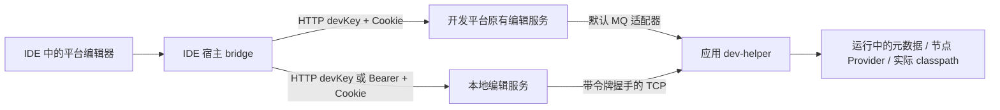
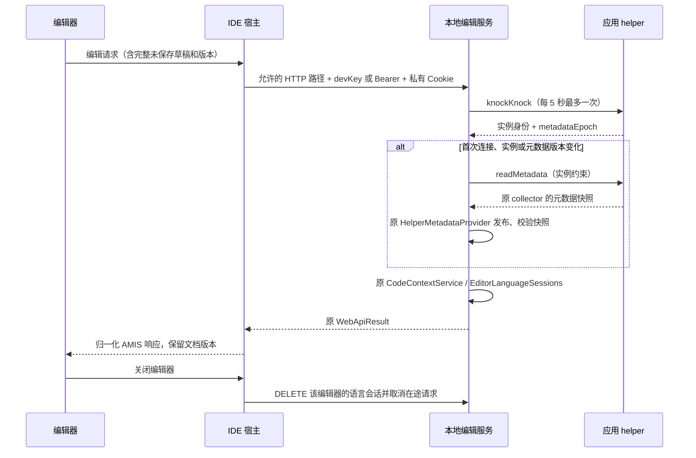

# 本地 IDE 编辑服务

没有开发服务器时，启动这个独立进程，为 VS Code 和 IntelliJ 提供与开发平台相同的代码上下文、语言会话和目录 HTTP 接口。它复用 dev-helper 命令、元数据发布、领域上下文 Provider、环境制品同步及语言服务，不启动开发平台的数据库和 MQ 自动配置。需 Java 21。



## 启动应用 helper

应用开发运行的依赖中包含 `ouroboros-dev-helper-runtime`，并使用本分支构建的版本。在 Spring Boot 配置中设置：

```yaml
spring:
  application:
    name: demo
ouroboros:
  dev-helper:
    transport: socket
    socket:
      bind-address: 127.0.0.1
      port: 19761
      token: ${LOCAL_HELPER_TOKEN}
```

普通 `main`、测试服务启动的 Spring Boot 都使用这套配置；JUnit 本身不意味着 `ouroboros.dev-helper.test-app=true`。该开关会禁用助手命令，本地编辑连接应保持 false（默认值）。替换 helper 的通信不会关闭业务应用自身的 MQ 依赖或业务功能。

## 启动本地编辑服务

在仓库根目录构建：

```bash
mvn -B -pl :ouroboros-dev-editor-service -am package -DskipTests
```

本地环境分别设置 `LOCAL_HELPER_TOKEN` 和 `LOCAL_EDITOR_TOKEN`，然后运行：

```bash
java -jar dev-module/ouroboros-dev-editor-service/target/ouroboros-dev-editor-service-2.0.0-rc.1-SNAPSHOT.jar \
  --ouroboros.editor.app-name=demo \
  --ouroboros.editor.token="$LOCAL_EDITOR_TOKEN" \
  --ouroboros.dev-helper.socket.token="$LOCAL_HELPER_TOKEN"
```

HTTP 默认监听 `127.0.0.1:19762`。helper 默认连接 `127.0.0.1:19761`，可用 `ouroboros.dev-helper.socket.host/port` 修改。应用尚未启动时服务仍可启动，请求返回 503；下次命令会尝试重连，不重放此前命令。

Groovy 沿用独立分发包：按[Groovy 语言服务指南](../ouroboros-dev-groovy-language-server/README.md)构建，并传入 `--ouroboros.code-intelligence.groovy.distribution=/absolute/path/to/target/distribution`。未安装时会报告不可用。JavaScript 和表达式继续使用既有语言实现。

## IDE 配置

共享文件 `.tidestack/develop.json`：

```json
{
  "schemaVersion": 1,
  "appName": "demo",
  "editorServiceUrl": "http://127.0.0.1:19762"
}
```

私有文件 `.tidestack/develop.local.json`：

```json
{
  "schemaVersion": 1,
  "devKey": "与 LOCAL_EDITOR_TOKEN 一致的值"
}
```

私有文件可用 `editorServiceUrl` 覆盖地址。连接开发平台时，专用地址可以省略，使用共享文件的 `developmentServerUrl` 和已有 `devKey`，无需另填平台登录令牌。宿主发送 `X-TideStack-Dev-Key`，平台复用原开发密钥校验、账号认证与授权链。连接本地服务时，把 `LOCAL_EDITOR_TOKEN` 设置为同一 devKey 即可；本地服务不依赖平台密钥库，直接校验该共享密钥。需要单独的本地凭据时，可在私有文件显式设置 `editorAccessToken` 作为 Bearer 覆盖。两款 IDE 优先使用显式覆盖，绝不同发两种凭据。密钥失效时返回真实 401，不自动弹出第二次登录。

两款 IDE 都从当前文件向上寻找最近的 `.tidestack/develop.json`，搜索范围限定在 VS Code workspace folder 或 IntelliJ 项目内。由此可以为同一项目的不同模块选择不同应用。每次打开编辑器固定目标；修改配置后重新打开编辑器生效。令牌和 Cookie 只在宿主中持有，不进入 Webview；宿主只转发当前应用的编辑接口，禁止任意 URL 和部署操作。服务地址的 context-path 会保留，HTTP 重定向不会携带凭据继续跳转。

| 运行方式 | 接入方式 |
| --- | --- |
| 已有开发平台 | IDE 指向平台；平台与 helper 继续使用默认 MQ |
| 基座嵌入本地 Spring Boot | helper 选择 socket；IDE 指向本地编辑服务 |
| 测试代码启动开发环境 | 同一套 socket 配置，连接已运行的 Spring 上下文 |
| 本地容器 | 容器内 helper 显式监听 `0.0.0.0`，把端口映射到宿主 `127.0.0.1:19761` |
| 无运行服务 | 不配置在线目标，继续使用随包静态编辑能力；应用语义服务不可用 |

TCP 本地通信不加密；远程进程通过 SSH 端口转发或既有开发平台连接。容器路径不会直接当作宿主路径使用，语言环境制品仍由原导出和校验流程同步。

## 请求与生命周期



上下文刷新会增加 helper 的 metadataEpoch；IDE 通过 environment 接口轮询同一目标的状态和身份，通知现有代码智能 bridge 失效。语言请求保留文档、草稿和上下文版本，前端原有的过期结果丢弃逻辑继续生效。

当前本地服务提供代码上下文/语言会话、逻辑流节点、字段类型和审批候选人目录。候选人源来自实际应用运行态 Provider，与平台的设计态预览源可能不同。未装配的编辑 API 返回真实错误，不用成功空列表代替；无在线配置时才使用随包静态目录。没有自动启动应用、通用能力发现、平台自动登录或任意业务 API 代理。

## 停用与恢复

关闭 IDE 编辑器后停止本地编辑服务，可释放它持有的语言会话和 helper 连接。需要恢复开发平台连接时，将编辑服务地址改回平台地址（或移除专用地址以使用 `developmentServerUrl`），继续使用已有平台 devKey（移除本地专用的 Bearer 覆盖），再重新打开编辑器。应用 helper 恢复 `transport: mq` 或移除此配置后，按原 MQ 参数重启；已有 MQ 实现和消息协议保持兼容。本次连接功能不修改应用数据库或元数据文件。
