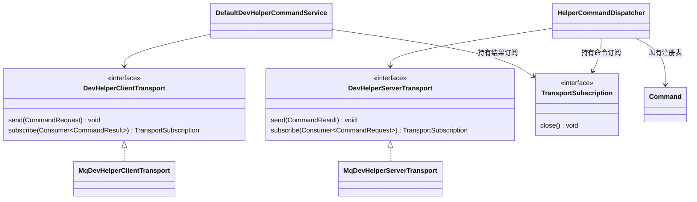
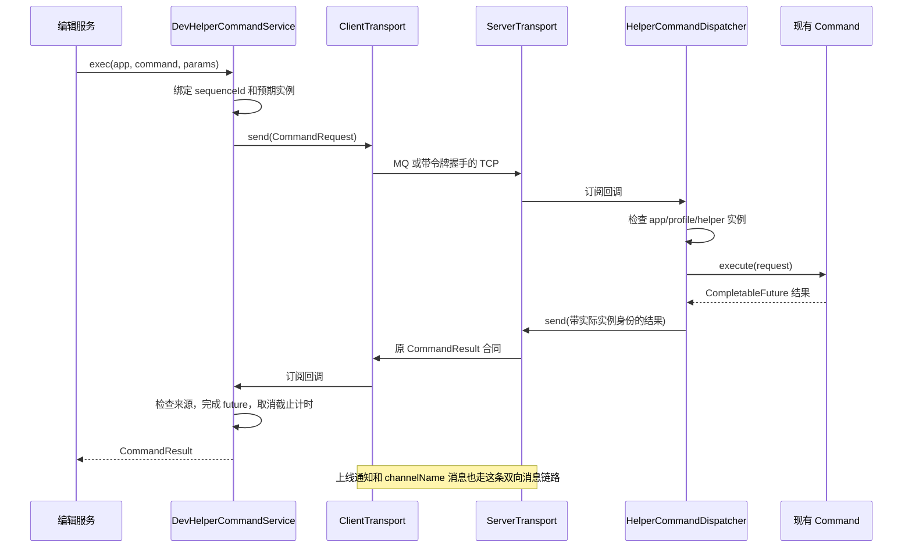
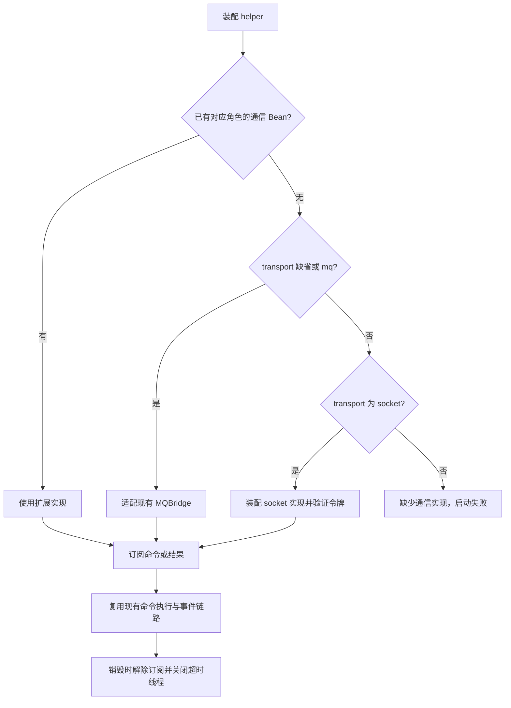
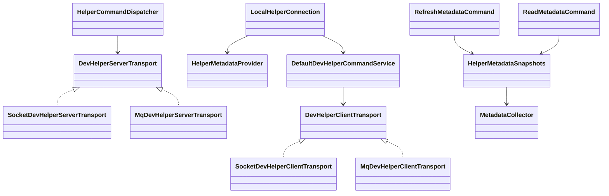

# Ouroboros Dev Helper 模块设计文档

## 1. 概述

`ouroboros-dev-helper` 是开发平台与运行时应用之间的开发辅助桥接模块，负责命令交互、元数据收集与同步、应用状态感知和流式通信能力。它是开发平台“看到运行时、驱动运行时”的关键支撑层。

## 2. 模块结构

聚合 `pom.xml` 显示该模块由四个子模块组成：

- `ouroboros-dev-helper-core`
- `ouroboros-dev-helper-runtime`
- `ouroboros-dev-helper-dev`
- `ouroboros-dev-helper-dev-metadata-provider`

这说明它天然横跨开发态与运行态：`core` 定义协议，`runtime` 接入应用端，`dev` 接入开发平台端，`dev-metadata-provider` 负责把元数据采集能力嫁接进开发平台。

core 保持与传输技术无关；现有 MQ 依赖仍留在 runtime/dev 模块，能力层 runtime 的依赖也保持原位。

## 3. 核心模型与机制

### 3.1 Command 抽象

`Command` 是模块最核心的执行契约，用来描述开发平台向运行时应用发出的操作请求。它体现了命令模式在该模块中的核心地位。

### 3.2 MetadataCollector 抽象

`MetadataCollector` 负责从运行时环境中提取元数据，使开发平台能够感知应用状态、模型或环境变化，而不必直接读取运行时内部实现。

### 3.3 DevHelperCommandService

`DevHelperCommandService` 作为开发平台侧调用入口，把命令执行、响应获取和结果回传统一起来，是“控制面”侧的主服务接口。

## 4. 通信与同步机制

### 4.1 通信边界

命令协议继续使用 `CommandRequest` / `CommandResult`。core 的 `transport` 包定义两个角色接口，避免一个实现被迫提供不适用的方法：

| 接口 | 发送 | 订阅 |
|---|---|---|
| `DevHelperClientTransport` | `CommandRequest` | `CommandResult` |
| `DevHelperServerTransport` | `CommandResult` | `CommandRequest` |

订阅返回 `TransportSubscription`。调用方销毁时解除自己的接收订阅；共享连接由传输实现或其原有基础设施管理，不能在取消订阅时关闭共享 `MQBridge`。

`DefaultDevHelperCommandService` 继续管理序列号、等待结果、超时、监听器和响应来源校验。`HelperCommandDispatcher` 继续通过现有 Command 注册表分发，管理应用/profile/进程身份校验、执行超时和异常结果。传输实现只承担消息发送、接收与编解码，不新增另一套命令路由、元数据注册表或重试策略。发送失败抛回原调用路径；未知传输不能静默切回 MQ。

```mermaid
flowchart LR
    Editor[平台或 IDE 编辑服务] --> Service[DevHelperCommandService]
    Service --> Client[DevHelperClientTransport]
    Client --> MQClient[现有模块内 MQ 适配器]
    Client --> IPCClient[本地 socket 适配器]
    MQClient <-->|原 topic / JSON| Broker[现有 MQ]
    Broker <--> MQServer[现有模块内 MQ 适配器]
    IPCClient <-->|令牌握手 / TCP| IPCServer[本地 socket 适配器]
    MQServer --> Server[DevHelperServerTransport]
    IPCServer --> Server
    Server --> Dispatcher[HelperCommandDispatcher]
    Dispatcher --> Commands[现有 Command]
    Commands --> Capabilities[MetadataCollector / 应用代码环境 / 调试能力]
```





### 4.2 默认 MQ 与替换配置

MQ 适配器放在现有 dev/runtime 模块内，不拆分底层 MQ 或增加 Maven 模块。原绑定合同如下：

| 角色 | 绑定名称 | destination | 配置 |
|---|---|---|---|
| 平台发送命令 | `ouroboros-dev-helper-command-client` | `ouroboros.dev-helper.command` | declareExchange，exchangeType=topic |
| 应用接收命令 | `ouroboros-dev-helper-command` | `ouroboros.dev-helper.command` | broadcast |
| 应用发送响应 | `ouroboros-dev-helper-result` | `ouroboros.dev-helper.response` | declareExchange |
| 平台接收响应 | `ouroboros-dev-helper-response-client` | `ouroboros.dev-helper.response` | broadcast |

发送仍交给 MQBridge 原有的 payload 序列化机制，接收仍按 UTF-8 JSON 解码。应用侧保留 256 KiB 请求上限，拒绝无效消息；平台侧拒绝非字节或无法解码的响应。

既有已注册的 `DevHelperAutoConfiguration` / `DevHelperDevAutoConfiguration` 提供默认 Bean：

```yaml
ouroboros:
  dev-helper:
    transport: mq  # 缺省值；现有部署无需新增配置
```

`@ConditionalOnMissingBean` 允许应用提供对应角色的自定义 Bean。提供 Bean 即可替换默认实现；若同时声明 `transport: ipc` 等名称，必须由扩展实现提供匹配的通信 Bean，配置本身不会创建 IPC。双方需使用相容的实现和连接参数。未提供实现时启动失败，不借用 MQ 隐式兜底。自定义传输模块的自动配置应在默认配置之前装配，并沿既有 META-INF 机制注册。

本地实现使用带令牌握手的 TCP 长连接（`transport: socket`），适用于已有 Spring Boot、JUnit 启动的进程和通过端口映射连接的容器，不占用应用 stdout。默认绑定 127.0.0.1:19761，连接失败后下一次命令重新连接，不重放命令。双方必须配置同一个 `socket.token`。传输配置与 `test-app` 无关；后者仍只控制原有功能装配。替换 helper 传输不等于关闭业务应用自身的 MQ 功能，现有 Maven 依赖和全局 MQ 自动配置仍保留。

### 4.3 执行与生命周期



平台启动时的探测和 helper 启动时的主动上线通知都保留，传输必须支持没有请求序列号的事件。现有共享命令/结果流式 facade 继续携带 `channelName`；独立流通道的 create/destroy 命令原本返回“暂未实现”，本次不扩展其能力。两端销毁时均解除订阅，并在 finally 中关闭各自超时线程。



## 5. IDE 与本地运行时复用边界

IDE 继续通过宿主 bridge 调用编辑服务。编辑服务调用同一个 `DevHelperCommandService`：有开发服务器时默认 MQ；本地 Spring Boot、测试启动或本地容器可安装同一套 helper 命令能力，并配置 socket 传输。部署方式决定通信连接，不决定元数据如何采集。

`RemoteCodeEnvironments` 继续通过 `DevHelperCommandService` 获取 `codeEnvironment` manifest、制品、校验和实际应用 classpath。无开发平台时启动 [本地编辑服务](../ouroboros-dev-editor-service/README.md)：它显式装配既有 CodeContextService、语言会话与 HelperMetadataProvider，不加载整个平台的数据库、MQ 和容器管理自动配置。

`readMetadata` 与 `refreshMetadata` 共用 `HelperMetadataSnapshots` 的 collector 和递增 revision。前者只读取已加载的元数据；后者仍触发原上下文刷新。`knockKnock` 返回 helper 身份及 `metadataEpoch`，上下文刷新后 epoch 增加。本地服务最多每 5 秒检查一次，只有实例或 epoch 改变才读取快照，沿原激活、请求和发布事件校验身份；普通打开和输入不重建应用上下文。

`editorCatalog` 从正式 `LogicFlowNodeDefineProvider` 和运行态 `FieldTypeCatalog` 读取目录。平台与 helper 共用 `LogicFlowNodeCatalog` 的覆盖和排序规则。`approvalCandidates` 查询应用已注册的 `CandidateProvider`，搜索、回显和分类均在应用内执行。本地服务将结果映射成既有 HTTP 编辑接口；没有实现的接口返回真实错误。



socket 帧采用长度前缀的 UTF-8 JSON。请求上限 256 KiB，结果上限 32 MiB，握手超时 5 秒，最多 8 条连接；服务端在发送结果前完成认证，不使用 Java 对象反序列化。容器显式配置监听地址和端口映射；本地 TCP 不提供 TLS，跨主机应使用 SSH 隧道或已有开发平台。独立流通道的 create/destroy 维持原来的不支持结果，与共享命令流 facade 区分。

## 6. 维护重点

- Command、MetadataCollector 和 DevHelperCommandService 保持唯一正式业务入口。
- 通信实现不得承担命令关联、运行实例选择或业务目录合并。
- MQ topic 与消息 DTO 的兼容性、默认装配、自定义实现替换及订阅清理均由行为测试覆盖。
- 本地通信的寻址、身份认证、连接断开和重连生命周期随具体实现设计，继续保持现有实例校验，不把进程直连当作免校验。
