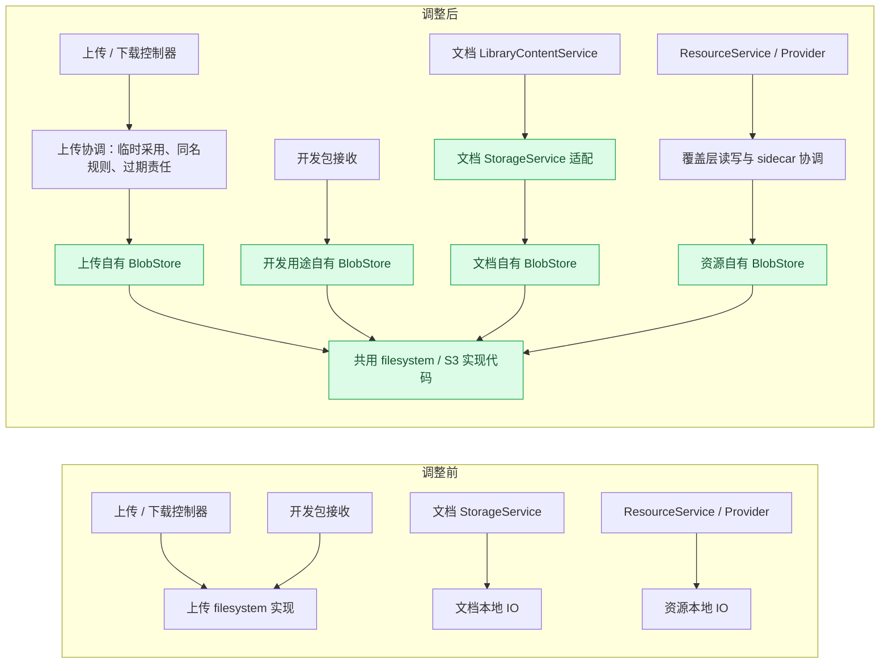
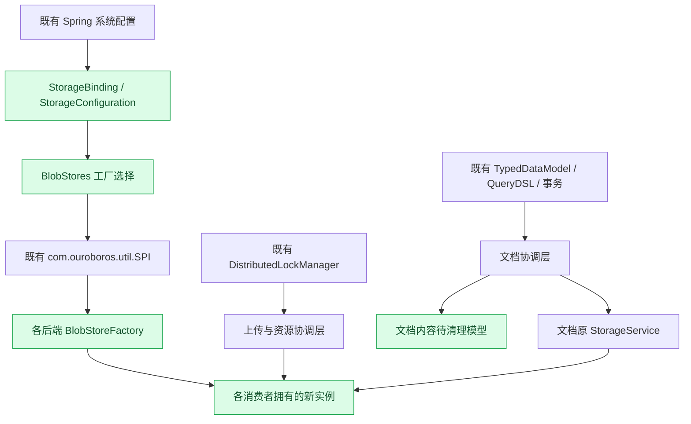
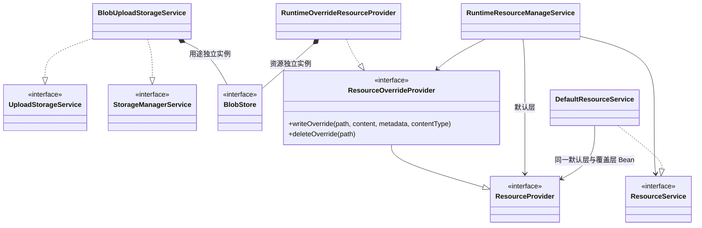

# 公共内容存储设计

文件上传、文档和资源覆盖层通过独立实例复用公共内容存储。公共库位于 libs Foundation 层，仅管理内容 IO；现有业务接口和协调层继续管理其业务规则。

## 架构调整

图中绿色是新增实现或接入。四个 BlobStore 框分别代表独立对象；底部表示代码复用关系，不代表一个全局后端对象。

## 与既有机制的关系

没有新增注册中心、全局实例缓存或公共事务框架。runtime JAR 用于可插拔装配，不承担业务生命周期。部署通过 Maven 引入后端实现，发现机制沿用 Java SPI。

## 核心契约与实现依赖

本设计落实全仓[接口与实现依赖隔离（P1-16）](../../architecture-constraints.md#15-接口与实现依赖隔离-p1-16)。上传存储实现和定时清理从 upload-core 移到独立的 `ouroboros-file-upload-storage`，供普通上传和开发接收的各自自动配置创建独立实例。生成器及其既有 SPI 留在 core；core 只引用 storage-core 的对象键 URL 编码规则。

资源 core 的 `ResourceOverrideProvider` 在原读取契约上补充覆盖写入和删除。原 `RuntimeOverrideResourceProvider` 直接实现此契约；管理层不再引用具体 Provider。纯路径规则归 resource-core，resource-dev 和 runtime-manage 不再通过 Maven 生产依赖引入 resource-runtime。上传/资源默认 Bean 的实际选择、内容布局和业务协调规则保持原机制。

Maven 依赖图见[存储模块说明](../../../libs/storage/README.md)。`StorageDependencyRulesTest` 同时读取编译类和 Maven effective reactor 的依赖/作用域，检查本设计列明的上传、资源、文档及存储模块的直接与传递依赖；全仓适用规则与尚未覆盖的自动检查范围以 P1-16 为准。

## 职责分配

| 内容 | 所属位置 |
| --- | --- |
| 对象 key、流式 IO、范围、分页、后端资源释放 | storage-core 与后端实现 |
| HTTP 旧协议的小片限制与技术暂存 | 各后端 MultipartBlobStore 实现 |
| 临时/永久、同名不覆盖、采用与过期扫描 | 文件上传域 BlobUploadStorageService |
| 文档唯一内容键、SHA-256、元数据事务与物理删除补偿 | 文档 StorageService / LibraryContentService / Repository |
| 资源优先级、sidecar/index、上传与恢复默认 | 原 ResourceService / Provider / RuntimeResourceManageService |
| URL 与匿名访问 | 原 Generator、控制器、安全机制 |

同名不覆盖使用现有锁，完整普通上传立即成为永久内容。临时采用先复制最终内容，再保存采用回执并清理源；回执保留到原期限以支持清理失败后的重复请求。最终写入与回执持久化之间仍可能结果不确定，报错后须核对最终内容；公共层没有跨对象事务。

## 文档删除与回滚

节点删除与 `doc_content_cleanup` 登记在同一元数据事务中提交，回滚同时撤销两者。afterCommit 使用独立事务核对仍存活的节点引用（包括可恢复库的节点），再删除内容并移除清理记录；失败保存次数、错误和退避时间。原调度每分钟重试一批，现有锁串行化同内容清理。

上传使用唯一新键。事务回滚触发补删；补删失败独立登记清理记录。提交结果 UNKNOWN 或进程硬退出时保留内容并记录/执行人工核对。新增窄模型仅保存待清理责任，不成为公共文件索引或通用消息队列。

独立事务需要额外数据库连接；连接池容量须覆盖并发外层事务及其提交后工作。文档配置仅在节点库、内容存储、待清理库和事务管理器齐备时装配默认内容服务；自定义领域服务的官方扩展点保留。

## 资源保证等级

保持 `RUNTIME_OVERRIDE > APP_DEFAULT`、原 key、sidecar 和 index 格式。覆盖内容和 sidecar 两次写入并非原子发布：内容成功、元信息失败时保留内容并明确报告部分成功；重试原上传修复。恢复默认删除内容和残留 sidecar，重复删除安全。权限、网络、坏 JSON 均传播，不伪装成缺失后回退。

公共存储不提供 CAS、发布 manifest、墓碑、GC 或文件系统跨进程锁；需要更强发布一致性时，由资源协调层另立有明确目标的设计。

## 验证与边界

基础合同、装配隔离、真实 MinIO 和真实 SQL 事务场景见[测试契约](../../../testing/integration/feature/storage/independent-content-stores/contract.md)。供应商范围、配置、部署与迁移限制见[操作指南](../../guides/content-storage.md)；Maven 依赖图和扩展方式见[存储模块说明](../../../libs/storage/README.md)。
