# 企业协作平台集成架构设计

> 当前连接配置使用单一 `provider` 名称；`connectionId` 在平台连接目录内全局唯一，连接配置、身份关联和 callback 只携带 `connectionId`，运行时从连接快照派生 provider。领域运行时仍可使用 Registry 中的 adapter descriptor `adapterId` 定位具体 facet，但该标识不是管理员连接字段。连接 `profile`、公共 `applicationType` 和公共 endpoint 没有独立配置语义；应用形态由 provider 实现和 typed credential 决定。登录绑定沿用 `UserSsoEntity`；部门、员工的组织关联已沿组织模块实现并通过本地行为验证，见 §0.2、§6.3 和 §7.5，不恢复 `enterprise.identity-mappings` 配置。

## 0. 当前连接与身份决策

### 0.1 标识边界

| 标识 | 语义 | 是否由流程映射提交 |
|---|---|---|
| `provider` | 外部平台及其当前领域适配实现的稳定类型，如 `dingtalk`、`wecom`、`feishu` | 否；从连接派生 |
| `connectionId` | 外部企业/应用安装的具体连接身份，在当前部署的连接目录内全局唯一；未来隔离由平台透明租户方案承接 | 是，唯一路由字段 |
| `profile` | 早期的未定义连接档案字段；与 `applicationType` 重叠且未参与运行时行为 | 否，删除 |

连接快照必须保存 `provider`，因为运行时仍然需要知道应装配哪一种凭据、客户端和协议；但任何领域调用方都不再把 provider 与 connectionId 作为一对可独立编辑的路由条件。连接服务负责保证 `connectionId` 唯一、provider 创建后不可变，并在被引用时禁止复用或删除。

### 0.2 用户外部身份绑定

当前第三方登录建立的安全绑定供既有企业成员解析复用，不另建审批身份配置表：

```text
t_sys_user_sso
  ssoChannel      = connectionId
  ssoUserIdentity = 连接作用域内的外部登录标识
  userIdentity    = Ouroboros 用户标识
  externalAttributes.MEMBER_ID = 企业 API 使用的成员标识
```

流程发起通过 `EnterpriseIdentityMappingService` 按连接和平台用户解析成员 ID，回调按连接和成员 ID 反向解析平台用户；成员 ID 不得用外部登录 ID 兜底。当前数据库约束 `(ssoChannel, ssoUserIdentity)` 唯一，反向查询出现多条时 resolver 必须 fail-closed。查询失败不能降级为原样透传或“未绑定”。

本期增加外部部门到本地 Department、外部成员到本地 Employee 的绑定，允许只绑定而不启用资料同步，也允许员工尚未建立登录绑定。组织关联由组织模块维护；Employee 与 User 继续使用现有正式关联。登录绑定由安全模块验证和维护，目录导入不自动获得账号绑定、角色或登录权限。既有身份解析端口应组合这些已确认关系，不能为审批、通知分别复制成员映射，也不能把组织绑定伪装为已验证的登录身份。决定依据见 [ADR-006](../../adr/ADR-006-enterprise-integration-capability-composition.md)。

### 0.3 动态连接 Schema

每个 provider 通过 `EnterpriseConnectionProvider` SPI 贡献连接 schema、凭据输入合同和服务端校验器。公共目录不再依赖审批 Provider。集成管理适配读取公共描述生成配置表单：

```text
GET /api/sys/enterprise-connections/providers/{provider}/management-schema
GET /api/sys/enterprise-connections/providers/{provider}/configuration
PUT /api/sys/enterprise-connections
```

`provider` 用于选择已安装类型；连接保存后仍只以稳定 `connectionId` 路由，不能将审批 `adapterId` 写进连接。页面和后台使用同一 Provider 合同，schema 不返回凭据内容。应用形态由 typed credential 与实际协议决定，不增加公共 `profile/applicationType/endpoint` 字段。

### 0.4 本期企业渠道基数（已实现、本地验证通过）

钉钉、企业微信、飞书每个渠道暂时只接一个企业，三种渠道可以同时启用；限制作用于同一平台部署的连接目录，不按管理员或应用各选一个企业。首期建议每个企业渠道配置一条企业连接，登录、目录、通知、工作台及 RPC 共用该连接；暂不增加同渠道的多企业选择、多应用连接管理或自动路由。一个企业与一个应用不是同一概念，后续确有同企业多应用需求时单独扩展，不能借此接入第二家企业。

保留 `connectionId` 及原连接快照模型。企业渠道的基数由 provider 管理描述声明，并在服务端保存/读取时校验，不能只隐藏页面按钮；缺失连接或存在重复候选均明确报错，不取第一条。已有多连接配置迁移时须先核对引用并人工收口，不能静默丢弃。通用 OIDC、LDAP、CAS 身份源以及下方接入应用不受这一企业渠道限制，沿原规则维护。决定见 [ADR-008](../../adr/ADR-008-single-enterprise-per-channel.md)。

## 1. 语义架构图

本章展示本期与独立后续能力的长期语义关系，箭头表示运行时调用或事实流向，不等同于 Java/Maven 源码依赖。待办投递、专项领域及入口自动发布按 §2.1 属独立后续，不是本期必须装配的模块；本期源码依赖和最小组合分别以 §5.2、§5.4 为准。

### 1.1 总图：平台边界与依赖关系

总图只保留语义边界和主依赖关系：领域拥有业务真相和端口，供应商 facet 实现领域端口并复用 Connector，Connector 负责连接与协议基础设施，外部平台承载供应商 API 和回调。

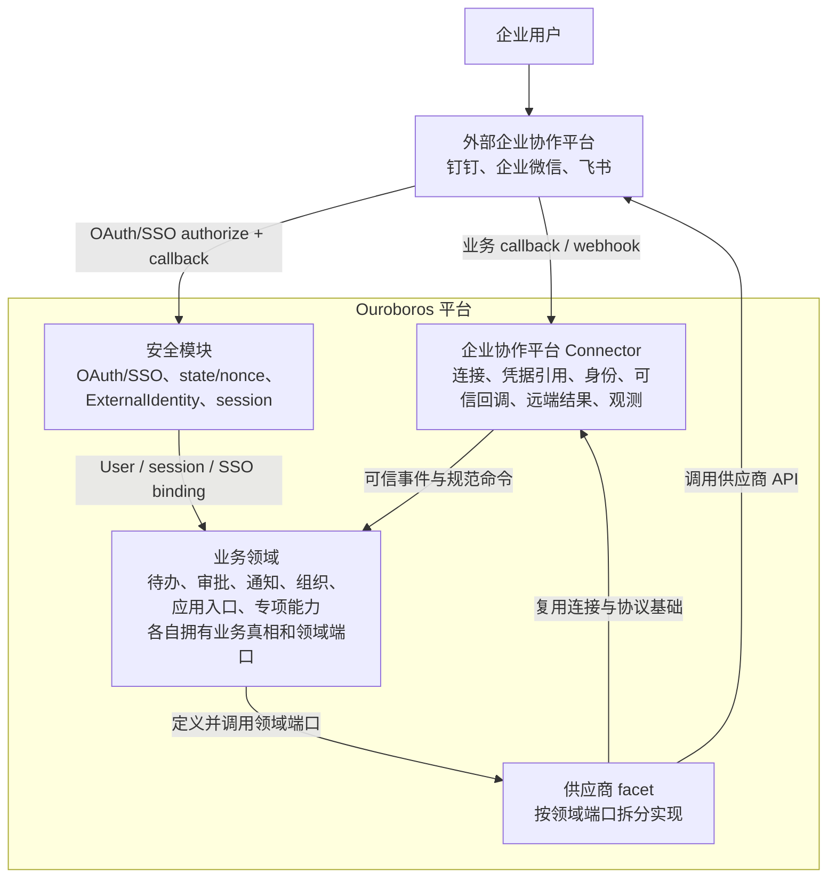

总图表达四条边界：领域不依赖供应商实现，Connector 不拥有业务生命周期；供应商 facet 是领域端口与外部协议之间的适配点；业务 callback/webhook 先经过 Connector 的可信接入，再分发给注册关注该事件的插件；OAuth/SSO callback 只进入安全模块，不进入企业业务回调分发。

### 1.2 细节图：按语义关系拆分

#### 1.2.1 业务领域与业务端口

每个领域分别用一张窄图表达“业务事实 → 领域端口”；端口由领域定义，供应商实现不能反向拥有这些事实。本组图聚焦业务事实和跨平台投递。

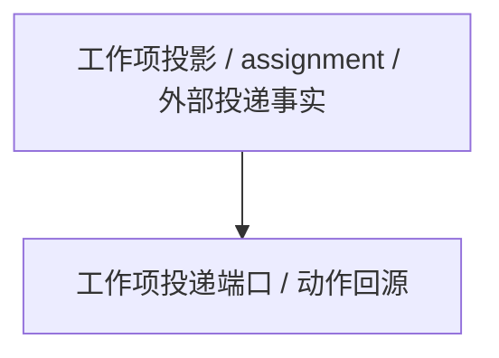

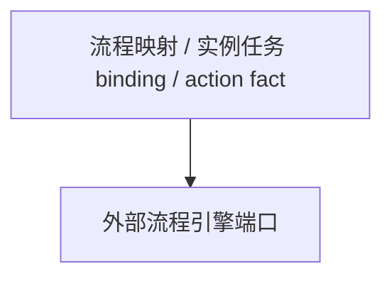

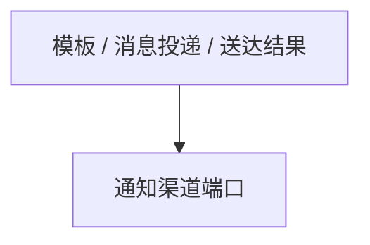

#### 1.2.2 平台支撑领域与专项端口

安全、组织、应用运行时和专项能力同样分别拥有自己的事实与端口，不共享彼此的业务生命周期。

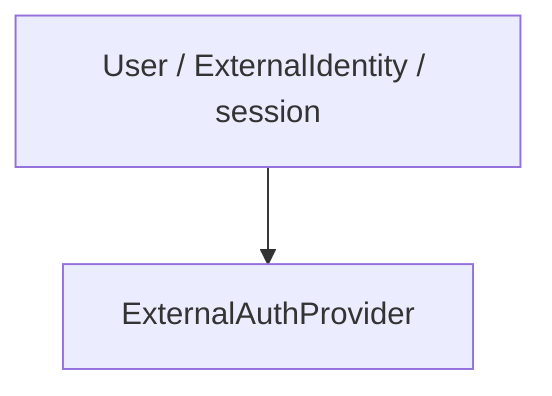

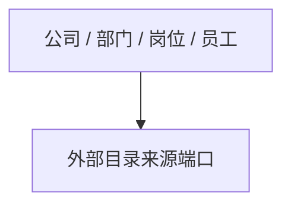

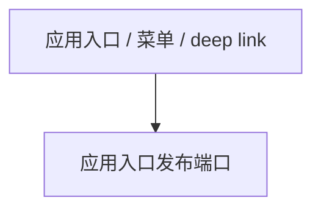

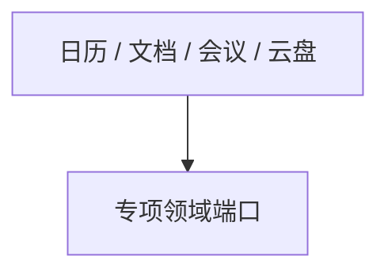

#### 1.2.3 钉钉 facet

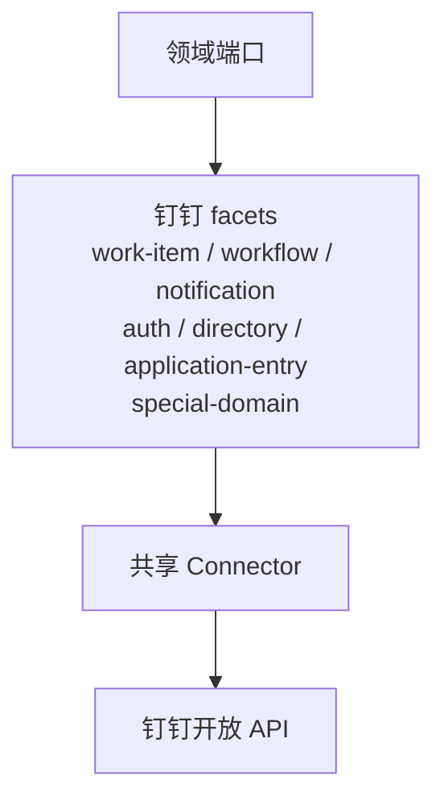

#### 1.2.4 企业微信 facet

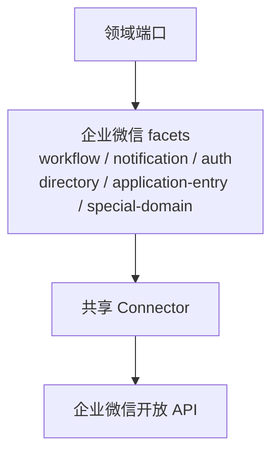

企业微信当前不注册 `work-item` facet；未注册的领域端口即不支持，不以空实现或运行时猜测补齐。

#### 1.2.5 飞书 facet

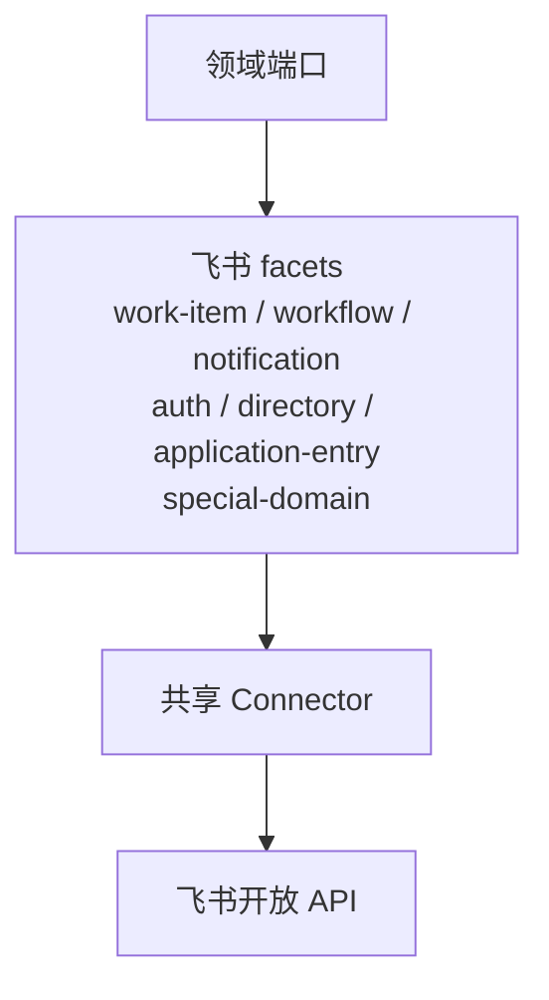

#### 1.2.6 Connector 连接与身份基础

所有供应商 facet 复用同一套连接和身份机制；这些机制不直接更新领域表。

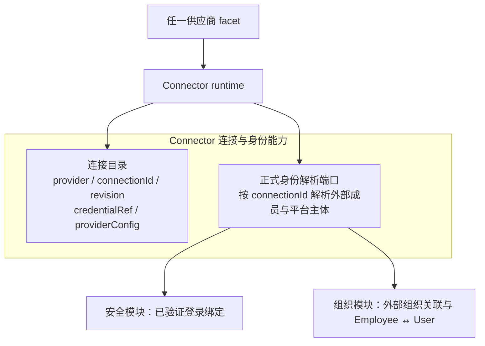

#### 1.2.7 Connector 受控调用与远端结果

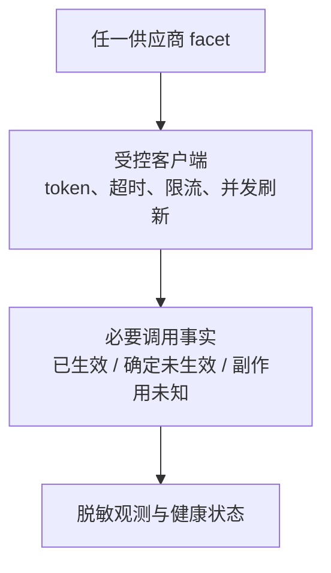

#### 1.2.8 Connector 业务 callback 接入

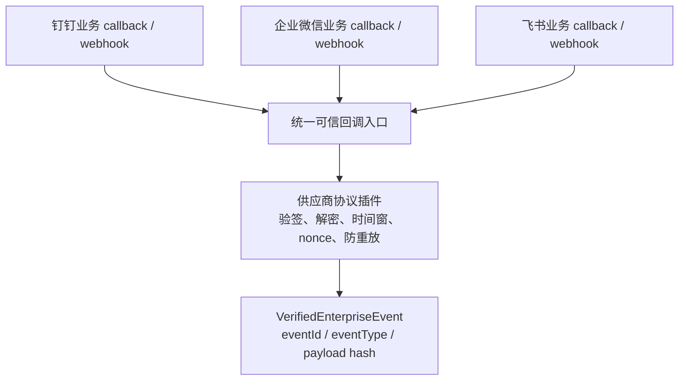

#### 1.2.9 OAuth/SSO 登录链路

OAuth/SSO 不进入企业业务回调分发；安全模块负责授权、回调、身份规范化和本地会话。

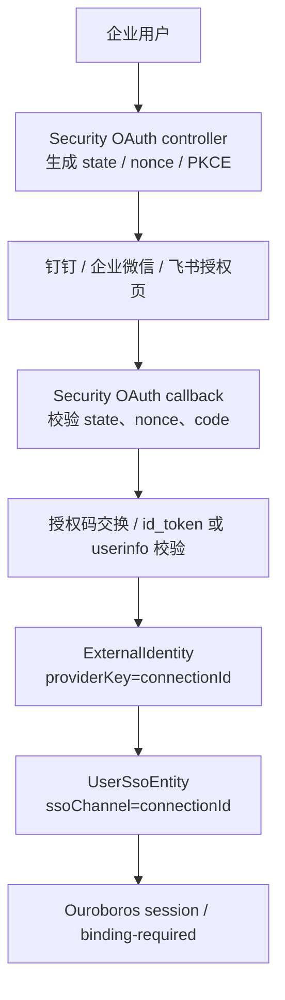

#### 1.2.10 回调领域路由与订阅

插件声明关注的 provider、事件类型和交付方式，统一入口据此分发。异步通知可有多个订阅者，同步命令只有一个处理者；持久化和业务恢复由各领域沿原机制承担。

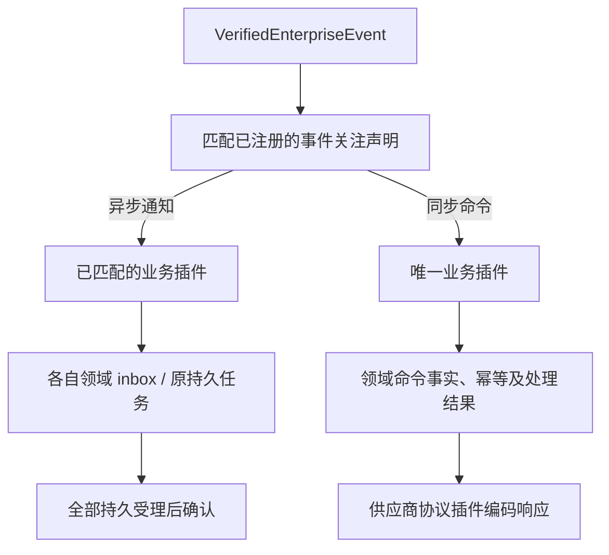

这些细节图共同说明依赖规则：领域核心不依赖供应商实现，也不依赖 Connector；供应商 facet 依赖对应领域端口并复用 Connector；回调只能通过显式 subscriber 或领域 handler 进入业务语义，运行时由 AutoConfiguration/SPI 装配。

## 2. 状态与适用范围

状态：本期范围和架构已确认，代码及本次仿真验收已完成。管理员第三方登录管理、可插拔集成管理宿主、登录/OIDC/DCR 入口及菜单/权限迁移已有本地验证。公共连接、AES-GCM 托管凭据、共享应用 token、自建应用登录、主密钥重加密、统一业务回调与审批订阅、目录绑定/单向同步、三家通知、工作台入口及通讯录/消息 RPC 包均已有实现和定向行为测试。通知继续复用原多渠道模板和持久投递计划。孤立凭据清除及连接引用保护、目录/通知内容保留和跨能力共享请求预算已有实现和行为验证。完整 reactor 编译、架构门禁、生产 Schema 浏览器测试及隔离 MySQL 8.3/Redis 验证通过。本次按用户确认，以仿真外部服务和两个正式后端节点验证内部机制；真实企业授权、供应商后台切换及存量生产迁移/发布回退作为后续发布核对，不再阻塞本次交付。证据边界见 §15.1、§18。

能力证据标记只出现在方案和验收材料，不进入代码。三家每渠道部署级一个企业，首期新增接入使用企业自建应用；停用警告后确认，遗留业务由管理员处理。集成管理首页上方“外部连接”、下方“应用接入”，通用 UI Model 保持纯粹。长期待办中心等目标仍为 Proposed，不属于本期承诺。详细实施证据和未完成项见企业连接模块 README 及临时实施清单。

目标读者：平台架构维护者、待办中心/审批/通知/安全/组织模块开发者，以及钉钉、企业微信、飞书适配器开发者。

本设计规定 Ouroboros 应用接入企业协作平台时的长期边界。它覆盖：

- 钉钉、企业微信、飞书等企业协作平台的连接基础设施；
- 待办、外部流程、通知、登录、组织目录和应用入口的领域适配方式；
- 供应商回调、身份和远端错误的公共机制；
- 审批 MIRROR 删除后的外部待办目标结构及尚未实现的替代能力。

本设计不承诺某个平台的所有开放 API，也不预先设计文档、日历、会议、云盘等尚无产品需求的专项领域。

### 2.1 本期范围与实施边界

| 能力 | 已有基础 | 本期确认的调整 |
|---|---|---|
| 部门、成员绑定与同步 | Company、Department、Employee、Appointment、员工与账号关联、企业身份解析端口 | 支持绑定本地已有对象；支持从外部目录单向创建/更新资料；两种方式共用组织关联，员工无需先登录。 |
| 通知 | NotificationAdapter、模板、分发、持久投递计划和钉钉渠道 | 增加企业微信、飞书渠道；连接和收件人关联复用公共机制；先覆盖文本与业务链接。 |
| 企业工作台进入业务应用 | 应用路由、外部认证、账号绑定、平台会话与权限 | 入口关联企业连接、目标应用及页面；先支持在供应商后台配置入口 URL，并补齐所需登录形态。 |
| 开放 API 的 RPC 包 | JAR RPC 元数据加载、凭据 SPI、执行器、逻辑流节点 | 按平台和 API 能力组交付 JAR；每个接口是独立 RPC 模型；配置连接和权限后可调用。 |
| 已有登录与外部审批 | 三平台认证适配、RESULT_ONLY 启动/详情查询/回调 | 保留正式安全和审批链路；登录与审批分别校验能力，完善订阅维护、结果核对和恢复；业务回调统一入口，协议和业务关注声明插件化，复用原审批持久受理。 |
| 集成配置入口 | 统一配置、接入应用专用页、动态连接 schema、通知管理描述、平台 UI 元数据 | 统一为“集成管理”，同步模块树、权限项与菜单；上方外部连接按类型直接配置，下方应用接入包括应用列表、授权服务器与 DCR；外部统一登录设置迁入；页面随模块/JAR 装配，重启后发现。具体交互通过原型确认。 |

统一待办中心、三家原生待办同步、全过程代理审批、通讯录双向写回以及工作台入口自动发布不作为本期前置条件。文档、日历、会议、云盘和 AI、数据库、对象存储、MQ 连接不在本期范围。§7.1 的待办设计保留为独立后续目标，不决定本期实施顺序。

安装模块后自动获得的是能力描述与 RPC 定义；真实调用仍要求连接、权限和所需映射就绪。插件安装沿用 Maven 模块/JAR、Java SPI 和 AutoConfiguration，不引入热安装运行时。

### 2.2 三平台共性能力矩阵（设计基线）

矩阵先定义平台之间真正共享的最小合同，再记录各平台差异。`本地已实现` 表示代码和定向行为测试已有证据；`已有/迁移` 表示沿原能力迁移；`待验证` 表示仍须用权限 scope 和真实租户确认，不能仅凭产品名称判断支持。矩阵不把平台特有能力强行压成统一字段。

| 能力 | 三平台共同最小合同 | 钉钉 | 企业微信 | 飞书 | 本期边界 |
|---|---|---|---|---|---|
| 连接与凭据 | 一个 provider connection；typed credential；受保护引用；能力按 scope 验证 | 本地已实现，共享内部应用凭据 | 本地已实现，新增自建应用凭据，与原套件分开 | 本地已实现，登录不强制业务回调材料 | 每渠道一个企业；凭据保存按 §6.2 |
| 登录/免登 | 授权发起、callback、稳定外部身份、UserSso 绑定、平台 session | 本地已实现；`unionId/openId` 与成员 `userId` 分开 | 本地已实现自建应用网页授权；`open_userid/userid` 分开 | 本地已实现；`open_id` 等身份按 auth facet 规范化 | 真实终端/授权待验；不把成员绑定当登录授权，不承诺所有终端 JS-SDK 免登 |
| 组织目录 | 分页读取部门/成员/归属；外部 ID→Department/Employee；绑定与单向同步 | 本地已实现；`corpId` 与成员权限按 provider 校验 | 本地已实现；通讯录权限和成员标识独立核对 | 本地已实现；可选部门范围及成员标识按 provider 合同 | 只同步白名单字段，不写回外部；真实可见范围待验 |
| 企业通知 | 复用 NotificationAdapter、模板、持久投递计划；首期文本/业务链接；连接和成员地址固定 | 本地已迁移，退出渠道内重复 token/client | 本地已实现 WeCom channel | 本地已实现 Feishu channel | 真实发送待验；不把通知变成待办，沿原内容授权 |
| 工作台入口 | 受控本地 route/deep link；进入前认证，进入后原权限检查；首期供应商后台手工配置 URL | 本地入口生成已实现 | 自建应用网页授权入口已实现，与第三方套件分开 | 本地入口生成已实现 | 真实客户端待验；不做入口自动发布，不接受任意回跳 URL |
| 开放 API / RPC | JAR 元数据、能力组、权限说明；按渠道自动解析唯一连接；复用原 executor/token 机制 | 本地已实现通讯录/消息包 | 本地已实现通讯录/消息包 | 本地已实现通讯录/消息包 | 真实 scope/调用待验；不按企业复制模型，不把业务 retry 下放给 RPC |
| 外部审批 | 启动/详情/结果/回调的领域端口；结果和动作按 provider 能力声明 | `已有/迁移`，RESULT_ONLY 基线 | `已有/迁移`，RESULT_ONLY 基线 | `已有/迁移`，RESULT_ONLY 基线 | 保留领域语义；不承诺全过程代理审批 |
| 能力检查与审计 | 配置校验、连接健康、scope/身份验证、操作审计彼此分开 | provider health | provider health | provider health | 沿各领域原检查与生效规则，不增加统一激活状态机，见 §9.2 |

矩阵的结论是：共性层只承诺连接、身份、目录关联、文本/链接通知、受控工作台入口和 RPC 调用上下文；卡片、富媒体、双向通讯录、入口自动发布、审批动作和平台特有 API 作为 provider facet 或独立领域能力。`SUPPORTED`、`UNSUPPORTED`、`TENANT_BLOCKED` 只用于方案核对、验收证据和发布准入，不进入业务代码、连接配置或运行时状态枚举。当前本期三家的登录、目录、通知、工作台和 RPC 均有本地实现，真实企业证据仍为 `TENANT_BLOCKED`，不能据本地通过标记真实授权已支持。发布验收须保存实际 schema、权限和企业验证证据；页面和服务端根据已装配的 capability、连接快照、权限和实际检查结果判定可用性，不能读取这些方案标记替代运行时判断。

### 2.3 配置作用域与未来透明租户化

本期已决定“每渠道一个企业”按**部署级**处理，因为 `enterprise.connections` 是后端配置项而不是租户数据。钉钉、企业微信、飞书各自最多存在一个企业连接；连接、凭据、组织绑定、通知计划、RPC 执行、缓存、定时任务、回调路由和审计均使用同一部署级作用域。页面不提供租户选择器，连接键也不携带请求头、企业 ID 或当前登录 User 推断出的租户信息。

未来租户化由平台统一的透明租户方案承接，沿配置、数据、缓存、任务等基础设施的正式扩展点实施；provider facet、RPC 模型、业务领域端口和管理页面不各自增加租户参数或租户分支。本期不预建租户解析层、租户选择器、作用域切换开关或每租户连接副本；未来哪些数据保持全局、哪些数据需要隔离及其迁移方式，由统一租户方案决定，并统一验证连接解析、缓存、任务、回调和审计之间的一致性。

本期所有集成连接均按部署级处理，不能由单个 provider 私自引入租户读取路径。多租户支持不扩大本期范围，详见 [多租户设计](multi-tenancy.md)；本期所有验收按部署级行为及其授权审计执行。

### 2.4 应用形态与本期对齐建议

自建应用和第三方应用描述的是应用归属与授权方式，不是“谁编写业务代码”。自建应用也可以委托外部团队开发。

| 形态 | 归属与使用范围 | 配置和运维含义 |
|---|---|---|
| 企业自建应用（钉钉称企业内部应用） | 在本企业后台创建，由本企业管理和授权，主要供本企业成员使用 | 配置本企业应用的标识、密钥及所需权限/可见范围；仍需企业内审批、发布和权限授权，不等于获得全通讯录或全部 API 权限 |
| 第三方应用（飞书常见形态为商店应用） | 服务商维护应用，由使用它的企业管理员安装或授权，可服务多家企业 | 除应用凭据外，还涉及企业安装授权、票据/授权回调等合同；具体字段因供应商而异。只安装到一家企业时仍属于第三方应用 |

每渠道一个企业的限制不决定应用形态。2026-11-16 已确认：首期钉钉、企业微信、飞书均接入企业自建应用。第三方应用不属于本期新接入和验收范围；已有第三方配置及业务引用按原迁移规则显式处置，不能静默删除、改名冒充自建应用或切换既有业务身份。

| 平台 | 自建应用的配置与能力条件（字段已接入，真实授权待验） | 与当前实现/原型如何对齐 |
|---|---|---|
| 钉钉 | 企业标识及 `AppKey/AppSecret`，消息发送等能力按需引用 `AgentId` 等字段；登录与服务端应用 token 分开 | 当前凭据已区分内部应用和第三方企业应用；首期新增接入使用内部应用，原第三方 `SuiteKey/SuiteSecret` 不改名冒充内部凭据。当前纯登录不再强制回调字段，实际接收回调时校验所需材料 |
| 企业微信 | `CorpID`、应用 `AgentID` 及对应 `Secret`；自建应用网页授权、应用消息和通讯录读取分别按官方权限/可见范围验证 | 已补自建凭据、应用 token 及服务端网页授权，原第三方套件协议保留为独立分支；不能把 `SuiteID` 改名为 `AgentID`。原套件连接按已有业务引用迁移规则处置，不作为本期自建接入的实现依据 |
| 飞书 | `App ID/App Secret`；登录声明重定向地址与身份权限，目录按授权范围读取，应用消息按需开启机器人及消息权限 | 当前主形态已是企业自建应用；把 `Verification Token/Encrypt Key` 的必填条件收回到实际事件接收方式，不让纯登录、目录读取或出站消息被审批回调字段阻塞 |

这里的“表单、配置校验和实际协议实现对齐”，指页面、后台检查和实际调用都围绕同一家平台的自建应用官方接入规则工作：

| 用语 | 具体含义（以企微为例） |
|---|---|
| 配置表单 | 集成管理中的企微设置页面，供管理员填写 CorpID、AgentID、Secret 及所需能力参数 |
| 配置校验 | 保存时后台检查所需字段是否完整、格式是否正确、是否满足启用能力的参数要求；字段检查通过不表示真实企业凭据和权限已验证，远程检查独立执行 |
| 实际协议实现 | 后台真正与企微通信的代码：按自建应用规则获取 token、发送请求并解析响应，而不是继续使用第三方套件的授权方式 |

例如，页面允许填写自建应用的 CorpID、AgentID、Secret，后台就必须能够检查并使用这些自建信息；不能页面填一套，后台仍要求 SuiteID、SuiteSecret、SuiteTicket 并按第三方方式调用。三家的字段和调用方式分别遵循各自官方规则，不要求三家字段完全相同。

配置页面按“应用基础凭据 + 实际启用能力所需字段”组合。业务回调的验证/加密材料仅在对应回调协议需要时要求；保留已有第三方业务链路时，其授权票据回调仍须符合原协议，不能为了减少字段而省略。工作台网页访问也不等于已实现所有终端的 JS-SDK 免登，仅展示对应 auth facet 实际支持的入口。

“由安装的模块贡献配置界面”指管理界面适配读取供应商的字段说明和校验合同，提供对应页面，并通过集成管理展示层的专用贡献接口接入工作区；页面渲染继续使用原 UI Model/Schema 机制。例如安装企微模块及其管理界面适配后出现企微设置，安装飞书模块及其管理界面适配后出现飞书设置；宿主页面不固定编写三套供应商表单，也不在 UI Model 中添加供应商或集成区域字段。具体边界见 §9.4.1。

应用形态由 provider 内明确的凭据类型及协议实现确定，不新增公共 `applicationType` 或任意 endpoint 字段；安装模块贡献真实支持的表单。界面文案、provider schema、typed credential、token/auth client、RPC 凭据和测试使用同一合同。只支持第三方的现有企微模块不能显示可保存的自建表单；自建实现就绪后再开放该表单。换应用涉及外部身份变化，须使用新连接身份并显式处置旧引用，不能通过改密钥直接切换形态。

概念及协议依据：[钉钉基础概念](https://open.dingtalk.com/document/personalapp/basic-concepts)、[企微自建应用概述](https://developer.work.weixin.qq.com/document/path/90556)、[企微凭据概念](https://developer.work.weixin.qq.com/document/path/90665)、[企微第三方网页授权](https://developer.work.weixin.qq.com/document/path/91120)、[飞书应用类型](https://open.feishu.cn/document/platform-overveiw/overview)。这些资料支持形态区分，不代替各能力的真实企业授权与联调验收。

## 3. 问题与设计目标

当前外部审批集成已经形成连接解析、typed credential、用户身份映射、HTTP client、callback codec、inbox/outbox 和错误分类等机制，但这些机制被放在审批语境中。若通知、待办、登录、组织同步分别复制一套，会产生以下问题：

- 同一企业应用被配置多次，credential、token 和租户作用域互相漂移；
- 同一外部用户在不同领域被映射成不同平台用户；
- 回调验签、防重放、重试和脱敏日志重复实现；
- 一个供应商 Adapter 被迫实现不相关能力，最终出现 no-op success 或虚假 capability；
- 待办投影被误认为审批流程执行，外部展示反向劫持本地业务权威。

本设计的目标是：

1. 让所有领域共享同一套连接和协议基础设施，但仍由各领域拥有业务语义和持久化事实。
2. 将目录绑定/同步、通知、工作台入口和开放 API 接入现有领域机制；后续外部待办投递仍归待办中心，不恢复审批 MIRROR 路径。
3. 让供应商按独立 facet 实现能力；未实现端口即不支持，禁止空实现、兼容别名和运行时猜测。
4. 复用现有 `ouroboros-configuration`、`ouroboros-web-security`、Provider/Center、Java SPI 和 Spring AutoConfiguration 机制。
5. 保持 `libs → core/security → ability → app/dev → platform` 的单向依赖，不让安全层或 core 反向依赖 ability。
6. 对远端副作用提供确定成功、确定失败和结果未知三值语义，使各领域可以做正确的持久化恢复。

非目标：

- 建设一个拥有所有业务状态的“大一统企业集成中心”；
- 用通用 webhook payload 或通用 JSON action 取代领域类型；
- 让 Connector 直接更新审批、待办、组织或通知的数据表；
- 为供应商未公开承诺的能力提供推测性实现；
- 因为多个领域都使用 HTTP 就强制它们共享同一个业务 Outbox。

## 4. 统一语言与权威边界

### 4.1 核心术语

| 术语 | 定义 |
|---|---|
| `provider` | 企业协作平台及当前领域适配实现的稳定类型，如 `dingtalk`、`wecom`、`feishu`。它取代早期的 providerId/adapterId 双标识。 |
| `connectionId` | 外部企业应用或应用安装的连接标识；在当前部署的连接目录内全局唯一。所有 token、外部身份和回调必须在该连接作用域内解释。 |
| `connectionRevision` | 当前读取器由非敏感连接内容派生的 `derived-<fingerprint>`，用于说明验证过的内容。不是配置项 CAS revision、每次编辑的递增代次或历史凭据版本。 |
| `connectionFingerprint` | 对连接非敏感规范快照计算的内容摘要，用于发现配置漂移；不包含 secret 内容。 |
| `credentialRef` | 指向安全存储的引用。Connector 和领域表均不得保存明文 secret/token。 |
| `profile` | 已废弃的通用连接档案字段。应用形态由 provider/typed credential 决定，连接身份使用 `connectionId`，不得再引入 profile 行为轴。 |
| 领域端口 | 由待办、审批、通知、安全、组织或应用运行时定义的业务能力接口。 |
| 供应商 facet | 某个平台对一个领域端口的实现，例如 `dingtalk-work-item` 或 `feishu-workflow`。 |
| 外部投影 | 把 Ouroboros 业务事实展示到外部平台。投影不是业务真相。 |
| 外部权威 | 外部平台拥有业务生命周期，Ouroboros 只保存 binding、规范事件和本地读模型。 |
| 远端副作用未知 | 请求可能已在远端生效，但本地没有得到可验证结果。该状态不能按普通可重试失败处理。 |

### 4.2 状态所有权

| 状态或事实 | 唯一所有者 | Connector 是否持有 |
|---|---|---|
| 企业连接非敏感配置与健康快照 | Connector | 是 |
| 凭据密文与持久凭据代次 | 原配置受保护项及受控解析机制；数据库托管方向已定，细节见 §6.2 | 持有引用，运行时按权限解析；不另复制持久明文 |
| 应用 token / 用户 token | 应用 token 归供应商共享缓存，用户 token 沿安全链路 | 仅按所属机制短期使用，不因集成新增持久 token 副本 |
| 外部成员 ↔ 平台主体解析 | 正式身份解析端口，组合安全/组织模块的关系 | 只提供解析入口，不复制关系事实 |
| 回调验签、解密、匹配与 ACK 协议 | Connector ingress 与供应商协议插件 | 仅处理技术接入，不新增公共持久交付事实 |
| 回调持久受理、消费进度与业务处理结果 | 各业务插件所属领域的原 inbox/任务/命令事实 | 否；沿原领域机制保存，见 §6.4 |
| 工作项业务状态 | 业务源 | 否 |
| 统一待办查询投影 | 待办中心 | 否 |
| 外部待办投递 binding/outbox | 待办中心 | 否 |
| 外部审批映射、实例/任务 binding、动作 fact | 审批外部集成 | 否 |
| 通知模板、通知发送和送达结果 | 通知模块 | 否 |
| 登录身份、SSO binding、session、claims | 安全模块 | 否 |
| 公司、部门、岗位、员工、任职及外部部门/成员关联 | 组织结构模块 | 否 |
| 外部工作台中的应用入口投影 | 应用运行时 | 否 |

规则只有一个：**技术接收成功不等于领域处理成功，远端 HTTP 成功也不自动等于业务事实成功。** Connector 只能报告可靠的技术结果；领域根据自己的合同决定何时提交状态。

### 4.3 两种方向不能混用

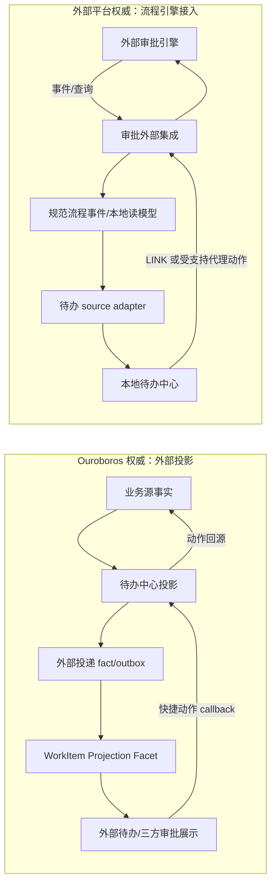

- 左侧外部平台只是入口和投影，动作最终由 Ouroboros 业务源授权并执行。
- 右侧外部平台是流程真相源，审批外部集成负责流程 binding 和动作；待办中心只消费规范工作项，不直接读取供应商任务 API。
- 同一个连接可以同时启用多个 facet，但每个具体业务对象只能有一个权威来源。

## 5. 分层与模块设计

### 5.1 目标模块结构

```text
ability/ouroboros-enterprise-connector/
├── ouroboros-enterprise-connector-core
│   └── 连接引用、外部身份键、可信事件 envelope、远端错误合同、Provider SPI
├── ouroboros-enterprise-connector-runtime
│   └── 配置解析、secret 引用解析、统一业务回调入口与插件分发、健康与观测
├── ouroboros-enterprise-connector-dingtalk
│   └── 钉钉 credential/token/client/callback 协议及轻量登录适配
├── ouroboros-enterprise-connector-wecom
│   └── 企业微信 credential/token/client/callback 协议及轻量登录适配
└── ouroboros-enterprise-connector-feishu
    └── 飞书 credential/token/client/callback 协议及轻量登录适配
```

以下为长期目标结构，尚未实现的模块不因列入结构图而成为本期必建项。组织与安全的身份桥接优先随现有组织 runtime 装配，不放入公共 Connector runtime，不仅为此新增 identity 框架/JAR。职责划分不要求一项职责对应一个新 JAR；具体拆分以最小可独立装配为准。全量选择优先使用现有 `ability-all-runtime` 和产品组合入口，不要求新增 connector-all 或每种组合的 starter。领域 facet 仍放在拥有该语义的模块族中：

```text
ability/ouroboros-work-item/
├── ouroboros-work-item-core
├── ouroboros-work-item-runtime
├── ouroboros-work-item-web
├── ouroboros-work-item-projection-dingtalk
└── ouroboros-work-item-projection-feishu

ability/ouroboros-approval-workflow-external-integration/
├── ...-core
├── ...-runtime
├── ...-dingtalk
├── ...-wecom
└── ...-feishu

ability/ouroboros-notification/ouroboros-notification-channel/
├── ...-dingtalk
├── ...-wecom
└── ...-feishu
```

SSO 继续使用 `security/ouroboros-web-security` 已有 `ExternalAuthProvider`、`OAuth2ProviderSpec`、`ExternalIdentity` 和 `UserSsoEntity`。如果标准 OAuth2 配置可以表达某个平台，新增配置而不是新增框架；只有协议确实不同，才增加实现安全层端口的上层 provider plugin。安全层不得依赖 `ability/ouroboros-enterprise-connector`。

公共企业 profile resolver 可随公共 runtime；各供应商轻量 profile/必要 builder 可随该供应商基础 JAR，编译依赖限于原安全稳定合同，不为三家默认各建 auth JAR。基础 JAR 在 classpath 不等于自动启用登录，仍执行原配置和授权；只有实际 SDK 引入显著独立依赖时才再评估拆包。统一业务回调入口随公共 runtime，协议实现随 provider，业务订阅及其数据模型/worker 随所属领域。标准目录、消息等开放 API 定义归 RPC 能力包，基础 JAR 不重复维护。

开放 API 包使用现有 RPC 资源机制，按平台及能力组拆分，例如 `dingtalk-rpc-contact`、`feishu-rpc-message`、`wecom-rpc-approval`（示意名称）。每个包可以包含多个独立接口定义，具体规范见 §7.8。

公共连接读取、凭据转换及企业登录 profile 已移到 Connector。供应商基础通过 `EnterpriseConnectionProvider` 贡献公共描述，审批 Provider 只贡献审批能力并消费 `ResolvedEnterpriseConnection`。保留原 `enterprise.connections`、配置及发现链路，没有第二份连接目录。

### 5.2 依赖方向

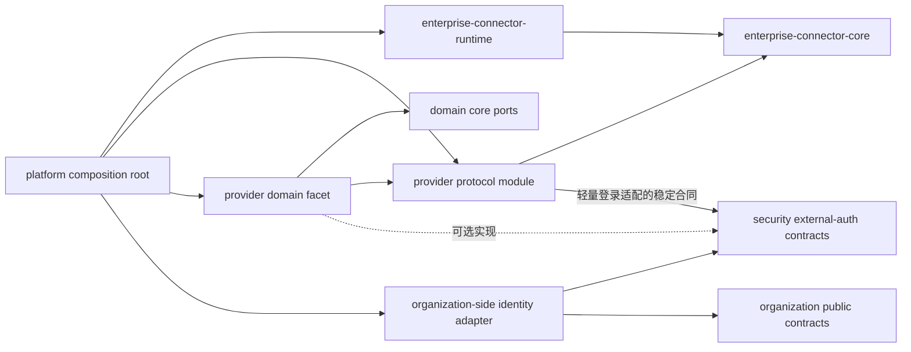

禁止的依赖：

- `work-item-core`、通知 core、审批 external core 依赖钉钉/企微/飞书类；
- Connector core 依赖待办、审批、通知或组织模块；
- 公共 Connector runtime 为查询成员关联依赖组织实现或审批 runtime；
- security 依赖 ability 层 Connector；
- 公共连接目录通过审批 Provider 才能取得连接 schema；
- 共享企业访问基础依赖企业 RPC API 包或企业 RPC 凭据适配，形成取 token 的反向依赖；
- 一个 provider 的 workflow facet 直接调用它的 work-item facet；
- 领域 runtime 通过反射或实现类名判断供应商能力。

### 5.3 发现和装配

- 静态 provider/facet 描述使用 Java SPI，按 `META-INF/services/<接口全名>` 注册。
- 需要 Spring 生命周期、ConfigurationService、SecretResolver、HTTP client 或 scheduler 的实现使用 AutoConfiguration。
- Registry/Center 只保存 provider 描述和工厂，不保存跨连接共享的有状态业务 Adapter。
- `provider + facetType` 必须唯一；当前外部流程 provider 直接承载领域适配能力，不再额外注册 adapterId。重复注册启动失败，不按加载顺序覆盖。
- capability 由实现的细粒度端口派生；连接激活时再与应用类型、权限 scope 和配置验证结果求交集。
- 企业登录适配沿现有 `EnterpriseAuthProfileResolver`、`ExternalAuthProviderBuilder` 和 `SecretResolver` 装配，不要求安装审批；组织侧成员账号适配沿原正式接口装配，并明确 RBAC 默认实现让位条件，同一接口只有一个有效解析链路，不按 Bean 顺序选取。
- 回调协议能力和业务事件关注声明沿同一 SPI/AutoConfiguration 发现机制贡献，统一入口按声明分发；注册不要求修改宿主供应商或领域分支，不另建插件安装器和动态订阅配置，具体规则见 §6.4。

静态描述发现不等于容器实例已接通。当前审批 Registry 汇合 SPI 与 Bean，认证 Factory 注入 builder/resolver，通知 Center 读取 SPI Supplier，RPC 凭据 Center 读取 SPI Builder；不能假定任意 Spring Bean 都会被消费。只在本次涉及的原装配/消费入口补齐托管服务依赖，避免同一实现被重复构造或通过全局静态字段持有容器 Adapter/token 服务，不全面重写各 Center。原有优先级覆盖合同继续保留，新 provider/业务订阅唯一性按其专门合同检查。

通知已在原 `NotificationAdapterSupplier` 增加 `managedSupplierType` 和纯类型描述方法，SPI 的三家描述对象不保存服务；原 Center 的托管重载只从当前消费容器传入的 Supplier 集合中解析指定类型，缺失/重复时拒绝。Dispatcher、员工地址解析、企业通知管理及原渠道管理页使用同一绑定入口。模板校验与选项反序列化直接读取类型描述，不需要获取 token 或实例化客户端。其他渠道保留原 SPI 优先级；本次不迁移全部历史渠道的装配方式。新增双容器/关闭重建测试验证当前上下文不会引用另一个上下文的企业 Adapter 或成员解析器。

公共连接目录不再通过构造审批 Adapter probe 获得公共描述。同步迁移 AutoConfiguration imports、扫描范围及构造依赖：领域控制器、持久模型和 worker 只随领域插件；provider 的 token/client/profile 不要求组织 mapper、审批 registry/inbox；枚举已安装插件不主动请求 token。不以反射、异常捕获或大量可选 Bean 掩盖未分开的职责。

### 5.4 最小装配与全量产品选择（已实现，持续回归）

下表省略各场景需要的原安全/RBAC、配置、数据、缓存、Web/UI 基础。管理宿主、供应商登录、目录 Source、RPC 包和工作台均有独立装配测试；真实产品依赖闭包及发布环境启动仍须分别核验，不能用全量 classpath 关闭开关替代。

| 场景 | 组合边界 |
|---|---|
| 通用 OIDC/LDAP/CAS 登录 | 原安全 runtime 与 external-auth-configuration；不要求企业 provider、审批或 OIDC 授权服务器。 |
| 某家企业登录 | 公共连接 + 该家 provider/profile/必要 builder + 原安全链路；不要求审批、通知、目录同步或 RPC API 包。 |
| 某家企业通知 | 原通知 core/runtime + 该家通知渠道及公共连接/provider；按真实发送路径复用 RPC/API 包；员工收件人仍需要原组织查询和授权，不要求其他供应商或审批。 |
| 某组企业 RPC | 原 RPC + 企业凭据适配 + 公共连接/provider + 所需 API 元数据；不要求无关领域 runtime，具体 API 的业务身份前提仍须满足。 |
| 某家业务回调 | 公共入口 + 对应协议 + 实际领域订阅及其原持久受理机制；不要求公共事件表、通用 worker 或其他消费者。 |
| 应用接入、授权服务器与 DCR | 原 OIDC server 及配置/安全基础；不要求三家 provider、审批、通知或目录同步，不为本期强拆原 OIDC 模块。 |
| 集成工作区宿主 | 原 UI/元数据、配置和权限基础；不因编译宿主强制带入 OIDC server、供应商或全部通知渠道。 |

AppRuntime 的员工地址解析已沿原通知 Supplier 扩展读取渠道贡献，供应商常量和 `notification-channel-all` 编译依赖已退出。站内、邮件、短信、语音、JPush、微信、钉钉等原行为须保留，不只迁三家企业渠道。全量渠道由原 `ability-all-runtime` 选择，不扩大为重拆通知 core 与组织 core 等现有依赖。

develop/mothership 使用 all-runtime 是产品选择，不等同于基础耦合；在完整 classpath 关闭开关也不能证明最小装配。实施以真实缺少不相关 JAR 的依赖闭包、容器启动及行为检查验证上述组合。

## 6. Connector 公共契约

### 6.1 企业连接

连接使用 `ouroboros-configuration` 管理非敏感值。现有配置服务已提供值/revision 一致读取和条件更新（CAS）。沿用现行 `enterprise.connections` 结构化快照，每个连接作为一个完整元素读取和校验，不为新界面拆成多份配置或另建连接存储：

```text
configuration key: enterprise.connections

配置值是连接快照数组；每个元素的 `connectionId` 是唯一业务标识。读取时必须按
`connectionId` 选择完整元素，不得把一个连接拆成多个动态 key。

{
  "connectionId": "feishu-corp-main",
  "provider": "feishu",
  "credentialRef": "env:FEISHU_CORP_MAIN_CREDENTIAL",
  "auth": {
    "enabled": true
  }
}
```

以下约束描述现行连接契约；整连接启停按 §9.7 扩展，应用形态及能力字段按 §2.4 对齐。两项均须同步正式 schema、读取链路和使用端，不能仅改管理表单。

约束：

1. `connectionId`、`provider` 必填；`connectionId` 在全局连接目录中唯一，`provider` 创建后不可变。需要远程认证的 provider 必须提供 `credentialRef`。
2. provider schema 声明的非敏感字段直接位于连接对象顶层；公共 `auth` 只允许 `enabled` 布尔字段，缺省为 `true`。公共 `profile`、`endpoint`、`applicationType`、`options`、回调 profile 和租户/应用 ID 字段均不属于现行契约，出现即拒绝。
3. 连接级 `auth.enabled` 决定该连接是否发布认证 profile：设为 `false` 时仅移除该连接的认证 profile，审批、通知和其他业务 facet 仍可使用。连接被认证解析器认领但没有 profile 时必须 fail-closed，不得回退到静态同名 provider。平台级紧急熔断若有需要，属于运维配置，不是连接认证契约。
4. 读取时对完整非敏感快照计算 `fingerprint`，并派生 `revision=derived-<fingerprint>`。二者不属于配置值，管理员提交时直接拒绝。
5. 凭据轮换只改变 `credentialRef` 指向的安全值时，不在普通连接值中复制 secret，也不把 secret hash 写入日志。非敏感快照的 fingerprint 不会反映此变化；数据库托管凭据按 §6.2 的持久 `credentialVersion` 失效，不以 fingerprint 替代凭据版本。
6. 审批等已有版本化映射的领域在激活时可保存 `connectionId + validatedConnectionRevision + validatedConnectionFingerprint`；目标或验证过的内容改变后按原领域规则重新验证，不推导出所有能力都必须增加 mapping/激活机制。
7. 审批等已有 binding 继续引用其创建时的 mapping version，其他领域沿原运行事实固定必要目标和配置依据；不得因为连接当前值变化而重写业务身份。mapping version 不意味着平台保存了历史凭据；连接停用及在途业务按 §9.7 处理，换企业/应用的身份处置按 §2.4 和 §18 落实。
8. 配置中心负责自己的条件更新和 revision CAS；外部集成只读取已发布快照，不在 Connector 内直写配置表。

三家 Provider 的非敏感字段为：钉钉必填 `corpId`、可选 `callbackMode`，企业微信必填 `corpId`，飞书可选 `departmentId`。企业微信自建应用的 `agentId/secret` 放在 typed credential 中，原第三方套件继续使用自己的 `suiteId` 字段。演示用 fake provider 另有 provider-specific 的 `startFail`、`autoApproveAfterSeconds`、`initialStatus`，用于契约测试和联调，不属于真实平台公共字段。除此之外不得使用无类型扩展字段；新增字段必须先进入 provider schema，并由同一个 provider 的服务端校验和测试实际消费。`revision` 和 `fingerprint` 由连接读取器派生，不接受管理员输入。连接不接受 `applicationType`：钉钉由安全凭据中严格二选一的内部应用或第三方企业应用字段组推导；企业微信区分自建应用和原第三方套件凭据；飞书使用企业自建应用。

飞书 OAuth 不额外增加普通连接字段。现有飞书 typed credential 的基础必填为 `appId`、`appSecret`，业务回调使用时再校验
`verificationToken`；认证 profile 使用同一个 `credentialRef`，分别通过 JSON Pointer
`#/appId`、`#/appSecret` 投影 OAuth client identity 和 secret。这样不会在
`enterprise.connections` 与安全凭据之间双写 `appId`，也不会因接入登录重新引入已删除的公共配置。

核心读取接口建议保持小而明确：

```java
public interface EnterpriseConnectionCatalog {
  Optional<EnterpriseConnectionSnapshot> get(String connectionId);
  EnterpriseConnectionSnapshot requireActive(String connectionId);
}

public record EnterpriseConnectionSnapshot(
    String provider,
    String connectionId,
    String revision,
    String fingerprint,
    String credentialRef,
    Map<String, Object> providerConfig) {
}
```

该对象不得暴露 secret。typed credential 只在 provider protocol module 的 client factory 内存中出现。

### 6.2 凭据、token 和 HTTP client

B1 实施进度（2026-11-16）：公共 Provider、连接校验、凭据 mapper、轻量登录适配及共享 token 已从审批模块提取到 `ouroboros-enterprise-connector`；审批工厂消费中立的 `ResolvedEnterpriseConnection`，不再贡献公共 schema。托管密文、版本/CAS、主密钥重加密、管理页面及各调用链发送前复核已有实现与定向测试；真实数据库及部署多节点轮换仍待验。见[模块说明](../../../ability/ouroboros-enterprise-connector/README.md)。

Connector runtime 复用安全层的 `SecretResolver` 接口解析 `credentialRef`，但连接模块不接管安全层。每个平台提供自己的 typed credential mapper 和 token provider。结构化凭据的单个文本字段可使用 `<credentialRef>#/<field>` 投影；resolver 仍只向底层安全存储提交不含 fragment 的原始引用，投影失败时 fail-closed。

应用级 token 的缓存身份包含：

```text
provider + connectionId + tokenKind + credentialGeneration
+ 实际影响换取 token 的其他参数版本（需要时）
```

`tokenKind` 区分不同应用技术令牌及其用途；用户 OAuth token 不进入这套应用令牌缓存。`credentialGeneration` 表达该来源的有效凭据代次，数据库托管凭据使用随密文替换提交的 `credentialVersion`，不是新增持久字段。确有其他换取参数变化时优先复用已有连接版本；当前 `revision=derived-<fingerprint>`，缓存键不同时保存这两份等价标识，也不另建认证参数版本体系。进程内受控刷新代次只在需要时作为实现细节，不进入页面、配置或公共领域合同。

提取现有 BoundedTokenCache 及供应商换取逻辑；同种应用 token 可由通知、审批和企业 RPC 凭据共同使用，不同种类不能混用。并发刷新在进程内按键合并；本期不因此新增分布式 token 服务或锁，只有真实协议验证证明跨节点重复换取存在冲突时再补最小协调。401/特定失效码最多触发一次受控刷新；刷新与重放分别判断，写请求只有符合 §6.5 的安全条件才能重放。

所有 client 必须显式配置 connect timeout、read timeout 和整体 deadline；获取 token、等待、HTTP 及允许的重试共用剩余执行预算，不能每一步重新开始计时。调用上下文为：

```java
public record EnterpriseCallContext(
    String operationId,
    String correlationId,
    String provider,
    String connectionId,
    String connectionRevision,
    String connectionFingerprint,
    Instant deadline) {
}
```

领域 Adapter 不得自行创建裸 `RestTemplate`、SDK client 或第二份企业 token cache。标准开放 API 沿原 RPC 执行器和接口定义，供应商认证、签名及回调等专用协议保留其正式实现；不为统一技术栈另建 HTTP 引擎。企业 RPC 凭据委托共享 typed token 能力，不叠加通用动态取 token RPC 的第二套企业缓存；原动态凭据继续服务其他 RPC 场景。

上述方向已确认并已在各相应模块实施，运行验证范围按本节和 §18 区分。现有 `SecretResolver` 主要提供引用读取，`config:` 当前读取 Spring Environment；通知模块已有受控密钥替换与脱敏策略，配置模块已有多项配置事务保存、依赖快照和 CAS。企业连接的 AES-256-GCM 密文存储、托管 resolver、受保护双配置管理策略与权威版本读取已有后端实现及行为测试；主密钥批量重加密、页面接入以及 RPC、目录和通知的发送前复核已接入；密钥清除与引用检查、真实数据库和部署演练仍待完成。仍沿原配置和 resolver 机制，不另建凭据数据库、通用保险库或分布式失效平台。

#### 6.2.1 数据库存储与受控读写（后端部分已实现，持续验收）

| 内容 | 建议存储与权威来源 |
|---|---|
| 连接、非敏感参数及能力设置 | 原 `enterprise.connections` 等领域配置，沿用配置数据库 |
| 页面录入的企业应用凭据 | 新增一个受保护的结构化配置项 `enterprise.credentials`，按 `connectionId` 保存密文记录，仍写入原配置值表 |
| 加密主密钥 | 部署级配置提供，所有服务节点一致；不与密文一起存入该数据库，也不进入页面或动态配置 |
| access token / HTTP client | 继续是运行时缓存，按连接、用途和凭据版本隔离；不作为管理员长期配置保存 |

`enterprise.credentials` 元数据由实际拥有该配置的模块沿原机制注册，标记为 `BACKEND`、`managementProtected`，无明文默认值，`managementEntry` 指向集成管理。记录只需 `connectionId/provider/credentialVersion/keyId/nonce/ciphertext`；`credentialVersion` 为服务端每次替换生成的新代次标识，`keyId` 用于识别解密部署密钥。凭据整体采用带完整性校验的加密方式（建议 AES-GCM），绑定 provider 和 connectionId 作为认证附加数据，避免密文被搬到另一连接。出站调用需要取回原文，因此不能照搬接入应用客户端密钥的单向散列。

沿 `ConfigurationManagementAccessPolicy` 提供专门的凭据变更命令：管理读取只返回已配置状态、可展示的应用标识、版本和更新时间，不返回明文或密文；脚本、逻辑流、前端配置和通用导出不能读取凭据。已有通知策略仅作为受控读写范例，不假定其已经实现加密。解密仅发生在可信 provider 构造凭据/client 的内存中，RPC 资源、模型表达式和调试结果不能拿到明文。

沿原 `SecretResolver` 接口增加数据库托管引用实现，建议引用为 `managed:<connectionId>`，指向上述受保护配置中的同名记录；原 `config:` 继续表示 Spring Environment，不改含义。`ExternalAuthAutoConfiguration` 已在原 env/config/file 装配处接纳模块贡献的 resolver，仍使用唯一 CompositeSecretResolver；安全层不为此依赖配置 ability，也不在企业模块另起组合器或覆盖默认 Bean。引用 scheme 出现冲突须明确拒绝，不能按加载顺序取第一项。结构化凭据字段投影沿原 JSON Pointer 合同。协议上可展示的 App ID 等字段由受控投影提供给页面，普通连接不双写其权威值。

保存语义为：省略凭据表示保留；明确替换时校验 typed credential、加密并生成新版本；明确清除另用命令，存在启用能力或未完成引用时拒绝清除。替换校验同时核对 provider、企业及应用身份，不能将 App ID/suiteId 等身份变更伪装成密钥轮换；远程企业归属仍需能力验证，不以本地字段合法推定已验证。不能以空字符串或“恢复默认”静默删除密钥。连接和凭据一起修改时，通过原 `mutateManagementConfigurations` 一次提交，提交涉及的所有配置 key 均携带 expectedRevision，权限策略验证绑定一致性；任一失败则整批回滚。即便只改凭据，也锁定/校验所依赖的连接快照。事务内不执行远程连通性测试，保存后按能力测试。

主密钥缺失、keyId 不可识别或密文校验失败时，该凭据不可用，不能回退为明文。部署主密钥及备份必须与数据库恢复配套；主密钥更换使用受控重加密，不提供通用配置编辑器入口。现有命令为 `POST /api/sys/enterprise-connections/credentials/reencrypt`，要求查看及换密钥权限、两个配置项的 expectedRevision；重加密保留应用 `credentialVersion`，不驱逐仍有效的应用 token。现有 env/file/config 引用继续可读，页面标为外部托管；迁入数据库使用显式替换，不把读取到的旧 secret 回传浏览器或隐式复制。新建页面配置默认使用数据库托管方式。

#### 6.2.2 轮换与跨节点生效（权威读取已实现，调用链持续接入）

每次出站调用及认证 profile 使用前，通过原 `getSnapshot` 读取数据库中的权威连接/凭据快照，并校验引用、provider、connectionId 和应用身份；不能仅依赖可能缓存的 `getRevision` 或普通 `get`。首期渠道数量少，直接检查版本比新增广播系统简单；可缓存按版本派生的解密结果和 client，不能跳过版本核对。

`getSnapshot(key)` 只保证单 key 的值/revision 一致，分别读取连接与凭据不等于原子组合读取。沿原权威读取增加受控组合读取或有限的版本复核，失配时重新获取或拒绝；确需 API 支持时在原配置服务做最小扩展，不另建全局快照框架，也不持有数据库事务等待外部 HTTP。SecretResolver 本身只返回原文，托管版本必须与同次受控读取的密文对应，不能先读版本再单独取得另一代原文。

替换提交后，新调用只能使用新的 `credentialVersion` 缓存分区；本进程配置事件用于及时清理，不作为跨节点正确性的前提。旧版本已发出的 HTTP 请求允许按原截止时间返回，结果仍属于原连接；旧版本晚到的刷新结果只能写旧分区，不能覆盖新版本。已开始但尚未放行发送的调用在发送前重新核对版本，失配则重新取得上下文或停止。数据库核对和外部 HTTP 不能原子提交，以最后核对通过为调用放行点；已放行请求视为在途，不承诺在轮换瞬间撤回，也不因换密钥重放已发出的写请求。

登录从发起到回调的 profile revision 同时纳入连接变化和凭据版本；中途轮换按原认证链路拒绝旧回调并提示重新登录。凭据版本不能只用于 RPC 缓存而遗漏认证、通知或其他 facet。数据库读取失败时阻止新调用，不无限使用旧凭据。配置服务若返回“已提交但可见性未确认”，页面重新读状态/版本，不盲目重试替换；不把已提交报告成已回滚。

env/file/config 引用没有上述数据库凭据版本，继续沿原读取方式支持，并分别说明实际刷新行为和必要的运维刷新/重启动作；不直接承诺与数据库托管相同的轮换保证。原文派生的缓存区分信息仅用于内存，不进入页面或日志，不为外部来源预建通用版本协议。

### 6.3 外部身份映射

成员解析保留安全模块的单一正式入口；组织模块通过 contributor 贡献外部成员与 Employee 的关联。正式端口位于 security core：

```java
public interface EnterpriseIdentityMappingService {
  Optional<PlatformPrincipalRef> toPlatform(
      String connectionId, String externalMemberIdentity);

  Optional<String> toExternalMember(
      String connectionId, PlatformPrincipalRef principal);
}
```

外部登录 ID 与企业成员 ID 是不同语义：钉钉登录使用 unionId/openId、审批使用 userId；企业微信登录使用 open_userid、成员接口使用 userid；飞书当前适配使用 open_id。不得把外部身份复制到普通连接配置；手机号、邮箱、用户名不作为运行时隐式 fallback。

当前实现将该端口和值对象放在 `ouroboros-web-security-core`，由
`ouroboros-web-security-rbac-manage` 中的 `UserSsoEnterpriseIdentityMappingService`
适配现有 `UserSsoService`。审批 runtime 只依赖端口，不能依赖 `UserSsoEntity`。
本期组织关联扩展必须沿同一正式解析入口接入：外部成员与 Employee 的关联由组织模块维护，通过现有 Employee↔User 关系解析平台主体；未关联账号的员工可以保存外部成员地址；实际业务通知仍受 §7.3 的启用 User 和内容披露规则约束。目录同步不能直接生成或覆盖 SSO 登录绑定。已有 SSO 成员属性与组织关联同时存在时，发现冲突或反向解析不唯一则拒绝受影响操作，由管理员按 §6.3.1 核对并人工处理，不自动合并或改绑。

当前沿 `EnterpriseIdentityMappingContributor` 接通组织关联，原 RBAC 实现组合 contributor 并拒绝冲突/歧义，不按 Bean 顺序取首项。旧 SSO 成员事实仍是原安全来源；已存在但失效的组织关联明确拒绝，不能回退重新启用旧地址。存量组织关系由管理员显式核对，不自动认领或改绑。现有 UserSso 的成员属性保留为认证来源事实，不因目录同步被默认为新的登录授权。

组合解析由组织侧适配提供，使用安全与组织的正式接口并由平台装配；公共连接底座不拥有组织查询或账号绑定业务，也不为查询组织关系反向依赖组织实现。`PlatformPrincipalRef` 当前明确表达 `userIdentity`，现有账号解析端口不能直接承担无 User 的 Employee 收件地址查询。账号解析经原 Employee↔User 关系读取同一组织关联，员工地址则由组织正式读取能力解析；两种接口视角不增加两份映射数据，也不能为复用账号签名而要求每个员工先开户。实际内容投递仍按 §7.3 的资格和授权规则判断。

RBAC 原正式解析器继续拥有组合入口，组织侧只贡献关系查询；没有第二个竞争的 `EnterpriseIdentityMappingService` Bean。存量 SSO-only 用户及通知地址的切换规则需显式迁移，接口装配本身不能代替迁移。

`UserSsoEntity` 至少保存 `ssoChannel=connectionId`、`ssoUserIdentity`、`userIdentity` 及展示审计字段。现有 `(ssoChannel, ssoUserIdentity)` 唯一约束继续生效；反向 `(ssoChannel, userIdentity)` 当前由查询时歧义拒绝兜底，如需数据库约束必须由安全模块单独迁移后再标记完成。登录绑定创建、解除和查询沿用第三方登录的权限、冲突和审计语义；查询异常必须 fail-closed。

#### 6.3.1 管理员查看与解绑第三方登录（已实现、本地验证通过）

人员关系的核对和冲突处理交由管理员人工完成。登录绑定继续由安全模块维护，部门/成员关联继续由组织模块维护，账号与员工沿原 `UserSubject` 关联；保留各关系的唯一性及冲突拒绝规则。管理员分别核对和处理这些关系，不要求系统自动识别新企业成员属于哪个账号，不增加跨领域自动协同绑定、身份合并或统一人员模型。

在原“用户管理 → 用户详情”中增加“第三方登录”区域：

| 操作 | 内容与边界 |
|---|---|
| 查看 | 展示指定用户已绑定的第三方登录，包括渠道/连接标识、外部身份 ID、展示名及绑定时间，供管理员核对；复用安全模块的绑定查询，不复制绑定数据。 |
| 解绑 | 对选定绑定提示影响并确认，服务端校验用户管理权限及记录归属，沿原服务删除绑定和对应成员索引，记录操作审计。 |
| 人工纠正 | 管理员解除错误或过期绑定，必要时通过原组织入口调整员工关联；用户再次完成企业认证后，按 §7.4.5 输入正确的平台账号密码重新绑定。管理员不直接填写外部 ID 创建登录绑定。 |

解绑只处理所选第三方登录绑定及其索引，不连带删除 User、Employee、组织关联或其他渠道绑定；已签发会话沿原安全机制处理，不将解绑等同于强制下线。确认提示应说明：该外部身份后续登录需重新绑定；仍依赖此绑定的成员解析可能受影响。管理员负责核对其他关系和业务，系统不自动补齐或级联改绑。

当前已有 `AuthBindAdminController` 的 `GET /api/admin/users/{userIdentity}/bindings` 和 `DELETE /api/admin/users/{userIdentity}/bindings/{id}`，分别委托 `UserSsoService.findByUserIdentity`、`deleteBinding`；删除服务同时维护成员索引。两条 API 已登记在 `systemSetting.userManagement` 权限中，原用户详情 Schema 已接入第三方登录操作区，并复用这些正式入口完成展示、确认提示、授权及审计验证，不新增同用途 Controller、Service、映射表或集成管理专属权限副本。

业务成员解析按原单一入口和组织关联迁移规则处理；缺失或冲突时提示管理员，不通过旧 SSO/通知地址隐式回退。更换企业不自动继承旧绑定，姓名、手机号或裸成员 ID 相同不作为自动认领依据。

### 6.4 可信回调入口

业务回调采用统一入口和插件注册关注事件的方式。该方向纳入本期；统一的是协议接收、验证和分发，业务入箱、命令事实、幂等和恢复仍由各领域负责，不以完整公共事件平台为前提。

#### 6.4.1 入口与协议职责

```text
GET/POST /api/enterprise-callbacks/{connectionId}/callback
```

这是统一路径模板，不是每个插件各暴露一个控制器。根据 `connectionId` 的完整连接快照派生 provider，选择该协议的验证材料和实现；provider 不作为第二个可独立选择的路由字段。GET 仅在相应协议需要 URL 验证时开放，不能只支持 POST 而遗漏企微等协议的验证请求。管理页展示后端生成的地址，不增加任意 callback endpoint 或 `callbackProfiles` 配置。

| 组成 | 负责什么 | 注册来源 |
|---|---|---|
| 统一入口 | 读取原始请求、大小及时间预算限制、解析连接、调用协议实现、按声明分发 | Connector 正式自动配置 |
| 供应商协议插件 | URL 验证/challenge、验签、解密、协议时间窗及重放校验、事件标识和类型提取、响应编码 | 对应供应商 provider 的协议能力 |
| 业务回调插件 | 声明关注的事件，解释对应业务载荷，调用原领域接收/命令用例 | 供应商的审批、组织、通知等领域 facet；仅注册实际实现的能力 |

统一入口不依赖审批实现。协议插件属于 Connector 的供应商基础 JAR，审批翻译和订阅属于 workflow facet。当前代码保留 `ExternalCallbackCodec` 领域端口用于能力推导及非 HTTP 调用，协议部分委托同一 Connector 实现；原供应商控制器和通用审批 HTTP 入口退出，不保留第二份验签或接收路径。业务回调地址复用既有公开平台地址配置，管理投影由后端生成；未配置时显示相对路径，不信任请求 Host 推导公网域名。

#### 6.4.2 插件如何注册关注的回调

关注声明最小包含稳定 `subscriberId`、provider、明确的事件类型集合和交付方式：异步事件或同步命令。交付方式由可信插件声明，不由请求 payload 决定；同一协议/事件类型的声明必须一致。插件按连接启用能力和所属业务引用执行原领域检查，不能仅凭事件类型绕过停用或业务授权。

声明沿 §5.3 的 Java SPI/AutoConfiguration 及 Provider/Center 发现机制装配，安装 JAR 后重启生效；公共层维护已发现声明的运行时索引，不能再并行维护一份手工注册表、动态订阅库或隐藏路由。关注声明不包含凭据，管理员也不能注册任意脚本、表达式或 WebAPI 作为 handler。

- 同一异步事件可以被多个不同业务插件关注，分发给所有匹配且可用的插件。
- 同一同步命令只能有一个处理插件，不能广播业务动作。
- 同一 `subscriberId` 重复注册、同一连接协议存在重复 codec、交付方式冲突或同步 handler 冲突，均在装配校验时明确失败，不按扫描顺序取第一项。
- 开启某项回调能力时检查其协议及业务插件已安装。插件缺失、升级及卸载的引用处置沿 §18.4.1，不能悄悄跳过必需消费者。

#### 6.4.3 验证、分发与可靠受理

处理顺序为：

1. 根据 URL 路由找到已启用的 connection snapshot；停用连接按 §9.7 拒绝新业务处理，不提供后台自动收尾通道。
2. 供应商协议插件按其正式合同完成验证和解密。body 声称的企业/应用在验证完成前不可信，验证后仍核对与连接归属一致；URL challenge 验证成功后直接按协议响应，不当作业务事件广播。
3. 形成最小 `VerifiedEnterpriseEvent`，包含 provider、connectionId、稳定 eventId、明确 eventType、事件时间和 payload hash；已验证载荷由匹配的业务插件解释，不统一审批状态、部门或消息字段。供应商没有稳定 eventId 时，其派生规则由协议实现及测试明确，不能随机生成重投身份。
4. 按已注册关注声明匹配业务插件。普通异步事件确实不属于任何已启用订阅时，按供应商协议确认并记录最小忽略摘要；验证失败、必需插件缺失、未知同步命令或已匹配插件受理失败，不能作为已处理成功响应。
5. 异步插件的接收函数只完成受控校验及持久受理，将事件写入原领域 inbox/任务后返回；业务处理由原 worker 推进。所有匹配插件都完成持久受理，或识别为同内容的已受理重复事件后，入口才按供应商协议返回 ACK。不能先 ACK 再放入内存线程或仅发布无持久保证的应用事件。
6. 同步命令先在原领域持久化幂等命令/动作事实，再由唯一 handler 在供应商规定的 deadline 内执行，协议插件编码结果。重复命令沿领域事实读取相同结果，超时或中断后的恢复归原领域，不因重新收包重复产生副作用。

异步多插件受理不承诺跨领域数据库事务。若先前插件已经入箱、后续插件失败，入口按供应商协议返回可重投的失败响应；供应商再次推送时，已入箱插件按连接、事件身份及自己的稳定订阅身份识别重复，未入箱插件继续受理。相同身份但内容摘要冲突时拒绝并诊断，不能当正常重复。批量请求亦须全部完成所需持久受理后才确认。

ACK 表示匹配插件已可靠受理，不表示业务已完成；后续失败由领域任务恢复。具体可重投响应和重投窗口取决于供应商协议，不把 HTTP 200、固定响应正文或无限重投假设写死到统一入口。供应商不保证重投时，相关能力必须沿原领域提供可验证的核对/恢复条件，不能用成功 ACK 掩盖未受理。

#### 6.4.4 最小实现与后续扩展

首期复用各领域正式 inbox/任务：审批回调插件沿原 receipt/ingest 服务写审批 inbox，流程实例、任务、结果及 action fact 留在审批。公共入口不预建 `t_enterprise_inbound_event`、`t_enterprise_inbound_delivery` 或通用重试 worker；只有真实需求证明必须独立保存原始事件、维护跨消费者交付进度时，再设计相应最小持久机制，并明确唯一受理路径。

先接通已有审批结果等异步事件。同步命令注册规则只随实际支持的交互能力装配，不为首期审批结果回调预建命令平台；其他领域也只有确有事件需求时才贡献订阅插件。

迁移时切换现有供应商控制器的协议接收和审批翻译职责，统一地址由上述入口提供；旧路径的外部配置切换、退出顺序和回退纳入发布迁移。不能新旧双重入箱、双消费或借新入口绕开原 receipt/幂等机制。

OAuth 登录 callback 继续由安全模块现有 OAuth/CAS 控制器及 state/nonce 语义处理，不注册成企业业务事件插件。只安装登录、出站通知或 RPC，不因此要求装配业务消费者、公共事件表或审批 worker。长连接、SDK dispatcher 等实际纳入某项能力时，沿同一可信验证与插件分发服务接入，保留其传输证明，不伪装为 HTTP，也不绕过验证直接调用领域 handler；本期不预建 MQ 等传输插件。

### 6.5 远端结果与重试

共享调用边界只保留调用方作出正确判断所需的技术事实，沿现有结果或异常做最小扩展。连接/操作身份和副作用确定性必须明确；供应商实际提供的请求 ID、状态码、业务错误码和重试提示按需要保留，不伪造缺失字段。事实范围为：

```text
provider, connectionId, operationId, providerRequestId,
httpStatus, providerErrorCode, retryAfter,
effectCertainty, retryDisposition, sanitizedMessage
```

以下是方案中的判定语义，不要求新增一套统一领域状态枚举：

| `effectCertainty` | 含义 | 自动处理 |
|---|---|---|
| `CONFIRMED_APPLIED` | 已得到官方可验证接受响应或查询确认 | 领域按自身完成条件推进状态 |
| `CONFIRMED_NOT_APPLIED` | 官方明确拒绝且无副作用 | 按 retryDisposition 重试或 DEAD |
| `UNKNOWN` | 超时、断连或模糊错误，远端可能已生效 | 禁止盲目重放写请求 |

| `retryDisposition` | 使用条件 |
|---|---|
| `RETRYABLE` | 已确认无副作用，或请求使用官方稳定幂等键 |
| `PERMANENT` | 权限、字段、状态、配置等永久错误 |
| `RECONCILE_REQUIRED` | 必须通过查询、callback 或人工核对远端结果 |

公共 client 不替领域决定 outbox 状态。工作项、审批和通知分别保存自己的 durable fact；收到 `UNKNOWN` 后，只有 provider 提供按 operationId/业务幂等键查询的 recovery port，或官方幂等合同明确允许时，才可自动再次写远端。

供应商协议/响应适配负责解释 HTTP 2xx 中的业务错误，不能直接把 RPC 的 HTTP 成功视为通知或审批成功。通知继续使用 `NotificationChannelResult`，审批继续使用 `ExternalOperationFailure/ExternalEffectCertainty`，其他领域使用各自结果；适配器把技术事实转换到这些原合同，不复制领域状态机或新增公共业务 Outbox。只投影脱敏诊断，不直接暴露原始 URL、头或正文，也不从异常 message 推断确定性。

安全重试约束落实在原 `OpenApiRpcProtocolInvoker`：仅接口静态定义明确 `retrySafe=true` 时，才在原 `retry/retryOverride` 上限及剩余预算内重放。缺省关闭，不根据 HTTP 方法推定安全；配置引用、表达式、调用参数和 options 不能授予安全重放权限。旧定义即便已有重试次数，也需由模型维护者核对只读或官方稳定幂等合同后显式声明。通讯录包声明只读合同，消息发送包不授予重放。重试次数只是上限：可信接口定义及实现证明的只读操作、确定未生效且错误可恢复的请求，或具有官方稳定幂等合同的操作，才允许在剩余预算内重放。未知写结果不得因次数大于零或 token 刷新而自动重试，调用者也不能用普通参数、表达式或 HTTP 方法绕过判断。不另建企业专用执行器或重试引擎。

### 6.6 Capability 判定

有效能力必须满足：

```text
已实现的领域端口
∩ 官方公开稳定 API 允许的能力
∩ 当前 provider/typed credential 允许的能力
∩ 当前连接已授予 scope
∩ 当前领域配置验证通过的能力
```

任一项为未知即不支持。Registry 通过端口实现派生候选能力，连接健康/激活校验计算 effective capabilities。不得通过 descriptor 单方面声明能力，也不得让端口返回成功空值来表示“不需要做”。§2.2 的三种证据标记只维护在方案/验收材料中，不新增对应的代码枚举、数据库字段、配置项、API 字段或执行开关。

## 7. 各领域的适配方式

### 7.1 待办中心：统一拥有外部待办投递

待办中心同时拥有两个不同方向的端口：

1. `WorkItemSource`：审批、低代码应用等业务源向中心发布工作项；动作由中心路由回业务源。
2. `ExternalWorkItemProjectionProvider`：中心把规范工作项投递到外部平台。

二者之间由待办中心投影和投递 fact 隔开，供应商 Adapter 不能成为第二个业务源。

#### 聚合快照

外部投递不能只传单个 task，因为飞书三方审批需要实例级聚合、任务集合、版本和 `update_time`。统一输入应为完整聚合快照：

```java
public record WorkItemProjectionAggregate(
    String projectionKey,
    String source,
    String sourceAggregateId,
    long projectionRevision,
    Instant updatedAt,
    ProjectionLifecycle lifecycle,
    WorkItemDisplay display,
    WorkItemTarget target,
    List<WorkItemProjectionEntry> items) {
}

public record WorkItemProjectionEntry(
    String workItemId,
    long workItemRevision,
    WorkItemStatus status,
    String outcome,
    Instant updatedAt,
    List<WorkItemAssignmentSnapshot> assignments,
    List<WorkItemActionDescriptor> actions) {
}
```

语义约束：

- 快照是指定 `projectionRevision` 的完整成员集合，不是由 provider 猜测合并的局部 patch。
- 任何 item、assignment、动作或展示字段变化都会生成更高的 `projectionRevision`。
- `updatedAt` 来源于待办中心提交该 revision 的时间；供应商要求 `update_time` 时必须使用该值，不得使用发送重试时间。
- 同一 revision 对应唯一 payload hash；相同 revision 不同 payload 是本地冲突，不能投递。
- 关闭聚合时仍发送带终态的完整快照，远端确认后才能清理历史 payload。
- `projectionKey` 是稳定业务身份；远端 ID 只保存于 binding，不能反向替代本地主键。

#### 细粒度端口

不要定义包含大量默认空方法的 fat interface。按真实副作用拆分：

```java
public interface WorkItemProjectionCreator {
  ExternalProjectionRef create(WorkItemProjectionCommand command);
}

public interface WorkItemProjectionUpdater {
  void update(ExternalProjectionRef ref, WorkItemProjectionCommand command);
}

public interface WorkItemProjectionCloser {
  void close(ExternalProjectionRef ref, WorkItemProjectionCloseCommand command);
}

public interface WorkItemProjectionReader {
  ExternalProjectionSnapshot get(ExternalProjectionRef ref);
}

public interface ExternalWorkItemActionHandler {
  WorkItemActionResult execute(ExternalWorkItemActionCommand command);
}
```

创建、更新、关闭、查询和快捷动作分别形成 capability。`ExternalWorkItemActionCommand` 是待办领域自己的规范命令，不引用 Connector envelope；供应商 facet 中的 event subscriber/command handler 负责从已验证的 Connector 事件转换后调用该端口。缺少某个端口时，mapping 激活或投递计划生成阶段就拒绝，不进入运行时 no-op。

#### 持久化和动作闭环

待办 runtime 持有：

- `work_item_external_projection_binding`：保存 provider/facet、connection revision、projectionKey、外部 aggregate/task ID、mapping version、lastDeliveredRevision/hash。
- `work_item_outbound_fact`：保存 eventFactId、operation、aggregate revision、payload reference、状态、lease、retry 和远端错误。

状态至少包含 `PENDING/PROCESSING/DELIVERED/UNKNOWN/DEAD`。业务源事务不等待外部平台；外部投递失败不回滚已经成立的业务事实。

外部投影 mapping 至少包含：

| 字段 | 语义 |
|---|---|
| `mappingId/version/status` | 不可变 mapping 版本及 `DRAFT/VALIDATING/VALIDATED/ACTIVE/RETIRED` 生命周期 |
| `source/category` | 匹配哪些待办来源和类别，禁止用供应商 payload 表达式任意选择本地数据 |
| `provider/connectionId` | work-item facet 与公共企业连接 |
| `projectionShape` | `GENERIC_TASK` 或 `APPROVAL_AGGREGATE`；必须是 facet 明确支持的形态 |
| `fieldMappings` | 标题、摘要、优先级、期限和受限扩展字段映射 |
| `allowedActions` | 外部允许展示的规范动作白名单；必须同时被业务源和 facet 支持 |
| `targetPolicy` | PC/移动端受控 route/deep link 生成策略 |
| `validatedConnectionRevision/connectionFingerprint/facetVersion/schemaHash` | 激活时证据，任一漂移都要求重新验证 |

投递 fact 的稳定幂等身份为 `mappingId + mappingVersion + projectionKey + projectionRevision + operation`；相同身份必须对应相同 payload hash。远端只提供任务级 ID 时，一个 aggregate binding 可以关联多个 task binding，但不得为每个 task 独立推进 aggregate delivered revision。

快捷动作时序：

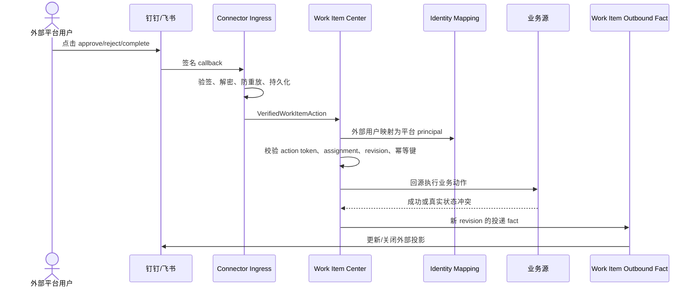

动作 token 必须是不可伪造、有限期、绑定 `connectionId + projectionKey + workItemId + action + revision` 的引用；禁止把任意 URL、脚本或供应商 action 名直接映射为业务命令。

#### 三个平台的待办边界

| 平台 | 目标支持 | 设计约束 |
|---|---|---|
| 钉钉 | 流程中心任务创建、更新、取消及官方支持的快捷动作 callback | 聚合可拆为一个或多个远端 task；只有真实远端 API 成功才能推进 delivered revision。实例生命周期没有官方副作用时不得声明实例更新 capability。 |
| 企业微信 | 尚未核实可供后台自动创建外部待办的完整服务端链路 | 官方已有受限的客户端创建面板，以及仅能操作当前应用待办的服务端查询/状态更新；这些能力不构成任意外部待办自动同步。 |
| 飞书 | 同时有通用任务 API 与三方审批投影，两者语义不同 | 通用任务使用 Task API；审批投影才要求外部实例/任务的聚合快照、稳定 revision 和 `updatedAt`，不能把所有工作项都限制为审批形态。 |

上述边界于 2026-11-15 按官方文档核对：[钉钉待办](https://open.dingtalk.com/document/development/add-dingtalk-to-do-task)、[飞书创建任务](https://open.feishu.cn/document/task-v2/task/create?lang=zh-CN)、[企业微信客户端创建待办](https://developer.work.weixin.qq.com/document/path/101530)、[企业微信更新待办状态](https://developer.work.weixin.qq.com/document/path/101534)。可用性仍需结合应用类型、权限与真实租户验证。

### 7.2 审批工作流外部集成：只负责外部流程权威

目标状态下，审批外部集成只处理“外部平台作为流程引擎”的路径：

- 外部流程定义发现与验证；
- 外部实例启动、查询、结果和受支持动作；
- 外部实例/任务/记录 binding；
- callback/轮询形成规范审批事实；
- 外部流程任务通过审批的 `WorkItemSource` 进入统一待办中心。

`authority=OUROBOROS` 的外部待办 MIRROR 不再属于 `WorkflowEngineMapping`。当前审批模块中的 `ExternalTaskCenterMirror`、`TaskCenterMirrorHook`、`ExternalMirrorOutbox` 及 `MIRROR_*` capabilities 已删除；待办中心尚未落地，删除不代表目标投递能力已经等价替换。外部待办仍是待实现目标，不新增双写或 no-op 兼容路径。

审批领域仍保留自己的 `WorkflowEngineMapping`、start/action fact、instance/task/result binding 和规范事件顺序。审批回调插件沿原 receipt/ingest 持久受理后，统一入口才确认该插件已接收；后续处理和恢复由审批 inbox/worker 推进。公共接收或将来可能增加的技术交付记录不替代这些领域事实。

供应商 workflow facet 复用 Connector 的连接、token/client、callback ingress 和远端错误合同；成员账号关系通过 §6.3 的正式身份端口读取，不由 Connector 持有组织映射。审批 core 继续只认识 `ExternalWorkflowStarter`、`ExternalInstanceReader`、`ExternalTaskReader` 等领域端口。

### 7.3 通知：复用现有 Channel，不把消息变成待办

通知继续以 `NotificationAdapter`、`NotificationAdapterSupplier`、模板和 dispatcher 为唯一入口。企业平台通知 channel：

- channel options 只引用 `connectionId`、消息类型和非敏感发送选项；不得复制 appSecret/token；
- 面向 Employee 的发送通过连接作用域内的组织关联解析外部 recipient ID；需要平台 User 的场景再通过现有员工与账号关系及正式身份端口解析，不以先登录为投递前提；
- 发送结果、批量部分失败和重试策略归通知模块；Connector 只提供受控 client 和标准远端错误；
- 普通消息、业务卡片、告警和进度播报属于通知；具有业务处理生命周期的项目属于待办；
- 卡片按钮若触发业务动作，callback 只能携带注册过的领域 action reference，通知模块不能执行任意 WebAPI/脚本。

这里的通知模板就是现有 `NotificationTemplate`：一份模板定义公共载荷契约及多个渠道各自的内容和发送选项，企业集成不新增模板类型或模板中心。业务发送逻辑沿原入口指定模板、收件人及可选渠道；dispatcher 只选用模板已定义的渠道，未指定时使用模板的全部渠道。配置企业连接或安装渠道插件不会自动给旧模板增加该渠道。标题/正文模板及供应商模板 ID 都是相应渠道的配置内容，不是另一类企业通知模板。

企业连接提供企业应用身份和访问凭据，不决定业务使用哪个通知模板。现有钉钉模板选项中的 `agentId` 与连接应用身份存在职责重叠，迁移时须核对并收敛，不能让两处可编辑配置分别改变投递目标；标题、正文、跳转地址等消息配置继续沿原模板合同维护。

现有 `ouroboros-notification-channel-wechat` 是微信渠道，不等于企业微信渠道。企业微信和飞书必须作为新 channel 显式接入，不能复用名称造成协议混淆。现有钉钉通知 channel 在迁移时改为消费 Connector client/token；完成切换后删除渠道内部的独立 token cache 和裸 client 构造。

本期先覆盖文本、标题和业务链接，复杂卡片按渠道扩展。通知发送可以复用已安装的消息 RPC 包，但消息内容、收件人、持久投递计划和未知结果恢复仍归通知模块。

当前 `NotificationEmployeeAddressParserImpl` 通过固定渠道分支读取员工档案或 `NotificationChannelEmployeeMapService`，后者只有渠道/员工/地址，缺少企业连接作用域。实施时沿现有渠道扩展面增加连接感知的收件人解析，新增渠道 JAR 不应要求修改宿主的渠道清单。企业成员地址沿 §6.3/§7.5 的组织关联解析；现有企业渠道地址记录需核对所属连接、关联 Employee 后迁移，不能无条件生成登录绑定或继续维护相同关系的第二份副本。

发送适配器可插拔不等于员工地址已可插拔：渠道须沿原通知扩展机制提供必要的地址解析能力和连接上下文，原地址解析入口负责组合，宿主不再为企微/飞书增加固定分支。组织正式服务提供关系事实，供应商协议模块提供外部访问，通知负责投递语义；不把组织写入或成员关系复制到渠道模块。现有 notification core 对 organization core 的依赖按当前架构保留，无需为本次扩展重写通知内核。

扩展必须贯穿原 dispatcher 的选项解析、员工地址解析、持久投递计划和重试校验，不能只给渠道 Adapter 增加 `connectionId`。首期由渠道解析其唯一企业连接，调用者无需再选企业。持久计划记录解析后的 connectionId、外部成员地址及关系依据；配置变化不得让失败重试静默改投另一个企业。同渠道多企业投递不在本期范围。

“无需先登录”表示地址关联不依赖登录历史，不表示跳过内容授权。现有业务事件通知通过启用的 User 检查业务事实的可读权限；只有 Employee、没有 User 的收件人目前会被拒绝。建议保留这一默认规则，按以下场景执行：

| 场景 | 建议行为 |
|---|---|
| 已绑定企业成员，Employee 关联启用的 User，但从未进行企业登录 | 可作为业务通知候选；仍按该 User 检查内容可读权限和当前业务资格，不要求先完成 SSO 登录绑定 |
| 已有平台账号但无业务内容权限，或账号已停用 | 拒绝发送相应业务内容；不能降级为匿名身份绕过检查 |
| 只有 Employee、没有 User | 本期自动化业务事件/审批通知不向其投递；保留目录关联和成员地址能力，不自动创建账号或授予权限 |
| 普通企业公告、接入测试等不含业务数据的消息 | 仅沿已有明确授权的发送用例执行，使用受控测试收件人或管理者明确选择的人员及非敏感模板；不借此放开业务事件，不新增公告系统或发送入口 |
| 成员未关联、关联失效或反向解析有歧义 | 记录具体收件人的阻塞原因，不根据姓名/手机号猜收件人，不将业务内容送给渠道默认账号 |

渠道选择继续服从原模板和 DispatchOptions：业务用例明确选择渠道，未显式选择时沿模板原规则；不新增“自动选最优渠道”或三家默认群发。单个渠道失败不自动切到另一渠道，除非原业务用例已经明确授权这样的投递。

可靠计划冻结目标连接和地址，重试前沿 `NotificationDeliveryPolicy` 核对成员关联、User 状态、内容权限和业务资格；地址或绑定变化时阻塞，不给新成员地址续发旧计划。密钥轮换可使用同一企业/应用的新凭据，不改目标身份；企业/应用替换必须停止旧计划并由原用例明确处置。消息首期以文本和受控业务链接为主，模板尽量只包含完成提醒所需的信息；链接不携带登录 token，打开后仍走原认证/权限检查。

### 7.4 安全：沿用 ExternalAuth，不把 Connector 变成认证中心

登录和免登继续由安全层拥有：

- 标准 OAuth2/OIDC 可以表达时，只增加 `OAuth2ProviderSpec` 配置；
- OAuth callback、state、nonce、授权码交换、`ExternalIdentity` 和 `UserSsoEntity` 继续走现有安全链路；
- 企业平台工作台入口先进入安全认证，再生成 Ouroboros session，然后按受控 deep link 路由；
- 服务端 API token 与用户登录 token 分开缓存和授权，不能互相替代；
- 同一外部应用确实共用 credential 时可以引用同一 secret，但不能仅因为 provider 相同就合并连接。

如果某个平台的登录协议不能由现有 OAuth2 provider 表达，最小扩展点应定义在 security core/runtime，由位于上层的 provider plugin 实现；不得让 security 反向依赖 Connector ability。

本节的安全扩展接口和企业认证桥接已有实现：security core 定义
`EnterpriseAuthProfileResolver`，当前实现 `EnterpriseConnectionAuthProfileResolver` 已位于 Connector runtime，各平台 profile provider 由供应商基础模块独立装配；该实现从已发布的
`enterprise.connections` 派生非敏感的认证请求；`ExternalAuthProviderFactory` 按
`connectionId` 即时派生 `ProviderSpec`，再由内建 OAuth2 构造逻辑或注册的
`ExternalAuthProviderBuilder` 构造 `RedirectAuthProvider`，并复用现有 OAuth controller 的
authorize/callback 入口。connection-scoped profile 不写入静态 provider 配置；原 provider 枚举通过 resolver 的候选连接动态解析已启用的企业登录，供登录页和工作台入口复用，不建立第二套目录。静态 provider
与 connectionId 重名时拒绝登录；state、nonce、PKCE verifier、连接 profile revision 和 callback
路由均绑定 `connectionId`。连接在授权发起与回调之间发生变更时，回调必须 fail-closed。

只有连接和 `auth.enabled` 均启用、凭据可解析、相应 auth facet 已装配的连接才生成登录入口；普通审批连接不会因此自动开放登录。飞书沿原 OAuth2 provider 使用 `appId/appSecret`，钉钉和企业微信通过 `ExternalAuthProviderBuilder` 提供专有协议适配。首期新接入使用自建应用，企业微信通过自建应用网页授权及 `/cgi-bin/auth/getuserinfo` 解析成员；既有第三方协议实现保留独立合同，不能通过重命名表单字段替代。
成功后都只返回 `ExternalIdentity`，session 和绑定仍由安全模块创建。三个平台的真实企业 redirect URI、
应用权限、授权撤销和 token 失效验证仍是上线门槛，在完成前由发布验收清单记录未验证，并保持生产登录开关关闭；不新增运行时证据状态。

security 已定义 `ExternalAuthProviderBuilder`，由 `ExternalAuthProviderFactory` 聚合 builder 并对重复
`type` 启动失败；LDAP/OAuth2/CAS 保持内建构造逻辑，企业平台专有 auth facet 实现该安全端口。

钉钉和企业微信 auth facet 不再设置平台级业务开关；模块始终注册协议适配器，由连接快照中的
`auth.enabled` 决定是否为具体连接发布认证 profile。这样不会因为关闭一个平台总开关而影响该平台的
workflow Connector、业务 callback 或服务端 API 凭据。若部署需要全局紧急熔断，应在运维层停止对应
认证入口，不能把它混入连接配置或 OAuth 协议模型。

#### 7.4.1 统一 OAuth/SSO 接入合同

第一期不新增一套企业平台登录框架，而是把企业连接映射到现有安全模块的 `ProviderSpec` 和 `RedirectAuthProvider`；标准协议使用 `OAuth2ProviderSpec`，非标准协议由专有 builder 构造。概念上的认证注册至少包含：

| 字段 | 规则 |
|---|---|
| `connectionId` | 认证路由和 `UserSsoEntity.ssoChannel` 的唯一作用域；不能只用 `provider` 路由 |
| `provider` | 从连接快照派生，用于选择钉钉、企业微信或飞书的协议实现；不可由浏览器提交覆盖 |
| `protocol` | `OAUTH2_AUTH_CODE`、`OIDC` 或明确命名的 `PROVIDER_BRIDGE`；未知协议不激活 |
| client identity | `clientId` 可以进入非敏感 provider schema，也可以通过 `clientIdRef` 从结构化凭据投影；两者严格二选一。connection-scoped profile 禁止明文 `clientSecret`，secret 只能使用 `credentialRef`/安全解析器 |
| authorization/token endpoint | 由现有 `OAuth2ProviderSpec` 或 provider plugin 提供；不得由用户输入任意 URL 形成 SSRF 路径 |
| identity source | 明确选择验证后的 `id_token` claim、JWKS claim 或 userinfo 字段；缺少稳定外部 ID 时拒绝登录 |
| `scopes` / PKCE | 由 provider profile 声明并在激活时校验；浏览器交换流程优先使用 PKCE S256 |

这里的“认证注册”是安全运行时的派生视图，不是连接配置中的第二套路由字段。`OAuth2ProviderSpec.key`、OAuth controller 的 `{provider}` 路径参数和缓存中的 provider key 必须能无歧义解析到 `connectionId`；不能让同一连接同时存在按 provider 和按 connectionId 的两条登录入口。

为支持动态连接而不让 security 反向依赖 Connector，最小扩展点定义在 `ouroboros-web-security-core`，实现由 composition root 装配：

```java
public interface EnterpriseAuthProfileResolver {
  Resolution resolve(String connectionId);

  record Resolution(
      boolean connectionClaimed,
      Optional<ProviderSpec> profile) {
  }
}
```

`ExternalAuthProviderFactory`/controller 只依赖该接口和现有 `RedirectAuthProvider` 合同；Connector runtime 或 provider auth facet 提供实现，负责从已发布连接快照派生 `ProviderSpec`。解析失败、连接禁用、provider 不匹配或 profile 校验失败都不得回退到另一个 provider，也不得按加载顺序选择。

`connectionClaimed=false` 仅表示该 ID 不属于连接目录，静态 provider 才可继续解析；
`connectionClaimed=true, profile=empty` 表示连接已认领该命名空间但当前不可用于认证，必须
fail-closed，尤其不得回退到同名静态 provider。

统一流程如下：

1. 安全模块根据 `connectionId` 读取已发布连接快照和 provider auth profile，确认连接未被禁用且凭据引用可解析。
2. `GET /api/auth/oauth2/{connectionId}/authorize` 生成一次性 `state`、`nonce`，按 profile 需要生成 PKCE verifier/challenge，并把 `connectionId`、return URL、redirect URI、issuedAt 和 verifier 绑定到短期缓存。
3. 外部授权回调只接受安全模块的 callback controller；先单次消费并校验 `state`、redirect URI、错误参数和过期时间，再交换授权码。
4. 对 `id_token` 校验签名、`iss`、`aud`、`exp`、`iat`、`nonce`；对 userinfo 响应校验 access token 绑定、HTTPS endpoint、稳定外部 ID 和 provider 声明的字段类型。
5. 规范化为 `ExternalIdentity`，其绑定作用域使用 `connectionId`；通过现有 `ExternalAuthService` 查找 `UserSsoEntity`。未绑定时按 §7.4.5 输入平台账号密码完成绑定，成功后创建 Ouroboros session。
6. 任何 state、nonce、issuer、audience、签名、外部 ID 或绑定查询失败都 fail-closed；不得把 OAuth callback 转成 Connector `ASYNC_EVENT`，也不得把 access token 当作 Ouroboros session token。

#### 7.4.2 三个平台的认证 profile

以下 profile 只规定架构落点和能力门槛；具体 endpoint、scope、用户 ID 字段和应用权限必须由 provider 官方合同、fake contract 和真实租户 profile 共同确认后才能激活。

| 平台 | 首选接入 | 必须区分的模式 | 第一阶段判定 |
|---|---|---|---|
| 钉钉 | `dingtalk-enterprise` provider bridge | 内部应用使用 `appKey/appSecret`，第三方企业应用使用 `suiteKey/suiteSecret`；`suiteTicket` 和 API access token 都不能当用户登录凭证 | 已实现两种应用的授权码登录；authorize 固定请求 `openid corpid`、`prompt=consent` 和连接 `corpId`，provider 在安全 Controller 传递原始回调参数后自行读取 `authCode` 并映射为 token 请求的 `code`，并校验 token 响应 `corpId`；以 `unionId`（缺失时 `openId`）为 connection-scoped 稳定 ID |
| 企业微信 | `wecom-enterprise` provider bridge | 现行第三方应用网页授权、自建应用 JS-SDK 免登、旧套件授权和审批 JS-SDK 发起是不同链路；code 必须服务端验证，不能伪装成通用 OAuth2 callback | 已实现现行第三方应用服务端网页授权；authorize 使用 credential 中的 `suiteId` 作为 `appid`、固定 `snsapi_base` 且不发送 `agentid`，缓存 `suite_access_token`，调用 `/cgi-bin/service/auth/getuserinfo3rd` 校验小写 `corpid`，以 `open_userid` 为 connection-scoped 稳定 ID，并保留 `userid` 作为成员映射属性 |
| 飞书 | OAuth2 授权码和用户身份查询 | `tenant_access_token` 是应用/租户 API 凭证，不是用户登录；用户授权 token 与租户 token 分开缓存和授权 | 已实现 connection-scoped `OAuth2ProviderSpec`：固定 authorize/token/userinfo endpoint，PKCE S256，以 userinfo `data.open_id` 为稳定 ID；本地 contract 已覆盖，真实租户验证仍是上线门槛 |

每个平台的 auth facet 还必须返回：支持的登录模式、所需 scopes、稳定外部 ID 类型、是否要求 PKCE、是否支持 userinfo/JWKS、绑定所需的展示字段，以及登录撤销/失效后的处理方式。没有这些声明时，不得把 `auth` capability 注册为有效能力。

#### 7.4.3 认证与业务连接的关系

- 同一个 `connectionId` 可以同时被 workflow、notification、directory 和 auth facet 使用，但每个 facet 的业务状态独立保存。
- auth facet 只负责把外部认证结果交给安全模块；它不创建审批实例、不写待办、不更新组织表，也不处理业务 webhook。
- Connector 负责服务端 API 的应用级/租户级凭据和受控 client；安全模块负责用户授权码、用户 access token、`ExternalIdentity`、SSO binding 和 session。二者可以引用同一个 secret，但不能共享 token cache 或 token 语义。
- 企业平台工作台入口的 deep link 必须先完成上述认证，再由 app runtime 校验受控 route 和业务权限；不能以外部回调携带的 URL 直接绕过登录。

#### 7.4.4 认证 contract 与真实租户门槛

每个 auth profile 至少需要以下 contract test：

- 授权 URL 只包含声明的 redirect URI、scope、state、nonce 和 PKCE 参数，不泄漏 secret；
- callback 缺失、重复或过期的 `state` 只能失败一次，不能重放登录结果；
- token response、id_token/userinfo 的 issuer、audience、签名、nonce、过期时间和稳定 ID 校验失败时拒绝登录；当响应携带且 profile 选择 JWKS 校验的 `id_token` 失败时，不得降级请求 userinfo；
- OAuth provider key 只能解析到一个 `connectionId`，跨 connection 的外部身份不能复用；
- 未绑定用户返回 `binding-required`，不能按邮箱、手机号或昵称自动绑定；
- provider bridge 的 `code`/`authCode`/ticket 必须先按官方参数名归一化并通过官方服务端校验，才能进入同一 `ExternalIdentity` 流程；重复的授权码参数必须 fail-closed；
- access token、refresh token、id_token 和授权 code 不进入日志、`UserSsoEntity` 或业务 fact。

真实租户 contract profile 还必须验证 redirect URI、应用权限、scope、用户身份字段、授权撤销和 token 失效行为。未完成真实验证的平台在发布清单中保留待验记录，不启用生产登录入口；不把验收记录做成代码枚举或配置字段。

#### 7.4.5 未绑定账号时输入平台账号密码（已确认）

首次外部认证成功但没有 `UserSsoEntity` 绑定时，展示“绑定平台账号”，要求输入 **Ouroboros 平台账号与密码**。企业平台已经负责验证外部身份，不要求用户在此输入钉钉/企微/飞书密码，也不按手机号、邮箱或组织同步关系自动建立登录绑定。

复用现有 `ExternalAuthService` 的短期 `bindingToken` 和 `POST /api/auth/bind`：服务端取得已验证的外部身份，沿 `UserIdResolver`、`UserPasswordVerifier` 验证平台账号，沿 `UserSsoService` 创建绑定并消费令牌，再按原安全策略签发平台会话。密码不持久化、不写日志、不转发给企业平台；令牌过期、凭据错误、限流、绑定冲突和账号不可登录均按原链路处理。无平台账号时联系管理员开户，本期不自动注册或授予角色。

绑定提交及会话签发前应沿正式连接解析链复核连接和登录仍启用、认证上下文仍有效；中途停用或变更导致上下文失效时要求重新认证，不能凭旧 `bindingToken` 绕过停用。这项企业连接检查待接入现有绑定链路，不另建绑定服务。

从工作台进入时，受控目标应用/页面由服务端认证上下文保留到绑定完成；获得平台会话后恢复该目标，并执行原应用权限检查。账号已绑定后再次进入无需重复绑定；当前源码已有账号密码绑定接口，工作台目标恢复和三家认证链路仍需联调，不因接口存在而视为验收完成。

绑定错误、旧企业遗留或关系冲突按 §6.3.1 由管理员查看并解绑，用户沿本节重新绑定；不根据组织关联自动创建或改写登录绑定。

### 7.5 组织结构：支持绑定已有对象及单向同步

组织模块已实现目录读取、部门/成员绑定、主来源范围、预览确认和单向同步；三家 Source 通过通讯录 RPC 包分页读取，完整性失败时拒绝同步。本地目录行为、持久化夹具和生产 Schema 浏览器测试已有证据；真实企业及生产数据库并发同步尚未执行。

组织结构模块仍拥有 Company、Department、Position、Employee 和 Appointment。本期确认两种使用方式：

| 方式 | 本地对象与资料维护 | 外部关联 |
|---|---|---|
| 绑定 | 管理者选择本地已有部门/员工，资料继续由本地维护 | 保存外部部门→Department、外部成员→Employee 关系，可用于收件人和身份解析。 |
| 同步 | 选择外部组织范围，从外部单向创建/更新本地部门、员工及归属关系 | 沿用同一关系识别已有对象，不按名称或手机号重复创建。 |

关联键为 `connectionId + 对象类型 + 稳定外部 ID`，可引用本地对象、记录来源及同步策略；绑定本身不要求开启同步。手机号/邮箱只能用于给出匹配建议，经有权限的管理者确认后建立关联，不能借目录导入自动授权登录。外部读取不完整不能被当作全员删除。首期不写回外部通讯录。

外部通讯录适配新增最小来源端口，支持按授权范围分页读取部门、成员及归属关系，并说明一次读取是否完整。稳定增量游标作为可选能力独立声明；无增量能力时使用完整读取与差异比较，不要求供应商实现不支持的增量方法。

供应商 directory facet 只把远端数据翻译成规范快照。组织 runtime 的同步用例负责：

- 稳定外部 ID 与本地组织 ID binding；
- 父子顺序、部门移动、人员离职和任职变化；
- revision/checkpoint、冲突策略和人工处理；
- 通过组织模块正式管理服务写入，不由 Adapter 直接写表；
- 维护组织关联，并通过正式身份解析端口提供成员到平台主体的解析；未关联 User 的 Employee 仍可维护通知地址；业务投递资格沿 §7.3 单独判断。

首期只做外部目录到 Ouroboros 的单向同步。反向写企业通讯录是另一种权威模型，需独立设计，不能在 source port 中顺手加入写方法。

#### 7.5.1 资料来源与绑定（已实现，真实目录待验）

默认采用“绑定已有组织”：本地维护资料，外部关系只用于成员解析和渠道投递。同一连接内，一个外部成员只能关联一个 Employee，一个 Employee 也只关联一个外部成员；部门关联遵循相同的双向唯一规则。一个 Employee/Department 可以分别关联钉钉、企微、飞书中的对象，这不违反每个渠道只接一个企业的限制。

需要同步时，为选定的本地组织范围指定一个主通讯录来源；范围重叠且会写同一本地对象时拒绝启用第二个来源。其他渠道继续绑定，只用于本渠道身份/通知解析。例：飞书维护集团通讯录，钉钉和企微关联同一批本地员工，不更新姓名和部门。首期不做多个来源的优先级或逐字段合并引擎。

主来源的同步字段使用固定白名单：默认姓名、部门名称/层级及归属关系；手机号和邮箱可显式纳入。User 身份/密码/启停、角色、业务授权、岗位职能和本地备注不在白名单内。绑定模式不改资料；同步管理字段在本地编辑入口显示来源并受原组织管理命令保护。要恢复本地维护，先显式退出该范围的同步，不能依赖下一轮覆盖消除本地冲突。

#### 7.5.2 人员与部门变化（已实现，真实目录待验）

| 变化 | 建议处理 |
|---|---|
| 首次同步、发现疑似同名对象 | 预览新增/更新/建议绑定/冲突；由有权限的管理者确认绑定或创建。绑定候选未经确认不合并，重复运行沿稳定关联识别对象 |
| 部门移动 | 更新同步来源拥有的层级；父节点不可见、跨出授权范围或出现环时阻塞该项，不擅自挂到根节点 |
| 员工属于多个部门 | 复用部门默认“成员”岗位及 Appointment；外部明确主部门时映射 PRIMARY，其余 SECONDARY；没有明确主部门且涉及主任职变更时要求确认，不取列表第一项。保留本地自行维护的任职，不从通讯录导入业务角色 |
| 外部明确确认离职/删除成员 | 立即使该外部关系不能用于新投递/新业务成员解析；对同步来源创建的任职，通过现有服务按日期语义结束，保留历史；不删除 Employee、不顺带解除其他渠道关系 |
| 本次范围内未看到成员/部门 | 只有完整读取后才形成“缺失待核对”；授权范围缩小、接口分页失败和外部离职分开诊断。缺失不自动删除本地对象或停用账号；确认移出后再终止相应关系 |
| 解绑 | 终止该渠道关联及相应同步权威，保留本地对象和审计；新的关联不接管旧通知计划。已被业务/登录关系引用时展示影响并沿原领域规则处置 |
| 停用同步或更换主来源 | 停止后续任务、保留资料；更换前预览重新绑定及字段/任职影响。旧来源未退出时不让新来源竞争写入 |

组织变化不自动改 User 启停、登录绑定、会话或角色；目录关联失效立即影响其自身的新投递/成员解析，账号安全处置仍由安全模块受控执行。需要“外部离职自动停账号”时，应另行设计明确的账号生命周期联动，不能由同步器暗中执行。

#### 7.5.3 执行、并发与恢复（已实现，数据库并发待验）

目录读取与本地应用分开执行，不持有数据库事务等待远程分页。组织模块记录同步范围、来源连接、读取完整性、进度、逐项结果和冲突；同一范围只允许一个应用任务推进。首次执行必须预览确认；后续可沿现有调度机制运行，按已确认字段白名单及关联创建/更新，破坏性变更保留人工核对。

写入通过原部门/员工/岗位/任职服务，以稳定关联和上次同步基线识别重复、并发修改及本地冲突；必要的关联与对象写入在同一本地事务内完成。读取不完整不推进完整同步水位，不根据半批目录计算删除。逐项提交的成功结果可以保留，任务明确显示部分完成；恢复从已确认进度重跑，冲突项等待处理，不因一个坏条目重复创建其他对象。不另建通用同步平台。

### 7.6 应用入口：从企业工作台进入业务应用

已实现连接级工作台入口生成和管理页：管理员输入站内业务路径，后端生成带 returnUrl 的原企业登录地址。当前管理员复制到供应商后台配置；不自动发布。入口路径校验、权限和最小装配的 8 项本地测试通过；三平台真实客户端和账号绑定后的目标恢复仍须联调。

应用模型、菜单、路由和权限仍由 `ouroboros-app-runtime`、Menu Model、UI Model 和安全层定义。本期先打通以下链路：

```text
企业工作台入口 → 平台受控入口 → 已有会话或企业认证
  → 已验证的本地账号关联 → 目标业务应用及页面 → 原权限检查
```

入口关联企业连接、目标应用和受控页面，按实际支持的终端提供访问链接。第一阶段在供应商后台配置入口 URL，不要求先实现工作台入口自动发布。三家的具体登录方式由 auth facet 实现；企业微信现有第三方网页授权不等于自建应用网页授权或 JS-SDK 免登，缺失形态沿 §2.4 补齐并做真实企业验证。用户未完成登录绑定时按 §7.4.5 输入平台账号密码绑定，然后恢复目标页面；组织关联不能直接替代认证。

后续确有自动维护入口的需求时，外部平台 facet 才扩展：

- 发布/更新工作台应用入口；
- 生成 PC/移动端 deep link；
- 保存外部入口 ID 和发布 revision；
- 接收应用安装、卸载和授权变更事件。

外部入口不能携带绕过权限的内部 URL。所有 deep link 必须解析为受控 route + 参数，进入 Ouroboros 后重新执行认证和授权。应用入口投递 binding/outbox 归应用运行时，不放入 Connector 通用表。

### 7.7 文档、日历、会议和云盘：按领域增量建设

这些能力可复用 Connector 与相应 RPC 包，不共享业务端口。出现明确产品需求时，应由对应领域模块定义文档、日程、会议或文件语义，再增加 provider facet。禁止提前在 Connector 中加入 `createDocument`、`createMeeting` 等供应商 API 聚合接口。

### 7.8 开放 API：按平台及能力组交付 RPC 包

当前 `JarRPCModelMetadataProvider` 和 `JarRPCAuthCredentialMetadataProvider` 已能从 classpath 加载 `.rpc.json`、`.rpc.auth.json`，随后由原 Center、Builder 和执行器使用。RPC 包沿用这一入口，标准请求优先以元数据表达，仅在现有凭据 SPI 无法表达企业连接协议时增加有明确类型的凭据适配。

包按平台和能力组拆分，包内每个接口保留独立、带平台及能力前缀的 RPC 名称；例如 `dingtalk-rpc-contact` 提供部门列表、成员列表和成员详情，`feishu-rpc-message` 提供消息发送/查询，`wecom-rpc-approval` 提供提交审批和查询详情。包名为示意，不在本期预先打包所有开放接口。

RPC 包交付接口定义、参数说明、所需权限说明及连接凭据引用合同。引入 JAR 并重启后，接口通过现有 RPC/逻辑流机制发现；配置企业连接及对应权限后才能调用。接口定义标明所属渠道和权限要求，首期执行端自动解析该渠道唯一的企业连接，业务调用者不用手填 connectionId；缺失或重复候选直接失败。接口定义不固定某家企业，仍按原机制授权 RPC 调用及该渠道连接的使用权。

目录 source、通知 channel 等领域适配可以复用同平台的 RPC 包，保持单一请求定义。RPC 包只负责接口调用；目录同步、通知投递、审批启动事实及回调恢复仍归各领域。审批和消息等有远端副作用的写接口，不因复用 RPC 而自动获得可安全重试的承诺。

依赖方向固定为领域适配使用所需 RPC API 包，企业 RPC 凭据适配实现原凭据 SPI 并使用共享企业连接/token 能力。通用 RPC 引擎不固定三家供应商；共享企业访问基础不反过来依赖企业 API 包或企业 RPC 凭据插件，避免获取 token 再递归调用需要同一 token 的 API。可复用原中立 HTTP/执行能力，不另建 HTTP 引擎。RPC 执行结果不直接改变通知、同步或审批的业务完成状态。

RPC 模型和凭据元数据仍随应用/JAR 版本管理；运行时策略继续由原 RPC 管理机制维护。统一集成页面配置连接关联、查看已安装接口和执行受控测试，不把这些定义复制为另一套运行时接口目录。实现依据见 [RPC 设计](../../../ability/ouroboros-rpc-model/DESIGN.md)。

调用合同沿现有 `RpcInvocationRequest.options`、`RpcExecutionResources` 和凭据 Builder 补齐：在正式执行入口从模型所属渠道解析唯一连接，服务端校验调用及连接使用权，把已验证 connectionId、非敏感快照和 credentialVersion 固定在该次调用资源中；业务参数和表达式不能覆盖。嵌套调用同渠道继承该上下文，不因过程内配置变化切到另一企业；跨渠道嵌套分别执行权限与连接解析。凭据 Builder 只委托原共享 client/token 机制，不向逻辑流暴露 secret，不创建第二份 token 缓存。方向已确认，精确资源合同见 §7.8.1 的待细化边界。

一次执行固定目标企业/应用；密钥替换可按 §6.2 取得同目标的新版本，更换企业/应用时停止旧上下文。需要持久恢复的原领域保存目标连接，不在重试时重新猜当前渠道默认值。原通用动态 AccessToken 凭据继续保留；上述企业连接行为由独立 `EnterpriseAccessToken` 实现和托管资源承接；不为本期预建同渠道多企业路由、通用连接选择表达式或按企业复制 RPC 模型。

#### 7.8.1 企业应用令牌认证：沿原 RPC 凭据 SPI 扩展

本节已沿原凭据 SPI 实现企业应用令牌类型 `EnterpriseAccessToken`，保留原 `AccessToken`、`PlainCredentials`、`HttpBasic`、`HmacSignature` 等类型。类型说明、原子 Schema 和编辑界面随企业 RPC 模块贡献，加载时不获取 token。下例仅省略完整请求定义。

认证定义分为三层，避免在每个 API 中重复企业配置：

| 层次 | 定义内容 | 归属与复用 |
|---|---|---|
| RPC 接口定义 | 请求、参数和 `authCredential` 引用 | API 能力包提供；接口不携带企业身份或密钥 |
| RPC 认证定义 | 供应商、应用令牌种类和请求中的令牌放置方式 | 沿原 `.rpc.auth.json` 交付；同一协议的多个 API 共用 |
| 企业连接 | 企业/应用身份、凭据引用、启用状态和版本 | 原配置受控入口维护；执行时解析该渠道唯一连接 |

例如，飞书消息 API 的接口定义只引用认证名称：

```json
{
  "name": "feishu.message.send",
  "type": "OpenAPI",
  "authCredential": "feishu.application-token"
}
```

该名称对应的认证定义示意如下，不包含具体企业和 secret：

```json
{
  "name": "feishu.application-token",
  "type": "EnterpriseAccessToken",
  "isEnabled": true,
  "enterprise": {
    "provider": "feishu",
    "tokenKind": "tenant_access_token"
  },
  "accessToken": {
    "tokenPlacement": "Authorization"
  }
}
```

接口示例只展示认证相关字段，并非可独立运行的完整请求定义。具体 API 的权限要求及应用形态仍以 §2.4 和能力包合同为准。

企业凭据仅增加原 SPI 的实现：

- `EnterpriseAccessTokenCredentialBuilder` 实现 `RPCAuthCredentialBuilder<HttpRPCRequest>`，由原 Center 发现和选择；不为每个平台或 API 再建 Builder/Registry。
- `EnterpriseAccessTokenCredential` 继承原 `AbstractAccessTokenRPCAuthCredential`，复用原请求令牌注入机制；实际应用令牌委托共享企业访问基础获取。
- 原 `RPCAuthCredentialBuilder` 已有 `build(metadata, RpcExecutionResources)` 重载。本次需要接通托管依赖和调用资源组装，不把该重载重复计为新增接口，不以全局静态 Bean 缓存代替正式装配。

令牌放置由 API 协议决定。例如，适用的飞书 API 使用 `Authorization: Bearer …`，钉钉新版 API 使用 `x-acs-dingtalk-access-token` 请求头，企业微信相应 API 使用 `access_token` 查询参数；不能把一种放置方式写成整个平台所有 API 的常量。继续使用原 `accessToken.tokenPlacement/customPlacement` 表达这些差异。

运行时从可信调用资源取得已验证目标；`applyToRequest` 现有业务参数 Map 不能作为企业身份、连接或凭据版本的事实来源。缺失/重复连接、无使用权、停用连接或令牌获取失败时终止调用。枚举、加载或构造认证定义不拉取远程 token，执行时按需获取；本次新增类型处理应用级令牌，用户 OAuth 令牌继续沿原安全链路。

与通知、审批等调用复用同一连接、令牌种类和有效凭据代次的共享缓存，不在企业 RPC 凭据内另加动态 token RPC 或第二份缓存。供应商 token 获取实现不能反向依赖需同一 token 的企业 API 包。令牌刷新和副作用请求重放分别沿 §6.5 判断，刷新成功不等于允许重放结果未知的写请求。

认证分层、可信资源、目标约束、类型贡献和强制脱敏已有代码及行为测试。首批包为三家通讯录读取和应用消息发送；实际 scope、企业可见范围及供应商接受结果仍需真实租户验证。见[企业 RPC 说明](../../../ability/ouroboros-enterprise-rpc/README.md)。

#### 7.8.2 企业 RPC 的执行与工具链约束（已实现，持续回归）

1. **凭据使用权与请求目标。** 沿原 RPC 调用及连接授权入口分别校验使用权，模型编辑权不自动获得企业凭据使用权。供应商协议与能力包说明允许的 API 目标、令牌种类及注入方式；在模板解析后的最终请求上校验，通过后才获取/注入令牌。跨目标重定向不得转发企业凭据。具体扩展点沿原执行链落实，通用 RPC core 不增加三家供应商分支。
2. **API 与令牌匹配。** API 能力包逐项说明应用形态、所需 token 及权限 scope；加载/编辑校验和执行遵循同一合同。缺少 scope、形态不符、令牌种类错配或未实现时明确失败，不自动更换令牌或降级调用。本次应用令牌类型不承接用户 OAuth API；首批接口名单另行细化，能力证据标记仍只在方案/验收材料使用。
3. **每次调用的可信资源。** 在原 SPI/Center 与资源组装处接通正式依赖，正常、同渠道嵌套、跨渠道嵌套及开发测试均执行相应连接与授权校验。全局认证对象不捕获某次调用的连接或旧凭据版本；业务参数 Map 不提供可信身份，资源缺失或认证失败不回退为无认证。调用时校验连接停用及凭据代次，加载定义不拉 token；资源仅作必要中立扩展，不变成任意服务查询器。
4. **编辑器与发现同步。** 新类型随模块贡献类型说明与原子 Schema，由原 RPC 编辑/检查入口消费；安装 Builder 同时交付配置、校验、测试初始化和运行支持。共享认证定义维护一份，各 API 包引用；原加载/校验入口诊断缺失插件、禁用/无效引用及冲突定义，不依赖不确定加载顺序。保留原机制有明确约定的合法覆盖语义，不建立第二目录，不在通用 UI Model 中加入集成语义。
5. **测试权限与真实效果。** 测试沿原入口检查连接使用权及所执行操作的权限；使用当前企业连接时明确目标和真实写操作效果，按原确认流程执行。测试模式保留原运行策略隔离，也须执行企业安全约束。临时配置不得替换正式连接身份/密钥、写回正式配置或清空/污染共享缓存；同一真实企业的合法 token 刷新服从共享机制，不因每次点击强制换 token，也不新增同渠道第二企业。
6. **凭据强制脱敏。** 沿原日志和测试证据出口，对实际注入的秘密位置和值、常用编码形式、URL 参数和上游错误回显强制脱敏。业务可选 mask 只能增加保护，不能关闭凭据脱敏。共享 token 获取绕过原 token-fetch RPC 时仍向原脱敏边界提供必要信息；真实令牌只用于内部执行，不输出到管理接口、测试证据或诊断中。

上述规则落在原凭据 SPI、调用资源、执行链、编辑校验及日志/测试边界，不增加新的 RPC 引擎、授权中心或日志平台。精确类型贡献签名、目标约束表示及测试操作清单在所属模块细化。

## 8. Provider Facet 组织方式

每个平台的协议基础模块与领域 facet 关系如下：

| 层次 | 钉钉示例 | 职责 |
|---|---|---|
| Connector provider base | `ouroboros-enterprise-connector-dingtalk` | credential、access token、HTTP/SDK client、callback crypto、错误解析；标准开放 API 定义由对应 RPC 包维护 |
| Work item facet | `ouroboros-work-item-projection-dingtalk` | 实现工作项 create/update/close/read/callback 端口 |
| Workflow facet | 现有 `...external-integration-dingtalk` | 实现外部审批启动、查询、结果和明确支持的动作 |
| Notification facet | 现有 `...notification-channel-dingtalk` | 实现通知模板到钉钉消息的转换与发送 |
| Auth facet | 复用 `OAuth2ProviderSpec`；必要轻量 profile/builder 随 provider base，公共 resolver 随公共 runtime | 实现原安全合同，注册 connection-scoped 登录 profile，规范化 `ExternalIdentity`，不定义 session、不默认单建 auth JAR |
| Directory facet | `ouroboros-organization-directory-dingtalk` | 实现组织目录 source port，不写组织表 |
| RPC API 包 | `dingtalk-rpc-contact` 等（示意） | 通过原 RPC 元数据机制提供接口组，引用连接感知的凭据，不管理目录/通知/审批业务状态 |

企业微信和飞书沿用相同结构。一个 facet 不依赖同平台的另一个 facet；它们可共享 provider base 和所需 RPC 包。这样删除通知渠道不会影响审批，禁用审批 capability 也不会禁用 SSO。

### 8.1 现有实现到目标结构的迁移映射

| 当前实现 | 目标归属 | 迁移要求 |
|---|---|---|
| `ApprovalWorkflowEngineConnection`（旧类型已退出） | 非敏感事实为 `EnterpriseConnectionSnapshot`；可信内存装配值为 `ResolvedEnterpriseConnection`，typed credential 归供应商协议基础 | 拆分当前“配置 + 运行时凭据”的职责，不能只重命名或把凭据塞入公共快照。旧类型退出公共连接读取路径；审批侧 `create` 等签名迁移后，再决定删除该类型或保留确有需要的审批专用输入，不以永久转换包装维持两套公共连接模型。 |
| `ExternalConnectionConfigProvider`、各 provider `*ConnectionCredentialMapper` 及连接 schema 目录 | Connector runtime + provider base | 仍按 connectionId 读取原配置数组中的完整连接快照；解除对审批连接类型、审批 Provider 和审批 runtime 的依赖；单一连接目录，typed credential 只存在于内存。 |
| 审批内 `EnterpriseConnectionAuthProfileResolver` 及供应商 auth profile/builder | 独立于审批装配的企业登录适配 | 实现原安全端口，不使 security 向上依赖 Connector；仅登录安装不带入审批。 |
| `ExternalUserIdentityMapper`、各 provider 用户映射配置 | 原 `EnterpriseIdentityMappingService` + 组织侧适配 | 当前由 RBAC 适配 UserSso；账号视角经原员工账号关系读取组织关联，Employee 收件地址沿组织正式读取；明确默认解析器让位和存量迁移，不由目录导入生成登录授权。 |
| 各 workflow adapter 内 token cache 和 HTTP/SDK client | 对应 Connector provider base | 先保持 HTTP 合同不变，再切换创建入口；切换后删除旧 cache/client factory。 |
| 供应商 callback 控制器及 `ExternalCallbackCodec` 的协议部分 | 统一入口 + Connector provider 协议插件 | 拆出验证、解密、challenge 和响应编码；审批事件翻译留在 workflow facet，以关注声明接收事件；切换外部 URL 并退出旧入口，不双重入箱。 |
| `ExternalEventCallbackController` 的通用审批回调入口 | 同一统一业务入口及审批订阅插件 | 一并核对 `/api/approval-workflow/external/{adapterId}/callbacks/{connectionId}` 的实际调用方；切换后退出旧接收入口，不能只删除三家供应商控制器而保留第二条通用接收路径。原 receipt/ingest 服务继续由审批插件调用。 |
| `ExternalEventIngestService`、审批 receipt/inbox | 审批回调插件 + 原审批接收与恢复服务 | 插件沿原服务持久受理后由统一入口 ACK；审批 inbox/action fact 不迁为公共表，不在领域 inbox 前强制再加 Connector inbox。 |
| 已删除的审批 MIRROR hook/outbox/port | 待办 external projection ports/runtime（目标） | 原入口已删除，待办替代尚未实现；须另验目标投递行为，不视为迁移完成。 |
| `DingTalkNotificationAdapter` 内独立配置、token 和 SDK client | notification facet + DingTalk provider base | 保留 `NotificationAdapter`，只迁基础连接与 client；通知发送/失败状态仍归 notification。 |
| `NotificationChannelEmployeeMapService` 的企业成员地址及宿主固定渠道分支 | 组织成员关联 + 渠道提供的连接感知收件人解析 | 核对历史记录所属连接，迁移企业成员关系；新渠道 JAR 沿正式扩展面提供解析，避免修改宿主清单或复制身份事实。 |
| 各领域重复声明的标准开放 API 请求 | 按平台/能力组交付的 RPC 定义包 | 复用原元数据、凭据 SPI 和执行器；连接选择与 token 隔离显式化；领域副作用恢复不下放到普通 RPC retry。 |
| `ouroboros-notification-channel-wechat` | 保持微信通知渠道 | 不重命名为企业微信；企业微信另建明确的 WeCom notification facet。 |
| 当前企业微信/飞书 workflow adapter | 审批 workflow facet | 可继续完成外部流程引擎能力，不等待待办中心；提取公共连接/client/实际复用 ingress，身份关系沿组织侧适配的正式端口读取。 |

迁移按“先接入新基础、验证行为等价、再删除旧入口”执行。一个领域在切换窗口内只能有一个活动写路径；允许旧代码和新代码短期共存用于编译和对照，但禁止对同一事实双写两个 outbox、双发远端请求或双收 callback。

## 9. 配置、校验与生效

### 9.1 三层配置

| 层次 | 示例 | 所有者 |
|---|---|---|
| Connection | 外部租户/应用连接、provider、connectionId、credentialRef 及 provider schema 字段 | Connector |
| 领域配置 | 流程定义映射、通知模板渠道、组织同步范围；工作项投影类型属独立后续 | 对应领域，沿原模型维护 |
| Runtime binding/fact | 外部实例 ID、外部任务 ID、delivery revision、action fact | 对应领域 runtime |

需要固定外部目标的领域配置或运行事实引用 `connectionId`，不复制连接配置。通知模板继续定义渠道内容，连接由发送链路解析并冻结在投递计划；RPC 接口及认证定义亦不绑定具体企业。不能由本表的分类推导出“每份通知模板、每个 RPC 定义都必须引用连接”。连接配置不维护“属于哪些审批流程/通知模板”的反向列表；管理页需要的关联信息从原领域事实计算为只读投影，不写回连接。

### 9.2 保存、检查、启停与领域生效（已实现，持续验收）

各领域保留自己的正式生效机制，撤销跨领域统一激活流程。集成管理组合入口，公共连接与协议基础提供实际复用的能力，不拥有各领域的发布版本或通用激活状态机。

| 操作 | 职责与边界 |
|---|---|
| 保存配置 | 沿所属模块的 Schema/凭据校验、字段与操作权限、原配置事务及 revision/CAS 保存。只检查该能力需要的字段；不要求所有保存都先通过远程健康、回调和完整 scope 检查。具体协议确需的身份校验仍按该协议执行。 |
| 检查连接/能力 | 独立执行明确的连接、令牌、权限或回调诊断，展示对象、结果和检查时间。检查成功只证明当次结果；某项检查失败不自动停用无关能力，也不代替运行时的真实校验。 |
| 启用/停用 | 沿已确认的连接总开关及各能力原有开关，分别授权；新连接保存后显式启用，停用按 §9.7 警告确认。无需增加“已配置→已验证→已激活”的持久状态机或每个 RPC 的新激活开关。 |
| 业务执行 | 正式入口检查当前权限、开关、目标和有效凭据，遵守各领域的业务资格与恢复规则；不以过去检查成功替代当前授权，不因一次网络失败改写全连接的管理启停状态。 |
| 审批映射发布 | 保留原 `WorkflowEngineMapping` 的草稿、校验和激活机制；只校验该映射实际需要的字段、对象及协议条件。新实例使用新映射版本，运行中的绑定继续沿创建时版本解释。 |

登录沿原配置与安全链路；通知沿原模板和可靠投递计划快照；组织同步沿原范围配置、预览确认和任务进度；应用接入/DCR 沿原客户端及配置命令；RPC 沿原元数据、凭据和运行策略。领域确需固定目标或规则时保存自己的运行依据，不要求所有插件具有不可变 mapping version、facet version 和 schema hash。

当前“检查已保存连接”只诊断应用令牌换取，使用独立 `.connections.enterprise.verify` 权限和 `POST /api/sys/enterprise-connections/{connectionId}/verify`。仅对已保存、已启用的连接发起请求，页面不提交草稿或密钥。沿供应商原协议和共享调用预算，绕过且不修改令牌缓存；默认超时 5000 ms，由 `ouroboros.enterprise.diagnostics.timeout-ms` 调整。结束时再次核对连接及凭据代次，响应不含令牌或密钥。它与沿共享缓存的正常 RPC 测试分开：诊断成功不证明其他业务权限通过，不形成持久健康状态或激活前置条件。

同一企业/应用的密钥轮换更新凭据代次及相关缓存，不因此要求发布全部审批映射、通知渠道和工作台入口；若企业/应用身份或业务规则改变，按所属领域的正式迁移、验证或发布规则处理。插件贡献字段、校验及受控操作，不强制实现统一 `activate()` 或通用版本接口。

### 9.3 集成管理入口与分区（A1 已实现，企业能力持续接入）

A1 实施状态（2026-11-16）：已有外部登录、应用列表、授权服务器设置及 DCR 已迁入插件化上下分区宿主。原配置 key、条件更新和领域授权范围保留；外部登录新增专用配置/公共设置权限。菜单、模块树及权限引用已同步，旧应用路由仅导航。组件、正式元数据装配及生产 Schema 的夹具浏览器测试已通过；企业连接、目录、通知和工作台页也已贡献；真实数据迁移和供应商联调尚未完成。装配合同和维护迁移步骤见[模块说明](../../../ability/ouroboros-integration-management/README.md)。

企业 RPC 模块另贡献“企业开放 API”说明及原管理入口跳转，使用 `.connections.rpc.catalog` 独立权限。加载此页不调用 API；说明权限不授予原 RPC 管理或 `.connections.rpc.invoke` 调用权限，接口查看和真实测试继续在原入口逐项授权。

本期已确认将现有接入应用、外部统一登录设置、企业连接以及目录/通知/工作台入口/RPC 的相关接入配置纳入同一管理工作区，页面能力随已安装模块/JAR 发现。`security.auth.externalAuth` 和 `enterprise.connections` 已由专用管理入口接管，通用配置策略阻止第二编辑链路；应用接入沿原专用页迁入。

工作区及其模块树、菜单统一命名为“集成管理”。首页采用上下排列的两个独立区域：上方“外部连接”按供应商/协议类型切换，选中后直接编辑配置；下方“应用接入”承接应用列表、授权服务器设置及动态客户端注册（DCR）。分区表示服务关系，不按 HTTP 请求或回调流向判断：外部连接供本平台使用外部身份源、企业平台和通知等能力；应用接入管理使用本平台登录和 API 授权的外部应用。

两个区域中的对象保留原领域标识，页面整合不要求增加统一集成实体表。一个企业连接可关联多个领域能力，不因启用登录、通知和目录分别出现三条连接记录。该布局替代此前混合对象列表的决定，见 [ADR-007](../../adr/ADR-007-integration-management-workspace.md)。

整合应复用已有权威机制：外部认证使用原配置适配与安全校验，接入应用继续使用原 OAuth2/OIDC 管理命令和权限，企业连接使用 provider schema，通知使用渠道管理描述，RPC 使用已部署元数据与原运行时策略。集成管理展示层通过专用界面贡献接口组合区域和能力导航；页面描述与渲染使用原 UI Model、AMIS schema，菜单和授权使用原 Menu、AppModule、Authority 元数据。通用 UI 模型不承担集成业务语义，前端不固定供应商或能力页签清单。

从配置中心移出的是管理入口与编辑体验，动态配置的持久化、并发控制和生效机制仍由 `ouroboros-configuration` 承接。配置迁移完成后，原入口应导向同一编辑操作；不保留可分别修改同一事实的重复表单。统一工作区不隐含统一业务权限、跨领域原子保存或通用密钥语义：接入应用的客户端密钥散列、外部调用的凭据引用、用户令牌和应用令牌继续按各自合同处理。

名称、模块树/权限/菜单同步调整、上下分区及按类型直接配置的方式已确认；界面贡献归集成管理展示层、UI Model 保持通用的边界已确认，见 §9.4.1。具体贡献合同及现行页面由相应模块实现；界面夹具测试与真实服务/供应商联调分别验收。

### 9.4 上下分区布局与对象详情

首页两个区域上下同时展示，不通过方向过滤在二者之间切换。外部连接参考按类型切换并直接编辑的设置页，应用接入继续使用多应用列表。布局如下：

```text
集成管理
  外部连接                                 [登录公共设置]
    [飞书] [企业微信] [钉钉] [通用 OIDC] [LDAP] [CAS]……
    当前类型的连接配置、凭据、能力设置、接入说明与检查

  应用接入
    [应用列表] [授权服务器] [动态注册 DCR]
    当前子页的列表/配置及对应操作
```

“外部连接”包含已有 LDAP、OAuth2/OIDC、CAS 身份源及企业协作连接；类型页签的名称、图标、顺序、表单和可配置能力来自已安装模块。已安装但尚未配置的类型也可展示，打开后直接填写，不要求先新增记录再进入。按 §0.4，钉钉/企微/飞书首期各展示一个企业配置，不提供新增第二企业或多企业选择控件；基数通过模块描述贡献并由服务端校验。通用 OIDC、LDAP、CAS 等沿原连接规则，仍可在类型内部选择/新增其允许的身份源，不把企业渠道限制推广到所有插件。

类型入口使用“飞书”“企业微信”等名称，登录作为其能力之一，与目录、通知、工作台入口、RPC 和已有审批能力按模块提供。通用 OIDC、LDAP 等只显示其实际提供的能力。参考图中的表单、接入说明和保存/连接检查可复用这一结构，配色仅为原型视觉方向；凭据脱敏、回调 URL 和测试行为必须由真实协议及模块合同决定，不能照搬图中文字作为平台规则。

“应用接入”承接现有 OAuth2/OIDC 客户端管理。应用列表保留应用名称、客户端标识、启用状态、注册来源、注册时间和筛选；手工与 DCR 注册的应用在同一列表维护。授权服务器设置与 DCR 为该区域内的独立子页，不放入某个客户端的编辑表单，也不放到外部连接区域。

DCR 子页包含动态注册启停、凭证/开放注册模式、允许客户端类型和身份范围、授权方式、回调策略、数量与频率限制，以及凭证模式下的一次性注册凭证签发、列表与吊销。沿用 `security.auth.oauth2.registration` 与原受控命令；凭证仅在签发时显示原文。策略变更只约束新注册，关闭 DCR 不停用已有应用；注册成功不自动获得业务 API 权限。DCR 管理仍要求现有应用安全管理权限，不因同处一个区域授予按范围维护应用者。完整规则见 [DCR 设计](../../../ability/ouroboros-oidc-server/dynamic-client-registration-design.md)。

连接配置先展示基础信息与凭据，再提供模块贡献的能力导航。各能力分别说明配置、授权与验证情况，例如“登录可用、目录未配置、通知缺少权限”；不以单个总开关代替各能力的真实状态。未安装能力不提供可执行操作，已配置但插件缺失的项目保留诊断，避免被误认为配置已删除。配置检查、连接探测和真实发送/调用测试应有明确区分。

工作区内的配置分工建议如下：

| 配置内容 | 建议位置 | 保留的权威来源/机制 |
|---|---|---|
| LDAP、OAuth2/OIDC、CAS 身份源及各自参数 | 对应对象的登录配置 | `security.auth.externalAuth`、原安全配置适配与校验 |
| 企业连接、凭据引用、企业登录 profile | 企业连接的基础信息及登录能力 | `enterprise.connections`、provider schema、原认证 profile 解析 |
| 下游应用登录/API 授权、客户端密钥操作 | 接入应用详情 | 原客户端受控管理命令及 `security.auth.oauth2.clients` |
| 公开回调地址、公共认证超时与绑定策略 | “外部连接”区域的登录公共设置 | 原外部认证公共字段及配置适配 |
| 授权服务器动态设置、动态客户端注册设置 | “应用接入”区域的设置操作 | 原授权服务器与动态注册受控命令；部署级 issuer/JWK 配置继续按部署机制维护 |
| 目录关联/同步规则、通知渠道连接、工作台入口、RPC 接口与权限说明 | 对象的对应能力页；企业渠道自动使用唯一连接 | 各领域的正式配置与操作命令 |
| 通知模板 | 保留现有通知模板管理入口；连接能力页可只读展示使用此渠道的模板，并按原权限跳转 | 列表从原生效模板的渠道集合计算；不保存连接与模板的新绑定、默认模板或模板白名单，集成管理不新增模板导航或编辑器 |
| 审批定义映射、RPC 定义与运行策略 | 保留原领域管理入口；连接能力页展示关联和必要的受控操作/跳转 | 保留领域管理语义；RPC 定义随应用/JAR 版本管理 |

集成管理只提供“外部连接”“应用接入”两个配置区域；模板内容、发送记录和其他领域完整管理页沿用原入口。通知能力页维护渠道接入参数并展示状态，复用原通知渠道管理能力；模板内容和模板选用的渠道仍由原通知管理入口维护。测试时如需选择已有模板，选择只用于本次明确授权的测试，不保存为连接的默认发送配置，也不覆盖业务选择。工作台入口引用的平台业务应用，与 OAuth2/OIDC 接入应用的客户端注册是两类对象，不因共用界面合并数据模型。单对象编辑若涉及整项配置快照，仍使用原 revision/CAS 校验；冲突时保留编辑并要求核对最新配置，不盲目覆盖其他对象的变更。

两个分区由宿主提供，连接类型和能力界面由已安装模块的管理界面适配贡献。业务描述和运行可用性继续从原 provider/channel/RPC 等正式机制读取，界面贡献按下节装配。工作区壳不能编译依赖某一家供应商、审批或 OIDC 服务端，也不能使单独使用外部认证配置被迫安装应用接入服务端。安装模块及其管理界面适配并重启后出现对应界面；普通配置修改沿各模块现有生效机制执行。

#### 9.4.1 界面贡献与装配边界（已实现）

UI Model 只描述通用页面、路由和渲染方式，Schema 描述页面内容。集成管理的区域、连接类型与能力归属由集成管理展示层拥有；这些字段不写入 UI Model 或其 `extraProps`，也不转移到通用 AppModule 或配置元数据中。

集成管理展示层新增一个小型专用管理界面贡献接口，表达所属区域、连接类型/能力位置、顺序以及已有页面或 Schema 的引用。能从原页面取得的标题等信息不重复维护，类型分组确需的展示信息由贡献者提供。当前合同为展示层 core 中的 `IntegrationManagementContributor/IntegrationManagementPage`，runtime 宿主负责组合。

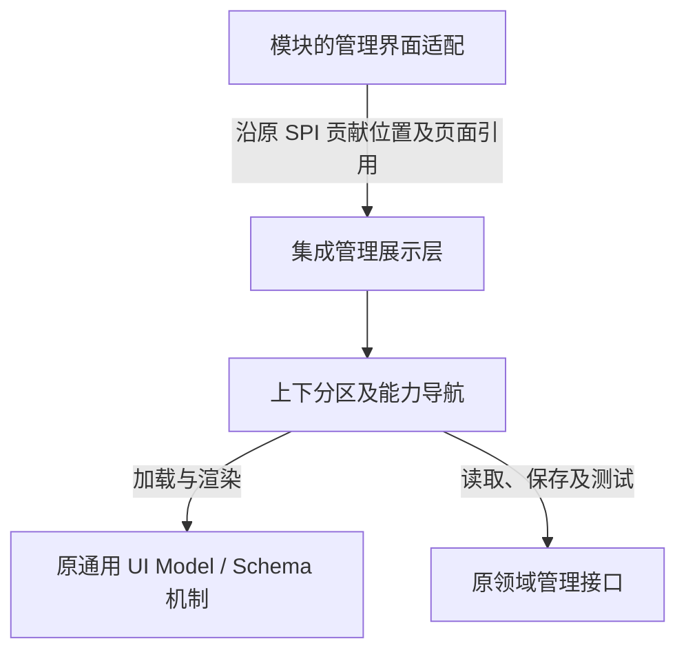

契约与组合逻辑均归集成管理展示层；宿主和管理界面适配依赖该契约，业务 core、供应商协议基础、原领域 SPI 和通用 UI 模块不依赖它或宿主实现。适配随对应管理/展示部分交付，实际 JAR 粒度依据 §5.4 的最小装配确定，不机械新增每家供应商 UI 包或整套 core/runtime/all。纯业务装配不因界面贡献被迫带入整个管理宿主。

贡献者沿现有 Java SPI/AutoConfiguration 注册和加载，安装后重启生效。宿主消费界面贡献，再按引用通过原通用机制加载页面/Schema；不改造 `UIModelProvider` 或 `UIRouteServiceImpl` 来理解集成业务。仅正式独立页面注册 UI Model，内嵌片段保留 Schema 引用；菜单和权限仍按原机制处理。

界面贡献回答“管理界面放在哪里”，业务 provider/channel/RPC 仍是实现发现与能力可用性的权威来源。贡献接口只引用正式类型标识及页面，不复制连接、凭据、配置或启用状态，不建立第二份业务插件目录；配置读取、校验、保存、测试及权限继续由原领域接口执行。贡献标识和单一编辑位置冲突须明确诊断，原页面合法覆盖规则保持。该接口不附带插件安装表、可变全局 Registry、热加载或新生命周期框架。

#### 9.4.2 分区加载、配置接管与页面数据边界（已实现）

两个区域及其子页独立授权、加载和提交。现有应用接入 Schema 最外层会请求 `/api/sys/auth-clients`，该请求不能成为整个集成管理页面的加载前提。有外部连接权限时，上方独立可用；下方无权或未安装 OIDC 模块时保留区域位置并给简短说明，不请求不可访问的数据。只有授权服务器设置权的用户也不需要先读取客户端列表。单个领域的 403/404 不阻断其他已授权区域，服务端仍逐对象、字段和操作校验原范围及 Permit/Deny。

配置接管按 key 及其拥有者逐项完成：

| 配置 key | 专用管理归属 |
|---|---|
| `security.auth.externalAuth` | 上方各身份源及登录公共设置 |
| `enterprise.connections` | 对应企业连接的基础信息、凭据引用及登录配置 |
| `security.auth.oauth2.clients` | 下方应用列表及详情 |
| `security.auth.oauth2.settings` | 下方授权服务器设置 |
| `security.auth.oauth2.registration` | 下方 DCR 策略，凭证签发/吊销仍走原命令 |

通知及其他领域的相关配置沿各自原 key 和策略核对，不复制进连接。A1 已补授权服务器设置独立页和接管元数据。`managementEntry` 在现有工作台的行为是排除该项的编辑、详情和统计，并不自动生成跳转；旧页面路由只导航至同一编辑入口，确需保留的快捷链接单独声明。

页面分别编辑不改变底层保存单位。多个身份源或连接共用一个配置 key 时，沿原管理策略、事务与 revision/CAS 实施必要的局部受控变更，保全未编辑成员及缺失插件的未知配置。冲突保留输入并要求核对，不按当前页面字段重建整个数组，也不因其他对象保存而丢弃未知项。基础配置、凭据、启停和业务测试分别授权；不增加跨领域“保存全部”事务或任意 JSON 写入旁路。通知 `configurationGroups` 只说明配置来源，不授予整组读取或编辑权限。

原 `/api/ui-schema` 允许匿名读取，其响应只提供不含受控数据的页面结构；实际配置值、可管理对象、状态和权限投影通过原受控接口加载，敏感响应沿原禁止缓存规则处理。不能将用户相关数据或秘密写入共享 Schema 缓存，也不为本次整合修改全平台 Schema 认证合同。企业能力页显式向业务 API 传递 `connectionId`；确需按对象生成 Schema 时使用现有 `schemaApi` 显式传参，在受控读取处重新校验对象、provider 及权限，不能信任查询参数。无需新增供应商专用 renderer。

### 9.5 模块树、权限项、菜单与路由同步迁移

现有模块树根节点和菜单均为 `systemSetting.authClients`，菜单、UI Model 和 `managementEntry` 指向 `/system-setting/auth-clients`；客户端管理权限由 `ClientManagementAccess` 的常量参与服务端校验。实施必须同时更新这些正式引用，不能只改页面标题。

目标模块树为“系统设置 → 基础配置 → 集成管理”，其下按“外部连接”“应用接入”组织管理能力与权限；主菜单只提供一个“集成管理”入口，打开上述上下分区页面。子模块用于能力及授权分组，不另外增加两个重复的主菜单入口。

宿主贡献根菜单和公共分组，领域模块贡献所属子节点、Authority 和页面引用；供应商不重复声明根菜单。界面贡献不授予领域权限，通知模板、组织、RPC 和审批完整管理仍沿原入口及原授权执行。

模块树、权限项和菜单的调整属于已有平台元数据及授权管理的迁移，不新增名为“模块与权限”的页面、菜单或授权管理器；管理员仍在原模块/权限管理入口维护授权。计划标识如下：

| 对象 | 当前标识 | 目标标识与归属 |
|---|---|---|
| 主模块、主菜单 | `systemSetting.authClients` | `systemSetting.integrationManagement`，标题“集成管理” |
| 外部连接分组 | 无统一节点 | `systemSetting.integrationManagement.connections`，标题“外部连接”，各连接/领域模块贡献所属权限 |
| 应用接入分组 | 原根节点承接客户端管理 | `systemSetting.integrationManagement.applications`，标题“应用接入” |
| 应用安全管理权限 | `systemSetting.authClients.security` | `systemSetting.integrationManagement.applications.security`，标题“应用接入安全管理” |
| 按范围维护应用的权限 | `systemSetting.authClients.manage` | `systemSetting.integrationManagement.applications.manage`，标题“应用接入配置管理” |
| 授权服务器设置节点及权限 | `systemSetting.authServer.settings` | `systemSetting.integrationManagement.applications.authServer.settings`，归属应用接入 |
| 页面路由、UI Model、配置专用管理入口 | `/system-setting/auth-clients` | `/system-setting/integration-management`；旧页面入口仅导航到新入口 |

同步范围包括 AppModule 元数据的 `fullName/parent/authorities/menu`，菜单及 Authority 的 `menuItems/uiViews`，UI Model/schema 的路径与文案，配置元数据的 `managementEntry`，以及服务端权限常量、校验、相关测试与当前说明。原 `/api/sys/auth-clients` 等领域 API、动态配置键和 OAuth 协议路径不因管理入口改名而重命名。

已有角色授权和引用这些权限名的授权边界必须通过原 RBAC/领域管理机制迁移，保留 Permit/Deny、客户端范围、字段限制、可授权权限上限及不可委托属性；不能用旧权限自动换取覆盖整个集成管理的更大权限。外部连接各能力沿自己的受控授权，不继承应用接入权限。页面按服务端可访问能力展示各区域与操作，不把可进入主菜单当作可管理所有连接或应用。切换后只保留一套活动权限标识和编辑入口，不靠长期双权限别名维持两条管理路径。

发布顺序、维护窗口、角色差异核对及并发修改后的回退建议见 §18.4.2；入口改名与凭据/连接数据迁移分批进行。

### 9.6 集成管理操作权限（增加权限项已确认）

在原 AppModule/Authority/RBAC 机制下增加以下操作权限，不新增授权系统。表中标识为目标设计，统一位于 `systemSetting.integrationManagement.connections` 下；公共连接操作由公共模块贡献，目录、通知、RPC 等权限随所属模块贡献，模块未安装时不出现可执行入口。

| 权限后缀 | 展示名称 | 服务端控制范围 |
|---|---|---|
| `.view` | 查看外部连接 | 读取脱敏连接、配置状态及诊断；不能读取密钥或任意业务正文 |
| `.configure` | 配置外部连接 | 修改基础非敏感参数，不能借保存隐式换密钥或改变启停状态 |
| `.credentials.rotate` | 管理连接凭据 | 受控新增、替换、清除凭据；仍执行引用和身份校验，不提供原文读取 |
| `.verify` | 检查连接 | 执行明确的非业务写入检查；真实发消息/写 API 不归此权限 |
| `.toggle` | 启用或停用连接 | 控制整个连接的可用开关，停用遵循 §9.7 的警告确认 |
| `.login.configure` | 配置企业登录 | 配置该连接的登录及启停；不影响目录、通知或 RPC |
| `.login.settings` | 配置外部登录公共设置 | 管理跨身份源的公开回调地址、认证超时和绑定设置；不能由单个应用管理权限获得 |
| `.directory.manage` | 管理部门成员关联 | 维护绑定、同步范围、字段及同步启停；同时受原组织管理范围约束 |
| `.directory.sync` | 执行组织同步 | 执行预览、确认应用及重跑；写入仍校验部门/员工/任职的原权限 |
| `.notification.configure` | 配置企业通知 | 配置渠道接入参数；不授予模板内容、模板渠道集合的编辑权限或全部发送内容的查看权限 |
| `.notification.test` | 测试企业通知 | 向受控收件人发送测试，继续执行内容、地址和业务资格校验 |
| `.workbench.configure` | 配置工作台入口 | 关联可管理的业务应用及受控页面，不允许任意回跳地址 |
| `.rpc.test` | 测试企业 API | 进入集成页测试操作；还必须通过原 RPC 模型执行权限、连接使用权及实际业务操作授权 |

读取、保存、检查和测试分别在对应服务端受控入口校验，不能只禁用页面按钮。修改同一对象的不同类别字段须逐项校验；配置权限不能夹带凭据替换、启停或业务调用。领域已有独立权限时继续执行原校验，例如通知重试和审批操作不因进入集成页而获得授权。自助绑定平台账号密码属于原认证流程，不要求普通员工持有上述管理员权限。

“应用接入”继续使用 §9.5 迁移后的应用安全、按范围管理及授权服务器设置权限；DCR 仍按原安全管理权限控制。旧应用权限不映射为新的外部连接操作权限。管理员在原权限管理入口分配新增项，各插件不能默认授予所有角色；沿原组织/客户端范围及 Permit/Deny 规则执行。

用户第三方登录的查看和解绑归原 `systemSetting.userManagement` 权限及用户管理入口，两条管理员 API 已有权限登记。外部连接配置权和应用接入管理权不授予该能力；本期不在集成管理下重复注册同用途权限，界面和直接请求均沿原授权链验证。

### 9.7 停用时警告并确认，未完成业务由管理员负责（已确认）

点击“停用”先弹出警告，确认后通过原配置受控命令和 revision/CAS 生效；有未完成引用也不阻止停用，不要求先完成引用扫描或清空在途业务。取消不产生变更；服务端校验相应操作权限并审计操作者、对象、变更及确认行为。

整连接停用的警告文案应明确：

> 停用后，该连接的登录、目录同步、通知、工作台入口及 API 调用将停止，未完成通知和审批可能无法继续处理。系统不会自动迁移、撤销或补发相关业务，请自行核对并处理。已经发出的请求无法撤回。是否确认停用？

只停用某项能力时，警告只描述该项影响，其他能力继续按原设置工作。整连接停用后拒绝新的出站调用和新业务回调处理；回调按供应商失败协议响应，不能成功 ACK 后丢弃。已经放行的 HTTP 请求允许按原截止时间结束，不能承诺远端副作用已撤销；已经持久化的业务记录和关联保留。关闭企业登录不主动撤销已签发的平台会话，会话仍按安全模块原生命周期处理，界面说明这一点。

新建连接保存后由管理员显式启用；已有连接迁移保留原有效启用语义。保存执行原 schema/凭据校验，远程检查独立提供；无需增加统一“已配置→已验证→已激活”的持久状态机。整体开关需在原连接 schema、受控保存和各使用端正式读取链路补齐；当前仅有 `auth.enabled`，不能以它冒充整个连接停用。

停用后不新增自动排空、收尾、补偿、迁移或跨连接改投机制，也不删除密钥、历史和业务记录。重新启用不表示批准补发积压；未完成计划、结果未知请求及在途审批由管理员在原领域入口核对和处理。删除连接、清除仍被引用的凭据、换企业/应用和卸载插件仍执行各自数据完整性检查，不能将“允许停用”解释为允许破坏引用。

## 10. 一致性和故障恢复

| 场景 | 正确行为 |
|---|---|
| token 获取失败 | Connector 返回确定失败；领域 fact 保持可重试或 DEAD，不伪造业务成功 |
| 写请求 read timeout | 标为 `UNKNOWN`；先查远端、等 callback 或人工核对，不盲重放 |
| callback 重复或部分插件受理后重投 | 每个匹配插件沿原领域受理/幂等机制去重；相同事件身份但摘要冲突拒绝，同步命令按原动作事实返回相同结果 |
| callback 乱序 | 统一入口保留可信事件时间；领域用自己的 revision/状态机拒绝旧事实覆盖新事实 |
| 身份映射缺失 | 进入 `UNRESOLVED`/人工处理；不把外部字符串当 `userIdentity` |
| connection revision 改变 | 新 mapping 必须重新验证；旧 binding 保留固定 mapping version；停用时按 §9.7 阻止后续调用，未完成业务由管理员处理 |
| provider 不支持更新 | 激活时拒绝相应 capability；不得 create 成功后让 update no-op |
| 待办投递失败 | 不回滚业务源；work-item outbound fact 重试/对账 |
| 外部流程回调处理崩溃 | ACK 前由供应商按协议重投，审批插件幂等受理；ACK 后沿原审批 inbox/worker 恢复，action fact 保证业务动作不重复 |
| 组织分页中途失败 | checkpoint 保留当前固定窗口和 cursor，成功耗尽后才推进 watermark |

## 11. 安全与审计

- secret、access token、refresh token、callback AES key 和完整敏感 payload 不得进入配置普通值、领域表或日志。
- 回调先验签后解析业务字段；验证失败不进入领域 handler，但写安全审计摘要。
- 管理连接、查看健康、激活领域 mapping、人工重试和处理 DEAD/UNKNOWN 使用独立权限。
- 所有外部动作审计包含当前平台 principal、外部 identity key、connectionId、domain fact ID、operationId 和脱敏 provider request ID。
- 外部身份映射的人工变更必须审计 before/after，并重新处理关联的 `UNRESOLVED` 记录。
- payload 持久化使用最小字段和明确 retention；必须保存原文时使用受控加密或对象引用。
- provider 返回的 URL、文件名、文本和错误消息都是不可信输入，展示前转义，跳转前校验 scheme/host 或转换为受控 route。

各类数据的拥有域、建议保留期、清理/导出权限和去重事实保全见 §18.4.3；管理操作日志沿原 `ouroboros-business-log`，不新增独立审计中心。

## 12. 可观测性

统一维度：

```text
provider, connectionId, connectionRevision, facetType,
domain, operation, operationId, eventFactId, mappingVersion,
localObjectId, externalObjectId, providerErrorCode, retryCount
```

指标至少包括：

- 连接/token 获取成功率、刷新次数和耗时；
- provider 调用按 operation 的成功、确定失败、UNKNOWN 和限流数；
- callback 验签失败、忽略摘要、各插件持久受理失败和处理延迟；业务 inbox 的 retry/DEAD 沿原领域观测；
- 身份映射缺失/冲突数量；
- 各领域 outbox backlog、最老事件年龄和对账差异；
- mapping 因 scope/schema 漂移进入重新验证的数量。

日志只记录脱敏摘要，不能记录 credential、token、完整表单、完整通讯录或通知 payload。

配额共享、多节点预算、限流退避、积压释放和到期清理告警的建议见 §18.4.3。

## 13. 测试策略

### 13.1 架构测试

- ArchUnit 验证 domain core 不依赖 Connector/provider 实现。
- Connector core 不依赖 work-item、approval、notification、organization 或 app runtime。
- provider facet 同时依赖领域端口和对应 provider base，不依赖其他 facet。
- 仅企业登录或通知的装配不加载审批 runtime；仅应用接入不加载三家企业协议实现；公共连接目录不依赖审批 provider。
- 组织侧适配实现原账号成员解析端口且只有一个有效实现；无 User 的 Employee 地址可独立解析，通知内容仍执行原授权规则。
- 新增企业渠道不修改宿主渠道分支；RPC 企业凭据适配单向使用共享访问基础，底座不依赖企业 API 包。
- SPI service file 和 AutoConfiguration imports 均可发现，重复 provider/facet ID 启动失败。
- §5.4 的关键组合以实际缺少无关 JAR 的 classpath 验证启动与领域行为；全量产品仍发现原能力，不能以完整 classpath 的开关测试代替。
- 通知地址迁移保留原非企业渠道行为并解除 AppRuntime 对 channel-all 的强制编译依赖；API 组仍由原 RPC 元数据机制加载，不新增逐 API Registry/starter。
- §7.8.2 沿原 RPC 链路验证正常/嵌套/测试的连接授权与版本、API/令牌/最终目标匹配、类型及编辑校验同步和缺失插件诊断；覆盖篡改 URL/认证引用、业务参数伪造、无权测试、共享缓存及无可选 mask 时的强制脱敏。定义发现和安装不请求远程 token。
- §9.2 的保存、诊断检查、启停和业务执行各走所属受控入口；检查失败不隐式停用无关能力，执行仍检查当前权限/目标/凭据。原审批版本化映射和通知冻结计划保持自身语义，不因页面组合增加通用激活实体或跨领域版本生命周期。
- 原 SPI/容器装配在关闭、重建及元数据刷新后不继续使用旧容器的可变服务；枚举能力不请求 token，领域扫描和 worker 不随公共/provider 基础加载。原优先级合同与新增唯一性规则分别验证。
- 集成管理界面贡献沿原 SPI 装配并引用原页面/Schema，新增贡献无需修改宿主供应商清单；UI Model、通用路由投影和业务 core 不引入集成展示契约或专用字段，纯业务装配不被迫带入管理宿主。
- 工作区仅有外部连接权、应用范围管理权或授权服务器设置权时分别可用，受限子页不阻断其他区域；逐 key 接管保持单一编辑链路和 CAS，未编辑及缺失插件配置保全，匿名 Schema/共享缓存不含受控数据。
- 统一回调入口不依赖审批实现；协议插件及业务关注声明沿原发现机制注册，重复订阅身份、协议或同步 handler 冲突明确失败；只安装登录、出站通知或 RPC 不要求事件表或审批 worker。

### 13.2 Connector contract

- connection scope、revision 以及已删除的公共历史字段（含 `options`）fail-closed；
- typed credential 不出现在序列化和日志中；
- 同 connection、token 种类及凭据代次的进程内并发刷新合并，不同种类/代次隔离，旧版本晚到不覆盖新版本；
- connect/read/deadline 均有界；
- 401 重放、限流和 timeout 按副作用确定性分类；
- 连接/凭据组合读取和 CAS、不混用版本、托管 resolver 贡献与冲突处理；
- RPC 开启重试仍拒绝未知写重放，HTTP 2xx 业务错误被正确解释，调用者不能覆盖安全约束；
- callback 验签、解密、GET/POST challenge、时间窗、nonce、连接归属及插件事件匹配；
- 异步事件全部匹配插件持久受理后 ACK；部分受理失败重投、批量事件、同 ID 异内容冲突、无订阅通知及未知命令分别验证；
- 同步命令沿领域 action fact、单 handler 及 deadline 处理；验证失败不进入业务插件，停用及插件缺失不能成功确认后丢弃；
- identity mapping 成功、缺失、冲突、撤销和跨 connection 隔离。

### 13.3 领域 Adapter contract

每个声明 capability 必须由 fake HTTP server/SDK fake 观察到真实远端副作用：

- 路径、方法、headers、body、响应解析和错误码分类；
- unsupported 端口在远端调用前拒绝；
- no-op success 视为测试失败；
- 同一 operationId/revision 重放不会产生第二个领域事实；
- timeout 后进入 UNKNOWN，只有 recovery/官方幂等合同存在时才自动恢复；
- callback 转换后的动作仍由领域权限和 revision 二次校验。

### 13.4 跨领域场景

1. 本地审批产生工作项，待办中心投递钉钉；外部快捷操作回到审批源，仅完成一次并关闭外部待办。
2. 飞书外部流程产生审批任务，经审批规范事件进入本地待办；本地点击 LINK/受支持动作回到审批 external adapter。
3. 一个 connection 同时用于通知和待办，token 可共享，但两个领域的 delivery 状态互不影响。
4. 用户离职导致组织和 identity binding 变化，新的待办/通知拒绝错误收件人，历史事实保持可审计。
5. callback 部分插件持久受理后进程崩溃，按供应商协议重投时去重并补齐受理；全部受理且 ACK 后沿原领域任务恢复，业务动作不重复。

真实租户 live contract 只验证文档和 fake 无法证明的权限 scope、真实 callback 字段和远端超时结果；没有 live 证据的未知能力保持关闭，不阻塞其他已由官方合同和本地 contract 证明的能力。

## 14. 实施顺序

实施按交付批次判断准备程度，不要求整份方案所有接口、业务细则及发布参数全部冻结后才能开工。以下阶段表达依赖关系；用户第三方登录管理和已有配置入口整合可先交付，后续能力按各自前提接入。

| 批次 | 可实施范围 | 该批次开始前明确什么 |
|---|---|---|
| A0：管理员第三方登录管理 | 原用户详情增加查看、确认解绑；复用已有 API、绑定服务和用户管理权限 | 已无待确认的业务取舍；按 §6.3.1 明确页面字段、确认提示及授权/记录归属/索引清理验收 |
| A1：整合已有配置入口 | 集成管理上下分区；先接原登录设置、应用列表、授权服务器设置和 DCR，完成相应元数据/权限迁移 | 在该任务开头确定展示贡献最小签名、物理归属及本批迁移清单；使用原配置、命令与生效机制，不等待新增企业能力 |
| B：共享访问基础与业务回调 | 按实际消费者提取连接、凭据和应用 token；统一回调接原审批受理机制 | 分别收口公共 Provider/配置一致读取/凭据合同，以及协议验证/订阅/受理返回合同；不扩大为通用生命周期或事件平台 |
| C：各领域能力增量 | 部门成员绑定与单向同步、三家通知、工作台访问、按需 RPC 包 | 在对应任务开始前细化该领域的业务规则、供应商字段/权限及最小接口；只依赖实际需要的 B 批成果 |

A0 可独立开工。A1 不等待组织同步、通知资格或首批 RPC API 清单，且其验收必须覆盖当前所用的权限迁移和单一编辑入口；不把这些检查全部拖到最终发布。需要新托管凭据格式或供应商协议变化的界面随 B/C 实施，不在 A1 暂建另一套存储或校验。§18 中仍列为建议的业务细则保持待定状态，只约束涉及它们的任务，不能因调整实施顺序视为已经获批。

### Phase 0：按批次收口最小合同

- 按 §2.1 锁定范围，明确组织关联、登录绑定、成员 ID 与通知地址的区别。
- 核对每个平台的应用类型、权限、实际端口和真实租户门槛；不以产品功能推断应用 API 可用。
- 按 §9.3–§9.5 已确认的布局和装配边界实施统一工作区；字段布局、展示贡献最小签名及实际迁移清单在相应任务开始时细化，不等待所有企业能力界面齐备。
- 补齐本批涉及的 §18 跨模块合同和业务取舍；以实际复用需要确定公共层最小拆分，不按长期结构图一次建设全部模块、回调平台或插件框架。
- 按 §2.4 已确认的自建应用范围补齐三平台适配，收口 §2.2 的方案证据和最小共性表单；本期作用域按 §2.3 固定为部署级。启停按 §9.7 的警告确认规则、权限按 §9.6 的新增项实施，不再建设统一能力状态机。

### Phase 1：复用连接、身份解析与 RPC 装配

- 从审批语境提取实际复用的连接、凭据、应用级 token/client 基础；复用现有连接快照及正式 Provider 发现。
- 为组织拥有的成员关联接通单一正式身份解析链路，区分登录证明与目录关联；登录就绪不再以审批就绪为前提，保留企业归属等认证校验。
- 在原用户详情补齐第三方登录查看、解绑及确认提示，复用已有管理员 API、用户管理权限和绑定服务；关系核对及纠正由管理员负责。
- 扩展原 RPC 凭据 SPI 承接企业渠道唯一连接解析、权限与 token 隔离；JAR 加载继续使用原 RPC 元数据机制。
- 按 §6.4 从现有回调实现提取统一业务入口、供应商协议插件和业务事件关注声明，先接通审批插件的原 receipt/inbox；不等待第二个领域才统一入口，也不预建公共事件表、通用重试 worker 或全量传输设施。外部 URL 切换及旧入口退出纳入迁移。

### Phase 2：交付 API 包、目录绑定/同步与通知

- 按实际需要交付通讯录、消息等 API 能力组，保持接口定义和企业连接分离。
- 先支持绑定已有 Department/Employee，再增加选择范围内的单向同步；共用组织关联，明确字段、变动和冲突规则。
- 保留 NotificationAdapter/模板/分发/投递合同；增加企微、飞书渠道，钉钉迁移到共享连接及成员解析。
- 迁移现有企业通知地址时核对连接作用域；完成切换后清理重复凭据、token 获取及地址事实。

### Phase 3：工作台入口与现有认证/审批结果链路

- 关联企业连接、目标应用与页面，先用供应商后台配置入口 URL，逐家验证工作台访问和所需登录模式。
- connection-scoped OAuth registration 及三平台 provider 代码已有实现；企业微信自建应用免登等缺失形态需要专项适配，不重复建设账号和会话机制。
- 三个真实审批适配器继续以 RESULT_ONLY 为基础，补齐必要的订阅维护、已发起实例状态核对及异常恢复；本期不承诺全过程代理动作。

### 配置工作区：方案确认后按模块接入

统一工作区可先接入现有登录设置、接入应用及企业连接；目录、通知、工作台入口和 RPC 管理描述随相应模块完成后接入，无需等待所有业务能力齐备。已有配置值、权限、并发与生效机制保持各自权威来源，入口迁移后不产生双写。

### 独立后续能力：待办与入口自动发布

统一待办中心、外部投递/动作回源、自动发布工作台入口需单独确认需求。后续建设待办时沿 §7.1 的业务源与中心投影设计推进，按真实 API 区分钉钉待办、飞书 Task/三方审批和企业微信受限能力，不恢复已删除的审批 MIRROR。

## 15. 验收标准

1. 新供应商/渠道/RPC 包沿正式 SPI、AutoConfiguration 和元数据装配；新增渠道无需修改宿主固定清单，安装后重启可发现。
2. 同一连接在多个领域使用时复用适用的应用级 token/client/成员关系，业务状态独立；用户登录 token 与应用 token 不混用，审批不可用不自动使登录失败。
3. 已有 Department/Employee 可独立绑定外部对象；关联启用 User 的员工无需先完成企业登录即可在内容授权通过后接收业务通知；无 User 不绕过原披露策略，目录关联不自动产生登录绑定或角色授权。
4. 绑定和单向同步使用同一稳定关联；重复同步不重复创建对象，部分可见目录不触发全量删除，冲突有明确诊断。
5. 三家通知沿原模板/分发/投递协议发送文本和业务链接；工作台入口完成所需认证及账号关联后进入目标页面，并执行原权限检查。
6. 每个 capability 均对应已实现端口、官方支持、连接 scope 和 contract test；不存在 no-op success。
7. 连接启用时，业务回调经统一入口验证，按插件关注声明分发；异步事件全部匹配插件沿原领域持久受理后才 ACK，部分受理失败可幂等重收，同步命令先持久化再由唯一 handler 执行并返回规范结果。ACK 后沿领域任务恢复，业务动作不重复；不依赖预建公共事件表。管理员停用时按 §9.7 停止后续处理，不自动承诺业务收尾。
8. timeout 后的未知副作用不会被普通 retry 重放。
9. 外部身份跨 connection 不串用，映射缺失时 fail-closed。
10. OAuth callback 不进入企业业务插件分发；业务 callback 不进入安全 OAuth controller。
11. 每个启用的 auth profile 都有 connection-scoped provider key、稳定外部 ID、scope/PKCE 声明和 contract test。
12. state、nonce、issuer、audience、签名、授权码重放和 provider bridge code 校验失败时均 fail-closed。
13. 三个平台的 connection-scoped auth profile 不写入静态 provider 配置；启用连接通过原 resolver 动态枚举，登录页和工作台共用原认证入口，同名静态配置被拒绝。真实企业门槛未通过前在发布清单记录待验，保持生产登录关闭，不引入运行时证据状态。
14. 所有持久化经 `ouroboros-data` QueryDSL API，SPI 和 AutoConfiguration 完整注册，新增代码测试覆盖率不低于项目门禁。
15. RPC 包引入后经原 Center/执行器发现和调用；首期自动解析渠道唯一企业连接，缺失/重复时拒绝；调用者不能覆盖已验证连接，权限和 token 按目标及用途隔离，同一接口定义不为每个企业复制。
16. “集成管理”首页上方外部连接按插件贡献的类型页签直接配置，下方应用接入包含应用列表、授权服务器和 DCR；三家企业渠道各接一个企业，通用身份源沿原连接规则；DCR 管理权限及客户端来源信息保留，保存仍走原领域/统一配置的受控命令。
17. 模块树、权限项、菜单、路由、UI Model 与配置专用入口同步迁移，已有授权及范围限制保持原语义；按范围管理应用者不能因入口合并获得外部连接或全局设置权限。
18. 不新增“模块与权限”和“通知模板”管理入口；企业通知复用原多渠道模板，连接页相关模板列表为只读投影，不保存默认模板或新绑定；配置连接不会自动给模板增加渠道，原业务模板及发送渠道选择保持有效。
19. 凭据替换、组织同步、通知重试、RPC 调用和入口回跳分别满足 §18 中对应的业务规则及场景验证；界面原型中的字段、检查成功和演示操作不作为实现证据。
20. 按 §6.2 的托管凭据合同，数据库只存密文，管理及执行投影不泄露原文；连接/凭据批量 CAS 任一失败均回滚；两节点在轮换、事件丢失和旧刷新晚到场景下不为新调用继续选旧版本；数据库不可读时拒绝新调用。
21. 按 §7.5 的同步合同，验证主来源重叠冲突、多渠道绑定同一员工、默认岗位/多任职、分页失败、缺失待核对、离职及任务重跑，且 User/角色不被同步器隐式修改。
22. 三个平台的每项初始能力在方案/验收材料中都有 `SUPPORTED/UNSUPPORTED/TENANT_BLOCKED` 标记、权限 scope、schema 和验证证据；这三个标记不进入业务代码、连接配置或运行时枚举。能力状态、连接作用域和管理操作权限由服务端依据已装配能力和实际检查统一判定，页面只展示投影。
23. 停用先警告、取消无写入、确认后生效；未完成业务不阻止停用，由管理员处理。只关闭登录不影响其他能力；整体停用后禁止新的调用和业务回调处理，保留历史，不自动收尾或改投。模块/JAR 升级、缺失、回滚不静默删除配置或扩大权限，不增加统一能力状态枚举。
24. 本期连接、凭据及相关组织关联、通知计划、RPC 执行、缓存、回调和审计按部署级语义协同工作；未来租户化由平台统一透明方案承接，本期不预建集成专属的租户解析层、字段、参数或切换开关。
25. 按 §18.4.1–§18.4.3 验证包升级/回滚和缺失插件保全、带并发修改的权限迁移回退、数据到期清理与幂等记录保全，以及多节点限额总预算；限流排队、可安全重试的失败和结果未知的写请求分别处理。
26. §9.6 新增权限通过原 AppModule/Authority 注册，服务端逐操作授权；无权角色不能通过直接请求换密钥、启停、同步或测试。应用接入的范围管理权限不扩大为外部连接权限，RPC 测试和目录同步仍执行原领域授权。
27. 未绑定用户先完成企业身份验证，再输入平台账号密码绑定；错误凭据、停用连接、无效上下文及绑定冲突被拒绝，已绑定用户无需重复输入；工作台目标在绑定后恢复且重新执行应用权限检查。自建与第三方表单严格对应真实 provider 实现，不通过字段改名转换协议。
28. 企业 RPC 认证遵循 §7.8.1–§7.8.2：模型编辑权不代替凭据使用权，API/令牌/最终目标相符；正常、嵌套及测试调用的可信资源一致受控，新类型可随模块配置、检查和执行；真实测试明确目标/效果，临时配置不改正式身份及密钥，日志和测试证据不依赖可选 mask 即能隐藏凭据。
29. 保存、检查和启停分开，领域沿 §9.2 保留原生效机制；审批保留自身校验/激活和绑定版本，其他能力不被要求建立通用 mapping/激活状态机。单次健康结果不替代运行授权，某项失败不隐式停用无关能力；同一应用密钥轮换不强制发布全部业务配置。
30. 管理员可在原用户详情查看并确认解绑指定第三方登录；无用户管理权限及跨用户记录操作被拒绝，删除同步清理对应成员索引并记录审计。用户可沿原认证和账号密码流程重新绑定；不自动关联新企业身份，不级联删除组织关系，不以旧关系回退恢复已撤销的业务成员地址。

### 15.1 本地验证与发布待验

2026-11-16 至 17 日在 `feat/ent-integration` worktree 完成本地验证及正式前后端补验。以下为不同范围的独立检查，测试存在重叠，不相加作为唯一用例总数。

| 检查范围 | 结果与证据边界 | 本地证据文件（`tmp/testing-evidence/`） |
|---|---|---|
| 完整 reactor 编译 | 300 个模块 clean/test-compile 成功；补齐诊断及 RPC 入口后再次完整 test-compile 成功，包含所有生产与测试源码；未执行全仓测试 | `enterprise-full-reactor-compile.log`、`enterprise-full-reactor-compile-final.log`、`enterprise-completion-audit-compile.log` |
| 架构门禁 | 补齐后重验，扫描 220 个生产模块，66 项通过；真实页面装配修复后再次通过 | `enterprise-architecture-gate-final.log`、`enterprise-completion-audit-architecture.log`、`enterprise-live-final-gates.log` |
| 新模块当前源码 | 原基线为 47 类、268 项；补齐后 48 类、279 项通过；仿真修复后重验 48 类、280 项通过，无跳过 | `enterprise-current-module-tests.log`、`enterprise-completion-audit-module-tests.log`、`enterprise-simulation/new-module-regression.log` |
| 诊断与 RPC 入口回归 | 18 类、87 项通过；覆盖正式菜单/权限树、三家 token、诊断及管理 Schema、企业 RPC 与原 RPC 管理，不扩大说明页授权 | `enterprise-completion-audit-regression.log` |
| 跨能力回归 | 311 项中 310 通过、1 项 MySQL 迁移用例因首次无数据库而跳过；该迁移用例随后已在隔离 MySQL 实际通过 | `enterprise-governance-combined-regression.log`、`enterprise-mysql-component-tests.log` |
| 生产 Schema 浏览器 | 原基线 17 项；补齐后 20 项通过，新增诊断成功/失败的草稿隔离和 RPC 原入口跳转。使用真实 Amis 与网络夹具，含管理员解绑、分区权限、连接双版本、预算隔离和孤立凭据确认 | `enterprise-workspace-browser-final.log`、`enterprise-completion-audit-browser.log` |
| 隔离 MySQL 8.3 组件 | 88 项中 87 通过、1 项 Redis 用例跳过；目录约束/事务/清理、通知增量迁移/可靠投递/清理均实际运行，Redis 用例在下一项补验 | `enterprise-mysql-component-tests.log` |
| MySQL 8.3 + Redis 7 | 配置持久化 4 项通过、无跳过；包括双 Spring 容器共享缓存、第二配置项 CAS 失败时整笔回滚与版本保全 | `enterprise-mysql-redis-configuration-tests.log` |
| 配置加锁版本回归 | 加锁读取保留完整 generation/revision 的数据库用例先失败、修复后通过；隔离 MySQL/Redis 中配置组件、管理权限及持久化共 38 项通过、无跳过 | `enterprise-http-lock-revision-red.log`、`enterprise-http-lock-revision-green.log`、`enterprise-http-configuration-mysql-regression.log` |
| 真实 HTTP / RBAC / MySQL | 8 个场景通过；正式 Mothership 登录和角色 API 创建受限账号，验证双版本并发换密钥恰一成功、拒绝后版本保全、预算独立保存及各操作权限。不替换过滤器/权限/持久化，测试连接保持停用 | `enterprise-http-acceptance-green.log`；逐请求证据 `enterprise-http/enterprise-management-http.jsonl` |
| 正式前后端页面 | 3 个场景通过，无请求夹具；目录/通知/工作台页实际加载，原管理 GET 接口成功，同页连续两次换密钥成功且清空输入，真实只读角色无修改操作且不请求应用列表。生产前端构建成功，有一条 Amis 依赖样式的 Autoprefixer 警告 | `enterprise-http-browser.log`、`enterprise-http-frontend-build.log`；状态和截图位于 `enterprise-http/` |
| 正式配置页面与非空应用范围 | 另 4 个场景通过，无请求夹具；受限角色在生产页面保存停用 LDAP、连续保存授权服务器有效期和关闭状态的 DCR 限额；两个真实应用中仅可编辑范围内应用的授权字段。范围外读取 404、越权修改 403，拒绝后版本及数据不变；结束恢复原配置 | `enterprise-workspace-settings-browser.log`；状态及四份截图位于 `enterprise-workspace-settings/` |
| 页面装配回归 | 原 Schema Provider 加载三份管理页的 3 项用例先失败、修复后通过；页面/菜单相关定向 38 项及后续工作台定向 12 项通过，包含重叠；正式 Mothership 及依赖重新打包成功，20 项组件浏览器回归通过 | `enterprise-schema-assembly-red.log`、`enterprise-schema-assembly-green.log`、`enterprise-workbench-assembly-green.log`、`enterprise-schema-browser-regression.log` |
| 审批原持久受理与恢复 | 隔离 MySQL 中 15 个唯一用例通过、无跳过；Surefire 和原 `mysql-integration` Failsafe profile 各执行一次，不计作 30 个用例。定向运行关闭 JaCoCo，新增模块覆盖门禁见本表独立检查 | `enterprise-mysql-callback-tests.log` |
| 原通知渠道组合 | 9 个渠道发现、40 个管理行为检查和 6 个凭据策略匿名读取拒绝均通过 | `enterprise-notification-channel-scenario.log` |
| 新模块行覆盖率 | 补齐后重新合并执行数据并实际 report/check；16 个新增 Java 模块均达到 70%，范围 81.1%–100%，无 class 数据不匹配；真实页面修复后已重新合并并检查。不代表所有存量模块全量覆盖率达标 | `enterprise-coverage-check-final.log`、`enterprise-completion-audit-coverage.log`、`enterprise-live-final-gates.log`；报告位于 `tmp/enterprise-integration/coverage/` |
| 本次完整仿真 | 独立 HTTPS 仿真三家外部服务；两个正式 Mothership 进程共享专用 MySQL 8.3/Redis 7。19 个编排阶段全部通过并清理，覆盖登录/绑定及管理员解绑、分页目录、通知、RPC、回调、权限、预算、跨节点轮换/停用、数据库暂停/恢复、主密钥重加密、移除旧 key 后实际重启及持久状态恢复 | `enterprise-simulation/` 下的 `summary.json`、`internal-mechanisms.jsonl`、`run-*.log`、`persistent-*.json` |
| 仿真缺陷回归 | 安全/连接/通知相关 8 类、60 项通过，无跳过；配置版本修复后 5 类、42 项中 41 通过，1 项需要单独 Redis 端口的旧组件用例跳过，其已有独立通过证据，本次正式双节点也实际共用 Redis | `enterprise-simulation/` 下的 `final-component-regression.log`、`configuration-regression.log`；修复前后证据另存于同目录 |
| 本次最终构件与门禁 | 修复后正式 Mothership 及依赖安装打包、300 模块 test-compile、66 项架构门禁通过；16 个新增 Java 模块覆盖率重新 report/check 通过，仍为 81.1%–100%；脚本语法、场景 ID、证据脱敏及自有资源清理核对通过 | `enterprise-simulation/` 下的 `formal-runtime-package.log`、`reactor-compile-current.log`、`architecture-current.log`、`coverage-current.log`、`evidence-audit.json`、`cleanup.json` |

独立模块行为、HTTP 协议合同、元数据装配和浏览器夹具分别证明各自边界。早期双 Spring 容器测试不代表多进程验证；本次仿真已另行启动两个正式后端进程并实际重启。隔离测试库的建表/增量迁移仍不等于存量生产数据切换。

真实 HTTP 与正式页面补验发现了此前组件夹具未覆盖的四类问题：配置加锁读取遗漏 `generation` 导致首次保存后持续版本冲突；分区及企业 Schema 请求未明确 GET，被 Amis 作为 POST 发出；目录、通知、工作台三份元数据缺少原加载器要求的 `name/schema` 包装；工作台的条件装配早于共享连接注册，导致接口未加载。修复分别落在原配置查询、页面请求定义、元数据包装和自动配置顺序，没有放宽版本/权限校验或增加备用加载路径。上述新证据补足这些链路，不扩大为真实企业联调通过。

本次仿真发现并修复四个原链路缺陷：企业连接认证可按 ID 解析却未被原 provider 枚举，导致工作台无法生成登录入口；待绑定凭证未实现共享 Redis 缓存需要的序列化合同；OAuth2 callback 中上游拒绝未映射为认证错误；配置批量 CAS 的前置检查不接受只读依赖版本，导致主密钥重加密被错误拒绝。修复分别落在原 resolver/Factory、缓存条目、OAuth2 provider 和配置事务中；依赖版本在原锁定快照上校验，既不伪造连接写入，也不放宽 CAS。修复前失败证据和修复后回归保留，不增加生产测试后门或第二套机制。

仿真重启后，三家凭据均已使用新主密钥且应用凭据代次不变；两个节点仍能沿原绑定登录、读取目录关系、调用 RPC 和幂等受理回调。原模板及可靠通知服务向无 User 员工发送明确批准的普通测试通知，持久 SUCCESS 不重发；远端已接收后断连的记录在新 JVM 中仍为 UNKNOWN、attempt=1，未重复外写。业务内容的披露授权仍由原业务事件组件回归独立证明。

本次以该仿真结果验收内部机制。发布前仍需核对实际差异：三家自建应用的真实凭据、scope、目录范围及终端行为；供应商后台回调和工作台地址；存量权限/配置/通知地址迁移与回退；生产节点、配额、调度和积压。仿真不被表述为供应商认证或实际生产迁移通过。复跑入口与真实发布清单见[验收手册](../../runbooks/enterprise-integration-acceptance.md)。

独立后续待办能力实施时追加验收：外部投递只经待办中心；缺少完整 API/应用权限的供应商不声明投递能力；飞书审批投影按完整聚合快照及稳定 revision 更新，通用任务使用 Task 合同。审批模块不恢复 MIRROR 第二路径。

## 16. Clean Architecture 检查

本地架构门禁已通过：扫描 220 个生产模块，66 项检查通过；完整 reactor 的 300 个模块完成 clean/test-compile。该结果证明现行门禁覆盖的依赖和结构约束，不能替代所有架构质量判断或真实部署验收。跨模块合同与发布待验项见 §18。

| 检查项 | 结果 | 依据 |
|---|---|---|
| 业务规则可脱离 DB/Web/框架测试 | 目标 | 领域端口和 aggregate/value object 位于 core |
| 源码依赖向内 | 目标 | provider facet 依赖领域端口，领域不依赖 provider |
| 数据库可替换 | 目标 | runtime 通过既有 data/QueryDSL 边界持久化 |
| Use Case 与交付机制分离 | 目标 | callback/controller 只翻译并调用领域用例 |
| 框架位于外圈 | 目标 | Spring/HTTP/SDK 仅在 runtime/provider modules |
| 组件图无环 | 本地门禁通过 | 完整 reactor 和架构门禁通过；公共连接不依赖审批 Provider，管理宿主不依赖 OIDC 服务端 |
| Composition Root 统一装配 | 本地测试通过 | 最小模块组合、正式产品元数据和双 Spring 容器测试覆盖原 AutoConfiguration/SPI 发现链；三家通知描述不静态持有容器服务 |

实施中任一行变为不满足，都应停止扩展并先修正依赖，而不是增加 bridge、静态注册表或兼容 wrapper。

复杂度复核按可核对的边界记录，不将设计阶段的合同完备度评分当作实现质量评分：

| 诊断 | 当前判断 | 补齐方式 |
|---|---|---|
| 模块职责可一句话说明 | 满足 | 连接处理协议，领域处理业务，安全处理认证 |
| 接口显著简于实现 | 已落实最小合同 | 共用连接解析、领域目录端口、原通知 Supplier 和 RPC 执行资源；不增加通用激活流程 |
| 实现变化不扩散到调用者 | 本期路径已调整 | 企业渠道贡献成员地址；共享连接退出审批注册表依赖，原渠道与领域调用继续沿正式扩展点 |
| 接口说明覆盖承诺和不变量 | 已补合同与行为测试 | 轮换、解绑、同步冲突、通知重试、RPC 安全重放及停用边界见所属章节 |
| 评审包含复杂度与复用检查 | 满足 | 按当前源码核对正式扩展点及不应新建的机制 |
| 每个模块拥有明确的决策 | 满足 | 认证、组织、通知、RPC 各自保有权威来源 |
| 无需读实现即可理解完整生命周期 | 目标 | §9.7 已明确停用确认和管理员处置边界；引用删除、卸载及迁移仍按各自合同落实 |
| 为设计改进保留投入 | 满足 | 实现前先完成合同审阅和交互原型，避免边写边叠加机制 |

## 17. 相关设计与证据

- [待办中心设计](../work-item-center.md)
- [审批工作流外部集成](../../../ability/ouroboros-approval-workflow-external-integration/docs/module-design.md)
- [通知模块设计](../modules/ability/ouroboros-notification.md)
- [组织结构模块设计](../modules/ability/ouroboros-organization-structure.md)
- [Web 安全模块设计](../../../security/DESIGN.md)
- [RPC 模型设计](../../../ability/ouroboros-rpc-model/DESIGN.md)
- [ADR-006：企业集成能力组合](../../adr/ADR-006-enterprise-integration-capability-composition.md)
- [ADR-007：集成管理分区与入口迁移](../../adr/ADR-007-integration-management-workspace.md)
- [ADR-008：企业渠道首期各接一个企业](../../adr/ADR-008-single-enterprise-per-channel.md)
- [集成边界](integration-boundaries.md)
- [Provider 模式](provider-patterns.md)
- [SPI 治理](spi-governance.md)
- [企业微信审批调研](../../references/wecom-approval-integration.md)
- [飞书审批调研](../../references/feishu-approval-integration.md)
- [钉钉审批调研](../../references/dingtalk-approval-integration.md)
- [钉钉与企业微信登录桥接官方合同核实](../../references/dingtalk-wecom-auth-bridge-contract.md)

## 18. 实施与发布验收收口

本节依据 `feat/ent-integration` 的现有源码复核。§2.1 的范围、§9 的界面分区、§0.4 的企业渠道基数及 §2.3 的部署级配置已确认。停用警告确认、增加权限项和输入平台账号密码绑定已确认，见 §9.6–§9.7、§7.4.5。G9 的证据标记仅用于方案/验收材料；G1–G4、G13–G15 已补具体建议，G7 的应用形态对齐建议见 §2.4，G5 的最小装配及其余实现/验证按下表推进。不以增加一套集成框架解决各领域缺口。

### 18.1 缺口与完成条件

| 优先级 / 编号 | 已有事实与设计缺口 | 需要补齐的合同及验证 |
|---|---|---|
| 本地已实现 / G1 凭据保存与轮换 | 原配置库中 AES-GCM 密文、托管 resolver、版本/CAS、身份校验、重加密、孤立凭据清除及发送前复核已实现并有定向测试；原配置多项事务在 MySQL 8.3 验证了后项冲突导致整笔回滚。 | 清除在原事务内检查连接标识及托管引用，停用/缺失插件仍受保护；当前不开放连接删除 API。双 Spring 容器共享 Redis 验证已通过，真实多节点轮换和恢复仍须部署演练。 |
| 本地已实现 / G2 组织关联与资料权威 | 部门/成员关联、单主来源、白名单同步、多任职、完整性校验和冲突拒绝已有本地行为与浏览器测试。 | 真实企业分页/可见范围、数据库并发及任务恢复待验；管理员负责核对存量关联，不自动创建 SSO 绑定或账号授权。 |
| 本地已实现 / G3 通知投递的连接与授权 | 三家渠道沿原 Supplier/Dispatcher 和模板装配；计划冻结连接及关系，重试前复核；原企业地址绑定旁路退出。 | 真实发送、旧钉钉配置清除及存量地址迁移待演练；无 User 不绕过原业务内容授权。连接页模板列表只读，测试仅发当前管理员的关联成员。 |
| 本地已实现 / G4 RPC 连接调用合同 | 企业应用令牌凭据、可信资源、连接固定、最终目标校验、编辑类型及强制脱敏已实现；已交付三家通讯录和消息包，原执行器已补静态安全重放合同及发请求前共享预算检查。 | 扩大正常/嵌套/测试回归。供应商 scope、真实调用和多节点配额待验，不提供同渠道多企业路由。 |
| 本地已实现 / G5 插件最小装配 | 公共连接不再依赖审批 Provider；管理宿主不依赖 OIDC，AppRuntime 已退出通知渠道全量聚合依赖；缺失插件配置受保护保全。 | 独立管理/供应商登录/目录/RPC/工作台已有装配测试，继续以实际产品闭包及架构门禁复核；缺失插件及有引用卸载须发布演练。 |
| 本地已实现 / G6 停用后业务处置 | 总开关、单独登录开关、警告确认及独立权限已实现；停用不等待在途业务。 | 确认后拒绝新调用，保留历史；删除/清除凭据和更换身份仍须数据完整性检查。真实环境在途处置由管理员验收。 |
| 本地已实现 / G7 平台形态与工作台链路 | 三家新增接入使用自建应用；企微已补自建凭据/token/网页授权，纯登录不强制业务回调材料；工作台 URL 管理已实现。 | 真实企业 redirect URI、授权撤销、客户端访问及账号密码绑定后的目标恢复待联调；本地测试不代表所有终端 JS-SDK 免登已支持。 |
| 本地已实现 / G8 配置和权限迁移 | 专用入口、模块树/菜单/权限改名、原 RBAC 等价迁移及 DCR 保全已有本地验证。 | 在维护窗口演练真实角色/范围及 Permit/Deny 迁移、并发差异和回退，保留 clientId、来源、凭证状态及配置 revision。 |

以上区分代码、本地验证和发布验收。后续优先收口仍有独立代码工作或验证缺口的项，再进行真实企业及迁移演练；不引入统一生命周期系统。

### 18.2 已确认的业务规则

1. **绑定与同步分开启用。** 默认绑定、本地维护；同一组织范围一个主同步来源，其他渠道只绑定。固定字段白名单，不建多来源合并引擎，详细建议见 §7.5。
2. **组织变化不隐式更改账号授权。** 明确离职与读取缺失分开处理，任职复用原服务，User 启停和会话仍为独立安全操作，详细建议见 §7.5。
3. **业务通知沿原内容授权。** 有启用 User 的员工不要求登录历史；没有 User 不开放本期自动化业务消息。通知冻结渠道目标、重试不改投，详细建议见 §7.3。
4. **页面凭据默认数据库托管。** 复用受保护配置项保存密文，部署密钥单独提供，版本持久化并在各节点使用前核对；不是只对输入框脱敏，详细建议见 §6.2。
5. **稳定业务身份与密钥轮换分开。** 同一企业/应用的密钥替换保留连接身份；更换企业或应用创建新连接并迁移引用。轮换如何确认企业/应用身份、何时失效以及何时重新验证，要落实到 provider 合同，不能只凭 `credentialRef` 字符串判定。
6. **原型字段逐项对照真实合同。** 类型/能力来自模块；必填字段取决于该类型实际启用的能力。原型的 Agent ID、服务区域、直接保存密钥和检查结果均为交互示意，未完成 schema/凭据/真实租户验证前不作为产品支持承诺。

这些规则不扩大本期范围。实现继续使用现有组织服务、身份解析、通知计划、RPC 执行和配置受控命令；不为界面统一另建模板中心、授权中心、token 中心或热插件运行时。

### 18.3 直接代码依据

| 主题 | 当前正式路径 |
|---|---|
| 配置快照与 CAS | [ConfigurationService](../../../ability/ouroboros-configuration/ouroboros-configuration-core/src/main/java/com/ouroboros/configuration/ConfigurationService.java)、[配置管理端口](../../../ability/ouroboros-configuration/ouroboros-configuration-core/src/main/java/com/ouroboros/configuration/management/ConfigurationManagementService.java)、[配置运行时](../../../ability/ouroboros-configuration/ouroboros-configuration-runtime/src/main/java/com/ouroboros/configuration/service/impl/RuntimeConfigurationServiceImpl.java) |
| 引用读取与受控密钥管理 | [SecretResolver](../../../security/ouroboros-web-security/ouroboros-web-security-core/src/main/java/com/ouroboros/security/externalauth/secret/SecretResolver.java)、[原 resolver 装配](../../../security/ouroboros-web-security/ouroboros-web-security-runtime/src/main/java/com/ouroboros/security/externalauth/ExternalAuthAutoConfiguration.java)、[ConfigSecretResolver](../../../security/ouroboros-web-security/ouroboros-web-security-runtime/src/main/java/com/ouroboros/security/externalauth/secret/ConfigSecretResolver.java)、[通知密钥策略](../../../ability/ouroboros-notification/ouroboros-notification-core/src/main/java/com/ouroboros/notification/configuration/NotificationChannelSecretManagementPolicy.java) |
| 组织与任职 | [EmployeeModel](../../../ability/ouroboros-organization-structure/ouroboros-organization-structure-runtime/src/main/java/com/ouroboros/organizationstructure/model/EmployeeModel.java)、[岗位服务](../../../ability/ouroboros-organization-structure/ouroboros-organization-structure-runtime/src/main/java/com/ouroboros/organizationstructure/service/PositionManageService.java)、[任职服务](../../../ability/ouroboros-organization-structure/ouroboros-organization-structure-runtime/src/main/java/com/ouroboros/organizationstructure/service/AppointmentManageService.java) |
| 通知解析、计划与披露 | [员工地址解析端口](../../../ability/ouroboros-notification/ouroboros-notification-core/src/main/java/com/ouroboros/notification/employee/NotificationEmployeeAddressParser.java)、[NotificationDispatcherImpl](../../../ability/ouroboros-notification/ouroboros-notification-runtime/src/main/java/com/ouroboros/notification/NotificationDispatcherImpl.java)、[BusinessEventNotificationListener](../../../ability/ouroboros-notification/ouroboros-notification-runtime/src/main/java/com/ouroboros/notification/behavior/BusinessEventNotificationListener.java) |
| RPC 请求、资源和 token | [RpcInvocationRequest](../../../ability/ouroboros-rpc-model/ouroboros-rpc-model-core/src/main/java/com/ouroboros/rpc/execution/RpcInvocationRequest.java)、[RpcExecutionResources](../../../ability/ouroboros-rpc-model/ouroboros-rpc-model-core/src/main/java/com/ouroboros/rpc/execution/RpcExecutionResources.java)、[DynamicAccessTokenRPCAuthCredential](../../../ability/ouroboros-rpc-model/ouroboros-rpc-model-runtime/src/main/java/com/ouroboros/rpc/security/DynamicAccessTokenRPCAuthCredential.java) |
| 连接发现与隔离校验 | [EnterpriseConnectionSnapshotValidator](../../../ability/ouroboros-enterprise-connector/ouroboros-enterprise-connector-runtime/src/main/java/com/ouroboros/enterprise/runtime/EnterpriseConnectionSnapshotValidator.java) |
| 飞书凭据与回调材料边界 | [FeishuCredential](../../../ability/ouroboros-enterprise-connector/ouroboros-enterprise-connector-feishu/src/main/java/com/ouroboros/enterprise/feishu/FeishuCredential.java) |
| 应用接入元数据及权限 | [app-modules.json](../../../ability/ouroboros-oidc-server/src/main/metadata/app-modules.json)、[ClientManagementAccess](../../../ability/ouroboros-oidc-server/src/main/java/com/ouroboros/ability/auth/oidc/management/ClientManagementAccess.java) |

### 18.4 补充设计项与收口进度

本表记录已确认合同及当前实现/验收差距。具体发布与治理合同由后三节维护；缺少运行证据的内容保持待验。

| 优先级 / 编号 | 缺口 | 为什么现在必须明确 | 收口条件 |
|---|---|---|---|
| P0 / G9 共同能力矩阵与证据 | §2.2 已有共性矩阵，标记仅用于方案和验收已确认；逐项证据待补 | 防止把“平台有 API”误写成“本适配器已支持”，并确定共性表单边界 | 在方案材料中记录 `SUPPORTED/UNSUPPORTED/TENANT_BLOCKED`、provider schema、权限和验证证据；不为这些标记增加代码枚举、配置、数据库/API 字段或执行开关 |
| 已确认 / G10 配置作用域 | 本期固定部署级，未来由平台统一透明租户方案承接，见 §2.3 | 同一连接的读取、任务、缓存、回调和审计须保持一致 | 按部署级实现及验收；本期不预建集成专属的租户参数、解析层或作用域开关 |
| 已收口 / G11 启停语义 | 启停沿 §9.7 简化为受控开关和警告确认，未完成业务由管理员负责；不增加统一持久状态机 | 保存、诊断检查与实际启用分别表达，停用影响要明确 | 按原配置与领域开关落实服务端检查及审计；不增自动排空/补偿；验证取消、确认、仅关登录、整体停用及重新启用不自动补发 |
| 本地已实现 / G12 操作权限 | §9.6 的连接配置/换密钥/停用/独立诊断、目录、通知测试、工作台和 RPC 权限已由原 AppModule/Authority 注册并逐操作校验；RPC 说明与调用分别授权 | 同页展示不扩大应用管理员范围 | 保留原组织、RPC、通知和客户端范围规则；真实角色迁移与直接 API 越权回归分别验收，不另建授权中心 |
| 发布待验 / G13 插件与 RPC 包生命周期 | §18.4.1 合同已确认；JAR/SPI/AutoConfiguration 装配及缺失配置保全已实现 | 包升级或卸载可能损坏持久引用 | 实际构件升级/回滚及有引用卸载检查待验，不另建运行时版本管理器 |
| 发布待验 / G14 入口与配置迁移回退 | §18.4.2 合同已确认，本地权限迁移测试通过，真实数据演练尚未执行 | 防止管理员失权、扩权或双写 | 维护窗口中备份/切换/逆向迁移，并核对 DCR 与并发授权差异 |
| 本地已实现 / G15 数据治理与运维限额 | §18.4.3 的孤立凭据清除、目录/通知内容清理、精简幂等事实保全、共享 QPS 与静态节点分额已有实现及组件测试；目录/通知清理已在隔离 MySQL 8.3 验证 | 内容保留、去重事实和调用预算不能混为一类 | 真实调度、双节点总速率和供应商配额仍待部署验证；没有持久每日额度计数器，不把静态节点分额写成分布式动态配额 |

#### 18.4.1 G13：插件与 RPC 包生命周期合同

以下为已确认的发布合同。插件沿用 Maven 模块/JAR、Java SPI 和 AutoConfiguration 装配，版本以发布构件为准。现有 RPC 以 `RPCModelMetadata.name` 和 `RpcInvocationRequest.modelName` 解析定义，尚无独立的模型版本选择合同；本期沿用这一机制。

| 阶段 | 方案合同 |
|---|---|
| 标识与兼容 | provider/facet ID、connectionId 和 RPC model name 保持稳定。修复和兼容新增可沿用模型名称；改变必填参数、响应含义、授权或副作用语义时新增模型名称，例如 `dingtalk.contact.member.get.v2`，旧定义继续由同一 Center 加载，不以同名覆盖把旧流程切到新语义。 |
| 安装与发现 | 构建期核对依赖和 SPI/AutoConfiguration 注册，重启时沿原正式注册链发现。重复/冲突标识按所属注册机制明确报错，不能按加载顺序选一个。未安装插件的配置保留且不可执行；页面只给脱敏诊断，保存其他对象不能丢弃未知项。 |
| 升级与配置 | 每次发布声明对上一部署版本的接口和配置兼容性。普通新增沿原 schema 默认/校验规则，不因 JAR 版本变化强制增加配置版本字段；确需破坏性配置迁移时，由拥有配置的模块提供一次性、可重复执行的受控迁移和备份，使用原 revision/CAS，完成前禁止相关能力的新调用。 |
| 在途调用与持久流程 | 首期有不兼容变更时采用维护窗口：停止相关新任务、等待已发请求收尾，再升级所有执行节点并恢复。持久流程/重试仍引用原 model name；旧定义保留到引用迁移或业务收尾，不能假定旧 JAR 卸载后仍能执行，也不引入同名模型的运行时版本路由。 |
| 停用与卸载 | 发布前核对登录入口、组织同步、通知计划、RPC/逻辑流引用、工作台入口及在途审批。先停止新使用，再处置引用；仍需接收回调或查询恢复时保留对应插件。卸载计划不通过引用检查则不执行；若被手工移除，相关调用明确失败、任务保留可恢复，不改投其他连接，配置和历史记录保留。 |
| 回滚与退役 | 无配置格式变更时恢复上一构件并重启；有变更时先关闭相关写入，验证旧程序可读当前数据，否则执行该次迁移的逆向转换。快照恢复只适用于确认没有后续写入的对象。旧 RPC 定义仅在无活动/持久引用后移除，发布说明给出受影响模型及替代名称，历史结果继续可查。 |

回滚不撤销已经发出的外部请求，不恢复已撤销凭据，也不重放未知结果的写请求。转换失败保持相关能力不可执行并输出诊断，不能以清空配置恢复启动。缺失插件保全和有引用卸载检查须在所属配置/领域机制落实，不另建一套通用插件生命周期平台。

#### 18.4.2 G14：入口与配置迁移、回退合同

以下为已确认的切换合同。首期使用一次受控维护窗口，暂时关闭管理写入、手工注册与 DCR 新注册，已有登录、授权和客户端继续使用；不能让权限改到一半时新旧节点同时对外提供管理写入。沿现有元数据初始化、RBAC 服务和配置受控命令执行，先备份本次涉及的标识、角色引用及配置 revision，再按以下逻辑顺序准备和切换；这些步骤不是五次对外发布：

1. **元数据**：按 §9.5 准备 AppModule、菜单、Authority、服务端权限常量与 UI Model 的旧→新映射，检查全部引用；目标入口暂不对外开放。
2. **权限**：通过原 RBAC 机制迁移角色及 Permit/Deny、客户端范围、字段限制、可授权权限上限和不可委托属性。逐项验证语义等价，不只比较权限条数；范围不能表达时阻断切换。保留具有相同管理能力的正式平台管理员授权，避免迁移后失权。
3. **路由**：准备 `/system-setting/integration-management`，旧路由切换后只跳转至此且执行相同权限检查；原领域 API 和 OAuth 协议路径保持稳定。
4. **配置专用入口**：更新 `managementEntry`，原配置工作台按现有机制隐藏被接管的配置项；若保留快捷跳转，显式添加指向同一专用页的普通导航链接，不保留第二编辑器。客户端记录、配置键、connectionId、凭据引用及 revision 不因页面改名而重建。
5. **开放新界面**：所有节点完成变更后同步启用新菜单、权限和上下分区，刷新原有元数据/权限缓存，验证管理员与受限角色，再恢复管理和 DCR 写入；切换后仅保留一套活动权限标识和写入口。

迁移批次记录操作者、映射、执行前 revision、已完成步骤和结果；重复执行识别已完成项，不重复授权。开放前失败，保持管理写入关闭并逆序撤回本批次修改。开放后需要回退，重新关闭管理/DCR 写入，恢复上一界面和服务端权限校验，再通过原 RBAC 机制反向迁移当前授权；新期间合法创建的客户端、配置和角色修改必须保留。只有当前值仍等于本批次写入值且 revision 匹配时才可用旧快照恢复；发生并发变化先生成差异并人工处理，不能整表覆盖。全过程审计沿用原业务日志与领域记录，不增加隐藏的管理员回退入口。

入口迁移本身不改配置数据格式；凭据托管或企业连接收口作为独立批次执行，按各自合同回退。回退界面不恢复旧密钥、不删除新注册的 DCR 客户端、不撤销已提交的业务操作。

验收覆盖：Permit/Deny 与各类范围等价；受限应用管理员不能管理外部连接；DCR 来源、clientId、密钥散列和凭证状态不变；connectionId、配置键与凭据引用保全；旧书签跳转正确；旧 API/协议继续可用；没有第二写路径。迁移报告通过现有部署/运维记录交付，不为一次迁移新增产品页面。

#### 18.4.3 G15：数据治理与运维限额合同

以下保留期是本方案默认建议，不代表法定期限；目录和通知的内容清理已实现，其他数据按下述领域机制处理。部署有更严格要求时覆盖。数据沿原配置、安全、组织、通知、RPC、业务日志及各领域事实保存，集成页只展示有权限的投影。动态保留期/限额沿 `ouroboros-configuration` 注册在拥有它们的模块，由原调度和数据 API 执行清理；不新增全平台数据治理框架、统一删除 SPI 或独立数据副本。

| 数据类别 | 责任域、建议保留期与内容 | 清理与访问边界 |
|---|---|---|
| 凭据与 token | 配置模块按 §6.2 保存现用密文及版本；换密钥后旧版本退出新调用。应用 token 按官方有效期缓存，用户 token 沿安全模块原合同，不为集成额外持久化。 | 管理投影不回显原文，常规导出不含密文、token 或主密钥。无收尾引用后移除旧密文/缓存；审计仅保留版本及动作。备份沿原部署策略受控保存，恢复后已撤销凭据仍不得启用。 |
| 目录快照与组织关联 | 组织模块：同步所需规范快照在任务完成/取消后保留 7 天，逐项冲突和结果摘要保留 30 天；有效绑定随关系存续，失效关系只保留历史业务必需的字段和引用。 | 手机、邮箱、姓名仅取白名单字段。解绑立即停止新解析，不能误删 Employee、其他渠道关系或有引用的历史绑定。组织管理员按原范围查看/导出；临时快照到期清除，历史最小摘要参照审计期。 |
| callback 事件 | 统一入口不改变领域存储归属，各业务插件沿所属领域保存受理/处理事实：处理收口后内容保留 7 天；去重键/处理结果至少保留 90 天，且覆盖供应商重投窗口。原文非必需不留，确需留存则加密。未来确需公共交付存储时另明确其归属，不因统一入口自动迁移领域表。 | 内容与去重键分开清理；领域幂等事实按业务生命周期保留。窗口未知或仍可人工重放时保留精简键并复用原 eventId，不能删键后把旧事件当新事件。OAuth code/state 不进入业务事件存储。 |
| 通知计划与投递地址 | 通知模块：完成/取消后正文和完整地址保留 30 天；投递结果、最小目标引用及幂等键保留 180 天，且覆盖上游业务可重放窗口。 | 不改变原计划/内容授权规则。清理正文后不可再次投递该计划；用户显式重新发送属于新的授权操作。窗口未知时继续保留精简幂等键；通知管理员不因渠道权限获得任意业务内容查看权。 |
| RPC 诊断 | RPC/调用领域：请求、响应正文默认不新增持久副本；脱敏诊断摘要保留 30 天，按原诊断机制确需暂存正文时，最小化、加密并在 7 天内清除。 | 摘要记录 model name、构件版本、connectionId、operationId、结果、耗时及脱敏 request ID。业务结果与恢复事实仍由调用域保存，不能随诊断到期而删除；测试同样遵守原执行权限。 |
| 审计 | 管理动作沿 `ouroboros-business-log`，领域动作沿原事实：最小审计摘要建议保留 180 天；被业务引用或有明确保全要求时延长到对应责任结束。 | 记录操作者、对象、动作、revision、结果和关联 ID，不留 secret 或完整业务正文。人工改绑记录最小 before/after 引用。沿原审计查询权限与脱敏模板，字段审计不等于长期保留完整个人资料。 |

当前清理实现：组织模块注册 `organization.directory.snapshot-retention-days=7` 和 `organization.directory.detail-retention-days=30`，分批清理快照与逐项结果，保留有效绑定、本地员工及恢复所需任务。通知模块注册 `notification.delivery.content-retention-days=30`，仅当所有单元已成功/跳过且最后收口时间到期，清空正文、地址及自由文本诊断，保留幂等键、最小目标和结果；小批量扫描会越过未收口记录并在后续轮次重访。旧记录缺少完成时间、结果未知或待恢复时保留。调度沿部署原有 Spring 调度机制，没有额外开启其他领域 worker。

审批回调不保存请求原文；现有 inbox 在成功或过期收口时已经清空 `lastError`，保留事件事实及去重依据。待恢复 DEAD 不按年龄清除。RPC 本期也没有新增请求/响应持久副本。上述 90/180 天为最小事实建议保留期，当前不会到期删除去重键，须结合真实业务重放窗口再处置。

保留期从完成、取消或问题人工收口时计算。仍在处理、结果未知、待恢复的 DEAD、存在活动引用或被保全的记录不自动按年龄删除；超过建议期限触发告警，由有权限的管理者先收口。调短期限前预览影响；清理分批经原数据 API 执行，并记录摘要。删除内容后保留必要的去重/业务键，防止供应商重投或上游重放形成第二次副作用。

导出沿原领域权限及组织/客户端范围逐字段过滤，集成管理访问权不产生全量导出权。删除请求由数据拥有域先检查业务/审计引用，再清除可删内容或返回保留原因；备份、归档也计入保留和访问范围。恢复备份后重新应用密钥撤销、内容删除和消费进度，先核对再恢复发送任务，避免恢复出已删除数据或重复投递。

限额使用 provider/API 的实际配额单位，按连接、应用及 API 组中供应商要求的粒度约束，登录、目录、通知、审批和 RPC 共享同一配额预算；不能每个 facet 或节点各用一份完整额度。首期优先复用现有 client/SDK 的限流能力，多节点按已部署执行节点数划分保守总预算，不能确认预算的任务先不启用；不为首期另建分布式配额服务。具体每秒/每日额度按真实应用授权记录在发布配置中，不假设三家平台相同。

当前实现使用受保护配置 `enterprise.api-budgets` 的渠道总 QPS，例如 `{"dingtalk": 5}`；在连接页独立维护，使用该配置的 revision 和配置权限，保全其他渠道。三家基础认证/审批 HTTP client 和企业 RPC 每次实际请求前共用 `EnterpriseApiBudget`，本地预算不足时请求不会发出。Spring 属性 `ouroboros.enterprise.execution-nodes` 默认 1，各节点按部署总 QPS 除以实际执行节点数保守限速；未配置、配置无效或预算不能分配时拒绝调用。已有时间槽不因预算修改重置。这里没有持久每日计数器；发布时按供应商每日及接口组限制选取更保守总速率，并沿业务任务调度约束日任务量。真实双节点与供应商配额仍待部署验证。

本地尚未放行的请求进入有界等待或明确限流，超出调用 deadline 即结束，不标为 `UNKNOWN`。供应商明确拒绝且确认无副作用时按 `Retry-After` 和剩余预算退避；写请求超时或模糊 5xx 沿 §6.5 进入 `UNKNOWN`，先核对远端，不自动重发。公共 client 只做一次 token 刷新及合同允许的安全重放；其余重试由原领域计划执行，RPC 包不再叠加。新增能力建议同一 operationId 的安全自动重试总计最多 3 次，各层共享次数和截止时间；原领域已有明确预算时沿用，不能每轮重置计数。基础退避间隔 1 秒至 60 秒并加抖动，`Retry-After` 更长时交由持久任务调度，不能缩短后提前调用。

分页大小不超过供应商上限，单次请求/排队有 deadline，错误和响应体有大小上限。连续 429/5xx、最老积压超过业务时限、DEAD/UNKNOWN 增长、临时快照超期和清理失败沿现有指标/运维机制告警；恢复后限速释放积压，不一次性补发全部。上线演练覆盖插件缺失/回滚、权限迁移中断及并发修改、凭据轮换、双节点总额度、限流恢复、数据库不可读、旧回调重放和到期清理；在发布记录中写明实际恢复耗时、影响和未恢复数据范围。

G6/G10/G11 的业务取舍及 G12 权限已落实；G5/G7 的本地装配和自建应用协议已有测试。G9 继续只在方案中保存证据。G15 的内容清理和共享预算已有本地实现、数据库组件及页面验证；G13–G15 的实际包升级/回退、存量迁移、多节点与供应商配额仍须发布演练，不能以本地结果替代。
