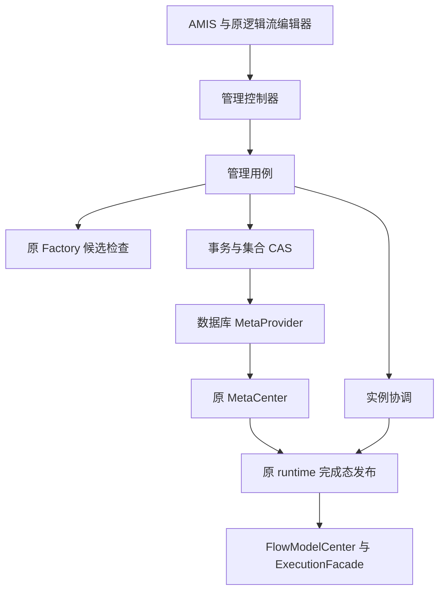

# 逻辑流运行时管理

应用维护者可在运行环境观察已部署逻辑流、修改持久覆盖，并按实例核对实际应用结果。管理模块复用正式 Provider、Center、Factory 和生命周期发布边界，操作范围为当前应用及其共享存储中的运行副本。

业务预期由 [LogicFlow 需求](../../requirements/logicflow.md)维护，功能现状见[特性地图](../../features/logicflow.md)，启用、操作及故障处理见[运行手册](../../runbooks/logicflow-runtime-manage.md)。本文维护来源、并发、实例协调、编辑器和观测的设计。

## 职责与接入

| 组件 | 职责 |
| --- | --- |
| `logicflow-core` | 定义来源观察、正式定义复制与摘要、候选构建和引用报告、发布观察及独立刷新合同 |
| `logicflow-authoring` | 共享节点目录、正式模型序列化和诊断投影 |
| `logicflow-runtime` | 在原 Provider 中构建候选，原子发布模型与元数据的完成态 |
| `common-app` 生命周期 | 在原发布锁与 Context epoch 上执行条件发布，保持完整刷新和独立刷新各自的失败语义 |
| `ouroboros-logicflow-editor-assets` | 唯一持有编辑器微前端元数据及构建包，供开发平台和运行时管理共同消费 |
| `ouroboros-logicflow-runtime-manage` | 管理用例、typed data 存储、数据库 MetaProvider、实例协调、HTTP、权限及 AMIS 页面 |

管理服务依赖核心和 authoring 合同，数据库细节留在 repository，实例刷新由 runtime 适配器协调。通过正式 AutoConfiguration 和 Meta SPI 装配，生产依赖避免导入 dev 和 runtime 实现。Provider 可保留只读快照，管理服务通过正式来源取得权威模型。

## 来源与完成态

内置 Meta 来源优先级为 App 100、业务模型投影 9、JAR 0，数据库覆盖以 200 参与同一选择链。来源观察同时保留禁用、被遮挡、不完整及冲突定义。部署默认采用最后一次成功完整 Context 捕获的目录，并在选择时排除运行时覆盖来源。

| 对象 | 权威位置与用途 |
| --- | --- |
| 部署默认 | 原来源选择，在没有有效覆盖时参与构建 |
| 持久目标 | 数据库当前有效覆盖集合，等待各实例应用 |
| 实例来源快照 | 某次刷新捕获的定义、来源和默认目录 |
| 实例完成态 | 模型、正式元数据、默认目录、来源、publicationId 和 sourceStamp 一次发布，供正式执行读取 |
| 编辑草稿 | 当前编辑器会话，检查和保存前保持为本地内容 |

未知来源、来源不完整、同名高优先级冲突、无法提供正式元数据或实际执行 Provider 不受管时，页面给出只读原因。模型诊断、来源错误和应用失败分别展示。禁用定义可观察，编辑默认按原启用和来源规则判定。

完整刷新、独立刷新和按需补建共享原完成态发布点。按需补建保留已有模型的来源证明，为新模型附对应构建输入。集合代次的应用确认要求逻辑流全集成功发布，完整 Context 路径还需等待整个生命周期成功返回。

## 持久化与版本

模型覆盖、变更和实例状态通过 typed data 和 QueryDSL 维护，由原迁移机制创建存储。存储初始化或读取失败显式返回依赖故障。物理字段以正式模型源类型为准。

| 模型 | 职责 |
| --- | --- |
| `RuntimeFlowCatalog` | 固定集合行，使用 epoch 和 revision 对覆盖集合进行 CAS |
| `RuntimeFlowOverride` | 规范名称键、展示名、有效标记、完整定义、名称修订及默认摘要 |
| `RuntimeFlowChange` | operationId、可信操作者、请求摘要、前后覆盖、提交版本及结果，支持幂等与恢复 |
| `RuntimeFlowInstanceStatus` | 每次启动的 bootId、期望与已应用版本、来源指纹、状态和回报时间 |

名称比较沿用逻辑流核心的大小写不敏感规则，名称键在数据库中唯一。撤销保留 inactive 墓碑与递增修订，防止删除重建后旧页面覆盖新内容。完整定义保留节点、连接、属性、布局及公开输入输出合同，序列化清除已明确的诊断派生字段。

`defaultHash` 覆盖完整正式默认，JSON 对象键排序而数组保留顺序。`catalogVersion` 组合 epoch 和 revision，`overrideVersion` 表示名称最近修订。`editToken` 绑定集合、名称与默认来源依据。`publicationId` 表示实例完成态身份，原 `runtimeRevision` 继续表示执行定义摘要。

## 检查、提交与恢复

检查与保存前检查使用同一候选链。在稳定 Context 读边界取得一致覆盖集合和来源，原 Factory 通过 NodeFactory 与引用目录初始化候选，形成模型诊断、依赖、反向影响、循环和差异报告。改动模型及受影响闭包中的错误阻止提交，其他历史无效模型继续作为环境诊断可见。第三方动态查找的目标保留依赖分析边界。

首期锁定名称、启用状态及流程对外类型和 Schema，允许修改内部节点、连接、属性和布局。候选检查只构建，节点初始化及引用读取遵守无业务副作用约束。请求规模上限由正式管理合同限定，当前为 2 MB、2000 个节点和 8000 条连接。

保存先隔离构建，提交前重新核对 Context 与来源依据。在短数据库事务内 CAS 集合行、修改名称记录并写入 Change，任何比较失败回滚并返回 409。不同流程也使用集合 CAS，保护跨流程引用，代价是无关流程并发编辑可能需要重新检查。构建在数据库写事务之外完成。

同一 actor、operationId 和完整请求摘要可重放原结果，复用 ID 但改变内容返回冲突。幂等记录与持久修改在同一事务提交。内容无变化时记录操作终态，并按当前基线决定是否推进版本。回执保留已提交事实，应用进度另行观察。

撤销与恢复操作前态复用相同检查和 CAS。撤销验证移除覆盖后的集合，恢复读取当前模型对应 Change 的 before 并形成新修订。缺少有效默认或存在依赖断点时按候选检查结果拒绝普通撤销。

## 独立刷新与多实例

提交释放数据库事务和 Context 读边界后，提示本实例核对最新目标。各实例也周期读取共享存储，补偿丢失或乱序提示。`logicflow.runtimeManagement.pollSeconds` 默认 5 秒，范围为 1–300 秒。

实例固定最后成功完整 Context 的默认目录，独立构建逻辑流全集，在原短发布锁内比较 Context epoch、原完成态和目标版本，再原子替换父子流程。过期候选、失败或等待超时保留旧完成态。已经取得模型的调用继续使用原对象，新调用取得发布后的模型。独立刷新机制的详细不变量见[模型生命周期](../../../core/ouroboros-logicflow/design/model-lifecycle/overview.md#9-逻辑流独立刷新)。

实例以启动 bootId 回报，旧进程只更新自身记录。状态表用于已知实例观察，历史记录和过期回报表示需重新核对。默认指纹不同的部署即使覆盖版本相同，也分别表达实际来源。

独立失败保持原全局可用门控，完整 Context 失败继续通过受保护运维通道完成完整刷新恢复。来源默认更新和其他模型依赖变更沿完整生命周期生效。卸载覆盖来源前先撤销或迁移有效覆盖并核对结果。

## 页面与编辑器

系统设置入口为 `/system-setting/logicflows`。运维详情按运行概览、实例、监控诊断、变更记录、模型来源组织，核心版本关系为部署默认、持久目标和当前实例。完整标识、原始正文及来源细节按需展开，恢复动作先展示目标差异和父流影响。

页面延续基座字体与青蓝配色，蓝色用于目标和主要动作，红色用于失败，琥珀色用于待完成，绿色用于已确认成功。浅灰蓝背景承托白色面板。设计使用 14px 基础字号、26px 主标题、17px 面板标题、11–12px 标签、4px 间距基准和 20px 面板内边距。桌面主内容与约 318px 侧栏分开，窄窗口合并为单列。

列表和摘要只加载轻量 FormItem 注册代理，首次开图或编辑时通过动态 import 加载原编辑器。代理保持 value/onChange、readonly/static、env、validationSnapshot、组件动作及校验合同，未就绪时阻止提交。并发画布共享代码加载，各自创建和销毁 store、Graph 及事件。失败提供明确重试，关闭后迟到响应不挂载。

运行时宿主显式绑定本环境节点及引用目录，关闭开发智能与调试。属性面板沿正式 flush hook 提交最新值。调试与预览按需分块，源码编辑继续复用共享脚本编辑器。

资产由唯一 `ouroboros-logicflow-editor-assets` 制品提供，入口、样式和异步块放入同一个 zip，正式路径采用 `/micro-logicflow-editor/<buildId>/`。部署只替换本次 buildId 目录，保留旧页仍需的版本资产。IDE 的 auto publicPath 构建继续提供稳定入口，异步块使用内容哈希。具体资产接入见[编辑器宿主合同](../../../frontends/web/ouroboros-logicflow-editor/docs/runtime-debug-host.md)。

## 逐流程观测

运行监控与详细诊断以单个规范流程名称为对象，未配置均为关闭。监控统计完成、失败、未完整及耗时直方图，详细诊断在监控开启时限时采集节点时序。开监控不会自动开启详细诊断，关闭监控同时关闭该流程诊断。

详细诊断时长可选 5、15 或 30 分钟，默认 15 分钟，每个 boot、流程、采集批次最多 100 次调用。修改已有采集设置保留原截止与批次，关闭再开启建立新批次。保存的监控策略可跨重启继续，诊断沿原权威截止时间到期。

策略由统一配置键 `logicflow.runtimeObservation.policies` 管理，使用一致快照与 expectedRevision CAS，配置及审计同事务提交。缺失流程解释为关闭，损坏策略返回配置故障。策略修订与模型版本分别维护，各实例后台核对并回报采用修订。到期按批次幂等记录为 system-expiry。

原 Analyzer SPI 在 invocation 入口按 FlowModel 选择策略。父子流程独立启用，未观测的中间调用隔断关联，深层已启用流程可独立采集。每次调用绑定入口策略，业务线程只更新有界内存，后台持久化。样本记录节点标识、类型、作用域、时序、结果和异常类型，业务值、异常消息及堆栈受采集边界排除。

每进程上限为 1024 个跟踪调用、512 个分钟窗口、128 个待存样本和 8192 条活跃节点记录，每调用最多 256 条节点记录，文本最多 200 字符。启用期间单调用最长跟踪一小时，关闭或到期后最长收尾 30 秒。超额、截断、丢弃、未完整和存储故障均在状态中体现。

后台按稳定标识覆盖累计窗口，按调用标识幂等写样本。存储故障暂停新采集并有界收尾，恢复后重新采用配置。P95 由合并直方图计算桶上界，跨版本保留对应 runtimeRevision。未采集、零结果和读取失败分别显示，关闭后可读取保留期内历史。

观测存储使用 `RuntimeFlowMetricWindow`、`RuntimeFlowDiagnosticRun`、`RuntimeFlowObservationStatus` 和 `RuntimeFlowObservationChange`。统计默认保留 24 小时，样本默认 1 小时，通过统一动态配置维护，实际容量、清理与恢复操作见[运行手册](../../runbooks/logicflow-runtime-manage.md#逐流程运行监控与诊断)。旧样本采用版本标识和节点时序表，精确历史图快照与图上定位尚未接入。

## 权限与接口

权限分为 `systemSetting.logicflow.read`、`.edit`、`.reload`、`.observation.read` 和 `.observation.manage`。编辑、重载和观测同时要求模型读取权限。HTTP 独立判断可信身份，读取正文、采集数据和修改设置分别授权。

| 入口 | 定义与职责 |
| --- | --- |
| [RuntimeFlowController](../../../ability/ouroboros-logicflow-runtime-manage/src/main/java/com/ouroboros/logicflow/manage/web/RuntimeFlowController.java) | `/api/runtime/logicflows` 下的列表、详情、检查、保存、撤销、恢复、操作与实例观察 |
| [FlowObservationController](../../../ability/ouroboros-logicflow-runtime-manage/src/main/java/com/ouroboros/logicflow/manage/web/FlowObservationController.java) | 模型子资源下的 observation-policy、observation-status、metrics、diagnostic-runs 和采集变更 |
| [RuntimeFlowCatalogController](../../../ability/ouroboros-logicflow-runtime-manage/src/main/java/com/ouroboros/logicflow/manage/web/RuntimeFlowCatalogController.java) | 当前运行态节点与引用目录 |

正常写入返回 202 和持久提交回执，无变更返回 200。接口通过正式控制器和 DTO 导出 OpenAPI，合同来源与生成方向见[接口入口](../../api/README.md)。

## 验证与当前边界

| 行为 | 可重复验证资产 |
| --- | --- |
| 真实存储、CAS、权限、恢复及观测边界 | [管理模块测试](../../../ability/ouroboros-logicflow-runtime-manage/src/test/) |
| 来源优先级、候选、父子流与完成态竞争 | [核心测试](../../../core/ouroboros-logicflow/ouroboros-logicflow-core/src/test/)、[runtime 测试](../../../core/ouroboros-logicflow/ouroboros-logicflow-runtime/src/test/) |
| 共享数据库双 JVM、重启及正式编辑器浏览器闭环 | [集成场景与合同](../../../testing/integration/feature/lowcode/logicflow-runtime-manage/contract.md) |

验证须包含同名与关联流程并发、操作重放、撤销重建、完整刷新竞争、丢失提示、旧启动回报、只读拒绝、草稿保留、异步块失败重试与旧版本资产加载。逐流程观测另覆盖默认关闭、父子流程独立、未观测中间层、限额到期、配置 CAS、reporter 故障及敏感数据边界。具体执行基线与结果归任务或 CI 附件。

完整目标平台认证、生产数据库迁移和方言、生产静态代理及旧资产保留仍需目标环境验收。服务器草稿、任意沙箱试运行、审批发布编排、公开合同迁移和完整图形版本比较工作台保留为后续范围。
