# 后端脚本与表达式代码提示

本文说明当前统一代码上下文、逻辑流静态分析与隔离语言服务的机制。正式编辑入口为 `code-intelligence/context`；代码位置及排除项见[入口清单](script-expression-intelligence-inventory.md)。提示能力与脚本执行器分别维护，不以编辑诊断代替业务运行验证。

机制由三部分组成：真实应用开发助手描述已加载的执行环境，领域 provider 描述当前位置的变量和结果结构，编辑器把描述转换为当前语言的候选。Java 对象通过反射读取类型签名；逻辑流的数据形状由可插拔的节点分析器静态传播。提示过程不执行脚本、表达式、RPC、配置求值、getter 或业务查询。

范围包括后端执行的 JS、Groovy、SpEL、RPC/配置模板、通知文本替换，以及 RPC 令牌 JSONPath、业务日志 FreeMarker 的上下文补全。浏览器执行的 AMIS 公式、事件脚本及微应用公式排除。审批 UEL、SQL 与固定文件名占位符按各自入口说明，不能按 `${…}` 外观统一解释成 SpEL。

## 1. 架构与模块边界

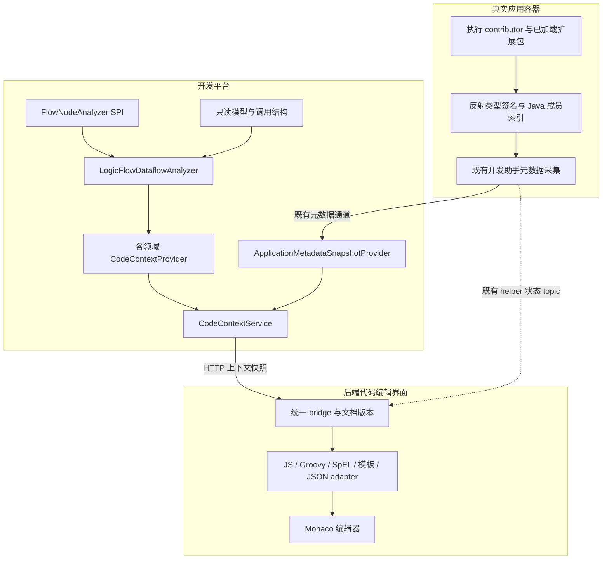

图中箭头表示数据流。Maven 分层仍遵循原架构：执行内核不依赖开发服务；共享协议不携带 Spring Controller 或脚本引擎。

| 模块 | 当前职责 |
| --- | --- |
| `common-code-intelligence` | 从 common-script 提取的唯一共享 DTO/Java 索引；TypeShape、只读反射、内容摘要；原 Java 包名保留 |
| `common-script` / `common-expression` | 复用各自正式 contributor；描述真实 bindings；SpEL AST 静态类型查询 |
| `common-dev` | CodeContextRequest/Description/Provider、只读元数据视图、安全配置键目录 |
| `ouroboros-dev-code-intelligence` | 唯一 HTTP 门面、领域装配、应用快照选择、文档身份与版本校验 |
| `logicflow-authoring` | 图传播、节点分析 SPI、内置分析器；不构造可执行节点 |
| 各领域 dev 模块 | 解析资源草稿和源位置；逻辑流 dev 另提供模型/RPC/子流程引用分析器 |
| 主应用编辑器目录 | 复用 bridge、Monaco adapter、模型隔离、JSON 嵌入和失效订阅 |

## 2. 前后端通信与 LSP

可以采用 LSP，但需要区分语言服务协议与领域上下文。LSP 定义 completion、hover、signatureHelp、diagnostic、文档同步和取消，不能自行推断低代码节点端口、业务模型投影或应用扩展包环境。无论使用什么传输，这些语义仍由本设计的领域 provider 和分析器提供。

当前有两种与语言能力相匹配的实现：JS/SpEL/JSON/模板继续使用版本化上下文与本地 adapter；Groovy 及后续后端语言插件使用通用 LSP 会话。HTTP 承载客户端 JSON-RPC 消息批次，开发平台直接与其托管的隔离语言进程使用标准 stdio 或内部 TCP LSP。既有 helper Command/RabbitMQ 通道只同步实际应用环境和依赖制品。STOMP 沿用环境失效通知。没有另建 WebSocket 传输或执行引擎。

| 共享职责 | 当前 LSP 对应实现 |
| --- | --- |
| URI、documentVersion、draftRevision | textDocument 文档身份与版本；平台另外保留草稿版本 |
| Monaco completion / hover / signature provider | LSP 对应请求与标准结果适配 |
| generation 与 dispose 防止旧响应覆盖 | 配合 $/cancelRequest，客户端仍需丢弃旧结果 |
| CodeContextService | 平台扩展上下文请求或语言服务器内部服务；不塞入标准 CompletionParams |
| helper 状态 topic | 平台失效通知；不声称属于 LSP 标准 |

通用端点为 `POST /api/dev/{appName}/code-intelligence/sessions`，子路径 `/{id}/messages` 同步消息、`/{id}/context` 更新领域上下文、`/{id}/notifications` 获取异步诊断，`DELETE /{id}` 关闭。标准语言方法使用 LSP 结构；`ouroboros/context` 是平台内部上下文协议，由各语言插件转换，不能当作标准 LSP 的一部分。静态 capabilities 决定 Monaco 功能；动态注册、服务器主动命令及跨文件编辑暂不支持。

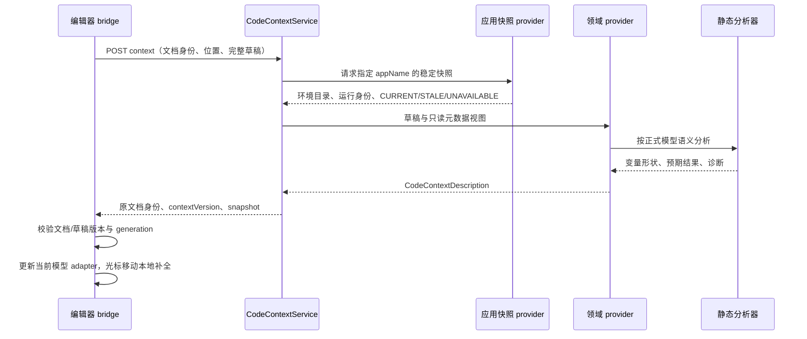

接口由正式 [CodeContextController](../../../dev-module/ouroboros-dev-code-intelligence/src/main/java/com/ouroboros/dev/codeintelligence/CodeContextController.java) 和 [CodeContextRequest](../../../libs/common/common-dev/src/main/java/com/ouroboros/dev/codeintelligence/CodeContextRequest.java) 定义：`POST /api/dev/{appName}/code-intelligence/context`。沿用开发平台的 WebApiResult、fetcher 和权限链。请求不保存草稿。

请求包含 `documentId`、`documentVersion`、`draftRevision`、`codeSite`、`language`、`resource`、`location` 和 `draft`。位置为 JSON Pointer；逻辑流同时指定 nodeName，pointer 相对该节点。返回包含原身份、contextVersion、runtimeStatus、runtimeIdentity、snapshot、expectedResult。错误走原平台错误封装，不另设错误协议。草稿大小和图规模有界，避免把提示变为无界计算。

## 3. 类型描述与反射

TypeShape 是不可变的 JSON Schema 快照。标准关键字描述对象、集合、联合和可选性；扩展关键字保留 Java 类型、Map/Java 表示差异、方法签名、未知原因和证据。未知形状保留变量名，不能假装空对象或任意确定结构。

JavaShapeIntrospector 读取字段、record component、bean property、方法返回值及泛型签名，支持有界递归。它接收类型，不读取对象属性值；动态 Map 的键不能由 Java 泛型恢复时保持开放形状。实际应用 helper 采集数据模型的字段 ValueType 和实例类型，开发平台不以自己的 classpath 冒充应用运行环境。

显式 Schema、真实 Java 类型和静态传播分别是不同证据。声明脚本输出 Schema 可以供后继节点使用；预期结果不能冒充已推断的实际脚本返回值。独立语言服务通过 ouroboros/inferOutput 推断 JS/Groovy 的字面值、局部赋值、嵌套成员、集合和分支返回路径；不运行脚本取样。动态调用副作用、循环、复杂变更或超出预算时保留 unknown，显式 outputSchema 优先。

## 4. 后端扩展与装配

扩展按现有职责分别装配，避免另建执行对象注册表。

| 新能力 | 正式扩展位置 | 发现与装配 |
| --- | --- | --- |
| 新增脚本/EL 工具对象 | 原 ScriptContextContributor / ExpressionContextContributor | 原 `META-INF/services`；helper 从实际 bindings 反射签名 |
| 新增逻辑流节点语义 | FlowNodeAnalyzer | `META-INF/services/com.ouroboros.logicflow.authoring.analysis.FlowNodeAnalyzer` |
| 新增资源类型的代码上下文 | CodeContextProvider | 所属 dev 模块 `@Bean`，沿原 AutoConfiguration imports 注册 |
| 新代码字段 | 正式节点/领域字段定义 | codeSite、codePointer、language；不按控件外观猜执行语义 |
| 新语言执行能力 | 原 ScriptRunner / ScriptCompiler | 原执行 SPI；编辑 adapter 另外负责 UI 投影 |
| 脚本返回结构推断 | ScriptAnalysisQuery / ouroboros/inferOutput | FlowTypeContracts 收集请求，平台调用原语言池；语言服务静态返回 TypeShape |
| 引用资源的已知调用输入 | InvocationInputProvider | 所属领域 dev 模块贡献 Bean；RPC provider 合并已知调用点，显式 Schema 优先 |

FlowNodeAnalyzer 声明 `nodeTypes()` 并实现 `analyze(NodeAnalysisInput, ExpressionTypeQuery)`。输入包含节点草稿、有序端口形状、全局类型和只读引用合同；输出为各端口 PortShape、各代码位置 CodeScope 与诊断。CodeScope 描述 profile、bindings、expectedResult。普通 Java 对象无须为每个类写插件；插件只负责反射无法给出的领域变换。

分析器由现有 SPI 工具加载。注册两个分析器处理同一 node type 会明确失败，避免不确定的覆盖顺序。自定义节点分析器不能在分析时调用 NodeBuilder、执行引擎、数据库、远端 RPC 或配置求值。未提供分析器的节点输出 unknown，其他可分析部分继续工作。

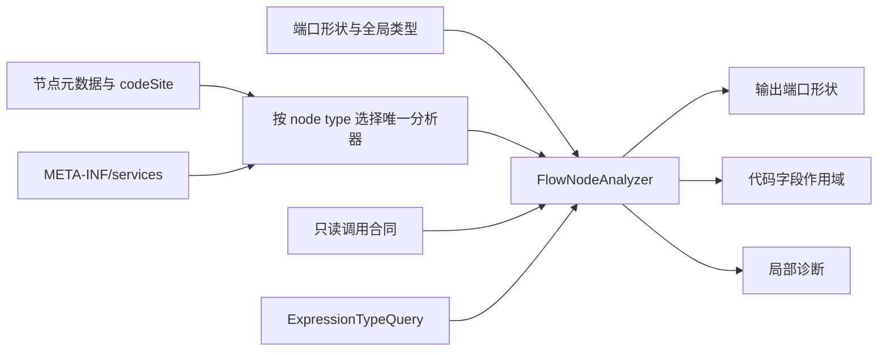

CodeContextProvider 按 resource type 唯一装配；不同时注册多个“部分 provider”再依赖隐式合并。已有领域增加字段时扩展原 provider。其 `describe` 返回局部 bindings、profile、预期结果、诊断、是否允许全局对象及语言投影提示；门面集中选择真实应用环境、合并可见对象和计算版本。

## 5. 逻辑流上下文推断

图分析采用有界 DAG 传播：读取入口/声明结构与外部模型合同，按连接的 sourceOutputPort 和 targetInputPort 合并输入，再调用节点分析器。条件输出保留 conditional；未连接输入和未知上游保留未知。禁用节点、失效连接、分析器异常都产生诊断。

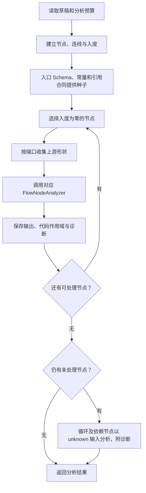

LogicFlowDataflowAnalyzer 负责图调度、端口合并、节点插件装配、可达节点与成功终点分析；TypeShape 只是它传递的类型载体，分析器并非一个 Schema 转换工具。子流程优先读取显式输出合同，否则以调用点的实际输入展开分析；深度 12、总节点 4000 的预算和调用路径检测阻止递归无限展开。流程执行器禁止环形连线，编辑中的无效循环及其依赖节点降级 unknown，不添加循环执行语义。禁用、断开的节点及成功终点之后的节点不进入调用输入或子流程结果汇总。

| 节点族 | 当前行为 |
| --- | --- |
| script | 按真实端口构造作用域；显式 Schema 优先，否则由独立语言服务提供静态输出合同；无法证明时 unknown |
| mapping | 字符串做 SpEL AST 类型查询；嵌套 Map 递归；List 为字面常量；支持目标路径、`&` 展开、冲突策略；逐项模式产生数组 |
| filter | 使用元素作用域；输出保持集合元素类型 |
| switch | 各条件读取普通节点输入；分支端口输出保留输入形状并标为 conditional |
| concat/distinct/intersect/subtract | 按比较元素提供 a、b、$0、$1；输出集合形状 |
| const、pick/omit/take/merge/validate、结构节点 | 按运行时变换和声明传播；缺少依据时保留局部未知 |
| RPC、数据模型、CRUD、子流程 | logicflow-dev 的引用分析器读取合同，子流程可按调用输入有界展开；不调用实际资源 |
| 子表同步、业务事件、Excel、异常 | 由所属领域的节点 SPI 描述子记录集合、事件 occurrence 信封、配置决定的工作表结果和终止行为；不读文件或调用业务服务 |

作用域对齐运行时：普通节点有 `$0…$n`、`$端口名`，单 Map 输入展开字段；mappingEachItem 有 `$item`、`$index`、`$parentContext`，其 `$0` 是元素；filter 没有专门注入 `$item`；比较式仅使用相应元素别名。全局对象覆盖顺序遵循现有执行链，不建立编辑器专用优先级。

流程和 RPC/认证模型新增可选 inputSchema/outputSchema，编辑表单可维护 JSON Schema。它们是提示合同，不改变调用校验或执行语义。没有声明结构时明确降级。

## 6. 业务模型复用正式投影

业务模型 before/after/script、导入映射、工作流表单映射和旧自定义 API 脚本，先用 BusinessModelDevService 的正式草稿预览构建模型，再生成原有 ModelBundle。投影节点携带 codeSourcePointer，将业务模型源字段映射回节点；随后复用同一个逻辑流分析器。不会手写另一套 `$input`/`$result` 变量表。

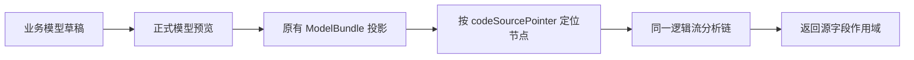

Action 的显式输入映射按正式新旧格式语义分析；没有映射时使用 Action 输入和 context。目标路径通过运行时相同的 Hierarchical 工具重建。Action outputMapping 的 result 来自被调用流程的输出合同。事件订阅按 sourceEvent.modelFullName/sourceEvent.eventName 读取实际来源 payloadSchema，不拿当前模型同名事件替代外部事件。

前置条件只暴露 input/objectStates，事件过滤只暴露 event；受限 predicate 不提供 Config、Java 导入或执行工具。HTTP 输入映射单独提供 request/query/headers 等根对象。字段默认值按草稿字段提供根变量和 `$record`；新字段或已修改类型缺少真实依据时保持未知。objectStates 的角色细节、HTTP 参数细化及新字段具体类型仍可能未知。

导入 UI 已对齐正式运行时读取的 `features.import.dataMapMode/dataMap`，没有继续维护无消费者的 dataMapping 名称。已撤除无后端消费者的 apis.add.defaultValues、workflow.customParams 控件及 workflow.paramMode 回退；正式 formDataMode 与 formDataMapping 保留，不删除已有模型数据。

## 7. RPC、配置、字段类型和通知

RPC provider 根据字段和执行阶段返回 templateMode。模型请求模板的局部变量来自调用输入 Map 的键，可选 inputSchema 描述这些键的结构，不额外注入 input/data/params 包装层；认证凭据按具体类型/preset 限定字段和上下文。动态 token 提取路径使用独立 JSONPath adapter，从令牌 RPC 的 outputSchema 提供根结构和路径候选，不提供 EL 工具对象。没有显式 inputSchema 时，由 InvocationInputProvider 收集应用已知 CallRPC 的实际上游输入；共享凭据合并其引用模型的输入。未知调用点必须保留 unknown，配置间接选择的凭据与动态调用不视为完整调用图。

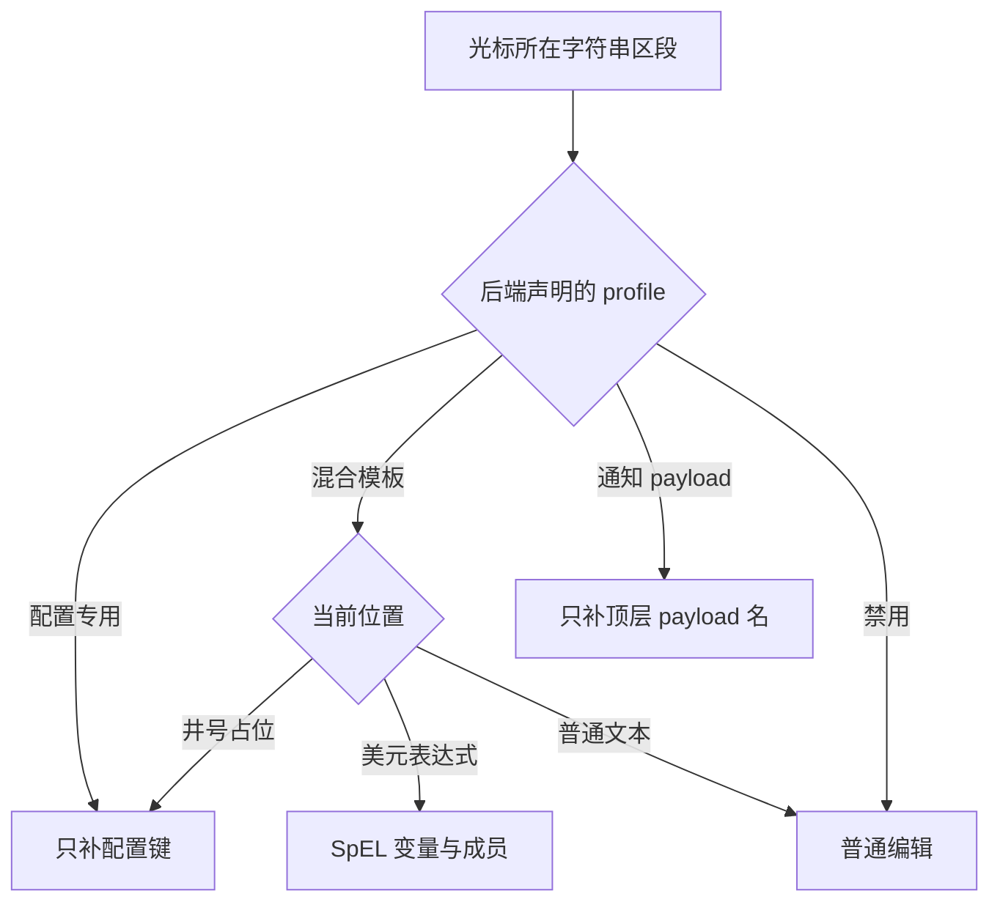

RPC 模型与授权的执行字段由 RpcFieldSemantics 统一分类：URL/参数值与可执行凭据值允许混合模板；method、参数名/位置/必填、认证引用、超时/重试、token 模式/模型/过期设置和 HMAC 结构设置只展开配置；名称、类型、启用状态、Schema 仍是元数据。先解析结构配置再做 enum/number 转换；混合模板只扫描原文一次，替入值不会重新成为代码。配置更新通过原生命周期重建凭据；动态令牌缓存按凭据实例代际隔离，旧请求不会写入新实例的缓存。零或已过期 TTL 不缓存。Spring Environment 兜底遵循 Spring 自身占位符语义。

业务日志的 FreeMarker provider 对齐 BusinessLogExtractor 的根对象及取值优先级，结合匹配 WebAPI 的 OpenAPI 合同细化 Request/Response；adapter 提供成员、简单 list/assign 作用域及 builtin 候选，平台复用运行时同配置 parser 提供基本语法诊断，不执行模板或加载 include。当前只接入有 appName 的开发元数据入口，运行期系统设置页面没有接入开发平台接口。

ConfigurationKeyCatalog 仅提供键、标题、描述、类型，过滤 protected 和敏感来源，不读取实际值，也不枚举全部 Environment。RPC/通知使用 `#{key}`，配置值自身使用 `${key}`；Config.get 参数候选复用同一目录。配置求值有先后依赖，提示不会执行表达式来决定最终值。

字段类型 provider 只描述后端参数展开阶段；UI Schema 中的浏览器表达式仍排除。参数来自 paramsUiSchema 的名字和可确定的默认类型，主键生成器另提供固定日期占位符。通知 schema/options 复用 JSON 编辑器；Email 只有 titleTemplate/contentTemplate 提供顶层 payload 替换键，不提供 SpEL 方法链。

## 8. 前端接入与编辑隔离

普通代码字段声明 `codeSite`、`codePointer`、`codeResourceType`、`language`、`intelligenceApi` 即可；逻辑流原有宿主已提供完整 `__FLOW_MODEL` 和当前节点。组合行沿 AMIS `__super` 找资源根，通配位置按当前行索引解析并转义 JSON Pointer。

JSON 数据字段使用同一个 JsonDataEditor 的可选 codeContext。adapter 解析当前 JSON 文本，仅在字符串值中提供候选，排除 key 和非字符串；允许不完整 JSON 编辑，并将补全范围通过 JSON 转义映射回原文。Mapping 的数组字面值禁止嵌入式表达式提示，嵌套对象/数组/数字/null 不被键值控件强制转成字符串。

请求通过 AMIS 官方 fetcher 的 `ignoreData` 选项发送原始草稿，避免把待编辑的 `$input` 或 `${…}` 再次当成页面表达式求值。嵌套 codeContext 的 URL 使用 AMIS buildApi 解析宿主参数。

JS 为每个模型建立隔离的虚拟模块和局部类型服务，避免全局声明污染及修改所有 Monaco JS 编辑器默认库。Groovy、SpEL、模板和 JSON provider 按 model URI 过滤，卸载时释放；页面中的 SQL 和浏览器脚本不被套用后端环境。JS 可以推断自身局部变量；Groovy 进入共享 LSP 语义链路，SpEL 以描述目录和属性路径为主。

`script-editor` 通过 AMIS 官方异步 `validate()` 接入表单，默认代码 Error 阻止提交，Warning 放行；字段参数 `validateCode: false` 可以关闭该阻断，`required` 等规则仍由 AMIS 执行。校验先刷新资源上下文，再等待当前文档版本的语言诊断，按当前 `diagnosticOwner` 读取模型，避免旧语言服务晚到的错误误阻止提交。Groovy 采用版本化 LSP 诊断，后端 JavaScript 复用隔离 Worker 检查语法和源码类型；服务失败或当前版本诊断超时返回验证错误。

SpEL/模板/JSONPath/FreeMarker 的基本语法检查沿用 `CodeContextController → CodeContextService`，平台中的 `CodeSyntaxDiagnostics` 按领域 provider 的 profile/hints 解析当前字段。SpEL 复用 `EL` 的 Spring parser 并绕过运行时缓存，FreeMarker 复用 `TextTemplateEngine` 配置，JSONPath 复用 Jayway parser；配置和通知的字面键替换仅检查占位符结构。检查不执行代码、不读取配置值，也不加载模板 include。JSONPath 含配置引用时只验证引用结构，最终路径依赖应用配置。

bridge 读取 `syntaxDiagnostics` 能力与 `ouroboros-syntax` 诊断，按相对字段的 JSON path、UTF-16 range 转换为 `editor-syntax` markers。编辑立即清旧结果，150ms 合并刷新，过期响应不覆盖当前文档；提交等待当前版本。JSON 字符串的转义、emoji、Tab 和换行均映射回源码。原有领域 unknown 提示不视为语法 Error。

AMIS 注册的 `json-data-editor` 在同步格式/根类型检查后等待 `codeContext` 的语法诊断；无 codeContext 时只做 JSON 校验。直接复用的基类保留同步 validate 合同，组合宿主若需代码阻断应等待 `validateForSubmit()`。语法通过不保证变量存在、类型正确或业务执行成功。接入约定见[插件指南](../../../dev-module/ouroboros-dev-code-intelligence/LANGUAGE-PLUGINS.md#amis-表单校验)。

### 可插拔语言服务与 Groovy 实现

Groovy 运行时保持 4.0.30 / Java 21，执行器及 compile() 行为保持原状。`ouroboros-dev-groovy-language-server` 构建独立语义服务分发包；完整 81 个编译器覆盖/trace 源文件从固定上游版本重编译，产物与来源摘要留在 provenance.json。patched JDT 只进入独立进程，不进入应用 JVM classpath。

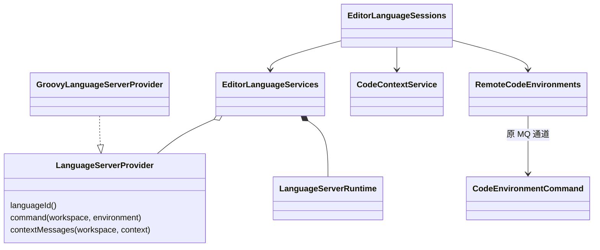

领域层继续以 CodeContextProvider / TypeShape / FlowNodeAnalyzer 描述输入，语言插件不重复分析逻辑流。平台的 LanguageServerProvider 定义语言标识、文件后缀、服务命令、上下文投影和可选同步 fence，通过已有 Spring AutoConfiguration 贡献 Bean。EditorLanguageServices 唯一装配所有实现，拒绝重复 languageId。LanguageServerRuntime 共享进程启动、文档隔离、标准 LSP 转发、URI 映射和诊断收集；GroovyLanguageServerProvider 只负责分发包、读取 LanguageEnvironment 的实际 Java classpath，以及其 context/barrier 适配。纯领域分析与语义引擎均由平台承担。

前端用同一个 EditorLspSession 和 LSP adapter 处理所有后端插件语言，依据 initialize.capabilities 注册能力，触发字符和 semantic tokens legend 同样来自服务端。新语言无需复制 providers；registerEditorLanguagePlugin 可装配 prepare 和可选 createAdapter：快照语言在同一注册机制提供适配器，其余语言自动使用共享 LSP adapter。Groovy 保留 TextMate 作为 Monaco 的词法输入，语义能力由独立服务提供。

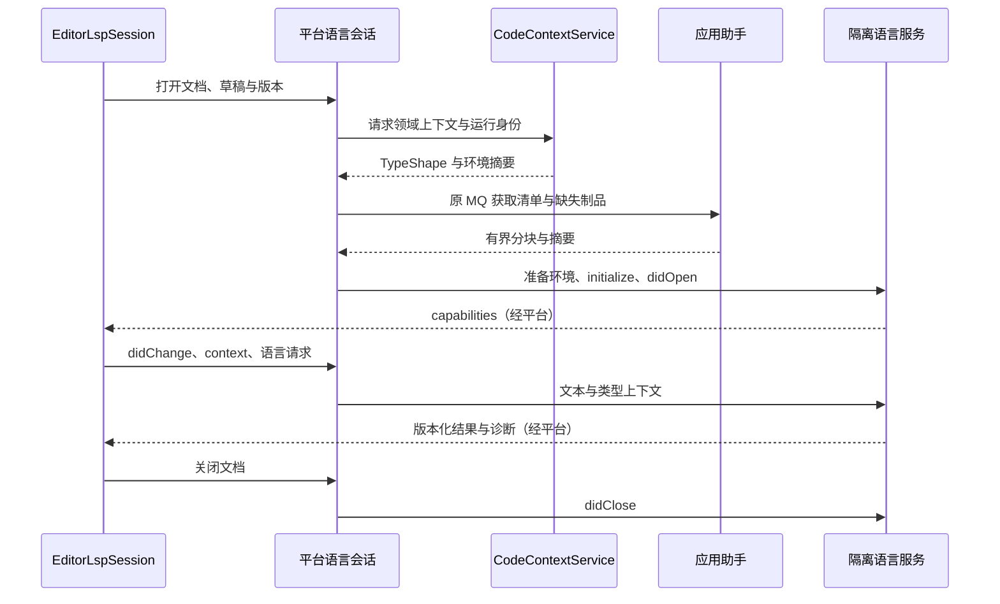

通用运行时将外部会话 URI 映射为独立 workspace 内带语言后缀的 file URI，再将诊断和符号结果映射回会话 URI。应用和 owner 边界由平台会话负责；helperInstanceId 绑定同步目标，环境摘要绑定语言进程。平台经原 MQ 命令同步环境后，直接调用本地语言服务，后续 LSP 请求不再转发助手。标准服务可异步发布诊断，由共享轮询传输回前端；只有 Groovy 插件请求其自有 barrier，不要求其他语言实现该扩展。

Groovy 语义复用 GE 6.0/e4.38 内核；ContextTypeLookup 通过 GE 正式 typeLookup 扩展点将 Binding 和结构 Map 投影进相同的 JDT 模型。Java 泛型使用真实 helper classpath，Map 保持动态访问及 Map 方法。源码或上下文变化通过 getNewModuleInfo() 重建模型，避免闭包推断残留旧 AST。编辑中的尾点与未闭合括号通过有位置映射的源码恢复继续分析；不会运行脚本主体，也不会启用用户 ASTTest 或依赖下载。

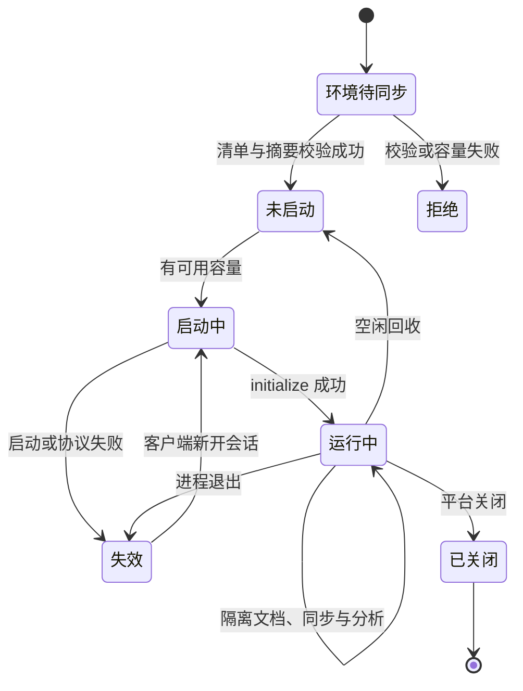

平台按语言和精确环境摘要复用 warm process，多个应用的相同依赖环境可共享进程，文档分别持有模型与上下文。默认整个实例最多 4 个语言进程，全部活跃时拒绝新环境，空闲环境可回收腾位；10 分钟空闲清理及平台关闭终止进程并删除 workspace。进程死亡后旧会话不可继续沿用；客户端清理失败会话，后续请求重新打开。应用 classpath 变更以新的 helper 实例/classloader 生命周期为边界。

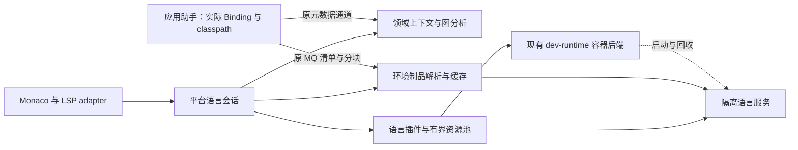

助手的 ApplicationCodeEnvironment 只枚举实际 classpath（含父加载器）、打包 class 目录、展开 Boot 包根/嵌套依赖、计算摘要和有界分块读取；CodeEnvironmentCommand 沿原 Command dispatcher 注册。RemoteCodeEnvironments 在平台校验清单和 SHA-256，按内容缓存缺失依赖。它不会加载应用 Class，也不会用平台自有依赖覆盖应用环境。清单有序且带 Java major，默认缓存上限 1 GiB；容量不足、摘要损坏或 Java major 不匹配均明确失败。缓存不会自动淘汰仍可能被 workspace 引用的制品；当前运维清理要求停止服务。所有未来需要远端解析引擎的语言沿用此分工与进程机制。

当前 Groovy 支持补全、hover、签名、语法诊断、当前文档内定义/引用/重命名、文档符号、语义 tokens、缩进格式化和补齐结束括号的 quick fix。格式化和 code action 的范围是上述具体能力，未承诺完整 IDE 的全部重构、跨文件索引或所有 Groovy DSL 的静态类型。脚本返回结构由同一独立语言服务的输出协议负责，复用当前带类型 module 和相同图传播；复杂动态路径仍需 outputSchema。

新增语言的配置、注册样例、能力合同和复用边界见[语言插件接入指南](../../../dev-module/ouroboros-dev-code-intelligence/LANGUAGE-PLUGINS.md)。构建与分段验收见[正式语言服务说明](../../../dev-module/ouroboros-dev-groovy-language-server/README.md)。

JS 的虚拟模块保留 `.ts` 扩展以承载声明，使用自有编辑语言标识，并由独立后端 JS Worker 同步和分析。通过 Monaco createWebWorker 装配同一 TypeScript 引擎，compilerOptions.lib 仅包含 lib.es2020.d.ts，不加载 DOM 或 Node 类型。Worker 按 Monaco 实例引用计数复用，最后一个后端 JS adapter 卸载时关闭。普通前端编辑器的 javascriptDefaults 保持独立。隐藏声明模块不作为词语补全来源，避免内部类型名被 Monaco 的通用词语建议带回编辑界面。

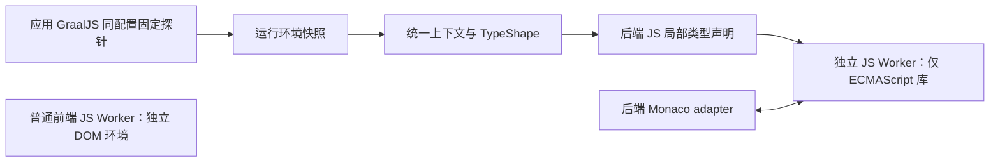

JavaScriptEngine 的执行与固定探针复用同一 Context 配置，探针仅枚举 globalThis 的属性描述符和直接成员，不执行用户脚本或 getter；结果随运行环境快照缓存并参与内容版本。实际存在的 Java、Polyglot、Graal、print、load 等对象生成局部声明；Java.type 保留受控类名和已反射类型提示，未建模的引擎方法参数暂为 any。ECMAScript 类型库提供标准对象和方法，运行时目录提供工具 Binding、GraalJS 全局对象以及显式 globalThis 类型。

浏览器全局和 Node 全局不进入后端类型环境；手工输入 window.、document.、globalThis.document. 也不能从 DOM 类型库得到成员。候选不按业务字段名字屏蔽，因此 payload.document.title 仍可提示。GraalJS 宿主互操作允许的任意 Java 类、复杂宿主方法签名及不同扩展 JS 配置的完整语义仍依赖后续专用模型，不能把动态 any 当作已精确推断。开发构建保留应用代码源码映射，排除 TypeScript 编译器大库的内联映射以降低解析开销。

ScriptEditor 和 JsonDataEditor 的上下文依赖整份资源草稿，使用既有 AMIS `strictMode: false` 表单项机制接收兄弟字段更新；bridge 按完整请求内容去重。不能只依赖当前代码值或草稿对象引用判断刷新，否则只修改上游节点时会保留旧上下文。

## 9. 环境刷新与状态

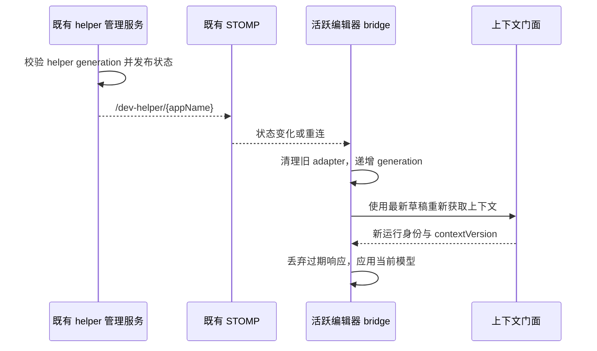

复用现有 STOMP 连接和 helper 状态 topic，不另建 WebSocket。订阅仅在编辑器启用上下文时加载，切换应用和卸载时释放。当前没有额外的共享领域缓存；bridge 仅复用当前请求键与上下文版本。

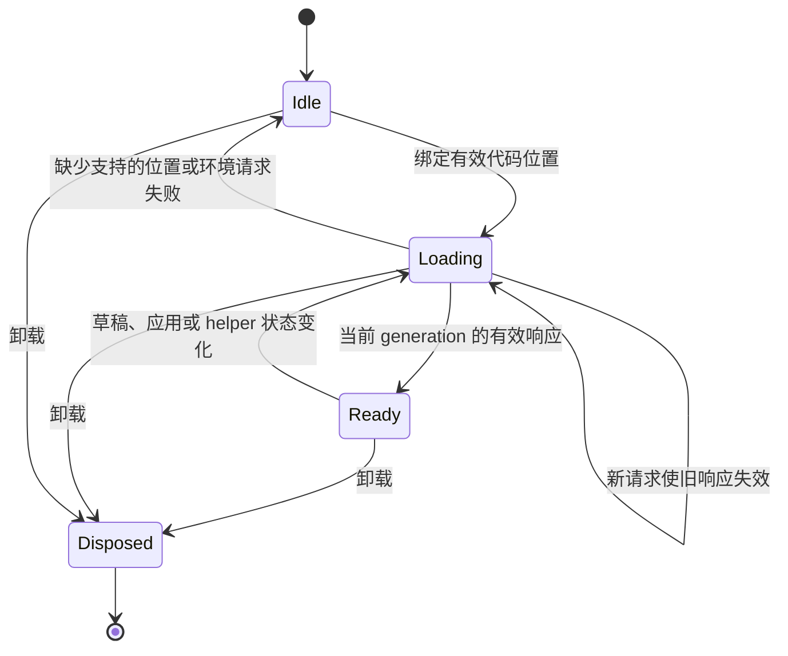

应用目录的 CURRENT/STALE/UNAVAILABLE 独立于编辑器状态返回。helper 不可用时保留局部结构推断与带来源标记的平台参考候选，应用环境状态仍为 UNAVAILABLE；旧响应不覆盖新文档。内容版本包含应用、资源、位置、环境签名及运行身份；不会仅按类名或节点名缓存。

## 10. 验证方法与能力边界

后端行为测试应覆盖反射不执行用户逻辑、Schema 防御性复制、作用域/图传播、插件装配失败、正式 CRUD 投影、跨应用隔离和敏感配置过滤。前端回归覆盖文档版本竞态、JSON 转义、候选接受、上游草稿变化和诊断阻断提交。

在 `frontends/web/main-app` 执行 `npx playwright test --config=playwright.code-intelligence.config.js` 可独立运行上下文浏览器回归；配置会构建并启动真实 Java 上下文服务和前端 harness。默认 `npm run test:integration` 只发现无需 Java 的模拟快照用例。环境及入口见[测试说明](../../../frontends/web/main-app/tests/integration/script-editor-intelligence/README.md)。隔离 harness、完整平台画布、真实应用容器及生产负载应分别验证；执行结果和证据归关联任务或 CI。

动态脚本调用/副作用、无声明的递归调用、复杂 HTTP 参数、授权角色和新字段动态类型缺少依据时保持 unknown。审批设计器主要提供结构化条件，不因源码存在 IOParameterSetting.sourceExpression 就推定存在低代码 UEL 自由文本入口。Kubernetes 仍缺真实集群验收，不能以模拟 API 合同替代。多平台副本协调与生产负载基准也未得到验证。

协议依据为 [LSP 3.17](https://microsoft.github.io/language-server-protocol/specifications/lsp/3.17/specification/)；标准编辑消息和 stdio 协议沿用 LSP，平台 HTTP 会话、领域上下文和输出合同属于 Ouroboros 扩展。

## 11. 统一入口与部署契约

### 11.1 入口与候选来源

正式页面、演示与测试统一使用 `code-intelligence/context`。应用环境缺失时，门面可提供有来源标记的平台参考候选；应用快照、草稿推断和平台参考分别标明。参考候选降低排序并显示“应用环境未验证”，来源传递到成员。应用状态仍为 UNAVAILABLE，不能拿平台 classpath 冒充应用运行环境启动语义服务。

共享描述类和 Java 索引由 common-code-intelligence 维护，common-script 继续提供执行上下文目录。旧 logicflow/script-intelligence/snapshot 入口及重复目录已移除，不维护第二套提示合同。

### 11.2 RPC 调试的配置和依赖

RPC 调试允许直接常量和显式覆盖值。调试配置来自本次覆盖、开发平台 ConfigurationService、开发平台 Spring Environment，后两者的来源须明确，不能视作应用运行配置。输入发现补齐授权引用、超时和重试等正式配置位置，复用 RpcFieldSemantics，不复制字段清单。

如果配置决定凭据或令牌模型名称，先收集待填写配置项，在本次值确定后解析引用并读取当前应用工作区的依赖。沿用 `POST test/init-form` 传入 configValues，初始化不取令牌、不发业务请求。覆盖值或开关变化立即使旧初始化失效，输入停顿 350 ms 后自动重建依赖，准备期间禁测；ready/missingConfigKeys 表明是否仍需补充配置。revision 包含实际依赖边与资源内容，执行重新读取并核对；普通配置口令不进入版本。资源选择与执行共用同一调用级配置视图，晚到响应不覆盖新准备结果。完整合同见 [RPC 调试设计](../../../ability/ouroboros-rpc-model/docs/model-testing.md#61-初始化)。

### 11.3 输出推断与图传播

Groovy 的补全和输出推断复用独立服务中的带类型语法树、应用依赖和上下文。语言服务返回语言无关 TypeShape，平台按拓扑组织输入、收集脚本输出合同并传播到下游。语言相关解析不再内嵌平台；图分析器及节点 SPI 保持纯分析，不直接发网络请求。显式 outputSchema 优先；动态属性、运行时元编程、超预算或无法证明的返回路径保留部分结果/unknown，不执行脚本取样。

映射静态推断须与实际执行保持一致，覆盖目标路径、展开、冲突策略及数组逐项处理。共同规则归映射所属模块维护，不另建映射分析框架或节点注册机制。

### 11.4 协议与部署合同

标准编辑能力沿用 LSP/JSON-RPC 2.0。ouroboros/context 继续注入类型上下文；脚本输出推断扩展携带源码、输入 TypeShape、环境摘要、文档/草稿版本，返回输出 TypeShape、依据和未知原因。通过 initialize 的扩展能力协商协议版本，不要求新语言实现 Groovy 私有 barrier。

本机子进程和专属容器共用连接合同，分别使用 stdio 或 TCP 字节流与 Content-Length 分帧。容器内仅提供 stdio 的引擎由公共启动适配接入。环境以内容摘要和制品清单交付，目标环境物化本地路径；不把平台绝对路径直接发送给远端引擎。制品在环境准备时同步，编辑请求不重复传输依赖。

容器创建、资源限制、状态、租约、日志和回收扩展现有 dev-runtime/RuntimeBackend 机制，以语言服务工作负载和非应用专属的实例身份运行，不能伪装成 DEV_HELPER，也不另建 Docker/Kubernetes 管理器。语言插件负责引擎发行物和上下文投影，部署实现负责启动及连接；现有语言池继续负责会话与容量。按语言、引擎版本、环境摘要复用；文档和 Binding 分开。当前单实例 Map 不宣称已提供多平台副本协调。

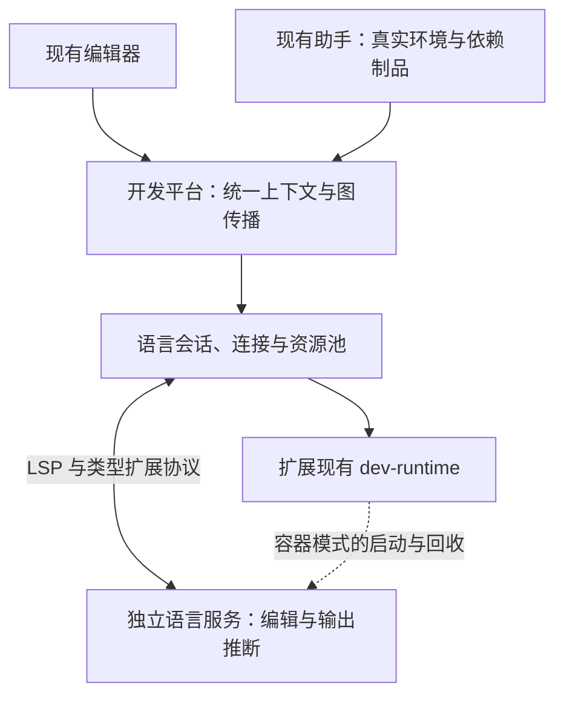
