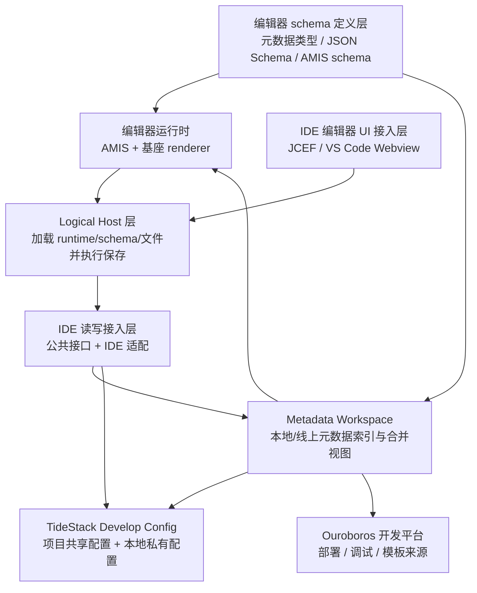
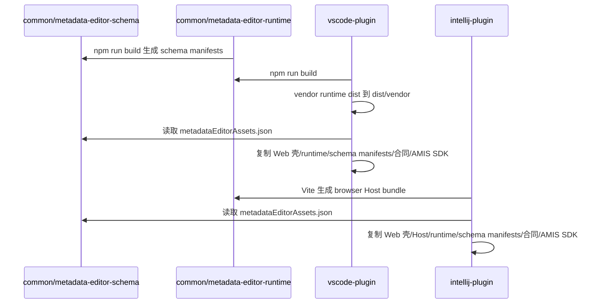

# IDE 插件架构

## 总览

IDE 插件体系按“公共 Web 编辑内核 + Schema 纯资源包 + IDE 薄适配层”组织。元数据类型定义、编辑器注册表和 i18n/capability 等声明式资源沉淀在 schema 包；AMIS 渲染、Host、序列化和保存协议沉淀在 runtime 包。IDEA 与 VS Code 只负责文件系统、编辑器 UI、诊断、命令和私有配置的 IDE 原生接入。

## 分层职责

### 1. 编辑器运行时层

路径：`ide-plugins/common/metadata-editor-runtime`

职责：

- 承载 AMIS 表单渲染、Ouroboros 基座 renderer、表单变更监听和自动保存触发。
- 将 JSON 文本解析为表单数据，并将表单变更稳定序列化回 JSON。
- 展示 JSON 解析错误、schema 校验错误和宿主保存错误。
- 从 `metadata-editor-schema` 同步生成的 `schema-resources` 读取 schema manifest，不在 runtime 内维护 schema 源定义。
- `MetadataEditorSession` 统一封装 load/save/validate/state/host-error response 语义；VS Code Webview 和 JetBrains Browser Host 只做 transport adapter，不重复拼装编辑器状态机。
- 不依赖 VS Code API、JetBrains OpenAPI 或任一 IDE 的文件系统 API。
- `runtime/metadata-editor-webview.html` 是两端唯一的 Web 编辑器页面壳；主题、布局和 runtime mount 不在 IDE 插件内重复实现。

内部物理分层：

- `src/core`：元数据 contribution、schema 合同、序列化、i18n、错误类型等纯规则；不得依赖 use case、browser、AMIS 或 IDE 代码。
- `src/usecases`：编辑器 host/session/state、metadata creation、develop config 等应用流程；只依赖 `core` 和传入的 bridge interface。
- `src/adapters`：browser host、Webview HTML/host script、AMIS editor runtime 等外层适配；可以依赖 `usecases` 和 `core`，不得被内层反向依赖。

普通元数据类型使用基础 AMIS form；`ui-schema` 类型通过 `editorKind: amis-editor` 使用完整的官方 AMIS Editor。两者共用同一 Web 壳、Host、文件保存和主题/语言协议。

### 2. 编辑器 Schema 定义层

路径：`ide-plugins/common/metadata-editor-schema`

职责：

- 以纯 JSON 资源定义 `MetadataTypeContribution`：模型类型、文件后缀、旧规范路径、中文显示名、JSON Schema 和 AMIS 表单 schema。
- 以纯 JSON 资源定义不同元数据类型的编辑器注册信息，而不是在一个大编辑器内部再路由。
- 复用同一套 schema 给 IDEA、VS Code 和未来在线开发平台。
- 维护路径匹配规则：新规范使用 `*.authority.json` 这类后缀，旧规范继续支持 `resources/META-INF/ouroboros/**` 子路径。
- 维护 IDE 注册派生规则：`metadata-types/*.json` 是 metadata type 的事实源，`metadata-editors/*.json` 是编辑器注册事实源；schema 包构建出 VS Code `viewType`、IntelliJ `editorTypeId`、文件匹配模式和 schemaName manifest，IDE 侧只消费这些描述。
- 维护创建与打包声明：`metadataCreationContract.json` 定义 `src/main/metadata`、路径规则和模板默认值规则，`metadataCreationCases.json` 是 TS/Kotlin 共用 case corpus，`metadataEditorAssets.json` 是 VS Code 与 IDEA 共同消费的 Webview/JCEF 资产清单。
- 维护中英文语言资源：`common/metadata-editor-schema/i18n` 是插件文案、metadata label、配置页文案和能力描述的事实源。VS Code 的 `package.nls*` 由该资源生成，IDEA 通过 `TideStackMessages` adapter 读取同一资源。

### 2.1 元数据文件创建 module

路径：`ide-plugins/common/metadata-editor-runtime/src/usecases/metadataCreation.ts`

职责：

- 根据 metadata contribution、选中目录和用户输入生成创建计划。
- 统一处理默认路径、后缀补全、固定集合文件路径校验和模板序列化。
- 从 `metadataCreationContract.json` 读取路径规则和默认值 fallback；不要在 TS 与 Kotlin adapter 中各自硬编码 `src/main`、`.json`、`metadata.json` 或 `example` 语义。
- 只返回目标路径、模板字段默认值和 JSON 文本，不直接读写 IDE 文件系统。
- 固定集合文件由 contribution 的 `fixedFileName` 推导，不在 IDE adapter 中维护第二份文件名到类型的映射。
- VS Code 的 Command Palette、`New File...` 和 Explorer 右键入口都进入同一个 creation module；IDEA 的 `NewGroup` 使用同一份 contribution/i18n 资源，文件写入仍由 IntelliJ adapter 完成。

该 module 的 seam 是“创建计划”，不是 IDE 文件操作。VS Code 和 IDEA 是不同 adapter：它们负责选择目录、弹出输入 UI、检查文件是否存在、写文件并打开编辑器。

### 2.2 Metadata Workspace module（规划）

未来会在公共层增加 Metadata Workspace module，用来承载本地元数据、开发服务器元数据和派生合并视图，而不是让编辑器 runtime 或 IDE adapter 直接把“当前文件”当作唯一事实源。

职责：

- 维护元数据 identity、source、revision、freshness 和 priority 等公共语义，区分本地文件、开发服务器模型/资源和后续可能的派生来源。
- 建立常驻内存索引或缓存，支持按类型、名称、路径、引用关系和数据源用途查询元数据。
- 统一执行本地与线上元数据的优先级合并，向表单数据源、引用选择器、校验器和编辑器提供 merged view。
- 将同步、刷新、冲突检测和远程能力探测收敛到一个公共 module；IDE adapter 只负责触发刷新、展示状态和打开资源。
- 为开发服务器模型和资源浏览预留 catalog/read/manage 能力；管理能力必须通过 capability 标识开启，不假定所有平台或项目都允许远程写入。

该 module 的 seam 是“元数据查询与合并视图”，不是具体缓存实现。Local metadata source、development-server metadata source 和未来其他 source 都是 adapter。VS Code 可能用 Tree View / virtual document 暴露线上资源；IntelliJ 可能用 Tool Window / VirtualFileSystem 暴露线上资源。是否能融合进原生文件管理器由 IDE 能力决定，但两端必须消费同一 Workspace interface 和同一组 source/priority 合同。

当前不实现同步、缓存和线上浏览；本节只约束后续架构，避免把这类能力散落进单个编辑器、单个命令或单个 IDE 的私有实现中。

### 3. IDE 读写接入层

公共接口位于 `common`，IDE 适配位于 `intellij-plugin` 与 `vscode-plugin`。

职责：

- 通过 IDE 原生 document/file API 读取、修改和保存文件，保持 undo、dirty、save、外部变更监听等 IDE 行为一致。
- 发布 IDE 原生 diagnostics。
- 提供列出元数据文件、打开引用、处理保存冲突等宿主能力。
- 后续如需访问远程元数据，只通过 Metadata Workspace module 的 source adapter 接入，不在编辑器 Host 或 IDE UI adapter 中直接调用平台接口。
- TideStack Develop Config 的文件合同由 `common/contracts/tidestack-develop-config.json` 定义；IDE 适配只负责项目根目录解析、文件写入和 UI 入口。
- TideStack Develop Config 的纯语义由 common `developConfig` module 定义：读取 legacy alias、按合同排序、移除废弃字段并生成 shared/local 文档。IDE adapter 只负责存储位置、原生 UI 和文件读写。

### 4. Logical Host 层

位置：`ide-plugins/common/metadata-editor-runtime`。

职责：

- 为嵌入式 Web 编辑器提供统一加载入口：运行时脚本、AMIS schema、当前文件内容和保存接口。
- 通过 IDE 读写接入层完成文件加载与保存，不直接绕过 IDE document model。
- 将 Web 端 message、HTTP-like request 或 JCEF query 归一化为同一套 `MetadataEditorHost` 调用；VS Code Webview 的 message transport bootstrap 由 common runtime 生成，IDE adapter 只传 initial state、theme 和 locale。
- 隔离 Web runtime 与 IDE UI 容器差异，使 VS Code Webview 和 JetBrains JCEF 共享尽可能多的协议与测试。

当前实现采用 logical host，不额外启动 loopback 服务。VS Code 扩展直接调用公共 TypeScript Host；IDEA JCEF 加载由同一源码生成的浏览器 Host bundle。两端图形编辑主路径共用类型解析、JSON 解析、schema 校验、editor state 组装和保存后的诊断流程。IDEA 仅在 JCEF 不可用的文本回退路径保留 JVM 侧校验器。

元数据结构契约统一维护在平台公共 `metadata-schema/`，由 `scripts/skills/sync_distribution.py` 分发至 `common/metadata-editor-schema/schemas/`、手册、Skills 与模板。类型贡献用 `jsonSchemaFile` 引用包内文件；UI 类型通过 `legacyJsonSchemaFile` 声明旧目录中的组件内容契约。构建产物包含完整 Schema 集合和 Ajv 预编译校验器，TypeScript Host 离线执行，不依赖 `unsafe-eval`。IDEA 文本回退校验使用 networknt 执行同一集合，覆盖引用、条件、组合约束与枚举，并共用分发的行为用例。

### 5. IDE 编辑器 UI 接入层

路径：`ide-plugins/intellij-plugin`、`ide-plugins/vscode-plugin`

职责：

- IDEA 使用 `FileEditorProvider` + JCEF 承载 Web 编辑器；JCEF 不可用时回退到文本编辑体验。
- VS Code 使用 Custom Text Editor + Webview 承载 Web 编辑器。
- 为每种元数据类型注册独立 editor/type contribution。
- 暴露 IDE 原生命令、设置页、调试入口和未来项目模板入口。

## 平台集成

部署与远程调试当前在 IDEA 插件中已有实现：

1. 构建项目产物。
2. 使用本地私有 devKey 向开发平台解析并授权 profile。
3. 上传扩展 jar。
4. 通过 `appName + profile` 解析目标容器并重启。
5. 创建远程调试 session。
6. 创建并启动 IDE Remote JVM Debug 配置。

VS Code 后续实现调试命令时，应复用同一套 TideStack Develop Config 和平台 API DTO；构建命令、进度 UI、debug attach 行为保留 IDE 适配差异。

## TideStack Develop Config

TideStack Develop Config 是项目与开发平台、高低开融合能力之间的统一配置入口，不局限于远程调试。

配置分两层：

| 文件 | 是否提交 | 字段 | 用途 |
|---|---|---|---|
| `.tidestack/develop.json` | 是 | `schemaVersion`、`developmentServerUrl`、`appName` | 团队共享的项目绑定信息 |
| `.tidestack/develop.local.json` | 否 | `schemaVersion`、`devKey` | 开发者本地私有凭据 |

约束：

- `developmentServerUrl` 与 `appName` 是公共项目事实，可以提交。
- `devKey` 是本地私有配置，不得提交；仓库 `.gitignore` 忽略 `.tidestack/develop.local.json`。
- `profileId` 与 `containerId` 不属于手工配置项：IDE 在运行时用 `devKey` 授权得到 profile，再按 `appName + profile` 从平台解析目标容器。
- 新功能优先扩展这套 develop config，而不是新增只面向 Debug 的设置命名空间。
- 后端授权接口使用 `POST /api/dev/{appName}/authorize`，请求字段为 `devKey`；不再保留 profile 前缀的历史授权接口。

## 打包流

## 扩展边界

- 新增元数据类型：优先扩展 `MetadataTypeContribution`，不要在 IDEA 或 VS Code 内复制 schema 判断、创建模板、注册描述或显示名。
- 新增 metadata runtime/schema/contract 资产：先更新 `metadataEditorAssets.json`，再让 VS Code copy/verify 脚本和 IDEA Gradle 资源处理消费同一清单。
- 新增 IDE：实现 `MetadataEditorDocumentBridge` 和 UI transport，不重新实现逻辑 Host、编辑器 schema 或 Web 壳。
- 新增调试能力：共用 TideStack Develop Config 和平台请求 DTO，IDE 构建、命令和 attach 流程保持适配层实现。
- 新增元数据同步、缓存或远程浏览能力：先落到 Metadata Workspace module 的 source/priority/catalog 合同，再由 VS Code Tree View、IntelliJ Tool Window 或原生文件视图 adapter 呈现。
- 新增项目模板：共享模板描述文件，IDEA 使用原生模板能力，VS Code 使用命令式 scaffold 或等价能力。
- 新增插件能力或 Marketplace/README 文案：先更新 common capability manifest 与 i18n 资源，再让 IDE adapter 或文档消费。

## 关键决策

- 将 IDE 插件移出 `frontends/web`，因为它们属于开发工具集成面，而不是平台 Web 前端应用。
- 保持 runtime npm 包名 `ouroboros-metadata-editor`，避免 VS Code import churn；物理目录拆为 `metadata-editor-runtime` 和纯资源 `metadata-editor-schema`。
- 当前继续从 `frontends/web/node_modules/amis/sdk` 打包 AMIS SDK；后续可单独设计公共层依赖/vendor 策略。
- TideStack Develop Config 分为可提交的项目共享配置和已忽略的本地私有 devKey，profile/container 等运行时目标由平台解析，避免不同 IDE 各存一套派生信息。
- 跨语言能力优先共享声明式合同和浏览器 bundle；只有必须运行在 IDE 原生生命周期中的代码保留 Kotlin/TypeScript 适配。
