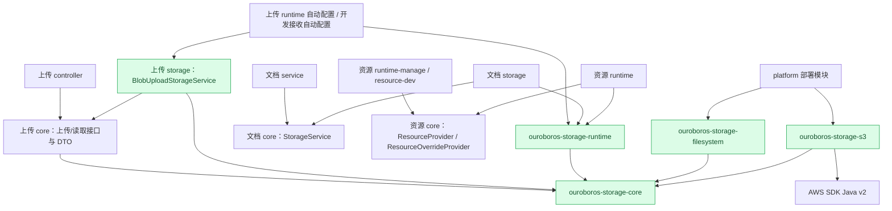

# 公共内容存储

公共存储为上传、文档、资源提供内容 IO。消费者共用契约、实现代码和装配逻辑，每个消费者拥有独立配置、BlobStore 和 S3Client；相同参数也不会合并实例。

## Maven 模块



箭头表示本次相关的生产 Maven 依赖，省略平台原有能力聚合的中间链路，遵守全仓[接口与实现依赖隔离（P1-16）](../../docs/architecture-constraints.md#15-接口与实现依赖隔离-p1-16)。上传 storage 实现与 HTTP runtime 分包，core 不包含 BlobUploadStorageService 或定时清理实现。

聚合 `ouroboros-storage` 是 POM。core 包含内容与分片契约；runtime 负责配置绑定和调用既有 SPI；filesystem/s3 注册 `BlobStoreFactory`。部署模块引入所需后端 JAR；仅有 BOM 或 runtime 不能获得后端实现。

## 使用与所有权

```java
var configuration = StorageConfiguration.filesystem("./data/documents");
try (BlobStore store = new BlobStores().create(configuration)) {
    store.put("reports/2026/报告.txt", input, OptionalLong.empty(), Optional.of("text/plain"));
    try (ObjectRead read = store.open("reports/2026/报告.txt", Optional.empty())) {
        read.content().transferTo(output);
    }
}
```

示例中的 input/output 由调用者关闭。返回的 ObjectRead/输入流须由读取方关闭。消费者停止接收请求、结束正在进行的 IO 后再关闭自己的实例；关闭一个实例不会关闭其他实例。公共库不注册全局 BlobStore Bean。

## 基础合同

| 操作 | 语义 |
| --- | --- |
| `put` | 完整替换一个对象；长度可未知，声明长度时精确校验；不关闭调用者输入流。源读取失败保留原内容。完成请求超时可能结果不确定，异常明确说明。 |
| `stat` | 返回大小、可选类型、时间、ETag；缺失返回 Optional.empty，权限与网络错误传播。ETag 是后端标识。 |
| `open` | 流式读取；可选闭区间 ByteRange，终点越过 EOF 时截断；起点超过 EOF 或空对象请求范围时报错。 |
| `delete` | 幂等删除；缺失成功，其他失败传播。 |
| `list` | 按 key 前缀分页，正 limit；继续令牌不透明，仅用于原配置与前缀。没有跨页快照或统一排序承诺。 |
| `close` | 释放本实例资源；重复关闭安全。 |

key 是相对逻辑路径，保留 Unicode、空格和 URI 特殊字符。绝对路径、盘符、反斜杠、点段、空段、控制字符和 `.ouroboros-storage/` 技术命名空间被拒绝。URL 在 HTTP 边界按段编码。不同后端还受各自 key 长度与文件系统限制约束。

filesystem 在同一根文件系统的技术目录写完整临时文件后替换目标，支持时使用原子 move。root 由部署方控制，禁止不可信进程修改目录或并发替换为符号链接。NFS/SMB 等挂载目录可复用此实现，锁、权限、rename 行为需在实际挂载环境验证。

## 分片扩展

`MultipartBlobStore` 提供 begin/inspect/part/complete/abort。上传业务层串行化同会话命令，按 partNumber 排序，按不透明回执选择重传版本；完整回执重复完成可重试。inspect 仅提供目标 key 和技术状态，用于在正确目标上使用既有锁。

filesystem 将小片暂存于自己的技术目录；S3 将旧 HTTP 小片暂存于专属技术前缀，完成时有界读取并通过原生 multipart 上传最终对象。普通 S3 put 直接使用有界原生分片，不经过旧协议暂存。不存在统一分片暂存平台。

完成状态保留到上传域的会话期限，以支持重复完成。abort 清除会话与临时片，不删除最终对象；取消失败传播，上传域保留到期记录后重试。COMPLETING 表示完成结果不确定，保留技术内容并要求人工核对，禁止盲目取消和覆盖。

## 后端配置

filesystem 只接受 `root-directory`。S3 参数如下：

| 参数 | 要求 / 默认值 |
| --- | --- |
| `bucket`, `region` | 必填，bucket 必须预先存在 |
| `endpoint` | 可选 HTTP(S) 服务地址；MinIO 自定义地址需要显式设置 |
| `path-style-access` | `true` / `false`，默认 false；本地 MinIO 通常 true |
| `credentials-mode` | default（默认凭据链）或 static |
| `access-key`, `secret-key`, `session-token` | static 模式的凭据，token 可选；从环境/密钥系统注入 |
| `key-prefix` | 默认空；非空须以 `/` 结束，用来隔离消费模块的物理键空间 |
| `technical-prefix` | 默认 `.ouroboros-storage/s3/`，须位于保留技术空间 |
| `part-size-mib` | 5～128，默认 8；每次并发写入占用有界的分片缓冲 |
| `connection-timeout-seconds` | 默认 10，正整数 |
| `read-timeout-seconds` | 默认 120，正整数 |

S3 SDK 固定为 2.57.3，校验和协商使用 WHEN_REQUIRED。MinIO 固定源码 tag `RELEASE.2025-04-22T22-12-26Z` 的集成行为验证记录见测试报告。阿里云 OSS、腾讯云 COS、华为云 OBS 尚未使用真实账号验证；现阶段是候选 S3 适配配置，不能标为已认证兼容。某家平台无法满足基础合同再新增其 factory/backend，不把厂商请求类型加入公共接口。

## 扩展后端

实现 BlobStoreFactory，并在 `META-INF/services/com.ouroboros.storage.BlobStoreFactory` 注册。工厂 type 必须唯一；未知类型、重复类型、未知选项和新旧配置冲突均显式失败。每次 create 返回新实例，不缓存按参数合并的实例。

数据库 BLOB/GridFS、SFTP/WebDAV 可作为后续后端，但当前没有调用需求，不新增依赖；NAS 挂载优先复用 filesystem。业务事务、资源发布、GC、墓碑、业务文件表、访问权限均由消费者协调层管理。

消费配置与迁移见[存储配置指南](../../docs/guides/content-storage.md)，职责图见[公共存储设计](../../docs/design/cross-cutting/content-storage.md)。
