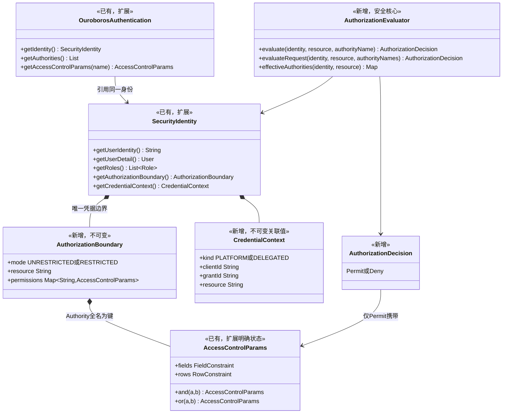

# 委托凭据的统一权限决策设计

本文面向安全、业务模型和协议组件维护者，细化[安全模块设计 §4.6](DESIGN.md#46-委托授权边界)。当前分支已在既有角色授权上增加凭据边界与统一求值器，使原 API、逻辑流、上下文和数据消费者使用有效权限。本文维护当前机制与执行约束；单次验收记录归关联实施任务，不代表当前部署状态。

OAuth2 客户端配置与授权确认分别见[客户端授权设计](../ability/ouroboros-oidc-server/authorization-design.md)和[确认流程设计](../ability/ouroboros-oidc-server/consent-flow-design.md)，令牌信任见[协议组件设计 §5.1](../ability/ouroboros-oidc-server/DESIGN.md#51-令牌用途与统一-api-权限)。纯 OIDC 只处理身份及获准资料，不需要业务客户端权限 C、业务快照 G 或本次权限改造，也不能据此调用平台业务 API。

## 1. 现有主路径与扩展位置

当前主路径是 `AuthenticationFilterSupplier → OuroborosAuthentication.identity → AuthorizationEvaluator → AuthorizationDecision → 原权限消费者`。角色、Authority 定义、访问控制构建 SPI 和数据模型插件保持原有归属。

| 正式入口 | 当前职责 |
| --- | --- |
| [SecurityIdentity](ouroboros-web-security/ouroboros-web-security-core/src/main/java/com/ouroboros/security/identity/SecurityIdentity.java) | 持有真实用户、不可变凭据边界及来源关联，不改写共享 User/Role |
| [OuroborosAuthentication](ouroboros-web-security/ouroboros-web-security-core/src/main/java/com/ouroboros/security/authentication/OuroborosAuthentication.java) | 引用原身份，权限投影调用统一求值器；getRoles 仍返回真实角色 |
| [DefaultAuthentication](ouroboros-web-security/ouroboros-web-security-spring-adapter/src/main/java/com/ouroboros/security/authentication/DefaultAuthentication.java) | 原身份往返 Spring；请求参数经明确 Permit/Deny 取得 |
| [AuthorizationEvaluator](ouroboros-web-security/ouroboros-web-security-core/src/main/java/com/ouroboros/security/authorize/AuthorizationEvaluator.java) | 角色 OR、边界 AND、资源和可委托性校验；不依赖协议组件 |
| [数据插件](../ability/ouroboros-app-runtime/src/main/java/com/ouroboros/app/datamodel/plugin/AccessControlDataModelPlugin.java) | 同一决策落实于读取、写入和字段/行约束 |

边界属于这份凭据，不能放进临时角色、用户副本、第二份授权仓库或新增 ThreadLocal。旧实现曾把角色、缺失权限和空参数混用；当前消费者必须保持下面的统一执行语义。

## 2. 身份与接口契约

### 2.1 类型与归属

以下类型和方法分别归属于原安全核心、运行时适配和原数据消费者，协议组件只负责提供凭据边界。



`AuthorizationBoundary`、`AuthorizationDecision`、`AuthorizationEvaluator` 及字段/行状态放在 security-core。`CredentialContext` 只表达可信凭据来源与关联标识，不保存令牌明文、客户端密钥、协议对象或 G 的第二份副本；它与边界中的 resource 必须一致。PLATFORM 不填写 clientId/grantId，DELEGATED 必须完整填写。构造身份时一次校验，业务代码不得改写。

`DefaultSecurityIdentity(User)` 保留为原平台登录及现有系统身份的 UNRESTRICTED 构造入口；新增显式接收边界与凭据关联的构造入口。DELEGATED 与 UNRESTRICTED 组合无效，缺失或损坏的委托信息不能调用旧构造入口兜底。`DefaultAuthentication(User)` 在内部构造原平台身份，新增 `DefaultAuthentication(SecurityIdentity)`；内部最终只保存 identity，不另存一份 User 或边界。

UNRESTRICTED 是角色权限交集的单位元，**不是超级用户**。RESTRICTED 的权限 Map 为空表示没有业务授权，Map 缺少某 Authority 表示该权限拒绝；不使用通配 Authority、角色名或 API 路径充当键。值、集合和过滤树均深复制并不可变，不能持有 DefaultAccessControlParams 的可变 setting 或动态 User/Role。

### 2.2 正式求值 API

接口签名以[AuthorizationDecision](ouroboros-web-security/ouroboros-web-security-core/src/main/java/com/ouroboros/security/authorize/AuthorizationDecision.java)与[AuthorizationEvaluator](ouroboros-web-security/ouroboros-web-security-core/src/main/java/com/ouroboros/security/authorize/AuthorizationEvaluator.java)为准。前者是 sealed interface（Permit/Deny，拒绝原因由其内部 Reason 枚举定义）；后者是无状态 final class，通过 `standard()`取得标准实例，提供 `evaluate`、`evaluateRequest`、`effectiveAuthorities` 和 `permitsRequest`。本页不复制另一套接口定义。

角色归并、按名求值、边界求交在安全核心只实现一次。resource 是执行端按原 Authority 目标元数据及平台资源适配绑定的可信值，平台传 `platform-api`，不能取自请求参数、业务脚本自填值或直接复制 identity.resource 充当目标校验。HTTP 方法和路径仍由 Spring 适配层按原 Authority.apis 匹配，再传入全名集合；core 不自行解析 URL。`effectiveAuthorities` 仅投影 Permit 的 Authority，原 `getAuthorities()` 委托它，供过滤器、菜单和权限列表使用。求值器实现无状态，通过原构造/装配机制传入消费者；不增加静态可变注册表。

新增 `getAuthorizationDecision()`、`getAuthorizationDecision(name)` 返回明确决策。原 `getAccessControlParams` 两个签名只做同一结果的读取：Permit 返回 params，Deny 抛平台授权异常，由 Web 适配层映射为 403，不返回 empty。没有身份是 Deny；无请求上下文的无参调用是 `MISSING_DECISION_TARGET`，调用方必须提供 Authority 全名。

同一个 API 匹配多个 Authority 时，按名逐项求值。原平台凭据的接口入口保留“任一 Permit 即可进入”的规则，例如接入应用管理与安全管理可访问同一接口，控制器随后按各自权限检查应用及字段。接口入口的通过结果不提供数据权限参数。请求数据权限参数或使用委托凭据进入接口时，只有各 Permit 映射到同一数据目标、同一字段/行语义才能 OR 合并参数；定义不兼容时返回 `AMBIGUOUS_DECISION_TARGET`。在开放委托前修正原 Authority/API 映射。不得继续采用“多于一个便返回空参数”的行为。权限定义中加入 `Authority.isDelegable()`，默认 false；组件维护者完成执行链验收后才声明 true。`BaseAuthority/DefaultAuthority` 的复制要保留该声明；`MergedAuthority` 同名贡献者必须全部支持，不能用 OR 使未验收的新增 API 自动开放。复用现有 Authority 发现与权限树，不增设目录注册表。

## 3. 权限与参数的确定语义

### 3.1 权限点、字段与行

| 对象/状态 | 精确定义 | 消费规则 |
| --- | --- | --- |
| Deny | 身份缺失、权限不存在、角色未授予、边界未包含、资源不符或约束无法正确解析 | 不携带可执行参数；停止调用，不访问数据引擎 |
| Permit | 该 Authority 在当前凭据下获准；附带字段与行约束 | 每项数据操作仍按以下状态执行 |
| 字段 ALL | 当前权限定义/目标数据模型的全部业务字段，扣除显式禁止集 D | 不是任意目标的全部字段；只有模型解析完成才能展开 `*` |
| 字段 ONLY(S) | 仅集合 S 中的字段，扣除 D 后规范化 | S 为空规范化为 NONE |
| 字段 NONE | 不允许输入或输出任何业务字段 | 读取业务字段及提交业务字段时拒绝；count/delete 等不读写业务字段的动作由其自身 Authority 决定 |
| 行 ALL | 该 Authority 的目标内没有额外行限制 | 仅此状态可在数据适配时不添加 WHERE |
| 行 FILTER(P) | 满足已解析且可执行的既有查询条件 P | 查询、计数、修改、删除都与业务条件 AND |
| 行 NONE | 没有可访问的数据行，不是未知或空条件 | 查询返回空结果、count 返回 0；写入拒绝；不能序列化为空过滤 Map |

字段与行分别合并，延续原 RBAC 的维度模型，不建立字段随每一行变化的策略系统。禁止集是既有字段参数的规范化输入，不是新增客户端配置。先把每一方自身的允许集合减去自身 D，再做并集或交集，避免相互矛盾的 allowed/disallowed 状态。交集等价于“允许集合求交，再排除任一方禁止字段”；并集允许另一角色合法授予该字段。

ALL 可携带禁止集 D，按第 3.2 节的集合代数参与运算，不能把 ALL−D 当作无条件 ALL。创建授权快照时才按完整目标字段全集 F 冻结为 ONLY(F−D)，空集为 NONE；无法确定 F 时不开放相应委托。

原 `AccessControlParams`以 `getFieldConstraint()`和 `getRowConstraint()`提供明确状态。正式不可变值类型是[FieldConstraint](ouroboros-web-security/ouroboros-web-security-core/src/main/java/com/ouroboros/security/authority/accesscontrol/FieldConstraint.java)与[RowConstraint](ouroboros-web-security/ouroboros-web-security-core/src/main/java/com/ouroboros/security/authority/accesscontrol/RowConstraint.java)，均为 final class；构造和工厂方法以源码为准，不使用本页另拟的 record 签名。

ONLY 在构造时扣除 excluded 并清空冗余禁止集，空集合转 NONE；ALL 可保留禁止集，直到原目标模型解析实际全集。FILTER 必须有非空、可执行的条件树；ALL/NONE 无条件载荷。条件仅允许既有查询 DSL 支持的不可变标量、集合和操作符，不保存可执行脚本、任意对象或稍后读取的身份对象。

`commonFields` 只在构造角色 U 时纳入角色允许集合，不在 U 与 B 求交后重新添加。超级角色与角色空 setting 使用的 `SuperAccessControlParams` 对该 Authority 返回字段 ALL、行 ALL；字段定义只描述可配置能力，不能把完整授权缩为已枚举字段。它仍执行相同交集运算；不能通过 instanceof 提前返回而跳过边界。`RbacGrantedAuthorityModel` 的空角色 setting 现有语义仍为完整授权；它与“没有 Authority”严格区分。`DefaultAccessControlParams` 对 `$fieldControl` 空值统一使用默认不限制契约：字段控制能力存在不等于已选择限制；空 setting、未选择字段和空字段列表仍为 ALL/ALL。管理权限若要求显式字段选择，必须由 `fieldSelectionRequired` 明确声明，不能由元数据存在自动推导。

### 3.2 真值表

普通业务权限的限制按配置生效：模型未配置某操作的访问控制时，沿用原插件链；角色已获准某权限但未配置字段或行限制时，对该权限目标使用 ALL/ALL。空 setting（包括 null）、未选择字段、空字段列表均不构成限制；可配置字段的元数据本身不是允许字段白名单。组织范围未勾选任何选项、指定组织列表为空时，行状态为 ALL；明确选择“当前部门”但没有对应部门时仍为 NONE。没有取得业务权限或约束解析失败仍为 Deny，不与“未配置限制”混用。管理权限通过 `fieldSelectionRequired` 明确要求逐字段授权时，继续执行该显式规则。

权限点先做如下合并；“无授予”不是负向拒绝规则，现有角色模型不新增 deny-role。

| A | B | 角色授予 OR | 角色与边界 AND |
| --- | --- | --- | --- |
| Deny | Deny | Deny | Deny |
| Permit(a) | Deny | Permit(a) | Deny |
| Deny | Permit(b) | Permit(b) | Deny |
| Permit(a) | Permit(b) | Permit(a OR b) | Permit(a AND b) |

字段表中的 ALL 指无禁止集的全部字段，A、B 是扣除各自禁止集后的集合。ALL 带禁止集时按集合代数处理：`(ALL−D1) AND (ALL−D2) = ALL−(D1∪D2)`，OR 得 `ALL−(D1∩D2)`；与 ONLY(S) 求交得 `ONLY(S−D)`，求并得 `ALL−(D−S)`，无需 core 提前枚举未知模型字段。以下表按对称项省略镜像行。

| 字段 A / B | OR | AND |
| --- | --- | --- |
| ALL / ALL | ALL | ALL |
| ALL / ONLY(B) | ALL | ONLY(B) |
| ALL / NONE | ALL | NONE |
| ONLY(A) / ONLY(B) | ONLY(A ∪ B) | ONLY(A ∩ B)，空集为 NONE |
| ONLY(A) / NONE | ONLY(A) | NONE |
| NONE / NONE | NONE | NONE |

| 行 A / B | OR | AND |
| --- | --- | --- |
| ALL / ALL | ALL | ALL |
| ALL / FILTER(Q) | ALL | FILTER(Q) |
| ALL / NONE | ALL | NONE |
| FILTER(P) / FILTER(Q) | FILTER(P OR Q) | FILTER(P AND Q) |
| FILTER(P) / NONE | FILTER(P) | NONE |
| NONE / NONE | NONE | NONE |

不要求 core 证明任意 P、Q 是否矛盾；已有规范化器能够确定矛盾时可转 NONE，否则原数据引擎执行 `P AND Q` 自然返回零行。AND/OR 数组保持合法的一层操作数列表，不把嵌套列表误当作条件 Map。

### 3.3 原公共运算的修正与旧消费者迁移

直接修正 `AccessControlParams.CombinedAccessControlParams`：AND 字段取交集，OR 字段取并集；禁止集及 `*` 按表规范化；行按明确状态合并。`AccessControlParams.empty()` 明确表示 NONE/NONE 的空访问能力，不能再与 ALL/ALL 共用解释。当前正式授权求值使用 AND 求交、角色授予使用 OR 求并；调用覆盖以源码和归属行为测试为准。既有 `merge()` 公共 API 保留其字段并集和 Map.deepMerge 的结构合并含义；它不是权限交集或并集，正式授权链禁止使用，不为其增加兼容开关或授权包装。本次不清理该公共 API。

生产 OR 位于 `OuroborosGrantedAuthority.merge()`，会影响所有角色消费者。现有 `FILTER OR 空Map` 错误地返回 FILTER；修正后，如果另一角色本就授予 ALL，应返回 ALL。这是可观察的正确性修复，可能使用户得到原角色已经授予但此前被错误收窄的数据。上线前按真实角色组合比对差异，列出 ALL 与 FILTER 混合的账号、Authority 和受影响查询，必要时在原角色配置中收窄误授的 ALL。不得增加旧算法开关或委托专用 OR。

`DefaultAccessControlParams.getFilters()` 当前通过原 `AccessControlFilterBuilder` 链处理 setting。已有 `RowScopeResolver` 只是该接口的空子接口，两套 SPI 描述符指向同一批 provider。原位将 builder 的解析结果扩为 `RowConstraint`，同步迁移默认 builder 和组织 builder；仍只执行一条原 SPI 链，不新增委托专用解析器。没有配置行限制可返回 ALL；配置了“当前部门”但用户没有部门时返回 NONE；未知条件、缺少解析器、无效值或异常直接拒绝，不能删除条件后返回 ALL。多 builder 对同一份角色 setting 的各项限制按原定义的组合语义生成一棵条件树，不用 Map 覆盖丢条件。

旧 `getFilters()` 仅作为明确状态的协议适配：ALL 可输出空 Map，FILTER 输出不可变条件树，NONE 抛拒绝异常。需要“零行”的消费者直接读取 RowConstraint 并短路。统一求值器把原权限定义的 commonFields 与 controlledFields 完整集合带入解析结果，供旧黑名单读取求补集；该集合只用于等价投影，不作为新的授权来源。旧字段投影同样不能返回会被下游解释成默认全部的空集合：ALL 可投影 `[*]`，ONLY 投影有限集合，NONE 的旧投影抛异常；明确状态的消费者直接处理 NONE。`getDisallowedFields()` 不能把 ONLY 退化成已有 controlledFields 中的禁止项，必须按原目标模型完整全集求补集；无法提供完整全集的旧黑名单消费路径不开放委托。脚本、逻辑流和数据插件均迁到明确状态，再保留同一结果的旧方法投影；不保留一份旧授权实现。源码已有默认字段和角色配置的解释不因接口升级而改变。

## 4. U、C、G、T 的形成与交集

```text
G = U创建时 ∩ C创建时 ∩ 本次实际批准业务权限
B = C当前 ∩ G ∩ T
E = U当前 ∩ B
```

U 始终来自真实用户当前角色，同名 Authority 的角色授予先 OR；C、G、T 仅在 OAuth2 业务授权存在时处理。首版 C 从原权限树选择可委托权限点，每项使用 ALL/ALL，不向客户端或用户提供字段白名单、强制数据条件、附加条件输入或选项级条件。用户只对本次实际可授予的“业务功能”整组确认。G 中的字段与行来自后端已有角色约束，并不是 UI 新增的选择项。

### 4.1 创建时冻结 G

授权确认服务在既有确认校验及配置 revision 检查通过后，对实际批准的业务 scope 逐项调用公共求值器，并与 C 求交。通过同一个最终 `OAuth2Authorization.attributes` 保存不可变 G；待确认记录、TTL 和 state 索引仍归原授权服务，不能新增一套 grant 仓库。

G 保存有版本的纯值：resource、Authority 全名、当前定义摘要、字段状态/集合、已解析行状态/条件。定义摘要来自原 Authority 的 API、访问控制定义及目标字段模型；不包含标题等展示文字。ALL 在有业务字段的权限上冻结为创建时实际字段全集的 ONLY，避免以后新增字段自动进入旧授权。无法得到确定字段全集或无法稳定序列化条件的权限不开放委托。

动态条件在创建时由原 builder 和可信用户/组织上下文解析成具体值，例如“当前部门及下级”冻结为当时的部门标识集合；G 不保存动态角色对象或待未来重新展开的部门表达式。执行时 U当前 重新解析当前组织属性，再与冻结 G 求交。因此从 D1 调至 D2 不会让旧授权自动获得 D2；继续访问新范围需重新确认。合法的明确 ALL 仍是全量，不把解析失败当作 ALL。

授权记录另存签发时的公开用户标识，与原 principalName 的内部 userIdentity 绑定；公开标识来源见[身份资料设计](../ability/ouroboros-oidc-server/identity-profile-design.md#2-公开用户标识)。G 中不重复保存用户或客户端主体。定义结构变化使旧 G 无法可靠执行时，该项拒绝并要求重新授权，不按新定义重解释旧快照。

### 4.2 当前求值伪码

```text
evaluate(identity, trustedResource, authorityName):
  if identity absent or AuthorityCenter cannot resolve exact authorityName: Deny
  U = OR(normalize(each real role grant for authorityName))
  if no role grant: Deny
  if boundary.mode == UNRESTRICTED: Permit(U)
  if credential metadata invalid or boundary.resource != trustedResource: Deny
  if authorityName not in boundary.permissions: Deny
  return Permit(AccessControlParams.and(U, boundary.permissions[authorityName]))

buildBoundary(currentClient, persistedGrant, verifiedAccessToken):
  require API authorization enabled and active exact access-token record
  require client / resource / account instance / snapshot schema match
  T = exact mapping of this access token's business scopes
  for each authorityName common to Ccurrent, G and T:
    require current Authority exists, isDelegable and definition digest matches
    B[authorityName] = Ccurrent[name] AND G[name] AND T[name]
  return RESTRICTED(resource, immutable B)  // empty B仍受限，绝不转UNRESTRICTED
```

T 的每个入选权限点同样为 ALL/ALL；未入选点直接消失。授权服务器只生成 B，不替 security 重写角色求值。刷新沿用 G、当前 C 和不超过原批准集合的 scope，刷新后缩小的集合继续约束后续刷新，不能通过原 G 恢复已放弃项。扩大 C、增加角色或角色字段权限不能扩大旧 G。业务授权关闭即不再形成可用业务边界，但合法身份用途按原协议独立判断。

## 5. 业务令牌与原认证扩展点的衔接

### 5.1 resource、audience 与 scope

首版平台业务资源标识使用既定 `platform-api`，与访问令牌的目标 audience 对应；边界 resource 必须精确一致。平台的内部令牌、ID Token、UserInfo Access Token、业务 Access Token 继续有各自用途，不统一算法、密钥或字节格式。

业务 scope 从现有 Authority 全名确定派生，采用 `authority:` 加 UTF-8 全名的无填充 Base64URL 编码；映射函数仅归属原协议组件，security-core 始终只使用 Authority 全名。服务端严格解码并要求重编码一致，再由原 AuthorityCenter 精确定位。它只是协议名称映射，不建立 scope 实体、别名表或第二套权限树。标准 `openid/profile/email/phone/offline_access` 不参与业务映射。仅注册当前客户端 C 中已声明可委托的权限，不接受通配前缀或从 API 路径猜权限。

### 5.2 验证后如何定位原授权与账号

在 ability 协议适配中实现原 `AuthenticationFilterSupplier`，通过原平台认证链接入。security 仅看到通过校验的身份与边界。验证过程必须完成以下连续绑定：

1. 按可信部署 issuer、允许算法及其固定公钥源验证 JWT，校验有效期、Access Token 用途与 `platform-api` audience；不从来路不明的 iss/jku 加载公钥。ID Token 的客户端 audience 或相同签名都不能替代用途校验。
2. 以原 `OAuth2AuthorizationService.findByToken(raw, ACCESS_TOKEN)` 查找原授权，要求实际保存的 Access Token 与本次令牌精确相同且 active。沿用已有 token SHA-256 索引；JWT 自报 grantId 不能替代此查询。
3. 校验授权记录的稳定 registeredClientId、签发客户端、关联平台会话与内部 principalName；目标 registeredClientId 使用[配置管理设计](../ability/ouroboros-oidc-server/configuration-management-design.md#21-权威值与内部字段)中的内部 registrationId，删除后相同 clientId 新建也必须不同。校验用户启用、会话归属/有效期及当前客户端能力。在线检查同时覆盖 public subject、G、用途、权限定义摘要和稳定客户端身份。
4. 使用授权记录 principalName 调用 `UserCenter.getUser(userIdentity)`。将 JWT sub、记录中的公开标识与当前账号的 publicSubjectId 三者比对；不可用 JWT 的公开 sub 直接查内部 userIdentity。删除后新建的同名账号不能继承旧授权。
5. 由该令牌的实际 scope、当前 C 与 G 形成 B，创建携带 clientId、原 authorization.id 作为 grantId、resource 和 B 的 SecurityIdentity，再包装为 DefaultAuthentication。令牌明文不进入身份或日志。

只有身份 scope、缺少有效业务 G 或资源不符时，业务认证失败，即使它可以访问 UserInfo。有限业务令牌不能调用平台登录、续接或令牌创建接口来获得 UNRESTRICTED 平台令牌；若未来需要再发凭据，新凭据必须保留同等或更小边界，本次不实现此能力。

### 5.3 识别、失败与接口接纳

平台 Token 认证对携带 Authorization 的请求沿原 TokenService、UserCenter 和委托身份解析器验证凭据。公开接口允许未认证访问，不强制匿名：有效平台 Token 建立当前用户及平台会话，有效委托 Token 保留委托身份、resource 和受限边界。无 Token、无效或过期 Token、重复或格式错误的 Authorization 请求头继续匿名访问，不能保留无效凭据前的完整平台身份；内部存储/配置故障仍报错，不能伪装成匿名成功。认证失败是否必须返回 401 复用 `AuthorizeCheckFilterSupplier.isAnonymousRequest` 和原 `AnonymousApiProvider` 的方法/路径匹配；保留 context path、PathPattern 与中间通配规则，不另建公开路径清单。

受保护接口仍通过 [AbstractAuthenticationFilter](ouroboros-web-security/ouroboros-web-security-runtime/src/main/java/com/ouroboros/security/authentication/filter/AbstractAuthenticationFilter.java) 和原授权过滤器处理。只有无效凭据且没有有效身份的请求，以前就不能访问受保护接口；本次不把它描述为新增的禁止规则。已识别的无效凭据在受保护接口提前终止；委托 Bearer 的候选识别只决定验证器，不等于已信任令牌。多个 Bearer、同时携带完整平台凭据与委托凭据的歧义请求拒绝，不能用过滤器顺序选权限更大的身份。

| 原接口类别 | 委托身份接纳规则 |
| --- | --- |
| 匿名公开 API | 无有效凭据时允许匿名访问；有效凭据建立对应身份，委托凭据仍保持原 resource 与受限边界，不获得平台管理会话 |
| 原 Authority 保护的业务 API | 必须声明 isDelegable、目标 resource 正确并得到该 API 的 Permit，且下游完整执行参数 |
| `AnyAuthenticationApiProvider` / `@PermitAll` 等仅登录 API | 默认不接受委托；需要开放时回到已有 Authority/API 定义明确其业务权限并验证下游，不将“已登录”当授权 |
| 登录、平台 token 刷新/创建、认证绑定、客户端管理等平台会话/管理能力 | 首版不因持有业务 token 自动开放，保留各自原完整平台认证与管理权限要求 |
| OIDC UserInfo、内省、撤销等协议端点 | 继续由原协议链按身份 scope、资源内省权限及授权状态处理，不借平台业务 API 接纳规则放宽 |

首次开放先列举并验收实际业务 Authority，不把全部现有权限一键标为可委托。管理界面的原权限树只允许选择这个已支持子集，后台保存和授权请求同样校验。

## 6. 全链路消费者改造矩阵

| 现有路径 | 原位修改 | 必须保留/验证的结果 |
| --- | --- | --- |
| `TokenAuthenticationFilterSupplier`、平台原登录 | 内部原令牌验证成功后构造 UNRESTRICTED 身份 | 原账号、角色、会话、内部 token 格式与登录响应继续工作 |
| `SpringSecurityCurrentSecurityContext`、`OuroborosAuthenticationHolder` | 优先取认证的 getIdentity；SpringWrappedAuthentication 往返保留同一引用；有 identity 时不得丢弃它再从 User 创建 | identity-only、认证-only、Spring 适配三条入口得出同一 B；未知委托认证拒绝适配 |
| `AuthorizeCheckFilterSupplier` | 保留现有请求作用域；调用公共按请求决策；委托不走 any-authentication 快速放行 | API 放行与参数决策一致，错误分发与 finally 清理不泄漏上下文 |
| `OuroborosAuthentication` 按名/按请求参数及 getAuthorities | 移除默认方法内的独立角色遍历，读取 evaluator；AnonymousAuthentication 的覆盖方法同样返回 Deny/抛拒绝，不能返回 empty | 同一 Authority 从所有入口取得同一字段/行限制 |
| `SecurityContextContributor.AuthContext` | 删除 identity.roles fallback；identity-only 也调用 evaluator；原 getAccessControlParams 与脚本别名投影同一结果 | 脚本不能通过别名或缺少 Spring 认证绕过 B；Deny 令执行失败 |
| `AuthFilterNode`、`AuthAllowedFieldsNode`、`AuthDisallowedFieldsNode` | 删除从 identity.User new DefaultAuthentication 路径；按名或当前请求调用 evaluator | Row NONE/Deny 不能输出 `{}` 继续查询；字段节点 NONE 不能被下游解读为默认全部 |
| `AccessControlDataModelPlugin` | 删除 getAccessControlParamsFromRoles；正式数据钩子调用 evaluator，或复用可信业务动作作用域选定的同一权限决策，再调用原 next-plugin | Controller 外的脚本、逻辑流和服务调用同样受保护，见第 7 节 |
| `BusinessBehaviorSecurity`、业务动作对象/关系解析、事件披露 | 作用域保留原 SecurityIdentity；identity-only 也使用 evaluator；字段和行检查使用显式约束 | 业务动作的模型内数据权限映射保留 clientId/grantId/resource 与边界；关联对象、事件及通知不能恢复原角色全量权限 |
| `AuthorityFieldsDecorator` | 有受保护操作时始终装配原 AccessControl 插件；原员工/部门/公司 setter 继续先于约束检查 | 仅字段控制、没有组织过滤器的模型也执行边界；不复制插件 |
| 菜单 `MenuServiceImpl`、`AuthenticationController.authorities` | 菜单 identity fallback 也读取 effectiveAuthorities；原权限列表投影 E | 不泄露角色全量能力为可执行权限；UI 隐藏不替代执行检查 |
| 报表 `DefaultDatasetExecutionContextResolver/PermissionInjector` | roles 保留身份资料含义；requiredRoles、exportRoles 不可代替 E；未完成原 Authority 与行/字段执行的报表暂不声明可委托 | 不因真实角色含 ADMIN 就允许超出 B 的查询或导出 |
| `EngineMappingPermissionGuard` 等按用户重新查角色/管理员角色放行的专用守卫 | 首版对应管理 API 不接纳委托；后续开放前在原守卫改用有效 Authority 决策，保留领域校验 | 委托不能借管理员角色越过边界；不为本次重建工作流权限 |
| 其他自定义查询、导出、关联读取、后台任务 | 在原 Authority 的执行链验证字段/行落实；未通过则 isDelegable=false | 不只验证最外层 Controller；数据插件外的直达路径不在首版开放范围 |

`CurrentSecurityContextHolder` 已有 scoped ThreadLocal 和 withIdentity/withContext，`AuthorizationDecisionContextHolder` 已有方法/路径 ThreadLocal；两者继续按原 finally 恢复，不再新增边界或结果 ThreadLocal。长生命周期任务只保存不可变凭据关联及边界上限，执行前重新验证当前 G/C/用户/会话，不能永久捕获旧 U。线程池不隐式继承安全上下文；显式 scoped 传播须同时保留边界，完成后恢复原上下文。无法在线重验证的异步业务首版不开放委托。

## 7. 原数据插件的执行契约

以下入口使用原 `DataModelPlugin`、QueryNormalizeContext、QueryDSL 和插件链；core/data 不反向依赖 security。每次先按插件配置的 add/search/edit/delete Authority 取得决策，Deny 返回失败的 Try 并由原异常映射处理，不能捕获后继续 next-plugin。

| 操作 | 字段执行 | 行执行 |
| --- | --- | --- |
| query | 将客户端 select、默认 select、关联输出与 ONLY 取交集；禁止字段不可经别名、表达式或关联展开重新输出；没有可输出字段时拒绝，不能传空 select 触发默认全部 | FILTER 在引擎分页前 AND；NONE 直接空结果，不能先查全表再过滤 |
| queryForUpdate | 与 query 使用同一字段检查和授权流程，不因对象加锁走另一条读取路径 | 保留原加锁调用，并执行同一行约束；业务动作前置条件仍在锁内重验 |
| count | 校验过滤、分组、聚合中使用的受控字段；不能通过禁止字段筛选推断数据 | 与 query 相同行约束；NONE 为 0，包括分页总数 |
| insert / batchInsert | 校验客户端提供键在允许集合中；原服务端 setter 的可信字段不视为客户端授权，但不能允许请求冒充该来源 | 检查原 setter、默认值处理后的最终新记录满足 P；NONE 拒绝；任一批次项不满足则整个操作失败 |
| update | 拒绝越界提交字段，按最终补丁检查；禁止字段不静默丢弃后返回“成功” | 原 WHERE AND P 约束旧记录；更新后记录也须满足 P，防止把合法记录移到边界外；检查和写入使用同一原事务/并发控制 |
| delete | 不需要输出字段，但其他条件字段仍受原查询规则约束 | 原 WHERE AND P；NONE 拒绝；不能因缺少授权将空 WHERE 放入执行器 |

允许字段要在原查询解析后检查实际来源字段，不能仅在结果中 omit 已知禁止字段；关系与关联模型也必须执行自身原权限。对于不输出字段但可推断其值的 sort/filter/group/aggregate，服务端使用现有字段元数据检查客户端指定的来源。服务端自己注入 P 时可引用内部权限维度字段，这不赋予客户端读取或自选这些字段的权限。首版无法正确分析的任意表达式或关联查询不开放委托。

写后行约束首版只开放原执行链能够原子检查的条件，例如可信组织 setter 写入后的等值/IN 约束。先读取再无条件更新不满足要求。无法校验更新后数据的模型，必须限制其原受保护数据维度不可由业务补丁改变；仍无法保证时，对应写 Authority 不声明可委托。任意复杂谓词、跨源写入和缺少事务保证的批处理不通过新增策略引擎勉强支持。

这些检查落实既有角色的数据/字段约束与 G 中冻结的旧约束，首版不会增加任何客户端或用户数据条件配置。内部登录也走同一数据执行路径；“无权限继续查”“越界字段静默丢弃”“写后越界”属于明确修复的旧行为，须在原调用方迁移与回归中记录，不以旧行为兼容为由保留旁路。

### 7.1 业务动作、历史快照与工作流事实

`BusinessBehaviorSecurity.withAuthority` 沿用业务动作既有的可信执行作用域，只为当前模型的数据操作选定该动作已发布的权限。`ScopedAuthentication.getIdentity()` 保留原身份；选定权限仍由统一 evaluator 求值，不能把委托身份重新包装为无限制平台身份，也不能向其他模型传播该映射。

历史/归档读取保留专有权限与源模型读取权限的双重校验。源读取存在行条件时，必须从快照查询的必需等值条件定位源记录，并证明该记录在当前源读取范围内；OR 分支不能证明唯一源对象。行条件作用于当前源记录，不套用历史字段值。源字段约束按既有 `sourceFieldMappings` 映射为快照字段允许集；固定查询条件、删除数据读取限制与加锁查询均保留。

工作流事实的内部身份仍只授予该模型的工作流权限和特定事件的生产权限；其无字段限制使用显式 ALL 表示，不能用 NONE 表示。业务动作对象/关系解析、事件披露直接消费字段/行约束，不经无法表示有限集合的旧排除字段接口转换。

## 8. 缓存、失效与发布回退

不缓存按 userIdentity 唯一键生成的 E，否则同一用户的不同客户端或授权会串权。首版每次执行边界从当前原配置、授权记录和原用户/角色/组织服务取得状态；C 与客户端状态使用原 ConfigurationService 新增的权威单键快照读取，与认证/发证读取同一路径，见[配置管理设计](../ability/ouroboros-oidc-server/configuration-management-design.md)。不能用本地陈旧配置缓存继续接受已关闭的业务能力。请求内可以复用同一可信身份和不可变 B，不新增长期决策缓存。现有 UserService、RoleService、UserRoleService、RoleAuthorityService 的缓存驱逐继续使用；需验证角色收回、组织变更的失效确实覆盖 User 聚合视图与多实例。未能保证的来源不能承诺下一请求立即收紧，也不能纳入首版委托支持范围。

客户端列表的 revision 仅用于 CAS 与配置一致性，registeredClientId 保持稳定，修改其他客户端不使本授权失效。C 收窄、业务能力关闭、grant 撤销、会话/账号失效在状态对实例可见后的下一业务校验生效；C 扩大不突破 G。修改 G 只允许新授权替换原授权生命周期中的快照，刷新不重新计算更大的 G。定义摘要、快照格式、解析器不兼容时拒绝受影响项并要求重新授权，不把损坏快照当作新授权。

发布顺序是先完成公共参数语义、消费者和原内部登录回归，再开放已验收 Authority 的声明，最后启用 OAuth2 业务令牌接纳。纯 OIDC 可独立发布。版本升级前保存原角色与客户端配置，检查 ALL/FILTER 的 OR 差异以及原接口多 Authority 的歧义，并修正源定义或源配置；不同时运行两套算法。

回退先关闭客户端的业务 API 能力并停止业务凭据接纳，保留原协议撤销/退出清理，清理或使不兼容 G 失效；原内部登录仍走 UNRESTRICTED。回退版本不能把带 G 的令牌转换为平台令牌，不能忽略残留边界后开放业务 API。公共 OR/AND 和数据执行修复涉及原用户行为，回退须按发布前配置快照与差异记录评估，不能以运行时兼容开关恢复有漏洞的授权算法。

## 9. 行为验收

以下为持续维护的行为验收要求，复用[统一认证验收场景](../testing/integration/feature/auth/sso-dynamic-config-oidc/contract.md)。单次报告、环境与覆盖范围归关联任务；本机 tmp 路径不构成共享验收证据。

1. 同一用户的内部登录为 UNRESTRICTED，委托登录为 RESTRICTED；共享 User、角色与 claims 未被改写。Spring 往返、identity-only、脚本、三种逻辑流节点均保留同一边界与 clientId/grantId/resource。
2. 角色 A 允许 `{id,name}` 和部门 D1，角色 B 允许 `{id,cost}` 和 D2；OR 得到字段并集及 D1 OR D2。边界只允许 `{id,name}` 和 D1 时，所有消费者得到 `{id,name}` 与 D1，管理员超级角色同样受限，commonFields 不会复活被边界排除的字段。
3. 对 ALL/ONLY/NONE 与 ALL/FILTER/NONE 逐格验证表中运算；尤其 FILTER OR ALL 得 ALL，FILTER AND ALL 得 FILTER，字段空交集为 NONE。Deny、NONE、解析异常均不能触发无条件 next-plugin。
4. G 创建时仅允许字段 `{id,name}`、部门 D1；以后给用户增加 cost 和 D2、扩大客户端 C，旧令牌仍不能访问 cost/D2。角色收回、部门变更、C 收窄、grant 撤销及账号/会话失效后，原服务在线校验按约定收紧。
5. 同一 access token 经原 token 索引精确关联原授权；伪造 grantId、错误 aud、ID Token、仅身份 scope、缺少 G、public sub 与内部账号实例不符均失败。识别后的失败与双凭据请求不能回退完整平台身份。
6. query、单条/关联读取、count/分页总数、insert、batchInsert、update、delete 从 API、服务、脚本和逻辑流分别进入，字段与行限制一致；字段-only 模型也装配原插件。拒绝输入不被静默删除；批量任一项越界不产生部分写入；旧行合法而新行越界的更新失败。
7. 新增模型字段不进入旧 G，定义不兼容和解析器缺失不变为全量；无部门的“当前部门”条件得到 NONE。任意表达式、跨源写入等未实现执行能力的 Authority 不出现在可委托选择中，伪造后台提交也拒绝。
8. 原本地/LDAP/外部登录、token 刷新、注销、平台会话、管理员、内置角色、菜单、脚本与逻辑流成功行为回归。对已列明的 OR 正确性修复、Deny 语义和写入修复验证预期差异；其他内部登录行为不得因增加边界而变化。
9. 纯 OIDC 客户端无 C/G 即完成合法身份流程；仅 UserInfo 可用不代表平台 API 可用。暂停发证、关闭业务能力与禁用客户端按各自生命周期处理，不混成同一权限开关。
10. 并发两客户端、两用户、嵌套 scoped 执行和线程池复用不串边界；异常后恢复原上下文；异步重新校验失败终止业务执行，不降为系统身份。

## 10. 业务模型的委托声明与授权快照

原业务模型编辑器在查询、新增、修改、删除的访问控制区域提供“允许第三方应用委托访问”，对应 `accessControl.<操作>.delegable`，默认 false。原 `AbstractAuthorityMPS` 把声明投影到原 `BusinessModelAuthority`，seal 后不可修改；原权限树和客户端选择器自动发现，不增加权限注册表。

声明可委托的操作即使没有启用可配置行/字段控制，也必须由原 `AuthorityFieldsDecorator` 装配 AccessControl 数据插件，并投影完整字段定义。字段的名称、类型与展示名称分别保留；字段集合的追加不覆盖已有集合。

`OidcGrantPermissions` 在原授权记录内冻结字段全集和权限定义摘要。ALL 在创建时转为当时的 ONLY 集合，保留排除字段与已解析行条件；未知字段全集拒绝授权。摘要按确定顺序包含 API、字段名称/类型和过滤器执行语义，不包含展示标题。兑换、刷新、业务令牌解析及内省检查当前定义；API/字段/过滤器语义改变后旧范围不可继续使用。它是协议授权记录内的纯值校验，没有第二份授权存储。
