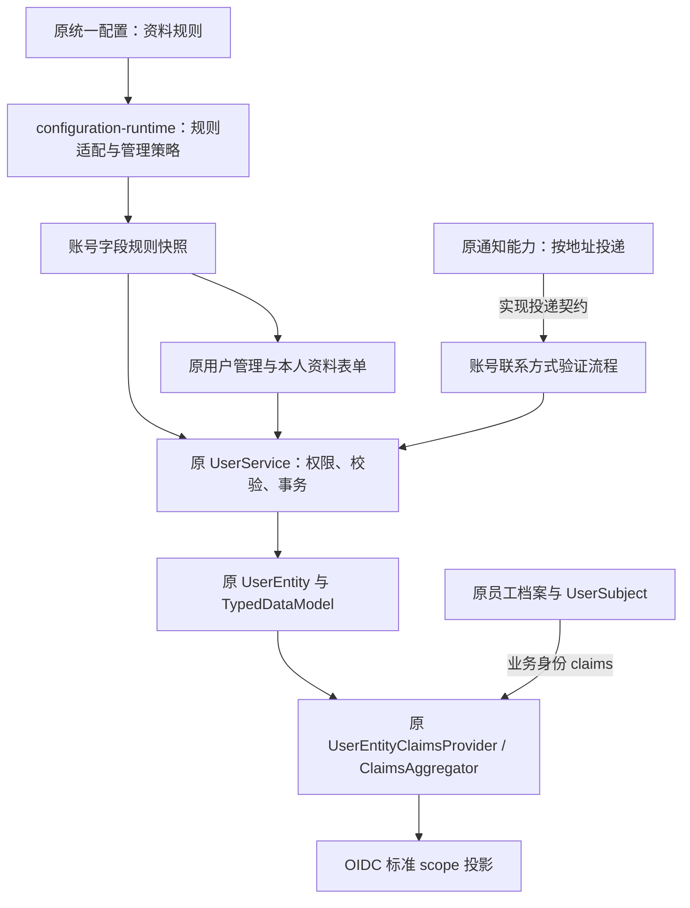
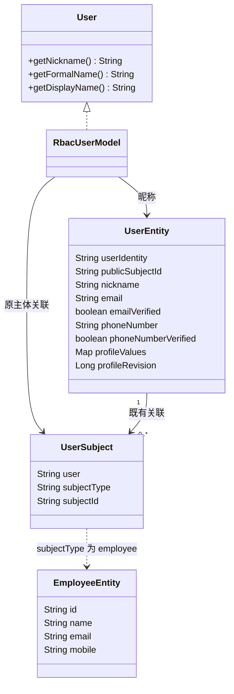

# 账号资料、联系方式与自助维护设计

本文面向平台组件维护者，定义账号资料的归属、字段规则、存储、自助维护与联系方式验证。账号资料由原安全账号能力提供，独立于员工档案和 OIDC；OIDC 的公开标识、迁移与协议投影见[用户标识与个人资料设计](../ability/ouroboros-oidc-server/identity-profile-design.md)。字段归属与 OIDC 投影分别由两份设计维护，不以外部产品的资料字段直接替代本平台契约。

**实现状态：当前分支已扩展原 UserEntity/UserService，提供账号资料规则、自助与管理员维护、独立联系方式变更及验证。** 原通知渠道负责投递；电话验证需要部署可用短信模板/渠道，不能把邮箱验收推定为真实短信验收。系统验证状态见验收报告。

## 1. 原有主路径与职责

原主路径是 `UserController → UserService → TypedDataModel<UserEntity>`；UserCenter 聚合用户，UserSubjectCenter 关联业务主体，ClaimsProvider 提供身份与业务 claims。员工模板、EmployeeProfileArchiveService 和扩展值属于组织组件。

账号联系邮箱、联系电话用于描述账号持有人；员工工作邮箱、工作电话属于人事档案。两者允许不同，并分别拥有生命周期。没有员工关联、组织组件未安装、员工解绑或岗位变更，都不能使账号资料不可维护。

| 对象或机制 | 归属与调整 |
| --- | --- |
| 账号资料、验证状态、资料版本 | 扩展原 RBAC 管理模块的 UserEntity 和 UserService，仍保存到原账号模型 |
| 字段规则的数据结构与值校验 | 由账号能力定义；不引用 PersonnelProfileFieldDefinition 或 EmployeeProvider |
| 统一配置读取及管理装配 | 由原 configuration-runtime 的适配器实现安全 core 中的规则读取契约；安全运行时仅声明默认元数据，不反向引用配置实现 |
| 字段编辑、管理页和本人页 | 原 metadata/UIModel/UISchemaProvider、用户管理和用户菜单；AMIS 渲染服务端投影 |
| 联系方式验证的判定与写入 | 原账号能力负责，验证结果不是普通资料字段 |
| 邮件、短信投递 | 既有通知 runtime 适配账号声明的投递契约，复用 AddressNotificationDispatcher，直接按新地址投递 |
| 员工和人事档案 | 保留在原组织组件，经既有 UserSubject 关联；无自动复制、双向同步或“账号为空则取员工”的隐式回退 |
| OIDC | 只通过原 UserCenter/ClaimsProvider 链取资料，按实际获准 scope 输出；不持有资料存储或编辑服务 |

配置读取复用已经存在的依赖和元数据加载机制，不新增 security → ability 模块依赖，不以历史依赖为由引入组织、通知或 OIDC 实现。通知适配方向是 ability → security 自有契约。新增 Bean、元数据和自动配置均通过原 META-INF 机制注册；不建立资料中心、另一份账号库或字段注册表。



图表示职责和数据流；通知适配不赋予通知组件修改账号验证状态的权限。

## 2. 存储与账号不变量

### 2.1 原账号模型中的字段

| 字段 | 存储与语义 |
| --- | --- |
| userIdentity | 原内部主键、登录名和会话定位，不改为邮箱或手机号 |
| publicSubjectId | 原账号增加的不可变公开 UUID；生成、保护和迁移沿用[公开标识契约](../ability/ouroboros-oidc-server/identity-profile-design.md#2-公开用户标识) |
| nickname | 可空文本，账号昵称，由本人或有权限的管理员维护；复用本次资料功能的物理列 display_name |
| formalName | 只读投影 User.getFormalName()，来源为原关联 Subject.getName()；员工账号对应 Employee.name，不新增账号列 |
| displayName | 只读投影 User.getDisplayName()，按非空白 nickname → formalName → userIdentity 计算，不持久化 |
| avatar | 原字段，继续只读投影；本期不增加上传或任意 URL 写入 |
| email / phoneNumber | 新增可空文本，分别是账号联系邮箱和 E.164 联系电话；没有值时为 null |
| emailVerified / phoneNumberVerified | 新增非空布尔，初始 false；仅表示当前确切联系方式已经过本系统认可的归属验证 |
| profileValues | 新增 `@Field(type="Map", nullable=true)`，存账号普通扩展属性；使用原数据模型 Map 持久化能力，不建扩展属性表 |
| profileRevision | 新增非空 Long，新建和存量补齐为 0，由系统维护，用于资料及验证状态的 CAS |

固定字段直接使用 UserEntity 的原字段/新增列；扩展字段只进入 profileValues。存储路由由账号模型确定，配置和 AMIS params 不得选择表名、列名、表达式或员工资料来源。普通字段的精确名称只对应一个存储位置，不能在 Map 中用同名键遮蔽固定字段。

首版预置 nickname、formalName、displayName、avatar、email、phoneNumber 六个可展示字段，以及 profileValues 中的可选 gender、birthdate 定义。gender/birthdate 属于账号本人声明的资料，与员工档案同类值不自动同步；OIDC 只映射这两个已明确支持的扩展键。其他扩展属性可在平台维护，但不会因存在而自动成为标准或自定义协议 claim。

邮箱是否唯一、是否作为登录名以及短信登录是独立产品策略；本设计不增加邮箱/电话登录，不据此自动合并账号，也不要求联系地址全局唯一。

### 2.2 账号与业务主体 UML



昵称属于账号；正式名称由原关联主体维护，员工账号从 Employee.name 读取，未绑定时可为空。正式名称表示业务主体登记名称，不承诺法定身份已验证。显示名称跳过 null、空串和纯空白，依次选昵称、正式名称、登录名；原 User 接口定义该规则，RbacUserModel 直接读取账号昵称，不能经 getClaims() 反向获取而造成聚合递归。资料页、用户信息接口和菜单使用同一语义。

员工姓名修改或绑定、解绑只影响正式名称及显示名称的计算结果，不复制、清空或覆盖昵称。没有昵称的存量员工账号继续显示员工姓名；昵称清空后恢复自动回退。账号普通 PATCH（含 ADMIN）拒绝 formalName/displayName，正式名称仍在原员工/业务主体管理入口维护。

EmployeeEntity.email/mobile 的现有数据原样保留，界面语义明确为员工工作联系方式。UserSubject 是已有的多业务主体关联；账号自助编辑不通过它定位目标，因此无需选择“当前员工”，也不新增 bindingRevision。

### 2.3 初始值与迁移

通过原模型迁移增加字段、Map 列与版本；验证状态、版本和公开标识均声明 requireAfterBackfill，补齐后再次模型迁移收紧非空。存量 verification flags 补为 false、profileRevision 补为 0；即使已有公开标识也独立补齐缺失状态，其他新值保持空。先部署兼容字段和写保护，再开放资料功能；改密、禁用等旧代码先改为字段补丁，避免整实体写回覆盖新资料。

名称调整不增加数据库列或新表：UserEntity.nickname 使用原 @Field(rawName="display_name") 映射，已经试用本分支并写入 display_name 的值直接作为昵称保留，没有双字段、双读或同步路径。formalName/displayName 不写入 profileValues。生产旧版本尚无本次资料字段时，仍由原模型迁移增加 display_name，其余账号迁移不变。

`security.user.profile` 的默认规则同步增加 nickname 以及只读 formalName/displayName。已在试用环境保存过旧草案规则的，升级时应经原配置工作台恢复最新默认值，再重新应用自定义字段规则（将旧可编辑 displayName 改为 nickname，并增加两个只读定义）；旧 schemaRevision 必须重载。正式生产未配置本项时直接使用新默认值。本次不引入自动重解释旧配置的兼容分支。回退旧草案代码前需要还原相应规则；物理名称列无需迁移。

不把员工联系方式批量复制成账号联系方式，也不继承已验证状态。将来确有业务迁移需求时，必须显式选定账号和来源、处理一对多冲突，并以未验证值写入同一账号保存路径；这不属于本次隐式初始化。账号删除、恢复、备份和公开标识沿用原生命周期；联系方式变更和员工重绑均不重建账号。

## 3. 字段规则、统一配置与管理入口

### 3.1 一份定义，分别用于权限、校验和展示

新增 BACKEND OBJECT 配置 `security.user.profile`，显示为“用户资料设置”。安全运行时原 metadata/configurations.json 声明默认值及编辑器，通过原配置元数据提供器加载；原账号模块定义 UserProfilePolicySource 的规则快照契约，configuration-runtime 的 ConfigurationUserProfilePolicySource 从 ConfigurationService 取得同一有效值和 revision。账号服务不直接读 Spring 配置或员工模板。

配置包含 fields 和联系方式 verification 策略。字段规则包括稳定 name、中文 label、type、group、order、required、viewableBy/editableBy（SELF、ADMIN）及受支持的 validators。SELF/ADMIN 是处理场景；ADMIN 仍须先通过原用户管理权限，不是配置一项枚举就获得管理权。展示参数只能从支持的 UI 元数据生成，不能提交任意 API、动作或脚本。

```json
{
  "fields": [
    {"name": "nickname", "label": "昵称", "type": "string", "required": false, "viewableBy": ["SELF", "ADMIN"], "editableBy": ["SELF", "ADMIN"], "validators": {"maxLength": 100}},
    {"name": "formalName", "label": "正式名称", "type": "string", "required": false, "viewableBy": ["SELF", "ADMIN"], "editableBy": []},
    {"name": "displayName", "label": "显示名称", "type": "string", "required": false, "viewableBy": ["SELF", "ADMIN"], "editableBy": []},
    {"name": "avatar", "label": "头像", "type": "string", "required": false, "viewableBy": ["SELF", "ADMIN"], "editableBy": []},
    {"name": "email", "label": "联系邮箱", "type": "email", "required": false, "viewableBy": ["SELF", "ADMIN"], "editableBy": ["SELF", "ADMIN"]},
    {"name": "phoneNumber", "label": "联系电话", "type": "phone", "required": false, "viewableBy": ["SELF", "ADMIN"], "editableBy": ["SELF", "ADMIN"]},
    {"name": "gender", "label": "性别", "type": "enum", "required": false, "viewableBy": ["SELF", "ADMIN"], "editableBy": [], "validators": {"options": ["male", "female", "other", "unspecified"]}},
    {"name": "birthdate", "label": "出生日期", "type": "date", "required": false, "viewableBy": ["SELF", "ADMIN"], "editableBy": []}
  ],
  "verification": {"email": "NONE", "phone": "NONE"}
}
```

以上为首版默认策略：联系方式可维护且默认不要求验证；未验证值不产生 true。需要验证时管理员分别改为 REQUIRED，须校验对应投递能力及确认页面就绪。NONE/REQUIRED 描述联系方式的变更规则，不是 OIDC 开关，也不控制业务权限。

固定字段不得删除、改名或改变类型及存储语义；管理员可调整标签、顺序、可见/可改和必填规则，formalName/displayName 必须只读且非必填，avatar 的写能力本期不能通过配置开启。普通扩展字段可动态新增、停用及调整规则，仍有以下限制：

- 名称按精确、大小写敏感的稳定键识别；拒绝同名、系统保留名、大小写冒充、点路径与未知类型。publicSubjectId、password、验证状态、profileRevision、角色、组织和关联字段均不进入可配置资料字段集合。
- 首版支持单值字符串、枚举和日期；必须有服务端类型、长度、选项和格式校验。不支持的控件或任意嵌套对象不能仅凭可渲染就开放写入。
- 固定字段/扩展字段的 editableBy 均须是 viewableBy 的子集。邮箱格式与 E.164 电话规则是内建最低要求，管理员不能移除；required 只表示有值，不等于已经验证。
- 停用或移除扩展定义后保留原值，运行时不显示、不接收新写入、不外发。字段改名或改变已有值的类型需显式迁移，不能自动用新定义重解释旧值。
- 首版不按 RP、业务角色或 scope 建立不同资料模板，也不增加表达式语言。资料字段可配置与 OAuth2 授权边界是不同机制；用户确认仍是原身份/业务两个分组。

### 3.2 管理配置与页面装配

入口为“统一配置 → 安全设置 → 用户资料设置”。使用既有配置工作台和元数据编辑器，展示字段列表、规则编辑和两个验证策略。新增 `systemSetting.userProfile.configure` Authority，默认不可委托，由原 RBAC 给管理员分配；普通配置管理权限不隐含此权限。账号资料值仍在“用户管理 → 用户详情”和“个人设置 → 个人资料”维护，不保存到配置值。

复用[统一配置安全读写契约](../ability/ouroboros-oidc-server/configuration-management-design.md#12-扩展位置)中的 ConfigurationManagementAccessPolicy，在原 configuration-runtime 的适配器中装配该键的策略。列表、详情、工作台、默认值、通用批量保存、恢复默认及开发态元数据覆盖均执行相同授权与合法性校验；配置键标记 managementAccessPolicyRequired，缺策略时拒绝管理。所有写入最终仍进入原 RuntimeConfigurationService/ConfigurationValueService 的数据库 CAS，不建第二个配置保存接口。

规则读取使用原配置服务的内部权威单键快照契约，值和 revision 来自同一快照。无持久化行时使用同一元数据默认值；内容损坏或读取失败时停止资料读取/写入，不降为全字段可写，也不影响只需要稳定 sub 的身份认证。schemaRevision 取该规则快照的权威 revision，并包含代码内建保护规则版本；页面不能自行提供规则。

AMIS schema 由同一规则快照按 SELF/ADMIN 场景生成，前后端共享字段定义。服务端检查视图/编辑权限、类型、必填和格式；表单 hidden/disabled/required 只是相同策略的展示。管理员保存后新请求使用新规则；旧表单提交返回 schema 冲突。一次请求按取得的权威快照执行，不承诺配置与账号表之间的全局事务。

人员档案的 TEMPLATE、FormScheme、核心/扩展值拆分继续归组织组件。账号表单复用底层 UI Schema 和元数据机制，不把员工模板提升为全局账号模型，也不要求为本次资料功能重构员工归档写链。

## 4. 本人和管理员资料接口

### 4.1 本人目标与读取

原账号模块的 UserProfileController 提供 `GET/PATCH /api/sys/user/me/profile`，使用原 WebApiResult。只接受有效 PLATFORM 登录身份，服务端从 SecurityIdentity 获取内部 userIdentity，并核对当前账号公开标识、启用及会话归属。DELEGATED 业务令牌不能调用本人资料或联系方式接口；本人操作无需用户管理 Authority。

对内建 RBAC 用户，服务端使用原 UserProvider/UserCenter 确认账号来源，再读该 UserEntity。不能因为外部 Provider 的 userIdentity 与本地同名就写本地记录。首版只写内建账号；纯外部用户返回 READ_ONLY_EXTERNAL，通过原 Provider/ClaimsProvider 提供资料，不自动建立本地副本。来源冲突须显式报错，不能用 Provider 优先级选择可写目标；在原聚合机制补来源核实，不增 Provider 注册表。

GET 返回 SelfProfileView，例如：

```json
{
  "status": "EDITABLE",
  "schemaRevision": "policy-revision:protection-v2",
  "profileRevision": 7,
  "fields": [
    {"name": "nickname", "label": "昵称", "type": "string", "required": false, "editable": true, "writeMode": "PROFILE_PATCH"},
    {"name": "formalName", "label": "正式名称", "type": "string", "required": false, "editable": false, "writeMode": "READ_ONLY"},
    {"name": "displayName", "label": "显示名称", "type": "string", "required": false, "editable": false, "writeMode": "READ_ONLY"},
    {"name": "email", "label": "联系邮箱", "type": "email", "required": false, "editable": true, "writeMode": "CONTACT_CHANGE"}
  ],
  "values": {"nickname": "小张", "formalName": "张三", "displayName": "小张", "email": "user@example.com"},
  "contactStatus": {"emailVerified": false},
  "editSchema": {"type": "form", "body": []}
}
```

只投影当前场景可查看的字段和值。contactStatus 提供对应可见联系方式的只读验证状态，也可包含当前本人/同会话 pending 的 requestId、阶段、到期时间和新地址掩码，供刷新页面后继续操作；不返回密码、角色、未声明 Map、验证凭据和内部整实体。无组织组件和无员工关联均正常返回资料视图。没有开放字段时为 READ_ONLY；外部只读、来源冲突或账号不可用时不返回可保存表单。未设置的可选属性可省略，不以伪造值补齐。

### 4.2 普通资料 PATCH

```json
{
  "schemaRevision": "policy-revision:protection-v2",
  "expectedProfileRevision": 7,
  "changes": {"nickname": "新的昵称", "birthdate": null}
}
```

只接受这三个顶层字段。changes 是有变化的普通资料字段，不接受 userIdentity、employeeId、subjectType、公开标识、验证状态、版本值、角色或关联。email/phoneNumber 即使 editable，也必须使用第 5 节联系方式接口，普通 PATCH 提交时整次拒绝。avatar 本期只读。

缺失键保留；可选 null 或 trim 后空文本表示清空；必填清空、未知/只读键和类型错误使整个请求失败。扩展键先按当前规则校验，再定向合并到 profileValues，不能直接覆盖整个 Map。只保存明确提交的补丁，保留未提交历史扩展值；历史非法可选值不阻断无关字段修改，但不进入协议 claims。新增必填资料在下次实际维护时引导补齐，不在登录或发 token 时填造。缺失的必填字段若当前本人不可编辑，返回待管理员补全的字段错误，不通过隐藏字段或自动造值绕过。

管理员在原用户管理接口族增加 `GET/PATCH /api/sys/user/{id}/profile`，先校验现有用户管理 Authority，再应用 ADMIN 场景规则，使用相同版本与保存方法。管理新建/批建也执行相同类型校验；如初始化联系方式，只能建立未验证值。管理创建可暂缺 required 资料，标记待补全；已有资料的清空仍检查 required。管理员改其他人的联系方式使用受控管理命令，结果为未验证并撤销旧 pending；不能通过通用实体更新写入 true。

## 5. 联系方式变更与验证

### 5.1 值、归属证明和 pending 分别管理

联系方式始终走专门变更入口，先验证 PLATFORM 身份、当前规则、版本及近期再认证。复用现有 UserPasswordVerifier 做本地账号的密码确认，再认证结果绑定此次操作且短期有效；没有可用再认证方式的账号将联系方式操作显示为只读，未来接入外部再认证也应沿用原认证渠道，不新增密码校验实现。

| 策略或操作 | 当前有效值与状态 |
| --- | --- |
| NONE：提交新邮箱/电话 | 规范化后在同一资料事务写新值，状态设为 false；不发送虚构的验证成功 |
| REQUIRED：申请新邮箱/电话 | 新值仅在 pending 挑战中；旧有效值和旧验证状态保留，发送邮件确认链接或短信验证码 |
| 挑战验证成功 | 原子写入被证明的新值及 true，推进 profileRevision，消费挑战 |
| 超时、取消、投递失败或校验失败 | 有效值不变，不沿用旧证明给新值背书 |
| 允许清空的联系方式 | 使用专门命令清空值、设 false、撤销 pending；required 字段拒绝清空 |
| 验证已填但未验证的当前地址 | 走同一挑战；成功时只在该值仍相同的条件下设 true |

新旧值先用同一规则规范化再比较。NONE 提交相同值不取消现有证明、不推进版本；REQUIRED 下相同且已验证的值直接返回当前状态，未验证则进入验证当前地址的流程。普通资料版本冲突仍先于这些判断处理。

不把验证策略切换为 NONE 当成“把现有地址标为已验证”。已有 true 对应的有效值未变化时可以保留；值变更、清空或管理员直接替换必须撤销该证明。未具备可信电话验证时 phoneNumberVerified 只能保持 false。首版不从员工信息或任意上游 claim 自动信任 verified=true。

### 5.2 接口、投递与一次性状态

本人接口拟为：

| 接口 | 用途 |
| --- | --- |
| POST `/api/sys/user/me/contacts/{kind}/changes` | kind 仅 email/phone；带 schemaRevision、expectedProfileRevision、新值及当前密码确认，NONE 返回 APPLIED，REQUIRED 返回 PENDING 和 requestId |
| POST `/api/sys/user/me/contacts/{kind}/changes/{requestId}/confirm` | 带邮箱一次性 ticket 或短信 code；从服务端挑战中取新值，禁止客户端再传地址替换 |
| DELETE `/api/sys/user/me/contacts/{kind}/changes/{requestId}` | 取消本人 pending；不清除当前有效地址 |

同一变更接口的 newValue 提交 null 表示明确清空；非空值与 schemaRevision、expectedProfileRevision、当前密码 password 一起提交。密码仅交由原 UserPasswordVerifier 即时校验，不写入 pending、日志或审计。各修改接口遵循原认证过滤链、同源及适用的 CSRF 保护。挑战未通过前的地址只以掩码返回本人页面；挑战本身不作为 claim 输出。接口必须区分已保存、待确认和失败，不能在 pending 时提示“联系方式已修改”。

账号侧定义最小 ContactVerificationDelivery 投递契约，通知 runtime 经既有自动配置实现它，复用通知模板、Email/SMS 渠道和 AddressNotificationDispatcher。地址取此次服务端挑战，直接投递，不经 EmployeeNotificationDispatcher，不要求已有员工或已有已验证地址。投递实现只报告发送结果，没有设置账号 verified 的能力；没有对应能力时拒绝启用 REQUIRED，运行时投递失败也不降为 NONE。

挑战复用原 CacheManager 和 DistributedLockManager，按账号公开标识、kind 定位当前变更；保存随机 requestId、发起账号及平台 sessionId、规范化新值、旧值摘要、发起 profileRevision、schemaRevision、到期时间、尝试次数与阶段。邮箱 ticket 使用高熵随机值，短信验证码使用安全随机数；仅存摘要，低熵验证码额外使用服务端密钥 HMAC。该密钥经原部署密钥解析机制提供，不进入管理响应。缓存、日志和审计不保存明文凭据；待验证地址按敏感资料限制访问。

挑战默认 10 分钟有效、同账号同 kind 60 秒发送间隔、每次最多 5 次校验；限流计数同样使用原缓存和锁，按账号及来源控制，不因刷新页面或重发清零，也不混用外部认证的账号绑定计数。新挑战撤销同 kind 旧挑战。发起、重发、取消和确认共用该账号的锁，并核对当前账号、会话、资料版本和规则；会话失效、账号禁用/删除或规则变化时停止确认。该状态不使用 OAuth2AuthorizationService、consent pending 或客户端配置存储。

发送在账号事务之外执行：先建立不可确认的发送中状态，投递成功再标记 PENDING；失败或超时使挑战失效。确认先校验挑战并进入 PROCESSING，再以第 6 节数据库 CAS 写入；提交成功后删除挑战，失败不标记成功。进程在提交后、删缓存前退出时，旧 profileRevision 已失效，不能再次应用证明；数据库事务失败或不明时允许用户重新发起，不能无条件重放。缓存清空只影响待确认流程，不清除账号已有验证事实。

邮箱确认链接指向固定本地个人资料页，一次性 ticket 放 URL fragment，页面立即清除 fragment，再由当前同账号、同发起会话以 POST 提交；不在 GET 中变更账号，不把凭据放 query、日志或客户端回调地址。异设备或换会话时需重新发起，不把持有链接等同于已经拥有平台账号会话。

## 6. 唯一保存路径、并发与缓存

扩展原 UserService 的资料读写方法，统一承接 SELF、ADMIN、账号创建及内部验证完成命令；以明确命令区分普通补丁、联系方式替换和可信验证结果。验证完成命令不接受调用方布尔值，必须消费服务端校验成功的具体挑战。原 UserService.update、批量/初始化以及改密调用同步改为明确字段补丁，不保留整实体无条件写回。

账号专用 DataModelPlugin 沿用公开标识的注册链，补齐资料保护：新建初始化版本与 false；普通 typed/untyped 写入不得设置验证状态/版本、整体替换 Map 或绕过资料 CAS。导入、脚本与外部通用数据 API 对这些受保护资料字段使用同一账号保存方法；不是在 Controller 隐藏后继续开放原始模型写。内部验证事务通过原受信系统身份范围执行受保护状态写入，不暴露“设置 verified”的管理接口，不关闭插件。

1. 服务从可信身份定位原账号，取得权威规则快照和当前资料；核对 publicSubjectId、来源、启用/删除状态及 schemaRevision。密码、角色和员工关系不从资料请求读取。
2. 对当前操作场景执行字段权限和服务端值校验；联系方式使用同一规范化规则：邮箱单地址、去首尾空白、域名大小写规范化且保留本地部分；电话为合法 E.164，不猜国家码。
3. 在原事务中用 QueryDSL 条件 `userIdentity = target AND publicSubjectId = boundSubject AND profileRevision = expected AND 未删除且启用` 更新明确字段，profileRevision=expected+1。资料值、Map 补丁和验证状态在原同一行提交；影响 0 行即冲突/不可用，不再做第二次无条件更新。
4. 联系方式确认额外要求值仍与挑战的旧值摘要一致、当前规则未改变，持有原账号/kind 锁至事务结束。其他资料更新造成版本变化时挑战停止，重新发起；不把旧输入覆盖回最新资料。
5. 提交后失效原 `ouroboros:users` 等相关缓存，再读取新视图。普通资料更新不触发员工表写入，不重建角色、会话或公开 subject；失败事务不发布成功或未提交缓存值。

所有原账号资料写入口都必须遵守版本推进，不能仅新接口做 CAS。改密只更新密码，禁用/删除仍由原生命周期管理；验证确认还检查当前可用状态。凭据被重置或会话失效时按原会话规则停止 pending。所有节点完成旧整实体写回修正、插件与 CAS 保护前，不开放自助修改。

RbacUserModel 在单对象上缓存 claims，清底层缓存不会刷新已有 User 实例。OIDC 新签发、刷新和 UserInfo 每次经 UserCenter 重新解析并聚合，不能把旧会话对象/旧令牌中的资料当作当前值。账号资料变化按对应标准 scope 更新 claims；已签发 ID Token 保持签发时快照，不宣称能够原地重写。

## 7. 页面与错误行为

“个人设置 → 个人资料”通过原 registerBuiltinUserMenuItem 注册，页面 `/personal-settings/profile` 使用原 UIModel/UISchemaProvider 和 AMIS，由账号能力提供。昵称是可编辑字段；正式名称、显示名称为只读文本，显示名称旁说明自动回退顺序。邮箱/电话分别展示当前值、验证状态、“修改”“验证”及待确认提示，不混在普通 PATCH。界面只使用中文字段标签。

用户管理页使用 ADMIN 投影，角色与员工关联仍在原独立管理区；资料配置权限与用户管理权限分别检查。SELF 不看员工选择器，无员工账号不会显示“请先关联员工”。前端只发送变化字段和版本，不整包发送 AMIS data，成功后以新视图重置初始值，并通过原 /api/sys/user/info 刷新当前登录用户的 store，使菜单立即显示新昵称。管理员编辑其他账号时仍刷新当前登录者的信息，不将目标账号覆盖到自己的菜单。

| 场景 | 当前状态及处理 |
| --- | --- |
| 无平台会话或 DELEGATED 身份 | 缺身份使用 `PROFILE_IDENTITY_NOT_ALLOWED`；DELEGATED 分支返回 403（本人资料仅接受平台登录凭据），不承诺同一机器错误码 |
| 外部账号 | GET 返回 READ_ONLY_EXTERNAL；不能写入同名本地账号 |
| 来源不唯一或迁移未完成 | `PROFILE_ACCOUNT_SOURCE_CONFLICT` / `PROFILE_MIGRATION_REQUIRED`，停止写入 |
| 规则或资料版本变化 | 409，`PROFILE_SCHEMA_CONFLICT` / `PROFILE_REVISION_CONFLICT`，重载并比较草稿 |
| 普通 PATCH 的未知键、只读字段、联系方式或格式错误 | 资料入口使用 `PROFILE_INVALID`；不能假定每种情况都有独立错误码 |
| 联系方式只读、格式/必填错误 | 专用入口使用 `PROFILE_FIELD_READ_ONLY` / `PROFILE_FIELD_INVALID` |
| 密码重验失败或凭证不属于当前会话 | `CONTACT_REAUTHENTICATION_FAILED` / `CONTACT_IDENTITY_MISMATCH`，不应用挑战 |
| 证明错误、过期或限流 | `CONTACT_PROOF_INVALID` / `CONTACT_CHALLENGE_EXPIRED` / `CONTACT_RATE_LIMITED` |
| 投递未装配、发送或密钥故障 | 503，`CONTACT_DELIVERY_UNAVAILABLE`；不降级验证要求 |

错误标识的正式来源是 UserProfileService、ProfileSession 与 ContactChangeService；平台异常封装按原 WebApiResult/异常映射处理。上表区分当前实现的错误族，避免把目标错误分类误写成每个分支已具备的机器契约。

资料与联系方式的验收要求见下节和归属行为测试；运行覆盖另由对应任务记录。普通资料、未填联系方式和投递能力未装配不阻止只依赖稳定 sub 的 OIDC 身份登录。

## 8. 实施顺序与验收

先扩展原账号字段和写保护、修正全部旧写入口并补齐版本，再接入规则配置和 SELF/ADMIN 投影，随后开放普通资料与 NONE 联系方式维护；验证投递、凭据保护、页面和一次性状态完成后才能开放 REQUIRED。公开 sub 迁移独立推进，资料页面和短信渠道不是 OIDC 基础身份发布的前提。

| 验收场景 | 必须观察到的行为 |
| --- | --- |
| 昵称编辑/清空、员工改名/重绑/解绑 | 昵称独立保留；正式名称来自当前主体；显示名称按三层规则回退；普通接口不能写派生名称 |
| 无组织组件/无员工、多员工、员工解绑 | 账号资料照常维护；没有隐式员工目标、联系方式回退或联动修改 |
| 邮箱/电话初始为空、存量员工有联系方式 | 原员工值保留，账号保持空/false，不自动复制或标记已验证 |
| SELF/ADMIN 规则、通用配置保存、恢复默认 | 同一规则和管理策略生效，旧 schema 冲突，普通配置权限不能提权 |
| 动态新增/停用扩展字段、保留名/改类型 | 合法定义可填写并持久化；停用不删历史值，危险更名/类型改变或系统名冲突被拒绝 |
| 新建/批建/初始化、改密、直接模型资料写 | 版本和保护统一；密码更新不覆盖资料，通用写不能伪造 verified 或替换整个 Map |
| 管理员与本人并发、两个浏览器并发 | 同一 expected revision 最多成功一次；普通值、Map 和状态不丢更新 |
| NONE 替换、清空、管理员替换 | 有效值与 false 同事务更新，旧证明/pending 被撤销 |
| REQUIRED 验证成功/失败、投递失败/未装配 | 证明成功前旧值保留；失败无资料写入，无发送能力不能保存 REQUIRED 或降级 |
| 验证码猜测、重发、重放、换账号/会话 | 总尝试与限流有效；旧挑战失效，凭据不泄露，同一证明最多应用一次 |
| 确认时改资料/策略、禁用/删除、进程崩溃 | CAS/绑定检查阻止陈旧证明；提交后缓存残留不能再次修改 |
| 外部 Provider 与本地账号同名 | 不向本地账号写入；外部只读和来源冲突有明确状态 |
| 新签发/刷新/UserInfo、不同 scopes | 使用当前账号 claims；已验证状态绑定当前值，未请求资料不外发，扩展 Map 不自动导出 |

行为、事务和真实协议请求是验收依据；文档中的目标设计不表示已有对应测试通过。

## 9. 现有实现入口

- 账号主路径：[UserEntity](ouroboros-web-security/ouroboros-web-security-rbac-manage/src/main/java/com/ouroboros/security/rbac/entity/UserEntity.java)、[UserServiceImpl](ouroboros-web-security/ouroboros-web-security-rbac-manage/src/main/java/com/ouroboros/security/rbac/service/impl/UserServiceImpl.java)、[UserController](ouroboros-web-security/ouroboros-web-security-rbac-manage/src/main/java/com/ouroboros/security/rbac/controller/UserController.java)、[UserEntityClaimsProvider](ouroboros-web-security/ouroboros-web-security-rbac-manage/src/main/java/com/ouroboros/security/rbac/claims/provider/UserEntityClaimsProvider.java)。
- 原配置装配：[AuthLoginConfig](ouroboros-web-security/ouroboros-web-security-runtime/src/main/java/com/ouroboros/security/config/AuthLoginConfig.java)、[安全配置元数据](ouroboros-web-security/ouroboros-web-security-runtime/src/main/metadata/configurations.json)、[统一配置组件](../ability/ouroboros-configuration/DESIGN.md)。
- 展示与投递：[原用户菜单注册](../frontends/web/main-app/src/common/menus/userMenuBuiltins.ts)、[人员档案字段定义](../ability/ouroboros-organization-structure/ouroboros-organization-structure-runtime/src/main/java/com/ouroboros/organizationstructure/profile/model/PersonnelProfileFieldDefinition.java)、[按地址通知接口](../ability/ouroboros-notification/ouroboros-notification-core/src/main/java/com/ouroboros/notification/AddressNotificationDispatcher.java)、[通知组件设计](../ability/ouroboros-notification/DESIGN.md)。

### 管理资料页面与联系方式替换

原用户管理列表的“资料”入口进入 `/system-setting/user-management/profile?userIdentity=...`；它复用本人页的 AMIS 字段投影和版本控制，使用 ADMIN 场景及 `GET/PATCH /api/sys/user/{id}/profile`。页面通过原 routerFacade 取得选中账号，不引入第二套路由或资料规则。

管理员联系方式使用受控 `PATCH /api/sys/user/{id}/contacts/{kind}`，输入仅 schemaRevision、expectedProfileRevision 和 newValue。原统一权限检查 `systemSetting.userManagement.profile`；联系方式更改与 false 验证标志同事务保存，按原账号/类型锁撤销 pending。该命令不接收 verified 值，不以管理员替换代表邮箱或电话持有证明。
