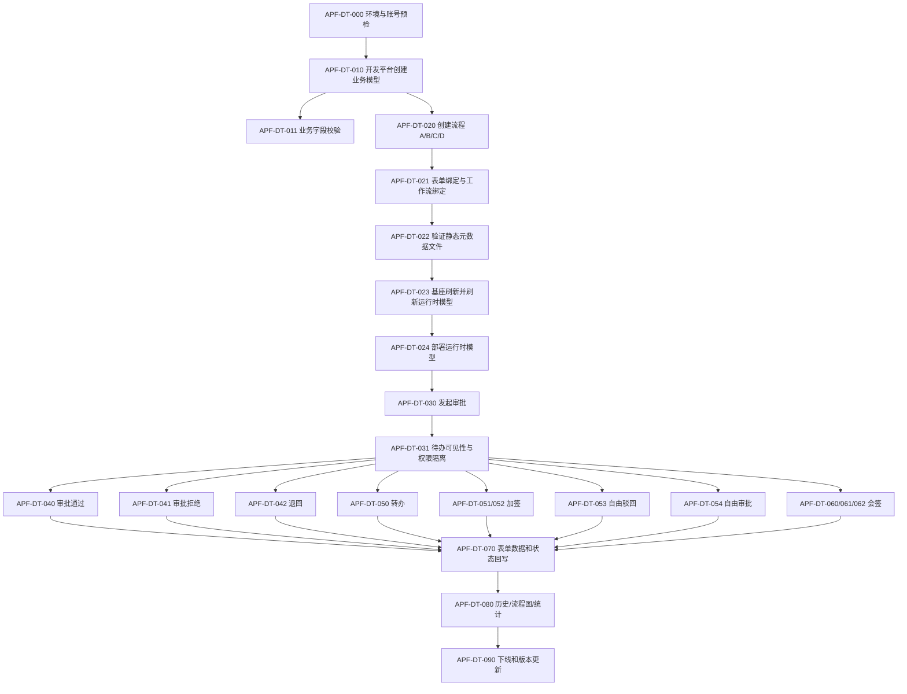

# 审批流开发平台到测试平台手工验收用例

## 目标

本文件用于指导测试人员从零开始验证审批流模块的完整闭环：

```text
开发平台配置业务模型和审批流
  -> 保存为应用元数据静态文件 workflow/{name}.workflow.json
  -> 提交并确定应用元数据版本
  -> 基座运行或刷新该应用元数据
  -> 测试平台应用实例刷新运行时 WorkflowModel
  -> 在应用实例中部署该运行时模型
  -> 测试平台发起审批
  -> 审批中心处理任务
  -> 查看历史、流程图和统计
```

本文的“测试平台”按当前仓库术语对应 `runtime-shell` / `mothership` 运行时，不新增独立平台概念。所有测试数据都在本文给出，执行人员不需要自行设计字段、人员、流程或审批意见。

## 前置条件

| 项目 | 值 | 说明 |
| --- | --- | --- |
| 开发平台前端 | `${OB_TEST_FRONTEND_BASE_URL}`，本地常用 `http://127.0.0.1:88` | 用于业务模型和审批流定义配置 |
| 测试平台前端 | `${OB_TEST_RUNTIME_FRONTEND_BASE_URL}`，本地常用 `http://127.0.0.1:88` | 用于发起审批和审批中心处理 |
| 后端健康检查 | `${OB_TEST_BASE_URL}/actuator/health` | 返回 `200` 才继续测试；`503` 表示生命周期未完成 |
| 测试应用名 | `awfacceptance` | 若环境已有固定测试应用，可以替换为该应用名，但全程保持一致 |
| 证据目录 | `tmp/testing-evidence/workflow-approval-flow/manual-dev-to-test/` | 截图、网络请求、导出 JSON、日志片段统一放这里 |
| 默认管理员 | `admin` / `666666` | 负责开发平台建模、流程设计和部署 |
| 审批用户密码 | `AwfRegression@2026!` | `awf.submitter`、`awf.approver1/2/3`、`awf.auditor`、`awf.flowadmin` 共用 |

执行前先完成一次预检：

1. 打开 `${OB_TEST_BASE_URL}/actuator/health`，确认返回成功。
2. 使用 `admin / 666666` 登录开发平台。
3. 使用 `awf.submitter / AwfRegression@2026!` 登录测试平台。
4. 若多用户无法登录，先执行既有 `approval-workflow-users-seed`，生成当前数据库的 `approval-workflow-identities.json`，不要手工猜 employeeId。

## 审批流元数据链路约定

本用例明确区分“开发平台保存”“开发平台提交”“测试平台刷新”和“测试平台部署”：

| 阶段 | 产物 / 动作 | 关键断言 |
| --- | --- | --- |
| 开发平台保存 | `workflow/{name}.workflow.json` | 静态文件只包含 `formatVersion/name/title/version/enabled/form/nodes/edges` 等定义字段 |
| 开发平台提交 | 应用元数据版本 | 提交与保存是两个动作，提交后该版本才允许被基座运行或刷新消费 |
| 基座运行应用元数据 | 读取应用实例 metadata path | 应用实例能从 metadata path 发现 `*.workflow.json` |
| 运行时刷新 | `WorkflowModel` | `source=metadata-layer`、`adopted=false`、来源版本等于静态 `version`、未部署时无 `processDefinitionId` |
| 运行时部署 | 流程引擎部署 | 部署成功后才产生 `processDefinitionId`，流程才可发起 |

静态审批流定义不允许写入 `source/adopted/status/processDefinitionId/creator/saveAt/definitionId/id`。

## 固定账号和角色数据

| 用户别名 | 登录账号 | 显示名 | 组织 | 角色 | 测试用途 |
| --- | --- | --- | --- | --- | --- |
| 提交人 | `awf.submitter` | `AWF Submitter` | `AWF-TEAM-APPLICATION` | `AWF-SUBMITTER` | 发起审批、查看本人申请 |
| 一级审批人 | `awf.approver1` | `AWF Approver 1` | `AWF-DEPT-ENGINEERING` | `AWF-APPROVER-L1` | 单签、串行第一节点、退回/拒绝 |
| 二级审批人 | `awf.approver2` | `AWF Approver 2` | `AWF-DEPT-FINANCE` | `AWF-APPROVER-L2` | 财务审批、转办、加签 |
| 并行审批人 | `awf.approver3` | `AWF Approver 3` | `AWF-DEPT-LEGAL` | `AWF-PARALLEL-APPROVER` | 并行会签、自由审批、自由驳回 |
| 审计员 | `awf.auditor` | `AWF Auditor` | `AWF-DEPT-EXEC` | `AWF-AUDITOR` | 只查看历史和统计，不处理待办 |
| 流程管理员 | `awf.flowadmin` | `AWF Flow Admin` | `AWF-TEAM-PLATFORM` | `AWF-FLOW-ADMIN` | 备用流程管理员 |

## 业务模型字段定义

在开发平台创建业务模型时，使用下面字段。字段名必须逐字一致，后续审批流条件、表单绑定和运行时数据都依赖这些字段名。

| 字段名 | 标题 | 类型 | 必填 | 默认值 | 校验 / 枚举 | 说明 |
| --- | --- | --- | --- | --- | --- | --- |
| `id` | `ID` | 雪花主键 | 是 | 系统生成 | 主键 | 不手工输入 |
| `requestNo` | `Request Number` | 单行文本 | 是 | 无 | 正则 `^AWF-REQ-[0-9]{4}$`，最大 20 | 每个用例唯一 |
| `workflowStatus` | `Workflow Status` | 单行文本 | 否 | 空 | 最大 32 | 工作流状态回写字段 |
| `applicantName` | `Applicant Name` | 单行文本 | 是 | 无 | 2-64 字符 | 固定填 `AWF Submitter` |
| `departmentCode` | `Department Code` | 单行文本 | 是 | 无 | `AWF-DEPT-ENGINEERING` / `AWF-DEPT-FINANCE` / `AWF-DEPT-LEGAL` | 用于字段传递和条件观察 |
| `amount` | `Amount` | 浮点数字 | 是 | 无 | `1 <= amount <= 1000000`，精度 2 | 用于审批金额 |
| `currency` | `Currency` | 单行文本 | 是 | `CNY` | `CNY` / `USD` / `EUR` | 币种 |
| `urgent` | `Urgent` | 单选 / 布尔 | 是 | `false` | `true` / `false` | 是否紧急 |
| `reason` | `Reason` | 多行文本 | 是 | 无 | 8-500 字符 | 审批原因 |
| `requestDate` | `Request Date` | 日期 | 是 | 无 | `YYYY-MM-DD` | 统一使用 `2026-08-10` 起的日期 |

## 业务模型配置数据

| 配置项 | 值 |
| --- | --- |
| 模型 `name` | `awf-expense-request` |
| 模型 `title` | `AWF Expense Request` |
| 模型说明 | `Approval workflow manual acceptance form for expense request scenarios` |
| API 开关 | `search/getOne/add/update/delete` 全部启用 |
| 视图开关 | `index/add/edit/detail` 全部启用，`add/edit/detail` 使用 `dialog` |
| 工作流开关 | `workflow.isEnabled=true` |
| 默认流程绑定 | `workflow.bindings[0].key=default` |
| 默认流程 ID | `workflow.bindings[0].processId=AWF_FLOW_SINGLE_L1` |
| 状态字段 | `workflow.bindings[0].statusField=workflowStatus` |
| 触发方式 | `workflow.bindings[0].trigger=manual` |

### 工作流状态映射

| 状态键 | code | label |
| --- | --- | --- |
| `draft` | `DRAFT` | `草稿` |
| `submitted` | `SUBMITTED` | `已提交` |
| `pending` | `PENDING` | `待开始` |
| `processing` | `PROCESSING` | `审批中` |
| `approved` | `APPROVED` | `通过` |
| `veto` | `VETO` | `否决` |
| `canceled` | `CANCELED` | `撤销` |
| `terminated` | `TERMINATED` | `终止` |

## 流程定义数据

### 流程 A：单级审批

| 字段 | 值 |
| --- | --- |
| `name` | `AWF_FLOW_SINGLE_L1` |
| `title` | `AWF Single Approval` |
| 元数据文件 | `workflow/AWF_FLOW_SINGLE_L1.workflow.json` |
| 绑定表单 | `form.formType=businessModel`，`form.formId=awf-expense-request` |
| 节点 | `AWF_NODE_START_01` 发起 -> `AWF_NODE_APPROVAL_L1` 一级审批 -> `AWF_NODE_END_01` 结束 |
| 一级审批人 | `awf.approver1` / `AWF_USER_APPROVER_1` |
| 动作 | `approve`、`reject`、`rollback` |
| 条件 | `amount >= 0` |

### 流程 B：两级串行审批和高级动作

| 字段 | 值 |
| --- | --- |
| `name` | `AWF_FLOW_SERIAL_MULTI` |
| `title` | `AWF Serial Multi Approval` |
| 元数据文件 | `workflow/AWF_FLOW_SERIAL_MULTI.workflow.json` |
| 绑定表单 | `form.formType=businessModel`，`form.formId=awf-expense-request` |
| 节点 | `AWF_NODE_START_02` 发起 -> `AWF_NODE_SERIAL_L1` 部门负责人审批 -> `AWF_NODE_SERIAL_L2` 财务审批 -> `AWF_NODE_END_02` 结束 |
| 部门负责人 | `awf.approver1` / `AWF_USER_APPROVER_1` |
| 财务审批人 | `awf.approver2` / `AWF_USER_APPROVER_2` |
| 一级动作 | `approve`、`reject`、`rollback`、`addSign` |
| 二级动作 | `approve`、`reject`、`rollback`、`addSign`、`transfer`、`freeReject` |

### 流程 C：并行会签和自由动作

| 字段 | 值 |
| --- | --- |
| `name` | `AWF_FLOW_PARALLEL_ADVANCED` |
| `title` | `AWF Parallel Advanced Actions` |
| 元数据文件 | `workflow/AWF_FLOW_PARALLEL_ADVANCED.workflow.json` |
| 绑定表单 | `form.formType=businessModel`，`form.formId=awf-expense-request` |
| 节点 | `AWF_NODE_START_03` 发起 -> `AWF_NODE_PARALLEL_SIGN` 并行会签 -> `AWF_NODE_END_03` 结束 |
| 会签模式 | `subType=会签`，`multipleMode=并行`，`percentage=100` |
| 审批人 | `awf.approver2` / `AWF_USER_APPROVER_2`，`awf.approver3` / `AWF_USER_APPROVER_3` |
| 动作 | `approve`、`reject`、`freeReject`、`freeApprove` |

### 流程 D：并行会签 50% 通过比例

| 字段 | 值 |
| --- | --- |
| `name` | `AWF_FLOW_PARALLEL_RATIO_50` |
| `title` | `AWF Parallel Ratio 50` |
| 元数据文件 | `workflow/AWF_FLOW_PARALLEL_RATIO_50.workflow.json` |
| 绑定表单 | `form.formType=businessModel`，`form.formId=awf-expense-request` |
| 节点 | 复制流程 C 的节点结构，节点 ID 改为 `AWF_NODE_START_04`、`AWF_NODE_PARALLEL_RATIO_50`、`AWF_NODE_END_04` |
| 会签模式 | `subType=会签`，`multipleMode=并行`，`percentage=50` |
| 审批人 | `awf.approver2` / `AWF_USER_APPROVER_2`，`awf.approver3` / `AWF_USER_APPROVER_3` |
| 动作 | `approve`、`reject` |

## 发起表单测试数据

每条用例使用一行数据。`workflowStatus` 发起前留空；提交后按预期观察状态回写。

| 数据 ID | requestNo | applicantName | departmentCode | amount | currency | urgent | reason | requestDate | 绑定流程 |
| --- | --- | --- | --- | ---: | --- | --- | --- | --- | --- |
| `BM-1001` | `AWF-REQ-1001` | `AWF Submitter` | `AWF-DEPT-ENGINEERING` | `1280.50` | `CNY` | `false` | `APF-DT-040 baseline approval request` | `2026-08-10` | 流程 A |
| `BM-1002` | `AWF-REQ-1002` | `AWF Submitter` | `AWF-DEPT-FINANCE` | `980.00` | `USD` | `false` | `APF-DT-041 reject request from finance team` | `2026-08-11` | 流程 A |
| `BM-1003` | `AWF-REQ-1003` | `AWF Submitter` | `AWF-DEPT-ENGINEERING` | `1500.00` | `CNY` | `true` | `APF-DT-042 rollback request for missing receipt` | `2026-08-12` | 流程 A |
| `BM-1004` | `AWF-REQ-1004` | `AWF Submitter` | `AWF-DEPT-FINANCE` | `3000.00` | `CNY` | `false` | `APF-DT-050 transfer finance approval request` | `2026-08-13` | 流程 B |
| `BM-1005` | `AWF-REQ-1005` | `AWF Submitter` | `AWF-DEPT-ENGINEERING` | `2200.00` | `EUR` | `true` | `APF-DT-051 add sign before current request` | `2026-08-14` | 流程 B |
| `BM-1006` | `AWF-REQ-1006` | `AWF Submitter` | `AWF-DEPT-ENGINEERING` | `2400.00` | `CNY` | `false` | `APF-DT-052 add sign after current request` | `2026-08-15` | 流程 B |
| `BM-1007` | `AWF-REQ-1007` | `AWF Submitter` | `AWF-DEPT-LEGAL` | `5600.00` | `USD` | `true` | `APF-DT-053 free reject to previous node request` | `2026-08-16` | 流程 B |
| `BM-1008` | `AWF-REQ-1008` | `AWF Submitter` | `AWF-DEPT-LEGAL` | `8800.00` | `CNY` | `true` | `APF-DT-054 free approval consult request` | `2026-08-17` | 流程 C |
| `BM-1009` | `AWF-REQ-1009` | `AWF Submitter` | `AWF-DEPT-FINANCE` | `6600.00` | `CNY` | `false` | `APF-DT-060 serial countersign request` | `2026-08-18` | 流程 B |
| `BM-1010` | `AWF-REQ-1010` | `AWF Submitter` | `AWF-DEPT-LEGAL` | `7200.00` | `EUR` | `false` | `APF-DT-061 parallel countersign request` | `2026-08-19` | 流程 C |
| `BM-1011` | `AWF-REQ-1011` | `AWF Submitter` | `AWF-DEPT-LEGAL` | `7300.00` | `CNY` | `false` | `APF-DT-062 ratio fifty approval request` | `2026-08-20` | 流程 D |
| `BM-1012` | `AWF-REQ-1012` | `AWF Submitter` | `AWF-DEPT-ENGINEERING` | `450.00` | `CNY` | `false` | `APF-DT-070 form data passthrough request` | `2026-08-21` | 流程 A |
| `BM-1013` | `AWF-REQ-1013` | `AWF Submitter` | `AWF-DEPT-FINANCE` | `1900.00` | `USD` | `false` | `APF-DT-080 history and diagram request` | `2026-08-22` | 流程 A |

### 字段校验负向数据

| 数据 ID | requestNo | applicantName | departmentCode | amount | currency | urgent | reason | requestDate | 预期 |
| --- | --- | --- | --- | ---: | --- | --- | --- | --- | --- |
| `BM-ERR-REQUEST-NO` | `AWF-REQ-X001` | `AWF Submitter` | `AWF-DEPT-ENGINEERING` | `100.00` | `CNY` | `false` | `Invalid request number format` | `2026-08-23` | `requestNo` 正则校验失败 |
| `BM-ERR-AMOUNT-MIN` | `AWF-REQ-1098` | `AWF Submitter` | `AWF-DEPT-ENGINEERING` | `0.00` | `CNY` | `false` | `Invalid minimum amount` | `2026-08-23` | `amount` 最小值校验失败 |
| `BM-ERR-CURRENCY` | `AWF-REQ-1099` | `AWF Submitter` | `AWF-DEPT-ENGINEERING` | `100.00` | `JPY` | `false` | `Invalid currency enum` | `2026-08-23` | `currency` 枚举校验失败 |

## 高级动作字段数据

| 动作 | 页面字段 | 后端字段 | 测试值 | 说明 |
| --- | --- | --- | --- | --- |
| 转办 | `transfer.targetUserId` | `transfer.targetUserId` / payload `targetUserId` | 选择 `AWF Approver 3` | 不手工输入 ID，从 selector 选择用户 |
| 加签前 | `addSign.targetUserIds` | `addSign.targetUserIds` | 选择 `AWF Approver 3` | 多选字段，即使只选一个也按数组提交 |
| 加签前 | `addSign.position` | `addSign.position` | `BEFORE_CURRENT` | 当前节点前插入加签任务 |
| 加签后 | `addSign.targetUserIds` | `addSign.targetUserIds` | 选择 `AWF Approver 3` | 多选字段 |
| 加签后 | `addSign.position` | `addSign.position` | `AFTER_CURRENT` | 当前节点后插入加签任务 |
| 自由驳回 | `freeReject.targetNodeId` | `freeReject.targetNodeId` / payload `targetNodeId` | `AWF_NODE_SERIAL_L1` | 从 selector 选择“部门负责人审批” |
| 自由审批 | `freeApproval.consultUserIds` | `freeApproval.consultUserIds` / payload `consultUserIds` | 选择 `AWF Approver 1` | 注意动作名是 `freeApprove`，字段名是 `freeApproval` |

## 测试用例关系图



## 测试用例总表

| 用例 ID | 名称 | 平台 | 数据 | 重点能力 | 通过标准 |
| --- | --- | --- | --- | --- | --- |
| `APF-DT-000` | 环境与账号预检 | 开发 + 测试 | 固定账号表 | 健康检查、登录、多用户身份 | health 成功，管理员和审批用户均可登录 |
| `APF-DT-010` | 创建业务模型 | 开发平台 | 业务模型配置数据 | 业务模型、字段、API、视图 | 模型保存和提交成功，可在列表查到 |
| `APF-DT-011` | 字段校验 | 开发/测试平台 | `BM-ERR-*` | 必填、正则、枚举、数值范围 | 页面阻止提交并提示对应字段错误 |
| `APF-DT-020` | 创建审批流定义 | 开发平台 | 流程 A/B/C/D | 节点、候选人、动作、会签比例 | 四条流程均保存为草稿或已更新 |
| `APF-DT-021` | 表单绑定与业务模型工作流绑定 | 开发平台 | 业务模型配置 + 流程定义 | `form.formType/form.formId`、`workflow.bindings` | 绑定字段完整保存 |
| `APF-DT-022` | 验证静态元数据文件 | 开发平台 | 流程 A/B/C/D | `.workflow.json`、静态字段、无运行态字段 | 四个 `workflow/{name}.workflow.json` 文件内容正确 |
| `APF-DT-023` | 基座刷新并刷新运行时模型 | 测试平台应用实例 | 流程 A/B/C/D 元数据 | metadata path、运行时刷新、版本同步 | `WorkflowModel` 存在且未部署、未接管、无 `processDefinitionId` |
| `APF-DT-024` | 部署运行时模型 | 测试平台应用实例 | 刷新后的运行时模型 | 运行时部署、流程引擎定义 | 部署后产生 `processDefinitionId`，测试平台可发起 |
| `APF-DT-030` | 发起审批 | 测试平台 | `BM-1001` | init-form、start、业务记录创建 | 实例启动并生成一级审批待办 |
| `APF-DT-031` | 待办可见性与权限隔离 | 测试平台 | `BM-1001` | 任务分配、非审批人隔离 | `awf.approver1` 可见，`awf.approver2/3` 暂不可见 |
| `APF-DT-040` | 审批通过 | 测试平台 | `BM-1001` | `approve`、状态完成 | 状态变为 `APPROVED`，历史有通过意见 |
| `APF-DT-041` | 审批拒绝 | 测试平台 | `BM-1002` | `reject`、否决状态 | 状态变为 `VETO` 或实例拒绝态，历史有拒绝意见 |
| `APF-DT-042` | 退回 | 测试平台 | `BM-1003` | `rollback`、任务回流 | 任务退回到预期节点，历史有退回意见 |
| `APF-DT-050` | 转办 | 测试平台 | `BM-1004` | `transfer.targetUserId` | 任务从 `awf.approver2` 转给 `awf.approver3` |
| `APF-DT-051` | 当前节点前加签 | 测试平台 | `BM-1005` | `addSign.position=BEFORE_CURRENT` | `awf.approver3` 先处理加签，再回到当前审批链 |
| `APF-DT-052` | 当前节点后加签 | 测试平台 | `BM-1006` | `addSign.position=AFTER_CURRENT` | 当前审批完成后出现 `awf.approver3` 加签待办 |
| `APF-DT-053` | 自由驳回 | 测试平台 | `BM-1007` | `freeReject.targetNodeId` | 流程回到 `AWF_NODE_SERIAL_L1` |
| `APF-DT-054` | 自由审批 | 测试平台 | `BM-1008` | `freeApproval.consultUserIds` | 自由审批提交成功，协商用户可追踪 |
| `APF-DT-060` | 串行审批 | 测试平台 | `BM-1009` | 两级串行 | 一级通过后才出现二级待办 |
| `APF-DT-061` | 并行会签 100% | 测试平台 | `BM-1010` | 并行任务、100% 通过比例 | 两个审批人同时收到任务，全部通过后完成 |
| `APF-DT-062` | 并行会签 50% | 测试平台 | `BM-1011` | 通过比例 | 任一审批人通过后流程继续或完成 |
| `APF-DT-070` | 表单数据和状态回写 | 测试平台 | `BM-1012` | `formData`、`workflowStatus` | 审批详情可见字段，业务记录状态正确 |
| `APF-DT-080` | 历史、流程图、统计 | 测试平台 | `BM-1013` | timeline、diagram、duration statistics | 历史含人员/动作/意见，流程图高亮，统计可查询 |
| `APF-DT-090` | 下线和版本更新 | 开发 + 测试 | 流程 A | 下线、重新编辑、重新部署 | 下线后不可新发起，重新部署后新版本可发起 |

## 测试用例明细

### APF-DT-000 环境与账号预检

字段级数据：使用固定账号和角色数据表，不创建业务记录。

1. 打开 `${OB_TEST_BASE_URL}/actuator/health`。
2. 确认返回成功；如果返回 `503`，等待生命周期完成后重试。
3. 打开开发平台，使用 `admin / 666666` 登录。
4. 打开测试平台，分别使用 `awf.submitter`、`awf.approver1`、`awf.approver2`、`awf.approver3` 登录一次。
5. 保存证据：health 响应、管理员首页截图、每个审批用户登录成功截图。

预期结果：所有账号可登录；登录失败时先重建 `approval-workflow-users-seed`，不要继续执行后续用例。

### APF-DT-010 创建业务模型

字段级数据：使用“业务模型字段定义”和“业务模型配置数据”。

1. 使用 `admin` 登录开发平台。
2. 进入 `/dev/awfacceptance/business-model`。
3. 点击新建业务模型。
4. 填写模型基础信息：`name=awf-expense-request`，`title=AWF Expense Request`，说明使用本文给定值。
5. 按字段定义表逐个新增字段，确认 `id` 为主键且无需业务人员输入。
6. 开启 `search/getOne/add/update/delete` API。
7. 开启 `index/add/edit/detail` 视图，`add/edit/detail` 模式设置为 `dialog`。
8. 开启工作流能力，先暂填 `workflow.bindings[0].processId=AWF_FLOW_SINGLE_L1`，后续在 APF-DT-021 绑定已创建流程。
9. 点击保存；随后单独点击提交。若当前 UI 的提交按钮名称同时包含保存与提交，证据中需标注这是提交动作，提交说明填写：`APF-DT-010 create approval expense business model`。

预期结果：模型列表能看到 `AWF Expense Request`；编辑页能回读全部字段、API、视图和工作流配置。

### APF-DT-011 字段校验

字段级数据：依次使用 `BM-ERR-REQUEST-NO`、`BM-ERR-AMOUNT-MIN`、`BM-ERR-CURRENCY`。

1. 使用 `awf.submitter` 登录测试平台。
2. 进入业务模型生成的新增入口或审批发起表单。
3. 输入 `BM-ERR-REQUEST-NO`，点击提交。
4. 截图记录 `requestNo` 正则校验错误。
5. 输入 `BM-ERR-AMOUNT-MIN`，点击提交。
6. 截图记录 `amount` 最小值校验错误。
7. 输入 `BM-ERR-CURRENCY`，点击提交。
8. 截图记录 `currency` 枚举校验错误。

预期结果：三组错误数据均不能提交；不会产生审批实例，也不会产生待办。

### APF-DT-020 创建审批流定义

字段级数据：使用流程 A、流程 B、流程 C、流程 D。

1. 使用 `admin` 登录开发平台。
2. 进入 `/dev/awfacceptance/approval-workflow-definition`；如果当前环境使用系统入口，则进入 `/system-setting/approval-workflow-definition`。
3. 新建流程 A，填写 `name`、`title`、绑定表单、节点、候选人和动作。
4. 点击保存，只保存为应用元数据，不执行部署；确认编辑页可以回读 `AWF_NODE_APPROVAL_L1` 的 `actions=[approve,reject,rollback]`。
5. 新建流程 B，填写两级串行节点和高级动作配置。
6. 保存流程 B，确认 `AWF_NODE_SERIAL_L2` 包含 `transfer`、`addSign`、`freeReject`。
7. 新建流程 C，填写并行会签节点，`multipleMode=并行`，`percentage=100`。
8. 新建流程 D，复制流程 C 结构并把通过比例改为 `50`。
9. 保存四条流程的静态 definition JSON 到证据目录。

预期结果：四条流程都能保存，没有图结构校验错误；保存动作不会产生运行时 `processDefinitionId`，流程 A/B/C/D 的节点、候选人和动作配置与本文一致。

### APF-DT-021 表单绑定与业务模型工作流绑定

字段级数据：业务模型 `awf-expense-request`，流程 A/B/C/D，状态映射表。

1. 在流程定义编辑页打开流程 A。
2. 绑定表单设置为 `form.formType=businessModel`、`form.formId=awf-expense-request`。
3. 保存流程 A；按同样方式保存流程 B/C/D。
4. 回到业务模型编辑页，确认 `workflow.isEnabled=true`。
5. 设置默认绑定：`workflow.bindings[0].key=default`、`processId=AWF_FLOW_SINGLE_L1`、`statusField=workflowStatus`、`trigger=manual`。
6. 填入完整状态映射表。
7. 保存业务模型和四条流程定义，确认只是写入应用元数据工作区。
8. 单独执行应用元数据提交，提交说明填写：`APF-DT-021 bind approval workflow to business model`。

预期结果：流程定义层的 `form.formType/form.formId` 和业务模型层的 `workflow.bindings[0].*` 都保存成功；两类绑定不能互相替代。保存和提交是两个独立动作，只有提交后的应用元数据版本才进入基座运行或刷新链路。

### APF-DT-022 验证静态元数据文件

字段级数据：流程 A/B/C/D。

1. 打开应用元数据目录，进入当前应用的 `workflow/`。
2. 逐个检查以下文件存在：`AWF_FLOW_SINGLE_L1.workflow.json`、`AWF_FLOW_SERIAL_MULTI.workflow.json`、`AWF_FLOW_PARALLEL_ADVANCED.workflow.json`、`AWF_FLOW_PARALLEL_RATIO_50.workflow.json`。
3. 打开 `AWF_FLOW_SINGLE_L1.workflow.json`，按字段核对：`formatVersion=1`、`name=AWF_FLOW_SINGLE_L1`、`title=AWF Single Approval`、`version>=1`、`enabled=true`、`form.formType=businessModel`、`form.formId=awf-expense-request`。
4. 检查 `nodes` 和 `edges` 包含本文定义的开始、审批、结束节点以及连线。
5. 检查四个静态文件都不存在 `id`、`definitionId`、`source`、`adopted`、`status`、`processDefinitionId`、`creator`、`saveAt`。
6. 将四个 `.workflow.json` 文件复制到证据目录。

预期结果：开发平台保存产物是单文件静态应用元数据；没有 `.json + .meta.json` 双文件，也没有运行时部署字段。

### APF-DT-023 基座刷新运行时模型

字段级数据：流程 A/B/C/D 的 `workflow/{name}.workflow.json`。

1. 启动或刷新测试平台应用实例，使基座运行最新应用元数据；如果环境有“刷新应用元数据”入口，使用该入口触发刷新。
2. 查看测试平台应用实例日志，确认扫描 metadata path 下的 `workflow/*.workflow.json`。
3. 在运行时审批流管理列表或模型查询接口中查找 `AWF_FLOW_SINGLE_L1`、`AWF_FLOW_SERIAL_MULTI`、`AWF_FLOW_PARALLEL_ADVANCED`、`AWF_FLOW_PARALLEL_RATIO_50`。
4. 打开 `AWF_FLOW_SINGLE_L1` 运行时模型，核对 `source=metadata-layer`、`adopted=false`、来源版本等于静态 `version`、`status` 为未部署状态、`processDefinitionId` 为空。
5. 重复核对流程 B/C/D 的运行时模型。
6. 保存运行时模型查询响应和刷新日志到证据目录。

预期结果：测试平台通过应用元数据发现并刷新运行时 `WorkflowModel`；刷新动作不会自动部署，也不会生成 `processDefinitionId`。

### APF-DT-024 部署运行时模型

字段级数据：APF-DT-023 刷新的运行时模型。

1. 使用 `admin` 登录测试平台应用实例或具备运行时管理权限的入口。
2. 在运行时审批流管理列表逐条选择流程 A/B/C/D。
3. 点击部署；确认这是运行时部署动作，不是开发平台保存动作。
4. 每次部署后确认运行时模型状态变为已部署，并记录生成的 `processDefinitionId`。
5. 打开测试平台的发起审批入口 `/approval-center/start`。
6. 刷新页面，确认可以看到 `AWF Single Approval`、`AWF Serial Multi Approval`、`AWF Parallel Advanced Actions`、`AWF Parallel Ratio 50`。

预期结果：四条流程均在测试平台运行时部署成功；部署成功后才产生 `processDefinitionId`，测试平台发起入口能看到最新流程。若流程改动后仍看不到，按顺序检查静态文件、metadata 刷新、运行时刷新、部署接口和运行时日志。

### APF-DT-030 发起审批

字段级数据：`BM-1001`。

1. 使用 `awf.submitter` 登录测试平台。
2. 进入 `/approval-center/start` 或业务模型 `AWF Expense Request` 新增入口。
3. 选择流程 A：`AWF Single Approval`。
4. 按 `BM-1001` 填写 `requestNo`、`applicantName`、`departmentCode`、`amount`、`currency`、`urgent`、`reason`、`requestDate`。
5. 提交审批。
6. 记录返回的业务记录 ID、流程实例 ID、首个任务 ID。

预期结果：审批实例启动成功，业务记录 `workflowStatus` 进入 `PROCESSING` 或等价审批中状态，`awf.approver1` 收到待办。

### APF-DT-031 待办可见性与权限隔离

字段级数据：沿用 `BM-1001` 产生的实例和任务。

1. 使用 `awf.approver1` 登录测试平台。
2. 打开 `/approval-center`。
3. 搜索或定位 `requestNo=AWF-REQ-1001`。
4. 确认待办存在，进入详情。
5. 登出后使用 `awf.approver2` 登录，确认暂时看不到 `AWF-REQ-1001` 的待办。
6. 登出后使用 `awf.approver3` 登录，确认暂时看不到 `AWF-REQ-1001` 的待办。

预期结果：只有当前节点候选人 `awf.approver1` 能处理该任务；其他审批人不可误见或误处理。

### APF-DT-040 审批通过

字段级数据：`BM-1001`。

动作数据：`action=approve`，`comment=APF-DT-040 approved by level 1`，`formData` 不修改业务字段。

1. 使用 `awf.approver1` 打开 `AWF-REQ-1001` 待办详情。
2. 点击通过。
3. 在审批意见中填写 `APF-DT-040 approved by level 1`。
4. 提交。
5. 回到业务记录详情、审批历史和流程图页面查看结果。

预期结果：任务完成；实例结束；业务记录状态为 `APPROVED`；历史包含审批人、动作 `approve`、意见和完成时间。

### APF-DT-041 审批拒绝

字段级数据：`BM-1002`。

动作数据：`action=reject`，`comment=APF-DT-041 rejected because amount evidence is insufficient`。

1. 使用 `awf.submitter` 按 `BM-1002` 发起流程 A。
2. 使用 `awf.approver1` 打开该待办。
3. 点击拒绝。
4. 填写拒绝意见。
5. 提交后查看业务记录和审批历史。

预期结果：实例进入拒绝/否决结果；业务记录状态为 `VETO` 或等价拒绝状态；历史包含 `reject` 和拒绝意见。

### APF-DT-042 退回

字段级数据：`BM-1003`。

动作数据：`action=rollback`，`comment=APF-DT-042 rollback for missing receipt attachment`。

1. 使用 `awf.submitter` 按 `BM-1003` 发起流程 A。
2. 使用 `awf.approver1` 打开该待办。
3. 点击退回。
4. 填写退回意见。
5. 提交后查看待办、历史和流程图。

预期结果：流程退回到定义允许的目标节点；若上一步已经是发起节点，按当前产品语义记录为退回/拒绝类结果；历史必须清楚记录 `rollback`。

### APF-DT-050 转办

字段级数据：`BM-1004`，绑定流程 B。

动作数据：`action=transfer`，`transfer.targetUserId=AWF Approver 3`，`comment=APF-DT-050 transfer to legal approver for review`。

1. 将业务模型默认绑定临时切换为 `processId=AWF_FLOW_SERIAL_MULTI`，保存后单独提交。
2. 使用 `awf.submitter` 按 `BM-1004` 发起流程 B。
3. 使用 `awf.approver1` 通过一级审批，意见填 `APF-DT-050 level 1 approved`。
4. 使用 `awf.approver2` 打开财务审批待办。
5. 点击转办。
6. 在“转办给”选择 `AWF Approver 3`，说明填 `APF-DT-050 transfer to legal approver for review`。
7. 提交后切换到 `awf.approver3` 查看待办。

预期结果：`awf.approver2` 不再持有该待办；`awf.approver3` 收到同一实例的待办；历史显示转办动作和说明。

### APF-DT-051 当前节点前加签

字段级数据：`BM-1005`，绑定流程 B。

动作数据：`action=addSign`，`addSign.targetUserIds=[AWF Approver 3]`，`addSign.position=BEFORE_CURRENT`，`comment=APF-DT-051 add sign before current approver`。

1. 使用 `awf.submitter` 按 `BM-1005` 发起流程 B。
2. 使用 `awf.approver1` 打开一级待办。
3. 点击加签。
4. “加签给”选择 `AWF Approver 3`。
5. “插入位置”选择 `当前节点前` / `BEFORE_CURRENT`。
6. 填写加签说明并提交。
7. 使用 `awf.approver3` 查看新增加签待办并通过，意见填 `APF-DT-051 add sign approved`。
8. 回到 `awf.approver1` 完成原审批。

预期结果：加签任务先于当前审批完成；历史中能看到加签插入、加签通过和原审批继续。

### APF-DT-052 当前节点后加签

字段级数据：`BM-1006`，绑定流程 B。

动作数据：`action=addSign`，`addSign.targetUserIds=[AWF Approver 3]`，`addSign.position=AFTER_CURRENT`，`comment=APF-DT-052 add sign after current approver`。

1. 使用 `awf.submitter` 按 `BM-1006` 发起流程 B。
2. 使用 `awf.approver1` 打开一级待办。
3. 点击加签。
4. “加签给”选择 `AWF Approver 3`。
5. “插入位置”选择 `当前节点后` / `AFTER_CURRENT`。
6. 填写加签说明并提交。
7. 使用 `awf.approver1` 通过当前审批。
8. 使用 `awf.approver3` 查看后置加签待办并通过。

预期结果：当前审批完成后才激活加签任务；加签完成后流程继续流转到财务审批或后续节点。

### APF-DT-053 自由驳回

字段级数据：`BM-1007`，绑定流程 B。

动作数据：`action=freeReject`，`freeReject.targetNodeId=AWF_NODE_SERIAL_L1`，`comment=APF-DT-053 free reject to department owner`。

1. 使用 `awf.submitter` 按 `BM-1007` 发起流程 B。
2. 使用 `awf.approver1` 通过一级审批，意见填 `APF-DT-053 level 1 approved before free reject`。
3. 使用 `awf.approver2` 打开财务审批待办。
4. 点击自由驳回。
5. “驳回到”选择 `部门负责人审批`，目标节点应为 `AWF_NODE_SERIAL_L1`。
6. 填写自由驳回理由并提交。
7. 使用 `awf.approver1` 查看是否重新收到待办。

预期结果：流程回到 `AWF_NODE_SERIAL_L1`；历史保留第一次一级通过、财务自由驳回和重新产生的一级待办。

### APF-DT-054 自由审批

字段级数据：`BM-1008`，绑定流程 C。

动作数据：`action=freeApprove`，`freeApproval.consultUserIds=[AWF Approver 1]`，`comment=APF-DT-054 free approval with level 1 consultation`。

1. 将业务模型默认绑定临时切换为 `processId=AWF_FLOW_PARALLEL_ADVANCED`，保存后单独提交。
2. 使用 `awf.submitter` 按 `BM-1008` 发起流程 C。
3. 使用 `awf.approver3` 打开并行会签待办。
4. 点击自由审批。
5. “协商用户”选择 `AWF Approver 1`。
6. 填写自由审批说明并提交。
7. 查看流程历史、任务状态和协商用户记录。

预期结果：请求以动作名 `freeApprove` 提交成功，表单字段 `freeApproval.consultUserIds` 被正确传到后端；历史可以追踪协商用户。

### APF-DT-060 串行审批

字段级数据：`BM-1009`，绑定流程 B。

动作数据：一级 `approve/comment=APF-DT-060 level 1 approved`；二级 `approve/comment=APF-DT-060 finance approved`。

1. 将默认流程切换为 `AWF_FLOW_SERIAL_MULTI`。
2. 使用 `awf.submitter` 按 `BM-1009` 发起审批。
3. 使用 `awf.approver2` 先查看待办，确认还没有该任务。
4. 使用 `awf.approver1` 通过一级审批。
5. 使用 `awf.approver2` 再查看待办并进入详情。
6. 使用 `awf.approver2` 通过二级审批。

预期结果：二级待办只在一级完成后出现；全部通过后实例完成，状态为 `APPROVED`。

### APF-DT-061 并行会签 100%

字段级数据：`BM-1010`，绑定流程 C。

动作数据：`awf.approver2` 和 `awf.approver3` 均执行 `approve`，意见分别为 `APF-DT-061 approver2 approved`、`APF-DT-061 approver3 approved`。

1. 将默认流程切换为 `AWF_FLOW_PARALLEL_ADVANCED`。
2. 使用 `awf.submitter` 按 `BM-1010` 发起审批。
3. 使用 `awf.approver2` 查看待办，确认可见。
4. 使用 `awf.approver3` 查看待办，确认也可见。
5. `awf.approver2` 先通过，查看实例是否仍未完成。
6. `awf.approver3` 再通过。

预期结果：两个审批人同时收到任务；由于通过比例为 100%，第一个人通过后流程不能提前完成，第二个人通过后才完成。

### APF-DT-062 并行会签 50%

字段级数据：`BM-1011`，绑定流程 D。

动作数据：`awf.approver2` 执行 `approve/comment=APF-DT-062 first parallel approver approved`。

1. 将默认流程切换为 `AWF_FLOW_PARALLEL_RATIO_50`。
2. 使用 `awf.submitter` 按 `BM-1011` 发起审批。
3. 确认 `awf.approver2` 和 `awf.approver3` 都收到并行待办。
4. 仅使用 `awf.approver2` 通过。
5. 查看流程实例状态、`awf.approver3` 待办状态和历史。

预期结果：通过比例达到 50% 后流程继续或完成；未处理审批人的任务应按引擎语义被关闭、跳过或标记为不再需要处理，不能继续推动已完成实例。

### APF-DT-070 表单数据和状态回写

字段级数据：`BM-1012`，绑定流程 A。

动作数据：`action=approve`，`comment=APF-DT-070 approve and verify form data`。

1. 将默认流程切换为 `AWF_FLOW_SINGLE_L1`。
2. 使用 `awf.submitter` 按 `BM-1012` 发起审批。
3. 使用 `awf.approver1` 打开待办详情。
4. 核对详情页字段：`requestNo=AWF-REQ-1012`、`amount=450.00`、`currency=CNY`、`urgent=false`。
5. 提交通过。
6. 回到业务记录详情，查看 `workflowStatus`。

预期结果：审批详情展示的 `formData` 与提交字段一致；审批完成后业务记录状态回写为 `APPROVED`。

### APF-DT-080 历史、流程图和统计

字段级数据：`BM-1013`，绑定流程 A。

动作数据：`action=approve`，`comment=APF-DT-080 approve for history diagram statistics`。

1. 使用 `awf.submitter` 按 `BM-1013` 发起审批。
2. 使用 `awf.approver1` 审批通过。
3. 打开审批详情或历史页，查看 timeline。
4. 打开实例流程图或 diagram 视图。
5. 使用具备统计查看权限的账号打开审批流统计页面。
6. 按流程名称、日期范围 `2026-08-10` 到 `2026-08-31` 查询。

预期结果：timeline 包含发起、审批、完成节点；流程图能显示完成路径；统计能查到流程执行记录或耗时数据。

### APF-DT-090 下线和版本更新

字段级数据：流程 A，业务模型默认绑定 `AWF_FLOW_SINGLE_L1`。

1. 使用 `admin` 登录开发平台。
2. 在审批流管理列表找到 `AWF Single Approval`。
3. 在测试平台运行时模型上执行下线；接口合同为 `POST /api/approval-workflow/definition/{id}/offline`，其中 `{id}` 是运行时模型 ID，不是流程 key。
4. 打开测试平台 `/approval-center/start`，刷新后确认不能再新发起流程 A。
5. 回到开发平台编辑流程 A，将说明改为 `APF-DT-090 redeploy after offline`。
6. 保存后确认 `AWF_FLOW_SINGLE_L1.workflow.json` 的 `version` 增加且说明字段更新。
7. 刷新测试平台应用元数据，确认运行时模型来源版本同步更新且仍未被实例接管。
8. 在测试平台运行时重新部署该模型，记录新的或更新后的 `processDefinitionId`。
9. 回到测试平台刷新，确认流程 A 重新可发起。

预期结果：下线影响新发起，不应破坏已完成历史；重新保存、应用元数据刷新、运行时部署后测试平台使用新版本定义。

## 正式生命周期补充验收

本节把自动化正式旅程 ID 落到可人工执行的字段级步骤。若已经执行过 APF-DT-020 到 APF-DT-024，可直接复用同一批流程 A/B/C/D 和证据，不要另造一套测试数据。

### APF-ASSET-001 / APF-ASSET-COMMIT-001 / APF-RUNTIME-BOOT-001 / APF-RUNTIME-LAYER-001 / APF-DEPLOY-001

字段级数据：`appName=awfacceptance`；流程 A/B/C/D；静态目录 `workflow/`；部署接口 `POST /api/approval-workflow/definition/{id}/deploy`，`id` 取运行时 WorkflowModel 的主键。

1. 执行 APF-DT-020 到 APF-DT-022，保存四个 `*.workflow.json` 静态文件。
2. 记录保存请求证据，确认保存动作没有调用 deploy API。
3. 执行应用元数据提交，提交说明填写：`APF-ASSET-COMMIT-001 approval workflow static assets commit`。
4. 启动或热刷新测试平台应用实例，确认基座使用当前应用元数据目录。
5. 在日志中记录 `workflow/*.workflow.json` 发现、校验、刷新信息。
6. 查询四条 `WorkflowModel`，逐条核对 `source=metadata-layer`、`adopted=false`、`status=draft`、`processDefinitionId=` 空值。
7. 打开测试平台发起入口，确认未部署前看不到可发起流程。
8. 逐条调用显式部署接口或点击运行时部署按钮，记录每条流程新的 `processDefinitionId`。
9. 再次打开发起入口，确认四条流程可发起。

预期结果：保存、提交、基座运行、发现刷新、部署五个动作均有独立证据；刷新不产生 Flowable 部署，显式部署后才允许发起。

### APF-METADATA-LAYER-UPDATE-001 高版本刷新和重新部署

字段级数据：流程 A；原始运行时模型 `name=AWF_FLOW_SINGLE_L1`；更新后 `title=AWF Single Approval Updated`；审批节点标题 `AWF Level 1 Approval Updated`；提交说明 `APF-METADATA-LAYER-UPDATE-001 update metadata-layer version`。

1. 先完成 APF-DT-024，记录流程 A 的旧 `version` 和旧 `processDefinitionId`。
2. 使用 `admin` 登录开发平台，打开流程 A。
3. 将流程标题改为 `AWF Single Approval Updated`。
4. 将一级审批节点标题或显示名改为 `AWF Level 1 Approval Updated`，节点 ID 保持 `AWF_NODE_APPROVAL_L1` 不变。
5. 点击保存，确认 `workflow/AWF_FLOW_SINGLE_L1.workflow.json` 的 `version` 大于旧版本。
6. 单独提交应用元数据版本，提交说明填写本用例给定值。
7. 不重启服务，触发测试平台应用元数据热刷新。
8. 查询运行时模型，确认 `source=metadata-layer`、`adopted=false`、`status=updated`、`processDefinitionId` 已清空或不再指向旧部署。
9. 打开发起入口，确认流程 A 在重新部署前不可新发起。
10. 先查询 name 为 `AWF_FLOW_SINGLE_L1` 的运行时模型，取其 `id`，再调用 `POST /api/approval-workflow/definition/{id}/deploy`。
11. 记录新的 `processDefinitionId`，确认它不同于旧值或 Flowable 版本号已增加。
12. 使用 `BM-1001` 再发起一次流程 A，确认新实例使用更新后的标题或节点显示名；旧实例历史仍可查询。

预期结果：高版本 metadata-layer 刷新后，已部署未接管模型进入 `updated` 而不是继续显示 `deployed`；重新显式部署后，新实例使用新 Flowable 版本，旧实例不被迁移或删除。

### APF-METADATA-LAYER-ADOPT-001 接管后不被 metadata-layer 覆盖

字段级数据：流程 B；运行时接管标题 `AWF Serial Multi Instance Customized`；后续静态 metadata-layer 标题 `AWF Serial Multi Metadata Layer Updated`；提交说明 `APF-METADATA-LAYER-ADOPT-001 metadata-layer update should not overwrite adopted model`。

1. 确认流程 B 已由静态资产刷新为 `source=metadata-layer`、`adopted=false`。
2. 在测试平台运行时审批流管理入口打开流程 B。
3. 使用当前产品提供的实例定制或接管入口修改标题为 `AWF Serial Multi Instance Customized` 并保存。
4. 查询运行时模型，确认 `adopted=true`，且标题为接管后的实例定制标题。
5. 回到开发平台打开流程 B，将静态定义标题改为 `AWF Serial Multi Metadata Layer Updated`，保持 `name=AWF_FLOW_SERIAL_MULTI` 不变。
6. 保存静态文件并提交应用元数据版本，提交说明填写本用例给定值。
7. 触发测试平台应用元数据热刷新。
8. 再次查询流程 B 的运行时模型。

预期结果：运行时模型仍保持 `adopted=true` 和 `AWF Serial Multi Instance Customized`，不会被更高版本 metadata-layer 的标题覆盖；刷新日志应记录该 metadata-layer 已接管或跳过覆盖。

### APF-METADATA-LAYER-REMOVE-001 删除静态 metadata-layer 后不可新发起但历史保留

字段级数据：流程 D；业务数据 `BM-1011`；静态文件 `workflow/AWF_FLOW_PARALLEL_RATIO_50.workflow.json`；提交说明 `APF-METADATA-LAYER-REMOVE-001 remove unadopted metadata-layer`。

1. 确认流程 D 已显式部署，且可使用 `BM-1011` 发起。
2. 按 APF-DT-062 发起并完成或至少启动一条流程 D 实例，记录实例 ID、任务 ID 和历史页面截图。
3. 在开发平台或应用元数据工作区删除 `workflow/AWF_FLOW_PARALLEL_RATIO_50.workflow.json`。
4. 单独提交应用元数据版本，提交说明填写本用例给定值。
5. 触发测试平台应用元数据热刷新。
6. 查询运行时模型，确认未接管的流程 D 已进入不可新发起状态，或通过现有下线机制从发起列表移除。
7. 打开发起入口，确认 `AWF Parallel Ratio 50` 不可新发起。
8. 使用第 2 步记录的实例 ID 查询历史、流程图和审计记录。

预期结果：删除静态 metadata-layer 只影响新发起；Flowable 历史部署、历史实例、审批历史、流程图和审计数据仍可查询。

### APF-RUNTIME-REFRESH-001 热刷新复用启动主链

字段级数据：流程 A 的 APF-METADATA-LAYER-UPDATE-001 更新版本；刷新方式为当前环境的应用元数据热刷新入口；不得重启后端服务。

1. 记录当前测试平台后端进程或容器启动时间。
2. 执行 APF-METADATA-LAYER-UPDATE-001 的保存和提交步骤。
3. 只触发应用元数据热刷新，不重启 develop、mothership 或 runtime-shell。
4. 记录日志中同一 refresher 的发现、校验、snapshot、refresh 阶段。
5. 查询运行时模型，确认状态变化与冷启动刷新规则一致。
6. 再次查看后端进程或容器启动时间，确认未发生重启。

预期结果：热刷新与启动使用同一套发现、校验和 refresh 状态机；刷新失败时应阻断本轮生命周期进入 READY，而不是服务 READY 但流程缺失。

## 执行记录模板

| 用例 ID | 执行人 | 开始时间 | 结束时间 | 结果 | 证据路径 | 问题单 / 备注 |
| --- | --- | --- | --- | --- | --- | --- |
| `APF-DT-000` |  |  |  |  |  |  |
| `APF-DT-010` |  |  |  |  |  |  |
| `APF-DT-011` |  |  |  |  |  |  |
| `APF-DT-020` |  |  |  |  |  |  |
| `APF-DT-021` |  |  |  |  |  |  |
| `APF-DT-022` |  |  |  |  |  |  |
| `APF-DT-023` |  |  |  |  |  |  |
| `APF-DT-024` |  |  |  |  |  |  |
| `APF-DT-030` |  |  |  |  |  |  |
| `APF-DT-031` |  |  |  |  |  |  |
| `APF-DT-040` |  |  |  |  |  |  |
| `APF-DT-041` |  |  |  |  |  |  |
| `APF-DT-042` |  |  |  |  |  |  |
| `APF-DT-050` |  |  |  |  |  |  |
| `APF-DT-051` |  |  |  |  |  |  |
| `APF-DT-052` |  |  |  |  |  |  |
| `APF-DT-053` |  |  |  |  |  |  |
| `APF-DT-054` |  |  |  |  |  |  |
| `APF-DT-060` |  |  |  |  |  |  |
| `APF-DT-061` |  |  |  |  |  |  |
| `APF-DT-062` |  |  |  |  |  |  |
| `APF-DT-070` |  |  |  |  |  |  |
| `APF-DT-080` |  |  |  |  |  |  |
| `APF-DT-090` |  |  |  |  |  |  |
| `APF-ASSET-001` |  |  |  |  |  |  |
| `APF-ASSET-COMMIT-001` |  |  |  |  |  |  |
| `APF-RUNTIME-BOOT-001` |  |  |  |  |  |  |
| `APF-RUNTIME-LAYER-001` |  |  |  |  |  |  |
| `APF-DEPLOY-001` |  |  |  |  |  |  |
| `APF-METADATA-LAYER-UPDATE-001` |  |  |  |  |  |  |
| `APF-METADATA-LAYER-ADOPT-001` |  |  |  |  |  |  |
| `APF-METADATA-LAYER-REMOVE-001` |  |  |  |  |  |  |
| `APF-RUNTIME-REFRESH-001` |  |  |  |  |  |  |

## 判定和排障规则

- 如果 `/actuator/health` 不是成功响应，停止业务测试，先修运行时。
- 如果开发平台保存成功但应用元数据目录没有 `workflow/{name}.workflow.json`，先修开发端保存链路，不要进入部署排查。
- 如果静态文件存在但运行时模型不存在，优先检查基座是否运行/刷新了最新 metadata path，以及刷新日志中的文件名与 JSON `name` 是否一致。
- 如果运行时模型存在但测试平台看不到可发起流程，优先检查运行时部署状态和 `processDefinitionId`，不要把开发平台保存当成部署。
- 如果高级动作按钮不可见，先查看当前节点 `actions` 是否包含对应动作，再看 `/api/approval-workflow/task/{taskId}/task-form-schema`。
- 如果高级动作 selector 为空，记录 selector URL、当前任务 ID、当前登录用户和接口响应，不要手工拼用户 ID 提交。
- 如果历史、流程图、业务记录状态三者不一致，按产品缺陷记录；不要只用其中一个页面判定通过。
